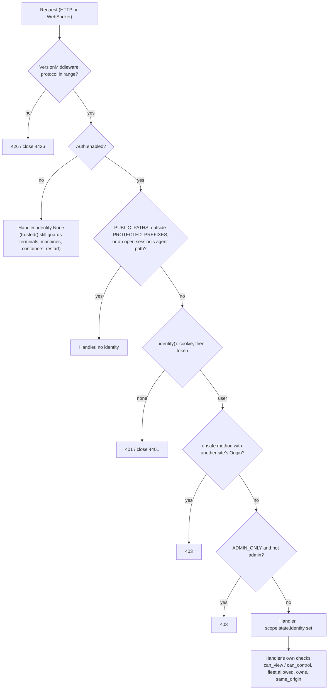

# Auth: who may do what

How every request proves who it is, and what each identity may do. The code is mostly in `server/agent_server/` (`auth.py`, `access.py`, `remote.py`, `routes/auth.py`, `fleet.py`), with the credential holders in `client/internal/login`, `client/internal/settings`, `client/internal/localproxy` and `machine/internal/login`. Read this before touching any of them, or before adding a route.

## Two modes

The server decides once per request, with `Auth.enabled`: accounts are on when `users.json` has a user, or `AI_PROXY_USERNAME` and `AI_PROXY_PASSWORD` are both set.

| | Local mode (no accounts) | Accounts mode |
| --- | --- | --- |
| Who is trusted | This computer (`RemoteAccess.local`: a loopback client **and** a loopback `Host`), or anyone with the access key | Whoever is signed in (`Auth.identify`) |
| `AuthMiddleware` | Passes everything through | Guards `PROTECTED_PREFIXES` |
| `Identity` in handlers | `None`, which every check reads as "may do anything" | The signed-in user |
| The access key | Pairs phones, signs in other machines (`agent login --key`) | Grants nothing: `trusted()` only asks `identify()`, and `local()` is false |
| Sharing, roles, machine grants | Not applied | Applied |

`app.ensure_first_user` switches a server to accounts mode by creating `admin` with a random password the first time `agent-server` listens beyond loopback and `users.json` doesn't exist (the password is printed and saved to `first-user-password`). It runs in `main()`/`Supervisor.serve`, not `create_app`, so tests stay in local mode unless they add a user. Removing every user later doesn't bring it back, as the file still exists.

`None` meaning "allowed" is deliberate and everywhere (`can_view`, `can_control`, `is_owner`, `owns`, `allowed`). Never treat a missing identity as "denied" in a new check, or local mode breaks; never let a request reach a handler with `None` in accounts mode, or the check passes for anyone. Only the middleware stands between the two.

## Credentials

| Credential | Who holds it | Sent as | Stored on the server | Checked by |
| --- | --- | --- | --- | --- |
| Password | People | `POST /api/auth/login` or `/api/auth/token` body | `users.json` `users.<name>.password`: scrypt (`SCRYPT`, n=2^14), salted | `UserStore.verify` (equal work for unknown users), `Auth.check_password` (the environment user, compared with `hmac.compare_digest`) |
| Browser sign-in | The console, the Android WebView | Cookie `ai_proxy_session` (HttpOnly, SameSite=Lax, Secure on HTTPS, `SESSION_DAYS` = 30) | `users.json` `sessions`, keyed by SHA-256 of the secret | `UserStore.session_user` |
| Launcher token (`aip_…`) | `agent login` and `agent-machine login`, each in its own `credentials.json` (token and token id, never the password); `AI_PROXY_TOKEN` overrides | Header `X-AI-Proxy-Token` | `users.json` `tokens.<id>`: SHA-256 hash, label, `last_used_at` (written at most once a minute) | `UserStore.token_user` |
| Access key | `certs/remote-access-key` (or `AI_PROXY_TOKEN`, or `log_dir/remote/` for code-built `Settings`) | Header `X-AI-Proxy-Token`, or cookie `ai_proxy_remote` after pairing | The file itself, mode 0600 | `RemoteAccess.has_key`; local mode only |
| Pairing code | Shown on this computer's console | `POST /api/remote/pair` | Memory: one at a time, `CODE_TTL` 10 min, single use, cancelled after `CODE_ATTEMPTS` wrong tries | `RemoteAccess.redeem`, which sets the `ai_proxy_remote` cookie |
| Session id | The launched agent, in its URLs (`/session/<id>/...`), `X-AI-Proxy-Session`, or `Proxy-Authorization` (`http://<id>:agent-proxy@127.0.0.1:8183`) | Path, header or proxy credentials | `Runtime.sessions` | `AuthMiddleware._session_capability`, `InterceptProxy._open_session`; only while the session is open |
| Machine keys | Strata's key (`Machine.keys`), the MCP bridge key (`Machine.mcp_key`), container API keys (`container-keys.json`) | Added by the server to traffic it relays to the machine | Memory, except container keys | The model server or bridge on the machine |

`X-AI-Proxy-Token` carries either a launcher token or the access key; the server tells them apart by mode (and the `aip_` prefix).

Passwords are at least 8 characters (`_checked_password`). Names are lowercase, `NAME` in `auth.py`. Setting a password signs the user out of every browser (`set_password` drops their sessions); it leaves their launcher tokens, which are revoked one by one (`DELETE /api/auth/tokens/{id}`, or `agent logout`). Removing a user removes both.

Failed sign-ins are counted per client address in memory (`Auth.allowed_attempt`): `FAILURE_LIMIT` (10) in `FAILURE_WINDOW` (10 min) answers 429 until the window passes. A success clears the count.

## How a request is checked

- `PUBLIC_PATHS`: `/health` and `/api/auth/{status,login,token,logout}`. Outside `PROTECTED_PREFIXES` (`/api/`, `/v1/`, `/anthropic/`, `/session/`, `/docs`, `/redoc`, `/openapi.json`) everything is public: the console's files, `/help-files/`, `/downloads/`, `/install.sh`. The console shows its own sign-in page from `/api/auth/status`.
- **The session capability**: `/session/<id>/...`, or `/v1/...` and `/anthropic/...` with `X-AI-Proxy-Session`, pass without a sign-in while that session is open. That's why the agent's own `Authorization` is never needed by the server and never replaced: hosted pass-through forwards it. Bare `/api/*` with the header isn't a capability. MCP traffic (`/session/<id>/mcp/...`) passes the same way, then `routes/mcp.py` checks the session was given that server and that `launched_by` (else `owner`) still has the fleet feature `mcp`.
- **Origin**: unsafe methods (`UNSAFE_METHODS`) with an `Origin` whose host isn't the request's `Host` are refused, because the cookie is SameSite=Lax. WebSockets aren't covered by the middleware's check; every WebSocket route calls `remote.same_origin` itself.
- **Handlers** read the identity with `auth.request_identity(request)`. `routes/auth.py`'s `signed_in` additionally requires a real sign-in (cookie or token) for the account's own pages: tokens, password.
- WebSocket refusals close with `4400 + status % 100` (4401, 4403).

## What an identity may do

**Roles** (`ROLES`): `admin` manages the server, organizations and users; `member` uses it. The first user is an admin; the last admin can't be demoted or removed. The environment user (`AI_PROXY_USERNAME`) is an admin with no organizations. Admin rights are about the server, not other people's things: private sessions stay private from admins, and admins launch on a machine only with a grant.

**Organizations and teams**: a user is in any number of organizations, and in teams only of those organizations. Teams are named `<org>/<team>` (`team_key`). They're managed with `agent-server user|org|team` or `/api/orgs` and `/api/users`. Members see only their organizations and the users who share one (`UserStore.orgs`/`user_list` with a viewer).

`UserStore.set_membership` changes one organization or team membership under the store's lock; the scoped PUT/DELETE `.../members/{name}` routes never replace unrelated memberships from a browser snapshot. Joining a team joins its organization; leaving a team keeps the organization; leaving an organization drops only its teams. `rename_team` changes the display name, never the sharing key. `update_user` validates the complete edit (including an optional password) before changing any fields, then saves once; password changes clear browser sessions but keep launcher tokens.

**Server changes** (`ADMIN_ONLY` in `auth.py`): settings (`PUT /api/config`), creating, editing and deleting containers, rotating the access key, restarting, adopting a machine's model server, and every change under `/api/orgs` and `/api/users`. The middleware enforces it, so handlers don't repeat it.

**Sessions** (`access.py`): the starter owns it and sets `visibility` (private, team, org) and `access` (view, control). `can_view`: the owner, `launched_by`, or a member of the chosen team or organization. `can_control` (type, end, change capture, clear, delete): the owner, `launched_by`, or a viewer when access is control. `is_owner` changes sharing. Sessions from before accounts (no owner) are admins' only. A session you can't see answers 404. Clients can't set `SERVER_TAGS` (`client_tags` strips them, `sharing_tags` validates what the owner asks for). Shell sessions (`fleet.SHELL_CLIENT`) are forced private. Narrowing sharing drops terminal viewers at once (`TerminalHub.drop_viewers`), and `/api/live` checks per event.

**Machines** (`fleet.py`): the owner is whoever's token the machine connected with (`agent-machine login`), set in `Fleet.connect`. `owns`; `allowed(identity, machine, feature)` over `FEATURES`: the owner always, admins `ADMIN_FEATURES` (view, models, update), others through the organization and team grants in `Machine.access` (any grant includes view); `can_manage` (set grants, remove): the owner or an admin, and members grant only their own organizations and teams (`checked_access`). Launches and terminals run under the machine's sign-in, so the server tags them `launched_by` the person who asked. Containers stay `owns` plus ADMIN_ONLY. Only the machine that was asked (signed in as its owner) can take a tunnel (`Tunnels.attach`).

**Terminals and "trusted"** (`remote.py`): every `/api/terminals*`, `/api/remote/*`, machine, container and restart route calls `runtime.remote.trusted()` and `remote.same_origin()`. In accounts mode that is just "signed in", and the session or machine checks above do the rest.

**Account agents' HTTPS** (`intercept.py`): with accounts on, a `CONNECT` without `Proxy-Authorization` naming an open session gets 407. The `WS /api/proxy/tunnel` that carries it needs the machine's token; the agent-proxy turns a refused tunnel into a 407 for the agent (`readHead` first, for Windows).

## The client and machine side

- `agent login` and `agent-machine login` (separate files, separate tokens, same code shape): `GET /api/auth/status`; with accounts, `POST /api/auth/token` with the username and password (read from the terminal, or `AI_PROXY_PASSWORD_INPUT` for tests), then save `{url, user, token, token_id}`. Without accounts, `--key` stores the access key instead. `logout` revokes the token on a best-effort basis.
- The agent-proxy reads `credentials.json` on every request, so login and logout apply at once. It adds `X-AI-Proxy-Token` only to `LauncherAPI` paths and its own WebSocket dials (the HTTPS tunnel, the terminal host), never to agent traffic, and never forwards cookies or `Origin`. It binds loopback only and checks a loopback `Host` and same origin on every route, because it signs as the user.
- agent-machine sends its token, version and protocol on everything (`settings.ServerClient`, `Identify`), including `WS /api/machines/connect` and each tunnel dial.
- The Python client and machine (`agent_py/login.py`, `common.py`) follow the same files and headers.

## Must never

- Let a handler under `PROTECTED_PREFIXES` run with no identity in accounts mode, other than through `PUBLIC_PATHS` or the open-session capability.
- Treat `identity is None` as denied in a sharing or fleet check (it's local mode).
- Store a password, browser secret or token in clear: only hashes go in `users.json`, and the file is written 0600 through a temporary file.
- Replace or drop an agent's own `Authorization` on hosted pass-through, or send it to an MCP bridge.
- Accept `owner`, `visibility`, `team`, `org`, `access`, `launched_by` or `mcp` from a client.
- Reveal a session's existence to someone who can't view it (404, not 403).
- Put the token on agent traffic in the agent-proxy, or let the access key mean anything once accounts are on.
- Read users or tokens anywhere but through `UserStore`: it reloads `users.json` when `agent-server user` changes it under a running server.

## Extending

- **A new route**: decide which of these it needs, in this order: `ADMIN_ONLY` (if it changes the server), `require_trusted` + `same_origin` (terminals, machines, containers, anything a remote shell could follow from), the session check (`viewable`/`controllable` in `routes/management.py`), or the machine feature (`allowed`). Add its line to `docs/api.md`, and a test that a member, another user, and a signed-out request are refused.
- **A new credential or cookie**: name it in the table above, hash it at rest, compare with `hmac.compare_digest`, and close its connections on restart if it's long-lived.
- **A new public path**: only if it must work signed out (as the sign-in, downloads and installers do). Add it to `PUBLIC_PATHS` or keep it outside `PROTECTED_PREFIXES`, and to the console's `PublicDocs`/`PublicDownloads` handling if it's a page.

## Tests

- `test_auth.py`: accounts, sign-in, tokens, the middleware, `ADMIN_ONLY`, sharing. It must pass `backends_file=tmp_path / "backends.yaml"` when it saves config (an early version overwrote the real file).
- `test_terminals.py`: local trust, the access key and pairing codes (`ws_connect` makes a WebSocket look local).
- `test_fleet.py` and `test_mcp.py`: machine grants, `launched_by`, the MCP checks.
- `test_client.py`: the real `agent login` and `agent-machine login` against a real server, tokens through the agent-proxy, 407 on the tunnel.

## Known gaps

- With accounts on, `POST /api/remote/rotate` can't succeed (`require_local` is false), though the key no longer grants anything then.
- Sign-in failure counters are per process and per client address; they reset on restart, and many addresses aren't limited together.
- Browser sign-ins expire after 30 days, launcher tokens never: they last until revoked.
