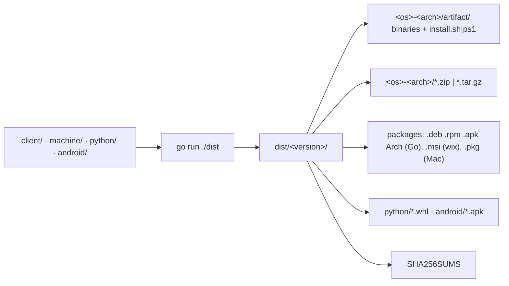

# Build and deploy (`tools/`, `scripts/`, `server/Dockerfile`, `compose.yaml`, `sandbox/`)

How the components are versioned, built for every platform, handed out by the server, installed and run in containers. The static brochure site in `site/` is separate from the application console in `ui/`; Compose serves it privately on port 8080 for the public reverse proxy.

## Design in one paragraph

There is one hand-written version (`VERSION`) and one compatibility number (`PROTOCOL`). `tools/dist` builds every Go program for every platform, plus packages, the Python wheel and the Android APK, into `dist/<version>/` with a `SHA256SUMS`. The server hands out exactly those files (`/downloads/`), and every installer and self-update checks them against that list. So a computer only ever installs what its server built.

## Versions

- `VERSION` = `X.Y.Z`. The build version is `X.Y.Z` on its tag, else `X.Y.Z+<commit>[.dirty]`. `.dirty` means uncommitted changes to tracked files outside `config/`; there's no `.git` → `+unknown`. `AI_PROXY_VERSION` overrides it.
- It is computed in three places that must agree: `tools/dist/version.go` (`BuildVersion`), `server/agent_server/version.py` (`build_version`) and `python/agent_py/common.py` (`checkout_version`).
- `PROTOCOL`/`MIN_PROTOCOL` live in `version.py`, `settings.Protocol` in client/ and machine/, and `common.PROTOCOL`; `test_client.py` checks they agree. Raise `PROTOCOL` for changes older programs can't follow, and `MIN_PROTOCOL` only when dropping the old one. Outside the range the server answers 426 (WebSocket close 4426).

## `tools/dist` (its own Go module, no dependencies)

- 15 targets (Windows, Linux incl. arm/riscv64/s390x/loong64, macOS, FreeBSD), built with `CGO_ENABLED=0 -trimpath` and `-X main.version`. Components: `agent` (agent and agent-proxy) and `agent-machine`.
- Archives and Linux packages are written in Go (execute bits survive NTFS). A missing external tool (wix, pkgbuild, a JDK or Android SDK) skips its format with a note.
- The wheel is written in Go from `python/pyproject.toml`, with `_version.py` stamped in. It is skipped when the version isn't PEP 440.
- Flags: `-only`, `-packages`, `-android`, `-python`, `-print-version` (used by the build scripts).

## Handing out and installing

- `downloads.py` serves `dist/<server version>/` (or the newest with the same `X.Y.Z`), only files in `SHA256SUMS`, publicly, at `/downloads/...`. `/downloads/index.json` is what `agent update` and `agent-machine update` read.
- **One-liners** `/install.sh` and `/install.ps1` (`installer.py`, templates in `server/agent_server/install/`): the server fills in its address (checked against `SAFE_URL`) and the archive table. They download, check hashes, and run the archive's own installer with `AI_PROXY_ONE_LINER=1`, then sign in from `/dev/tty`.
- **Archive installers** (`tools/dist/install/`): `install.sh` (to `/usr/local/bin` or `~/.local/bin`; `--service` sets up systemd, launchd or rc.d; `--uninstall`) and `install.ps1` (to `%LOCALAPPDATA%\Programs\agent-proxy`, user PATH, `-Service` as an at-logon task).
- Test installers and services as a throwaway user in another WSL distro, never as the Ubuntu user (it runs a real agent-machine).

## Containers

- `server/Dockerfile` (built from the repo root, because it needs `ui/`): builds the console with Node, then a python:3.13-slim image running as uid 10001. Volumes `/app/config`, `/app/logs`, `/app/certs`; port 9999. The entrypoint seeds `config/` from `/app/defaults/config` without overwriting. Pass `--build-arg AI_PROXY_VERSION` to match a `dist/` folder (no git in the image).
- `compose.yaml`: `marketing-site` on host loopback port 8080, the standalone static `console` on loopback 8081 under `--profile console`, `agent-server` with named volumes and `./dist:/app/dist:ro`, and `agent-sandbox` under `--profile sandbox`. Split deployments build the console with `VITE_API_URL`, run the API with `AI_PROXY_SERVE_UI=0` and trust the console through `AI_PROXY_CONSOLE_ORIGINS`.
- `site/`: static public brochure site (`index.html`, `styles.css`), served by its own small nginx image. The apex and `www` hostnames serve this site; `console.<domain>` serves only the static console (`ui/Dockerfile`, `ui/nginx.conf`); `api.<domain>` routes console, agent and machine requests to `agent-server` and redirects its root to the console.
- `sandbox/`: an image with `agent`, `agent-machine` and the npm coding agents. Its entrypoint signs both in from the environment, sets launches on for `/workspace` only (containers and servers off), and runs `agent-machine run`.

## Scripts (`.sh`/`.ps1` pairs; change both)

- `build-client`, `build-machine` (into `client/bin`, `machine/bin`), `build-dist` (wraps `tools/dist`; `PACKAGES=1` / `-Packages`), `agent` (build and run), `dev` (API with reload + Vite).
- No pair: `start-ollama.sh`, and `scripts/https/setup-https.ps1` (Windows: nginx + win-acme for Let's Encrypt, serving the brochure site on the apex/`www`, the console on its hostname and API traffic on `api.<domain>`).

## Rules

- Keep `go.mod` at Go 1.24 and build with `GOTOOLCHAIN=local`.
- Don't commit `dist/`, `ui/dist`, `logs/`, `certs/` or the `bin/` folders.
- Linux package versions are `X.Y.Z-<release>`. `PackageRelease` makes the release the commits since `vX.Y.Z` plus one, so each untagged build upgrades the one before. Keep the release rising if the version scheme changes.
