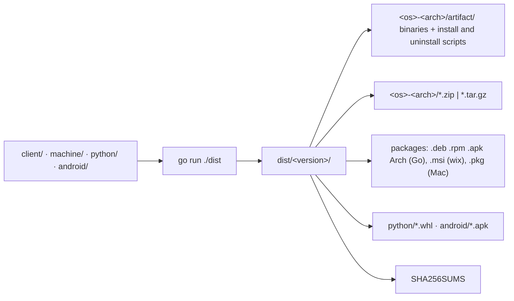

# Build and deploy (`tools/`, `scripts/`, `server/Dockerfile`, `server/docker/`, `ui/Dockerfile`, `site/`, `compose.yaml`, `sandbox/`, `quickstart/`)

How the components are versioned, built for every platform, handed out by the server, installed and run in containers. The static brochure site in `site/` is separate from the application console in `ui/`; Compose serves it privately on port 8080 for the public reverse proxy.

## Design in one paragraph

There is one hand-written version (`VERSION`) and one compatibility number (`PROTOCOL`). `tools/dist` builds every Go program for every platform, plus packages, the Python wheel and the Android APK, into `dist/<version>/` with a `SHA256SUMS`. The server hands out exactly those files (`/downloads/`), and every installer and self-update checks them against that list. So a computer only ever installs what its server built.

## Versions

- `VERSION` = `X.Y.Z`. The build version is `X.Y.Z` on its tag, else `X.Y.Z+<commit>[.dirty]`. `.dirty` means uncommitted changes to any tracked file (no exclusions: the server's settings used to be saved in `config/`, which was exempt, but they live in its database now); there's no `.git` → `+unknown`. `AI_PROXY_VERSION` overrides it.
- It is computed in three places that must agree: `tools/dist/version.go` (`BuildVersion`), `server/agent_server/version.py` (`build_version`) and `python/agent_py/common.py` (`checkout_version`).
- `PROTOCOL`/`MIN_PROTOCOL` live in `version.py`, `settings.Protocol` in client/ and machine/, and `common.PROTOCOL`; `test_client.py` checks they agree. Raise `PROTOCOL` for changes older programs can't follow, and `MIN_PROTOCOL` only when dropping the old one. Outside the range the server answers 426 (WebSocket close 4426).

## `tools/dist` (its own Go module, no dependencies)

- 15 targets (Windows, Linux incl. arm/riscv64/s390x/loong64, macOS, FreeBSD), built with `CGO_ENABLED=0 -trimpath` and `-X main.version`. Components: `agent` (agent and agent-proxy) and `agent-machine`.
- Archives and Linux packages are written in Go (execute bits survive NTFS). A missing external tool (wix, pkgbuild, a JDK or Android SDK) skips its format with a note.
- The wheel is written in Go from `python/pyproject.toml`, with `_version.py` stamped in. It is skipped when the version isn't PEP 440.
- Flags: `-version`, `-root`, `-out`, `-only`, `-packages`, `-android`, `-python`, `-print-version` (used by the build scripts).
- The APK is a release build only when `android/keystore.properties` exists, else a debug build (which carries the Android Auto service); see `android.md`.

## Handing out and installing

- `downloads.py` serves `dist/<server version>/` (or the newest with the same `X.Y.Z`), only files in `SHA256SUMS`, publicly, at `/downloads/...`. `/downloads/index.json` is what `agent update` and `agent-machine update` read.
- **One-liners** `/install.sh` and `/install.ps1` (`installer.py`, templates in `server/agent_server/install/`): the server fills in its address (checked against `SAFE_URL`) and the archive table. They download, check hashes, and run the archive's own installer with `AI_PROXY_ONE_LINER=1`, then sign in from `/dev/tty`.
- **Archive installers** (`tools/dist/install/`): `install.sh` (to `/usr/local/bin` or `~/.local/bin`; `--service` sets up systemd, launchd or rc.d; `--uninstall`) and `install.ps1` (to `%LOCALAPPDATA%\Programs\agent-proxy`, user PATH, `-Service` as an at-logon task).
- **Uninstallers** (`server/agent_server/install/uninstall.sh`, `uninstall.ps1`): one file each, not templates. The server serves them as they are (`/uninstall.sh`, `/uninstall.ps1`, `installer.uninstaller`, no build needed) and `tools/dist` copies them into every archive (`writeUninstaller`, LF for `.sh`), where `install.sh --uninstall` and `install.ps1 -Uninstall` hand over to them. They undo `--service`, stop agent-machine and this install's agent-proxy, remove the `servers service` sudoers rule as root, and with `--purge` log out (one server per `logout`, looped) and delete the default settings folders. The service names and paths in them must match `install.sh`/`install.ps1`. `AI_PROXY_SCHEDULED_TASK` renames the Windows task for tests (the dev computer has a real one).
- Test installers and services as a throwaway user in another WSL distro, never as the Ubuntu user (it runs a real agent-machine).

## Containers

- The root `.dockerignore` excludes local virtual environments, agent metadata/history and generated `.screenshot*`, `.test-*` and `.tmp-*` directories. Keep these out of the context: Compose's Windows context validation can fail on their private ACLs before the container engine sees the build.
- `server/Dockerfile` (built from the repo root, because it needs `ui/`): builds the console with Node, then a python:3.13-slim image running as uid 10001, with `docs/`, `VERSION` and `benchmarks/tests`, `AI_PROXY_HOME=/app` and `AI_PROXY_UI_BUILD=0`. It copies no default config (a new database is seeded from `defaults.py`) and has no entrypoint script: `ENTRYPOINT ["agent-server"]`. Volumes `/app/logs` (the server's log, and the SQLite database when no `AI_PROXY_DATABASE_URL` is set) and `/app/certs` (`first-user-password`); `/app/config` and `/app/auth-state` exist, owned by the image's user, only so an older install's volumes can be mounted for the import. Port 9999. Pass `--build-arg AI_PROXY_VERSION` to match a `dist/` folder (no git in the image).
- `compose.yaml`: `postgres` (`postgres:17`, volume `postgres-data`, no published port, a `pg_isready` healthcheck, `server/docker/postgres-init.sh` as its first-start script), `marketing-site` on host loopback port 8080, the standalone static `console` on loopback 8081 under `--profile console` (built with `VITE_API_URL`, default `http://localhost:9999`), `agent-auth` on loopback 10000, `agent-server` with `./dist:/app/dist:ro`, and `agent-sandbox` under `--profile sandbox`. agent-server gets `AI_PROXY_DATABASE_URL` (role `mesh_api`), agent-auth `AI_PROXY_AUTH_DATABASE_URL` (role `mesh_auth`); both wait for `postgres` to be healthy. The `.env` needs `AI_PROXY_POSTGRES_PASSWORD`, `AI_PROXY_DB_API_PASSWORD` and `AI_PROXY_DB_AUTH_PASSWORD` (letters and digits, as they're written into SQL and URLs).
- `server/docker/postgres-init.sh` runs once, on an empty data directory: roles `mesh_api` and `mesh_auth` with their passwords, schemas `mesh` and `mesh_auth` owned by them, and `public` and the database closed to `PUBLIC`. agent-server grants `mesh_auth` read access to `users`, `orgs` and `meta` itself when it migrates (`migrate.grant_issuer`). `.gitattributes` keeps the script LF, since the container runs it as it is. Backups: `docker compose exec -T postgres pg_dump -U postgres -Fc mesh > mesh.dump` (as `compose.yaml`'s header says).
- Upgrading Compose from before the database: the old volumes stay mounted (`agent-server-config` and `agent-auth-state` read-only, `agent-server-logs`, `agent-server-certs`), so the first start against the empty PostgreSQL imports their files (settings, accounts, keys, the CA, machines, sessions; the issuer's grants and signing key), after which only `logs/proxy/` and `first-user-password` are used. Nothing in them is deleted. Split deployments build the console with `VITE_API_URL`, run the API with `AI_PROXY_SERVE_UI=0` and trust the console through `AI_PROXY_CONSOLE_ORIGINS`.
- `site/`: static public brochure site (`index.html`, `styles.css`), served by its own small nginx image (`site/Dockerfile`, `site/nginx.conf`, with a `/health`). The apex and `www` hostnames serve this site; `console.<domain>` serves only the static console (`ui/Dockerfile`, `ui/nginx.conf`); `api.<domain>` routes console, agent and machine requests to `agent-server` and redirects its root to the console.
- The brochure explains the component roles, request routes, organization features and deployment steps. Its architecture and request-flow diagrams are semantic HTML/CSS (no JavaScript or third-party renderer). On phones the request path stacks vertically, with separate console access below it. Keep product claims in step with `docs/`; the hero workspace is illustrative, not live fleet data.
- Bump the brochure stylesheet URL's `v` query in `site/index.html` when changing `site/styles.css`: public CDNs may keep the previous CSS after a deployment.
- `sandbox/`: an image with `agent`, `agent-machine` and the npm coding agents. Its entrypoint signs both in through device approval, sets launches on for `/workspace` only (containers and servers off), and runs `agent-machine run`.
- Mandatory OIDC adds Compose `agent-auth` (same Python image, `entrypoint: ["agent-auth"]`), host loopback :10000, its state in PostgreSQL's `mesh_auth` schema (the `agent-auth-state` volume only for importing an older issuer's files), and accounts read through its role's read-only grants. Both services require the same `AI_PROXY_OIDC_INTROSPECTION_SECRET`. HTTPS setup provisions `auth.<domain>` separately; auth responses are uncached and auth URLs excluded from access logs.
- Sandbox first start prints two device codes for browser approval; persistent home credentials refresh later. Password/key bootstrap is removed.
- `quickstart/compose.yaml` is a separate local-demo project: PostgreSQL (the same init script, fixed demo passwords, volume `postgres-data`), server + issuer on it (`AI_PROXY_DATABASE_URL`, `AI_PROXY_AUTH_DATABASE_URL`; the server's only volume is its logs), two sandbox-based fleet machines, and Ollama in its own container, which machine-1's `start.py` relays to its loopback port 11434 (agent-machine only discovers loopback model servers). Published ports bind host loopback (19999 API, 20000 issuer). Each machine has separate home/workspace volumes; Ollama has its own model volume. `quickstart/compose.gpu.yaml` is an optional override that gives `ollama` the NVIDIA GPUs by CDI name (`devices: nvidia.com/gpu=all`); Podman ignores Compose's `deploy.resources` device reservations, so don't switch it to those. It stays a separate file because a missing CDI device stops the container from starting. The environment-defined admin defaults to admin/secret, optionally overridden by `QUICKSTART_ADMIN_PASSWORD`.
- The quickstart supports `podman compose` and `docker compose`. Built images use `localhost/` names, pulls and the server/sandbox base images use explicit registries, and shared helper bind mounts use `:ro,z` for SELinux. Podman needs a Compose provider (Docker Compose is supported); Windows/macOS also need a running Podman machine. Services must retain separate network namespaces: Podman refuses to recreate a container another shares (`network_mode: service:`) with. The issuer's `/health` is what `auth`'s healthcheck, and so the machines' `depends_on`, waits for. `quickstart/tests/test_e2e.py` runs sign-in and permission checks against the running stack's published ports (skipped when it's down).
- A Windows WSL kernel missing Podman's nftables bridge support can prevent container startup even though builds and Compose validation pass (observed with Podman 6.0.2 / WSL kernel 6.6.87.2). The quickstart README documents the upstream issue and WSL update/restart path. Do not work around it by globally disabling firewall rules or collapsing all services into one namespace.
- Quickstart-only `start.py` supervises the normal programs and relays canonical localhost OAuth/API ports to the corresponding Compose services. `machine.py` approves its own two device grants through the issuer's CSRF-bound form, saves separate standard OAuth credential files, removes the bootstrap password from the launched environment, and runs `agent-machine`. It sets a non-loopback machine address so provider traffic uses fleet tunnels. It does not weaken API/issuer authentication. It writes no settings (there's no `backends.yaml` to seed): the database starts with the shipped defaults, `AI_PROXY_DEFAULT_BACKEND=machine-1` names the default, and adopting machine-1's Ollama creates the `machine-1` backend.

## Scripts (`.sh`/`.ps1` pairs; change both)

- `build-client`, `build-machine` (into `client/bin`, `machine/bin`), `build-dist` (wraps `tools/dist`; `PACKAGES=1` / `-Packages`), `agent` (build and run), `dev` (API with reload + Vite).
- No pair: `start-ollama.sh`, and `scripts/https/setup-https.ps1` (Windows: nginx + win-acme for Let's Encrypt, filling in `nginx.conf.template` and `nginx-https.conf.template`: the brochure site on the apex/`www` (`-SiteBackend`, :8080), the console on its hostname (`-ConsoleBackend`, :8081), the issuer on `auth.<domain>` (`-AuthBackend`, :10000) and API traffic on `api.<domain>` (`-Backend`, :9999)).
- `scripts/deploy.sh`/`.ps1` and the `deploy-remote.sh` both send (gitignored, so they exist only on the developer's computer): release to the server's own computer, where everything runs in Docker Compose. From a clean `master` (optionally setting and tagging `VERSION` first) it pushes, runs `build-dist`, has the remote checkout `git pull --ff-only` to the same commit and copies `dist/<version>/` there. Then `deploy-remote.sh` runs there (filled in and base64-encoded, since PowerShell 5.1 mangles double quotes in native arguments; the sudo password on stdin): it checks SHA256SUMS, runs `docker compose --env-file <root-only env file> --profile console up -d --build` with `AI_PROXY_VERSION` set to the build, so agent-server, agent-auth, the console and the site come from the same commit and version, and waits for the server's and issuer's `/health`. The deploy fails unless `/health` reports the new version. Settings: `AI_PROXY_DEPLOY_TARGET`, `_DIR`, `_HEALTH`, `_PASSWORD`, `_ENV_FILE` (default `/etc/agent-mesh/compose.env`: the OIDC secret, the three PostgreSQL passwords, `VITE_API_URL`, `AI_PROXY_SERVE_UI=0`, `AI_PROXY_CONSOLE_ORIGINS`, `AI_PROXY_PUBLISH_HOST=127.0.0.1` and `AI_PROXY_FORWARDED_ALLOW_IPS=*` behind the computer's nginx).
- `scripts/screenshots/`: `demo.py` (a self-contained demo server on :8199 with fake machines and backends; its temporary home has its own SQLite database, seeded with `config_io.apply` and the shipped model tuning), `traffic.py` (drives agent traffic through it) and `capture.mjs` (Playwright screenshots into `docs/screenshots/`).

## Rules

- Keep `go.mod` at Go 1.24 and build with `GOTOOLCHAIN=local`.
- Don't commit `dist/`, `ui/dist`, `logs/`, `certs/` or the `bin/` folders.
- Linux package versions are `X.Y.Z-<release>`. `PackageRelease` makes the release the commits since `vX.Y.Z` plus one, so each untagged build upgrades the one before. Keep the release rising if the version scheme changes.
