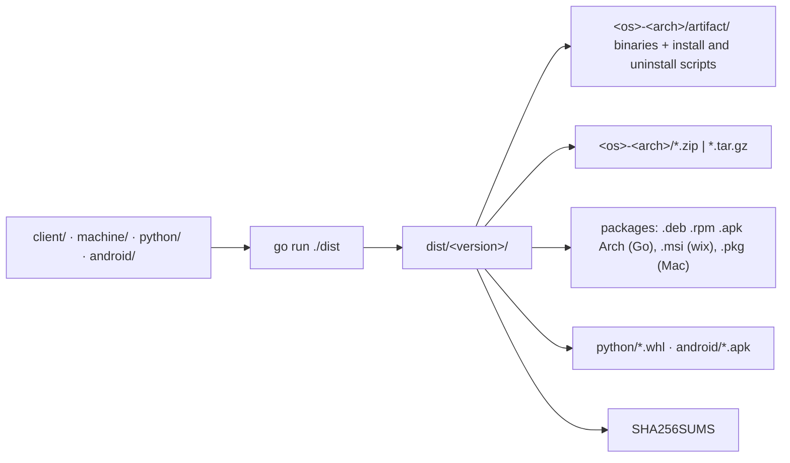

# Build and deploy (`tools/`, `devhelpers/`, `server/Dockerfile`, `server/docker/`, `ui/Dockerfile`, `site/`, `sandbox/`, `deploy/`)

How the components are versioned, built for every platform, handed out by the server, installed and run in containers. The static brochure site in `site/` is separate from the application console in `ui/`; Compose serves it privately on port 8080 for the public reverse proxy.

## Design in one paragraph

There is one hand-written version (`VERSION`) and one compatibility number (`PROTOCOL`). `tools/dist` builds every Go program for every platform, plus packages, the Python wheel and the Android APK, into `dist/<version>/` with a `SHA256SUMS`. The server hands out exactly those files (`/downloads/`), and every installer and self-update checks them against that list. So a computer only ever installs what its server built.

## Versions

- `VERSION` = `X.Y.Z`. The build version is `X.Y.Z` on its tag, else `X.Y.Z+<commit>[.dirty]`. `.dirty` means uncommitted changes to any tracked file (no exclusions: the server's settings used to be saved in `config/`, which was exempt, but they live in its database now); there's no `.git` → `+unknown`. `AI_PROXY_VERSION` overrides it.
- It is computed in three places that must agree: `tools/dist/version.go` (`BuildVersion`), `server/agent_server/version.py` (`build_version`) and `python/agent_py/common.py` (`checkout_version`).
- `PROTOCOL`/`MIN_PROTOCOL` live in `version.py`, `settings.Protocol` in client/ and machine/, and `common.PROTOCOL`; `test_client.py` checks they agree. Raise `PROTOCOL` for changes older programs can't follow, and `MIN_PROTOCOL` only when dropping the old one. Outside the range the server answers 426 (WebSocket close 4426).

## `tools/dist` (its own Go module, no dependencies)

- 15 targets (Windows, Linux incl. arm/riscv64/s390x/loong64, macOS, FreeBSD), built with `CGO_ENABLED=0 -trimpath` and `-X main.version`. Components: `agent` (agent and agent-proxy) and `agent-machine`.
- Archives and Linux packages are written in Go (execute bits survive NTFS). A missing external tool (wix, pkgbuild, a JDK or Android SDK) skips its format with a note.
- The wheel is written in Go from `python/pyproject.toml`, with `_version.py` stamped in. It is skipped when the version isn't PEP 440.
- Flags: `-version`, `-root`, `-out`, `-only`, `-packages`, `-android`, `-python`, `-print-version` (used by the build scripts).
- The APK is a release build only when `android/keystore.properties` exists, else a debug build (which carries the Android Auto service); see `android.md`.

## Handing out and installing

- `downloads.py` serves `dist/<server version>/` (or the newest with the same `X.Y.Z`), only files in `SHA256SUMS`, publicly, at `/downloads/...`. `/downloads/index.json` is what `agent update` and `agent-machine update` read.
- `agent-server downloads fetch` (`fetch_builds.py`, dispatched in `app.main`) fills `dist/<X.Y.Z>/` from a GitHub Release for a server with no build of its own (the published image, an install without Go): it reads the release's flat `SHA256SUMS`, downloads only the archives and the wheel, refuses a mismatch before replacing anything, and writes tools/dist's layout (`<platform>/<archive>`, `<platform>/artifact/<program>` from each archive's own `<platform>/` folder, `python/<wheel>`, a new `SHA256SUMS`). A server on `X.Y.Z+<commit>` then serves it as the newest of its `X.Y.Z`. It's an administrator's command with plain `urllib` (the environment's proxy applies), not the server's `runtime.client`: the running server never downloads builds. `deploy/compose/server` mounts `dist/` writable for it (`docker compose exec --user 0 ...`). The image itself stays without builds: every platform's are about 440 MB.
- **One-liners** `/install.sh` and `/install.ps1` (`installer.py`, templates in `server/agent_server/install/`): the server fills in its address (checked against `SAFE_URL`) and the archive table, plus the wheel as `python python <sha> <url>` in both scripts. They download, check hashes, and run the archive's own installer with `AI_PROXY_ONE_LINER=1`, then sign in from `/dev/tty`. With `--python`/`-Python`, or when there's no archive for the platform (an unknown OS or processor no longer fails), they install the wheel instead into their own venv (`~/.local/share/agent-py`, `/usr/local/lib/agent-py` as root, `%LOCALAPPDATA%\agent-py`) and link `agent`, `agent-proxy`, `agent-machine` into the prefix (Windows: copies of pip's launchers, which name the venv's python.exe by full path). The uninstallers remove those links but leave the venv. In PowerShell, variable names ignore case: a `$python` variable is the `-Python` switch, so the interpreter is `$interpreter` (the sh scripts use `use_python`/`interpreter` alike).
- **Archive installers** (`tools/dist/install/`): `install.sh` (to `/usr/local/bin` or `~/.local/bin`; `--service` sets up systemd, launchd or rc.d; `--uninstall`) and `install.ps1` (to `%LOCALAPPDATA%\Programs\agent-proxy`, user PATH, `-Service` as an at-logon task).
- **Uninstallers** (`server/agent_server/install/uninstall.sh`, `uninstall.ps1`): one file each, not templates. The server serves them as they are (`/uninstall.sh`, `/uninstall.ps1`, `installer.uninstaller`, no build needed) and `tools/dist` copies them into every archive (`writeUninstaller`, LF for `.sh`), where `install.sh --uninstall` and `install.ps1 -Uninstall` hand over to them. They undo `--service`, stop agent-machine and this install's agent-proxy, remove the `servers service` sudoers rule as root, and with `--purge` log out (one server per `logout`, looped) and delete the default settings folders. The service names and paths in them must match `install.sh`/`install.ps1`. `AI_PROXY_SCHEDULED_TASK` renames the Windows task for tests (the dev computer has a real one); the archive `install.ps1` and the uninstaller both honour it.
- Test installers and services as a throwaway user in another WSL distro, never as the Ubuntu user (it runs a real agent-machine, and `install.sh --service` would stop it and join the test service to the real fleet). WSL has Ubuntu, `FedoraLinux-44` and `archlinux`; for Alpine, `wsl --import` its minirootfs. `wsl -d <distro> -u root` is root without a password: install the built packages with each distro's tool (`dpkg -i`, `dnf install`, `apk add --allow-untrusted`, `pacman -U`) and remove them again. For services, `useradd -m aptest`, then `SUDO_USER=aptest ./install.sh --service` as root. Use `wsl --exec sh -c '...'`: plain `wsl -- ...` runs the line through another shell first, which expands `$?` too early. The same goes for the one-liners (`/install.sh`, `/install.ps1`).

## Containers

The shared `deploy/compose/quickstart/start.py` server wrapper calls `configure_vault` before bootstrapping accounts or starting the server. With no explicit `AI_PROXY_VAULT_KEYS` or `AI_PROXY_VAULT_KEYS_FILE`, it generates a version-1, 32-byte random key in `<AI_PROXY_LOG_DIR or /app/logs>/private/vault-keys`, sets the file environment variable for children, and reuses it on restart. A temporary owner-only file is hard-linked into place so incomplete writes and concurrent starters cannot replace the live key. The private directory is 0700 and file 0600. The existing per-server logs volume persists it outside PostgreSQL; losing the file loses access to encrypted credentials. Empty existing files are refused, never regenerated silently. Basic and the published quickstart both pass through an optional `AI_PROXY_VAULT_KEYS` override. All-in-one/local instances already provision their own key in `local.py`'s `secrets.json`.

- The root `.dockerignore` excludes local virtual environments, agent metadata/history and generated `.screenshot*`, `.test-*` and `.tmp-*` directories. Keep these out of the context: Compose's Windows context validation can fail on their private ACLs before the container engine sees the build.
- `server/Dockerfile` (built from the repo root, because it needs `ui/`): builds the console with Node, then a python:3.13-slim image running as uid 10001, with `docs/`, `VERSION` and `benchmarks/tests`, `AI_PROXY_HOME=/app` and `AI_PROXY_UI_BUILD=0`. It copies no default config (a new database is seeded from `defaults.py`) and has no entrypoint script: `ENTRYPOINT ["agent-server"]`. Volumes `/app/logs` (the server's log, and the SQLite database when no `AI_PROXY_DATABASE_URL` is set) and `/app/certs` (`first-user-password`); `/app/config` and `/app/auth-state` exist, owned by the image's user, only so an older install's volumes can be mounted for the import. Port 9999. Pass `--build-arg AI_PROXY_VERSION` to match a `dist/` folder (no git in the image).
- Two trees: `deploy/` runs only the **published images** (`deploy/README.md`): `deploy/compose/{allinone,quickstart,peer,server}` and `deploy/helm/{agent-mesh,quickstart}`. `devhelpers/` is for development (`devhelpers/README.md`): the same Compose stacks **built from the checkout** (`devhelpers/{basic,allinone,peer}/compose.yaml`, which build by default, and `devhelpers/server/compose.build.yaml`, an override for `deploy/compose/server`), the all-in-one image's `Dockerfile` and `entrypoint.py` (`devhelpers/allinone/`), and every script (`devhelpers/scripts/`, which find the root as `../..` from themselves). A new published-image stack goes in `deploy/`, its from-source twin in `devhelpers/`; `server/tests/test_quickstart.py` checks that each twin has the same services, settings and mounts (only `image`/`build` differ, local `localhost/ai-control-mesh-dev-*` names) and its own project name (`<name>-dev`), so a build never replaces a published tag or opens the deploy stack's volumes.
- `deploy/compose/server/compose.yaml` pulls `agent-server` (also agent-auth's), `agent-sandbox` and the site from `${AI_PROXY_IMAGES:-ghcr.io/joeyenfield}/<name>:<tag>`, with `AI_PROXY_IMAGE_TAG` for services and independent `AI_PROXY_SITE_IMAGE_TAG` for the site (both default to `latest`); only the console has a `build:` (its `VITE_API_URL` is per deployment). Its paths are relative to its folder (`../../../dist`, `../../../server/docker/postgres-init.sh`, the console's context `../../..`). `devhelpers/server/compose.build.yaml` is an override with the `build:` sections and local image names (`agent-server`, `agent-sandbox`, `ai-control-mesh-site`), for building from the checkout (from the root: `-f deploy/compose/server/compose.yaml -f devhelpers/server/compose.build.yaml up -d --build`; Compose reads an override's paths from the first file's folder, so its context is `../../..`). The production server runs it through `devhelpers/release_scripts/deploy-remote.sh` with `-p <checkout folder's name>`, the project name it had as the root `compose.yaml`, so its volumes and containers keep their names. It holds `postgres` (`postgres:17`, volume `postgres-data`, no published port, a `pg_isready` healthcheck, `server/docker/postgres-init.sh` as its first-start script), `marketing-site` on host loopback port 8080, the standalone static `console` on loopback 8081 under `--profile console` (built with `VITE_API_URL`, default `http://localhost:9999`), `agent-auth` on loopback 10000, `agent-server` with `../../../dist:/app/dist`, and `agent-sandbox` under `--profile sandbox`. agent-server gets `AI_PROXY_DATABASE_URL` (role `mesh_api`), agent-auth `AI_PROXY_AUTH_DATABASE_URL` (role `mesh_auth`); both wait for `postgres` to be healthy. The `.env` needs `AI_PROXY_POSTGRES_PASSWORD`, `AI_PROXY_DB_API_PASSWORD` and `AI_PROXY_DB_AUTH_PASSWORD` (letters and digits, as they're written into SQL and URLs), `AI_PROXY_OIDC_INTROSPECTION_SECRET`, and the deployment's own addresses, which have no default (`AI_PROXY_OIDC_ISSUER`, `_AUDIENCE`, `_REDIRECT_URIS`, `_BROWSER_ORIGINS`, and `AI_PROXY_SERVER` for the sandbox). agent-server's port is published on loopback unless `AI_PROXY_PUBLISH_HOST` says otherwise.
- `server/docker/postgres-init.sh` runs once, on an empty data directory: roles `mesh_api` and `mesh_auth` with their passwords, schemas `mesh` and `mesh_auth` owned by them, and `public` and the database closed to `PUBLIC`. agent-server grants `mesh_auth` read access to `users`, `orgs` and `meta` itself when it migrates (`migrate.grant_issuer`). `.gitattributes` keeps the script LF, since the container runs it as it is. Backups: `docker compose exec -T postgres pg_dump -U postgres -Fc mesh > mesh.dump` (as `deploy/compose/server/compose.yaml`'s header says).
- Upgrading Compose from before the database: the old volumes stay mounted (`agent-server-config` and `agent-auth-state` read-only, `agent-server-logs`, `agent-server-certs`), so the first start against the empty PostgreSQL imports their files (settings, accounts, keys, the CA, machines, sessions; the issuer's grants and signing key), after which only `logs/proxy/` and `first-user-password` are used. Nothing in them is deleted. Split deployments build the console with `VITE_API_URL`, run the API with `AI_PROXY_SERVE_UI=0` and trust the console through `AI_PROXY_CONSOLE_ORIGINS`.
- `site/`: static public brochure site (`index.html`, `quickstart.html`, `teams.html`, `security.html`, `styles.css`), served by its own small nginx image (`site/Dockerfile`, `site/nginx.conf`, with a `/health`). The apex and `www` hostnames serve this site; `console.<domain>` serves only the static console (`ui/Dockerfile`, `ui/nginx.conf`); `api.<domain>` routes console, agent and machine requests to `agent-server` and redirects its root to the console.
- The brochure leads to the local quickstart and a separate team evaluation path. `quickstart.html` holds the quickstarts, one whole guide per level, picked with the four level cards at its top (radios `#lvl-basic`, `-intermediate`, `-advanced`, `-professional`; `.qs-guide.guide-<level>` is the guide, and `site.js` checks the radio for a link to `#<level>`): Basic (one container or no containers), Intermediate (the Compose stack, `docs/quickstart.md`'s seven steps), Advanced (the Helm quickstart) and Professional (the production chart, text only). Each guide has its own command box, steps and real screenshots (`quickstart-basic-*`, the numbered `quickstart-NN-*` that `docs/quickstart.md` shows too, `quickstart-helm-*`; web-sized, the sign-in captures cropped to their card), from `quickstart-steps.mjs` run once per level, and each says where the provider is added that a provider is your own, not only Ollama; the homepage keeps a teaser (still `#quickstart`, now the closing panel) and every Try locally link goes to the page. In a guide, tabs (`.qs-tabs`: Basic's one container or no containers, Professional's sizes) and switches (engine, where models run, your terminal: Linux / macOS or Windows PowerShell, which changes line continuations and the installer) pick the command block and the words that go with it. It is radios and `:has()` in `styles.css`: a choice is a radio with an `opt-<choice>` class, and what belongs to another choice of the same switch (`when-<other>`) is hidden while it is checked (`check.mjs` clicks through every level). The homepage's order is the hero, four cards on what it does, how it works (three steps and the diagram), any agent on any machine, three routes to a model, the console, where it runs, teams, then the quickstart panel. `check.mjs` requires its twelve step screenshots to be the ones the guide uses. A new page needs the Pi's front-nginx allowlist too. The homepage shows isolated-demo captures from `docs/screenshots/` as web-sized WebP copies in `site/assets/screens/` (800 and 1440 pixels wide, 400 and 618 for the phone capture, picked by `srcset`; `devhelpers/scripts/screenshots/site-images.py` makes them, leaving the console's sidebar out of desktop captures, so rerun it when `capture.mjs` changes one of its `SHOTS`). Cloudflare and browsers keep the site's stylesheet, script and images for 4 hours, so every page links to them by content hash (`/styles.css?v=<hash>`): `devhelpers/scripts/site/fingerprint.py` stamps the links (`site-images.py` runs it), and `check.mjs` fails while one is stale, so run it after changing `site/styles.css` or `site/site.js`, each linking to its full PNG under `/screenshots/`. The hero is `terminal-grid-dark` (the Live agent view: four demo agents in a 2 × 2 grid, one asking a question, with the quick keys) under a lede on running several agents on different machines and a row of agent names; the console section is one feature a row: a running session (`live-dark`), notifications (`terminal-phone`, in a phone-sized frame), Start an agent, a session, machines and MCP; "Where it runs" lists the ways to add a machine; "Any agent, any machine" (section 01, straight after the hero) shows three real agents' terminals side by side (`real-opencode`, `real-copilot`, `real-qwen`: OpenCode, Copilot CLI and Qwen Code started from the production console on a fleet machine's Ollama, captured by hand from the console's terminal view, only `.xterm-screen` after **Fit width**; `capture.mjs` can't remake them, so replace them the same way), then three cards, one of them the Android app. `terminal-grid-dark` and `live-dark` are dark demo captures used by the site. `teams.html` covers deployment and operational requirements; `security.html` covers controls and data boundaries. Compatibility is a native HTML disclosure. The quickstart's commands have two switches, engine (Docker, Podman, Kubernetes with Helm: `docs/quickstart-kubernetes.md`'s install, port-forwards and sign-in) and where models run (CPU, NVIDIA GPU, which adds `deploy/compose/quickstart/compose.gpu.yaml`; for Helm a note on giving the machine's `ollama` container a GPU): radio buttons and CSS `:has()` show one of five command blocks and the notes for the choice, so they work without JavaScript; `site.js` copies the block shown (`data-copy-shown`). `docs/website.md` records implementation/test evidence and the minimum version for governance/cluster features; Helm image defaults must be checked separately. The existing console link is secondary and requires an account for that deployment. The architecture is semantic HTML/CSS and stacks vertically on small screens. `site.js` progressively enhances the mobile menu and copy button; content and navigation remain usable without it. No application API calls or third-party assets are used.
- `site/assets/` contains editable SVG branding and browser-rendered PNG social/app icons. `robots.txt`, `sitemap.xml`, `site.webmanifest` and homepage metadata use the apex hostname. The Dockerfile explicitly copies the public assets and selected screenshots. `devhelpers/scripts/site/preview.mjs` serves the same allowlist on loopback; `check.mjs` checks all three pages at 375/768/1440 px, cross-page navigation, quickstart inputs, interactions and assets, and optionally renders branding exports with `--render-assets`. Browser captures go to gitignored `.test-site/`. See `docs/website.md` for commands and claim evidence.
- Bump the brochure stylesheet URL's `v` query in all three public HTML pages when changing `site/styles.css`: public CDNs may keep the previous CSS after a deployment.
- `sandbox/`: an image with `agent`, `agent-machine` and the npm coding agents. Its entrypoint signs both in through device approval (or a setup code), retrying a failed sign-in after a wait that doubles to 15 minutes rather than exiting (a restart policy would otherwise loop it, asking for codes), sets launches on for `/workspace` only (containers always off; servers on unless `AGENT_SERVERS=off`), and runs `agent-machine run`. agent-machine only probes its own loopback, so `AGENT_OLLAMA`/`AGENT_LLAMACPP` (`host[:port]`) make the entrypoint run `socat` relays from `127.0.0.1:11434` and `127.0.0.1:9931` to model server containers next to it; tunnels then reach them like local ones. The image copies Ollama (`OLLAMA_VERSION`, pinned) from the `ollama/ollama` image with only its CPU backends (the top-level files of `lib/ollama`; every GPU backend is a subfolder, dropped), into `/usr/local/bin` and `/usr/local/lib/ollama`, where `ollama` looks beside itself; servers on starts it from PATH. A relayed `AGENT_OLLAMA` holds 11434, so the entrypoint warns that the console manages that one instead. For OpenShift's restricted policy (a random user in group 0), `/home/agent` and `/workspace` are `chgrp 0`/`g=u` and `/etc/passwd` is group-writable; the entrypoint adds a passwd line for a nameless user, falls back to `HOME=/tmp/agent-home` when the home isn't writable, and maps `AGENT_DATA_DIR` to agent-machine's `AI_PROXY_MACHINE_DATA`. The image carries `libgomp1` because llama.cpp's GitHub Linux builds (what the console installs with servers on) need it and node's slim base lacks it.
- Mandatory OIDC adds Compose `agent-auth` (same Python image, `entrypoint: ["agent-auth"]`), host loopback :10000, its state in PostgreSQL's `mesh_auth` schema (the `agent-auth-state` volume only for importing an older issuer's files), and accounts read through its role's read-only grants. Both services require the same `AI_PROXY_OIDC_INTROSPECTION_SECRET`. HTTPS setup provisions `auth.<domain>` separately; auth responses are uncached and auth URLs excluded from access logs.
- Sandbox first start prints two device codes for browser approval; persistent home credentials refresh later. Password/key bootstrap is removed.
- `deploy/compose/quickstart/compose.yaml` is a separate local-demo project that mounts nothing from the checkout, so a download of that one file runs (`docs/quickstart.md`, Without a checkout): `server/Dockerfile` copies `start.py` and `server/docker/postgres-init.sh` into `/quickstart`, `sandbox/Dockerfile` copies `start.py` and `machine.py` there, and a one-shot `postgres-init` service (the server's image, as root) copies the init script into the `postgres-initdb` volume that `postgres` mounts at `/docker-entrypoint-initdb.d` and waits for (`service_completed_successfully`). Images from before that (2.1.57 and older) have no `/quickstart`, so an older `AI_PROXY_IMAGE_TAG` doesn't start with it. `devhelpers/basic` is the same without mounts, so a change to `start.py` or `machine.py` needs its `--build`; `peer/` and `testdata/` still mount the checkout's copies over the images'. It holds PostgreSQL (the same init script, fixed demo passwords, volume `postgres-data`), server + issuer on it (`AI_PROXY_DATABASE_URL`, `AI_PROXY_AUTH_DATABASE_URL`; the server's only volume is its logs), two sandbox-based fleet machines, and Ollama in its own container, which machine-1's `start.py` relays to its loopback port 11434 (agent-machine only discovers loopback model servers). `machine.py` signs both machines in as the admin and sets their switches; machine-1 has servers on, so the console pulls models into that Ollama with nothing typed on the machine. `devhelpers/scripts/screenshots/quickstart-steps.mjs` walks a fresh quickstart through `docs/quickstart.md`'s steps (sign-in to Qwen Code answering) and takes its `quickstart-*.png` screenshots. Published ports bind host loopback (19999 API, 20000 issuer). Each machine has separate home/workspace volumes; Ollama has its own model volume. `deploy/compose/quickstart/compose.gpu.yaml` is an optional override that gives `ollama` the NVIDIA GPUs by CDI name (`devices: nvidia.com/gpu=all`); Podman ignores Compose's `deploy.resources` device reservations, so don't switch it to those. It stays a separate file because a missing CDI device stops the container from starting. The environment-defined admin defaults to admin/secret, optionally overridden by `QUICKSTART_ADMIN_PASSWORD`.
- The quickstart runs the published `agent-server` and `agent-sandbox` images (same variables); `devhelpers/basic/compose.yaml` is the same stack with `build:` sections and `localhost/ai-control-mesh-dev-*` names. `server/tests/test_quickstart.py` checks the pair, the server's override, and that every deploy stack's own images are the published `:latest` ones. The quickstart supports `podman compose` and `docker compose`. Built images use `localhost/` names, pulls and the server/sandbox base images use explicit registries, and shared helper bind mounts use `:ro,z` for SELinux. Podman needs a Compose provider (Docker Compose is supported); Windows/macOS also need a running Podman machine. Services must retain separate network namespaces: Podman refuses to recreate a container another shares (`network_mode: service:`) with. The issuer's `/health` is what `auth`'s healthcheck, and so the machines' `depends_on`, waits for. `devhelpers/basic/tests/test_e2e.py` runs sign-in and permission checks against the running stack's published ports (skipped when it's down).
- `deploy/compose/` holds the local demos, one Compose project each (`deploy/compose/README.md`): `quickstart/` (below), `allinone/` (the image below) and `peer/`, each with its from-source twin in `devhelpers/`. `quickstart/start.py` (the containers' loopback relays; `QUICKSTART_AUTH_HOST`/`_PORT`, `QUICKSTART_SERVER_HOST`/`_PORT` name other services and ports, `QUICKSTART_OLLAMA_HOST` the Ollama a machine relays to (default `ollama`), and in server mode `QUICKSTART_ORGS` (`id=Name,...`, `agent-server org add`) then `QUICKSTART_ACCOUNTS` (`org:user[:role[:team+team]],...`, `account_arguments`) add organizations and accounts first) and `quickstart/machine.py` (the device-flow sign-in; `QUICKSTART_API`, `QUICKSTART_ISSUER`, `QUICKSTART_USER`, defaulting to the basic stack's and admin; optionally `QUICKSTART_MCP` (`name=command,...`, replaced with `agent-machine mcp add` on each start), and `QUICKSTART_ADOPT`/`QUICKSTART_GRANT`, which a `provision` child process applies through the API with agent-machine's token once the fleet lists the machine and its model servers: adopt them for the organization, grant the organization features) are shared: `peer/` and the `devhelpers/` stacks mount them, the all-in-one image copies `machine.py` in. `peer/compose.yaml` is two of the basic setup (each server with its issuer and its own PostgreSQL), `AI_PROXY_MESH_ID` `server-a`/`server-b` and `AI_PROXY_MESH_URL` by service name, server-a on `localhost:29999`/`:30000` and server-b on `127.0.0.1:39999`/`:40000` (different host names, so one browser keeps both consoles' cookies), `laptop-a` (alice, acme) and `gpu-box` (bob, globex, with Ollama). `peer/setup.py` (stdlib only, on the host) links them and opens a bridge through the APIs, signing in by the issuers' device flow. `test_quickstart.py` checks every folder's twin, mounts and loopback ports (the one allowed difference, `DEV_ONLY`: `devhelpers/basic`'s server also seeds two organizations with two people each through `QUICKSTART_ORGS`/`QUICKSTART_ACCOUNTS`), and the peer stack's layout. `devhelpers/testdata/` is the one stack with no `deploy/` twin (not in `PAIRS`): three organizations with people and teams, a machine per organization signed in as its admin with its own Ollama (`ollama-<org>`, a one-shot `pull-<org>` for `TESTDATA_MODEL`), `mcp_toolbox.py` (a stdlib stdio MCP server) shared from each, on `localhost:49999`/`:50000`; `test_quickstart.py` checks its layout and the toolbox. `deploy/helm/quickstart/` holds the Kubernetes quickstart's `values.yaml` and `machine.yaml`.
- `deploy/helm/quickstart/` is the Kubernetes quickstart (docs/quickstart-kubernetes.md): `values.yaml` runs the Helm chart in `mode: single` with `publicScheme: http`, the server on port 19999 and agent-auth on 20000 inside the pod, so the public `http://localhost:19999` / `:20000` addresses (reached through `kubectl port-forward`) also work inside the pod, where the server introspects at its issuer URL. `machine.yaml` is one pod of `agent-sandbox`, Ollama and two `alpine/socat` relays (localhost:19999 and :20000 to the release's Services, so it assumes release `mesh`); the machine has to be in the cluster, not on the host through a port-forward, because the server would see a port-forwarded machine as loopback (`Fleet.loopback`) and skip its tunnel. The pod sets `AGENT_SERVERS=on` so the console can pull into its Ollama; the guide keeps `agent-machine servers on` in the pod as the fallback for sandbox images from before that setting, which ignore it.
- A Windows WSL kernel missing Podman's nftables bridge support can prevent container startup even though builds and Compose validation pass (observed with Podman 6.0.2 / WSL kernel 6.6.87.2). The quickstart README documents the upstream issue and WSL update/restart path. Do not work around it by globally disabling firewall rules or collapsing all services into one namespace.
- Quickstart-only `start.py` supervises the normal programs and relays canonical localhost OAuth/API ports to the corresponding Compose services. `machine.py` approves its own two device grants through the issuer's CSRF-bound form, saves separate standard OAuth credential files, removes the bootstrap password from the launched environment, and runs `agent-machine`. It sets a non-loopback machine address so provider traffic uses fleet tunnels. It does not weaken API/issuer authentication. It writes no settings (there's no `backends.yaml` to seed): the database starts with the shipped defaults, `AI_PROXY_DEFAULT_BACKEND=machine-1` names the default, and adopting machine-1's Ollama creates the `machine-1` backend.

- `deploy/helm/agent-mesh/`: the Kubernetes chart (its own README has every value). `mode: single` is one `Recreate` Deployment with every role (SQLite on a PVC, agent-auth as a second container sharing it, the pod migrating itself with `AI_PROXY_MIGRATE=1`); `mode: scaled` is a Deployment per role or role group (`roles.<name>.serves`) with HPAs (CPU, or `agent_server_open_streams`/`agent_server_fleet_sockets` through the Prometheus adapter), PDBs and zone spreading, and a migration Job (`agent-server db migrate`, a pre-install/pre-upgrade hook, or a plain `-migrate-install` Job when CloudNativePG or External Secrets make its inputs) while pods run with `AI_PROXY_MIGRATE=0`. Optional CloudNativePG `Cluster` and `Pooler` (the worker, the migration Job and agent-auth connect directly; other roles through the pooler, so only transaction-level advisory locks there), a single bundled Valkey, the standalone console, Gateway API `HTTPRoute`s or an Ingress carrying `docs/scaling.md`'s route table (`_helpers.tpl`), External Secrets, ServiceMonitor and PrometheusRule, and a NetworkPolicy opening the internal port (9100) only to the release's server pods and Prometheus. It sets `AI_PROXY_POD_ID`/`AI_PROXY_POD_IP` from the downward API, generates `AI_PROXY_INTERNAL_TOKEN` once (kept with `lookup`), sets `AI_PROXY_GRACEFUL_SECONDS` to each role's grace period minus 15, and `AI_PROXY_RETENTION_SEED` on the migration Job. `ci/` holds the values `helm lint --strict`, `helm template` and `kubeconform -strict` are run with. When the server's roles, routes, env vars, probes or metrics change, change the chart too.
- `sandbox/Dockerfile`'s runtime stage is `ubuntu:24.04` with Node from the `node:22-bookworm-slim` image (`COPY --from=node /usr/local/`), the `PACKAGES` build argument (everyday tools: git, gh, ssh/sftp, ping, dnsutils, build-essential, Python with pip/pipx and `python-is-python3`, so `python` works, ...), `EXTRA_PACKAGES`, and passwordless sudo for `agent` unless `AGENT_SUDO=0` (agents may install tools; `AGENT_APT_PACKAGES` installs on start). Ubuntu's user 1000 is `ubuntu`, renamed `agent` (node's was `node`). The all-in-one image repeats these arguments.
- `deploy/compose/allinone/` is the `ai-control-mesh` image: the whole system in one container, to try it (`docs/local.md`). Its Dockerfile repeats `sandbox/Dockerfile`'s stages (Go programs, Ollama's CPU build, the agents on node; `server/tests/test_allinone.py` keeps `OLLAMA_VERSION`, `AGENTS` and the base images in step), builds the console, and lays the server out in `/opt/mesh` as the release bundle does (`pip install -e`, `BUILD`), so `/opt/mesh` is its `ROOT`. `entrypoint.py` runs `local.start(overrides=...)` with `AI_PROXY_HOST`/`AI_PROXY_AUTH_HOST` `0.0.0.0` and `AI_PROXY_LOCAL_HOME=/data/server`, signs agent-machine and agent-proxy in once through `deploy/compose/quickstart/machine.py`'s `sign_in` (copied in as `quickstart_machine.py`: the issuer's device flow at the fixed `localhost:19999`/`20000`, so the host must publish those same ports), switches launches, files, commands and servers on for `/workspace`, then supervises `agent-machine run` and the two processes, stopping all when one stops. `MESH_ADMIN_PASSWORD` makes `admin` an environment user. Volumes `/data`, `/home/agent`, `/workspace`. A GPU: the build argument `OLLAMA_GPU` (empty by default, so `ai-control-mesh` stays CPU only) names the Ollama GPU backend folders to keep. `release/local.py` builds the same Dockerfile with `OLLAMA_GPU=cuda_v13` as `ai-control-mesh-gpu` when `services --image gpu` is selected, which `deploy/compose/allinone/compose.gpu.yaml` runs with the NVIDIA GPUs as the CDI device `nvidia.com/gpu=all`; `devhelpers/allinone/compose.gpu.yaml` builds it from the checkout as `localhost/ai-control-mesh-dev-gpu`. `docs/gpu.md` is the guide for setting up Podman or Docker; `test_allinone.py` checks the files and the release catalog.
- `devhelpers/release_scripts/release.ps1|.sh` invokes the shared standard-library Python orchestrator `release/local.py`. Its `IMAGES` catalog selects `website` (only `ai-control-mesh-site`) or `services` (default `agent-server`, including auth and console; explicit `sandbox`, `allinone`, `gpu`). Builds run directly on local Podman, with native Linux x64 by default, cached layers, Docker image format and no injected HTTP proxy. Repeated `--platform` builds a manifest; non-native targets require local emulation. `--archive` exports single-platform Docker archives. Each snapshot gets a unique UTC/commit tag and a PEP 440 local version; receipts/checksums live under `dist/releases/<type>/<tag>/`. `--plan` writes nothing. `--publish` directly pushes selected images to a registry or uploads installer files through `gh`, requiring committed tracked changes. All image builds finish before pushes begin. `--stable` requires a clean checkout at the existing matching version tag; only `--stable --publish --promote` updates latest. There are no Actions workflows, and pushes/tags have no build side effects. Website and service tags are independent (`AI_PROXY_SITE_IMAGE_TAG` and `AI_PROXY_IMAGE_TAG` in the server Compose stack). `docs/releases.md` covers every command, prerequisites and retiring queued Actions runs.

- **The tray** (`agent-tray`, `python/agent_py/tray.py`) comes in with the wheel's `tray` extra. The release's web installers install the wheel into the server's venv (always, for the tray; only `--python` links `agent`/`agent-machine` from it) and the server's one-liners into the `agent-py` venv, when there's a desktop (Windows, macOS, `DISPLAY`/`WAYLAND_DISPLAY`; there's no root check), unless `--no-tray`/`-NoTray`. Failing to install it never fails the install. They link or copy only `agent-tray`, run `--autostart on`, and start it detached at the end. pip fetches the server's Python dependencies (and pystray and Pillow for the tray) from PyPI: the release's hashes cover only its own files. `tools/dist`'s wheel writer carries `[project.gui-scripts]` into `entry_points.txt`'s `[gui_scripts]`. The installer tests use a fake wheel whose `tray` extra is empty and whose `agent-tray` only prints, with `PYTHONPATH` cleared so the real `agent_py.tray` can't set the dev computer's own autostart.
- `release/local.py installers` builds `ui/dist` and `tools/dist -android=false` locally, with intermediate archives under `dist/local-builds/<version>/` and final files under `dist/releases/installers/<tag>/files/`. Targets can be limited with repeated `--target`. Only `--publish` creates a GitHub Release (snapshots are prereleases at the source commit, stable builds verify the existing tag). No published assets are overwritten. Then `devhelpers/release_scripts/release/release.py` writes the release's flat files: the server bundle `ai-control-mesh-X.Y.Z.zip` (`VERSION`, `BUILD`, `LICENSE`, `server/` sources, `ui/dist` without the UI sources so `ui_build` never rebuilds, `docs/`, `benchmarks/tests`), every archive, the wheel, `SHA256SUMS`, and the web installers `install-local.sh`/`.ps1` filled in from the templates beside it (`{{BASE}}`, `{{VERSION}}`, `{{BUNDLE}}`, `{{FILES}}`, each checked to be plain URL, version and file-name characters). The installers trust only the hashes written into them. They unpack the bundle into `<instance home>/app/<version>` (the `local.py` folder; keep the two in step), `pip install -e` its `server/` into `<home>/venv` so the bundle is the server's `ROOT`, stop a running instance first, remove older `app/` folders, link `agent-server` into the prefix, run `agent-server local start`, then unpack each archive and run its own installer (`AI_PROXY_ONE_LINER=1 --prefix`) and sign in with `--enable launches,files`. On Windows the archive's `install.ps1` runs in a child PowerShell with `-ExecutionPolicy Bypass -File` (the server's `/install.ps1` does the same): it's a file on disk, which the default policy refuses, unlike the `irm | iex` text; the tests pass `-ExecutionPolicy Bypass` themselves, so they can't show a regression there. `--help` prints a `usage` heredoc, since a script piped into `sh` has no file to read its header from. The last lines repeat the console's address and the password file. `uninstall-local.sh`/`.ps1` (the same folder, copied into the release as they are) undo it: the tray's autostart, agent and agent-machine through the bundle's own `server/agent_server/install/uninstall.*` (before the server stops, so `--purge` can sign them out), the `agent-server` link, `app/` and `venv/`, and the data only with `--purge`; keep their folders in step with the installers'. `version.py` takes the version from `BUILD` when there's no git. In PowerShell 5.1 every native call goes through `Invoke-Program`: with `ErrorActionPreference = Stop`, redirected stderr (Authlib's deprecation warning, say) would otherwise abort the install. Test them with `--base-url http://127.0.0.1:<port>`, a local `http.server`, `AI_PROXY_LOCAL_HOME` and `--prefix` in scratch folders, spare ports, and on Linux a throwaway user in `FedoraLinux-44` (`server/tests/test_release.py` covers the files).

## Scripts (`.sh`/`.ps1` pairs; change both)

- `build-client`, `build-machine` (into `client/bin`, `machine/bin`), `build-dist` (wraps `tools/dist`; `PACKAGES=1` / `-Packages`), `agent` (build and run), `dev` (API with reload + Vite).
- `install-local` (`docs/local.md`): finds Python 3.11 or later (else stops with a message), makes `.venv` in the checkout when the system's Python is externally managed (PEP 668), `pip install -e server`, the console with npm when it's there, `agent` and `agent-machine` with the build scripts when Go is there (else `pip install python/`), then `agent-server local start` (`server/agent_server/local.py`). Never run it on the dev machine as is: it rebuilds `client/bin` under the running agent-proxy.
- No pair: `start-ollama.sh`, and `devhelpers/scripts/https/setup-https.ps1` (Windows: nginx + win-acme for Let's Encrypt, filling in `nginx.conf.template` and `nginx-https.conf.template`: the brochure site on the apex/`www` (`-SiteBackend`, :8080), the console on its hostname (`-ConsoleBackend`, :8081), the issuer on `auth.<domain>` (`-AuthBackend`, :10000) and API traffic on `api.<domain>` (`-Backend`, :9999)).
- `devhelpers/release_scripts/deploy.sh`/`.ps1`, `deploy-remote.sh` and `deploy-setup-remote.sh` (the one-time `--setup`: the ssh key and passwordless sudo for docker there) are gitignored, maintainer-only helpers. From clean master they push the checkout, call the local `services --publish` release with `--receipt dist/deploy-services.json`, built for `linux/arm64` (the server is a Raspberry Pi; they run `podman-arm64` first), then stamp `build-dist` with that receipt's version. They update the remote checkout and copy the matching downloads. The remote helper checks checksums, pulls the already-published service image once, and starts only agent-server, agent-auth and the deployment-specific console. It does not wait for Actions or redeploy the website. An explicit Version option selects a stable release; otherwise it uses a snapshot. Both remote health endpoints must answer and the server must report the built version. Settings remain `AI_PROXY_DEPLOY_TARGET`, `_DIR`, `_HEALTH`, `_PASSWORD`, `_ENV_FILE` (default `/etc/agent-mesh/compose.env`). These helpers stay untracked.
- `devhelpers/release_scripts/podman-arm64.sh`/`.ps1` prepare Podman for ARM64 image builds on x64: they start the Podman machine if it is stopped and register `qemu-aarch64`. Under WSL the machine's `systemd-binfmt` can't do it (`/proc/sys/fs/binfmt_misc` is an unreadable autofs mount there, and restarting that service hangs), so they mount `binfmt_misc` at `/run/binfmt` and write the machine's own `/usr/lib/binfmt.d/qemu-aarch64-static.conf` to its `register` file. The registration lasts until the machine restarts; the scripts do nothing when it is already there.
- `devhelpers/scripts/screenshots/`: `demo.py` (a self-contained demo server on :8199 with fake machines and backends; its temporary home has its own SQLite database, seeded with `config_io.apply` and the shipped model tuning; `--capture` runs the screenshots and stops it, `--stop` stops one left running), `traffic.py` (drives agent traffic through it) and `capture.mjs` (Playwright screenshots into `docs/screenshots/`).

## Rules

The standalone console and brochure nginx images hide version strings and send framing, object/base-URL, sniffing and referrer protection headers. Keep nginx header inheritance intact when changing location-specific caching. Helm trusts forwarded headers from loopback by default: operators must set ingress/gateway CIDRs, or restrict `networkPolicy.publicFrom` before trusting `*`.

- Keep `go.mod` at Go 1.24 and build with `GOTOOLCHAIN=local`.
- Every build in `dist/<version>/` is ~450 MB and nothing prunes them: delete old `dist/<version>+<commit>/` folders by hand.
- Podman on the dev computer (`podman-machine-default`, WSL-based, no localhost forwarding) builds and runs `server/Dockerfile`: pass `--http-proxy=false` to `podman build`, and reach a published port at the VM's address (`ip -4 addr` inside `wsl -d podman-machine-default`).
- Don't commit `dist/`, `ui/dist`, `logs/`, `certs/` or the `bin/` folders.
- Linux package versions are `X.Y.Z-<release>`. `PackageRelease` makes the release the commits since `vX.Y.Z` plus one, so each untagged build upgrades the one before. Keep the release rising if the version scheme changes.
