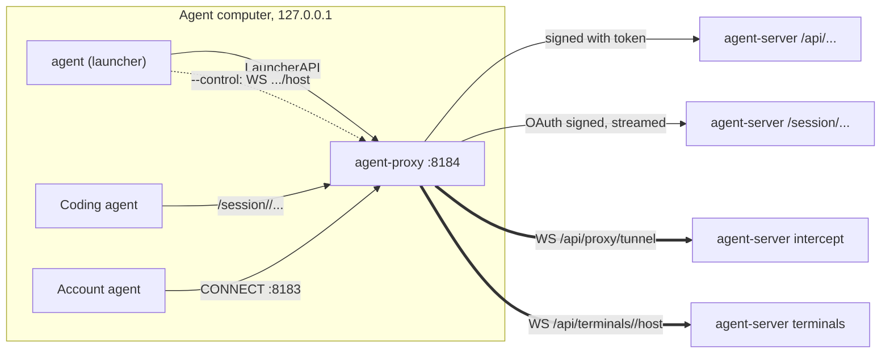

# Client (`client/`)

The Go module `ai-coding-agent-proxy/client`. It builds `agent` (the launcher, `login`/`logout`, `proxy`, `update`, `version`) and a standalone `agent-proxy`. It runs on every computer that starts coding agents.

## Design in one paragraph

The client knows the server by URL and gets agent definitions, environments and routing from its API. The loopback agent-proxy authenticates **all** upstream traffic, including model/MCP calls, with an OAuth access token in `X-AI-Proxy-Token`, preserving vendor Authorization. Login uses device authorization; serialized refresh rotates credentials before requests and reconnects. Session ids select sessions, not credentials. The launcher opens the session, writes its files and runs the agent plainly, with `--control`, or headless.

## Boundaries

- Never reads the server's settings or database, or imports server, machine or Python code. Never chooses backends or renders templates.
- Never joins the fleet: `agent machine` points at agent-machine and exits.
- Binds `127.0.0.1` only. No HTTP client or dialer uses an environment proxy (`Proxy: nil`).
- Dependencies: gorilla/websocket, x/sys, x/term, creack/pty. Go 1.24 in `go.mod`; build with `GOTOOLCHAIN=local`.

## Shape

## Packages

| Package | Responsibility | Key symbols |
| --- | --- | --- |
| `cmd/agent`, `cmd/agent-proxy` | Dispatch subcommands; the version comes from `-ldflags -X main.version` | `main` |
| `internal/settings` | Ports, server URL lookup, credentials, headers, proxy-less transports | `DefaultServerURL`, `Upstream` (re-reads credentials on every call), `Credentials.Save` (0600, atomic), `Transport`, `ServerClient`, `Identify`, `Protocol`, `TokenHeader` |
| `internal/settings/oauth.go` | OIDC discovery, device sign-in, refresh, revocation | `DeviceLogin`, `Upstream.AccessToken` (refreshes under the lock), `RejectAccessToken`, `LockCredentials`, `Revoke`, `SecureURL`/`IssuerEndpoint`, `OAuthClient` (no redirects), `TokenEnvironment` (`AI_PROXY_TOKEN`), `ErrLoginRequired` |
| `internal/api` | JSON calls, always through the agent-proxy | `Client`, `Error`, `StatusOf`, `Health` |
| `internal/launcher` | Argument parsing, launching, the shell, containers | `ParseArgs`, `Launch`, `EnsureProxy`, `EnsureContainer`, `LaunchShell`, `List` |
| `internal/localproxy` | The agent-proxy | `LauncherAPI`, `Proxy.ServeHTTP`, `local`, `rewriteAgent`, `ServeTunnels`, `readHead`, `Dial`, `relay` |
| `internal/login` | `agent login`/`logout`: device sign-in, then save under the lock; logout revokes and forgets | `Login`, `Logout` |
| `internal/terminal` | `--control` and headless runs | `Run`, `RunHeadless`, `Share`, `History` (4 MiB), `InputGap`, ConPTY (`pty_windows.go`), creack/pty (`pty_unix.go`) |
| `internal/process` | Detached starts, PATH lookup that skips Windows drives on WSL | `Detach`, `LookPath`, `AgentDirs` |
| `internal/update` | Self-update from the server's `/downloads/index.json` (`agent update`) | `Main`, `Programs`, `Fetch`, `Plan`, `Apply` (SHA-256), `Swap`, `Cleanup` |

## Flows

**Launch** (`launcher.Launch`)

1. `EnsureProxy`: if `/health` on 8184 doesn't answer, start `agent proxy` detached and wait. If the proxy's server is loopback and down, start `agent-server` from PATH. Version notices go to stderr.
2. `checkSignedIn`, then `findAgent` (`GET /api/agents`), then `process.LookPath` for the executable.
3. Account agents: `GET /api/intercept`, then cache the CA in `~/.cache/agent-proxy/<fp16>/`.
4. `POST /api/agents/{id}/sessions` with model, backend, trace, project, `proxy_url`, `launcher: true`, mcp, sharing, tags and `files_dir`. The reply carries the env, the command, files and the container.
5. Write the files (plain names only) into `~/.cache/agent-proxy/sessions/<rand>/`, removed when the agent exits. Start the container if there is one (`EnsureContainer`; a 409 means use `--switch`).
6. Run: `[resolved exe] + command[1:] + extra`, with the env merged (names match case-insensitively on Windows). **Headless** prints exactly one JSON line, `{"session_id": ...}` (agent-machine reads it), then `RunHeadless`. With `--control`, `terminal.Run` with a `Share`; otherwise `exec.Cmd`.
7. `PATCH /api/sessions/{id}` with `ended` and the exit status.

**agent-proxy** (`Proxy.ServeHTTP`), checked in this order:

1. `GET /health`: open (role, server, user, version, protocol).
2. `POST /shutdown`: `local()` only.
3. `/api/terminals/<id>/host`: WebSocket relay to the server. Refusals map to close `4400+status%100`.
4. Other `/api/*`: `local()`, then the **`LauncherAPI` allowlist** (anything else is a 404). Signed with `X-AI-Proxy-Token`; cookie, Origin and proxy headers are stripped. `/api/intercept`'s `url` is rewritten to the local 8183.
5. `/session/`, `/v1/`, `/anthropic/`: `local()`, then OAuth-signed `ReverseProxy`, flushed immediately for SSE. The proxy sets its own `X-AI-Proxy-Token` over any the caller sent; cookies, Origin and proxy headers are stripped; vendor Authorization stays. Without a usable token it answers 401 itself and forwards nothing. Bare `/api/*` is not agent traffic here.

**HTTPS tunnel** (8183): one `WS /api/proxy/tunnel` per TCP connection, signed. A refused or failed dial reads the agent's CONNECT head first (`readHead`, because Windows resets sockets closed with unread data), then answers 407 (no sign-in, HTTP 401/403) or 502. A server close of 4401/4403 before any bytes came back is a 407 too; 4410 calls `RejectAccessToken`.

**Login** (`settings.DeviceLogin`): `GET /api/auth/status` names the issuer and client id (a server that doesn't require OIDC is refused), OIDC discovery must return that issuer with every endpoint on its origin, then device authorization prints the verification URL and code and polls (`authorization_pending`, `slow_down`). The user comes from userinfo. A server without a scheme gets `https://`; HTTPS is required except on loopback. `--user`/`--key` are refused: passwords and access keys are gone, and automation sets `AI_PROXY_TOKEN` instead.

**Tokens** (`Upstream.AccessToken`): an access token valid for 30 s more is used as is; otherwise the refresh token is exchanged (it rotates) and saved, all inside `LockCredentials`. `invalid_grant` clears the entry, so the user must sign in again; other failures propagate, never a fallback. A close 4410 from the server (credential expired on an open socket) calls `RejectAccessToken`, which zeroes the expiry so the next dial refreshes. **Logout** revokes the refresh token at the issuer and forgets the entry even when revocation fails (exit 1 then). See `auth.md`.

## State

- `credentials.json` in `%APPDATA%\agent-proxy\` or `~/.config/agent-proxy/` (`AI_PROXY_CREDENTIALS`), with `agent-proxy.log` beside it: per server the access token, refresh token, expiry, issuer, client id and token/revocation endpoints. The format is shared with the Python client.
- `credentials.json.lock`, a directory beside it: the cross-process lock (Go and Python) around every read-refresh-save. Waits 30 s and is never stolen, since stealing could replay a rotated refresh token. On Windows a `mkdir` racing another process's `rmdir` fails as access denied rather than "exists", so that counts as busy too (`LockCredentials`, `credential_lock`).
- `AI_PROXY_TOKEN`, when set, is used as the access token instead of the file (no refresh).
- The CA cache and per-session file folders under `~/.cache/agent-proxy/`.
- The proxy keeps no state of its own; it re-reads credentials on every request, so `agent login`/`logout` apply at once.

## Invariants

- `local(r)` = loopback Host **and** same origin (Origin missing or equal to Host), on every route except `/health`.
- Every upstream request carries the access token: `LauncherAPI` forwards, agent traffic (model and MCP) and the proxy's own WebSocket dials (tunnel, terminal host). Only the proxy sets it; a caller's `X-AI-Proxy-Token` is dropped or overwritten. The session id in the path selects a session, it never authenticates.
- OAuth calls go only to endpoints on the issuer's origin, over HTTPS (HTTP on loopback only), and never follow redirects.
- `Proxy: nil` everywhere (`settings.Transport`, `localproxy.Dial`, `Share`). Started from inside an intercepted agent, it would otherwise loop.
- Terminal input: text and Enter go as separate writes `InputGap` apart (Claude Code reads them together as a paste).
- A `Share` stops retrying only on close 4401, 4403 or 4404, so the terminal relay sends those for real refusals only (no sign-in, HTTP 401/403 on the handshake, or the server's own 4403/4404). On an established socket a token expiring is retryable: a 4410 calls `RejectAccessToken` and is passed on, a 4401 goes to the launcher as 1011, and the next dial refreshes. Any other HTTP answer (a reverse proxy's 502/503/504 during a restart) goes to the launcher as 1011. Between tries it calls `Share.Revive` (`launcher.proxyReviver`), which starts the agent-proxy again if it's gone (`agent update` stops it).

## Extending and testing

- **A new server call from the launcher**: add it to the server's API, to `LauncherAPI` here **and** `LAUNCHER_API` in `python/agent_py/client/localproxy.py`, and a test in `server/tests/test_client.py`.
- Go tests: `go test ./...`; `go vet ./...` and `GOOS=linux go vet ./...` for both pty paths.
- The contract: `server/tests/test_client.py` builds `./cmd/agent` and runs it against a real server on free ports.
- Never test on 8183, 8184 or 9999 on the dev machine. Set `AI_PROXY_LOCAL_PORT`, `AI_PROXY_LOCAL_INTERCEPT_PORT`, `AI_PROXY_URL`, `AI_PROXY_CREDENTIALS`.

## Gotchas

- Unknown flags (typos included) are passed to the agent silently.
- `agent proxy` reports `Program="agent"`; only the standalone binary says `agent-proxy` in its User-Agent.
