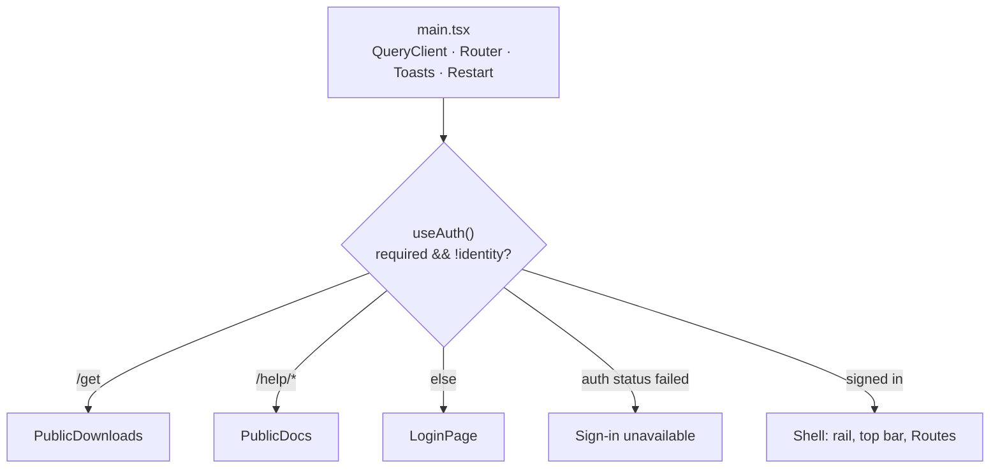

# Console (`ui/`)

The web console: React 19, TypeScript (strict), Vite, TanStack Query, react-router 7. It is a pure client of the server's API. The server serves the build from `ui/dist` and rebuilds it on start when sources are newer (`server/agent_server/ui_build.py`).

## Design in one paragraph

Every byte the console shows comes from the server over HTTP, server-sent events (`/api/live`) or WebSockets (`/api/terminals/{id}/view`). `VITE_API_URL` chooses the API origin at build time; unset means same-origin. `api.ts` owns `API_ORIGIN`, `apiUrl`, credentialed fetches and the socket URL; SSE uses `withCredentials`. Documentation, downloads and installer/login commands use the API origin too. All server state is TanStack Query cache, keyed by short arrays and refreshed by polling or invalidation. Navigation is data (`navigation.ts`), and the layout is one stylesheet (`styles.css`) with CSS variables for light and dark themes: the tokens at its top (`--paper`, `--ground`, `--rail`, `--hover`, `--ink`, `--steel`, `--faint`, `--line`, `--accent`, `--radius`, `--shadow`, ...), then the controls, the shell and the shared surfaces (panels, cards and tables share one look: hairline border, 14 px radius, soft shadow). Page tabs are underlined (`.tabs.page-tabs`, `.machine-nav`); second-level tabs are segmented controls (`.tabs.segmented`, `.machine-subnav`), so a level never reads as another row of the same tabs. Anything about a model server lives on its machine's page. The console never works out routing decisions itself: which backends an agent can use comes from `/api/agents`.

## Boundaries

The standalone nginx image and server-hosted SPA send `frame-ancestors 'none'`, `X-Frame-Options: DENY`, `nosniff`, `same-origin` referrer policy, and object/base-URL restrictions. These do not change page layout. nginx location caching must preserve the server-level security headers.

- Only the server's API. No imports from other components, and no logic the server owns (backend choice, agent templates).
- The server's SPA fallback returns `index.html` for unknown paths but 404 under `api/`, `v1/`, `session/`, `anthropic/`, `downloads/`, `help-files/`. So the SPA must not use `/downloads/`, `/android` (files) or `/docs` (OpenAPI). That's why Downloads is `/get` and docs are `/help`.
- Every build replaces the lazy chunks (`mermaid.js`, the terminal, containers). So the server sends `index.html` and the docs with `Cache-Control: no-cache` and `/assets/` as immutable, `main.tsx` reloads the page once on `vite:preloadError` (a console from before an update), and the Docs page says so on each diagram if `mermaid.js` still won't load, trying again next time.
- Standalone: `ui/Dockerfile` builds a static nginx image; `ui/nginx.conf` caches hashed assets, revalidates the SPA and refuses API paths. Compose's `console` profile exposes it on loopback :8081. The API must trust its exact origin through `AI_PROXY_CONSOLE_ORIGINS`; both hosts must be HTTPS subdomains of the same site for SameSite=Lax cookies.
- Dev: `npm run dev` on :5173 proxies `/api` (with `ws: true`), `/health`, the API reference (`/docs`, `/redoc`, `/openapi.json`), `/help-files`, `/downloads`, the installers and `/android` to `AI_PROXY_URL` (default `http://127.0.0.1:9999`). With `VITE_API_URL`, it calls that origin directly instead.

## Shell and routing

- `main.tsx`: queries retry once, never on a 401; any 401 invalidates `["auth"]`, which drops back to sign-in.
- `App.tsx`: the mandatory auth gate reads `window.location.pathname`, not the router. When `/api/auth/status` itself fails (the issuer or API is down) before any identity was confirmed, it shows "Sign-in unavailable" rather than `LoginPage`; `/get` and `/help` still render. Once signed in, a failed recheck keeps the last identity and the Shell mounted (unmounting it would abort Ask a model's stream and close terminals); only a status that answers signed out shows `LoginPage`. `/pair` is a Shell route and requires sign-in.
- Authentication is mandatory and fail-closed. Login redirects to the API's PKCE flow; only the issuer collects passwords. `api.ts` renews access cookies ahead of expiry (`scheduleRenewal`, from `expires_in` on `/api/auth/status` and `/api/auth/refresh`; again at once when a throttled background tab becomes visible), serializes refreshes per tab and through Web Locks (a localStorage lease on plain HTTP), and skips one another tab already made (`refreshSignIn(since)`); every renewal calls `onRenewed` listeners with the new access token (another tab's is read back from `/api/auth/status`). The terminal viewer sends it over its socket (`{"type":"token"}`), and `useLive`/`followReply` open the next stream on the new cookie and switch to it at its snapshot, so neither is cut when the token they opened with expires; auth status polls every 30 seconds. The header polls `/api/status?recent=0` and `/api/terminals?open=1`; only the Overview asks for the recent request records (`useStatus({ recent: true })`). Terminal reconnects check status before dialing. Legacy `/pair` links redirect to terminals; expired permissions show sign-in, never a key form.
- `Shell`: the rail is the Overview (`/overview`, `OverviewPage`), then `visibleSections(siteAdmin, admin)` from `navigation.ts`, then the foot: `HELP_LINKS` (Downloads, Documentation), `AccountMenu`, the connection, the theme switch and the version. It shows counts (in-flight requests, connected terminals, connected machines; agents waiting for their user replace the terminals count, and `AttentionAlerts` shows them as slim bars above every page). `RailLink` is a plain `Link` whose `active` class comes from `linkActive` (so `/machines#add` never lights up with All machines, and `/machines/<id>` keeps All machines lit). **Go to…** (`.rail-search`, and Ctrl/⌘ K anywhere through `useCommandShortcut`) opens `components/CommandMenu.tsx`: a `<dialog>` searching `visiblePages()` (each page's `hint`) and the machines from the shared `["machines"]` query, arrow keys and Enter to open. Below 900 px it becomes a top bar (menu button first, at the left, then the wordmark and a search button) with a slide-in menu. Opening the menu pushes a history entry, so Back (Android's included) closes it. Each section heading is a button that folds its group (`useFoldedSections`, the section `id`s in localStorage `ai-proxy-nav-folded`); a folded group still lists the active page. `rail-toggle` collapses the desktop rail to 64 px of icons (`useRailSlim`, localStorage `ai-proxy-rail-slim`, `.shell.rail-slim`, its rules inside `min-width: 901px` so the phone menu never loses its names); links then carry their label as `title`.
- Old addresses (`/models`, `/strata`, `/docker`, `/containers`, ...) redirect to `/machines`.

`navigation.ts` has two views of the same pages. `SECTIONS` is the rail, grouped by task: **Agents** (Start an agent, Live agent view, Running agents, Ask a model), **Models** (Providers, Subscriptions, Shared with you), **Machines** (All machines, Add a machine, Approve a device), **Activity** (Live, Traffic, Requests, Sessions), **Logs** (Access log and API log for site admins, Audit log for admins) and **Administration** (Organizations; Server settings and Server stats for site admins). Each page is defined once in `PAGES` (`to`, `label`, `icon`, `hint` for the command menu, `siteAdmin`/`admin`). `PARTS` is the three parts a request passes through (agents, the server, machines, with their numbers), which only the Overview's cards and the routing map use (`partsById`). `sectionFor()` drives `PartTag`, the breadcrumb above each `<h1>` ("Activity › Requests"); its `trail` prop adds what is deeper than the page (a machine's name, a request's session and number), so no page builds a breadcrumb of its own. The pages in detail: **Agents** (`/live-agents` Live agent view, `/agents` Start an agent, `/terminals` Running agents, `/providers` Providers: `pages/Providers.tsx`, `["providers"]` from `/api/providers`, cards grouped On machines / Hosted APIs / Subscriptions with your usage in a chosen window, `LimitMeter` per limit and `BlockedNote`, all as the server reports them, `/subscriptions` Subscriptions: `pages/Subscriptions.tsx`, provider accounts with `["provider-accounts"]`/`["provider-account", id]`, usage windows and the estimated remaining balance as the server reports them (never computed in the browser), assignments, token store/revoke (the field is cleared, nothing kept), settings, history; `/ask` Ask a model: `pages/Ask.tsx`, a session of client `console-chat` and `askModel` in `api.ts` streaming `/session/<id>/v1/chat/completions` with the browser's sign-in, as an agent would, plus `X-AI-Proxy-Finish: 1` so the server reads the reply to the end; when the stream drops (not an `ApiError`, not Stop), `followReply` picks the rest up from `/api/live` by the reply's `X-Request-ID`; Stop also calls `api.stopReplies`), **Machines** (`/machines`, active on individual machine pages too; `/approve-device` Approve a device), **Server** (`/live`, `/traffic`, `/requests`, `/sessions`, `/server-stats`, `/access-log` (`pages/AccessLog.tsx`, site admins: Overview `["access-log-stats"]`, Since this start `["access-log", failed, q]`, Saved history `["access-log-history", failed, fleet, q]`), `/api-log` (`pages/ApiLog.tsx`, site admins: the request log, `["request-log-summary"]` with a debug-mode toggle, `["request-log", filters]` polled while Follow is on, paged by `before` time, a row's payload `["request-log-entry", id]` read when opened), `/audit` (`pages/AuditLog.tsx`, admins only: rail items marked `admin`; `["audit", filters]` is an infinite query paged by the server's `next_before` cursor, opaque to the browser; downloads and Verify chain for admins; Sign checkpoint now for site admins only), `/settings`, `/organization`, `/get`).

`MachinesPage` lists machines in responsive rows (name, architecture, last contact, function states), with a case-insensitive search over name, id, hostname, address and owner. `MachineRow` uses reported flags for agents, terminals, server management, containers, updates and tunnel; model servers use `machineProviders`, MCP uses reported servers. These describe configuration/presence, not `machine.you` permissions or connection readiness. Searching only filters the rows; fleet totals and the add/removed-machine controls stay unchanged. Adding a machine (`#add`) is `JoinSteps`: a system switch (sh, PowerShell, Python or Docker container) and an install switch (agent-machine, or agent-machine and agent; hidden for a container), both kept in `localStorage`, give one command from `installLine()` in `Downloads.tsx` (shared with `OneLineInstall`), a start-by-itself checkbox (`--service`) and a list of what the command does. `PythonSteps` gives pip with the build's wheel (from `/downloads/index.json`), then `agent-machine login` and `start`. `SandboxSteps` (a `sandbox/Dockerfile` container, the Docker container system) has its own engine and shell switches and an optional name field (`dockerName()` slugs it; not remembered, since a leftover name would point the next sandbox at another's volumes). The name adds to `SANDBOX_BASE` and names the container, its hostname (the sandbox names the machine after it; Docker's default is the container id) and both volumes (`-home`, `-workspace`), so one computer can run several sandboxes; it flows into `RemoveSteps` as its `container` prop so `exec`/`rm`/`volume rm` name the same sandbox. `RemoveSteps` (under each system's steps) is the way back out for the same choices: `uninstallLine()` for sh/PowerShell, pip and the settings folders for Python, `rm`/`volume rm`/`image rm` for the container, with a purge checkbox; it ends by pointing to the machine page's **Remove from this server**.

## Data layer

- **`api.ts`** is the only place that calls `fetch`. `request<T>()` turns non-2xx responses into `ApiError(detail, status)`. `export const api = {...}` groups the methods by area. Standalone helpers cover streaming and shaping: `pullModel` (NDJSON progress), `fetchProviderLog`, `terminalSocketUrl`, `machineProviders`, `providerRef`, `addBackend` (hosted APIs only). The stored settings have their own methods and types: `api.storedAgents`/`saveAgent`/`deleteAgent`/`resetAgent` (`StoredAgent`: id, definition, yaml, builtin, edited), `api.modelTuning`/`modelTuningYaml`/`saveModelTuning` (`ModelTuning`: defaults, profiles, aliases), `api.storage`/`saveRetention` (`StorageInfo`), `api.importSettings`; `api.requests(query)` takes a `RequestQuery` (`session_id`, `limit`, `before`, `model`, `kind`). Its types must mirror the Python response shapes.
- **Provider addressing**: `/api/machines/{id}/providers/{kind}-{port}`. A `ProviderRef` is `{machine, provider}`. `MACHINE_TYPES = ["ollama","llamacpp","strata","docker"]`. `API_TYPE = "api"` is the generic OpenAI-/Anthropic-compatible backend, hosted or on a machine (a machine reports it with a `flavor`: `lmstudio`, `vllm`, `sglang`, `openai`; `API_FLAVORS` names them); `routes.ts` `isHosted(backend)` (Anthropic, or `api` with no machine) decides the hosted route, never `type === "anthropic"` alone.
- **Query keys**: shared ones in `hooks.tsx` (`useStatus` `["status", "summary"]` and `["status", "recent"]` every 2 s (invalidate by the `["status"]` prefix), `useSessions`, `useRequests(sessionId?)` `["requests", sessionId, revision]` (one session's all, or everyone's newest `REQUEST_WINDOW` = 2000; the Requests page fetches older pages on demand with `before`, "Load 2000 older"), `useModels`, `useMachines` every 5 s, `useAgents`, `useAuth`, `useVersion` `["health"]`). Others: `["terminals", "open"]` (the rail) and `["terminals"]`, `["containers"]`, `["remote"]`, `["config"]`, `["stored-agents"]` (saving one also invalidates `["agents"]`), `["model-tuning"]` (saving it also invalidates `["models"]`), `["storage"]`, `["api-providers"]`, `["orgs"]`, `["users"]`, `["mcp"]`, `["downloads"]`. Per machine: `["provider", m, p]`, `["metrics", m]`, `["ollama-settings", id]`, `["ollama-log", id]`, `["llamacpp-settings", id]`, `["llamacpp-install", id]`, `["llamacpp-log", id]`, `["provider-log", m, p, source]`, `["container-log", name]`, `["machine-folders", id, path]`. After a mutation, invalidate the keys it affects. Logout, adopting a provider, adding a backend, saving Settings and creating or deleting a container invalidate everything (sign-in is a full-page redirect).
- **Session chat** (`components/SessionChat.tsx`, the Chat tab of `pages/Session.tsx`): `["chat", session, thread]` is an infinite query, newest page first; a change in the session's request count refetches only the newest page and folds it in. `["chat-turn", session, thread, index]` fetches one turn whole when a preview is opened. `buildItems` turns the server's turns into messages, and it decides by the server's `author`/`note`/`kind`, never by role alone: `person`/`parent`/`unknown` (and a background call's own instructions) on the right, assistant and unpaired tool output on the left, the agent's own text as centred notes (reminders and notes only with **Show what … added**). Don't re-derive who wrote something in the browser: add it to `chat.py`. The thread list is the side column at 900 px and up, a `<select>` below.
- **Live**: only `live.ts` `useLive(sessionId?)` opens the EventSource (and `followReply` in `api.ts`, for Ask a model). It folds the `snapshot`/`start`/`summary`/`delta`/`end` events into a ref and publishes once per animation frame. An EventSource that ends up `CLOSED` (a reconnect answered 401, 502 or 503) never retries by itself, so both call `renewSignIn(opened)` (exported from `api.ts`, wrapping the shared refresh; a renewal made since the stream opened counts) and open a new one after `LIVE_RETRY_MS` (1, 2, 5, 10, 30 s); `useLive` also reconnects at once on `online` and on `visibilitychange` to visible. Every new connection starts with a snapshot, which resyncs. The server ends a stream when its access token expires and sends `retry: 1000`, so the browser reopens it a second later; `useLive` reports disconnected only after a gap longer than `LIVE_GAP_MS` (4 s). `followReply`'s retries stop with its 60 s quiet timeout, which reopening doesn't reset.
- **Polls after errors**: `pollEvery(ms, afterError)` in `hooks.tsx` is the `refetchInterval` for polls with `retry: false` (the rail's `["terminals"]` and `["machines"]`, a machine's terminals): after an error it keeps polling every `afterError` (20 s by default), stopping only on a 403. `["remote"]` on Running agents polls every 10 s while it fails. The other shared queries use a plain number, which TanStack Query keeps polling through errors.
- **Pulls**: `pullModel` resolves only on the server's final `{"status":"success"}` line; a stream that ends without one, or fails mid-read, throws `PullConnectionLost`, which `usePull` shows as "Lost the connection to the pull" (not "Pulled") and refreshes the provider's models.
- **Terminal viewer** (`pages/Terminal.tsx`, lazy-loaded because it pulls in xterm): binary frames go straight to xterm; the JSON messages are `state`, `replay`, `replayed`, `gap`, `resize` and `error`. The viewer keeps `position`, the absolute byte offset of the end of what it shows, and reconnects with `?from=<position>` (`terminalSocketUrl(id, from)`). After `state` the server sends `{"type":"replay","start","resumed"}`: resumed means the history that follows starts at `from`, so it's appended without a reset; otherwise the terminal is reset. Either way position = start, plus every binary frame's length; `{"type":"gap","to"}` (output the launcher skipped) sets position = to. An older server sends no `replay`: the first history frame (or `replayed`) then resets and position stays unknown, as before. Every (re)connect first calls `api.authStatus()`, which renews the cookies; no identity shows sign-in, and a failure retries after 5 s. Close 4401 renews the sign-in once (`renewSignIn`) and reconnects, and shows sign-in only if it comes again before a good connection; 4404 is retried every 1.5 s for the first minute (`WAIT_FOR_TERMINAL_MS`: a launch opens the page as soon as its session exists, a moment before its launcher shares the terminal), then means gone; 4410 (the socket's access token ran out, every few minutes) reconnects at once and resumes, showing retrying only if that takes over 1.5 s; anything else (4403, a restart) reconnects after 2 s and resumes. Input is `{type:"input", keys}` or `{text, enter:true}`. xterm's automatic replies (`REPLY`) are dropped because the real terminal answers them. Wheel reports (`WHEEL`) pass, so alternate-screen agents can scroll. The on-screen key row exists for phones.

### Terminal grid

`pages/TerminalGrid.tsx` is the lazy-loaded **Live agent view** at `/live-agents`, in the Agents section of `SECTIONS` (after Start an agent) and the console's landing page: `/` redirects to it (`/terminals-beta` too), and the Overview lives at `/overview`. It uses the same `["remote"]` and `["terminals"]` queries. `Terminal.tsx` exports `TerminalView` for the full `TerminalPage` and compact grid tiles, sharing the socket lifecycle, token renewal, replay, permissions and input filtering. Compact viewers use 2,000 lines of scrollback instead of 20,000 and a separate grid font size; changing the font or layout does not reconnect or resize the launcher's PTY. Removing a tile or changing grid pages disposes its viewer and socket.

The grid selects up to 16 sessions in selection order, paged by rows × columns (each 1–4, default 2 × 2). Layout and font size are validated and stored under `ai-proxy-terminal-grid-layout` in localStorage (`slim` is a boolean, the rest bounded integers); session ids are in sessionStorage under `ai-proxy-terminal-grid:<JSON tenant/user tuple>`. Unavailable selections stay as removable placeholders; ended selections retain their final screen. Fullscreen links to `/terminals/:sessionId` with router state `fromGrid`, which points the viewer's back button at the grid. Below 700px, tiles stack in one column. No API or protocol change.

**The chrome is one line wide**: `.grid-bar` holds the collapse button, the part tag, the title and `.grid-controls`, two `.grid-menu` dropdowns: **Agents** (`.grid-picker`: search, the session checklist, Clear/Done) and the layout (`.grid-layout-controls`: Rows, Columns, Text size, the capacity and the type/tap hint). Each `.grid-popover` hangs under its button and closes on Esc or a mousedown outside (`useDismiss`, as `AccountMenu`); only one is open at a time. Below 700px `.grid-menu` is static, so the popover spans `.grid-bar` (`position: relative`). The picker starts open while nothing is selected; the empty state's button and empty tiles reopen it (`openPicker`). `slim` sets `hidden` on `.grid-controls` (a flex child, so it needs `.grid-controls[hidden] { display: none }`) and drops the part tag; `toggleSlim` deliberately does **not** reset the grid page the way `changeLayout` does, and `layout.slim` is a fit-effect dependency so the ResizeObserver-driven `--grid-height` refits the moment the bar shrinks. Collapsing also closes both dropdowns. The grid pager (`.grid-pages`) is two icon buttons, the chevron (`.back` rotates it), around `page / pages`. The tile viewer's own hint paragraph is gone from `TerminalView` in compact mode (`term-hint` stays on the full page only); the layout dropdown carries that hint instead, switching on `matchMedia("(pointer: coarse)")`. Each tile header is one `.terminal-tile-title` button — chevron, `.state-dot` in the state's tone, ellipsized name — whose `aria-expanded`/`aria-controls` drive the on-demand `.terminal-tile-meta` row (type, machine, folder with `project_path` as its `title`, status label and detail, model, session id, watch-only note); opening it costs tile height, not PTY size, since xterm's rows come only from the server's `state`/`resize`. Fullscreen and Remove stay icon buttons. Below 700px the model fact is dropped and tiles get `grid-auto-rows: 300px`.

**Quick keys**: `.grid-key-bar` (in `.grid-keys`, sticky at the bottom, after `.terminal-grid`) renders `KEYS` from `Terminal.tsx` for the selected tile. Each compact `TerminalView` gets `onSender` and registers a `KeySender` (`keys`: `send({keys: keys(term)})`, so arrow keys follow that terminal's cursor mode; `text`: `send({text, enter: true})`) in the grid's `senders` map, removed on unmount. On touch devices `.grid-keys` (the sticky wrapper) also holds `.grid-message`, a message box (16px, so iOS doesn't zoom) that sends to the target; tiles get `onTapToType`, so a tap on a tile's `.term-screen` focuses that box inside the tap and the phone raises its keyboard (xterm has `disableStdin` on touch). The target is `active` (set on a tile's pointerdown or focus) when it is on the visible page, else the first available tile; buttons are disabled unless `you.control` and not ended. The fit effect subtracts the height of `.grid-keys` (`nextElementSibling`) from `--grid-height`.

**The full terminal page** has one `.term-bar`: back link (`fromGrid` picks the grid or `/terminals`), `.term-title` button (dot, `<h1>` name, project, chevron) toggling the `.term-details` panel (state detail, Session traffic, `SharingControl`, desktop hints), the state pill and `.terminal-toolbar`. Below 1000px the toolbar shows only while the details are open (`.term-bar.open`), on its own row. xterm keeps `disableStdin` on touch devices (its hidden textarea mangles autocorrect and composition), so a click on `.term-screen` on a touch device focuses the message textarea to raise the keyboard.

## Machine page (`pages/Machine.tsx`)

The design rule: **everything about a model server is on its machine's page**, one tab per function, at `/machines/:id/:section`; model servers and containers all under the one Providers tab.

- `machineProviders(machine, status.backends)` merges what the machine reports running with the backends that point at it, keyed `{kind}-{port}`.
- Tabs: Summary, `agents`, `terminal`, `files` (`MachineFiles.tsx`: the file viewer, `machine.you.files` and `machine.files`; the open folder and file in `?path=` and `?file=`, `api.machineFiles`/`machineFileContent`; Markdown files rendered with marked unless `?view=source`, raw HTML escaped, relative links resolved against the file's folder (`resolveLink`) and opened in the viewer, headings ids prefixed `user-content-`; the list folds away (`list-closed`) by itself below 1100px when a file opens), `providers`, `load`, `mcp` (owner, or it shares servers), `accounts` (`MachineAccounts.tsx`: the machine's `provider_clis` and the subscriptions assigned there), `access` (`MachineAccess.tsx`, `machine.you.manage`). `LaunchForm` offers **Subscription** for agents with `subscription` (`account_id`: the machine's own sign-in for its owner only, `auto`, or an id). Other sections are listed in `SECTIONS`; an unknown one says there's no such tab.
- **Providers** (`MachineProviders`, routes `/machines/:id/:section/:kind/:sub`, links from `providersPath(id, kind?, sub?)`): `.machine-subnav` with **Overview** (`MachineModelServers`: every instance, `InstalledServers`), one tab per kind from `providerKinds` (kinds it runs, plus Ollama when installed, llama.cpp when `servers` is on and the machine knows it, Strata when found; in `KIND_ORDER`), and **Containers** (if it runs them or a provider is a container). `ProviderKind` shows `.instance-nav`: one pill per instance of that kind (its id is the sub; containers too) and the kind's `server` sub from `serverTabLabel` (`MachineOllama`, `MachineLlamaCpp`); without a sub, the first instance, else `server`. `movedSection` redirects the old tabs (`model-servers`, `ollama`, `llamacpp`, `containers`, `{kind}-{port}`) here, so links and bookmarks keep working.
- `ProviderView` renders `ProviderHead` (with **Add as a provider** for admins of the machine's organization when there's no backend yet), then switches on kind: `OllamaProvider` (`Models.tsx`), `LlamaCppProvider` (`LlamaCpp.tsx`), `StrataProvider` (`Strata.tsx`), `DockerProvider` (`Docker.tsx`), `ApiServerProvider` (`ApiProviders.tsx`, kind `api`: a read-only model list from `/api/models`, no pull, delete or load, since LM Studio, vLLM and SGLang manage their models themselves). Each of the first four takes `{target: ProviderRef, label, backend, manageable}`. `manageable` is a reason string when changes aren't possible (machine offline, `servers` off). Other tabs: `MachineOllama` (`OllamaServer.tsx`, which exports `SettingsTab` and `EnvironmentTab` for any settings table), `MachineLlamaCpp` (`LlamaCpp.tsx`: install with a build picker, progress polled from `["llamacpp-settings", id]`, start/stop/restart/remove, settings, environment, log), `MachineContainers({machine})` (`Containers.tsx`, lazy-loaded), `MachineLoad({machine, ollama})` (`Hosts.tsx`; both take the machine's id), `MachineMcp.tsx`.
- Show controls according to `machine.you` (`owner`, `manage`, and one flag per feature: view, launch, terminal, models, servers, update, mcp), never according to role.

## Server settings (`pages/Settings.tsx`, `pages/SettingsStored.tsx`)

- `pages/DeepSeekSetup.tsx` is the dedicated DeepSeek onboarding and ordinary edit form, used for preset ID `deepseek` and for saved providers the server marks `balance_supported`. It takes the existing server preset/fields unchanged for endpoints and protocols, asks for a key source plus optional name/team access, then saves and tests through the existing organization API. A check failure reports that the save succeeded, so retries do not create duplicate connections; a save failure keeps input available. Blank replacement keeps a vault key; switching to environment authentication sends `clear_key` when needed. Secrets are cleared after saving and kept only in local state before then. `ApiProviders.tsx` exposes a direct Connect DeepSeek tile, tailored saved-card labels, Refresh models and Claude guidance; Advanced settings retains `ProviderEditor` for full configuration. Styling is in the `.deepseek-*` rules in `styles.css`.

- API provider cards show `discovered_models` returned by automatic discovery, alongside aliases. Their listing query refreshes every five minutes while mounted. `balance_supported` from the server enables DeepSeek's **Check balance** button (disabled without a key), calling `api.apiProviderBalance(org, name)`. Its local mutation state shows availability and exact per-currency strings; balances are never polled or kept in shared query caches. Model discovery refreshes after five minutes; Test connection bypasses it and invalidates model queries. The discovery option explains this in the editor.

- `Settings.tsx` edits the network settings through `GET`/`PUT /api/config`: the listen address and URL, the **Public console address** (`proxy.public_url`; empty clears it), the default backend and hosted backends. `api` backends round-trip there as `{type, url}` (the server keeps their other options); their name, type and URL are read-only and they can't be removed there, only chosen as the default.
- The organization page's **API providers** tab (`Organization.tsx` `OrgDetail`, `?orgTab=providers`, for those who `manages` it; `pages/ApiProviders.tsx` `ApiProviderSettings({org})`) manages the organization's `api` backends through `/api/orgs/{org}/providers` (`["api-providers", org]`; `api.apiProviders`, `saveApiProvider`, `deleteApiProvider`, `testApiProvider`, each taking the org). The editor's **Teams that may use it** picks from `org.teams` (keys `<org>/<team>`); **Also share with** (`orgs`) shows only when the listing's `share` is true (site admins). Cards are grouped Hosted APIs / Gateways / On machines by `category`, with protocols, sign-in mode, where the key comes from (`has_key`, `key_source`; never the key), model aliases, priority and fallbacks, and health. Add from a preset or blank; the editor's key field is write-only (empty keeps the stored key, **Remove key** sends `clear_key`), and when `vault` is false it says to use `key_env` (`AI_PROXY_API_KEY_*`). **Test connection** shows the result and offers to add the models it lists as aliases of themselves. Machine-hosted ones are added from the machine's page (adoption); their URL can't be changed. Saves invalidate everything, as adding a backend does.
- `SettingsStored.tsx` holds the sections for what used to be files, each a self-contained component: `AgentDefinitions` (every agent with a "Shipped", "Shipped, changed" or "Added here" badge, edited as YAML in `AgentEditor`; Reset for a changed shipped one, Add an agent, Remove), `ModelTuningEditor` (Ollama model tuning as one YAML document: defaults, profiles, aliases) `StorageSettings` (which database, its size, and the server's retention policy: `["retention"]` from `/api/config/retention`; saving also invalidates `["storage"]` and `["org-retention"]`) and `AuditSettings` (`["audit-config"]`: the key, backlog, checkpoint interval and exports; it refetches after saving, since `PUT` doesn't return the key or backlog). `components/SharedModels.tsx` (`SharedModelsSettings`, the **Shared models** tab, `?tab=shared`) edits `["shared-models"]` (`/api/config/shared-models`): the site's providers the server says can be shared, each with the models `useModels` knows plus typed ones; saving invalidates `["agents"]`, `["models"]` and `["providers"]`. `Settings.tsx` shows them as tabs kept in `?tab=` (the default tab stays mounted, so unsaved edits survive a switch). `retention.ts` holds the kinds' labels and day parsing shared with the Data tab; days are numbers or `null` (forever). They're admin-only on the server, so each hides itself on a 403 (`forbidden`) rather than showing an error.
- `ServerStats.tsx`'s "What the server keeps" table has a row for the database (`database: {kind, bytes}` from `/api/server/stats`) beside the folders. Its top is the live dashboard from the same answer's `live` (`ServerLive`): cards (`LiveNow`), the Traffic charts and `Technical` (facts, open WebSockets by kind, the server's processes when there's more than one). The server and machines send running totals (network bytes, requests answered, tunnel bytes); `rates.ts` `useRates(timestamp, totals, window)` turns successive samples into per-second series, leaving a gap rather than a spike when a total is missing or went backwards, and `ceiling()` gives those charts a top that follows the data. `Hosts.tsx` (`MachineLoad`, `MachineDetails`) uses the same for a machine's network and tunnel traffic; every `MachineSample` field after `gpu_error` is optional, since an older agent-machine doesn't send them.
- The YAML stays text in the browser: the server parses and validates it (`PUT` with a YAML body) and answers 400 with what's wrong. Don't parse or re-serialize definitions in the console.

## Organization workspace (`pages/Organization.tsx`)

- `pages/ApiCredentials.tsx` renders manager-only `orgTab=credentials`. Query `["api-credentials", org]` lists metadata and the token endpoint; create/regenerate keep the one-time secret only in component state. Revoke/regenerate use `ConfirmDialog` and invalidate credential queries. Account choices stay inside the selected organisation; an environment account is marked `environment` and can't be edited there. Root offers the bootstrap flag. `App.tsx` mounts `BootstrapCredentialWarning` for site admins above page content; it reads root credentials (polling every minute, so credentials made with `agent-auth` show too) and links to the tab while any bootstrap record is not revoked. Credential changes invalidate the query and a window focus refetches it, so it doesn't poll. Check failures are visible instead of silently clearing the warning.

- Organizations are tenants (`.context/auth.md`): `identity.tenant` is the user's one organization, `identity.site_admin` an admin of `root` (`ROOT_ORG` in `api.ts`); `roleLabel()` names them. `manages(identity, org)`: site admins any organization, organization admins their own. Server-wide pages and controls (Server settings, Server stats, restart) follow `site_admin` (`navigation.ts` items marked `siteAdmin`, `visibleSections`); organization and machine admin actions follow `role === "admin"` within the tenant.
- `components/AccountMenu.tsx` is the rail's account button: the browser's sign-ins (`api.accounts`, query `["accounts"]`), **Switch to**, **Add another account** (`api.addAccount`), sign out of one or all (`api.logout({user}|{all})`). Any change reloads the page and posts to `BroadcastChannel` `mesh-account`, which `useAccountChanges()` (in `App.tsx`) follows in other tabs. `Login.tsx` offers **Continue as** for accounts still held when the active one has ended.
- `/organization` has URL-backed tabs (`tab`): Organizations (default; "Your organization" for anyone but site admins), Everyone (`users`, site admins only: everyone else's People tab already lists all they can see), Your account (`account`). Your account explains OIDC/device/service sign-in; legacy password and launcher-token controls are removed.
- An organization's **Data** tab (`orgTab=data`, for those who manage it) is `pages/OrgData.tsx`: `["org-retention", org]` (the effective policy, `own`, and `server`: its capture, days and bounds) and `["holds", org]` from `/api/holds?org=`. Saving sends the organization's whole set of overrides (`PUT` replaces them); the server checks the bounds and answers 400 with why.
- An organization's **Usage** tab (`orgTab=usage`, on the root too) is `pages/OrgUsage.tsx` `OrgUsageTab`: `["org-usage", org]` from `/api/orgs/{org}/usage`, a table by person and provider for a chosen window (members get only their own rows, `manage: false`), and for managers `Limits` (list, remove, and a form; `parseTokens` takes `1m`, `100k`, `2.5b`). Saving puts the returned report in the cache and invalidates `["providers"]`. Who's blocked and until when is the server's answer; don't compute it in the browser.
- Site admins start at a table of every organization (root first: name and id, people, teams, admins; search, and New organization, which opens the new one), and opening one shows it full width with **All organizations** and a switcher above it; everyone else goes straight to their own. `org` opens an organization (none: the table); its header lists ID, people, teams and admins, with **Add an admin** (opens `CreateUser` with the admin role) while it has none. `orgTab` selects People (default; "Site admins" for root), Teams (none for root), API providers, Usage, Data, Sharing or Settings (none for root: rename; delete, site admins, only once it has no users); `team` opens a team (and sets `orgTab=teams`). Switching organizations clears the nested selection. `NewNameForm` creates organizations and teams from a name, deriving the id (`idFrom`) until it's edited.
- Users belong to one organization for good, so there are no organization membership controls (the server refuses them); `TeamMembers` uses the scoped `setTeamMember` call for that organization's users only. Removing a team member or deleting a team/organization asks for confirmation; none deletes the user's account.
- `CreateUser` creates in a fixed organization (and team) or, for site admins, in a chosen one (root forces the admin role). `UserRow` edits role, the organization's teams and an optional password together, never the organization. `useDirectoryChange` replaces the org/user query caches and invalidates auth, machines and sessions.
- Mutations are for the organization's admins and site admins (`manages`); members get read-only views filtered by the server.

## Peering (`components/LinksSettings.tsx`, `pages/OrgSharing.tsx`, `pages/Shared.tsx`)

Server settings' **Links** tab (site admins) is `LinksSettings`: the mesh id, codes, joining by address and fingerprint, confirming a server that presented, and each link's policy. Organizations' **Sharing** tab (its admins, not the root) is `OrgSharingTab`: bridge codes, checking and entering the other side's, and each bridge's policy editor (out: `shareable` from the server; in: what the other side lets out, with teams), limits and actions. **Shared with you** (`/shared`, the Agents part) lists `/api/peer/resources` and launches on a shared machine (`api.peerLaunch`), then opens the mirror session's terminal (`/terminals/<id>`; the server relays it). `MachineAccess` adds the organization's bridges as grantees for launch, terminal and MCP. The data layer's types are at the end of `api.ts` (`LinkInfo`, `BridgeInfo`, `BridgeItem`, `PeerResources`, ...). Remote things are always shown by their full names, as the server sends them; the console never builds one except to say what a launch names.

## Module map (where things go)

- `src/`: `api.ts` (calls and types), `hooks.tsx` (shared queries, theme, toasts, clipboard), `live.ts`, `traffic.ts` (host and path classification), `format.ts`, `routes.ts` (`ROUTES`, `PROVIDERS`, `providerLabel()`), `navigation.ts`.
- `pages/`: one file per page. `Docs.tsx` renders `docs/*.md` from `/help-files/` with marked, and loads mermaid lazily. `markdown.ts` holds what it shares with the file viewer: `escapeHtml`, `slug`, `mermaidBlock`, `renderDiagrams`/`watchDiagrams`.
- `components/`: reuse before writing new ones: `Tabs` (`useTabParam`, `TabBar`, `TabPanel`, which unmounts inactive panels and so stops their polling), `CodeLine`, `ConfirmDialog`, `ModelSearch` (`flavor="llamacpp"`: Hugging Face only, names `user/repo:quant`, a pull method beside Pull and the **By hand** tab, `ManualDownload`/`llamaCurlCommands`, over `api.llamaFiles`/`api.llamaReload`)/`usePull(target, label, onPulled)` (`start(ref, method?)`), `ProviderState`/`StateDot`, `LogPanel`, `RouteBadge`, `AddBackendForm`, `Sharing`, `McpChoice`, `FolderPicker`, `Attention` (`AttentionAlerts`, `waitingAgents`, `NotifyToggle`), `Restart` (`RestartProvider`, `RestartButton`), `Icon` (inline SVG only), `DetailView` (`useDetailView`, `DetailBack`: details that take the page from their list on a narrow screen).

## Styling

`styles.css` is the only stylesheet, with no framework. Tokens are on `:root` and overridden on `:root[data-theme="dark"]` (`--paper`, `--ground`, `--ink`, `--accent` indigo, `--shadow*`, `--route-*`). The fonts are Inter and JetBrains Mono. An inline script in `index.html` sets the theme before React loads. Check dark mode and a ~412 px viewport (the Android app) for every layout change.

## Extending

- Start an agent (`pages/Agents.tsx`): two choices kept in the address (`?on=<machine id>&agent=<id>`; the last machine also in localStorage): where it runs ("Give me the command", or a machine with `you.launch`, each with `machineBlocker()`'s reason) and the agent, then `AgentStart` shows only that case: on a ready machine `Machine.tsx`'s exported `LaunchForm` with `initialAgent` and `fixedAgent` (no agent choice of its own); on one without the agent its `InstallCommand` for the machine's OS; for the command, the install command, then `AccountCommand`/`ProxyCommand` with the extras under a collapsed Options. No machines you may launch on: a callout linking to `/machines#add`.
- **Page**: `pages/X.tsx` with the standard head (`header.page-head`: `<PartTag />`, the `<h1>`, or `.page-title` holding the `<h1>` and the page's actions, then a `p.lede` of one or two short sentences without commands; anything longer is a `p.subtle` or goes in the content), counts as `dl.stat-cards`, search in `.filters`, pill filters and toggles in `.chip-bar` (buttons with `aria-pressed`), top-level tabs as `TabBar className="page-tabs"`, and `p.empty` for empty and loading states. Sessions and Traffic are the models (Traffic's rows are `.traffic-list` buttons, not a table, so they fit beside the inspector). Running agents (`pages/Terminals.tsx`) is Sessions for the active ones: the same head, cards, search and state chips over `.agent-list`, whose rows (`AgentRow`) are links to the terminal, with the state from `terminalState()` and who, where and traffic from the `["terminals"]` summary (nothing worked out from requests). A list with details beside it (`.split`: Traffic, Requests) uses `components/DetailView.tsx`: `useDetailView(open)` gives `select(key)` (sets `?request=` and pushes a history entry marked `fromList`) and `close()` (Back when it came from the list, else it drops the parameter), and the page puts `detail-open` on `.page` with a `DetailBack` above the inspector. Below 1100px, where `.split` stacks, `detail-open` hides the head, cards and list so the details are the page, and the hook puts the list back where it was scrolled to (it follows `window.scrollY` while the list shows, since the page has already shrunk by the time an effect could read it). The full-bleed terminal pages (`grid-bar`, `term-bar`) and Docs (its Markdown has the title) are the deliberate exceptions. It also needs a `<Route>` in `App.tsx`, an entry in `PAGES` placed in one of `SECTIONS`, calls in `api.ts`, and docs in `docs/console.md`.
- **Provider view**: `MACHINE_TYPES`, `PROVIDERS`, the Settings `<option>` and `URL_PLACEHOLDERS`, a `<Kind>Provider` taking the props above, and its case in `ProviderView`. No global provider pages.
- Check with `npm run typecheck` and `npm run build`; for visual checks, the demo below.

## Checking changes visually

`python devhelpers/scripts/screenshots/demo.py` runs a self-contained demo on :8199 (a direct intercept listener on :18199; no agent-proxy), in a temporary home with its own SQLite database seeded with `config_io.apply`, so the real `logs/` and database aren't touched. It has three made-up shared terminals fed through `FakeLauncher` (Claude Code at a permission prompt, OpenCode working, Codex finished; typing echoes back), three made-up machines over the fleet socket (`ai-desktop`, `ai-laptop`, `build-box`) whose provider requests `FakeProviders` answers and whose containers `FakeContainers` keeps in memory (`strata-iq3` ready, `strata-coder` waiting to switch in, `ollama-cpu`), fake backends (Ollama on :18434 and :18435, Anthropic on :18436, Docker Model Runner on :18437), seeded account sessions and live traffic. `--capture [names]` runs `capture.mjs` against it once the traffic is seeded, then stops it; prefer it, since a demo left running blocks the next one. It writes `.screenshot-demo.json` (its pid, its server's and issuer's, its folder) so `--stop` can stop one from another shell; Ctrl+C, SIGTERM and SIGBREAK all run the same cleanup (the `stopping` event first, so traffic and fake machines don't reconnect to a server going away).

`node devhelpers/scripts/screenshots/capture.mjs http://127.0.0.1:8199 docs/screenshots [name,...]` regenerates the screenshots in `docs/` (README and `docs/console.md`). It needs `playwright-core` and a browser; without Playwright's Chromium, pass one with `chromium.launch({ executablePath })` (on the dev computer, Edge at `C:/Program Files (x86)/Microsoft/Edge/Application/msedge.exe`). Keep throwaway screenshot scripts outside the repo. Update a screenshot when the page it shows changed visibly.

## Documentation pages (`docs/`)

The Docs page (`/help`) renders `docs/*.md`. A new page goes into `DOC_SECTIONS` in `pages/Docs.tsx` (`test_help.py` checks every page is listed), the same section of `docs/index.md` (Start here, Use it, People and data, Run a server, Technical overview, Contribute). The guides (Start here to Run a server) are plain steps for users and operators; design, flows, protocols and internals go in Technical overview pages, so a guide links to them rather than carrying the detail and `README.md`'s table. Diagrams are Mermaid (`sequenceDiagram` for flows, `flowchart` for structure), never ASCII art. Headings: one H1, a handful of H2s, H3s only for genuinely separate parts, no H4s, no Contents lists; small topics are a paragraph with a bold lead-in, a list item or a table row. Plain short sentences, sentence case, saying what something does for the user.

## Gotchas

- The auth gate and public pages work from `window.location`; add a route to `PublicDocs`/`PublicDownloads` only if it must work signed out.
- A poll whose `refetchInterval` is a function returning `false` on error stops for good after one failure (a lapsed sign-in, a dropped network); use `pollEvery` instead, which only stops on 403.
- UI text: plain sentence case, providers named through `providerLabel()`.
