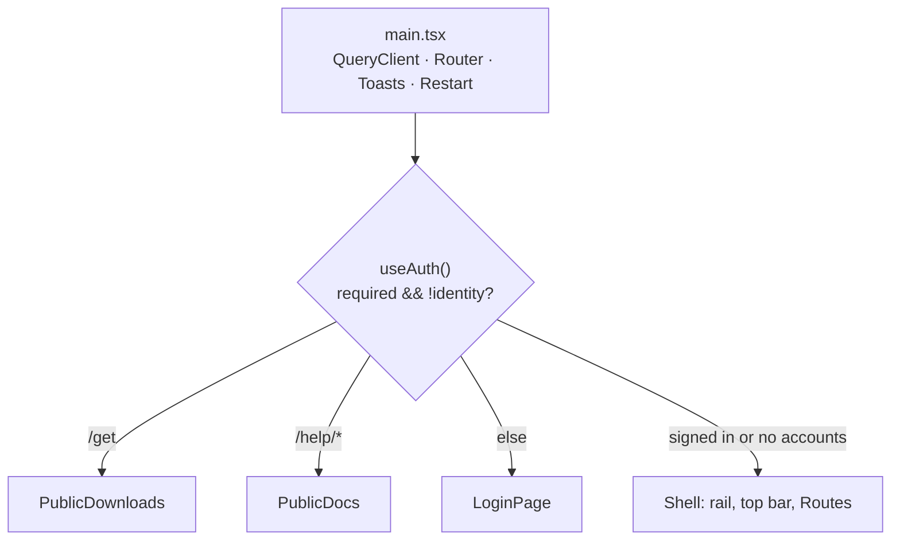

# Console (`ui/`)

The web console: React 19, TypeScript (strict), Vite, TanStack Query, react-router 7. It is a pure client of the server's API. The server serves the build from `ui/dist` and rebuilds it on start when sources are newer (`server/agent_server/ui_build.py`).

## Design in one paragraph

Every byte the console shows comes from the server over same-origin HTTP, server-sent events (`/api/live`) or WebSockets (`/api/terminals/{id}/view`). All calls and response types live in one file (`api.ts`); all server state is TanStack Query cache, keyed by short arrays and refreshed by polling or invalidation. Navigation is data (`navigation.ts`), and the layout is one stylesheet (`styles.css`) with CSS variables for light and dark themes. Anything about a model server lives on its machine's page. The console never works out routing decisions itself: which backends an agent can use comes from `/api/agents`.

## Boundaries

- Only the server's API. No imports from other components, and no logic the server owns (backend choice, agent templates).
- The server's SPA fallback returns `index.html` for unknown paths but 404 under `api/`, `v1/`, `session/`, `anthropic/`, `downloads/`, `help-files/`. So the SPA must not use `/downloads/`, `/android` (files) or `/docs` (OpenAPI). That's why Downloads is `/get` and docs are `/help`.
- Dev: `npm run dev` on :5173 proxies `/api` (with `ws: true`), `/health`, `/docs`, `/openapi.json` to `AI_PROXY_URL` (default `http://127.0.0.1:9999`). `/help-files` and `/downloads` aren't proxied, so Docs and Downloads don't work under Vite.

## Shell and routing

- `main.tsx`: queries retry once, never on a 401; any 401 invalidates `["auth"]`, which drops back to sign-in.
- `App.tsx`: the auth gate reads `window.location.pathname`, not the router. `/pair` is a Shell route, so it needs a sign-in when accounts are on.
- `Shell`: the rail is built from `PARTS` plus one entry per connected machine (`["machines"]`). It shows counts (in-flight requests, terminals, machines, agents waiting for their user), the version, the user and the theme picker. Below 900 px it becomes a top bar with a slide-in menu. Opening the menu pushes a history entry, so Back (Android's included) closes it.
- Old addresses (`/models`, `/strata`, `/docker`, `/containers`, ...) redirect to `/machines`.

`navigation.ts` `PARTS`: **Agents** (`/agents` Start an agent, `/terminals` Running agents), **Server** (`/live`, `/traffic`, `/requests`, `/sessions`, `/settings`, `/organization`, `/get`), **Machines** (`/machines`, then the machines themselves). `partFor()` drives `PartTag`, the breadcrumb above each `<h1>`.

## Data layer

- **`api.ts`** is the only place that calls `fetch`. `request<T>()` turns non-2xx responses into `ApiError(detail, status)`. `export const api = {...}` groups the methods by area. Standalone helpers cover streaming and shaping: `pullModel` (NDJSON progress), `fetchProviderLog`, `terminalSocketUrl`, `machineProviders`, `providerRef`, `addBackend` (hosted APIs only). Its types must mirror the Python response shapes.
- **Provider addressing**: `/api/machines/{id}/providers/{kind}-{port}`. A `ProviderRef` is `{machine, provider}`. `MACHINE_TYPES = ["ollama","strata","docker"]`.
- **Query keys**: shared ones in `hooks.tsx` (`useStatus` `["status"]` every 2 s, `useSessions`, `useRequests` `["requests", revision]`, `useModels`, `useMachines` every 5 s, `useAgents`, `useAuth`, `useVersion` `["health"]`). Per machine: `["provider", m, p]`, `["metrics", m]`, `["ollama-settings", id]`, `["provider-log", m, p, source]`, `["container-log", name]`, `["machine-folders", id, path]`. After a mutation, invalidate the keys it affects. Sign-in, logout and adopt invalidate everything.
- **Live**: only `live.ts` `useLive(sessionId?)` opens the EventSource. It folds the `snapshot`/`start`/`summary`/`delta`/`end` events into a ref and publishes once per animation frame.
- **Terminal viewer** (`pages/Terminal.tsx`, lazy-loaded because it pulls in xterm): binary frames go straight to xterm; the JSON messages are `state`, `replayed`, `resize` and `error`. Close 4401 shows pairing; 4404 is retried every 1.5 s for the first minute (a launch opens the page as soon as its session exists, a moment before its launcher shares the terminal), then means gone; anything else reconnects after 2 s and replays. Input is `{type:"input", keys}` or `{text, enter:true}`. xterm's automatic replies (`REPLY`) are dropped because the real terminal answers them. Wheel reports (`WHEEL`) pass, so alternate-screen agents can scroll. The on-screen key row exists for phones.

## Machine page (`pages/Machine.tsx`)

The design rule: **everything about a model server is on its machine's page**, one tab per function, at `/machines/:id/:section`.

- `machineProviders(machine, status.backends)` merges what the machine reports running with the backends that point at it, keyed `{kind}-{port}`.
- Tabs: Summary, `agents`, `terminal`, `model-servers`, one per provider id, `ollama` (if installed), `containers`, `load`, `mcp`, `access` (`MachineAccess.tsx`).
- `ProviderView` renders `ProviderHead` (with **Add as a provider** for admins when there's no backend yet), then switches on kind: `OllamaProvider` (`Models.tsx`), `StrataProvider` (`Strata.tsx`), `DockerProvider` (`Docker.tsx`). Each takes `{target: ProviderRef, label, backend, manageable}`. `manageable` is a reason string when changes aren't possible (machine offline, `servers` off). Other tabs: `MachineOllama` (`OllamaServer.tsx`), `MachineContainers({machine})` (`Containers.tsx`), `MachineLoad({machine, ollama})` (`Hosts.tsx`), `MachineMcp.tsx`.
- Show controls according to `machine.you` (`owner`, `manage`, and one flag per feature: view, launch, terminal, models, servers, update, mcp), never according to role.

## Module map (where things go)

- `src/`: `api.ts` (calls and types), `hooks.tsx` (shared queries, theme, toasts, clipboard), `live.ts`, `traffic.ts` (host and path classification), `format.ts`, `routes.ts` (`ROUTES`, `PROVIDERS`, `providerLabel()`), `navigation.ts`.
- `pages/`: one file per page. `Docs.tsx` renders `docs/*.md` from `/help-files/` with marked, and loads mermaid lazily.
- `components/`: reuse before writing new ones: `Tabs` (`useTabParam`, `TabBar`, `TabPanel`, which unmounts inactive panels and so stops their polling), `CodeLine`, `ConfirmDialog`, `ModelSearch`/`usePull(target, label, onPulled)`, `ProviderState`/`StateDot`, `LogPanel`, `RouteBadge`, `Sharing`, `McpChoice`, `FolderPicker`, `Icon` (inline SVG only).

## Styling

`styles.css` is the only stylesheet, with no framework. Tokens are on `:root` and overridden on `:root[data-theme="dark"]` (`--paper`, `--ground`, `--ink`, `--accent` indigo, `--shadow*`, `--route-*`). The fonts are Inter and JetBrains Mono. An inline script in `index.html` sets the theme before React loads. Check dark mode and a ~412 px viewport (the Android app) for every layout change.

## Extending

- **Page**: `pages/X.tsx` with `<PartTag />` above its `<h1>`, a `<Route>` in `App.tsx`, an item in `PARTS`, calls in `api.ts`, and docs in `docs/console.md`.
- **Provider view**: `MACHINE_TYPES`, `PROVIDERS`, the Settings `<option>` and `URL_PLACEHOLDERS`, a `<Kind>Provider` taking the props above, and its case in `ProviderView`. No global provider pages.
- Check with `npm run typecheck` and `npm run build`; for visual checks, `python scripts/screenshots/demo.py`.

## Gotchas

- The auth gate and public pages work from `window.location`; add a route to `PublicDocs`/`PublicDownloads` only if it must work signed out.
- The Shell's terminal and machine polls stop after an error until the page is reloaded (an unpaired device gets 401).
- UI text: plain sentence case, providers named through `providerLabel()`.
