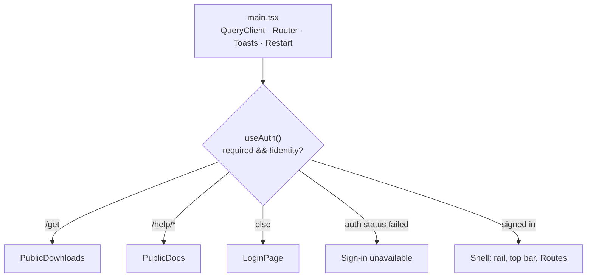

# Console (`ui/`)

The web console: React 19, TypeScript (strict), Vite, TanStack Query, react-router 7. It is a pure client of the server's API. The server serves the build from `ui/dist` and rebuilds it on start when sources are newer (`server/agent_server/ui_build.py`).

## Design in one paragraph

Every byte the console shows comes from the server over HTTP, server-sent events (`/api/live`) or WebSockets (`/api/terminals/{id}/view`). `VITE_API_URL` chooses the API origin at build time; unset means same-origin. `api.ts` owns `API_ORIGIN`, `apiUrl`, credentialed fetches and the socket URL; SSE uses `withCredentials`. Documentation, downloads and installer/login commands use the API origin too. All server state is TanStack Query cache, keyed by short arrays and refreshed by polling or invalidation. Navigation is data (`navigation.ts`), and the layout is one stylesheet (`styles.css`) with CSS variables for light and dark themes. Anything about a model server lives on its machine's page. The console never works out routing decisions itself: which backends an agent can use comes from `/api/agents`.

## Boundaries

- Only the server's API. No imports from other components, and no logic the server owns (backend choice, agent templates).
- The server's SPA fallback returns `index.html` for unknown paths but 404 under `api/`, `v1/`, `session/`, `anthropic/`, `downloads/`, `help-files/`. So the SPA must not use `/downloads/`, `/android` (files) or `/docs` (OpenAPI). That's why Downloads is `/get` and docs are `/help`.
- Every build replaces the lazy chunks (`mermaid.js`, the terminal, containers). So the server sends `index.html` and the docs with `Cache-Control: no-cache` and `/assets/` as immutable, `main.tsx` reloads the page once on `vite:preloadError` (a console from before an update), and the Docs page says so on each diagram if `mermaid.js` still won't load, trying again next time.
- Standalone: `ui/Dockerfile` builds a static nginx image; `ui/nginx.conf` caches hashed assets, revalidates the SPA and refuses API paths. Compose's `console` profile exposes it on loopback :8081. The API must trust its exact origin through `AI_PROXY_CONSOLE_ORIGINS`; both hosts must be HTTPS subdomains of the same site for SameSite=Lax cookies.
- Dev: `npm run dev` on :5173 proxies `/api` (with `ws: true`), `/health`, the API reference (`/docs`, `/redoc`, `/openapi.json`), `/help-files`, `/downloads`, the installers and `/android` to `AI_PROXY_URL` (default `http://127.0.0.1:9999`). With `VITE_API_URL`, it calls that origin directly instead.

## Shell and routing

- `main.tsx`: queries retry once, never on a 401; any 401 invalidates `["auth"]`, which drops back to sign-in.
- `App.tsx`: the mandatory auth gate reads `window.location.pathname`, not the router. When `/api/auth/status` itself fails (the issuer or API is down), it shows "Sign-in unavailable" rather than `LoginPage`; `/get` and `/help` still render. `/pair` is a Shell route and requires sign-in.
- Authentication is mandatory and fail-closed. Login redirects to the API's PKCE flow; only the issuer collects passwords. `api.ts` renews access cookies and serializes refreshes per tab and through Web Locks; auth status polls every 30 seconds. Terminal reconnects check status before dialing. Legacy `/pair` links redirect to terminals; expired permissions show sign-in, never a key form.
- `Shell`: the rail is the Overview (`/`, `OverviewPage`) and then `PARTS`, with All machines, Approve a device (`/approve-device`) and Add a machine (`/machines#add`) rather than individual machine entries. It shows counts (in-flight requests, connected terminals, connected machines; agents waiting for their user replace the terminals count, and `AttentionAlerts` shows them above every page), the version, the user and the theme picker. Below 900 px it becomes a top bar with a slide-in menu. Opening the menu pushes a history entry, so Back (Android's included) closes it.
- Old addresses (`/models`, `/strata`, `/docker`, `/containers`, ...) redirect to `/machines`.

`navigation.ts` `PARTS`: **Agents** (`/agents` Start an agent, `/terminals` Running agents, `/ask` Ask a model: `pages/Ask.tsx`, a session of client `console-chat` and `askModel` in `api.ts` streaming `/session/<id>/v1/chat/completions` with the browser's sign-in, as an agent would; no route of its own on the server), **Server** (`/live`, `/traffic`, `/requests`, `/sessions`, `/server-stats`, `/settings`, `/organization`, `/get`), **Machines** (`/machines`, active on individual machine pages too; `/approve-device` Approve a device). `partFor()` drives `PartTag`, the breadcrumb above each `<h1>`.

`MachinesPage` lists machines in responsive rows (name, architecture, last contact, function states), with a case-insensitive search over name, id, hostname, address and owner. `MachineRow` uses reported flags for agents, terminals, server management, containers, updates and tunnel; model servers use `machineProviders`, MCP uses reported servers. These describe configuration/presence, not `machine.you` permissions or connection readiness. Searching only filters the rows; fleet totals and the add/removed-machine controls stay unchanged. Adding a machine (`#add`) is `JoinSteps`: a system switch (sh or PowerShell) and an install switch (agent-machine, agent-machine and agent, Python, sandbox), both kept in `localStorage`, give one command from `installLine()` in `Downloads.tsx` (shared with `OneLineInstall`), a start-by-itself checkbox (`--service`) and a list of what the command does. `PythonSteps` gives pip with the build's wheel (from `/downloads/index.json`), then `agent-machine login` and `start`. `SandboxSteps` (a `sandbox/Dockerfile` container) takes its shell from the system switch.

## Data layer

- **`api.ts`** is the only place that calls `fetch`. `request<T>()` turns non-2xx responses into `ApiError(detail, status)`. `export const api = {...}` groups the methods by area. Standalone helpers cover streaming and shaping: `pullModel` (NDJSON progress), `fetchProviderLog`, `terminalSocketUrl`, `machineProviders`, `providerRef`, `addBackend` (hosted APIs only). The stored settings have their own methods and types: `api.storedAgents`/`saveAgent`/`deleteAgent`/`resetAgent` (`StoredAgent`: id, definition, yaml, builtin, edited), `api.modelTuning`/`modelTuningYaml`/`saveModelTuning` (`ModelTuning`: defaults, profiles, aliases), `api.storage`/`saveRetention` (`StorageInfo`), `api.importSettings`; `api.requests(query)` takes a `RequestQuery` (`session_id`, `limit`, `before`, `model`, `kind`). Its types must mirror the Python response shapes.
- **Provider addressing**: `/api/machines/{id}/providers/{kind}-{port}`. A `ProviderRef` is `{machine, provider}`. `MACHINE_TYPES = ["ollama","strata","docker"]`.
- **Query keys**: shared ones in `hooks.tsx` (`useStatus` `["status"]` every 2 s, `useSessions`, `useRequests(sessionId?)` `["requests", sessionId, revision]` (one session's all, or everyone's newest `REQUEST_WINDOW` = 2000; the Requests page fetches older pages on demand with `before`, "Load 2000 older"), `useModels`, `useMachines` every 5 s, `useAgents`, `useAuth`, `useVersion` `["health"]`). Others: `["terminals"]`, `["containers"]`, `["remote"]`, `["config"]`, `["stored-agents"]` (saving one also invalidates `["agents"]`), `["model-tuning"]` (saving it also invalidates `["models"]`), `["storage"]`, `["orgs"]`, `["users"]`, `["mcp"]`, `["downloads"]`. Per machine: `["provider", m, p]`, `["metrics", m]`, `["ollama-settings", id]`, `["ollama-log", id]`, `["provider-log", m, p, source]`, `["container-log", name]`, `["machine-folders", id, path]`. After a mutation, invalidate the keys it affects. Logout, adopting a provider, adding a backend, saving Settings and creating or deleting a container invalidate everything (sign-in is a full-page redirect).
- **Session chat** (`components/SessionChat.tsx`, the Chat tab of `pages/Session.tsx`): `["chat", session, thread]` is an infinite query, newest page first; a change in the session's request count refetches only the newest page and folds it in. `["chat-turn", session, thread, index]` fetches one turn whole when a preview is opened. `buildItems` turns the server's turns into messages, and it decides by the server's `author`/`note`/`kind`, never by role alone: `person`/`parent`/`unknown` (and a background call's own instructions) on the right, assistant and unpaired tool output on the left, the agent's own text as centred notes (reminders and notes only with **Show what … added**). Don't re-derive who wrote something in the browser: add it to `chat.py`. The thread list is the side column at 900 px and up, a `<select>` below.
- **Live**: only `live.ts` `useLive(sessionId?)` opens the EventSource. It folds the `snapshot`/`start`/`summary`/`delta`/`end` events into a ref and publishes once per animation frame.
- **Terminal viewer** (`pages/Terminal.tsx`, lazy-loaded because it pulls in xterm): binary frames go straight to xterm; the JSON messages are `state`, `replayed`, `resize` and `error`. Every (re)connect first calls `api.authStatus()`, which renews the cookies; no identity shows sign-in, and a failure retries after 5 s. Close 4401 shows sign-in; 4404 is retried every 1.5 s for the first minute (`WAIT_FOR_TERMINAL_MS`: a launch opens the page as soon as its session exists, a moment before its launcher shares the terminal), then means gone; anything else (4410 renewal, 4403, a restart) reconnects after 2 s and replays. Input is `{type:"input", keys}` or `{text, enter:true}`. xterm's automatic replies (`REPLY`) are dropped because the real terminal answers them. Wheel reports (`WHEEL`) pass, so alternate-screen agents can scroll. The on-screen key row exists for phones.

## Machine page (`pages/Machine.tsx`)

The design rule: **everything about a model server is on its machine's page**, one tab per function, at `/machines/:id/:section`.

- `machineProviders(machine, status.backends)` merges what the machine reports running with the backends that point at it, keyed `{kind}-{port}`.
- Tabs: Summary, `agents`, `terminal`, `model-servers`, one per provider id, `ollama` (if installed), `containers` (if it runs them or a provider is a container), `load`, `mcp` (owner, or it shares servers), `access` (`MachineAccess.tsx`, `machine.you.manage`). Other sections are listed in `SECTIONS`; an unknown one says the model server isn't reported.
- `ProviderView` renders `ProviderHead` (with **Add as a provider** for admins when there's no backend yet), then switches on kind: `OllamaProvider` (`Models.tsx`), `StrataProvider` (`Strata.tsx`), `DockerProvider` (`Docker.tsx`). Each takes `{target: ProviderRef, label, backend, manageable}`. `manageable` is a reason string when changes aren't possible (machine offline, `servers` off). Other tabs: `MachineOllama` (`OllamaServer.tsx`), `MachineContainers({machine})` (`Containers.tsx`, lazy-loaded), `MachineLoad({machine, ollama})` (`Hosts.tsx`; both take the machine's id), `MachineMcp.tsx`.
- Show controls according to `machine.you` (`owner`, `manage`, and one flag per feature: view, launch, terminal, models, servers, update, mcp), never according to role.

## Server settings (`pages/Settings.tsx`, `pages/SettingsStored.tsx`)

- `Settings.tsx` edits the network settings through `GET`/`PUT /api/config`: the listen address and URL, the **Public console address** (`proxy.public_url`; empty clears it), the default backend and hosted backends.
- `SettingsStored.tsx` holds the sections for what used to be files, each a self-contained component: `AgentDefinitions` (every agent with a "Shipped", "Shipped, changed" or "Added here" badge, edited as YAML in `AgentEditor`; Reset for a changed shipped one, Add an agent, Remove), `ModelTuningEditor` (Ollama model tuning as one YAML document: defaults, profiles, aliases) and `StorageSettings` (which database, its size, "Keep payloads and terminals for N days"). They're admin-only on the server, so each hides itself on a 403 (`forbidden`) rather than showing an error.
- `ServerStats.tsx`'s "What the server keeps" table has a row for the database (`database: {kind, bytes}` from `/api/server/stats`) beside the folders.
- The YAML stays text in the browser: the server parses and validates it (`PUT` with a YAML body) and answers 400 with what's wrong. Don't parse or re-serialize definitions in the console.

## Organization workspace (`pages/Organization.tsx`)

- `/organization` has URL-backed tabs (`tab`): Organizations (default), User directory (`users`), Your account (`account`). Your account explains OIDC/device/service sign-in; legacy password and launcher-token controls are removed.
- Organizations uses a responsive master/detail layout. `org` selects the organization; `orgTab` selects Teams (default), Members or Settings; `team` opens a team's members and settings. Switching organizations clears the nested selection.
- `Members` is shared by organization and team views. Its mutations use the scoped `setOrgMember`/`setTeamMember` API calls, not replacement membership arrays. Removing a member or deleting a team/organization asks for confirmation; none deletes the user's account.
- `CreateUser` supports a scoped organization/team creation form and the global directory form. `UserRow` edits role, memberships and optional password together, without browser prompts. `useDirectoryChange` replaces the org/user query caches and invalidates auth, machines and sessions.
- All mutations require a server admin; members get read-only views filtered by the server. Existing many-to-many memberships and `<org>/<team>` keys are unchanged.

## Module map (where things go)

- `src/`: `api.ts` (calls and types), `hooks.tsx` (shared queries, theme, toasts, clipboard), `live.ts`, `traffic.ts` (host and path classification), `format.ts`, `routes.ts` (`ROUTES`, `PROVIDERS`, `providerLabel()`), `navigation.ts`.
- `pages/`: one file per page. `Docs.tsx` renders `docs/*.md` from `/help-files/` with marked, and loads mermaid lazily.
- `components/`: reuse before writing new ones: `Tabs` (`useTabParam`, `TabBar`, `TabPanel`, which unmounts inactive panels and so stops their polling), `CodeLine`, `ConfirmDialog`, `ModelSearch`/`usePull(target, label, onPulled)`, `ProviderState`/`StateDot`, `LogPanel`, `RouteBadge`, `AddBackendForm`, `Sharing`, `McpChoice`, `FolderPicker`, `Attention` (`AttentionAlerts`, `waitingAgents`, `NotifyToggle`), `Restart` (`RestartProvider`, `RestartButton`), `Icon` (inline SVG only).

## Styling

`styles.css` is the only stylesheet, with no framework. Tokens are on `:root` and overridden on `:root[data-theme="dark"]` (`--paper`, `--ground`, `--ink`, `--accent` indigo, `--shadow*`, `--route-*`). The fonts are Inter and JetBrains Mono. An inline script in `index.html` sets the theme before React loads. Check dark mode and a ~412 px viewport (the Android app) for every layout change.

## Extending

- **Page**: `pages/X.tsx` with `<PartTag />` above its `<h1>`, a `<Route>` in `App.tsx`, an item in `PARTS`, calls in `api.ts`, and docs in `docs/console.md`.
- **Provider view**: `MACHINE_TYPES`, `PROVIDERS`, the Settings `<option>` and `URL_PLACEHOLDERS`, a `<Kind>Provider` taking the props above, and its case in `ProviderView`. No global provider pages.
- Check with `npm run typecheck` and `npm run build`; for visual checks, `python scripts/screenshots/demo.py`.

## Gotchas

- The auth gate and public pages work from `window.location`; add a route to `PublicDocs`/`PublicDownloads` only if it must work signed out.
- The Shell's terminal and machine polls stop after an error until the page is reloaded (an unauthenticated device gets 401).
- UI text: plain sentence case, providers named through `providerLabel()`.
