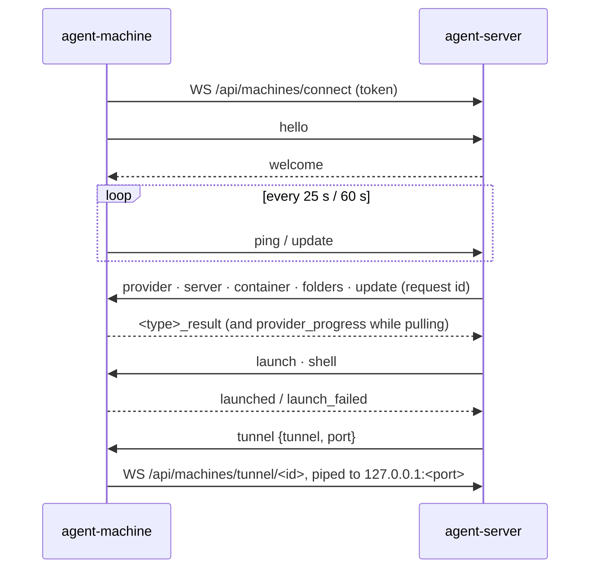

# Machine (`machine/`)

`agent-machine`: the Go module `ai-coding-agent-proxy/machine`. It keeps a computer in a server's **fleet** and supplies every local LLM provider: the model servers it runs, and containers it runs for the server.

## Design in one paragraph

The machine only dials out. It holds one WebSocket to the server (`/api/machines/connect`), describes itself in a hello and then every minute, and answers requests that arrive on that socket. Every request is checked again on the machine, against a freshly loaded `machine.json`, whatever the server allowed. Everything about a model server (models, logs, load, settings, start/stop) is done here against `127.0.0.1:<port>`, so the server never needs a route to it. Agents' traffic reaches the model servers through tunnels the machine dials back on request. Launches and shells run the client's `agent` program as a separate process; the two share no code.

## Boundaries

- Imports nothing from `client/`, `server/` or `tools/`. Dependencies: gorilla/websocket, x/sys, x/term.
- No inbound listeners except the MCP bridge on `127.0.0.1:0`. Outbound only: the server, loopback model servers, model catalogues.
- `Proxy: nil` on every client (`settings.Transport`). Server calls carry the version, protocol and token headers (`settings.ServerClient`, `Identify`).
- Its own sign-in (`agent-machine login`), apart from `agent login`.
- Device authorization and rotating OAuth credentials mirror the client in this separate Go module (`internal/settings/oauth.go`). Every request and socket reconnect renews as needed; 4410 is retryable. Never send passwords to the API or fall back to an old key. See `auth.md`.

## Command line (`internal/command`)

- `agent-machine` / `status`: show id, server, fleet state, providers, toggles, MCP servers, roots.
- `login`/`logout`; `run` (foreground), `start` (detached, `AI_PROXY_MACHINE_STARTED=background`), `stop`.
- Toggles, all **off by default**: `launches`, `commands`, `updates`, `servers`, `containers` `on|off`; `containers cli auto|docker|podman`; `roots add|remove <dir>`; `name`; `address`.
- `sudo agent-machine servers service [off]`: lets it drive a systemd `ollama.service` (a sudoers rule for `systemctl start|stop|restart ollama`, a drop-in, `/etc/agent-machine/ollama.env`).
- `mcp`, `mcp add <name> [--env] [--dir] -- <cmd...>` or `--url u [--header]`, `mcp remove`.
- `update [--force] [--server] [--with-agent]`, `version`.

## Packages

| Package | Responsibility | Key symbols |
| --- | --- | --- |
| `cmd/agent-machine` | Entry point, version from ldflags, cleans up old binaries | `main` |
| `internal/command` | The command line and status display, restart after an update | `Main`, `configure`, `run`, `start`, `stop`, `show`, `restartAfterUpdate` |
| `internal/presence` | The fleet connection: hello and updates, dispatching requests, tunnels, launches, shells, folders, remote update, provider detection | `Presence.Run`/`session`/`describe`, `DetectProviders`, `Check`, `CheckShell`, `Arguments`, `ShellArguments`, `AgentCommand`, `tunnelPorts`, `Folders`, `RemoteUpdate` |
| `internal/providers` | Model-server operations and catalogue search, against fixed loopback paths | `Manager.Handle`, `ollama.go`, `strata.go`, `docker.go`, `Metrics`, `catalog.go` |
| `internal/servers` | Starting and stopping Ollama (only the one it started, or through systemd) and Strata profiles; Ollama's `OLLAMA_*` settings | `Manager.Handle`, `ollama_settings.go`, `systemd.go` |
| `internal/containers` | Containers for the server: the engine table, spec checks, run arguments, the CLI, jobs | `Engines`, `Validate`, `RunArgsFor`, `Detect`, `Manager`, `Prefix = "ai-proxy-"` |
| `internal/mcp` | Shared MCP servers (`mcp.json`) and the bridge | `Server.Check`, `Load`/`Save`, `Bridge.Describe`/`ServeHTTP` |
| `internal/settings` | Its folder, credentials, `machine.json`, `status.json`, root checks | `Home`, `Upstream`, `Machine.Within`, `Protocol` |
| `internal/login`, `update`, `process` | Sign-in; self-update from `/downloads/index.json` (SHA-256, `.old` swap); detached runs, `Stop`/`StopTree`, WSL-aware `LookPath` | |

## Fleet protocol, from the machine

- **Hello/update** (`describe`): id, name, hostname, os, arch, version, protocol, address, `agents` (the server's agents found on PATH), `providers` (`{type, port, version, models, api_key?}`, detected by probing 11434, 12434, 18500 and Strata profiles), `launches`, `roots`, `commands`, `updates`, `tunnel: 1`, `launcher`, `containers {enabled, cli, engines, ...}`, `servers {enabled, ollama, strata}`, `mcp {port, key, servers}`. Strata keys travel only as `providers[].api_key`, for loopback instances.
- **Requests**, each handled in its own goroutine, with writes serialised:

| Type | Gate on the machine | Does |
| --- | --- | --- |
| `provider` | changes (pull, delete, load, unload) need `servers` | status, models, log, metrics, catalogue search |
| `server` | `servers` | Ollama settings and start/stop/restart, Strata start/stop |
| `container` | `containers` | status, start/restart/switch (jobs), stop, remove, logs |
| `folders` | `launches` or `commands`, inside the roots | folder names only, at most 500 |
| `launch` / `shell` | `launches` / `commands`, inside the roots | runs `agent ... --headless --launch-id` and reads its one `{"session_id"}` line |
| `update` | `updates` | runs `agent-machine update` detached |
| `tunnel` | port reported, a container's port, or the bridge | pipes bytes to `127.0.0.1:<port>`; closes 4502 if nothing answers |

- Reconnects back off 2, 5, 10, 30 s. A 426 or close 4426 means a protocol mismatch.

## State (`settings.Home()`: `AI_PROXY_MACHINE_HOME`, `%APPDATA%\agent-machine`, `~/.config/agent-machine`)

`credentials.json` (token only, never the password), `machine.json` (id, name, toggles, roots, address, CLI), `status.json` (pid, state, server, server_version, started), `mcp.json`, `servers.json` (the Ollama it started), `ollama.json`, `agent-machine.log`, `ollama.log`. Files are 0600 in a 0700 folder, written atomically.

## Invariants

1. Every toggle defaults to off and is re-checked per request from `machine.json`.
2. Roots are checked after resolving links (`Machine.Within`). The server checks too (`within_roots`); keep both.
3. Container specs come only from the engine table, with each engine's own options, plain images, `gpus` all/none/numbers, and a volume name or absolute folder. **Never add free-form docker arguments**: `docker run` is root on that machine. Podman gets GPUs as CDI devices.
4. Tunnels reach only reported provider ports, containers' ports and the bridge.
5. Provider operations call fixed loopback paths. Ollama stop only stops the Ollama it started.
6. Strata keys are redacted in logs. MCP commands, env and headers never leave the machine (the hello carries names). The bridge checks its per-run key in constant time and re-reads `mcp.json` on every request.
7. A launch is refused when this computer's agent-proxy carries traffic to another server.
8. Updates install only the server's build, verified by SHA-256.

## Extending and testing

- **Provider kind**: a case in `providers.handle` (status, model operations, log), a probe in presence, Go tests, then the server and console sides (see the checklist in `AGENTS.md`).
- **Message type**: a branch in `presence.session` answering `<type>_result` with its own toggle check; a new toggle goes into `settings.Machine`, `configure`, `show` and `describe`. Mirror it in `python/agent_py/machine/presence.py` and the server's `Fleet`.
- `go test ./...`, and vet for Windows and Linux (the `process_*.go` files differ). End to end: `server/tests/test_client.py::fleet_machine` with `fake_docker.py`, `fake_strata.py`, `fake_mcp.py`.
- Don't test as the Ubuntu WSL user: it runs a real agent-machine in the real fleet.
