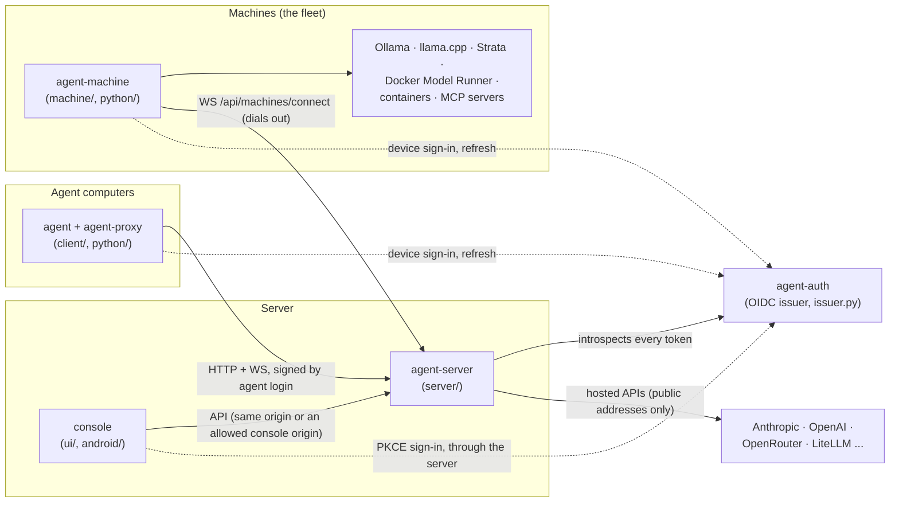
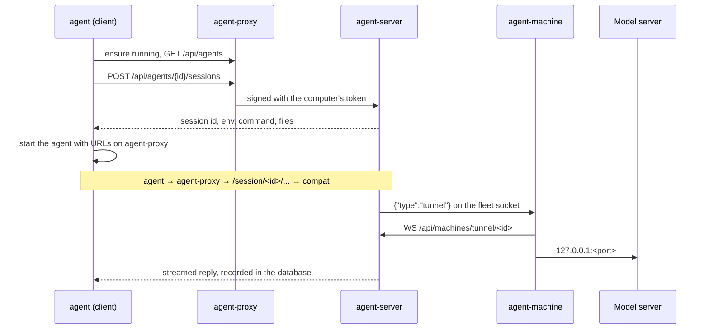

# Overview

A proxy that every coding-agent request goes through. Agents (Claude Code, Codex, OpenCode, Qwen Code, Aider, Goose, Copilot CLI, ...) are launched pointed at a loopback proxy on their own computer. That proxy carries everything to one **server**, which routes each request to an LLM provider and records it: tokens, timings, full traces, live text and shared terminals.

## The three roles

- **Server**: the hub. It owns all configuration, accounts, agent definitions, backend choice and recordings, and keeps them in one database (PostgreSQL in production, a SQLite file by default).
- **Agents** connect to it through their computer's `agent-proxy`.
- **Machines** supply every local provider (an OpenAI-compatible server found on a machine, such as LM Studio or vLLM, is an `api` backend with a `machine`). Hosted APIs (`anthropic`, and `api` backends without a machine) are the only providers not on a machine.
- **Auth issuer** (`agent-auth`, `server/agent_server/issuer.py`, a separate process at `auth.aicontrolmesh.com`) issues OAuth access tokens through Authlib: device codes for `agent login` and `agent-machine login`, PKCE for the console, client credentials for provisioned service clients. It reads the server's accounts (read-only, through its own database role on PostgreSQL) but never changes them. The server introspects every token there and has no unauthenticated mode: all API traffic, including loopback and agent sessions, needs a token. Pairing and the access key are gone. See `auth.md`.

## One server, one process or many

The server is one program. Small installs run it as one process, which keeps its live state in memory. Large ones run several, each with some of its roles (`api`, `gateway`, `mcp`, `intercept`, `fleet`, `realtime`, `worker`), sharing PostgreSQL and Redis and reaching each other on an internal port (`server.md`, Several processes; `docs/scaling.md`; `deploy/helm/agent-mesh/`). Clients and machines can't tell the difference: they still talk to one address.

## Design principles (apply to every component)

1. **Components talk only over HTTP and WebSockets, never by importing each other.** Each folder is its own build (Python package, Go modules, npm project, Gradle project).
2. **The server owns the logic.** Agent definitions (the database's `agents` table, shipped ones from `defaults.py`), template rendering and backend choice (`serves()`, `backend_for()`) are Python. Clients, the console and machines take them from the API and never re-derive them.
3. **The server never manages a model server.** It forwards agents' traffic only. Everything else is a request to the machine that runs the model server, over the fleet socket.
4. **Everything dials the server; the server dials nothing behind NAT.** Agent-proxies tunnel account HTTPS and terminals over WebSockets; machines dial back a tunnel per agent connection to a model server.
5. **Loopback is a trust boundary.** `agent-proxy` binds 127.0.0.1 and checks Host and Origin; the MCP bridge binds 127.0.0.1 and checks its per-run key on every request (a browser can't send that header without a preflight the bridge never grants). Anything that can run commands (terminals, launches, shells, containers) is gated twice: by the server (accounts, sharing, fleet features) and again by the machine (its own toggles, roots).
6. **Secrets stay where they belong.** Never in the stored settings (what `agent-server config export` writes); generated ones in the database's `secrets` tables, passwords in the environment. Strata and MCP keys live in server memory only, and MCP commands and headers never leave their machine.
7. **One version, one protocol.** `VERSION` and `PROTOCOL` stamp every component; the server refuses programs outside `MIN_PROTOCOL..PROTOCOL`.

## Routes to a provider

| Route | Agents | Path |
| --- | --- | --- |
| Account | `intercept: true` (signed in to their own Claude, Copilot or ChatGPT) | `HTTPS_PROXY` → agent-proxy :8183 → `WS /api/proxy/tunnel` → decrypted with the server's CA → the vendor |
| Own provider | `backend_type: ollama` (default) | `/session/<id>/v1` etc. on agent-proxy :8184 → `routes/compat.py` → `ollama` (translated to `/api/chat`), `strata`, `docker` or `llamacpp` (passed through), via the machine's tunnel |
| Hosted | `backend_type: anthropic` | `ANTHROPIC_BASE_URL` → passed through unchanged |
| API providers | `backend_type: ollama` agents, by protocol | the same URLs → `routes/compat.py` `_forward` → an `api` backend (`api_providers.py`): the server's key, model aliases, extra headers; on a machine through its tunnel, hosted ones through `runtime.api_clients` (public addresses only) |
| Over a bridge | any agent whose backend is a provider another server's organization lets in (`provider:server/org/name`) | the same URLs → `_forward` → a `link` backend (`bridges.upstream`): signed, with an assertion, to that server's `/api/links/relay/provider/...` (directly, or over the link socket), which serves it with `compat.relay` into a bridge session and its own provider |

## Peering: servers linked with servers

Two servers' site admins **link** them (`links.py`); an organization on each then opens a **bridge** (`bridges.py`) and each says what it lets out and in. The servers are the only parties that talk: agents, agent-proxies and machines never reach the other server. Each server has a mesh id and Ed25519 link keys (secret `link-keys`); every request between servers is signed (method, path, time, nonce, body digest, assertion) and checked by `Links.verify`, never by the issuer. The side that reached the other while joining dials a WebSocket (`/api/links/connect`) and sends its requests directly; the other side sends its requests framed over that socket (`links.Channel`), and both run them through their own app, so every request meets the same checks. Someone of the other server is a `bridges.Guest`, which no existing permission helper accepts. See `server.md` (Peering) and `auth.md` (Guests), and `docs/peering.md`.

## A launch, across components

The console starts agents on a machine the same way: `POST /api/machines/{id}/launch` → the machine runs `agent ... --headless` → the same flow.

The agent gets URLs on its agent-proxy that carry the session id, rendered by the server from the agent's stored templates: `{openai_url}` = `http://127.0.0.1:8184/session/<id>/v1`, `{anthropic_url}` = `…/session/<id>/anthropic`, `{ollama_url}` = `…/session/<id>` (native `/api/...`). Account agents get `HTTPS_PROXY=http://<id>:agent-proxy@127.0.0.1:8183` and the server's CA. Bare `/v1` and `/anthropic` also work with `X-AI-Proxy-Session` and `X-AI-Proxy-Backend`; the server takes bare `/api/...` native Ollama calls the same way, but the agent-proxy answers `404` to any bare `/api` path not on its `LauncherAPI` allowlist, so agents use `/session/<id>/api/...`. Everything is recorded through the server's write queue: `sessions`, `requests`, gzipped `traces`, `chat_index`, and a shared terminal's `terminal_chunks`. The server's own log stays a file (`logs/proxy/proxy.log`) so it works when the database doesn't.

## Where state lives

| Where | What |
| --- | --- |
| Server database (`AI_PROXY_DATABASE_URL`; schema `mesh`, role `mesh_api` on PostgreSQL; else `logs/agent-server.sqlite3`) | settings (network, backends, Ollama model tuning, agents, retention), accounts (users, organizations, teams), generated secrets (the intercept CA, the browser state key, container keys), the fleet, sessions with their request records, traces, chat indexes and terminal output |
| Issuer database (`AI_PROXY_AUTH_DATABASE_URL`, else schema `mesh_auth` of the same PostgreSQL, role `mesh_auth`; else `issuer-state.sqlite3` in `AI_PROXY_OIDC_STATE_DIR` or `certs/oidc/`) | OAuth grants and token hashes, service clients, the signing key; accounts are read-only from the server's tables |
| Server files | `logs/proxy/proxy.log`, the CA's public files (`logs/ca/`), `certs/first-user-password`; an older install's `config/`, `certs/` and `logs/sessions/` files are only read once, by the import into an empty database |
| Agent computer | `credentials.json` (+ `agent-proxy.log`), `~/.cache/agent-proxy/` (CA copy, per-session files) |
| Server database, provider accounts | `provider_accounts` and their assignments, hourly usage and events; `provider_credentials` (Copilot tokens, AES-GCM under `AI_PROXY_VAULT_KEYS`, which never enters the database) |
| Server database, API providers | `backends.options` (protocols, auth, models, headers, priority, fallback, orgs; API step 8); keys in `provider_credentials` as `backend:<name>` (AES-GCM under `AI_PROXY_VAULT_KEYS`, bound to the provider's origin) or an `AI_PROXY_API_KEY_*` variable; health and discovered models in each process's memory |
| Server database, usage limits | `provider_usage` (hourly tokens and calls per organization, person and provider), `usage_limits` (an organization's token limits per person or everyone, provider and window) |
| Server database, retention and audit | `retention_policies`, `legal_holds`; `audit_events` (append-only hash chains per tenant), `audit_chains`, `audit_checkpoints` (signed with the secret `audit-signing-key`) |
| Blob storage (`AI_PROXY_BLOB_URL`, optional) | traces (messages once per session, by hash) and terminal chunks under `tenant/<org>/<yyyy>/<mm>/<session>/`; audit checkpoints and exports under `audit/` |
| Redis (`AI_PROXY_REDIS_URL`, several processes only) | which process holds each machine, terminal and tunnel; heartbeats; request and usage counters; leases; launch grants; revocations; messages between processes. Machines' keys only sealed. |
| Server database, peering | `links` (peer, url, state, the peer's public keys), `peer_codes` (digests of one-use link and bridge codes), `bridges`, `peer_policies` (each side's signed link and bridge policies, every version); the link keys in `secrets` (`link-keys`); the mesh id in meta `mesh_id` (or `AI_PROXY_MESH_ID`); `agents.org` (an organization's own definitions) |
| Machine | its folder: `credentials.json`, `machine.json`, `status.json`, `mcp.json`, `servers.json`, `ollama.json`, `llamacpp.json`, `llamacpp-install.json`, `llamacpp/` (installed builds), logs |

## Ports

9999 server (a linked server reaches it there too: `/.well-known/mesh-link`, `/api/links/*`) · 9100 the server's internal port in Kubernetes (`AI_PROXY_INTERNAL_PORT`) · 10000 agent-auth (its default, loopback) · 8184 agent-proxy (loopback) · 8183 agent-proxy HTTPS proxy (loopback) · 5173 Vite · 11434 Ollama · 18500 Strata · 9931 llama.cpp's llama-server (loopback on its machine) · 12434 Docker Model Runner. Never test on 8183/8184/9999 on the dev machine.

For development: 19999/20000 `agent-server local` (`local.py`), and the quickstart and basic stacks' server and issuer, so only one of those runs at a time · 49999/50000 the testdata stack's server and issuer · 8199 the screenshot demo (`demo.py`) · 55432 the PostgreSQL test database (`AI_PROXY_TEST_DATABASE_URL`).

## Cross-component changes

- **API between client/machine and server**: change the server, Go, *and* `python/`, and cover it in `server/tests/test_client.py`.
- **New provider type**: server config and compat, agent-machine providers, console view, docs, the demo. Follow the checklist in `server.md` (Extending).
- **New fleet message**: `Fleet` on the server, `presence` in Go and Python.
- **Incompatible protocol change**: raise `PROTOCOL` everywhere.
- **Sign-in or credentials**: the issuer and `auth.py` on the server, `agent login` and `agent-machine login` in Go and `python/`, the console and the Android app. Read `auth.md` first.
