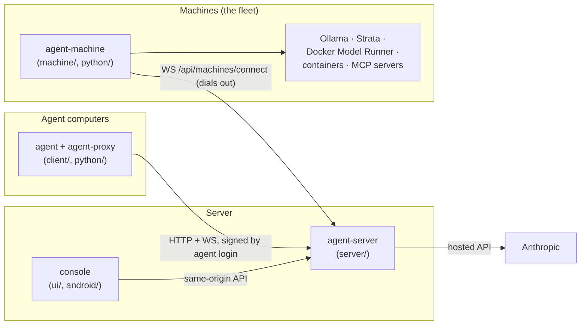
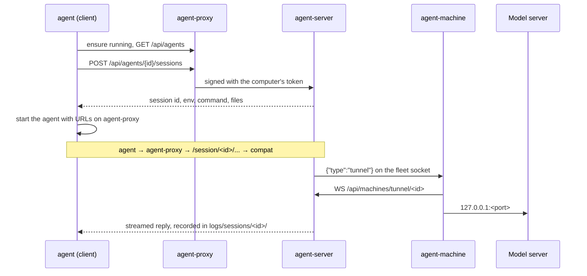

# Overview

A proxy that every coding-agent request goes through. Agents (Claude Code, Codex, OpenCode, Qwen Code, Aider, Goose, Copilot CLI, ...) are launched pointed at a loopback proxy on their own computer. That proxy carries everything to one **server**, which routes each request to an LLM provider and records it: tokens, timings, full traces, live text and shared terminals.

## The three roles

- **Server**: the hub. It owns all configuration, accounts, agent definitions, backend choice and recordings.
- **Agents** connect to it through their computer's `agent-proxy`.
- **Machines** supply every local provider. Hosted APIs are the only providers not on a machine.

## Design principles (apply to every component)

1. **Components talk only over HTTP and WebSockets, never by importing each other.** Each folder is its own build (Python package, Go modules, npm project, Gradle project).
2. **The server owns the logic.** Agent definitions (`config/agents.yaml`), template rendering and backend choice (`serves()`, `backend_for()`) are Python. Clients, the console and machines take them from the API and never re-derive them.
3. **The server never manages a model server.** It forwards agents' traffic only. Everything else is a request to the machine that runs the model server, over the fleet socket.
4. **Everything dials the server; the server dials nothing behind NAT.** Agent-proxies tunnel account HTTPS and terminals over WebSockets; machines dial back a tunnel per agent connection to a model server.
5. **Loopback is a trust boundary.** `agent-proxy` and the MCP bridge bind 127.0.0.1 and check Host and Origin. Anything that can run commands (terminals, launches, shells, containers) is gated twice: by the server (accounts, sharing, fleet features) and again by the machine (its own toggles, roots).
6. **Secrets stay where they belong.** Never in `config/`. Strata and MCP keys live in server memory only, and MCP commands and headers never leave their machine.
7. **One version, one protocol.** `VERSION` and `PROTOCOL` stamp every component; the server refuses programs outside `MIN_PROTOCOL..PROTOCOL`.

## Three routes to a provider

| Route | Agents | Path |
| --- | --- | --- |
| Account | `intercept: true` (signed in to their own Claude, Copilot or ChatGPT) | `HTTPS_PROXY` → agent-proxy :8183 → `WS /api/proxy/tunnel` → decrypted with the server's CA → the vendor |
| Local models | `backend_type: ollama` (default) | `/session/<id>/v1` etc. on agent-proxy :8184 → `routes/compat.py` → `ollama` (translated to `/api/chat`), `strata` or `docker` (passed through), via the machine's tunnel |
| Hosted | `backend_type: anthropic` | `ANTHROPIC_BASE_URL` → passed through unchanged |

## A launch, across components

The console starts agents on a machine the same way: `POST /api/machines/{id}/launch` → the machine runs `agent ... --headless` → the same flow.

## Where state lives

| Where | What |
| --- | --- |
| Server `config/` | `backends.yaml`, `models.yaml`, `agents.yaml` |
| Server `logs/` | sessions (telemetry, traces, terminals), `machines.json`, `chat-index.json` |
| Server `certs/` | the intercept CA, the access key, `users.json`, `container-keys.json` |
| Agent computer | `credentials.json` (+ `agent-proxy.log`), `~/.cache/agent-proxy/` (CA copy, per-session files) |
| Machine | its folder: `credentials.json`, `machine.json`, `status.json`, `mcp.json`, `servers.json`, `ollama.json`, logs |

## Ports

9999 server · 8184 agent-proxy (loopback) · 8183 agent-proxy HTTPS proxy (loopback) · 5173 Vite · 11434 Ollama · 18500 Strata · 12434 Docker Model Runner. Never test on 8183/8184/9999 on the dev machine.

## Cross-component changes

- **API between client/machine and server**: change the server, Go, *and* `python/`, and cover it in `server/tests/test_client.py`.
- **New provider type**: server config and compat, agent-machine providers, console view, docs, the demo. Follow the checklist in `AGENTS.md`.
- **New fleet message**: `Fleet` on the server, `presence` in Go and Python.
- **Incompatible protocol change**: raise `PROTOCOL` everywhere.
