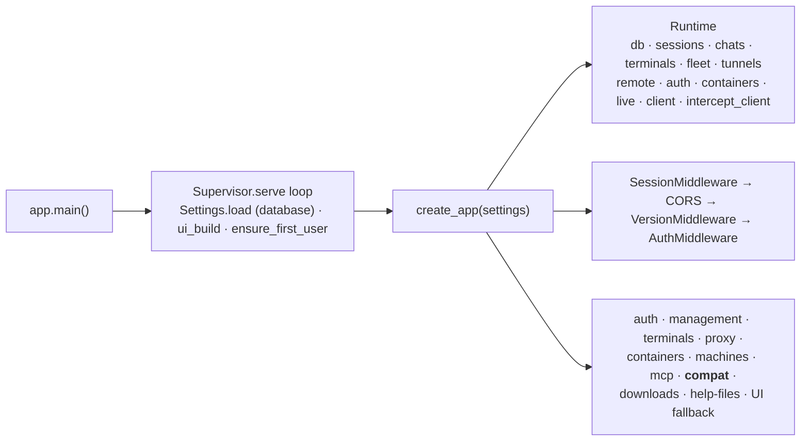
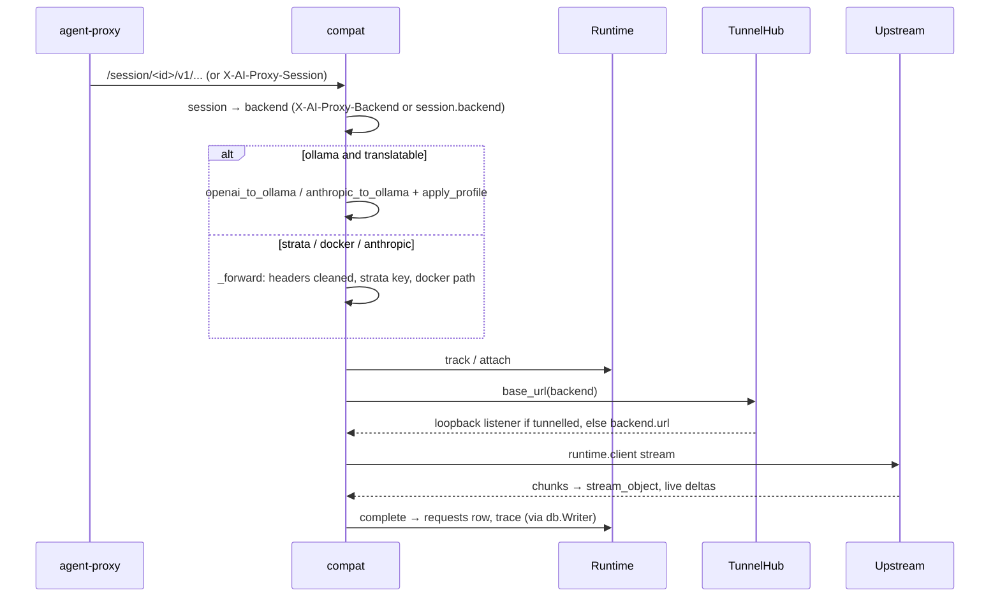

# Server (`server/agent_server/`)

`agent-server`: Python, FastAPI and uvicorn. The hub. It owns the API, accounts, all configuration, agent definitions and template rendering, backend choice, recording, HTTPS interception of account agents, and the fleet registry, and keeps all of them in one database (`db/`: PostgreSQL in production, SQLite by default; there are no configuration files). It optionally serves the console's build; `AI_PROXY_SERVE_UI=0` disables UI routes and automatic UI builds for separate hosting. The same package holds `agent-auth` (`issuer.py`), the OIDC issuer the API depends on but runs as its own process, and `agent-benchmark` (`benchmark.py`).

## Design in one paragraph

Every agent request arrives at one ASGI app. `routes/compat.py` finds the session, picks its backend, then either translates the request (Ollama) or forwards it (Strata, Docker, Anthropic). Each request is tracked by `Runtime` and recorded in the database (`requests`, `traces`), written behind by `db.Writer` so the event loop never waits on it. Machines hold a WebSocket open to the server (`/api/machines/connect`); the server asks them to do everything about a model server (`Fleet.ask`), and reaches the model servers on machines behind NAT through tunnels that the machine dials back. Account agents' HTTPS arrives as WebSocket tunnels and is decrypted with the server's own CA. Shared state lives in one `Runtime`, and there are no globals apart from two in `strata.py`: `managed_keys` (filled by `KeyStore`) and `fleet` (set by `Runtime`, for the keys machines report).

## Must never

- Call a model server for anything but agents' traffic. Listing, pulling, status, logs, metrics, Ollama settings and start/stop are fleet requests to the machine. Native `/api/*` passthrough only allows `compat.NATIVE_AGENT_PATHS`.
- Run `docker`, or add a local backend (`MACHINE_TYPES`: ollama, strata, docker) by URL. `Settings.update_network_config` refuses new or moved ones; only `anthropic` is added by URL.
- Import client, machine or Python-port code, or assume anything about them beyond the API.
- Keep cookies in the upstream client (`runtime.upstream_client`), replace an agent's own `Authorization` on hosted pass-through, or forward it to an MCP bridge.
- Send platform credentials upstream: `compat._upstream_headers` drops `X-AI-Proxy-Token`, cookies, Origin and the session/backend headers, and drops `Authorization` only when it was the platform's Bearer (no `X-AI-Proxy-Token`).
- Treat anything but the middleware's introspected identity as authentication: not loopback, a session id or the old access key.
- Write dialect-specific SQL outside `db/`, or edit an existing migration step. Queries are SQLAlchemy Core over `db.schema`, so they run on PostgreSQL and SQLite alike; a schema change is a new step appended to `db/migrate.py`.
- Keep a secret in the settings (`settings` table, what `config export` writes). Generated secrets go in the `secrets` table; passwords and the introspection secret come from the environment.

## Composition

- **Router order is load-bearing.** `compat` has catch-alls (`/api/{path}`, `/v1/{path}`, `/anthropic/{path}`), so every console route registers before it, and the UI fallback comes last. Within a router, literal paths come before parameterised ones.
- **Middleware order** puts the version check before auth, so old programs get 426 (WebSocket close 4426) before a 401. `routes/auth.register` adds Starlette's `SessionMiddleware` (the signed `mesh_oidc_state` cookie for the browser sign-in) after the others, so it is the outermost.
- **Split console/API**: `Settings.console_origins` (`AI_PROXY_CONSOLE_ORIGINS`) is the exact origin allowlist for credentialed CORS and `remote.same_origin`, shared by auth mutations and route/WebSocket gates. Cookies stay host-only on the API; no parent-domain cookie or wildcard origin.
- **Restart** (`POST /api/server/restart` → `Runtime.request_restart`): waits up to 30 s for in-flight requests (`Runtime.active`; container jobs run on machines and aren't waited for), then `_restart_when_idle` closes live streams, terminals, fleet sockets, tunnels and intercept tunnels, and the Supervisor serves again with a fresh `Settings.load()`, which reopens the database and re-reads the stored settings. **A new long-lived connection must be closed there.** There's no Supervisor with `--reload` or in tests.
- **Storage lifecycle**: `Settings.load()` opens the database (`open_database`: migrate, a one-time legacy import into a new database, `seed`, `sync_builtin_agents`, then the stored settings with the environment on top). `Runtime` takes `settings.open_database()` and hands it to every store. The lifespan starts `Runtime.prune_daily` (retention, hourly) and, on shutdown, closes the database last (`runtime.db.close()` drains the write queue first). **A new store that buffers or queues writes must flush or close in the lifespan, before that.** `agent-server config|db` (`commands.py`) and `agent-server user|org|team` open the same database from the shell.
- `ensure_first_user` runs in `main()` (with `--reload` too) and every `Supervisor.serve` round, including loopback, never in `create_app`. It does nothing once accounts were ever written (meta `accounts_initialized`, `UserStore.initialized()`) or `AI_PROXY_USERNAME`/`AI_PROXY_PASSWORD` are set. Tests must authenticate explicitly; no anonymous local mode remains.
- `issuer.py` runs the separate `agent-auth` Authlib service (`create_auth_app`, never mounted into the API app): PKCE, device and service grants, hashed transactional token state (`State`: schema `mesh_auth` on PostgreSQL, else a SQLite file of its own), discovery/JWKS, introspection, revocation and userinfo. It reads but never mutates API accounts. API `Auth` introspects with a dedicated client (closed in the lifespan); browser `routes/auth.py` manages host-only access/refresh cookies. See `auth.md`.

## Module map

| Area | Modules | Key symbols |
| --- | --- | --- |
| Database | `db/__init__.py`, `db/schema.py`, `db/migrate.py`, `db/kv.py`, `db/legacy.py` | `Database` (`write()`/`read()`, `size`, `close`; SQLite WAL + BEGIN IMMEDIATE, PostgreSQL schema translation), `Writer` (`submit`, `flush`, `close`), `pack`/`unpack` (gzip), `sqlite_url`, `redacted`; `API_SCHEMA` `mesh`, `AUTH_SCHEMA` `mesh_auth`; `migrate` (`API_STEPS`, `AUTH_STEPS`, `schema_version`, advisory lock), `grant_issuer`, `ISSUER_READS`; `kv.upsert`/`get`/`put`/`get_meta`/`put_meta`/`secret`; `legacy.import_settings`/`import_sessions` |
| Config | `config.py`, `defaults.py`, `config_io.py`, `commands.py` | `Settings` (`load(database=True)`, `open_database`, `database_address`, `_configure` (stored settings, environment on top), `_store_config` (code-built Settings write theirs), `backend`, `backend_for`, `profile`, `update_network_config`, `update_models`, `set_retention`, `save_backend`, `remove_backend`, `upcoming_listen`), `seed`, `sync_builtin_agents`, `stored_config`, `validate_models`, `Backend` (`name`, `url`, `type`, `machine`, `container`), `serves()`, `BACKEND_TYPES`, `NATIVE_PROTOCOLS`, `MACHINE_TYPES`, `PROVIDER_NAMES`; `defaults.PROXY`/`INTERCEPT`/`BACKENDS`/`DEFAULT_BACKEND`/`MODELS_YAML`/`AGENTS_YAML`; `config_io.export`/`dump`/`parse`/`apply`, `put_agent`/`delete_agent`/`reset_agent`; `commands.main` (`agent-server config export|import`, `db info|migrate|import`) |
| Shared state | `runtime.py` | `Runtime` (`db`, `track` → `attach` → `stream_object`/`progress` → `complete`, `proxy_error`, `resolve_session`, `agents()`, `prune`/`prune_daily`), `upstream_client` |
| Recording | `sessions.py`, `telemetry.py`, `live.py`, `chat.py` | `SessionStore(db)` (memory authoritative for open sessions, written behind; `records`, `query_requests` (limit, before, model, kind), `traced`, `totals`, `recent`, `prune(before)`), `RequestTelemetry` (`kind`: api, intercept, upgrade, tunnel, mcp), `LiveHub` (memory only), `Chats` (the `chat_index` table) |
| Agents | `agents.py` | `AgentDefinition.render`, `load_agents(db)` (the `agents` table, re-read on every call), `parse_agents`, `stored_agents`, `_render` (a template with a missing placeholder is dropped) |
| Translation | `translate/` | `openai_to_ollama`/`OpenAIStreamTranslator`, `anthropic_to_ollama`/`AnthropicStreamTranslator`, `apply_profile` |
| Providers | `strata.py`, `model_runner.py` | `key_for`/`with_key` (container key, `STRATA_API_KEY`, or the machine's), `upstream_path` |
| Fleet | `fleet.py`, `tunnels.py`, `containers.py`, `mcp.py` | `Fleet(db, sessions)` (`connect`, `message`, `ask`, `launch`, `shell`, `remove`/`restore`, `moved`, `machine_for`), `allowed`, `FEATURES`, `ADMIN_FEATURES`; `TunnelHub.base_url`; `ContainerManager`, `validate_spec`, `KeyStore(db)` (secrets `container-key:<name>`); `mcp.usable`/`choose` |
| Security | `auth.py`, `access.py`, `remote.py` | `AuthMiddleware`, `PROTECTED_PREFIXES`, `PUBLIC_PATHS`, `ADMIN_ONLY`, `Auth` (`identify` by introspection, `identity_for`, `account_version`, `check_password`), `AuthUnavailable`, `UserStore(db, readonly=False)` (`initialized`, `account_version`), `Identity`, `request_identity`; `can_view`/`can_control`/`is_owner`, `client_tags`, `sharing_tags`, `SERVER_TAGS`; `RemoteAccess.trusted`, `same_origin`, `write_secret`/`read_token` |
| Issuer (`agent-auth`) | `issuer.py`, `issuer_pages.py` | `issuer_pages` (the branded sign-in, device and problem pages, `STYLESHEET` for `/sign-in.css`); `create_auth_app`, `Issuer` (`client`, `provision`, `active`, `rate`, `csrf`, `page`, `finish`, `transaction_cookie`), `State(db, legacy_dir)` (`mesh_auth.records` with an `exp` column, the signing key in `mesh_auth.secrets`, the import of an older `issuer.sqlite3`), `state_database`, `accounts_database`, grants `CodeGrant`/`RefreshGrant`/`DeviceGrant`/`ServiceGrant`, `main` (`agent-auth`, `agent-auth client add|remove`) |
| I/O | `intercept.py`, `certs.py`, `websocket_tap.py`, `terminals.py` | `InterceptProxy.serve_tunnel`, `CertificateAuthority(db, directory)` (key in secret `intercept-ca`, public `ca.pem` and bundle written to `directory`), `WebSocketTap`, `TerminalHub` (output written as `terminal_chunks` every 64 KB or 1 s, `LOG_LIMIT` 64 MiB) |
| Distribution | `version.py`, `downloads.py`, `installer.py`, `openapi.py`, `ui_build.py` | `PROTOCOL`, `MIN_PROTOCOL`, `VersionMiddleware`; `Downloads` (only `SHA256SUMS` files); `SAFE_URL`; `TAGS` |
| Routes | `routes/` | `compat` (agents), `management` (console), `machines` (fleet and provider relay), `terminals`, `mcp`, `proxy`, `containers`, `auth` (browser sign-in, organizations, users) |
| Tools | `benchmark.py` | `agent-benchmark`, runs `benchmarks/tests/<name>/` |
| Server stats | `stats.py` | `ServerStats.sample()` for `GET /api/server/stats` (admins): psutil CPU, memory, swap, the process, each disk holding `log_dir`/`dist_dir`, the database (`database: {kind, bytes}`); folder sizes walked on a background thread at most every `FOLDER_TTL` (300 s), never on the request |

`routes/auth.py` exposes organization → team → member management, including scoped PUT/DELETE membership routes and team display-name changes. `UserStore` owns the hierarchy (the `users` and `orgs` tables, cached whole and re-read when meta `accounts_version` changes) and applies scoped changes under its lock; combined account edits validate role, memberships and password before saving once, in one transaction that bumps `accounts_version`. The existing user records and `<org>/<team>` sharing keys stay compatible.

The settings routes (`/api/config` and `/api/config/export|import|agents|models|storage`; `PUT /api/config` and everything under `/api/config/` are `ADMIN_ONLY`) live in `routes/management.py` and go through `Settings` and `config_io`.

## Core flows

**Agent request** (`routes/compat.py`)

- Before compat runs, `AuthMiddleware` has already required an access token and, for a session path or `X-AI-Proxy-Session`, an open session the caller can control (404 otherwise).
- `MESSAGES_BACKENDS` (anthropic, strata, docker) take Anthropic Messages as they are; Ollama gets them translated.
- **Every upstream URL comes from `await runtime.tunnels.base_url(backend)`.** It tunnels when the machine reports `tunnel`, is connected and isn't loopback: a loopback listener per `(machine, port)`. Each connection sends `{"type":"tunnel"}` on the fleet socket and waits for the machine to dial `WS /api/machines/tunnel/<id>`.

**Account interception**: authenticated `WS /api/proxy/tunnel` → `InterceptProxy.serve_tunnel` → a socketpair into `_accept` (`start_tls` needs a real transport). `_connection` needs an identity (the tunnel's, or on the optional direct listener an `X-AI-Proxy-Token` in the CONNECT head, introspected; 503 if the issuer is down) and `Proxy-Authorization` naming an open session that identity can control, or answers 407. A destination that resolves to a non-public address gets 403. `intercept.passthrough` hosts pipe untouched (`kind: tunnel`); others are decrypted and recorded with credential redaction (`redact_headers`, `redact_fields`).

Account interception's outbound HTTP goes through its own client (`runtime.intercept_client`, `InterceptTransport` with `PublicNetworkBackend`), which resolves and pins destinations to public IP addresses only. The passthrough tunnel and WebSocket upgrade paths apply the same check (`_public_addresses`) before connecting; private, loopback, link-local and reserved addresses are refused.

**Fleet socket** (`/api/machines/connect`): signed with the machine's token (4401 otherwise); the first text frame is the hello → `Fleet.connect` (4400 bad id, 4403 removed or someone else's id, 4409 replaces an older socket) → `claim` backends → `welcome`. Then:

| Direction | Messages |
| --- | --- |
| machine → server | `update`, `ping`, `launched`/`launch_failed`, `provider_progress`, `<channel>_result` (accepted only from the machine that was asked) |
| server → machine | `launch`, `shell`, `tunnel`, and `Fleet.ask` channels: `container` (status, start, stop, restart, remove, logs), `provider` (status, pull, delete, load, unload, log, metrics, search), `server` (settings, configure, start, stop, restart), `folders`, `update` |

`Fleet.ask` errors: not connected or the machine's toggle for that channel is off → 409, reply `ok:false` → 409, timeout → 504, disconnect → 502. `Machine.keys` (Strata keys) and `Machine.mcp_key` stay in memory only, never in `stored()` or `public()`.

**MCP relay** (`/session/<id>/mcp/<machine>/<name>`): session open and given that server (`tags["mcp"]`), the launch-only per-session URL token matches its stored hash, the launcher (`launched_by`, else `owner`) still `mcp.usable`, machine connected with a bridge, name still listed. The request goes to `127.0.0.1:<bridge>` through `tunnels.base_url` with the bridge key and only `REQUEST_HEADERS`. POSTs are recorded (`kind:"mcp"`). The middleware has already required an access token and `can_control` on the session; the token travels as `?key=` (`mcp.valid_token` against `Session.mcp_token_hash`, issued by `mcp.issue_token` when the launch chose servers).

**Terminals**: the launcher's `.../{id}/host` (`can_control`) sends a hello → `TerminalHub.attach`, then binary output. Viewers on `.../view` (`can_view`) get state, the history in 256 KB chunks, `replayed`, then live output. Input is re-checked with `can_control` on every message and goes out as `{"type":"input","parts":[...]}` (`input_parts`, with bracketed paste). Slow viewers are closed with 4408.

## State

- `Fleet` receives the session store from `Runtime`. Launch replies must come from the
  requested machine; before granting `launched_by`, it checks the returned session's
  owner, machine, launch id and client. Machine history is filtered by session access.
- Legacy backends (no `machine`) are linked only by explicit admin adoption
  (`providers/adopt`). `claim` only moves already-linked backends to the machine's new
  address (`Fleet.moved`); nothing links a backend to a machine automatically.
- Buffered compat replies use `_read_upstream` to close the response and complete
  telemetry on read failure or cancellation. `_cancel_request` also handles a
  cancellation while awaiting upstream headers.
- Terminal viewers re-identify their original credential for input and each output
  frame, and poll permissions every second while idle. A missing identity on an
  originally authenticated connection never becomes local-mode access.

| In memory | In the database (schema `mesh` on PostgreSQL) | Still files |
| --- | --- | --- |
| `Runtime.active`/`recent`, `LiveHub`, fleet sockets and pending asks, `Machine.keys`/`mcp_key`, tunnel listeners, terminal viewers and the last 4 MiB of each terminal's history, the `Writer` queue, `UserStore`'s cached directory; open sessions (`SessionStore` is authoritative for them and writes them behind); in the issuer process, its sign-in rate counters (`Issuer.attempts`) | `settings` (key → JSON: `proxy`, `default_backend`, `intercept`, `models` = `{defaults, profiles, aliases}`, `retention_days`), `backends` (ordered by `position`), `agents` (`definition` JSON, `builtin`, `edited`), `meta` (`config_seeded`, `accounts_version`, `accounts_initialized`, `deleted_builtin_agents`, and the legacy import's `backends_imported`, `imported`, `sessions_pending`), `users`/`orgs` (scrypt hashes, `created_at`, memberships), `secrets` (`oidc-browser-key`, `intercept-ca`, `container-key:<name>`), `machines`/`machines_removed`, `sessions` (with only the MCP token's hash), `requests` (indexed by timestamp), `traces` (gzipped JSON), `chat_index`, `terminals` (state) and `terminal_chunks` (64 KB chunks, up to 64 MiB a session), `schema_version` | `logs/proxy/proxy.log` (the server's log must work when the database doesn't); the default SQLite database `log_dir/agent-server.sqlite3`; the CA's public `ca.pem` and bundle in `AI_PROXY_CA_DIR` (default `log_dir/ca/`) for agents that read them as files; `first-user-password` in the folder of `Settings.remote_key_path` (`certs/` for a real server, `AI_PROXY_REMOTE_KEY_FILE` moves it; `log_dir/remote/` in code-built Settings), for the operator to read once |
| | Issuer (`agent-auth`): schema `mesh_auth` on PostgreSQL (`records` with `exp`, `secrets` with `signing-key`, its own `schema_version`), or `issuer-state.sqlite3` in its state folder (`AI_PROXY_OIDC_STATE_DIR`, else `oidc/` beside `first-user-password`) | An older install's files (`config/*.yaml`, `certs/users.json`, keys and CA, `logs/machines.json`, `logs/sessions/`, the issuer's `issuer.sqlite3` and `signing-key.pem`), read once by the import into an empty database and never deleted |

Retention: `Runtime.prune()` runs hourly (`prune_daily`, started in the lifespan) and deletes traces, chat indexes and terminal chunks of sessions whose last activity is older than `retention_days`; request records and totals stay.

## Security model

The summary; `auth.md` has the whole of it (credentials, the middleware's order, roles, what must never change).

- **Mandatory OIDC**: `AuthMiddleware` covers `/api/`, `/v1/`, `/anthropic/`, `/session/` and API documentation, except explicit public authentication endpoints. Active access tokens are introspected at the separate issuer (`Auth.identify`; down or unconfigured is 503); identity and permissions come from current accounts. Loopback, session ids and legacy keys never authenticate. Retired auth routes (password sign-in, launcher tokens, pairing) answer 410 or 403.
- **Browser and role checks**: unsafe methods require the API's exact origin or an explicitly allowed console origin, and `ADMIN_ONLY` routes need an admin. WebSockets periodically revalidate credentials and close with retryable 4410 when renewal is required.
- **Sessions** (`access.py`): owner or `launched_by`; private/team/org visibility; view or control. A session you can't see is a 404. Clients can't set `SERVER_TAGS`. Shell sessions are forced private. Narrowing sharing drops terminal viewers.
- **Machines** (`fleet.allowed`): the owner always; admins only `ADMIN_FEATURES` (view, models, update); others through org or team grants in `Machine.access`. Launches and folders are checked against roots on both sides. Creating, editing or removing a container needs the owner, who must also be an admin (ADMIN_ONLY).

## Extending

- **Route**: add it to a `routes/*.py` `register` (or a new module registered before `compat`), an `openapi.TAGS` entry, an `ADMIN_ONLY` entry if it changes the server, the sharing check (`viewable`/`controllable`) or the feature check (`allowed`), and a line in `docs/api.md`.
- **Backend type**: `config` constants, compat (`MESSAGES_BACKENDS`, `_forward`, `_list_models`), `management._backend_models`, plus the machine and console sides. See the checklist in `AGENTS.md`.
- **Fleet message**: a `Fleet.ask` channel with its gate and `<channel>_result` in `Fleet.message`, a hello field in `_update`/`Machine`, then the machine side in Go and Python.
- **Agent**: an entry in `defaults.AGENTS_YAML` to ship it (synced into every server's `agents` table on start), or one added on Server settings → Agents; no code.
- **Setting**: a key in the `settings` table, read in `Settings._configure`, written by `_store_config` (code-built Settings) and seeded in `config.seed`; add it to `config_io`'s document (export, parse, apply) so `config export|import` carry it, and to `ADMIN_ONLY` if a new route changes it.
- **Table or column**: `db/schema.py` plus a new step appended to `db/migrate.py`'s `API_STEPS` (never an edit to step 1); queries in SQLAlchemy Core; if the issuer must read it, `migrate.ISSUER_READS`. Cover it in `test_db.py`, on SQLite and PostgreSQL.

## Tests (`server/tests/`)

- `make_app(tmp_path, handler)`/`close_app`: `Settings(...)` built in code (which writes its values into the test's database), `create_app`, a `TestClient` (signed in: `oidc_helpers.authenticated_client`, with introspection mocked), and `runtime.client` swapped for an `httpx.MockTransport`. Assert on what upstream received too.
- `oidc_helpers.py` plays the issuer's introspection for API tests (`access_token(app, user)`, `issuer(app).revoke`); `test_oidc_issuer.py`, `test_oidc_api.py` and `test_oidc_browser.py` cover the real issuer, the API's mandatory auth and the browser sign-in; `test_quickstart.py` the quickstart stack's credentials and layout. See `auth.md`.
- `FakeSocket` (`test_providers.py`) answers like agent-machine; `FakeMachine` (`test_containers.py`) replaces `Fleet.ask`; `ws_connect` (`test_terminals.py`) makes WebSockets look local.
- `test_client.py` runs the real Go client and machine (and, from `python/tests`, the Python ones) on real ports and real tunnels, signed in through a real `create_auth_app` issuer, with `fake_mcp.py`, `fake_docker.py`, `fake_ollama.py`, `fake_strata.py` (`fake_systemctl.py` is for the machine's systemd tests in Go and `python/tests`).
- `conftest.py` (autouse `isolated_storage`) gives every test its own `AI_PROXY_LOG_DIR` (so its own SQLite file), `AI_PROXY_REMOTE_KEY_FILE` and `AI_PROXY_CA_DIR`, clears `AI_PROXY_DATABASE_URL`/`AI_PROXY_AUTH_DATABASE_URL` and the legacy `AI_PROXY_BACKENDS`/`MODELS`/`AGENTS`, and fails any test that touches the real `logs/agent-server.sqlite3` or creates secrets in `certs/` (`remote-access-key`, `container-keys.json`, `users.json`, `first-user-password`). With `AI_PROXY_TEST_DATABASE_URL` (a PostgreSQL admin URL) each test gets a fresh database there, dropped afterwards; the whole suite passes on both.
- `oidc_helpers` reads back what's stored: `stored_backends(settings)` (the backends as `config export` gives them), `database(tmp_path, separate=False)` (the test's database, or a separate SQLite one), `stored_rows(db, table)`. Each flushes the write queue first.
- `test_db.py` covers the database itself: migrations, seeding, shipped-agent upgrades, export/import, the config routes' admin checks, request paging and retention, terminal chunks, the issuer's read-only accounts and the legacy import (issuer state included).

## Known gaps

- `containers._answers` probes `backend.url + health_path` directly, not through the tunnel, so readiness can be wrong for a machine behind NAT.
- A settings import (`config_io.apply`: `agent-server config import`, `POST /api/config/import`) checks backend types and URLs but not `validate_spec` or the rule that local backends come only from machines; agent-machine's own spec check is what stands behind an imported container.
