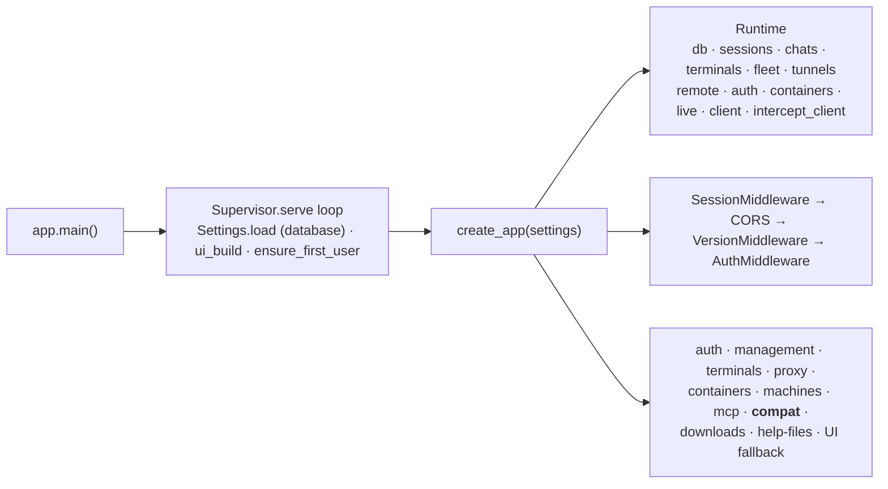
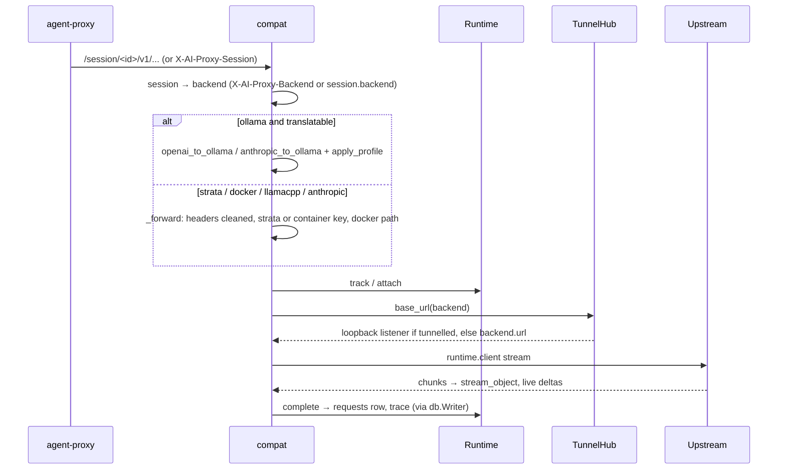

# Server (`server/agent_server/`)

`agent-server`: Python, FastAPI and uvicorn. The hub. It owns the API, accounts, all configuration, agent definitions and template rendering, backend choice, recording, HTTPS interception of account agents, and the fleet registry, and keeps all of them in one database (`db/`: PostgreSQL in production, SQLite by default; there are no configuration files). It optionally serves the console's build; `AI_PROXY_SERVE_UI=0` disables UI routes and automatic UI builds for separate hosting. The same package holds `agent-auth` (`issuer.py`), the OIDC issuer the API depends on but runs as its own process, and `agent-benchmark` (`benchmark.py`).

## Design in one paragraph

Every agent request arrives at one ASGI app. `routes/compat.py` finds the session, picks its backend, then either translates the request (Ollama) or forwards it (Strata, Docker, llama.cpp, Anthropic). Each request is tracked by `Runtime` and recorded in the database (`requests`, `traces`), written behind by `db.Writer` so the event loop never waits on it. Machines hold a WebSocket open to the server (`/api/machines/connect`); the server asks them to do everything about a model server (`Fleet.ask`), and reaches the model servers on machines behind NAT through tunnels that the machine dials back. Account agents' HTTPS arrives as WebSocket tunnels and is decrypted with the server's own CA. Shared state lives in one `Runtime`, and there are no globals apart from two in `strata.py`: `managed_keys` (filled by `KeyStore`) and `fleet` (set by `Runtime`, for the keys machines report).

## Must never

Agent session resolution checks control permission and ended state. Unscoped forwarded GETs do not create recordings; protocol validation precedes implicit session creation. New implicit sessions receive seven-day session retention when otherwise unlimited, respecting the policy minimum. Non-site-admin status responses use the request's public origin/address and omit backend URLs; model discovery hides machine runtime details from callers without machine view permission. The built-in SPA sends framing, object, base-URL, sniffing and referrer headers. Refused intercept audit events include the trusted HTTP connection address or direct socket peer.

- Call a model server for anything but agents' traffic. Listing, pulling, status, logs, metrics, Ollama settings and start/stop are fleet requests to the machine. Native `/api/*` passthrough only allows `compat.NATIVE_AGENT_PATHS`, and `_forward` refuses a path with a `.` or `..` segment (the HTTP client would resolve `/v1/../api/pull` into the model server's own API).
- Send one of the server's environment secrets to an address someone else chose. Only a site admin sets a provider's `key_env` (`routes/api_providers.py` keeps or drops it for an organization's admin), and an audit export's `token_env` can't name the server's own settings (`audit.py`).
- Run `docker`, or add a local backend (`MACHINE_TYPES`: ollama, llamacpp, strata, docker) by URL. `Settings.update_network_config` refuses new or moved ones; only `anthropic` is added there by URL, and hosted `api` backends only through `/api/orgs/{org}/providers` or `/api/config/providers` (`api_providers.validate`).
- Reach a hosted `api` backend with anything but `runtime.api_clients` (`api_providers.ProviderTransport`: resolves, refuses non-public addresses unless `AI_PROXY_API_PRIVATE_HOSTS` lists them, pins the checked address, follows no redirect), put its key anywhere but `provider_credentials` (`ApiKeys`, AAD bound to the origin) or an `AI_PROXY_API_KEY_*` variable, or let `key_env` name any other variable. Keys never go in `Backend.options`, `config export`, records, traces, logs or responses.
- Retry a request on a `fallback` provider after anything but a connection failure (`httpx.ConnectError`/`ConnectTimeout`), or move a session's own backend; pick a hosted `api` backend in `backend_for` unless it's named or the default.
- Import client, machine or Python-port code, or assume anything about them beyond the API.
- Keep cookies in the upstream client (`runtime.upstream_client`), replace an agent's own `Authorization` on hosted pass-through, or forward it to an MCP bridge.
- Send platform credentials upstream: `compat._upstream_headers` drops `X-AI-Proxy-Token`, cookies, Origin and the session/backend headers, and drops `Authorization` only when it was the platform's Bearer (no `X-AI-Proxy-Token`).
- Treat anything but the middleware's introspected identity as authentication: not loopback, a session id or the old access key. The one other authentication is a linked server's link-key signature on the peer routes (`/api/links/present`, `/api/links/connect`, `/api/links/relay/*`), checked by `Links.verify` first, which never yields an `Identity`.
- Let a `bridges.Guest` through an existing permission helper, or serve one anywhere but the peer routes; let a `link` backend be used by another tenant, or crossed onward (one hop: a provider received is never let out); send a provider's key, an MCP bridge key or a machine's credentials to a linked server.
- Write dialect-specific SQL outside `db/`, or edit an existing migration step. Queries are SQLAlchemy Core over `db.schema`, so they run on PostgreSQL and SQLite alike; a schema change is a new step appended to `db/migrate.py`.
- Keep a secret in the settings (`settings` table, what `config export` writes). Generated secrets go in the `secrets` table; passwords and the introspection secret come from the environment.

## Composition

- **Router order is load-bearing.** `compat` has catch-alls (`/api/{path}`, `/v1/{path}`, `/anthropic/{path}`), so every console route registers before it, and the UI fallback comes last. Within a router, literal paths come before parameterised ones.
- **Middleware order** puts the version check before auth, so old programs get 426 (WebSocket close 4426) before a 401. `routes/auth.register` adds Starlette's `SessionMiddleware` (the signed `mesh_oidc_state` cookie for the browser sign-in) after those; `create_app` then adds `TerminalForward`, `AuditMiddleware`, `InternalGate` and `AccessLogMiddleware` outside it, so `AccessLogMiddleware` is the outermost.
- **Split console/API**: `Settings.console_origins` (`AI_PROXY_CONSOLE_ORIGINS`) is the exact origin allowlist for credentialed CORS and `remote.same_origin`, shared by auth mutations and route/WebSocket gates. Cookies stay host-only on the API; no parent-domain cookie or wildcard origin.
- **Restart** (`POST /api/server/restart` → `Runtime.request_restart`): waits up to 30 s for in-flight requests (`Runtime.active`; container jobs run on machines and aren't waited for), then `_restart_when_idle` closes live streams, terminals, fleet sockets, tunnels and intercept tunnels, and the Supervisor serves again with a fresh `Settings.load()`, which reopens the database and re-reads the stored settings. **A new long-lived connection must be closed there.** There's no Supervisor with `--reload` or in tests.
- **Storage lifecycle**: `Settings.load()` opens the database (`open_database`: migrate, a one-time legacy import into a new database, `seed`, `sync_builtin_agents`, then the stored settings with the environment on top). `Runtime` takes `settings.open_database()` and hands it to every store. The lifespan starts `Runtime.prune_daily` (retention, hourly) and, on shutdown, closes the database last (`runtime.db.close()` drains the write queue first). **A new store that buffers or queues writes must flush or close in the lifespan, before that.** `agent-server config|db` (`commands.py`) and `agent-server user|org|team` open the same database from the shell.
- `ensure_first_user` runs in `main()` (with `--reload` too) and every `Supervisor.serve` round, including loopback, never in `create_app`. It does nothing once accounts were ever written (meta `accounts_initialized`, `UserStore.initialized()`) or `AI_PROXY_USERNAME`/`AI_PROXY_PASSWORD` are set. Tests must authenticate explicitly; no anonymous local mode remains.
- `issuer.py` runs the separate `agent-auth` Authlib service (`create_auth_app`, never mounted into the API app): PKCE, device and service grants, hashed transactional token state (`State`: schema `mesh_auth` on PostgreSQL, else a SQLite file of its own), discovery/JWKS, introspection, revocation and userinfo. It reads but never mutates API accounts. API `Auth` introspects with a dedicated client (closed in the lifespan); browser `routes/auth.py` manages host-only access/refresh cookies. See `auth.md`.

## Module map

| Area | Modules | Key symbols |
| --- | --- | --- |
| Database | `db/__init__.py`, `db/schema.py`, `db/migrate.py`, `db/kv.py`, `db/legacy.py` | `Database` (`write()`/`read()`, `size`, `close`, `hold_lock` (a process-long PostgreSQL advisory lock), `transaction_lock` (one until the write ends; the issuer's); SQLite WAL + BEGIN IMMEDIATE, PostgreSQL schema translation), `Writer` (`submit`, `flush`, `close`), `pack`/`unpack` (gzip), `sqlite_url`, `redacted`; `API_SCHEMA` `mesh`, `AUTH_SCHEMA` `mesh_auth`; `migrate` (`API_STEPS`, `AUTH_STEPS`, `schema_version`, advisory lock), `grant_issuer`, `ISSUER_READS`; `kv.upsert`/`get`/`put`/`get_meta`/`put_meta`/`secret`; `legacy.import_settings`/`import_sessions` |
| Config | `config.py`, `defaults.py`, `config_io.py`, `commands.py` | `Settings` (`load(database=True)`, `open_database`, `database_address`, `_configure` (stored settings, environment on top), `_store_config` (code-built Settings write theirs), `backend`, `backend_for`, `profile`, `update_network_config`, `update_models`, `set_retention`, `save_backend`, `remove_backend`, `upcoming_listen`), `seed`, `sync_builtin_agents`, `stored_config`, `validate_models`, `Backend` (`name`, `url`, `type`, `machine`, `container`, `options`), `serves()`, `BACKEND_TYPES`, `NATIVE_PROTOCOLS`, `MACHINE_TYPES`, `PROVIDER_NAMES`; `defaults.PROXY`/`INTERCEPT`/`BACKENDS`/`DEFAULT_BACKEND`/`MODELS_YAML`/`AGENTS_YAML`; `config_io.export`/`dump`/`parse`/`apply`, `put_agent`/`delete_agent`/`reset_agent`; `commands.main` (`agent-server config export|import`, `db info|migrate|import`) |
| Shared state | `runtime.py` | `Runtime` (`db`, `track` → `attach` → `stream_object`/`progress` → `complete`, `proxy_error`, `resolve_session`, `agents()`, `prune`/`prune_daily`), `upstream_client` |
| Recording | `sessions.py`, `telemetry.py`, `live.py`, `chat.py` | `SessionStore(db)` (memory authoritative for open sessions, written behind; `records`, `query_requests` (limit, before, model, kind), `traced`, `totals`, `recent`, `prune(before)`), `RequestTelemetry` (`kind`: api, intercept, upgrade, tunnel, mcp), `LiveHub` (memory only), `Chats` (the `chat_index` table), `read_traces` (batched) |
| Agents | `agents.py` | `AgentDefinition.render`, `load_agents(db)` (the `agents` table, re-read on every call), `parse_agents`, `stored_agents`, `_render` (a template with a missing placeholder is dropped) |
| Translation | `translate/` | `openai_to_ollama`/`OpenAIStreamTranslator`, `anthropic_to_ollama`/`AnthropicStreamTranslator`, `apply_profile` |
| API providers | `api_providers.py`, `routes/api_providers.py` | `PROTOCOLS`, `AUTH_MODES`, `DEFAULT_OPTIONS`, `PRESETS`; `options`, `speaks`, `enabled`, `external`, `validate` (`check_url`, headers that look like credentials refused, `key_env` only `AI_PROXY_API_KEY_*`, `anthropic_url` same origin), `protocol_for`, `target` (url is the OpenAI base; Messages to `anthropic_url` or url without `/v1`), `query` (`api_version`), `upstream_model`, `headers` (the server's auth replaces the agent's unless `auth: agent`), `ApiKeys(db, vault)` (`provider_credentials` rows `backend:<name>`, AAD `backend:<name>\|<origin>`; stored wins over `key_env`; `rotate`, also run by `agent-server vault rotate`), `PrivateHosts` (`AI_PROXY_API_PRIVATE_HOSTS`), `ProviderNetworkBackend`/`ProviderTransport`, `Health` (memory, per process), `public`; `owner`, `for_teams`; routes `GET /api/orgs/{org}/providers`, `PUT`/`DELETE /api/orgs/{org}/providers/{name}`, `POST .../{name}/test` (the organization's admins and site admins; `managed`), the same for every organization at `/api/config/providers*` (site admins), both through `save`/`delete` and `discover` (which fills `runtime.api_discovery`) |
| Providers | `strata.py`, `model_runner.py` | `key_for`/`with_key` (container key, `STRATA_API_KEY`, or the machine's), `with_container_key` (a llama.cpp container's key; `managed_keys` holds every keyed container's), `upstream_path` |
| Fleet | `fleet.py`, `tunnels.py`, `containers.py`, `mcp.py` | `Fleet(db, sessions)` (`connect`, `message`, `ask`, `launch`, `shell`, `remove`/`restore`, `moved`, `machine_for`), `allowed`, `FEATURES`, `ADMIN_FEATURES`; `TunnelHub.base_url`; `ContainerManager`, `validate_spec`, `KEYED_ENGINES` (strata, llamacpp), `KeyStore(db)` (secrets `container-key:<name>`); `mcp.usable`/`choose` |
| Security | `auth.py`, `access.py`, `remote.py` | `AuthMiddleware`, `PROTECTED_PREFIXES`, `PUBLIC_PATHS`, `SITE_ADMIN_ONLY`, `ADMIN_ONLY`, `ROOT_TENANT`, `same_tenant`, `administers`, `Auth` (`identify` by introspection, `identity_for`, `account_version`, `check_password`), `AuthUnavailable`, `UserStore(db, readonly=False)` (`initialized`, `account_version`), `Identity`, `request_identity`; `can_view`/`can_control`/`is_owner`, `client_tags`, `sharing_tags`, `SERVER_TAGS`; `RemoteAccess.trusted`, `same_origin`, `write_secret`/`read_token` |
| Issuer (`agent-auth`) | `issuer.py`, `issuer_pages.py`, `relay.py` | `relay` (the browser's address the API names on its `/token` calls, with an HMAC proof under the introspection secret, so the issuer's per-address limit counts browsers, not the API); `issuer_pages` (the branded sign-in, device and problem pages, `STYLESHEET` for `/sign-in.css`); `create_auth_app`, `Issuer` (`client`, `provision`, `active`, `rate`, `csrf`, `page`, `finish`, `transaction_cookie`), `State(db, legacy_dir)` (`mesh_auth.records` with an `exp` column, the signing key in `mesh_auth.secrets`, the import of an older `issuer.sqlite3`), `state_database`, `accounts_database`, grants `CodeGrant`/`RefreshGrant`/`DeviceGrant`/`ServiceGrant`, `main` (`agent-auth`, `agent-auth client add|remove`) |
| I/O | `intercept.py`, `certs.py`, `websocket_tap.py`, `terminals.py` | `InterceptProxy.serve_tunnel`, `CertificateAuthority(db, directory)` (key in secret `intercept-ca`, public `ca.pem` and bundle written to `directory`), `WebSocketTap`, `TerminalHub` (output written as `terminal_chunks` every 64 KB or 1 s, `LOG_LIMIT` 64 MiB) |
| Distribution | `version.py`, `downloads.py`, `fetch_builds.py`, `installer.py`, `openapi.py`, `ui_build.py` | `PROTOCOL`, `MIN_PROTOCOL`, `VersionMiddleware`; `Downloads` (only `SHA256SUMS` files); `SAFE_URL`; `TAGS` |
| Routes | `routes/` | `compat` (agents), `management` (console), `machines` (fleet and provider relay), `terminals`, `mcp`, `proxy`, `containers`, `auth` (browser sign-in, organizations, users) |
| Tools | `benchmark.py` | `agent-benchmark`, runs `benchmarks/tests/<name>/` |
| Local instance | `local.py` | `agent-server local start\|stop\|status` (`main`, dispatched first in `app.main`): the API and agent-auth as two detached children (`python -c` with the `MARK` comment) on `127.0.0.1`, OIDC on `http://localhost:<port>` (19999/20000, kept in `local.json`). One folder (`instance_home`: `AI_PROXY_LOCAL_HOME`, else `%LOCALAPPDATA%\AI Control Mesh`, `~/Library/Application Support/AI Control Mesh`, XDG `ai-control-mesh`) holds `logs/` (SQLite), `oidc/`, `private/first-user-password` and `secrets.json` (0600: introspection secret, vault key; made once by `Instance.secrets`, given to the children only by environment). `Instance.environment` drops every inherited `AI_PROXY_*`. The API starts first (migrations, the first `admin`), then the issuer; ready means `/api/auth/status` names the expected issuer and audience and the issuer's discovery its own name. `stop` kills only processes whose id, start time and command-line mark match (`running`), their trees with them. `status --json` (`status_json`) is what agent-tray reads, with the server's `public_url` from `/api/auth/status` (public). `start(..., overrides=)` puts variables into the children's environment last: the all-in-one image's `AI_PROXY_HOST=0.0.0.0` and its `MESH_ADMIN_PASSWORD` as `AI_PROXY_USERNAME`/`PASSWORD`. Tests: `test_local.py` |
| Provider accounts | `provider_accounts.py`, `routes/provider_accounts.py` | `ProviderAccounts(db, fleet, vault)` (accounts and assignments in memory, written behind; `create` (idempotent per owner, provider, name), `update`, `assign` (owner's own machines only), `health`, `state` (`STATES`, `BLOCKING`), `observe` (from `Runtime.complete`: hourly `provider_account_usage` via `kv.increment`, 429s on `PROVIDERS[...]["hosts"]` → `cooldown_until`/`exhausted_until` by `Retry-After` vs `QUOTA_RETRY`), `usage` (observed windows, `_estimate` against a declared `limit`), `for_launch`/`grant`/`end_grant`, `for_session`, `deliver` (one-time token), `plan` (scheduler), `event` (audit)), `Vault` (AES-256-GCM, `AI_PROXY_VAULT_KEYS`, AAD per account, `rotate`), `reported_clis` (the hello's `accounts`) |
| Usage limits | `usage_limits.py`, `routes/providers.py` | `UsageLimits(db, clock)` (`observe` from `Runtime.complete`: hourly `provider_usage` per (tenant, user, provider) through `db.writer` and `kv.increment`; `applicable` (a person's own limit for a window, else everyone's `"*"`), `status`, `blocked`/`blocked_session`, `set_limit`/`remove_limit` (`usage_limits` table, all in memory), `windows` (reports), `prune` after `USAGE_DAYS`); `provider_for(record)` (`backend:<name>` for compat calls, `subscription:<kind>` for intercepted calls to `PROVIDERS[kind]["hosts"]`), `session_user` (`launched_by`, else `owner`), `refusal` (the 429 body and `Retry-After`), `REFUSED` (`usage_limit`); `Runtime.over_limit`/`refuse_over_limit`/`launch_blocked`. Routes: `GET /api/providers`, `GET /api/orgs/{org}/usage`, `PUT`/`DELETE /api/orgs/{org}/limits` |
| Access log | `access_log.py` | `AccessLogMiddleware` (added last in `create_app`, so outermost: it sees 426s, auth refusals and WebSocket close codes from both sides), `AccessLog(db, retention_days)`: in memory the newest `ALL_LIMIT` entries, `FAILED_LIMIT` failures kept apart, open WebSockets by id (`open`, `open_scopes`, re-identified when read: the fleet route puts the hello's machine `{id, name}` in `scope["state"]["machine"]`) and running `stats` (per minute, answers, durations, failing routes (`route()` folds ids) and addresses, capped at `GROUPS`); failures, dropped sockets and every `FLEET_PATH` connection are also saved through `db.writer` to the `access_log` table (API step 4), read by `history`/`saved_stats` and deleted by `prune` (from `Runtime.prune`) after `retention_days`, or `SAVED_DAYS`. Query names only, never values; skips its own routes and `/assets/`. `GET /api/server/access-log`, `/stats`, `/history` (site admins) |
| Request log | `request_log.py` | `RequestLog(db, settings)` (the `request_log` setting: `enabled`, `days`, `payloads`, `payload_days`; `defaults.REQUEST_LOG`, `Settings.set_request_log`, `config.checked_request_log`): `AccessLog.finish` hands it every finished entry (`AccessLog.request_log`), saved through `db.writer` to `request_log` (API step 7); in debug mode `capture(scope)` gives the middleware a `Capture` of the request's and response's headers and bodies (HTTP only, `PAYLOAD_LIMIT` each, never `SECRET_PATHS`), saved gzipped in `request_log_payloads`; `SECRET_HEADERS` dropped and `SECRET_NAME` fields redacted (`redact`, `redact_query`, `SECRET_JSON_TEXT` for a cut body). `query` (words, method, status class, user, `before`/`since`), `get`, `summary`, `prune` (from `Runtime.prune`: rows after `days`, payloads after the lesser of `payload_days` and `days`). `GET /api/server/request-log`, `/summary`, `/{id}` (site admins); the setting through `/api/config/storage` |
| Several processes | `cluster.py`, `roles.py`, `internal.py` | `Cluster` (`LocalCluster` in one process, `RedisCluster` with `AI_PROXY_REDIS_URL`; `fakeredis://<name>` in tests): sync keys and counters (`get`/`set`/`incr`/`hincrby`/`keys`), `publish`/`on` (messages to the other processes, never to the sender), `leader(name, ttl)` (leases), `pods()` (heartbeats every `HEARTBEAT`, gone after `POD_TIMEOUT`; `beacons` add fields), `call`/`stream` (an internal call to one process), `seal`/`unseal` (AES-GCM from `AI_PROXY_INTERNAL_TOKEN`); `roles.parse`/`check`/`role_of`/`filter_routes` (routes dropped by the module that registered them, `create_app`'s `registered`); `InternalEntry` (the internal listener: token check, then the same app, `scope["state"]["internal"]`), `InternalGate` (the public port never serves `/internal/*`), `TerminalForward` (a viewer of a terminal hosted elsewhere is proxied there whole), `register` (`/internal/fleet/{id}/ask\|launch\|shell\|tunnel`, `WS /internal/tunnels/{id}`, `/internal/live`), `metrics` |
| Blob storage | `blobs.py` | `from_environment` (`AI_PROXY_BLOB_URL`: None for the database, `FileBlobs`, `S3Blobs` with `sign` (SigV4) and `Credentials` (static or web identity)); `session_prefix` (`tenant/<org>/<yyyy>/<mm>/<session>`), `pack_trace`/`unpack_trace` (messages as `{"$block": sha256}`, once per session), `parallel` |
| Retention and audit | `retention.py`, `audit.py`, `routes/governance.py` | `Retention(db, settings, sessions, cluster)` (`server`/`set_server` (settings key `retention`; `retention_days` is its traces/terminal days), `org`/`set_org`/`remove_org` (`retention_policies`), `effective`, `stamp` (a new session's `retention` tag and trace capture, `SessionStore.stamp`), `check_trace`, `captures`, holds (`legal_holds`), `run` (sessions due by `sessions.retention_next`), `extra` (the audit log's prune)), `seed_from_environment` (`AI_PROXY_RETENTION_SEED`); `Audit` (`event`, `record(entry, now)` (`_append`: the tenant's `audit_chains` row locked, `seq`/`prev`/`hash`), `query`, `checkpoint` (Ed25519 key in secret `audit-signing-key`), `verify`, `prune` (sets `audit_guard`), exports (`config`/`set_config`, settings key `audit`; `export_once`, cursors in meta `audit_export:<name>`; `deliver`: otlp, syslog, webhook, blob), `backlog`), `AuditMiddleware` (which requests make events: changes, refusals, `data.viewed`; `SAFE_FIELDS`) |
| Peering | `routing.py`, `links.py`, `bridges.py`, `routes/links.py`, `routes/bridges.py` | `routing.Name`, `parse`, `full`, `is_full` (full names `kind:server/org[/machine]/name`, never matching a short name); `links.Links(db, settings, cluster)` (`mesh_id` (meta `mesh_id`, `AI_PROXY_MESH_ID`), `url` (`AI_PROXY_MESH_URL`, else `public_url`, `url`), `well_known`, `KeyRing` (secret `link-keys`: Ed25519, `sign`, `rotate` (old key valid `KEY_OVERLAP`), `remove`), `make_code`/`find_code`/`spend_code` (`peer_codes`, digests only, one use), `inspect`, `join` (present over HTTPS, else over the socket, else `outgoing` until the peer dials), `presented`, `link_id` (digest of both (mesh id, first key) pairs), `sign_policy`/`accept_policy`/`policy`/`link_policy`/`set_link_policy` (`peer_policies`, each side signs its own), `signed_headers`/`verify` (`mesh-link`, `mesh-from`, `mesh-date` (`SKEW`), `mesh-nonce` (cluster key `link:nonce:*`, `NONCE_TTL`), `content-digest`, `mesh-assertion`, `mesh-signature`; rate `RATE`/`BURST` per link), `route`/`prepare`/`send`/`websocket` (directly when `reachable`, else the `Channel`), `notify`, `announce_keys`/`accept_keys`, `accept`/`_dial`/`_hold`/`_keep` (the link socket: challenge, signed hello and welcome, `ping` every `PING_SECONDS`, signed `auth` every `RESIGN_SECONDS`, re-checks every `RECHECK_SECONDS`), `Channel` (binary frames `req`/`res`/`data`/`end`/`err`/`cancel`, `wso`/`wsa`/`wsm`/`wsc`; requests from the peer run through `Links.app` with `scope["state"]["link_channel"]`), `ChannelTransport` (httpx over a channel), `close_all`); `bridges.Bridges(runtime)` (`Guest`, `user_uuid`, `bridge_id`, `overlap` (the four gates), `safe_definition`, `make_code`/`inspect`/`join`/`presented`, `policy`/`digests`/`crossing`/`set_policy` (out: the organization's own, a machine's needs its `bridge:<id>` grant), `refresh_link` (pull the peer's policies and catalogues; `notify` back when one was newer), `catalogue_for`, `lets_in`/`remote_for` (receiving side, teams), `rebuild` (`Settings.remote_backends`: `link` backends), `usable`, `caller`/`upstream`/`mcp_upstream`/`assertion`/`who`, `checked` (giving side: bridge, digests (409), what crosses out (403), the `Guest`), `bridge_session` (id `bridge-<digest>`, tenant the giving org, `launched_by` `bridge:<id>`), `limit_missing`, `launch_backends`/`launch_mcp`, `mirror_session`/`mirror_once`/`mirrored` (cursor in meta `mirror:<session>`), `offboard`/`offboarded`, `_close_withdrawn`, `start` (refresher, mirror loop), `close`) |
| Server stats | `stats.py` | `ServerStats.sample()` for `GET /api/server/stats` (site admins): psutil CPU, memory, swap, `network` (running totals over the interfaces that aren't loopback; the console works out rates), the process (with `open_files` and `connections`, null where the system refuses), each disk holding `log_dir`/`dist_dir`, the database (`database: {kind, bytes}`); folder sizes walked on a background thread at most every `FOLDER_TTL` (300 s), never on the request. `live(runtime)` (called by the route on the event loop, which owns what it counts) adds this process's own counts under `live`: requests in flight and the access log's totals and per-minute counts, open WebSockets by kind (`_socket_kind` on the access log's open entries), live streams, sessions, the fleet (machines, tunnels), shared terminals and viewers, intercept tunnels, links, the write queue and `cluster.pods()` as `nodes`. Nothing is saved, and with several processes each answers for itself. For Prometheus: `exposition(metrics, common)` writes `Metric` tuples as text (a None value is left out), `server_metrics(runtime)` adds the dashboard's numbers to `internal.metrics` (the internal port's `/metrics`, and `GET /api/server/metrics` for site admins on the public port), and `machine_metrics(sample)` is a machine's load sample as `agent_machine_*` for `GET /api/machines/{id}/metrics?format=prometheus` |

`routes/auth.py` exposes organization → team → member management, including scoped PUT/DELETE membership routes and team display-name changes. `UserStore` owns the hierarchy (the `users` and `orgs` tables, cached whole and re-read when meta `accounts_version` changes) and applies scoped changes under its lock; combined account edits validate role, memberships and password before saving once, in one transaction that bumps `accounts_version`. The existing user records and `<org>/<team>` sharing keys stay compatible.

**Peering** (`links.py`, `bridges.py`; `docs/peering.md`, `docs/peering-internals.md`). A link is two servers; a bridge an organization on each, over a link. What crosses is the overlap of four gates (both link policies, both bridge policies, plus a machine's `bridge:<id>` grant), each side signing only its own policy; requests carry both digests, so a request under an older version gets 409 and the sender refreshes (`refresh_link`). On the receiving side a provider let in is a `link` backend under its full name in `Settings.remote_backends` (never stored, exported or picked by `backend_for` unless named; `fleet.usable_by` → `bridges.usable`: its organization only, its teams, never scope `home`); compat's `_upstream_for` signs it to the giving server's `/api/links/relay/provider/{org}/{name}/{agent path}`, sending the agent-facing path (`_agent_path`) so the giving side translates for its own provider. The giving side's route checks the signature, then `bridges.checked`, makes or finds the bridge session, refuses a POST with no bridge limit (`limit_missing`: nothing is used until the giving org sets one), and runs `compat.relay` (the session and backend in `scope["state"]["peer_relay"]`, so `_backend`/`_resolve` take them). MCP relays the same way (`/session/{id}/mcp/peer/{full name}` here, `relay/mcp/...` there, through `routes/mcp.bridge_target`). A guest's launch on this side's machine (`relay/machine/.../launch`) is `Fleet.launch(guest=...)`: the guest's tags (`guest`, `guest_name`, `bridge`, `link`, `launched_by: bridge:<id>`, `remote_session`, `peering: launch`, `allowed_backends`) wait in `Fleet.guest_launches` (and cluster key `fleet:guest-launch:<id>`) for the machine's launcher, whose `prepare_agent_session` takes them and limits the backend to `allowed_backends`, which `compat._backend` enforces on every request. Its records go back to the launching side's mirror session (`peering: mirror`, `mirror_*` tags) by `mirror_once`; its terminal is viewed through `relay/session/{id}/terminal` (`routes/terminals.serve_guest_viewer` there, `relay_mirror_terminal` here). Agent definitions have an `org` (API step 9): `runtime.agents(identity)` is the server's own, the tenant's, and `bridged_agents` (pinned digest, `safe_definition`, an executable the server already runs); only an organization's own cross. Removing a user tells linked servers (`bridges.offboard`); removing an organization ends its bridges.

**Chats** (`chat.py`, `GET /api/sessions/{id}/chat`): the session's traced model calls grouped into threads, kept in one `chat_index` row (`INDEX_VERSION`; bump it when the index's shape or the grouping changes, and every index is rebuilt on its next visit). A call joins a thread three ways: Claude Code's `cc_prev_req=<request-id>` in its system prompt's header names the call it follows (matched to that call's `request-id` response header, `index["upstream"]`): with only user and system messages it's chained on (`index["links"]`, the chat stitched from the chain in `Chats._stitch`), with assistant messages it's the whole history again (a smaller one with another first message starts an era: the agent compacted). Otherwise its messages must start with a thread's last call's. `x-claude-code-request-class` (`main`, `subagent`, anything else is background) and `x-claude-code-agent-id` keep the main chat, each sub-agent and the background calls (titles, recaps, suggestions, compaction; `aside`, never joined) apart; without them a thread without tools that isn't the main one is background. Each thread has a `kind` and, for background ones, a `purpose` (`PURPOSES`). Text sent as the user gets `author` (person, parent, agent, unknown) from the thread's voice and the text itself (`REMINDER`, `AGENT_NOTES`, `QUEUED`, `COMMAND`; text that came with tool results is the agent's), and the agent's own a `note`. Never label by role alone: agents send most of what's in the user's place themselves.

The settings routes (`/api/config` and `/api/config/export|import|agents|models|storage`; `/api/config` and everything under `/api/config/` are `SITE_ADMIN_ONLY`) live in `routes/management.py` and go through `Settings` and `config_io`.

**Provider accounts** (`provider_accounts.py`): people's own subscriptions (Claude, Codex, Copilot), owned by one user in one tenant, apart from `auth.py`'s platform accounts. Modes: `runner` (the CLI is signed in on the machine; the server keeps only the machine's report, `Machine.provider_clis`) and `token` (Copilot's fine-grained PAT in `provider_credentials`, encrypted). The module docstring has the authorization matrix: owner everything; `users` it names may launch; tenant admins and site admins see metadata and may disable, never use or read; nobody reads a token back. `routes/machines.launch` calls `for_launch` for whoever asked (an account agent started by anyone but the machine's owner needs an `account_id` they may use; `auto` runs `plan`), makes a `Grant` for the launch id it passes to `Fleet.launch` (which sends `account` to the machine and checks the returned session's `provider_account` tag in `_start`), and ends it when the launch returns. `prepare_agent_session` with `account` calls `for_session` (vouched by the grant, else the caller must `may_use`; a token account needs the grant) and tags the session `provider_account` (`access.SERVER_TAGS`). `POST /api/sessions/{id}/provider-credential` (`deliver`) hands the token once, to the session's owner, within the grant. Never put a token in a session answer, env rendering, event, log or `config export`.

## Core flows

**Agent request** (`routes/compat.py`)

- Before compat runs, `AuthMiddleware` has already required an access token and, for a session path or `X-AI-Proxy-Session`, an open session the caller can control (404 otherwise).
- Docker Model Runner paths are remapped by `model_runner.upstream_path()`: `/v1/messages*` to `/anthropic/v1/messages*`, other `/v1/*` to `/engines/v1/*`, `/api/*` unchanged. Ollama's own `/v1` ignores `num_ctx`, which is why Ollama traffic is translated to `/api/chat` rather than passed through.
- `MESSAGES_BACKENDS` (anthropic, strata, docker, llamacpp, api) take Anthropic Messages as they are; Ollama gets them translated. Strata, llama.cpp and api refuse native `/api/*` (400).
- **api backends** (`_forward`, `_api_protocol`, `_upstream_for`, `_api_payload`, `_fallback`): the path's protocol (`api_providers.protocol_for`) must be one the backend speaks (400 before anything goes out; 404 for other `/v1/*`); the model alias is mapped; `_upstream_for` gives the client (`runtime.api_clients[verify_tls]` for hosted, `runtime.client` through `tunnels.base_url` for a machine's), URL (`target`), headers (key; 503 without one) and the per-backend timeout. A `ConnectError`/`ConnectTimeout` tries the backend's `fallback` list (`_fallback`: enabled api, usable by the caller, speaks the protocol, knows the model, not over the limit), recorded (`fallback_from`, `routing`), logged and audited (`backend.fallback`); the session keeps its backend. Records add `protocol`, `upstream_model`, `rate_limited`. `_observe` keeps `runtime.api_health`. `/v1/models` for api lists aliases then `discover`. `count_tokens` is estimated for an api backend without `anthropic`.
- llama.cpp backends: `_list_models` asks `/v1/models`; `management._backend_models` lists the router's models except `downloading`/`incomplete` ones, with `context_length` None (llama.cpp doesn't say the running context). `routes/machines.py` has `GET`/`PUT /servers/llamacpp` (`server_settings`/`configure_server`, shared with Ollama), `GET /servers/llamacpp/install` and the `install` (`{"variant"}`, checked by `VARIANT`)/`uninstall`/start/stop/restart actions; `fleet._llamacpp` keeps the hello's `servers.llamacpp` to known fields.
- **Every upstream URL comes from `await runtime.tunnels.base_url(backend)`.** It tunnels when the machine reports `tunnel`, is connected and isn't loopback: a loopback listener per `(machine, port)`. Each connection sends `{"type":"tunnel"}` on the fleet socket and waits for the machine to dial `WS /api/machines/tunnel/<id>`.

**Account interception**: authenticated `WS /api/proxy/tunnel` → `InterceptProxy.serve_tunnel` → a socketpair into `_accept` (`start_tls` needs a real transport). `_connection` needs an identity (the tunnel's, or on the optional direct listener an `X-AI-Proxy-Token` in the CONNECT head, introspected; 503 if the issuer is down) and `Proxy-Authorization` naming an open session that identity can control, or answers 407. A destination that resolves to a non-public address gets 403. `intercept.passthrough` hosts pipe untouched (`kind: tunnel`); others are decrypted and recorded with credential redaction (`redact_headers`, `redact_fields`).

Account interception's outbound HTTP goes through its own client (`runtime.intercept_client`, `InterceptTransport` with `PublicNetworkBackend`), which resolves and pins destinations to public IP addresses only. The passthrough tunnel and WebSocket upgrade paths apply the same check (`_public_addresses`) before connecting; private, loopback, link-local and reserved addresses are refused.

**Fleet socket** (`/api/machines/connect`): signed with the machine's token (4401 otherwise); the first text frame is the hello → `Fleet.connect` (4400 bad id, 4403 removed or someone else's id, 4409 replaces an older socket) → `claim` backends → `welcome`. Then:

| Direction | Messages |
| --- | --- |
| machine → server | `update`, `ping`, `token` (a renewed access token: `auth.renew_socket`), `launched`/`launch_failed`, `provider_progress`, `<channel>_result` (accepted only from the machine that was asked) |
| server → machine | `launch`, `shell`, `tunnel`, and `Fleet.ask` channels: `container` (status, start, stop, restart, remove, logs), `provider` (status, pull, delete, load, unload, log, metrics, search), `server` (settings, configure, start, stop, restart), `folders`, `update` |

`Fleet.ask` errors: not connected or the machine's toggle for that channel is off → 409, reply `ok:false` → 409, timeout → 504, disconnect → 502 (`MachineGone`; a `READ_ONLY` (channel, op) is asked once more first, never a change). Tunnels: `TunnelHub.tunnelled` counts a machine that dropped within `RECONNECT_WINDOW` (`Fleet.reconnecting`), `_open_tunnel` waits for its socket (`Fleet.wait_socket`) and is tried twice before any byte is read, and `_pipe` takes the machine's text frames `{"type": "token"}` through `TunnelHub.renew` (`auth.renew_socket`). Streamed replies with `X-AI-Proxy-Finish: 1` (Ask a model) run in `Runtime.finish_later` (`compat._outliving`), so they're read and recorded whole after the client goes; `Runtime.stop_finishing` (`POST /api/sessions/{id}/stop`, ending the session) cancels them. CORS exposes `X-Request-ID`/`X-Session-ID`, which the console follows on `/api/live`. `Fleet._via` records which socket each request went out on: a socket replaced by a reconnect, or one whose send fails, fails its requests at once (`_fail_sent`, `MachineGone`). A machine's Strata and MCP keys survive a disconnect (its next hello replaces them). The shared client has explicit `Limits` (400, keep-alive 30 s, pool timeout 30 s); MCP GET streams have no read timeout. Terminal viewers resume: `TerminalHub.subscribe(terminal, identity, since)` returns only what a viewer with `?from=` missed while `Terminal.contiguous_from` allows it (reset by a gap, and to `total` on load). `Machine.keys` (Strata keys) and `Machine.mcp_key` stay in memory only, never in `stored()` or `public()`.

**MCP relay** (`/session/<id>/mcp/<machine>/<name>`): session open and given that server (`tags["mcp"]`), the launch-only per-session URL token matches its stored hash, the launcher (`launched_by`, else `owner`) still `mcp.usable`, machine connected with a bridge, name still listed. The request goes to `127.0.0.1:<bridge>` through `tunnels.base_url` with the bridge key and only `REQUEST_HEADERS`. POSTs are recorded (`kind:"mcp"`). The middleware has already required an access token and `can_control` on the session; the token travels as `?key=` (`mcp.valid_token` against `Session.mcp_token_hash`, issued by `mcp.issue_token` when the launch chose servers).

**Terminals**: the launcher's `.../{id}/host` (`can_control`) sends a hello → `TerminalHub.attach`, then binary output. Viewers on `.../view` (`can_view`) get state, the history in 256 KB chunks, `replayed`, then live output. Input is re-checked with `can_control` on every message and goes out as `{"type":"input","parts":[...]}` (`input_parts`, with bracketed paste). Slow viewers are closed with 4408.

## State

- `Fleet` receives the session store from `Runtime`. Launch replies must come from the
  requested machine; before granting `launched_by`, it checks the returned session's
  owner, machine, launch id and client. Machine history is filtered by session access.
- Legacy backends (no `machine`) are linked only by explicit admin adoption
  (`providers/adopt`). `claim` only moves already-linked backends to the machine's new
  address (`Fleet.moved`); nothing links a backend to a machine automatically.
  Adoption's duplicate check counts only the machine's own backends and legacy ones: a
  backend is (machine, port), not its URL, as machines behind one public address share URLs.
- Buffered compat replies use `_read_upstream` to close the response and complete
  telemetry on read failure or cancellation. `_cancel_request` also handles a
  cancellation while awaiting upstream headers.
- Terminal viewers re-identify their original credential for input and each output
  frame, and poll permissions every second while idle. A missing identity on an
  originally authenticated connection never becomes local-mode access.

**Usage limits** (`usage_limits.py`): a provider is a backend (`backend:<name>`) or a kind of subscription (`subscription:claude|codex|copilot`, whichever account carried it). `Runtime.complete` counts every model call for the session's person (`launched_by`, else `owner`) and tenant; checks read an in-memory copy of the last 32 days' buckets, loaded per (tenant, user, provider) the first time a limit applies, so a request with no limit costs a dict lookup. Enforcement happens before anything goes upstream: `compat._over_limit` (POSTs in `_forward` and `_native_chat`), `InterceptProxy._exchange` (POSTs to a subscription's hosts) and `_upgrade` answer 429 `usage_limit` with `Retry-After`, recorded through `refuse_over_limit` (not counted as usage, and not passed to `provider_accounts.observe`, so it's never mistaken for the provider's own 429). New sessions: `prepare_agent_session` checks the requester unless the session carries a `launch` tag (a fleet launch runs under the machine's sign-in), and `routes/machines.launch` checks whoever asked. Limits are an organization's (`administers`); members see only their own rows.

Provider accounts' tables: `provider_accounts` (metadata JSON), `provider_account_assignments`, `provider_account_usage` (hourly buckets, pruned after `USAGE_DAYS`), `provider_account_events` (audit), `provider_credentials` (ciphertext only; API step 3 `_provider_accounts` creates them on older databases). Grants are in memory only.

| In memory | In the database (schema `mesh` on PostgreSQL) | Still files |
| --- | --- | --- |
| `Runtime.active`/`recent`, `LiveHub`, fleet sockets and pending asks, `Machine.keys`/`mcp_key`, tunnel listeners, terminal viewers and the last 4 MiB of each terminal's history, the `Writer` queue, `UserStore`'s cached directory; open sessions (`SessionStore` is authoritative for them and writes them behind); in the issuer process, its sign-in rate counters (`Issuer.attempts`) | `settings` (key → JSON: `proxy`, `default_backend`, `intercept`, `models` = `{defaults, profiles, aliases}`, `retention_days`, `request_log`, `shared_models`), `backends` (ordered by `position`), `agents` (`definition` JSON, `builtin`, `edited`), `meta` (`config_seeded`, `accounts_version`, `accounts_initialized`, `deleted_builtin_agents`, and the legacy import's `backends_imported`, `imported`, `sessions_pending`), `users`/`orgs` (scrypt hashes, `created_at`, memberships), `secrets` (`oidc-browser-key`, `intercept-ca`, `container-key:<name>`), `machines`/`machines_removed`, `sessions` (with only the MCP token's hash), `requests` (indexed by timestamp), `traces` (gzipped JSON), `chat_index`, `terminals` (state) and `terminal_chunks` (64 KB chunks, up to 64 MiB a session), `schema_version` | `logs/proxy/proxy.log` (the server's log must work when the database doesn't); the default SQLite database `log_dir/agent-server.sqlite3`; the CA's public `ca.pem` and bundle in `AI_PROXY_CA_DIR` (default `log_dir/ca/`) for agents that read them as files; `first-user-password` in the folder of `Settings.remote_key_path` (`certs/` for a real server, `AI_PROXY_REMOTE_KEY_FILE` moves it; `log_dir/remote/` in code-built Settings), for the operator to read once |
| | Issuer (`agent-auth`): schema `mesh_auth` on PostgreSQL (`records` with `exp`, `secrets` with `signing-key`, its own `schema_version`), or `issuer-state.sqlite3` in its state folder (`AI_PROXY_OIDC_STATE_DIR`, else `oidc/` beside `first-user-password`) | An older install's files (`config/*.yaml`, `certs/users.json`, keys and CA, `logs/machines.json`, `logs/sessions/`, the issuer's `issuer.sqlite3` and `signing-key.pem`), read once by the import into an empty database and never deleted |

Retention: `Runtime.prune()` runs hourly (`prune_daily`, in the worker role, under the `retention` lease) and applies `Retention.run`: each session by the policy it started with (its `retention` tag, a server tag), deleting traces (and chat indexes), terminal chunks, request records or the whole session as each falls due, skipping legal holds, and noting each session's next due time in `sessions.retention_next` so only due sessions are read. `retention_days` is the server policy's traces and terminal days. Then the audit log's prune (`Audit.prune`, never under `AUDIT_FLOOR`). `request_log` and `request_log_payloads` since API step 7 (the request log). Also in the database since API step 6: `retention_policies`, `legal_holds`, `audit_events` (append-only: triggers and `audit_guard`), `audit_chains`, `audit_checkpoints`; `traces.location` and `terminal_chunks.location` (blob storage); the sessions' counter columns. In Redis (several processes only): presence, heartbeats, counters, leases, grants, revocations; nothing kept there is the only copy except leases and counters for limits, which are rebuilt from the database.

## Configuration

Hosted API model discovery runs on provider listings and model pickers/launch context lookup when `discover` and `enabled` are true and `auth` is not `agent`. `runtime.api_discovery[name]` is a per-process `ModelDiscovery` (IDs, context sizes, result, hashed URL/options/key signature, monotonic expiry, async lock). Concurrent automatic checks share a request; successful checks cache 300 seconds, failures 30. Manual Test connection forces a refresh. Last good IDs survive transient failures, but changed signatures clear them; save/delete/offboarding also clear entries. Nothing new is shared or persisted; each process rediscovers after restart. Machines keep their fleet discovery path. `routes/management._api_models` joins discovered context sizes to aliases.

For Claude's Anthropic protocol on the official hosted DeepSeek origin, `api_providers.claude_launch_model` advertises `[1m]` only when discovery reports >=1M context; `configure_claude_launch` adds effort `max` and a compaction window at 75% of context unless edited definitions set them. Haiku/subagent model templates use the unqualified selected model. DeepSeek alias resolution removes Claude's suffix. No upstream key or real base URL enters the launcher environment. Other origins/agents keep their settings.

DeepSeek balance checks are explicit administrator POSTs to `/api/orgs/{org}/providers/{name}/balance` (or site-admin `/api/config/providers/{name}/balance`). Both reuse tenant administration, same-origin and normal admin policy. Only the official DeepSeek hosted origin is supported; `runtime.api_clients` performs GET `/user/balance` with the provider's key as Bearer. Responses allow only the documented availability/currency/decimal-string fields, are no-store, and never persist balances or expose raw provider errors.

There are no configuration files. Every setting is in the database (`settings`, `backends` and `agents` tables), edited from Server settings, with `agent-server config export|import` (one YAML document, `config_io.py`) or through `/api/config*` (`SITE_ADMIN_ONLY`). A new database is seeded once from `defaults.py` (`config.seed`, meta `config_seeded`).

- **Network** (`settings["proxy"]`, `default_backend`, `intercept`): the server's address (`proxy.url` is also the agent-proxy's server before `agent login`), `public_url`, `tls`, the default backend, HTTPS capture (`intercept.listen_port` only to accept agents directly). A listen address change applies on the next restart (`Settings.upcoming_listen`).
- **Ollama model tuning** (`settings["models"]`): `defaults`, then the first matching `profiles` entry (shell pattern on the model name), then the exact `aliases` entry; values a client sends win. `Settings.profile()` applies it, `Settings.update_models` validates it.
- **Agents** (`agents` table: `definition`, `builtin`, `edited`; the comment block at the top of `defaults.AGENTS_YAML` explains the fields). On every start `config.sync_builtin_agents` updates shipped agents nobody edited, adds new ones and drops ones no longer shipped; an edited one stays until reset (`config_io.reset_agent`), a deleted shipped one stays deleted (meta `deleted_builtin_agents`). `agents.load_agents(db)` reads them on every call, so edits apply at once. `files` are rendered here and written by the launcher into the `files_dir` it sends; a template whose placeholder has no value is left out (`agents._render`). An agent takes shared MCP servers through its `mcp` block (`entry`, `{mcp_servers}`, `env`/`files`/`args`/`args_each`); its args go before the agent's own unless they contain `{mcp_args}` (Claude Code's `--mcp-config` swallows plain arguments after it; Goose's flags belong after `session`).
- **Retention** (`settings["retention_days"]`, the traces and terminal days of `settings["retention"]`); audit exports and checkpoints in `settings["audit"]`.
- **Request log** (`settings["request_log"]`): whether every request is saved for the API log, for how many days, and debug mode's payloads and their days. A database from before it has no key: `_configure` falls back to `defaults.REQUEST_LOG`.
- **Shared models** (`settings["shared_models"]`, `config.checked_shared_models`): `{backend: [model]}` (`"*"` all) site admins let every organization use (`Settings.set_shared_models`, `/api/config/shared-models` in `routes/api_providers.py`). `Settings._forget_shares` drops a removed backend's share (`remove_backend`, `update_network_config`; `config_io.apply` keeps only backends it has), so a new backend of the same name never inherits one. The fleet reads it live (`Fleet.shared_models`, set by `Runtime`); `auth.md` has the rules.
- Ollama's `OLLAMA_*` settings are the machine's (`ollama.json` there); the server has none.
- **Repo root**: `AI_PROXY_HOME`, else the first directory up from the package or the cwd with `VERSION` and `server/`.
- **Environment overrides**: `AI_PROXY_DATABASE_URL`, `AI_PROXY_AUTH_DATABASE_URL`, `AI_PROXY_HOST`, `AI_PROXY_PORT`, `AI_PROXY_URL`, `AI_PROXY_PUBLIC_URL`, `AI_PROXY_TLS_CERT`/`_KEY` (all over the stored proxy settings), `AI_PROXY_DEFAULT_BACKEND`, `AI_PROXY_LOG_DIR` (also the default SQLite file's folder), `AI_PROXY_UI_DIR`, `AI_PROXY_DIST_DIR`, `AI_PROXY_VERSION`, `AI_PROXY_INTERCEPT=0`, `AI_PROXY_INTERCEPT_HOST`/`_PORT`, `AI_PROXY_CA_DIR`, `AI_PROXY_LIVE=0`, `AI_PROXY_UI_BUILD=0`, `AI_PROXY_SERVE_UI=0`, `AI_PROXY_CONSOLE_ORIGINS`, `AI_PROXY_DOCS_DIR`, `AI_PROXY_REMOTE_KEY_FILE`, `AI_PROXY_USERNAME`/`_PASSWORD` (an admin outside the users table; stops `ensure_first_user`), `STRATA_API_KEY`. Several processes and storage: `AI_PROXY_ROLES`, `AI_PROXY_REDIS_URL`, `AI_PROXY_INTERNAL_TOKEN`, `AI_PROXY_INTERNAL_PORT`/`_HOST`, `AI_PROXY_POD_ID`/`_IP`, `AI_PROXY_WORKERS`, `AI_PROXY_MIGRATE=0`, `AI_PROXY_GRACEFUL_SECONDS`, `AI_PROXY_SESSION_LIST_DAYS`, `AI_PROXY_DB_POOL_SIZE`/`_MAX_OVERFLOW`, `AI_PROXY_BLOB_URL`/`_ENDPOINT`/`_REGION`/`_THREADS`, `AI_PROXY_LOG_STDOUT`, `AI_PROXY_LOG_FORMAT`, `AI_PROXY_RETENTION_SEED`; agent-auth's `AI_PROXY_AUTH_JWT_ACCESS_TOKENS` and the OIDC settings (`docs/oidc.md`). `AI_PROXY_BACKENDS`/`_MODELS`/`_AGENTS` are read only by the one-time legacy import. Tests: `AI_PROXY_TEST_DATABASE_URL`.
- **Upgrading an install from before the database**: the first start against an empty database imports its files (`db/legacy.py`), each old session in its own transaction so an interrupted import resumes; nothing is deleted. `agent-server db import --from <folder>` does it by hand.
- **The account-state folder**: `Settings.remote_key_path` (`AI_PROXY_REMOTE_KEY_FILE`) only decides a folder now (the access key is gone): `first-user-password`, the issuer's default `oidc/` state, and an older install's files for the import. Code-built `Settings(...)` put it under `log_dir`; `Settings.load()` uses `certs/`. Tests and the demo must never touch the real one.

## Rules for changes

Managed API credentials use the issuer's `client` records, not API settings or secrets tables. `routes/auth.py` relays organisation credential management to issuer `/api-credentials`, with the person's console token and API introspection authentication. The issuer owns hashes, revocation and rotation; its transaction and database are authoritative across processes. See `auth.md` for pinned roles, opaque tokens and bootstrap CLI provisioning.

- **Database**: hot-path writes (request records, traces, terminal chunks, session and machine updates) go through `db.writer`; a read that must see them calls `writer.flush()` first. `Settings(...)` built in code writes its values (proxy, backends, models, `agents=`; `None` means the shipped ones) into the database it opens, so a test states the configuration it wants. On PostgreSQL the API is role `mesh_api` (schema `mesh`) and agent-auth `mesh_auth`, which reads only `ISSUER_READS`; add a table there only if the issuer must read it.
- `Settings(...)` built in code leaves HTTPS capture disabled, and the server binds an intercept listener only when `intercept.listen_port` is set (tests use 0), so tests never open 8183.
- **Containers**: a backend with `machine` and `container` is a container on that machine, which runs it (`Fleet.ask` channel `container`); the server never runs `docker`. Specs are checked on both sides (`containers.validate_spec` against the machine's reported engine, and the machine again): known engines, each engine's own env settings, plain images, `gpus` all/none/numbers, a volume name or absolute folder. Never add free-form docker arguments. Creating, editing or deleting needs the machine's owner, who must also be an admin; starting and stopping is open to those who can see the machine (the launcher's `EnsureContainer` needs it). `Settings.update_network_config` keeps existing machine and container blocks and ignores new ones; only `/api/containers` (`save_backend`/`remove_backend`) or a settings import changes them. Strata containers get `PRESET` and a generated `API_KEY`, llama.cpp ones `LLAMA_API_KEY`, `LLAMA_ARG_HOST=0.0.0.0`, `LLAMA_ARG_PORT=8080` (`KEYED_ENGINES`); keys live in secrets `container-key:<name>` and are published to `strata.managed_keys`. Container jobs run on the machine, so a restart doesn't wait for them.
- **Fleet features**: every new machine route checks its feature with `fleet.allowed`. A launch is a remote shell: only the owner or those granted `launch`, only with the machine's `launches` on, only inside its `roots` (`within_roots` here, `Machine.Within` there; keep both). Shells (`POST /api/machines/{id}/shell`) need `terminal` and `commands` on; their sessions (client `shell`, `fleet.SHELL_CLIENT`) are forced private and can't be widened. Remote updates need `updates` on and `fleet.can_update`. The folder picker (`launch` or `terminal`) returns folder names only, inside the roots. The file viewer (`GET /api/machines/{id}/files` and `/files/content`) needs `files` (granted) and `files on`, and refuses paths outside the roots (`within_roots`) before asking the machine, which checks again. Hidden names are shown. Starting a machine's Ollama/llama.cpp/Strata needs `servers` (granted) and `servers on`. `Fleet._start` verifies a launch's returned session (machine, owner, launch id, agent) before tagging `launched_by`. Removing a machine (`Fleet.remove`) closes its socket with 4403 and keeps it in `machines_removed` until restored. Adopting a model server is ADMIN_ONLY and uses the machine's address as seen, unless the machine names one (`agent-machine address`). Hand-started agents carry only `hostname`; `Fleet.machine_for` files them under the same owner's machine.
- **Sessions**: every endpoint that touches one checks `access.can_view`/`can_control` (`viewable`/`controllable` in `routes/management.py`), lists filter, streams check per event, `TerminalHub.drop_viewers` runs when sharing narrows, and `access.client_tags`/`sharing_tags` keep clients off server tags.
- **Terminal endpoints** are a remote shell: every `/api/terminals*` and `/api/remote/*` route checks `runtime.remote.trusted()` and `remote.same_origin()`. Multi-line input is wrapped in bracketed paste once the agent enabled it (`\x1b[?2004h`, detected in `terminals.py`).
- **Usage limits**: every new path that sends agents' model calls upstream checks `runtime.over_limit` first and answers through `refuse_over_limit` before any byte goes out; a new way to start sessions checks `runtime.launch_blocked`. A session carrying a `launch` tag skips that early check only when `Fleet.pending_launch` knows the launch: this process's own `_asked`, or the `fleet:launch-grant:<id>` key the launching process holds in the cluster for the launch's lifetime (the console's launch route already checked the limit; the id is server-generated and secret). Refusals are never counted as usage nor passed to `provider_accounts.observe`.
- **MCP**: keep both checks in `routes/mcp.py` (the session was given that server; its user may still use it). Never forward the agent's `Authorization` to a bridge (`REQUEST_HEADERS`).
- **Retention and audit**: new recordings go through `SessionStore` (and `blobs`) so retention covers them. Changes under `/api/` are audited by `AuditMiddleware`; a WebSocket or non-HTTP action records its own event (`runtime.audit.record(runtime.audit.event(...))`). Only `SAFE_FIELDS` values are kept from bodies.
- **Python style**: `from __future__ import annotations`, a module docstring saying what the module is for, dataclasses and type hints, comments that explain why. No formatter or linter; match the surrounding code.

## Several processes

`agent-server` is one program; `AI_PROXY_ROLES` (`roles.py`) says what a process serves, and `AI_PROXY_REDIS_URL` makes processes one server (`cluster.py`). Without Redis, everything stays as described above (memory is authoritative), and `app.single_node` holds a PostgreSQL advisory lock (`SINGLE_NODE_LOCK`) so a second such process refuses to start; roles other than `all` and `AI_PROXY_WORKERS>1` are refused (`roles.check`). With Redis (`cluster.scaled`):

| What | How |
| --- | --- |
| Sessions (`SessionStore`) | Created with a direct write and announced; `get` falls back to the database; document changes are `_change` (read, change, write in one transaction with `with_for_update`, then `session.changed`), applied in place in every process (`_refresh`, `listeners`: terminal viewers drop); request ids from shared counters (`session:<id>:seq`/`:count`, seeded from the row); counters are columns only ever raised (`_write_counters`); `list()` reads the last `LIST_DAYS` from the database. |
| Machines (`Fleet`) | The holding process announces `fleet.machine` (state, keys sealed); others keep `owners`; `ask`/`launch`/`shell`/`send_tunnel` go through `_where` to `_remote` (the owner's `/internal/fleet/...`), whose `FleetError`/`MachineGone` come back as such; `fleet.removed` closes and refuses it everywhere. `_save(machine)` writes only the changed machine. |
| Tunnels (`TunnelHub`) | The asking process keeps its loopback listener and records `tunnel:<id>` → itself; a dial-back reaching another process is `relay`ed to `/internal/tunnels/<id>` (binary frames only; the machine's token renewals are taken where its WebSocket is). |
| Terminals | `terminal:<session>` → the hosting process and its `public()`, refreshed by `flush_quiet`; `TerminalForward` proxies `/api/terminals/<id>/view` there; `summaries` uses the snapshot. |
| Live (`LiveHub`) | Events batched to `live.events` every `BATCH_SECONDS` only while another process has subscribers (its beacon `live`); others mirror entries without payloads; details are asked of the process (`elsewhere`, `/internal/live`). |
| Usage limits | `usage:<tenant>:<user>:<provider>` hash per hour, seeded once from the database (max per hour); `usage.limits` reloads limits. |
| Provider accounts | `Grants` in shared keys, `claim` (`SET NX`) for the one-time token; `provider_accounts.changed` carries rows. |
| Settings, container keys, API provider keys | `Settings.changed` / `KeyStore.listeners` / `ApiKeys.listeners` → `config.changed` → `Settings.reload`, `KeyStore.reload` and `ApiKeys.reload`. API providers' health and discovered models (`runtime.api_health`, `runtime.api_discovery`) are each process's own observations and aren't shared: the console shows what the process answering it saw. |
| Jobs | Only the `worker` role runs them, each under a lease: retention (`prune_daily`), `_audit_checkpoints`, `_audit_exports`. |
| Auth | `Auth.revocations` (`Revocations`): signed access tokens checked locally (`verify_jwt`) while revocations are fresh; see `auth.md`. |
| Links (`links.py`) | One `fleet` process dials each link (lease `link-dial:<id>`); the process holding a socket says so in `link:socket:<id>`. Nonces are cluster keys, so a replay is refused anywhere. Changes are `bridge.changed` messages (`Links._heard` reloads links, keys and bridges). Signed requests to a reachable peer go from any process; one only reachable over its socket is reached only from the holding process (a known gap). Guests' launches: `fleet:guest-launch:<id>`; the internal launch route passes `guest` on. |

A new route belongs to a role by the module that registers it (`roles.MODULE_ROLES`, `PATH_ROLES`): add it there, and to the chart's route table (`deploy/helm/agent-mesh/templates/_helpers.tpl`) when it isn't the api's. Jobs one process should run take `cluster.leader(name)` and run in the `worker` role. `test_cluster.py` shows two processes in one test (`RedisCluster("fakeredis://<uuid>", ...)`, `create_app(..., cluster=, internal_port=0)`).

**Must never** with several processes: put a machine's keys, an MCP key or a token in Redis in the clear (seal them); serve `/internal/*` on the public port or without the token (`/metrics` is the only exception); treat an internal call as authentication (launches and shells name the user, whose permissions are checked again; forwarded viewers carry their own credentials); keep a new kind of per-process state without saying how another process finds it.

## Security model

Two things a machine is trusted with are known limits, kept because the fleet's own tests define the behaviour (`docs/security.md`, What a machine is trusted with): its self-reported address is where a direct (untunnelled) provider is reached, and with `servers` on it changes models on any loopback port the server names.

The summary; `auth.md` has the whole of it (credentials, the middleware's order, roles, what must never change).

- **Mandatory OIDC**: `AuthMiddleware` covers `/api/`, `/v1/`, `/anthropic/`, `/session/` and API documentation, except explicit public authentication endpoints. Active access tokens are introspected at the separate issuer (`Auth.identify`; down or unconfigured is 503); identity and permissions come from current accounts. Loopback, session ids and legacy keys never authenticate. Retired auth routes (password sign-in, launcher tokens, pairing) answer 410 or 403.
- **Browser and role checks**: unsafe methods require the API's exact origin or an explicitly allowed console origin, and `ADMIN_ONLY` routes need an admin. WebSockets periodically revalidate credentials and close with retryable 4410 when renewal is required. The fleet socket renews in place: a `token` message goes through `auth.renew_socket` (valid, same user and tenant), which stores it in the scope (`RENEWED_TOKEN`) for `AuthMiddleware`'s later checks. `Fleet.ask`, `launch` and `shell` wait up to `RECONNECT_WAIT` for a machine that dropped within `RECONNECT_WINDOW`.
- **Sessions** (`access.py`): owner or `launched_by`; private/team/org visibility; view or control. A session you can't see is a 404. Clients can't set `SERVER_TAGS`. Shell sessions are forced private. Narrowing sharing drops terminal viewers.
- **Tenants** (`.context/auth.md`): every user, machine, backend and session belongs to one organization, and every check starts there. Another tenant's things answer 404; `tests/test_tenancy.py` covers it.
- **Machines** (`fleet.allowed`): nobody outside `Machine.tenant`; the owner always; the tenant's admins only `ADMIN_FEATURES` (view, models, update); others through grants to the organization or its teams in `Machine.access`. Launches and folders are checked against roots on both sides. Creating, editing or removing a container needs the owner, who must also be an admin (ADMIN_ONLY).

## Extending

- **Route**: add it to a `routes/*.py` `register` (or a new module registered before `compat`), an `openapi.TAGS` entry, a `SITE_ADMIN_ONLY` entry if it changes the server itself (else `ADMIN_ONLY` plus an `administers` check for organization changes), the tenant check (`same_tenant`, `fleet.usable_by` for backends), the sharing check (`viewable`/`controllable`) or the feature check (`allowed`), and a line in `docs/api.md`.
- **Backend/provider type** (the places Docker Model Runner touched):
  1. `config.py`: `BACKEND_TYPES`, `NATIVE_PROTOCOLS` (if it's pass-through), `PROVIDER_NAMES`; `MACHINE_TYPES` and `fleet.PROVIDER_TYPES` if machines run it.
  2. `routes/compat.py`: `MESSAGES_BACKENDS`, path mapping in `_forward`, and `_list_models` (agents' traffic only).
  3. agent-machine: a kind in `machine/internal/providers` (status, model ops, log), its probe in `presence.DetectProviders`, Go tests, and the same in `python/` (`machine.md`, `python.md`).
  4. `routes/management.py`: `_backend_models` shapes the machine's `status` for `/api/models`. The provider routes in `routes/machines.py` are generic; nothing per provider goes in the server.
  5. Console: `api.ts` types and `MACHINE_TYPES`, `routes.ts` `PROVIDERS`, `Settings.tsx` (`<option>`, `URL_PLACEHOLDERS`), a `<Kind>Provider` view taking a `ProviderRef` and its case in `ProviderView` (`console.md`).
  6. The comments in `defaults.py` where they name backend types; `docs/providers.md`, `docs/console.md`, `docs/configuration.md`, `docs/api.md`; the fake server in `devhelpers/scripts/screenshots/demo.py`.
  7. Tests: traffic in `server/tests/test_<provider>.py` (follow `test_model_runner.py`), the relay in `test_providers.py`, the machine's side in Go and Python.
- **Fleet message**: a `Fleet.ask` channel with its gate and `<channel>_result` in `Fleet.message`, a hello field in `_update`/`Machine`, then the machine side in Go and Python.
- **Agent**: an entry in `defaults.AGENTS_YAML` to ship it (`executable`, `protocol`, `env`/`args` templates, `install`, `homepage`, and `backend_type` or `intercept`; synced into every server's `agents` table on start), or one added on Server settings → Agents (`PUT /api/config/agents/{id}`); no client code. Then check `agent --list` finds it, launch it once with `--trace` and read the traces, and add it to "Supported agents" in `docs/running-agents.md`.
- **Setting**: a key in the `settings` table, read in `Settings._configure`, written by `_store_config` (code-built Settings) and seeded in `config.seed`; add it to `config_io`'s document (export, parse, apply) so `config export|import` carry it, and to `ADMIN_ONLY` if a new route changes it.
- **Table or column**: `db/schema.py` plus a new step appended to `db/migrate.py`'s `API_STEPS` (never an edit to step 1); queries in SQLAlchemy Core; if the issuer must read it, `migrate.ISSUER_READS`. Cover it in `test_db.py`, on SQLite and PostgreSQL.

## Tests (`server/tests/`)

- `make_app(tmp_path, handler)`/`close_app`: `Settings(...)` built in code (which writes its values into the test's database), `create_app`, a `TestClient` (signed in: `oidc_helpers.authenticated_client`, with introspection mocked), and `runtime.client` swapped for an `httpx.MockTransport`. Assert on what upstream received too.
- `oidc_helpers.py` plays the issuer's introspection for API tests (`access_token(app, user)`, `issuer(app).revoke`); `test_oidc_issuer.py`, `test_oidc_api.py` and `test_oidc_browser.py` cover the real issuer, the API's mandatory auth and the browser sign-in; `test_quickstart.py` the quickstart stack's credentials and layout. See `auth.md`.
- Starlette's TestClient sends WebSockets to `ws://testserver`: pass `headers={"host": "127.0.0.1:8181"}` and `client=("127.0.0.1", ...)` to look local (`ws_connect` in `test_terminals.py`). A refused WebSocket left open inside a `with TestClient(...)` block hangs the test on exit instead of failing it; use context managers for sockets. The one pytest warning (Starlette's httpx deprecation) is expected.
- `FakeSocket` (`test_providers.py`) answers like agent-machine (`LlamaSocket` in `test_llamacpp.py` adds llama.cpp's provider and server requests); `FakeMachine` (`test_containers.py`) replaces `Fleet.ask`; `ws_connect` (`test_terminals.py`) makes WebSockets look local.
- `test_client.py` runs the real Go client and machine (and, from `python/tests`, the Python ones) on real ports and real tunnels, signed in through a real `create_auth_app` issuer, with `fake_mcp.py`, `fake_docker.py`, `fake_ollama.py`, `fake_llamacpp.py` (llama-server's router: models, downloads with `/models/sse` progress), `fake_strata.py` (`fake_systemctl.py` is for the machine's systemd tests in Go and `python/tests`). It builds the programs with the first of `BUILD_FLAGS` that builds and runs (`build_program`, version `dev` in each): on Windows, Defender's ML check (`Trojan:Win32/Bearfoos.A!ml`, a false positive) quarantines one variant of the client or another, at link, at write or at run, and which one changes with the bytes and with Defender's updates. If every variant fails with "contains a virus", `Get-MpThreatDetection` names the file, and the comment by `BUILD_FLAGS` lists what was tried; add another variant there.
- `conftest.py` (autouse `isolated_storage`) gives every test its own `AI_PROXY_LOG_DIR` (so its own SQLite file), `AI_PROXY_REMOTE_KEY_FILE` and `AI_PROXY_CA_DIR`, clears `AI_PROXY_DATABASE_URL`/`AI_PROXY_AUTH_DATABASE_URL` and the legacy `AI_PROXY_BACKENDS`/`MODELS`/`AGENTS`, and fails any test that touches the real `logs/agent-server.sqlite3` or creates secrets in `certs/` (`remote-access-key`, `container-keys.json`, `users.json`, `first-user-password`). With `AI_PROXY_TEST_DATABASE_URL` (a PostgreSQL admin URL) each test gets a fresh database there, dropped afterwards; the whole suite passes on both.
- `oidc_helpers` reads back what's stored: `stored_backends(settings)` (the backends as `config export` gives them), `database(tmp_path, separate=False)` (the test's database, or a separate SQLite one), `stored_rows(db, table)`. Each flushes the write queue first.
- `test_cluster.py` runs two apps (pods) sharing a database and a fakeredis, each with its internal port on loopback: sessions, request ids and sharing across them, a machine on one asked from the other, launch grants, usage limits, settings, a terminal viewer forwarded to its host. `test_governance.py` covers retention, holds, the audit log (chains, tampering, exports, the middleware) and blob storage; `test_jwt.py` signed access tokens against the real issuer.
- `test_db.py` covers the database itself: migrations, seeding, shipped-agent upgrades, export/import, the config routes' admin checks, request paging and retention, terminal chunks, the issuer's read-only accounts and the legacy import (issuer state included).

## Known gaps

- Peering: a linked server reachable only over its link socket is reached only from the process holding it (others answer 503); MCP servers "for our own people's launches" (scope `home`) aren't offered to guests' launches; terminal output of a launch on the other server isn't copied into the mirror session (it's viewed live, and kept there); account agents can't be launched for guests; legal holds don't cross. Long streams re-check the bridge on every message there, but don't send fresh assertions.

- `containers._answers` probes `backend.url + health_path` directly, not through the tunnel, so readiness can be wrong for a machine behind NAT.
- A settings import (`config_io.apply`: `agent-server config import`, `POST /api/config/import`) checks backend types and URLs but not `validate_spec` or the rule that local backends come only from machines; agent-machine's own spec check is what stands behind an imported container. An imported `api` backend gets `api_providers.validate`, but one naming a `machine` keeps its URL unchecked, like other local backends.
- API providers' fallback is only for connection failures; there's no fallback on 429/5xx answers, no circuit breaker and no active health probe (health is what requests and tests saw, per process).
- A machine-hosted `api` backend with a key sends that key through the machine's tunnel: its machine's owner could read it. Use `auth: none` for servers on machines unless the machine is trusted with the key.
