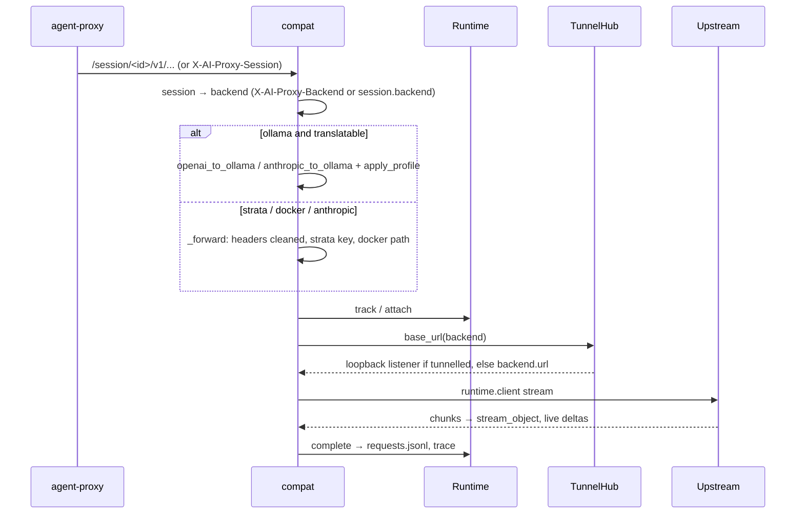

# Server (`server/agent_server/`)

`agent-server`: Python, FastAPI and uvicorn. The hub. It owns the API, accounts, all configuration (`config/`), agent definitions and template rendering, backend choice, recording, HTTPS interception of account agents, and the fleet registry. It optionally serves the console's build; `AI_PROXY_SERVE_UI=0` disables UI routes and automatic UI builds for separate hosting.

## Design in one paragraph

Every agent request arrives at one ASGI app. `routes/compat.py` finds the session, picks its backend, then either translates the request (Ollama) or forwards it (Strata, Docker, Anthropic). Each request is tracked by `Runtime` and recorded under `logs/sessions/<id>/`. Machines hold a WebSocket open to the server (`/api/machines/connect`); the server asks them to do everything about a model server (`Fleet.ask`), and reaches the model servers on machines behind NAT through tunnels that the machine dials back. Account agents' HTTPS arrives as WebSocket tunnels and is decrypted with the server's own CA. Shared state lives in one `Runtime`, and there are no globals apart from two small key caches in `strata.py`.

## Must never

- Call a model server for anything but agents' traffic. Listing, pulling, status, logs, metrics, Ollama settings and start/stop are fleet requests to the machine. Native `/api/*` passthrough only allows `compat.NATIVE_AGENT_PATHS`.
- Run `docker`, or add a local backend (`MACHINE_TYPES`: ollama, strata, docker) by URL. `Settings.update_network_config` refuses new or moved ones; only `anthropic` is added by URL.
- Import client, machine or Python-port code, or assume anything about them beyond the API.
- Keep cookies in the upstream client (`runtime.upstream_client`), replace an agent's own `Authorization` on hosted pass-through, or forward it to an MCP bridge.

## Composition

- **Router order is load-bearing.** `compat` has catch-alls (`/api/{path}`, `/v1/{path}`, `/anthropic/{path}`), so every console route registers before it, and the UI fallback comes last. Within a router, literal paths come before parameterised ones.
- **Middleware order** puts the version check before auth, so old programs get 426 (WebSocket close 4426) before a 401.
- **Split console/API**: `Settings.console_origins` (`AI_PROXY_CONSOLE_ORIGINS`) is the exact origin allowlist for credentialed CORS and `remote.same_origin`, shared by auth mutations and route/WebSocket gates. Cookies stay host-only on the API; no parent-domain cookie or wildcard origin.
- **Restart** (`POST /api/server/restart` → `Runtime.request_restart`): waits up to 30 s for in-flight requests (`Runtime.active`; container jobs run on machines and aren't waited for), then `_restart_when_idle` closes live streams, terminals, fleet sockets, tunnels and intercept tunnels, and the Supervisor serves again with a fresh `Settings.load()`. **A new long-lived connection must be closed there.** There's no Supervisor with `--reload` or in tests.
- `ensure_first_user` runs in `main()`/`Supervisor`, including loopback, never in `create_app`. Tests must authenticate explicitly; no anonymous local mode remains.
- `issuer.py` runs the separate `agent-auth` Authlib service: PKCE, device and service grants, hashed transactional SQLite token state, discovery/JWKS, introspection and revocation. It reads but never mutates API accounts. API `Auth` uses a dedicated introspection client; browser `routes/auth.py` manages host-only access/refresh cookies. See `auth.md`.

## Module map

| Area | Modules | Key symbols |
| --- | --- | --- |
| Config | `config.py` | `Settings` (`load`, `backend`, `backend_for`, `profile`, `update_network_config`, `save_backend`, `remove_backend`), `Backend` (`name`, `url`, `type`, `machine`, `container`), `serves()`, `BACKEND_TYPES`, `NATIVE_PROTOCOLS`, `MACHINE_TYPES`, `PROVIDER_NAMES` |
| Shared state | `runtime.py` | `Runtime` (`track` → `attach` → `stream_object`/`progress` → `complete`, `proxy_error`, `resolve_session`, `agents()`), `upstream_client` |
| Recording | `sessions.py`, `telemetry.py`, `live.py`, `chat.py` | `SessionStore`, `RequestTelemetry` (`kind`: api, intercept, upgrade, tunnel, mcp), `LiveHub` (memory only), `Chats` (`chat-index.json`) |
| Agents | `agents.py` | `AgentDefinition.render`, `load_agents` (re-read on every call), `_render` (a template with a missing placeholder is dropped) |
| Translation | `translate/` | `openai_to_ollama`/`OpenAIStreamTranslator`, `anthropic_to_ollama`/`AnthropicStreamTranslator`, `apply_profile` |
| Providers | `strata.py`, `model_runner.py` | `key_for`/`with_key` (container key, `STRATA_API_KEY`, or the machine's), `upstream_path` |
| Fleet | `fleet.py`, `tunnels.py`, `containers.py`, `mcp.py` | `Fleet` (`connect`, `message`, `ask`, `launch`, `shell`, `remove`/`restore`, `unclaimed`, `machine_for`), `allowed`, `FEATURES`, `ADMIN_FEATURES`; `TunnelHub.base_url`; `ContainerManager`, `validate_spec`, `KeyStore`; `mcp.usable`/`choose` |
| Security | `auth.py`, `access.py`, `remote.py` | `AuthMiddleware`, `ADMIN_ONLY`, `UserStore`, `Identity`; `can_view`/`can_control`/`is_owner`, `client_tags`, `SERVER_TAGS`; `RemoteAccess.trusted`, `same_origin` |
| I/O | `intercept.py`, `certs.py`, `websocket_tap.py`, `terminals.py` | `InterceptProxy.serve_tunnel`, `CertificateAuthority`, `WebSocketTap`, `TerminalHub` |
| Distribution | `version.py`, `downloads.py`, `installer.py`, `openapi.py`, `ui_build.py` | `PROTOCOL`, `MIN_PROTOCOL`, `VersionMiddleware`; `Downloads` (only `SHA256SUMS` files); `SAFE_URL`; `TAGS` |
| Routes | `routes/` | `compat` (agents), `management` (console), `machines` (fleet and provider relay), `terminals`, `mcp`, `proxy`, `containers`, `auth` |

`routes/auth.py` exposes organization → team → member management, including scoped PUT/DELETE membership routes and team display-name changes. `UserStore` owns the hierarchy and applies scoped changes under its lock; combined account edits validate role, memberships and password before saving once. The existing user records and `<org>/<team>` sharing keys stay compatible.

## Core flows

**Agent request** (`routes/compat.py`)

- `MESSAGES_BACKENDS` (anthropic, strata, docker) take Anthropic Messages as they are; Ollama gets them translated.
- **Every upstream URL comes from `await runtime.tunnels.base_url(backend)`.** It tunnels when the machine reports `tunnel`, is connected and isn't loopback: a loopback listener per `(machine, port)`. Each connection sends `{"type":"tunnel"}` on the fleet socket and waits for the machine to dial `WS /api/machines/tunnel/<id>`.

**Account interception**: authenticated `WS /api/proxy/tunnel` → `InterceptProxy.serve_tunnel` → a socketpair into `_accept` (`start_tls` needs a real transport). CONNECT must name an open session or gets 407. Allowed passthrough hosts pipe untouched; others are decrypted and recorded with credential redaction. No anonymous unattributed mode remains.

**Fleet socket** (`/api/machines/connect`): the first text frame is the hello → `Fleet.connect` (4400 bad id, 4403 removed or someone else's id, 4409 replaces an older socket) → `claim` backends → `welcome`. Then:

| Direction | Messages |
| --- | --- |
| machine → server | `update`, `ping`, `launched`/`launch_failed`, `provider_progress`, `<channel>_result` (accepted only from the machine that was asked) |
| server → machine | `launch`, `shell`, `tunnel`, and `Fleet.ask` channels: `container` (status, start, stop, restart, remove, logs), `provider` (status, pull, delete, load, unload, log, metrics, search), `server` (settings, configure, start, stop, restart), `folders`, `update` |

`Fleet.ask` errors: reply `ok:false` → 409, timeout → 504, disconnect → 502. `Machine.keys` (Strata keys) and `Machine.mcp_key` stay in memory only, never in `stored()` or `public()`.

**MCP relay** (`/session/<id>/mcp/<machine>/<name>`): session open and given that server (`tags["mcp"]`), the launch-only per-session URL token matches its stored hash, the launcher (`launched_by`, else `owner`) still `mcp.usable`, machine connected with a bridge, name still listed. The request goes to `127.0.0.1:<bridge>` through `tunnels.base_url` with the bridge key and only `REQUEST_HEADERS`. POSTs are recorded (`kind:"mcp"`).

**Account interception** uses a separate outbound HTTP client whose network backend resolves and pins destinations to public IP addresses only. The direct CONNECT tunnel and WebSocket upgrade paths apply the same address check before connecting; private, loopback, link-local and reserved addresses are refused.

**Terminals**: the launcher's `.../{id}/host` (`can_control`) sends a hello → `TerminalHub.attach`, then binary output. Viewers on `.../view` (`can_view`) get state, the history in 256 KB chunks, `replayed`, then live output. Input is re-checked with `can_control` on every message and goes out as `{"type":"input","parts":[...]}` (`input_parts`, with bracketed paste). Slow viewers are closed with 4408.

## State

- `Fleet` receives the session store from `Runtime`. Launch replies must come from the
  requested machine; before granting `launched_by`, it checks the returned session's
  owner, machine, launch id and client. Machine history is filtered by session access.
- With accounts, legacy backends are linked only by explicit admin adoption. Automatic
  `unclaimed` migration is limited to local mode; already-linked backends still move.
- Buffered compat replies use `_read_upstream` to close the response and complete
  telemetry on read failure or cancellation. `_cancel_request` also handles a
  cancellation while awaiting upstream headers.
- Terminal viewers re-identify their original credential for input and each output
  frame, and poll permissions every second while idle. A missing identity on an
  originally authenticated connection never becomes local-mode access.

| In memory | On disk |
| --- | --- |
| `Runtime.active`/`recent`, `LiveHub`, fleet sockets and pending asks, `Machine.keys`/`mcp_key`, tunnel listeners, terminal viewers, sign-in failure counters | `logs/sessions/<id>/` (`session.json`, `requests.jsonl`, `traces/NNNNNN.json`, `terminal.log`, `terminal.json`), `logs/chat-index.json`, `logs/machines.json`, `logs/proxy/proxy.log` |
| | Account state (`certs/` for a real server, `log_dir/remote/` in code-built Settings): `users.json` (scrypt hashes, orgs and teams; obsolete sign-ins/tokens do not authenticate), `oidc-browser-key`, `container-keys.json`, `first-user-password`. Separate issuer state contains the OAuth database and private signing key. |
| | `certs/`: `ca.pem`, `ca-key.pem`, `bundle.pem`. `config/backends.yaml` is rewritten with `yaml.safe_dump` from the console, so its comments are lost |

## Security model

The summary; `auth.md` has the whole of it (credentials, the middleware's order, roles, what must never change).

- **Mandatory OIDC**: `AuthMiddleware` covers `/api/`, `/v1/`, `/anthropic/`, `/session/` and API documentation, except explicit public authentication endpoints. Active access tokens are introspected at the separate issuer; identity and permissions come from current accounts. Loopback, session ids and legacy keys never authenticate.
- **Browser and role checks**: unsafe methods require the API's exact origin or an explicitly allowed console origin, and `ADMIN_ONLY` routes need an admin. WebSockets periodically revalidate credentials and close with retryable 4410 when renewal is required.
- **Sessions** (`access.py`): owner or `launched_by`; private/team/org visibility; view or control. A session you can't see is a 404. Clients can't set `SERVER_TAGS`. Shell sessions are forced private. Narrowing sharing drops terminal viewers.
- **Machines** (`fleet.allowed`): the owner always; admins only `ADMIN_FEATURES` (view, models, update); others through org or team grants in `Machine.access`. Launches and folders are checked against roots on both sides. Creating, editing or removing a container needs the owner, plus ADMIN_ONLY with accounts.

## Extending

- **Route**: add it to a `routes/*.py` `register` (or a new module registered before `compat`), an `openapi.TAGS` entry, an `ADMIN_ONLY` entry if it changes the server, the sharing check (`viewable`/`controllable`) or the feature check (`allowed`), and a line in `docs/api.md`.
- **Backend type**: `config` constants, compat (`MESSAGES_BACKENDS`, `_forward`, `_list_models`), `management._backend_models`, plus the machine and console sides. See the checklist in `AGENTS.md`.
- **Fleet message**: a `Fleet.ask` channel with its gate and `<channel>_result` in `Fleet.message`, a hello field in `_update`/`Machine`, then the machine side in Go and Python.
- **Agent**: an entry in `config/agents.yaml`; no code.

## Tests (`server/tests/`)

- `make_app(tmp_path, handler)`/`close_app`: `Settings(...)` built in code, `create_app`, a `TestClient`, and `runtime.client` swapped for an `httpx.MockTransport`. Assert on what upstream received too.
- `FakeSocket` (`test_providers.py`) answers like agent-machine; `FakeMachine` (`test_containers.py`) replaces `Fleet.ask`; `ws_connect` (`test_terminals.py`) makes WebSockets look local.
- `test_client.py` runs the real Go client and machine (and, from `python/tests`, the Python ones) on real ports and real tunnels, with `fake_mcp.py`, `fake_docker.py`, `fake_ollama.py`, `fake_strata.py`.
- `conftest.py` fails any test that touches the real `config/*.yaml` or creates secrets in `certs/`. Pass `backends_file=tmp_path / "backends.yaml"` when saving config.

## Known gaps

- `containers._answers` probes `backend.url + health_path` directly, not through the tunnel, so readiness can be wrong for a machine behind NAT.
- Legacy `/api/remote` pairing/rotation operations are intentionally refused.
