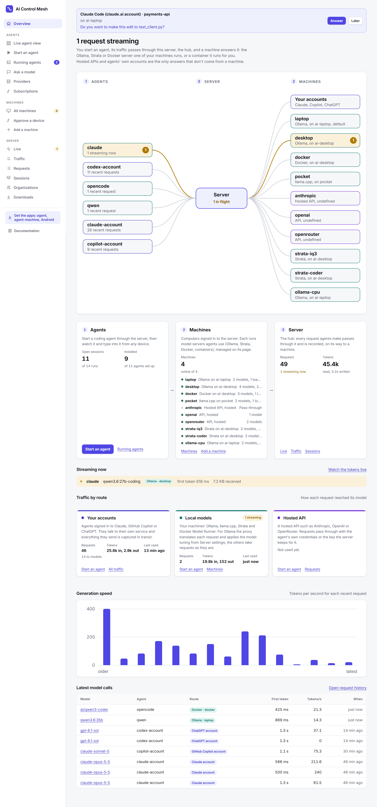

# AI Control Mesh

**Your AI agents. Your machines. One control plane.**

AI Control Mesh is an open-source, self-hosted control plane for AI coding agents. Every agent's traffic goes through one server you run: point agents at your own models or your own vendor plans, share machines and MCP tools across your fleet, and watch and answer running agents from any device. Request metadata, tokens and timings are always recorded; turn on tracing to keep full prompts and responses.



**[Website](https://aicontrolmesh.com/) · [Try the local quickstart](docs/quickstart.md) ([or on Kubernetes](docs/quickstart-kubernetes.md)) · [Documentation](docs/index.md) · [MIT license](LICENSE)**

## What it does

- **Understand agent activity.** Follow live streams, request metadata, tokens and timings. Enable full tracing to save payloads and read sessions back as conversations. Account-agent capture permits public destinations; private and reserved addresses are refused.
- **Three routes to a model, mixed as you like.**
  - **Your accounts**: Claude Code, Copilot CLI and Codex on your own plans, captured in transit.
  - **Local models**: supported agents on compatible Ollama, llama.cpp, Strata or Docker Model Runner backends, with Ollama requests translated and tuned per model.
  - **Hosted API**: requests passed through to the Anthropic API unchanged.
  - **API providers**: any OpenAI or Anthropic-compatible API: OpenAI, Anthropic, OpenRouter, LiteLLM Proxy and other hosted services with a key the server keeps, or LM Studio, vLLM and SGLang found on your machines. Requests pass through in the protocols each one speaks (Chat Completions, Responses, Messages), and hosted ones are reached only at public addresses. See [API providers](docs/providers.md#api-providers-openai-and-anthropic-compatible).
- **A fleet of machines.** Every computer running `agent-machine` supplies its model servers, containers and MCP servers to agents anywhere, through its own connection to the server, so it needs no open port. You can also start agents and open terminals on it from the console.
- **Agents from your phone.** Share an agent's terminal (`--control`), then watch it and type into it from a browser or the Android app, and answer its permission prompts.
- **One person or a team.** Mandatory OIDC sign-in, organizations, teams, private or shared sessions, and access grants per machine.

## Quick start

Install Git and Docker with Compose (or Podman with a Compose provider), then:

```bash
git clone https://github.com/joeyenfield/ai-coding-agent-proxy.git
cd ai-coding-agent-proxy
docker compose -f quickstart/compose.yaml up -d
```

For Podman, replace `docker compose` with `podman compose`. One command starts the whole system in containers on your computer: the server and console, the sign-in service, PostgreSQL, two fleet machines with coding agents installed, and Ollama, from the project's published images. Open http://localhost:19999, sign in with **admin** / **secret**, and follow the [guided quickstart](docs/quickstart.md): add a provider, pull a model, start an agent and watch it work, in about ten minutes. There's a [Kubernetes version](docs/quickstart-kubernetes.md) too.

**It's a local demo**: known credentials, ports on localhost only, nothing downloaded for you. Delete it with `docker compose -f quickstart/compose.yaml down -v`.

## A real install

Four steps, walked through in [Getting started](docs/getting-started.md):

1. **Run the sign-in service and the server.** Set up `agent-auth` (the OIDC issuer) with HTTPS and your callback URLs ([OIDC authentication](docs/oidc.md)), then run `agent-server`: from a checkout with `pip install -e ./server`, or in containers with `docker compose up -d` ([Deployment](docs/deployment.md)). Sign-in is mandatory everywhere, loopback included.
2. **Install `agent` where you run coding agents**, from the server's **Downloads** page or its one-line installer, and sign each computer in once:

   ```bash
   agent login https://your-server.example.com   # approve the device code in your browser
   agent --list                      # the server's agents, and which are installed here
   agent claude-account .            # Claude Code on your claude.ai login, recorded
   agent qwen . --model qwen3:8b     # Qwen Code on a local model
   ```

3. **Join machines to the fleet** on each computer that runs models or MCP servers for agents:

   ```bash
   agent-machine login https://your-server.example.com
   agent-machine start
   ```

4. **Add providers in the console**: open the machine, choose **Add as a provider**, pull a model, and start agents against it from anywhere.

## Documentation

Start at the [documentation's overview](docs/index.md). The pages, by section:

| Section | Pages |
| --- | --- |
| Start here | [Quickstart with Docker or Podman](docs/quickstart.md) · [Quickstart on Kubernetes](docs/quickstart-kubernetes.md) · [Getting started](docs/getting-started.md) |
| Use it | [Agents](docs/agents.md) · [The console](docs/console.md) · [Machines](docs/machines.md) · [Providers](docs/providers.md) · [MCP servers](docs/mcp.md) · [Subscriptions](docs/subscriptions.md) |
| People and data | [Accounts and sharing](docs/accounts.md) · [Usage limits](docs/usage-limits.md) · [Retention](docs/retention.md) · [The audit log](docs/audit.md) |
| Run a server | [Deployment](docs/deployment.md) · [Several server processes](docs/scaling.md) · [Configuration](docs/configuration.md) · [Security](docs/security.md) · [OIDC authentication](docs/oidc.md) |
| How it works | [Architecture](docs/architecture.md) · [Networking and protocols](docs/networking.md) · [API](docs/api.md) |
| Contribute | [Development](docs/development.md) · [Marketing website](docs/website.md) |

## The parts

| Part | Folder | What it is |
| --- | --- | --- |
| Server | `server/` | `agent-server` (Python): the API, recording, routing, accounts; optionally serves the console |
| Console | `ui/` | The web console (React), bundled or [hosted separately](docs/deployment.md#separate-console-and-api-domains) |
| Public site | `site/` | The brochure website, separate from the application console |
| Client | `client/` | `agent` (Go): the launcher and each computer's `agent-proxy` |
| Machine | `machine/` | `agent-machine` (Go): keeps a computer in the server's fleet |
| Android app | `android/` | Your servers' consoles on your phone |
| Python client and machine | `python/` | `agent` and `agent-machine` for computers without a Go build |

See [Contributing](CONTRIBUTING.md) for changes and issue reports, [Development](docs/development.md) for builds and tests, and [`AGENTS.md`](AGENTS.md) for the code's structure and rules. Full traces can contain sensitive code and secrets; review [Security](docs/security.md) and configure recording retention before sharing a deployment.
