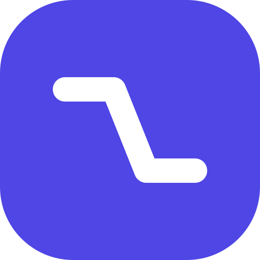
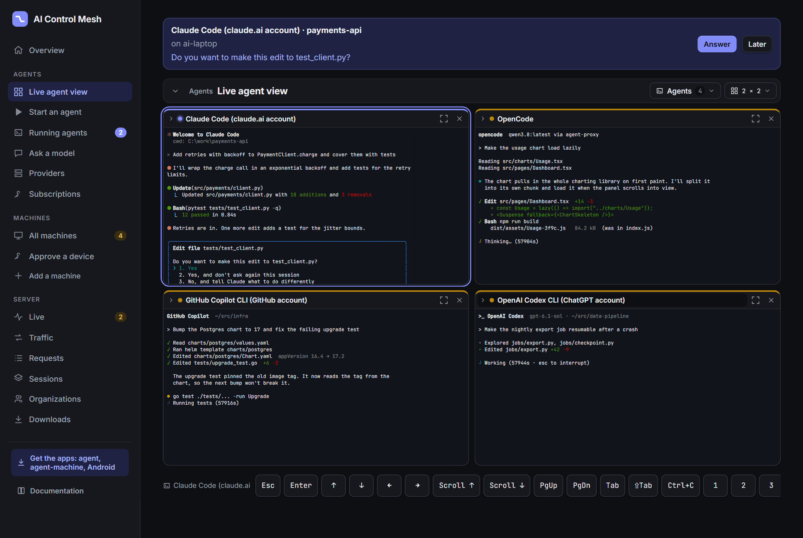
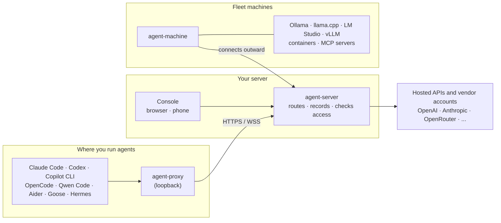
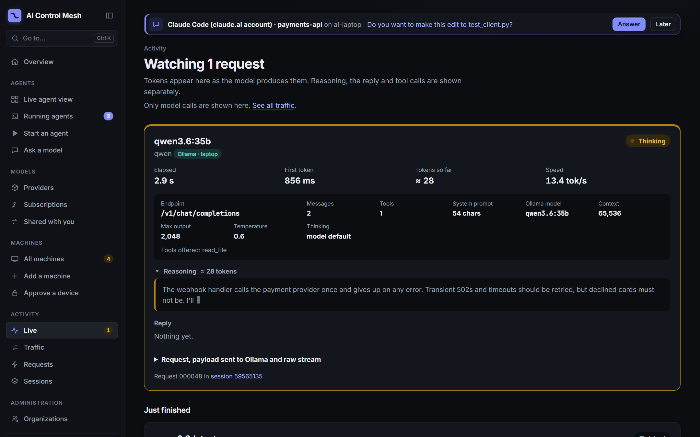
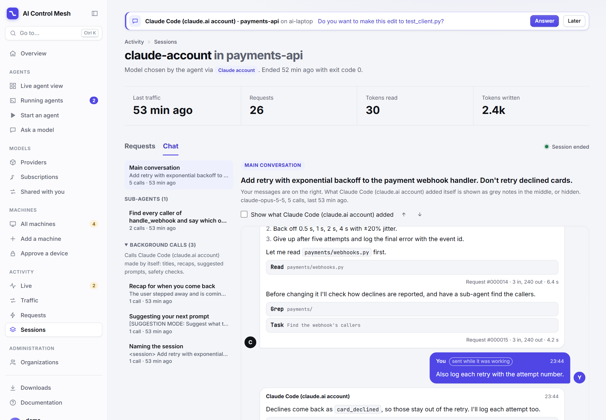
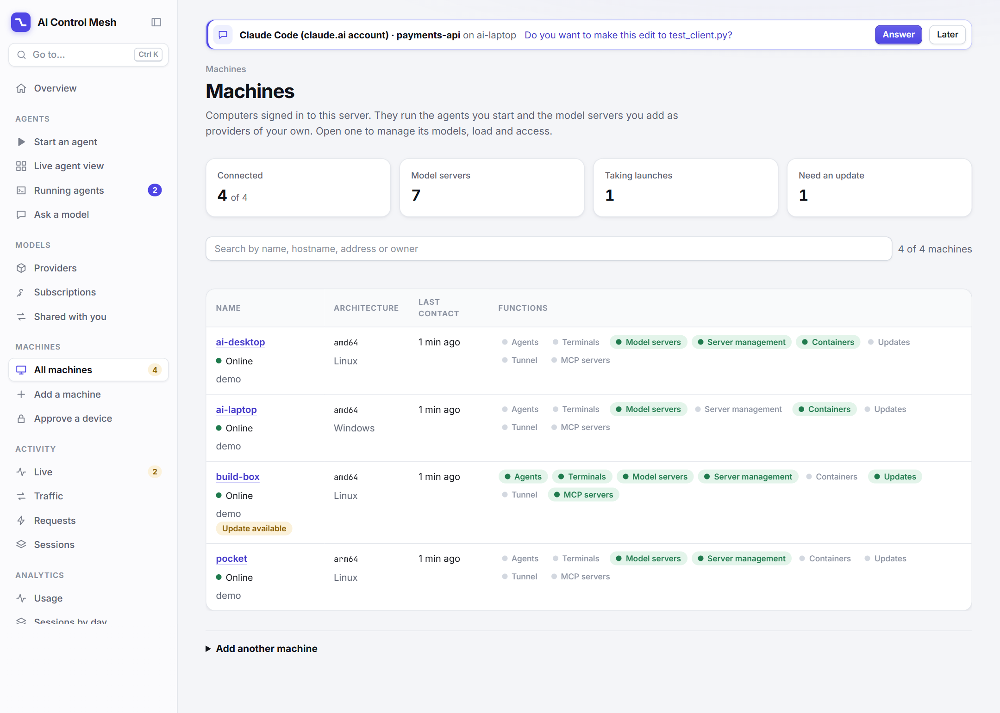
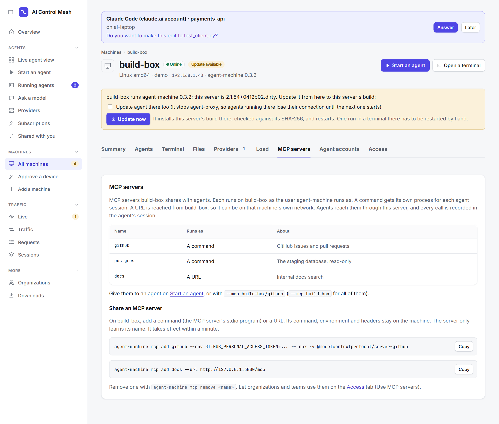

<div align="center">



# AI Control Mesh

### Your AI agents. Your infrastructure. One control plane.

An open-source, self-hosted control plane for AI coding agents.<br>
One server you run sits between your agents and their models: see every request, choose the model behind each agent,<br>
share machines and MCP tools, and answer agents from any device.

**[Website](https://aicontrolmesh.com/) · [Quick start](#quick-start) · [How it works](#how-it-works) · [Documentation](docs/index.md) · [MIT license](LICENSE)**



*Four agents on different machines, one view, one keyboard. Real console, demo data.*

</div>

## Why

Coding agents run in terminals scattered over laptops, servers and containers. Each has its own sign-in, its own model settings and its own idea of what to log. AI Control Mesh puts one server in the middle:

| | |
| --- | --- |
| **See every request** | Each call's metadata, tokens and timings are always recorded. Turn on tracing to keep full prompts and responses, and read a session back as a conversation. |
| **Pick any model** | Keep the agent you know. Point it at a local model, a hosted API, or the Claude, ChatGPT or Copilot plan you already have. |
| **Share a fleet** | A computer joins with one command and offers its model servers, containers and MCP tools to agents anywhere. It connects outward, so it needs no open port. |
| **Answer from anywhere** | Share an agent's terminal, then watch it, type into it and answer its permission prompts from a browser or the Android app. |
| **One person or a team** | Mandatory OIDC sign-in, organizations, teams, private or shared sessions, access grants per machine, usage limits and an audit log. |
| **Yours** | MIT licensed and self-hosted. There is no hosted service to sign up for. |

## How it works



1. **Run the server** (`agent-server`): one container, a Compose stack, a Helm chart or a local install. It holds the settings, the accounts and the recordings, and serves the console.
2. **Start agents with `agent`**: `agent claude-account .` starts the agent you already use, with its traffic going through your server.
3. **Join machines with `agent-machine`**: each one shares its model servers, containers and MCP tools with the agents you allow.

Read [How it works](docs/how-it-works.md) for the longer version, and [Architecture](docs/architecture.md) for the design.

## Three routes to a model

Every agent takes one of three routes. Mix them as you like; all of them are recorded in the same place.

| Route | Agents | Where requests go |
| --- | --- | --- |
| **Your accounts** | Claude Code, Codex, Copilot CLI | The vendor's service, on your own plan and sign-in. The server records the traffic in transit. Only public destinations are allowed: private and reserved addresses are refused. |
| **Own provider** | Qwen Code, OpenCode, Copilot CLI, Claude Code, Codex, Aider, Goose, Hermes Agent | Ollama, llama.cpp, Strata or Docker Model Runner on your machines, with Ollama requests translated and tuned per model. Also LM Studio, vLLM and SGLang, and any [API provider](docs/providers.md#api-providers-openai-and-anthropic-compatible): OpenAI, Anthropic, OpenRouter, LiteLLM Proxy and other OpenAI or Anthropic-compatible services, with a key the server keeps. |
| **Hosted API** | Claude Code | The Anthropic API, passed through unchanged. |

[Agents](docs/running-agents.md) lists every agent and its command. [Providers](docs/providers.md#compatibility) says which agent works with which model server.

## A look inside

| | |
| --- | --- |
|  **Watch a session live.** Reasoning, reply and tool calls as they stream. |  **Every request, every token.** Sessions read back as conversations, sub-agents included. |
|  **Your machines, their models.** Start, stop and pull models from the console. |  **Shared MCP tools.** Register them once on a machine; grant them per team. |

There is more: [analytics](docs/analytics.md) (usage and estimated cost by day, person, model and provider), usage limits, retention and legal holds, an audit log, [subscriptions](docs/subscriptions.md), and [peering](docs/peering.md), which links two servers so an organization on each can use chosen providers, MCP servers and machines of the other's.

## Quick start

Pick one. All three run on your own computer, on loopback only.

| | You need | You get |
| --- | --- | --- |
| [The quickstart stack](#the-quickstart-stack) | Git, and Docker or Podman with Compose | The whole system with two fleet machines and Ollama, and a guided tour |
| [One container](#one-container) | Docker or Podman | The whole system in a single container, no checkout |
| [No containers](#no-containers) | Python 3.11 or later | The server, `agent` and `agent-machine` installed for you alone |

### The quickstart stack

```bash
git clone https://github.com/joeyenfield/ai-control-mesh.git
cd ai-control-mesh
docker compose -f deploy/compose/quickstart/compose.yaml up -d
```

For Podman, replace `docker compose` with `podman compose`. One command starts the server and console, the sign-in service, PostgreSQL, two fleet machines with coding agents installed, and Ollama, from the project's published images.

Open http://localhost:19999, sign in with **admin** / **secret**, and follow the [guided quickstart](docs/quickstart.md): add a provider, pull a model, start an agent and watch it work, in about ten minutes. There's a [Kubernetes version](docs/quickstart-kubernetes.md) too.

**It's a local demo**: known credentials, ports on localhost only, nothing downloaded for you. Delete it with `docker compose -f deploy/compose/quickstart/compose.yaml down -v`. [`deploy/compose/`](deploy/compose/README.md) also has the all-in-one container as a Compose file, and two linked servers to try peering.

### One container

The whole system, with a machine and the coding agents already in it:

```bash
docker run -d --name mesh -p 127.0.0.1:19999:19999 -p 127.0.0.1:20000:20000 \
  -v mesh-data:/data -v mesh-home:/home/agent -v mesh-workspace:/workspace \
  ghcr.io/joeyenfield/ai-control-mesh
docker logs mesh     # the console's address and the admin password
```

Then open http://localhost:19999. The three volumes keep the data, the machine's sign-ins and its projects when the container is re-created.

### No containers

One command installs the server, `agent` and `agent-machine` from the latest release and runs them on your own computer with your own folders, for you alone, with an icon in the system tray to start, stop and open it:

```bash
curl -fsSL https://github.com/joeyenfield/ai-control-mesh/releases/latest/download/install-local.sh | sh
```

```powershell
irm https://github.com/joeyenfield/ai-control-mesh/releases/latest/download/install-local.ps1 | iex
```

`uninstall-local.sh` (or `.ps1`) from the same address takes it out again. See [Run it on your own computer](docs/local.md), which covers the container, the installer and [removing it](docs/local.md#remove-it), and installing from a checkout (`./devhelpers/scripts/install-local.sh`).

## A real install

Four steps, walked through in [Getting started](docs/getting-started.md):

1. **Run the server and its sign-in service.** They are two programs, `agent-server` and `agent-auth` (the OIDC issuer), behind HTTPS with your callback URLs ([OIDC authentication](docs/oidc.md)). Sign-in is mandatory everywhere, loopback included. Either:
   - **in containers:** in `deploy/compose/server`, put `AI_PROXY_POSTGRES_PASSWORD`, `AI_PROXY_DB_API_PASSWORD`, `AI_PROXY_DB_AUTH_PASSWORD`, `AI_PROXY_OIDC_INTROSPECTION_SECRET` and your own addresses (`AI_PROXY_OIDC_ISSUER`, `AI_PROXY_OIDC_AUDIENCE`, `AI_PROXY_OIDC_REDIRECT_URIS`, `AI_PROXY_OIDC_BROWSER_ORIGINS`, `AI_PROXY_SERVER`) in a `.env` file, then run `docker compose up -d` there ([Deployment](docs/deployment.md)); or
   - **from a checkout:** `pip install -e ./server`, set the `AI_PROXY_OIDC_*` variables, then run `agent-server` and `agent-auth` ([Getting started](docs/getting-started.md#from-a-checkout)).
2. **Install `agent` where you run coding agents**, from the server's **Downloads** page or its one-line installer, and sign each computer in once. A new server gets the builds it hands out with `agent-server downloads fetch`.

   ```bash
   agent login https://your-server.example.com   # approve the device code in your browser
   agent --list                      # the server's agents, and which are installed here
   agent claude-account .            # Claude Code on your claude.ai login, recorded
   agent qwen . --model qwen3:8b     # Qwen Code on a local model
   ```

3. **Join machines to the fleet** on each computer that runs models or MCP servers for agents:

   ```bash
   agent-machine login https://your-server.example.com
   agent-machine start
   ```

4. **Add providers in the console**: open the machine, choose **Add as a provider**, pull a model, and start agents against it from anywhere.

Full traces can contain sensitive code and secrets. Review [Security](docs/security.md) and configure recording [retention](docs/retention.md) before sharing a deployment.

## Documentation

Start at the [documentation's overview](docs/index.md). The pages, by section:

| Section | Pages |
| --- | --- |
| Start here | [How it works](docs/how-it-works.md) · [Run it on your own computer](docs/local.md) · [Quickstart with Docker or Podman](docs/quickstart.md) · [Quickstart on Kubernetes](docs/quickstart-kubernetes.md) · [Getting started](docs/getting-started.md) |
| Use it | [Agents](docs/running-agents.md) · [The console](docs/console.md) · [Machines](docs/machines.md) · [Providers](docs/providers.md) · [GPUs in containers](docs/gpu.md) · [MCP servers](docs/mcp.md) · [Subscriptions](docs/subscriptions.md) · [Reviewing a session](docs/session-review.md) |
| People and data | [Accounts and sharing](docs/accounts.md) · [Peering](docs/peering.md) · [Analytics and costs](docs/analytics.md) · [Usage limits](docs/usage-limits.md) · [Retention](docs/retention.md) · [The audit log](docs/audit.md) |
| Run a server | [Deployment](docs/deployment.md) · [Several server processes](docs/scaling.md) · [Configuration](docs/configuration.md) · [Security](docs/security.md) · [OIDC authentication](docs/oidc.md) · [Using API credentials](docs/api-credentials.md) |
| Technical overview | [Architecture](docs/architecture.md) · [Flows](docs/flows.md) · [Networking and protocols](docs/networking.md) · [Peering internals](docs/peering-internals.md) · [Scaling internals](docs/scaling-internals.md) · [Local instance internals](docs/local-internals.md) · [API](docs/api.md) |
| Contribute | [Development](docs/development.md) · [Local releases and snapshots](docs/releases.md) · [Marketing website](docs/website.md) |

## The parts

| Part | Folder | What it is |
| --- | --- | --- |
| Server | `server/` | `agent-server` (Python): the API, recording, routing, accounts; optionally serves the console |
| Console | `ui/` | The web console (React), bundled or [hosted separately](docs/deployment.md#separate-console-and-api-domains) |
| Public site | `site/` | The brochure website, separate from the application console |
| Client | `client/` | `agent` (Go): the launcher and each computer's `agent-proxy` |
| Machine | `machine/` | `agent-machine` (Go): keeps a computer in the server's fleet |
| Android app | `android/` | Your servers' consoles on your phone |
| Python client and machine | `python/` | `agent` and `agent-machine` for computers without a Go build |

## Contributing

See [Contributing](CONTRIBUTING.md) for changes and issue reports, [Development](docs/development.md) for builds and tests, and [`AGENTS.md`](AGENTS.md) for the code's structure and rules. The project is [MIT licensed](LICENSE).
