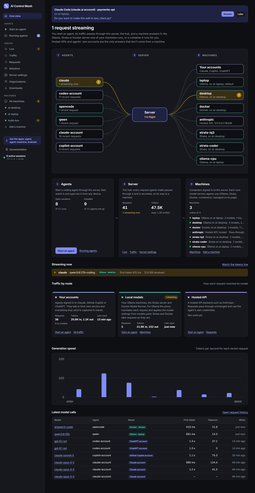

# AI Coding Agent Proxy

Run terminal coding agents (Claude Code, GitHub Copilot CLI, OpenAI Codex, Qwen Code, OpenCode, Aider, Goose) through one local proxy and see everything they do: every model call with its prompt, reply, tokens and timing, and, for agents signed in to their own accounts, every other request they make as well: sign-in, settings, MCP, telemetry and update checks.

It supports three setups, and you can mix them:

- **Your accounts.** Claude Code on your claude.ai login, Copilot CLI on your GitHub Copilot subscription, Codex on your ChatGPT plan. Nothing changes about how the agent works; the proxy records its HTTPS traffic in transit.
- **Local models.** Any agent against your own Ollama machines, Docker Model Runner or Strata. For Ollama the proxy translates each request to Ollama's native API and applies tuned settings, so local Qwen models get the context window and sampling they need; Docker and Strata speak the agents' APIs themselves and get requests unchanged.
- **Hosted API pass-through.** Claude Code pointed at the proxy's Anthropic endpoint, forwarded unchanged to the Anthropic API.

It comes in parts, each in its own folder:

| Part | Folder | What it is |
| --- | --- | --- |
| **Server** | `server/` | `agent-server`, in Python: the API, accounts, recording, and routing to every LLM provider. Runs anywhere, or in Docker. |
| **Console** | `ui/` | The web console, in React. It only calls the server's API, and the server serves its built files. |
| **Client** | `client/` | `agent`, in Go: one binary for each machine where you start agents. It launches them, signs the machine in with `agent login`, and runs that machine's `agent-proxy`. Agents only ever talk to the `agent-proxy`, which carries everything to the server. |
| **Machine** | `machine/` | `agent-machine`, in Go: one binary for each machine that supplies LLM providers. It signs in with `agent-machine login` and keeps the machine in the server's fleet, so the server can use the model servers it runs, run containers on it and start agents there. See [machine/README.md](machine/README.md). |
| **Android app** | `android/` | Your servers on your phone: each one's console full screen, on Running agents. See [android/README.md](android/README.md). |

On one computer you run both the server and the client, and the client starts the server for you.

Start an agent with `--control` and the launcher also shares its terminal with the console, a bit like tmux. From your phone, on any network, you can then see the agent's screen and scrollback and type into it: answer a permission prompt or send the next instruction while you're away from your desk.


**Contents:** [Quick start](#quick-start) · [How it fits together](#how-it-fits-together) · [Running the server in Docker](#running-the-server-in-docker) · [A fleet of machines](#a-fleet-of-machines) · [The three setups](#the-three-setups) · [Your accounts](#setup-1-your-accounts-claude-copilot-chatgpt) · [Local models](#setup-2-local-models-on-ollama) · [Docker Model Runner](#docker-model-runner) · [Hosted API](#setup-3-hosted-api-pass-through) · [Running agents on your phone](#running-agents-on-your-phone) · [A shared server for your team](#a-shared-server-for-your-team) · [Supported agents](#supported-agents) · [What the requests are](#what-the-requests-are) · [The console](#the-console) · [Configuration](#configuration) · [API](#api) · [Development](#development)

## Quick start

You need whichever of these you want to use: a Claude, GitHub Copilot or ChatGPT subscription, or an Ollama server.

**1. The server.** Either in Docker (see [Running the server in Docker](#running-the-server-in-docker)):

```bash
docker compose up -d            # console on http://<this host>:9999
```

or from this checkout, with Python 3.11+ and Node 20+:

```bash
python -m venv .venv
. .venv/bin/activate            # Windows: .venv\Scripts\activate
pip install -e "./server[dev]"

agent-server                    # console on http://127.0.0.1:9999
```

`agent-server` builds the web console from `ui/` on first start, and rebuilds it whenever the UI sources are newer than `ui/dist` (running `npm install` first if dependencies changed). If the build fails it prints npm's output and serves the previous build. Use `agent-server --no-build` or `AI_PROXY_UI_BUILD=0` to skip this.

**2. The client**, on each machine where you start agents. Build it with Go 1.24+ (`scripts/build-client.sh`, or `.\scripts\build-client.ps1` on Windows), or take the one built for that machine from `dist/` and install it (see [Installing on a machine](#installing-on-a-machine)). A build of your own is `client/bin/agent`: put it on your `PATH`. It's a single file with nothing else to install. On the server's own machine you're done. On any other machine, sign it in once:

```bash
agent login http://server:9999
```

Then start an agent from your project folder:

```bash
agent --list                                # the server's agents and whether they're installed here
agent claude-account .                      # Claude Code on your claude.ai login, everything captured
agent copilot-account .                     # Copilot CLI on your GitHub subscription
agent codex-account .                       # Codex on your ChatGPT plan
agent qwen . --model qwen3.6:35b            # Qwen Code on your default Ollama machine
agent opencode . --model qwen3.8:latest --backend desktop --trace
agent claude-subscription . --model sonnet  # Claude Code via the hosted Anthropic pass-through
```

The launcher starts this machine's `agent-proxy` if it isn't running (`agent proxy`, in the background), and the `agent-server` too when that's this computer and it's installed here. It opens a session for the run, points the agent at the `agent-proxy`, waits for the agent to exit, then records the exit status. The agents and how to start them come from the server's `config/agents.yaml`, so a new agent there is available on every machine at once. Arguments after `--` go to the agent (`agent claude-account . -- --model sonnet`). `--trace` saves full request and response bodies. `--control` shares the agent's terminal so you can watch it and type into it from the console (see [Running agents on your phone](#running-agents-on-your-phone)).

## How it fits together

```text
client: agent machine (loopback only)                      server: agent-server (:9999)
agent ─HTTPS_PROXY─▶ agent-proxy :8183 ══ /api/proxy/tunnel ══▶ decrypts, records ─▶ api.anthropic.com, github, chatgpt…
agent ─base URL───▶ agent-proxy :8184 ══ /session/<id>/… ═════▶ records, routes ───▶ Ollama, Strata, Docker, Anthropic
agent launcher ───▶ agent-proxy :8184 ══ /api/… ══════════════▶ agents, sessions, the CA (signed as this machine)
agent --control ──▶ agent-proxy ══ /api/terminals/<id>/host ══▶ Running agents ◀── console (ui/) or phone, any network

machine: agent-machine                                     server: agent-server (:9999)
agent-machine ═════ /api/machines/connect ════════════════▶ the fleet: its model servers become providers;
  ◀══ container requests, launches (runs `agent`) ═══════════ containers and launches go back to the machine
```

- **One computer:** run `agent-server`, then `agent …`. The launcher starts `agent-proxy` for you.
- **Another machine:** copy the `agent` binary there, run `agent login https://your-server:9999` once, then `agent …`. Its `agent-proxy` signs every request with that machine's token. The agent machine needs no open ports, and the server needs only its own: account agents' HTTPS is tunnelled over a WebSocket on it.
- **What `agent-proxy` listens on:** `127.0.0.1` only, on ports 8184 and 8183 (`AI_PROXY_LOCAL_PORT`, `AI_PROXY_LOCAL_INTERCEPT_PORT`). It logs to `agent-proxy.log` beside `agent login`'s credentials file. `agent --list` shows which server it uses and as whom.
- **Three parts:** the **server** is the hub; **agents** connect to it; **machines** supply the LLM providers. Every local model server a backend points at (Ollama, Strata, Docker Model Runner, or a container) runs on a machine signed in to the server, and is added from that machine. Hosted APIs are the only exception. The server routes everything, and a machine carries agents' requests to its own model servers through its connection to the server, so they need no open port or router forward: a machine behind NAT, in WSL or on another network works the same. A machine joins with `agent-machine` (see [A fleet of machines](#a-fleet-of-machines)).

## Running the server in Docker

`server/Dockerfile` builds one image with the server and the console. Agent machines don't use it: they run the client.

```bash
docker compose up -d                      # build and start; console on http://<this host>:9999
docker compose logs agent-server          # the first admin's password, on the first start
```

Or without compose: `docker build -f server/Dockerfile -t agent-server .` from the repository root (the build needs `ui/` as well as `server/`).

- **Signing in.** The server listens beyond loopback in the container, so on its first start it creates the user `admin` with a random password. The log shows it, and it's saved as `first-user-password` in the certs volume. Sign in, change it under **Server → Organizations**, and sign each agent machine in with `agent login http://<this host>:9999`.
- **Volumes.** `config` holds `backends.yaml`, `models.yaml` and `agents.yaml`, filled with the image's defaults on the first start and never overwritten after that. `logs` holds sessions, traces and terminals. `certs` holds the HTTPS capture's CA, users and keys. Keep `certs` private.
- **Reaching your providers.** Inside the container `127.0.0.1` is the container itself. The default `backends.yaml` reaches Ollama on the Docker host as `http://host.docker.internal:11434`, which compose maps on Linux too. Ollama must then listen beyond loopback (`OLLAMA_HOST=0.0.0.0`). Name other machines by their LAN address. To keep the config in this checkout instead, mount `./config:/app/config` (see `compose.yaml`).
- **Set `proxy.url`** in the config volume's `backends.yaml` (or from **Settings**) to the address agent machines use, so `agent login` hints and pairing links point there.
- **Not in the container:** starting a local `ollama serve`. Containers aren't run by the server at all: machines run them (see [Containers](#containers-strata-and-ollama-run-by-your-machines)), so this works the same in Docker.

## The three setups

| | Your accounts | Local models | Hosted API |
|---|---|---|---|
| **Agents** | `claude-account`, `copilot-account`, `codex-account` | `qwen`, `opencode`, `claude`, `copilot`, `codex`, `aider`, `goose` | `claude-subscription` |
| **Model** | The vendor's, on your plan | Ollama, Docker Model Runner or Strata on your machines, or containers they run | Anthropic's, via an `anthropic` backend |
| **How the agent reaches the proxy** | `HTTPS_PROXY` to its machine's `agent-proxy` (`:8183`), tunnelled to the server | Its API base URL points at its machine's `agent-proxy` | `ANTHROPIC_BASE_URL` points at its machine's `agent-proxy` |
| **What the proxy does** | Decrypts, records, forwards unchanged | Ollama: translates to its API, applies `models.yaml`. Docker, Strata: forwards unchanged | Forwards unchanged |
| **What you see** | Every request, to any host: model calls plus sign-in, settings, MCP, telemetry | Model calls, with the exact payload sent to Ollama | Model calls and other Claude Code API calls |
| **Credentials** | The agent's own login | None needed | The agent's own login |

```text
Your accounts   Claude Code ─┐                                         ┌─▶ api.anthropic.com, mcp-proxy.anthropic.com, ...
                Copilot CLI ─┼─ HTTPS_PROXY ─▶ agent-proxy ══▶ server ─┼─▶ api.githubcopilot.com, api.github.com, ...
                Codex       ─┘                 :8183           decrypts └─▶ chatgpt.com (HTTPS and WebSocket), ...

Local models    Qwen Code, OpenCode, ─▶ /session/<id>/v1 ─────┬▶ translate + tune ─▶ laptop, desktop (Ollama)
                Claude Code, Aider ...  /session/<id>/anthropic │
                                        /session/<id>/api       └▶ unchanged ───────▶ docker (Docker Model Runner), strata

Hosted API      Claude Code ─▶ /session/<id>/anthropic ─────────▶ api.anthropic.com
```

For local models and the hosted API, the agent's requests also go to its machine's `agent-proxy` first, which passes them to the same paths on the server.

The console colours every request, session and agent by its route: **blue** for your accounts, **teal** for local models, **purple** for the hosted API.

## Setup 1: Your accounts (Claude, Copilot, ChatGPT)

Sign in once with the agent's own client (`claude`, `copilot` then `/login`, or `codex login`). Then:

```bash
agent claude-account .
agent copilot-account .
agent codex-account .
agent claude-account . --trace -- --model sonnet   # save bodies; pass a model to the agent
```

So that the account login is the one used, unset `ANTHROPIC_API_KEY`, `ANTHROPIC_AUTH_TOKEN`, `ANTHROPIC_BASE_URL`, `COPILOT_PROVIDER_*`, `COPILOT_OFFLINE`, `OPENAI_API_KEY` and `OPENAI_BASE_URL`, and remove any Claude `apiKeyHelper`. Your plan's usage limits still apply.


### How the capture works

- The launcher starts the agent with `HTTPS_PROXY` pointing at its machine's `agent-proxy` (`127.0.0.1:8183`). The session id is the proxy URL's user name, so every request is filed under the right session. The `agent-proxy` tunnels each connection to the server over a WebSocket on the server's own port (`/api/proxy/tunnel`), and the server does the rest.
- On first start the server creates a certificate authority in its `certs/`. The launcher fetches it through the `agent-proxy` and hands it only to the agent's own process tree: `NODE_EXTRA_CA_CERTS` for Claude Code and Copilot CLI, `CODEX_CA_CERTIFICATE` for Codex, and `SSL_CERT_FILE`, `REQUESTS_CA_BUNDLE`, `CURL_CA_BUNDLE` and `GIT_SSL_CAINFO` pointing at a bundle of your system roots plus that CA. That last set means the tools the agent runs (curl, git, pip, Go-based MCP servers) keep working and are captured too. Nothing is added to the system trust store.
- For each request, the server terminates TLS with a certificate from that CA, forwards the request unchanged over a normally verified TLS connection, and streams the reply straight back. Model calls are parsed as they stream, giving tokens, prompt-cache reads and writes, time to first token, and reasoning, text and tool calls.
- **WebSockets** are relayed byte for byte and logged as a connection. Their messages are also decoded on the side: Codex sends its model turns over a WebSocket to `chatgpt.com/backend-api/codex/responses`, and each `response.create` becomes its own model-call record. The proxy drops `Sec-WebSocket-Extensions` from the upgrade so messages aren't compressed.
- Hosts listed under `intercept.passthrough` are tunnelled without decryption and logged as connections only.

### Agent-specific notes

- **Codex** runs with `--no-daemon`. Without it, the interactive TUI hands conversations to Codex's shared background app-server daemon, which was started without the proxy settings, so only startup calls would be captured. Each Codex conversation also opens with a *prewarm* turn (`generate: false`) that shows up as a model call with no output.
- **Codex** may print `[UNDICI-EHPA] Warning: EnvHttpProxyAgent is experimental` from its Node launcher when it picks up the proxy settings. It's harmless.
- **VS Code extensions** (Copilot, ChatGPT/Codex) run their own processes and aren't captured. Only agents started with `agent ...` go through the proxy.

### Privacy and security

- **Redaction.** Credentials are removed before anything is shown or saved: `Authorization`, `Cookie`, `Set-Cookie` and any header with *auth*, *token*, *secret*, *key* or *session* in its name; token-like query parameters; and token fields (`access_token`, `refresh_token`, `code`, ...) in bodies of OAuth and token endpoints.
- **Bodies are not redacted.** Saved and live bodies still contain your code and prompts. Bodies are saved only for sessions with capture on (`--trace`, or the switch on **Sessions**). Live text is held in memory only.
- **The `agent-proxy` listens on loopback only.** Programs on that machine can use it. With accounts, the server only serves agents in an open session: HTTPS without one gets `407`. The server listens for agents directly only if you set `intercept.listen_port`; keep that on loopback too.
- **The CA key.** `certs/ca-key.pem` is created readable only by you. Delete `certs/` to rotate the CA.
- **No credential handling.** The proxy never reads credentials from disk or asks you to copy tokens; the agents keep managing their own sign-in and refresh.

## Setup 2: Local models on Ollama

Point any agent at your Ollama machines. Sign each machine in to the server and keep it in the fleet (`agent-machine login <server>`, then `agent-machine start`); its Ollama shows up on **Machines**, where an admin adds it as a provider with **Add as a provider**. The server, a machine and agents can all run on the same computer. Then:

```bash
agent qwen . --model qwen3.6:35b                         # default backend
agent opencode . --model qwen3.8:latest --backend desktop
agent claude . --model qwen3.6:27b-coding -- --continue  # Claude Code, translated to Ollama
```

The **Start an agent** page builds the same commands. For local-model agents it lists the backends the agent can use (Ollama machines, and Docker or Strata when configured) and the models each one has.


### Tuning Ollama for Qwen

Ollama's OpenAI-compatible `/v1` endpoint ignores per-request settings such as `num_ctx`, so agent conversations get silently truncated to the server's default context. To avoid that, the proxy translates OpenAI Chat and Anthropic requests to Ollama's native `/api/chat`, applies the matching profile from [`config/models.yaml`](config/models.yaml), and translates the reply back, including streaming, tool calls and reasoning.

```yaml
defaults:
  keep_alive: 30m          # keep models warm between agent turns
  options:
    num_ctx: 65536         # context for every model

profiles:                  # first match wins, matched against the Ollama tag
  - name: qwen-coder
    match: ["qwen3*coder*", "qwen3*coding*"]
    options: {temperature: 0.7, top_p: 0.8, top_k: 20, repeat_penalty: 1.05}
  - name: qwen3
    match: ["qwen3*"]      # qwen3, qwen3.5, qwen3.6, qwen3.8 ...
    options: {temperature: 0.6, top_p: 0.95, top_k: 20, min_p: 0}

models:                    # aliases agents can use
  qwen-fast:
    ollama_model: qwen3.6:35b
    think: false           # skip reasoning for quick edit loops
```

Values a client sends explicitly always override profile defaults. Each Ollama's page, under its machine (**Machines → the machine → the Ollama**), lists its models with the settings the server will apply, and how much of each loaded model fits in VRAM.


If a model shows **less than 100% on GPU**, part of it runs on the CPU and generation slows down a lot. Fix it by doing one of the following:

- lowering `num_ctx` in `defaults` or in a profile;
- picking a smaller tag;
- starting Ollama with a quantized KV cache: `OLLAMA_FLASH_ATTENTION=1 OLLAMA_KV_CACHE_TYPE=q8_0` (see [`scripts/start-ollama.sh`](scripts/start-ollama.sh)).

Codex in `--oss` mode uses the Responses API, which is passed through unchanged; set `OLLAMA_CONTEXT_LENGTH` on the server for it.

### Which agent works best with Qwen on Ollama

1. **Qwen Code** is the first choice for Qwen 3.x. It's built by the Qwen team around the tool-calling format the models are trained on, so tool calls parse reliably.
2. **OpenCode** is a close second. It has good local-provider support and a smaller system prompt than Claude Code, which matters with 27–35B models.
3. **Copilot CLI** (BYOK mode) and **Claude Code** work too. Claude Code's large system prompt and tool list need a 64K+ context and are slower to process on local GPUs.

This ranking is a recommendation, not a measured benchmark. Use `agent-benchmark` and the Requests page to compare agents on your own hardware.

### Watching the Ollama machines

A machine's **Load** tab charts its CPU, memory, GPU load and GPU memory over the last five minutes, and shows what each of its Ollama servers has loaded, like `ollama ps`: size, GPU/CPU split, context length and when the model unloads. The machine is asked every two seconds while the tab is open; samples aren't saved.


Everything on this page comes from the machine that runs each Ollama: its `agent-machine` reads Ollama's API there and samples the machine's CPU, memory and GPU (GPU figures need `nvidia-smi`). The server itself never contacts a model server except to forward agents' requests, so a backend that isn't on a signed-in machine shows no models or load.

### Managing models and the server

You can also change what's on your machines from the console, not just watch them. Every change goes to the machine that runs the model server, and its `agent-machine` makes it there. It's off until the machine allows it:

```bash
agent-machine servers on    # let the server manage the model servers here: their models, Ollama's settings, starting and stopping
```

- **Models**, on any Ollama. Its page under its machine opens with totals (models, loaded, in memory, on disk, agent requests) and three tabs. **Models** lists them, filterable and sortable by name, size or memory, with **load**, **unload** and **delete** (with a confirmation). **Aliases** lists the short names from `config/models.yaml`. A model server agent-machine found but nobody has added yet works the same way, with **Add as a provider** at the top for admins.
- **Finding models to pull.** The **Find and pull** tab searches the **Ollama library** (ollama.com; click a size to pull a clean tag like `qwen3:8b`) or **Hugging Face** (GGUF repos; expand one to pick a quantization and pull `hf.co/<repo>:<quant>`), or pulls a tag **by name**. It pulls to the Ollama whose page you're on; its machine does the searching and the download. The progress shows on every tab, so you can keep browsing while it runs.
- **A machine's Ollama server**, on its machine's **Ollama server** tab. It brings the same tuning as [`scripts/start-ollama.sh`](scripts/start-ollama.sh) into the console. A status card at the top shows whether Ollama is running there and whether agent-machine started it, with **Start**, **Stop** and **Restart**. Below it are three tabs. **Settings** edits the `OLLAMA_*` settings (KV cache type, context length, parallelism, keep-alive, GPU selection, models directory, …), grouped into Memory, Scheduling, Hardware and Server; each field shows the variable it sets and can be reset to its default. **Environment** takes extra `OLLAMA_*` variables and shows exactly what Ollama will start with. **Log** follows the log of the Ollama agent-machine started, live. Settings are saved on the machine, in agent-machine's folder (`ollama.json`), and applied the next time it starts Ollama; **Save and restart** does both in one step. agent-machine sets where Ollama listens itself: loopback when the server is on the same computer, every address otherwise.

Only the machine's owner can change its Ollama settings or start and stop it; agent-machine only stops an Ollama it started itself (not one run by Ollama's tray app). An Ollama installed as a systemd service (`ollama.service`, which Ollama's Linux installer sets up) belongs to root: run `sudo agent-machine servers service` on that machine once, and agent-machine starts, stops and restarts it through systemd, with the console's settings. It lets only your user run `systemctl start|stop|restart ollama` without a password, and makes the service read its `OLLAMA_*` settings from `/etc/agent-machine/ollama.env`, which agent-machine writes; `sudo agent-machine servers service off` undoes it. Models can be managed by the machine's owner and admins.

### Strata

Strata serves one local model over the OpenAI Chat Completions, OpenAI Responses and Anthropic Messages APIs. Add it as a `type: strata` backend and the local-model agents can use it:

```yaml
backends:
  strata: {type: strata, url: http://127.0.0.1:18500}
```

```bash
agent claude . --model qwen3.8-flash-next-iq3_s --backend strata
```

The proxy passes requests to Strata unchanged: no translation, and `config/models.yaml` doesn't apply. It records them like any other request, using Strata's own prompt and generation timings for the speeds. Strata requires an API key, so the server swaps the agent's placeholder key for Strata's own. The machine running Strata reads that key from Strata's profile there (the run config that `%APPDATA%\Strata\profiles\<id>.json` points to) and gives it to the server over its fleet connection, so the key is never copied into `config/` and the server keeps it in memory only. Set `STRATA_API_KEY` on the server to use a different key. Agents that speak native Ollama (`aider`, `goose`) can't use Strata.

Strata runs on a machine like any other provider: once the machine is signed in, add its Strata on **Machines**, or run Strata in a container there. Its page under its machine shows the model, whether it's loaded, its context, uptime and where the key came from, with **Load** and **Unload** (to free the GPU between sessions). Its tabs show:

- **Overview:** speeds from the last request, the GPU memory and load and system memory Strata reports, and the model's names and aliases.
- **Connect agents:** the launch command for each compatible agent.
- **Log:** Strata's server and engine logs, live.

Start and stop a machine's Strata profiles from **Machines** (with `agent-machine servers on` there), or with Strata's own app.

### Docker Model Runner

[Docker Model Runner](https://docs.docker.com/ai/model-runner/) is Docker's model server, part of Docker Desktop and Docker Engine. It pulls models from Docker Hub (`ai/qwen3`) and Hugging Face (`hf.co/<user>/<repo>`), loads one when a request first names it, and speaks the OpenAI Chat Completions, OpenAI Responses, Anthropic Messages and native Ollama APIs. So every local-model agent can use it, Aider and Goose included. Add it as a `type: docker` backend:

```yaml
backends:
  docker: {type: docker, url: http://localhost:12434}
```

```bash
docker desktop enable model-runner --tcp 12434   # Docker Desktop: turn on the port the proxy uses
docker model pull ai/qwen3-coder                 # or pull from the console
agent opencode . --model ai/qwen3-coder --backend docker
```

The proxy passes requests through unchanged, mapping each agent endpoint to Model Runner's own prefix (`/v1` to `/engines/v1`, Anthropic to `/anthropic`, Ollama's `/api` as is), and records them like any other request. `config/models.yaml` doesn't apply, and Model Runner needs no API key. Docker Engine listens on port 12434 already, so Model Runner on another machine, such as a Linux GPU box, works the same way at `http://<host>:12434`. Coding agents send long prompts, so give the model a large context: `docker model configure --context-size=65536 ai/qwen3-coder`.

Model Runner runs on a machine like any other provider: turn on its TCP port there and sign the machine in, and **Machines** offers to add it. Until then the machine's overview has the steps. Its page under its machine shows its address, engines (llama.cpp, vLLM), disk use and the models loaded now. Its tabs show:

- **Models:** pulled models with their size, parameters, quantization and context, with **Load** (warm a model up before an agent starts), **Unload** (free its memory now) and **Delete**.
- **Get models:** pull any model by name, or search Docker's curated `ai/` models on Docker Hub and pick a size. Download progress shows on every tab.
- **Connect agents:** the launch command for every local-model agent, and the context-size command above.

### Containers: Strata and Ollama run by your machines

A machine can run model servers in containers for the server: it starts and stops them when you ask from the console, and hands the GPU from one to another. It's off until the machine allows it (Docker or Podman must be installed there):

```bash
agent-machine containers on        # let the server run Strata or Ollama containers here
agent-machine containers cli podman  # optional: always Podman (by default it uses whichever is installed and answering)
```

The machine then shows on **Machines → Containers** with the engines it can run. Add a container there: pick the machine, the engine and its settings. Each container becomes a provider agents can use, stored with its `machine` and a `container:` block in `config/backends.yaml`:

```yaml
backends:
  strata-iq3:
    type: strata
    url: http://192.168.1.40:8080   # the machine's address as the server sees it
    machine: 3f2a9c1e7b6d4a10       # the machine's id (agent-machine's machine.json)
    container:
      engine: strata          # or ollama
      image: ghcr.io/niko1221/strata:latest-cuda13
      port: 8080
      gpus: all               # all, none, or card numbers such as 0 or 0,1
      env: {MODEL: IQ3_XXS, CONTEXT: "32768", KV: q4_0, VISION: "off"}
      # volume: D:\models\strata   # optional: its own model storage instead of the engine's shared volume
```

On the machine, that runs the same container as this command, using the flags from Strata's Docker guide (it listens on `127.0.0.1` when the machine is the server's own computer, otherwise on all addresses so the server can reach it):

```powershell
docker run -d --name ai-proxy-strata-iq3 --gpus all -p 127.0.0.1:8080:8080 --ulimit memlock=-1:-1 --shm-size 2g `
  --stop-timeout 120 -v strata-data:/data -e MODEL=IQ3_XXS -e CONTEXT=32768 -e KV=q4_0 -e VISION=off `
  -e PRESET=strata-iq3 -e API_KEY=<generated> ghcr.io/niko1221/strata:latest-cuda13
```

**How it works:**

- **One model store per machine.** Every Strata container on a machine mounts the same `strata-data` volume at `/data`, so a model is downloaded once. Each container gets its own `PRESET` (its name), so its settings, tuning and key don't clash with the others'.
  - Strata's Docker guide doesn't cover several containers sharing `/data`. Keep one running per GPU, which is what switching does.
  - Ollama containers share `ollama-models` the same way.
- **Keys.** The server generates each Strata container's API key and sends it to the machine, which passes it in as `API_KEY`. The server keeps the key in `certs/container-keys.json` and adds it to requests, so agents need none.
- **Switching.** Containers on the same machine that need the same GPUs can't run together.
  - **Switch to this** stops the one holding the GPU (Strata gets two minutes to unload), then starts the other.
  - `agent claude . --backend strata-coder --switch` does the same before launching the agent.
  - Without `--switch`, the launcher starts a stopped container but won't take the GPU from another one.
- **Starting.** The first start pulls the image and, for Strata, downloads the model (tens of GB). Later starts take a minute or two to load it. Each container's card shows whether it's pulling, loading or ready, and **Log** shows `docker logs`.
- **Changing settings** marks the container out of date; the next start replaces it. Deleting a container keeps the models.
- **Who can do it.** Running a container is as powerful as a shell on the machine. So the machine has to turn it on itself, and it checks every request against its own list of engines, settings and plain image names, whatever the server sends. Only the machine's owner can create, change or delete containers on it (and, with accounts, they must be an admin, since a container is a new provider). Anyone signed in can start or stop one that's set up. The Settings page can't add or change container blocks.

## Setup 3: Hosted API pass-through

The `claude-subscription` agent sets only `ANTHROPIC_BASE_URL`, pointing at the proxy's Anthropic endpoint. The proxy forwards everything unchanged to a `type: anthropic` backend (the bundled `anthropic` backend is `https://api.anthropic.com`). Claude Code keeps its own login.

```bash
agent claude-subscription . --model sonnet
```

The launcher picks the `anthropic` backend automatically. The proxy sees Claude Code's API calls (`/v1/messages`, `count_tokens`, `/v1/models` and any other `/anthropic/...` path) but not its OAuth, telemetry or MCP traffic, which goes directly to Anthropic. Use `claude-account` when you want those too.

## Running agents on your phone

Start an agent with `--control` (`agent claude-account . --control`) and the launcher runs it in a pseudo-terminal it shares with the server through the `agent-proxy`, a bit like a one-window tmux. The agent draws in your terminal window as usual. Meanwhile the console's **Running agents** page shows the same screen, scrollback included, and can type into it. Sign in on your phone once, and you can check on every such agent from any network:

- see which agents are working and which are waiting for you: an agent asking something (a permission prompt) gets a banner above every page with its question, and **Notify me when an agent is waiting** on Running agents turns on browser notifications;
- read what they printed;
- answer a permission prompt or send the next instruction.

1. In **Settings**, set the listen host to `0.0.0.0` and restart the server, so your phone can reach it. On the first start that listens on the network, the server creates an `admin` user. It prints the password and saves it in `certs/first-user-password`. From then on everyone signs in.
2. On your phone, open the console and sign in as `admin`. Change the password on **Server → Organizations**, then delete that file.
3. Open **Running agents**. Add it to the home screen to get back quickly. Sign each agent machine in once with `agent login <server>`, including this one (`agent login http://127.0.0.1:9999`).

Rather not sign in on your own network? Run `agent-server user remove admin`; it isn't created again. Pair the phone instead. On this computer, open **Agents → Running agents**, then **Use it from your phone → Show the pairing code**, and scan it with your phone's camera. Can't scan it? **Get a short code** instead, and type it into **Pair this device** on the phone. A short code works once, for 10 minutes, and five wrong tries cancel it.

Each agent shows as working (the model is answering or the agent is printing), waiting (quiet, so it may need you) or exited. Open one to see its terminal:

- **Send** types your message and then presses Enter.
- The keys underneath cover agents' menus and permission prompts: Esc, Enter, arrows, Tab, Shift+Tab, Ctrl+C, 1 to 3, y and n.
- **Fit width** sizes the text so the whole terminal fits the screen.
- On a computer you can also click the terminal and type into it directly.

Details:

- **Away from home:** put this computer and your phone on the same [Tailscale](https://tailscale.com) network (or another VPN), and pick its `100.x` address under **Use it from your phone**. If your router forwards a public name to this computer, set it as `proxy.public_url` in `config/backends.yaml`; pairing links then use it by default. On a public address, also turn on accounts and HTTPS (see [A shared server for your team](#a-shared-server-for-your-team)), or anyone who finds it can read your traffic.
- **Your window stays the main one.** Its size sets the terminal's size, and closing it ends the agent, as before.
- **History is saved.** Each terminal's output goes to `logs/sessions/<id>/terminal.log` (up to 64 MB), so finished sessions stay readable. If the launcher loses the server, it resends what the server missed when it reconnects.
- **It's off unless you ask.** Without `--control`, the agent runs directly and only its traffic is recorded. Set `AI_PROXY_CONTROL=1` to make `--control` a machine's default.
- **It needs an interactive terminal:** on Windows that's Windows Terminal, PowerShell or cmd, not Git Bash's mintty. Otherwise the launcher prints why sharing is off and runs the agent directly.
- **Agents on other machines** can be shared once the machine is signed in with `agent login <server>`. On a server without accounts, give the agent machine the access key: `agent login <server> --key <access key>`, or set `AI_PROXY_TOKEN`.

**Security.** Typing into an agent's terminal is as good as a shell on this computer, so only this computer and paired devices can watch or type.

- Pairing stores a random access key in a cookie scripts can't read; the key itself lives in `certs/remote-access-key`. **Replace access key** signs every device out.
- Pages from other sites are refused, including through your own browser, so a web page can't type into your agents.
- Listening on `0.0.0.0` turns sign-in on, through the `admin` user created on the first start. If you remove every user, the console's other pages (traffic, sessions) are open to your network without a key. Do that only on networks you trust.
- The connection is plain HTTP. On shared networks, use Tailscale, which encrypts it.

## A shared server for your team

Run `agent-server` on one machine, the server, and start agents on your own laptop. The laptop's `agent-proxy` carries their traffic to the server, where the traffic, terminals and sessions live. You can watch and drive them from its console, and so can your team, if you share them.

**On the server:**

```bash
agent-server org add pockets --name "Empty Pockets"
agent-server user add joey --org pockets --team core   # the first user is an admin; it asks for a password
agent-server user add sam --team pockets/core          # joining a team joins its organization
```

Once a user exists, everyone signs in: the console shows a sign-in page and the API needs an account. If you skip `user add`, the first start that listens on the network creates an `admin` user with a random password (printed, and saved in `certs/first-user-password`). Set the listen host to `0.0.0.0` (**Settings**, or `proxy.listen_host`) so laptops can reach it. That port is all the server needs: account agents' HTTPS arrives tunnelled over it, and only for agents in an open session.

**On your laptop:**

```bash
agent login http://server:9999              # once: a token for this machine's agent-proxy, not your password
agent claude-account . --share team --control   # runs here; recorded, shared and controllable on the server
agent logout
```

After `agent login`, this machine's `agent-proxy` sends everything to that server, unless `AI_PROXY_URL` says otherwise. Signing in or out takes effect straight away, with no restart. The server picks each agent's backend (unless you name one with `--backend`) and tells the launcher how to start it, and with `--control` the launcher shares the agent's terminal with the server. Open the server's console from anywhere to watch the agent or type into it. Each machine's token appears as `agent-proxy on <host>` under **Server → Organizations**.

## A fleet of machines

The server is the hub: it links, signs in and records everything. A machine joins its fleet with `agent-machine`, a separate binary from `agent` (in `machine/`, with its own sign-in):

```bash
agent-machine login http://server:9999   # once
agent-machine start                      # join the fleet in the background (stop leaves; run stays in the foreground)
agent-machine                            # how the fleet sees this machine
```

Every machine where `agent-machine` runs shows up on **Machines** and in the rail, and has its own page: an **Overview** (its model servers, the Ollama and Strata installed there, its agents and launches), a tab for each model server (models, status, logs), **Ollama server**, **Containers** and **Load**. Machines are where every local LLM provider comes from, so this is where they're managed. A machine that only supplies models needs nothing but `agent-machine`. From there you can:

- **Start an agent on a machine.** Pick the agent, a folder and a model; it starts there in a shared terminal, and the console takes you to it. To pick the folder, open the folders inside the machine's launch folders one by one, or name a new one to make there.
- **Update a machine from here.** With `agent-machine updates on` there, a machine on another build than the server's has **Update now** on its page, for its owner or an admin. The machine installs the server's own build (agent-machine, and agent if you tick it), checked against its SHA-256, and restarts on it.
- **Open a terminal on a machine.** With `agent-machine commands on` there, **Open a terminal** on its page starts a shell in one of its launch folders, in a terminal only you see: a remote terminal you can use from a phone. Start a fleet of Claude Code sessions across your machines, and drive them all from the console or your phone.
- **Add a machine's model servers as providers.** Ollama, Docker Model Runner or Strata found on a machine becomes a provider with **Add as a provider** (admins), so agents anywhere can use models anywhere in the cluster. This is the only way to add one: the server refuses new local backends by URL. Backends set up by URL before machines did this keep working, and are linked to their machine as soon as it reports the same model server.
- **Manage a machine's model servers.** Everything the console does with a model server goes to its machine: listing, pulling, loading and deleting models, logs, the machine's load, searching model catalogues, Ollama's settings. With `agent-machine servers on` there, its overview also has **Start** and **Stop** for the Ollama installed on it and for each of its saved Strata profiles. Only the machine's owner can start, stop or configure them. agent-machine only stops an Ollama it started itself. Without `servers on`, the machine still reports its model servers but changes nothing.
- **Run containers on a machine.** With `agent-machine containers on` there (it uses Docker, or Podman when that's what's installed and answering), run Strata or Ollama on it from its **Containers** tab (see [Containers](#containers-strata-and-ollama-run-by-your-machines)).

Starting agents runs programs on the machine, so it's off until the machine allows it, and only in folders it names. A launch runs the `agent` command there, so the machine needs the client too, signed in to the same server with `agent login`:

```bash
agent-machine launches on          # let the server start agents here
agent-machine roots add ~/code     # where they may start (and any folder inside)
agent-machine commands on          # optional: let you open a terminal here from the console
agent-machine updates on           # optional: let the console update agent-machine and agent here to the server's build
```

- **Only the machine's owner** (whoever signed it in) can start agents on it, not admins.
- **The folder is checked twice:** by the server, then by the machine itself, which resolves links and `..` first. The folder picker works the same way: the machine lists only folders (no file names), only inside its launch folders, and leaves out hidden ones and links that lead outside.
- **Terminals are a shell on the machine** as the user agent-machine runs as, so they're off until `agent-machine commands on`, and only the owner can open one. They start in a launch folder, but a shell can go anywhere that user can. Their sessions stay private: they can't be shared with a team.
- **Every launch is recorded** with who asked, the agent, the folder and its session. The session is tagged with its machine, and all its traffic is recorded like any other.
- **Model servers are reached through the machine.** For each connection an agent's request needs, the server asks the machine to open a tunnel: agent-machine dials back to the server and passes the bytes to `127.0.0.1:<port>` on its side. So the server never needs a route to the machine, and the fleet works like a mesh. A machine only tunnels to its own model servers (those it found running, and the containers it runs for the server), never to any other port. A machine on the server's own computer is reached directly, and so is one whose agent-machine is older than tunnels; for those, the address the server uses is the machine's as it sees it, or the one `agent-machine address <host>` names.

### A sandbox machine in Docker

`sandbox/Dockerfile` builds **agent-sandbox**, a container that is a machine of its own. It has `agent`, `agent-proxy` and `agent-machine`, plus Claude Code, Codex, OpenCode, Qwen Code and Copilot CLI. On start it signs in to the server, turns launches on for `/workspace` only, and joins the fleet. Agents you start on it from **Machines** run inside the container, so they can't touch the computer it runs on beyond `/workspace`.

```bash
docker build -f sandbox/Dockerfile -t agent-sandbox .     # from the repository root
docker run -d --name agent-sandbox --restart unless-stopped \
  -e AI_PROXY_SERVER=http://server:9999 -e AI_PROXY_USER=joey -e AI_PROXY_PASSWORD=... \
  -v agent-sandbox-home:/home/agent -v agent-sandbox-workspace:/workspace agent-sandbox
```

Or, beside the server in `compose.yaml`: `AI_PROXY_USER=joey AI_PROXY_PASSWORD=... docker compose --profile sandbox up -d`.

Podman takes the same commands with `podman` in place of `docker`. **Machines › Add a machine** writes both out for your server, with Docker or Podman to pick. A server on the same computer is reached at `host.docker.internal` (Docker, with `--add-host=host.docker.internal:host-gateway`) or `host.containers.internal` (Podman). Podman restarts the container after a reboot only with `systemctl --user enable podman-restart`.

| Setting | What it does |
|---|---|
| `AI_PROXY_SERVER` | The agent-server to join (required) |
| `AI_PROXY_USER`, `AI_PROXY_PASSWORD` (or `AI_PROXY_PASSWORD_FILE`) | Who signs it in. The machine is that user's, and only they can start agents on it. |
| `AI_PROXY_KEY` | Instead, the access key of a server without accounts |
| `AI_PROXY_MACHINE_NAME` | The name on **Machines** (default: the container's hostname) |
| `AGENT_WORKSPACE` | Where agents may start (default `/workspace`) |
| `-v ~/sandbox-ssh:/ssh:ro` | SSH keys for git (and optionally `config` and `known_hosts`), copied into `~/.ssh` on every start |
| `GIT_USER_NAME`, `GIT_USER_EMAIL` | Who the agents' commits are by |
| `AGENT_REPOS` | Git URLs to clone into the workspace on start, space-separated. Ones already there are left alone. |
| `--build-arg AGENTS="..."` | The npm packages of the agents to install |

- **Sign-ins.** Signing in trades the password for tokens, which are kept in `/home/agent` with the machine's id. With that as a volume, later starts skip the sign-in, so you can leave the password out of the container's settings. The container removes the password from the environment before any agent starts.
- **Projects.** Mount the projects to work on at `/workspace` (`-v ~/code:/workspace`), clone them on start with `AGENT_REPOS`, or clone them from the agent's terminal.
- **Git over SSH.** Put a key in a folder and mount it at `/ssh`. It's copied rather than used in place, because a mount from Windows or macOS usually has permissions ssh refuses. Without a `config` of your own, a host's key is trusted the first time it's seen, so a clone doesn't stop at a question nobody can answer. Agents in the sandbox can read the key, so use a deploy key or one made for the sandbox, not your own. The copy stays in the `/home/agent` volume.
- **Account agents.** Their sign-ins (Claude, Copilot, ChatGPT) also live in `/home/agent`: sign in once from the agent's terminal in the console.

**Organizations, teams and sharing:**

- **Organizations and users.** Users are the people who sign in. A user can belong to several organizations, and to teams inside them (named `<organization>/<team>`). Admins create, search and delete organizations, and add users to them, on **Server → Organizations**, or with `agent-server org|team|user`. Members see their own organizations and the people in them.
- **Roles.** Users are members or admins, across the whole server. Admins manage the server: settings, adding containers, pulling and deleting models, the Ollama server, organizations and users. Members use it: they start agents, start or switch containers, and load models.
- **Sessions.** Every session belongs to whoever started it, and is private until they share it:

  | Visibility | Who sees it |
  |---|---|
  | `private` (default) | Only you. Admins can't either. |
  | `team` | The members of one of your teams (`--team pockets/core` if you're in several) |
  | `org` | Everyone in one of your organizations (`--share org --team pockets` if you're in several) |

  Shared sessions are watch-only unless you let others type (`--let-others-type`, or the checkbox on the session). Then they can type into its terminal and end it.
- **Changing it later.** Change the sharing on the session's row or its terminal page. People who lose access stop seeing it straight away.

**How agents prove who they are.** An agent sends its requests to `/session/<id>/...`. The open session's id is the credential: a signed-in launcher created it. So agents keep their own API keys and sign-ins for hosted services. Requests without a session need a signed-in browser or a launcher token (`X-AI-Proxy-Token`). Ended and unknown sessions are refused.

**Encryption.** For HTTPS on a public name, put nginx with a Let's Encrypt certificate in front of the server (see [HTTPS with nginx and Let's Encrypt](#https-with-nginx-and-lets-encrypt)). Or set `proxy: {tls: {cert: server.pem, key: server-key.pem}}` in `config/backends.yaml` (paths relative to `config/`), with a certificate from `tailscale cert` or mkcert. Otherwise keep plain HTTP inside Tailscale or another VPN. The sign-in page and `agent login` warn when the connection isn't encrypted.

### HTTPS with nginx and Let's Encrypt

On Windows, `scripts/https/setup-https.ps1` puts nginx in front of `agent-server` with a free certificate from Let's Encrypt that renews itself. Run it once from an elevated PowerShell:

```powershell
powershell -ExecutionPolicy Bypass -File scripts\https\setup-https.ps1 -HostName aiproxy.hopto.me
```

- **The router:** port 80 from the internet to this computer's **9980** (Let's Encrypt checks the name there, at every renewal too), and 443 to **9443**. nginx also serves HTTPS on **9998**; forward that too if you want `https://<name>:9998`.
- **What it installs** in `C:\ProgramData\agent-proxy-https`: nginx for Windows (the current stable release) and [win-acme](https://www.win-acme.com), the Let's Encrypt client. win-acme proves the name by leaving a file where nginx serves `/.well-known/acme-challenge/` on 9980, so nothing else needs port 80. It writes the certificate to `certs\` and renews it from its own daily task, reloading nginx.
- **What it sets up:** firewall rules for those ports, and a task that starts nginx at boot. Rerun it any time: it keeps what's there. `-Staging` tries Let's Encrypt's staging service first (no rate limits, but browsers don't trust the certificate). `-Email` gives Let's Encrypt an address. `-HttpPort`, `-HttpsPorts` and `-Backend` change the ports and the server it proxies.
- **What nginx does:** plain HTTP only answers Let's Encrypt and redirects to HTTPS. HTTPS refuses names other than yours, and proxies everything to `http://127.0.0.1:9999`, WebSockets (terminals, the fleet, account agents' tunnels) and streamed replies included. It passes the browser's Host and the client's own address, so nobody reaching the server through nginx counts as "this computer". It marks the requests as HTTPS, so sign-in cookies are secure.
- **Then:** set `proxy.public_url` to `https://<name>` (**Server settings**, or `config/backends.yaml`), so pairing links, install commands and the Downloads page use it. Sign machines in with `agent login https://<name>` and `agent-machine login https://<name>`. Once everything uses HTTPS, stop forwarding the plain port 9999 from the internet.

On Linux, the same configuration works with the distribution's nginx: the templates are `scripts/https/nginx.conf.template` and `nginx-https.conf.template`. Get the certificate with `certbot certonly --webroot -w <acme folder> -d <name>`.

**Storage.** Users, organizations, teams and sign-ins live in `certs/users.json`, which holds only hashes of passwords and tokens. Each session's owner and sharing are stored in its tags.

## Supported agents

| Agent | Command | Route | How it talks to the proxy | Install |
|---|---|---|---|---|
| Claude Code (claude.ai account) | `agent claude-account` | Your accounts | All HTTPS through the agent-proxy's HTTPS proxy | `npm i -g @anthropic-ai/claude-code` |
| GitHub Copilot CLI (GitHub account) | `agent copilot-account` | Your accounts | All HTTPS through the agent-proxy's HTTPS proxy | `npm i -g @github/copilot` |
| OpenAI Codex CLI (ChatGPT account) | `agent codex-account` | Your accounts | All HTTPS and WebSocket traffic through the agent-proxy's HTTPS proxy | `npm i -g @openai/codex` |
| Qwen Code | `agent qwen` | Local models | OpenAI Chat, translated to native Ollama | `npm i -g @qwen-code/qwen-code` |
| OpenCode | `agent opencode` | Local models | OpenAI Chat, translated to native Ollama | `npm i -g opencode-ai` |
| Claude Code (Ollama) | `agent claude` | Local models | Anthropic Messages, translated to native Ollama | `npm i -g @anthropic-ai/claude-code` |
| GitHub Copilot CLI (Ollama, BYOK) | `agent copilot` | Local models | OpenAI Chat, offline BYOK mode | `npm i -g @github/copilot` |
| OpenAI Codex CLI (Ollama) | `agent codex` | Local models | OpenAI Responses, passed through | `npm i -g @openai/codex` |
| Aider | `agent aider` | Local models | Native Ollama | `aider-install` |
| Goose | `agent goose` | Local models | Native Ollama | see the Goose docs |
| Claude Code (Anthropic API pass-through) | `agent claude-subscription` | Hosted API | Anthropic Messages, passed through | `npm i -g @anthropic-ai/claude-code` |

Agents are defined in [`config/agents.yaml`](config/agents.yaml) as environment variables and arguments with placeholders such as `{openai_url}`, `{anthropic_url}` and `{model}`; adding an agent needs no code changes. An agent can also have `files`, settings files the launcher writes for the session into `{files_dir}` and removes afterwards. `{context_window}` is the model's real context size on the session's backend: `num_ctx` from `models.yaml` for Ollama, or what Strata or Docker Model Runner reports. Qwen Code gets it this way, through `QWEN_CODE_SYSTEM_SETTINGS_PATH`, because it otherwise guesses from the model's name and takes any `qwen3.x` for a 1M context. Set `intercept: true` for an agent that should keep its own login and be captured in transit (`--model` then becomes optional), or `backend_type: anthropic` for one that needs a hosted backend. The **Start an agent** page shows each agent's install state, builds its launch command, and can open a session and print the environment for running the agent by hand in bash or PowerShell.

## What the requests are

Every request is recorded with timing, sizes and status, and labelled with **the service it went to** and **what it was for**. Model calls are what you'd expect. The rest is what agents do around them, and it's usually most of the traffic: in one capture, Claude Code made 43 requests to answer a single one-line prompt, and only one of them was a model call.


### Request types

| Type | What it is | Examples |
|---|---|---|
| **Model call** | A prompt sent to a model, with its streamed reply. Recorded with input/output tokens, prompt-cache reads and writes, time to first token and generation speed. | `POST api.anthropic.com/v1/messages`, `POST api.individual.githubcopilot.com/v1/messages`, `WS chatgpt.com/backend-api/codex/responses`, `/v1/chat/completions` to Ollama |
| **Token count** | Asks how many tokens a prompt would use, without running it. Claude Code calls this before long turns. | `POST /v1/messages/count_tokens` |
| **Model list** | Which models the account or machine offers. | `GET api.individual.githubcopilot.com/models`, `GET chatgpt.com/backend-api/codex/models` |
| **MCP** | Model Context Protocol servers and tool registries the agent connects to: tool lists and tool calls. | `POST mcp-proxy.anthropic.com/v1/mcp/...`, `GET api.anthropic.com/mcp-registry/v0/servers`, `POST api.individual.githubcopilot.com/mcp/readonly`, `chatgpt.com/backend-api/ps/plugins/...` |
| **Account** | Who you are, your plan and organisation settings. Some are polled repeatedly. | `api.anthropic.com/api/oauth/organizations/...`, `api.github.com/copilot_internal/user`, `chatgpt.com/backend-api/wham/...` |
| **Sign-in** | Token validation and refresh. Token values are redacted. | `POST api.anthropic.com/api/oauth/validate`, `api.github.com/copilot_internal/v2/token` |
| **Settings & flags** | Feature flags, managed policy and bootstrap configuration. | `api.anthropic.com/api/claude_cli/bootstrap`, `/api/claude_code/policy_limits`, `/api/eval/...` |
| **Telemetry** | Usage events, metrics and logs the agent reports. | `api.anthropic.com/api/event_logging/v2/batch`, `http-intake.logs.*.datadoghq.com`, `telemetry.individual.githubcopilot.com`, `ab.chatgpt.com/otlp/v1/metrics` |
| **Updates** | Checks for a newer version of the agent. | `api.github.com/repos/github/copilot-cli/releases`, `registry.npmjs.org/@openai/codex` |
| **Connection** | A WebSocket (logged as one connection, with its messages decoded separately) or a tunnel to a `passthrough` host that isn't decrypted. | `GET chatgpt.com/backend-api/codex/responses` (upgrade) |

### What each account agent sends

These are the requests seen in real captures, grouped by purpose. Exact paths change between agent versions.

| | Claude Code | Copilot CLI | Codex CLI |
|---|---|---|---|
| **Model calls** | `api.anthropic.com/v1/messages` (SSE stream) | `api.individual.githubcopilot.com/v1/messages` or `/chat/completions` | `chatgpt.com/backend-api/codex/responses` (WebSocket; one record per turn) |
| **Before the first prompt** | OAuth validation, CLI bootstrap, policy limits, MCP server list, organisation settings | Copilot user and plan, model list, MCP | Model list, account check, plugin lists |
| **Around each prompt** | Token counts, MCP tool calls | MCP | Prewarm turn (`generate: false`) |
| **In the background** | Event logging batches, metrics, Datadog logs; organisation settings polled repeatedly | Telemetry batches, release check | OpenTelemetry metrics, analytics events, npm and GitHub release checks |

### What's recorded for each request

| Field | Meaning |
|---|---|
| Status, method, host, path | The HTTP exchange. WebSocket turns show `WS` and status 101. |
| Request / response size | Bytes sent and received. |
| Total time, first token | Wall-clock duration and time until the first streamed token. |
| Input / output tokens | As reported by the service (or Ollama). Marked `≈` when estimated because a stream ended early. |
| Prompt cache | Cached input tokens read and written (Anthropic `cache_read_input_tokens`, OpenAI `cached_tokens`). |
| Headers | Request and response headers, credentials redacted. |
| Request, response, conversation | Full bodies and a readable conversation (system prompt, messages, reasoning, reply, tool calls), when capture is on. |
| Sent to Ollama | For local models, the exact payload after translation and model profiles. |


## The console

The console is served by the server at `http://127.0.0.1:9999`. It has three numbered parts, in the order a request flows: you start an **agent** (1), its traffic passes through the **server**, the hub that records it (2), and one of your **machines** answers it with an LLM provider it runs (3). The rail groups the pages by part, each page says which part it's in, and the Overview's routing map and cards follow the same order.

| Part | Page | Shows |
|---|---|---|
| | **Overview** | The routing map (agents, server, machines' providers), a card per part, what's streaming, traffic by route, speed and the latest model calls. |
| 1 Agents | **Start an agent** | Agents grouped by route, install state, launch commands, and manual setup. |
| | **Running agents** | Agents running through the launcher, whether each is working or waiting for you, and their terminals to read and type into. Pairs your phone. |
| 2 Server | **Live** | Model calls streaming token by token. |
| | **Traffic** | Every request, like a browser's network tab. |
| | **Requests** | Model-call history with search and filters, and an inspector. |
| | **Sessions** | One row per agent run; expand for its requests and settings, or open it on its own page. |
| | **Server settings** | Listen address, the default provider; remove providers and add hosted APIs. |
| | **Organizations** | With accounts: your account and launcher tokens; the organizations (search them; admins create and delete them, and manage their members and teams); and the users, with their roles, organizations and teams. |
| | **Downloads** | The client, agent-machine, their packages and the Android app built for this server, with install commands. Public: it works before signing in, and `/android` is the app. |
| 3 Machines | **All machines** | Machines signed in to the server, with their model servers and whether they need an update, and the steps to add one. Each machine is also in the rail. |
| | **A machine: Overview** | The agents running on it, launched from the console or started there by hand, to open and answer. Its model servers (add one as a provider), the Ollama and Strata installed there to start and stop, its agents and launches, and starting an agent on it. |
| | **A machine: each model server** | Ollama: its models, pull from the Ollama library or Hugging Face, load, unload, delete, aliases. Strata: its model, speed and GPU, load and unload, launch commands and logs. Docker: its engines and models, pull from Docker Hub, load, unload, delete. |
| | **A machine: Ollama server** | The `OLLAMA_*` settings agent-machine starts its Ollama with, start, stop or restart it, and a live log. |
| | **A machine: Containers** | The Strata and Ollama containers it runs: add one, start, stop, switch the GPU between them, edit settings, read logs. |
| | **A machine: Load** | Its CPU, memory and GPU over five minutes, and what its Ollama servers have loaded. |

### Live

The **Live** page streams every in-flight model call token by token, with reasoning, the reply and tool calls in separate panes. Each card shows the phase (waiting, thinking, writing, calling tools), time to first token, a running token count and live tokens per second. It also shows what the agent asked for: endpoint, message and tool counts, the tools offered, system prompt size and, for local models, the Ollama settings applied. Open **Request, payload sent to Ollama and raw stream** for the conversation so far, the exact request, the translated payload, the latest 200 raw chunks and the headers.


Live text is kept in memory only. Set `AI_PROXY_LIVE=0` to stream token counts without the text.

### Traffic

The **Traffic** page lists every request through the proxy, newest first, labelled with its service and type. The counts at the top filter by type; you can also filter by session, search, or show failures only. Back-to-back identical requests (agents poll some endpoints many times) fold into one row with a count. Select a request to see its timing, tokens, headers, bodies and conversation. See [What the requests are](#what-the-requests-are) for the screenshots.

### Requests

The **Requests** page is the model-call history. Search it and filter it by session, route, saved payloads or failures. Account agents' sign-in, telemetry and MCP calls are hidden by default, one checkbox away. The inspector shows time to first token, prompt and generation rates, context size, the conversation, the raw request and response and, for local models, the exact payload sent to Ollama.


### Sessions

A session is one agent run; the launcher opens and closes one for you. **Sessions** lists them as collapsed rows with the agent, project, route, model, status, request count and last activity. Expand a row for its settings, actions (review, traffic, download JSONL, end, clear data, delete) and latest requests, or **Open** it on its own page.


A session's own page lists its requests the same way, as one stable column. Each row expands in place, showing the streaming card while it's live and the full details once it finishes, or opens on its own page.

Its **Chat** tab reads the same session back as a conversation, the way the agent's own window shows it: your messages, the replies, thinking, and each tool call with its input and result. Every reply links to the request that wrote it, with its tokens and time. Sub-agents and one-off calls (titles, classifiers) are kept apart from the main chat; pick them from the list. It opens on the newest messages and loads older ones as you scroll up; long tool output arrives as a preview and loads in full when you open it. The chat is read from captured payloads, so it needs tracing on for the session.


**Delete all sessions…** removes every saved request, telemetry file and payload. Sessions used in the last 15 minutes are emptied but kept, so agents that are still running keep working; sessions with a request in flight are skipped.

Saving full bodies is off unless you ask for it, because traces contain source code and possibly secrets. Turn it on with `--trace`, the capture switch on a session, or **Enable tracing** in the inspector. (The account agents' launch panel on **Start an agent** ticks it by default.) The console follows your system theme, or you can pick Light or Dark.



## Configuration

[`config/backends.yaml`](config/backends.yaml) holds the server's network settings and its providers. You can also edit them on **Server settings**, which keeps, removes or picks the default among local providers but can't add them: they're added from their machine.

```yaml
proxy:
  listen_host: 0.0.0.0       # accept other machines; 127.0.0.1 for this computer only
  listen_port: 9999
  url: http://127.0.0.1:9999 # this computer's own address for the server: agent-proxy uses it before `agent login`
  public_url: https://proxy.example.net:9999  # optional: where phones reach it from anywhere; pairing links use it first
default_backend: laptop
backends:                    # local ones are added from their machine, which `machine` names
  laptop:    {type: ollama, url: http://127.0.0.1:11434, machine: 3f2a9c1e7b6d4a10}
  desktop:   {type: ollama, url: http://192.168.1.133:11434, machine: 9b1c0d2e3f4a5b6c}
  strata:    {type: strata, url: http://127.0.0.1:18500, machine: 3f2a9c1e7b6d4a10}
  anthropic: {type: anthropic, url: https://api.anthropic.com}   # hosted: the one kind not on a machine
intercept:                   # decrypting and recording account agents' HTTPS, tunnelled from each agent-proxy
  enabled: true
  passthrough: []            # host patterns tunnelled without decryption, e.g. ["*.internal.example"]
  # listen_port: 8183        # optional: also accept agents directly on 127.0.0.1 (listen_host), without an agent-proxy
```

Backend types: `ollama` for local models (translated and tuned), `strata` for a local Strata server (passed through with Strata's API key added), `docker` for Docker Model Runner (passed through) and `anthropic` for the hosted pass-through. Account agents don't use a backend. Each agent's `backend_type` decides which backends it can use. Agents with `backend_type: ollama` can also use a `docker` backend, and a `strata` backend unless they speak native Ollama. When `--backend` is omitted, the launcher uses `default_backend` if the agent can use it, otherwise the first backend of the agent's own type.

**Restarting from the console.** **Settings → Restart the proxy** (or **Restart now** on the banner after you change the listen address) restarts `agent-server` in place:

- It waits for requests in flight (up to 30 seconds).
- It reloads every file in `config/`.
- It rebuilds the console if its sources changed.
- It listens on the configured address again, and the page follows it to a new port.

Running agents keep going; their terminals, tunnels and the live views reconnect by themselves. Only this computer or a paired device can restart it (with accounts, an admin). It's off with `--reload`, and changes to the Python code still need `agent-server` restarted by hand. A new client binary needs each machine's `agent-proxy` stopped once, so `agent` starts the new one.

Environment overrides on the server:

| Variable | Overrides |
|---|---|
| `AI_PROXY_HOST`, `AI_PROXY_PORT` | The server's listen address |
| `AI_PROXY_DEFAULT_BACKEND` | `default_backend` |
| `AI_PROXY_BACKENDS`, `AI_PROXY_MODELS`, `AI_PROXY_AGENTS` | Paths of the config files |
| `AI_PROXY_LOG_DIR`, `AI_PROXY_UI_DIR`, `AI_PROXY_HOME` | Logs, built UI, repository root |
| `AI_PROXY_DIST_DIR`, `AI_PROXY_VERSION` | Where the builds to hand out are (default `dist/`); the version the server says it is |
| `AI_PROXY_INTERCEPT` (0 disables), `AI_PROXY_INTERCEPT_HOST`, `AI_PROXY_INTERCEPT_PORT`, `AI_PROXY_CA_DIR` | HTTPS capture on the server, its optional direct listener, and the CA location |
| `AI_PROXY_LIVE` (0 hides live text), `AI_PROXY_UI_BUILD` (0 skips UI rebuilds) | Live view and UI build |
| `AI_PROXY_REMOTE_KEY_FILE` | Where the server keeps the access key (default `certs/remote-access-key`) |
| `AI_PROXY_USERNAME`, `AI_PROXY_PASSWORD` | An admin account from the environment (turns sign-in on), for servers set up by script |
| `STRATA_API_KEY` | The key sent to `strata` backends, instead of the one their machine reports |

On agent machines (the client):

| Variable | Overrides |
|---|---|
| `AI_PROXY_URL` | The server the `agent-proxy` uses, ahead of the one from `agent login` (default `http://127.0.0.1:9999`) |
| `AI_PROXY_TOKEN` | What the `agent-proxy` signs with instead of its `agent login` token: a launcher token, or a server's access key |
| `AI_PROXY_LOCAL_PORT`, `AI_PROXY_LOCAL_INTERCEPT_PORT` | The `agent-proxy`'s ports on 127.0.0.1 (default 8184 and 8183) |
| `AI_PROXY_CONTROL` (1 shares every agent's terminal) | The launcher's `--control` default |
| `AI_PROXY_CREDENTIALS` | Where `agent login` keeps the machine's tokens (default: `agent-proxy/credentials.json` in your user config folder) |

On fleet machines (`agent-machine`):

| Variable | Overrides |
|---|---|
| `AI_PROXY_MACHINE_HOME` | Its folder: sign-in, `machine.json`, status and log (default: `agent-machine` in your user config folder) |
| `AI_PROXY_AGENT` | The agent command launches run (default: `agent` on `PATH`) |
| `AI_PROXY_CONTAINER_COMMAND`, `AI_PROXY_OLLAMA_COMMAND`, `AI_PROXY_STRATA_COMMAND` | JSON lists of arguments to run instead of `docker`/`podman`, `ollama` and `strata` |
| `AI_PROXY_PASSWORD_INPUT` | The password for `agent login`, for scripts, instead of asking |

## API

Agent-facing endpoints, either per session or unscoped (unscoped requests get an implicit session, or set `X-AI-Proxy-Session`). Agents use them on their machine's `agent-proxy` (`http://127.0.0.1:8184`), which passes them to the same paths on the server:

| Path | API |
|---|---|
| `http://<session>:x@127.0.0.1:8183` | The `agent-proxy`'s HTTPS proxy (`HTTPS_PROXY`) for account agents; each connection goes to the server's `WS /api/proxy/tunnel` |
| `/session/{id}/v1/...` | OpenAI: chat completions (translated for Ollama, passed through for Strata and Docker), responses, models, embeddings |
| `/session/{id}/anthropic/v1/messages` | Anthropic Messages and `count_tokens`, translated for Ollama and passed through for Strata and Docker; with a hosted `anthropic` backend, any other `/anthropic/...` path is forwarded too |
| `/session/{id}/api/...` | Native Ollama pass-through for what agents call (`chat`, `generate`, `embed`, `embeddings`, `tags`, `show`, `ps`, `version`), with profiles applied to `chat` and `generate` on Ollama; passed through unchanged to Docker Model Runner's Ollama API. Managing calls such as `pull` and `delete` aren't forwarded: models are managed through their machine |

Management API, used by the console and launcher. The server describes all of it in OpenAPI at `/openapi.json`, with Swagger UI at `/docs` (sign in with **Authorize** and a launcher token, or just be signed in to the console) and ReDoc at `/redoc`. They're grouped by area and list the WebSockets too; once the server has accounts they need a sign-in like the rest of the API. The table below has the main endpoints:

| Endpoint | Purpose |
|---|---|
| `GET /health` | Public: whether it answers, its version and the protocol levels it accepts |
| `GET /install.sh`, `GET /install.ps1` | Public: the one-line installers, written for this server's address and build (`curl -fsSL <server>/install.sh \| sh`, `irm <server>/install.ps1 \| iex`) |
| `GET /downloads/index.json`, `GET /downloads/{version}/{path}` | Public: the builds it hands out (agent, agent-machine, packages, the Android app) with sizes and SHA-256, and each file |
| `GET /api/status` | Totals, in-flight requests, recent requests, intercept state |
| `GET /api/requests[?session_id=]` | Full request history with payload availability |
| `POST /api/sessions`, `GET /api/sessions` | Open or list sessions |
| `PATCH /api/sessions/{id}` | End a session or toggle capture |
| `DELETE /api/sessions/{id}[/data]` | Delete a session, or only its saved data |
| `DELETE /api/sessions` | Delete all sessions (recently active ones are emptied and kept) |
| `GET /api/sessions/{id}/telemetry`, `.../traces/{request}` | JSONL telemetry and captured payloads |
| `GET /api/sessions/{id}/chat?thread=&before=&limit=` | The session's captured model calls as chats: its conversations, and a page of one conversation's turns (the main one, newest first), long tool output as previews |
| `GET /api/sessions/{id}/chat/turns/{index}?thread=` | One turn in full |
| `GET /api/agents`, `POST /api/agents/{id}/sessions` | Agent registry, with the backend each picks; open a session and get its environment and command, rendered for the launcher's `agent-proxy` and CA copy (the client's `agent` uses this for every launch) |
| `GET /api/models` | Models per backend with loaded state and applied profile, each listed by the backend's machine |
| `GET /api/live[?session_id=]` | Server-sent events: snapshot, then start, delta and end events |
| `GET /api/live/{session}/{request}` | Payloads, headers and latest raw chunks for one live or recent request |
| `GET /api/containers[/{name}]` | The machines that run containers (their CLI, whether it answers, the engines they offer), and each container's machine, phase, settings, GPU conflicts and last action |
| `POST /api/containers`, `PUT`/`DELETE /api/containers/{name}` | Add a container on a machine (`machine`, `engine`, settings), change its settings, or delete it there (its models stay) |
| `POST /api/containers/{name}/{start,stop,restart}`, `GET .../log` | Start (send `{"switch": true}` to stop the containers holding its GPU), stop, restart; its `docker logs` |
| `GET /api/config`, `PUT /api/config` | Network configuration; `PUT` can remove local backends or add hosted ones, not add or move local ones, and leaves backends alone without `backends` |
| `POST /api/server/restart` | Restart with the configuration on disk once in-flight work finishes; answers with the address it comes back on |
| `GET /api/intercept`, `GET /api/intercept/ca.pem`, `GET /api/intercept/bundle.pem` | HTTPS capture state, CA path and fingerprint; the CA certificate; common roots plus the CA, for tools that take one CA file |
| `WS /api/proxy/tunnel` | One account agent's connection, carried by its machine's `agent-proxy` (binary frames both ways) |
| `WS /api/machines/connect` | A machine in the fleet, for as long as its `agent-machine` runs: its hello and updates in; launches, container, server and provider requests out |
| `GET /api/machines`, `GET /api/machines/{id}`, `DELETE /api/machines/{id}` | The fleet (its owner and admins see a machine), and forgetting an offline one |
| `POST /api/machines/{id}/launch` | Start an agent on a machine (its owner only, in one of its folders); answers with the session once it's open |
| `POST /api/machines/{id}/servers/{ollama,strata}/{start,stop,restart}` | Start, stop or restart the machine's Ollama, or start or stop one of its Strata profiles (`{"profile": ...}`); its owner only, with `agent-machine servers on` there |
| `GET`/`PUT /api/machines/{id}/servers/ollama` | The settings agent-machine starts the machine's Ollama with (schema, values, environment, warnings); save them (its owner only) |
| `GET /api/machines/{id}/providers/{kind}-{port}` | One model server on the machine (`ollama-11434`, `strata-18500`, `docker-12434`) as the machine sees it now: its models and what's loaded, Strata's status and key state, Model Runner's engines and disk use, and the traffic agents sent it |
| `POST /api/machines/{id}/providers/{kind}-{port}/models/{pull,delete,load,unload}` | Manage its models (`{"name": ...}`; Strata: load or unload); `pull` streams the machine's download progress as Ollama-style NDJSON |
| `GET /api/machines/{id}/providers/{kind}-{port}/log[?source={server,engine}]` | Its log on the machine: a Strata profile's server or engine log with the key blanked out, or the Ollama agent-machine started |
| `GET /api/machines/{id}/metrics` | The machine's CPU, memory and GPU load, sampled there |
| `GET /api/machines/{id}/catalog/{ollama,huggingface,huggingface-quants,docker-hub,docker-hub-tags}?q=&repo=` | Search a model catalogue from the machine: the Ollama library, Hugging Face GGUF repos and their quantizations, Docker Hub's `ai/` models and their tags |
| `POST /api/machines/{id}/providers/adopt` | Add a machine's model server as a provider (admins); the only way to add a local one besides a container |
| `GET /api/remote` | Whether this browser may use terminals; on this computer, also the access key and the addresses a phone can use |
| `POST /api/remote/{pair,unpair,rotate}` | Pair this browser with the access key or a short code (sets a cookie), unpair it, or replace the key (this computer only) |
| `POST /api/remote/code` | A one-time short pairing code, valid for 10 minutes (this computer only) |
| `GET /api/terminals` | Shared terminals with their agent, project, state and activity |
| `WS /api/terminals/{session}/view` | A terminal's history, then live output. Send `{"type": "input", "text": "...", "enter": true}` or `{"type": "input", "keys": "\u001b"}` |
| `WS /api/terminals/{session}/host` | The launcher's side, relayed by its `agent-proxy`: streams the agent's output, receives input |

The terminal endpoints accept only this computer or a device holding the access key, and refuse pages from other sites.

Accounts (see [A shared server for your team](#a-shared-server-for-your-team)):

| Endpoint | Purpose |
|---|---|
| `GET /api/auth/status` | Whether sign-in is required, and who is signed in |
| `POST /api/auth/login`, `/logout`, `/password` | Sign a browser in (cookie) or out; change your password |
| `POST /api/auth/token` | A username and password in, a machine token out (`agent login`) |
| `GET`/`POST /api/auth/tokens`, `DELETE /api/auth/tokens/{id}` | Your launcher tokens |
| `GET /api/orgs` | Organizations, with their members and teams (members see only their own) |
| `POST /api/orgs`, `PUT`/`DELETE /api/orgs/{id}` | Create, rename or delete an organization (admins) |
| `POST /api/orgs/{id}/teams`, `DELETE /api/orgs/{id}/teams/{team}` | Add or remove a team in an organization (admins) |
| `GET /api/users` | Users, with their roles, organizations and teams (members see the people in their organizations) |
| `POST /api/users`, `PUT`/`DELETE /api/users/{name}` | Add a user, change their role, organizations, teams or password, remove them (admins) |
| `PATCH /api/sessions/{id}` with `visibility`, `team`, `org`, `access` | Share a session you started: `private`, a `team` (`<org>/<team>`) or an `org`, watch-only (`view`) or `control` |

## Benchmarks

Add a folder under `benchmarks/tests` with `prompt.md` and `test.yaml`, then:

```bash
agent-benchmark reasoning --model qwen3.6:35b --backend desktop
agent-benchmark --all
```

Each run gets its own session. Results are written to `benchmarks/results/<timestamp>`.

## Development

```text
server/     The server, in Python: agent-server (FastAPI API, HTTPS capture, accounts, routing), benchmarks, its Dockerfile
ui/         The console, in React + TypeScript + Vite: calls the server's API only; the server serves its build
client/     The client, in Go: agent (launcher, agent login, agent proxy) for every machine that runs agents
machine/    agent-machine, in Go: a machine in the fleet (its LLM providers, containers, launches)
tools/      Build tooling, in Go: dist (every platform's binaries and archives)
android/    The Android app: your servers, and each one's console in a WebView
config/     The server's backends.yaml (network), models.yaml (Ollama tuning), agents.yaml (agent definitions)
benchmarks/ benchmark tests and results
scripts/    client build and launcher shims, dev runner, Ollama start script, screenshot tooling
```

```bash
./scripts/dev.sh                  # or .\scripts\dev.ps1: API with reload + Vite on :5173 (hot reload)
cd server && python -m pytest     # server tests, plus the client against a real server when Go is installed
cd client && go test ./...        # client tests
cd machine && go test ./...       # agent-machine tests
cd ui && npm run typecheck
./scripts/build-dist.sh           # or .\scripts\build-dist.ps1: agent and agent-machine for every platform, in dist/
```

### Distributions

`scripts/build-dist.sh` (or `.\scripts\build-dist.ps1`) builds both Go components for every standard platform, with `CGO_ENABLED=0`, so each binary is a single static file:

| OS | Architectures (folder names) |
|---|---|
| Windows | `windows-amd64`, `windows-arm64`, `windows-386` |
| Linux | `linux-amd64`, `linux-arm64`, `linux-armv7` (32-bit ARM, Raspberry Pi 2 and later), `linux-386`, `linux-ppc64le`, `linux-riscv64`, `linux-s390x`, `linux-loong64` |
| macOS | `darwin-amd64` (Intel), `darwin-arm64` (Apple silicon) |
| FreeBSD | `freebsd-amd64`, `freebsd-arm64` |

```text
dist/<version>/                                  one folder per version, named like the binaries' version
  SHA256SUMS                                     check with: cd dist/<version> && sha256sum -c SHA256SUMS
  linux-arm64/
    agent-<version>-linux-arm64.tar.gz           the client: agent and agent-proxy, and install.sh (executable bits set)
    agent-machine-<version>-linux-arm64.tar.gz   agent-machine alone, for machines that only supply models
    agent-<version>-linux-arm64.deb, .rpm, .apk, .pkg.tar.gz   with PACKAGES=1: native packages
    artifact/agent, agent-proxy, agent-machine, install.sh     the binaries they're made from
  windows-amd64/
    agent-<version>-windows-amd64.zip, agent-machine-<version>-windows-amd64.zip
    agent-<version>-windows-amd64.msi            with PACKAGES=1 and wix on PATH
    artifact/agent.exe, agent-proxy.exe, agent-machine.exe, install.ps1
  ...
```

Pass targets to build only some (`scripts/build-dist.sh linux/arm64 windows/amd64`, or `-Targets linux/arm64,windows/amd64`), `ONLY=agent-machine` (`-Only agent-machine`) for one component, and `VERSION=v1.2.0` to name the version (the default is `git describe`). A build replaces that version's folder and leaves other versions in `dist/` alone. The work is done by `tools/dist` (`go run ./dist` in `tools/`), which holds the targets and components, so the archives come out the same from Windows or Linux. `scripts/build-client` and `scripts/build-machine` build just this machine's binary into `client/bin` or `machine/bin`.

`PACKAGES=1` (`-Packages`) adds native packages for each component:

| Format | Targets | Built with | Installs |
|---|---|---|---|
| `.deb` (Debian, Ubuntu) | every Linux target | `tools/dist` itself | `/usr/bin` |
| `.rpm` (Fedora, RHEL, openSUSE) | every Linux target | `tools/dist` itself | `/usr/bin` |
| `.apk` (Alpine) | every Linux target | `tools/dist` itself | `/usr/bin` |
| `.pkg.tar.gz` (Arch) | every Linux target | `tools/dist` itself | `/usr/bin` |
| `.msi` | Windows amd64, arm64, 386 | [WiX](https://wixtoolset.org) 4 or later on `PATH` (`dotnet tool install --global wix`, which needs the .NET SDK; WiX 7 also needs `wix eula accept wix7` once) | `Program Files\agent` or `Program Files\agent-machine`, on the system `PATH` |
| `.pkg` (macOS) | macOS amd64, arm64 | `pkgbuild`, so only on a Mac | `/usr/local/bin` |

The Linux packages are plain archives with a manifest, which `tools/dist` writes in Go, so they come out the same from any build machine. A format whose tool is missing is skipped with a note. The packages are named `agent-proxy` (agent and agent-proxy) and `agent-machine`, and their version is the tag's (`v1.2.0-3-g…` becomes `1.2.0`, release 4). Without a tag it's `0.0.0`. None are signed.

### Versions, downloads and updates

The whole project has one version, in [`VERSION`](VERSION) at the root (`0.4.0`). The server, `agent`, `agent-machine` and the Android app are all stamped with it: `0.4.0` for a build of the `v0.4.0` tag, else `0.4.0+<commit>` (with `.dirty` for uncommitted changes). `AI_PROXY_VERSION` names another, for Docker images and CI. `agent version` and `agent-machine version` print theirs; `/health` has the server's.

**Compatibility is a protocol level**, not the version. Each program says which one it speaks with every request. The server accepts a range and refuses anything outside it with `426 Upgrade Required`, saying how to update; within it, a different version just works. Machines on another build show **Update available** on **Machines**, and `agent` and `agent-machine` say so once when they talk to a newer or older server.

**The server hands out its own build.** It serves the `dist/<version>/` of its version (or the newest one of the same release when that wasn't built) from `dist/` (`AI_PROXY_DIST_DIR`; mount it at `/app/dist` in Docker). The console's **Downloads** page (`/get`, under Server, and linked from the rail and the sign-in page) offers it per platform, with the files for your own computer and the Android app first: the client and agent-machine archives, the native packages, the binaries on their own and the Android app, each with its size, SHA-256 and the commands to install it. The page and the files are public, like `/health`, so a new machine or a phone can get them before signing in: `/downloads/index.json` lists them, and `/android` is always this server's Android app, a short address to type on a phone.

**The programs update themselves from the server they're signed in to:**

```bash
agent update            # agent and agent-proxy; stops the running agent-proxy so the next agent starts the new one
agent-machine update    # agent-machine; restarts it if it runs in the background
```

Each takes the server's build for this platform, checks its SHA-256, and replaces itself. Copies installed by a package manager (`/usr/bin`, `Program Files`) are left to it: update those with the package, from the Downloads page. The Android app compares its version with each server's and offers **Update**, which opens the Downloads page.

### Installing on a machine

The quickest way is one command, from the server itself. It works out the computer's system and processor, downloads the server's build for it, checks it against its SHA-256, installs agent and agent-machine, and signs them in to that server (asking for a user and password when it has accounts):

```bash
curl -fsSL http://server:9999/install.sh | sh                                      # Linux, macOS, FreeBSD
curl -fsSL http://server:9999/install.sh | sh -s -- --only agent-machine --service # just agent-machine, started at boot
```

```powershell
irm http://server:9999/install.ps1 | iex                                                         # Windows
& ([scriptblock]::Create((irm http://server:9999/install.ps1))) -Only agent-machine -Service
```

Options: `--only agent` or `--only agent-machine` (default both), `--service`, `--prefix DIR`, `--no-login` (print the sign-in commands instead) and `--no-start` (don't start agent-machine after signing it in); in PowerShell `-Only`, `-Service`, `-Prefix`, `-NoLogin`, `-NoStart`. The server writes the script for its own address and build, so the programs it installs always speak to it. The console's **Downloads** page and **Add a machine** show the commands for your server, ready to copy and send. They're public, like the downloads.

Or by hand: every archive has an installer for its OS. Unpack the archive, then run:

```bash
./install.sh                    # into /usr/local/bin as root, else ~/.local/bin (--prefix DIR for another)
sudo ./install.sh --service     # also start agent-machine at boot
./install.sh --uninstall        # remove them again (with the same --prefix); sign-ins and settings stay
```

```powershell
powershell -ExecutionPolicy Bypass -File install.ps1            # into %LOCALAPPDATA%\Programs\agent-proxy, on your PATH
powershell -ExecutionPolicy Bypass -File install.ps1 -Service   # also start agent-machine when you sign in
powershell -ExecutionPolicy Bypass -File install.ps1 -Uninstall
```

`--service` (`-Service`) makes agent-machine start by itself. It runs as the user who ran the installer (the sudo user under sudo), because that user's `agent-machine login` and settings are the ones it uses. If an agent-machine is already running, the installer stops it and says so, so the service's own can join the fleet. Sign in with `agent-machine login` before or after; the service keeps retrying until then.

| OS | What `--service` sets up |
|---|---|
| Linux, as root | A systemd service, `/etc/systemd/system/agent-machine.service`, run as that user from boot |
| Linux, as a user | A systemd user unit, `~/.config/systemd/user/agent-machine.service`, run while you're signed in (`sudo loginctl enable-linger <you>` runs it from boot) |
| macOS | A launchd agent, `~/Library/LaunchAgents/com.ai-coding-agent-proxy.agent-machine.plist`, run when you log in |
| FreeBSD, as root | An rc.d service, `/usr/local/etc/rc.d/agent_machine`, enabled with `sysrc` |
| Windows | A scheduled task, `agent-machine`, that runs `agent-machine start` when you sign in |

Native packages install the same programs:

```bash
sudo apt install ./agent-<version>-linux-amd64.deb           # Debian, Ubuntu
sudo dnf install ./agent-<version>-linux-amd64.rpm           # Fedora, RHEL (warns that it isn't signed)
sudo apk add --allow-untrusted ./agent-<version>-linux-amd64.apk   # Alpine
sudo pacman -U ./agent-<version>-linux-amd64.pkg.tar.gz      # Arch
msiexec /i agent-<version>-windows-amd64.msi                # Windows
sudo installer -pkg agent-<version>-darwin-arm64.pkg -target /   # macOS
```

`agent-<version>-...` holds the package named `agent-proxy` (agent and agent-proxy), and `agent-machine-<version>-...` the `agent-machine` one. The `agent-machine` deb, rpm and Arch packages include a systemd user unit, not enabled. Turn it on after `agent-machine login` with `systemctl --user enable --now agent-machine`. The MSI and macOS packages don't set up a service: run `agent-machine start`, or use the archive's installer with `-Service`/`--service`.

Logs and traces are stored under `logs/`:

```text
logs/
├── proxy/proxy.log
└── sessions/<session-id>/
    ├── session.json
    ├── requests.jsonl
    ├── terminal.log      # the agent's terminal output, when it ran with --control
    ├── terminal.json     # its size, exit status and byte count
    ├── chat-index.json   # which captured calls make up each conversation, for the Chat tab
    └── traces/000001.json
```

The screenshots come from a self-contained demo: fake Ollama machines and a fake Anthropic API, account sessions shaped like real captures but with made-up content, three made-up agent terminals, and real traffic streaming through a proxy on port 8199. None of it touches your logs, config, accounts or access key.

```bash
python scripts/screenshots/demo.py                                    # leave running
node scripts/screenshots/capture.mjs http://127.0.0.1:8199 docs/screenshots
```
