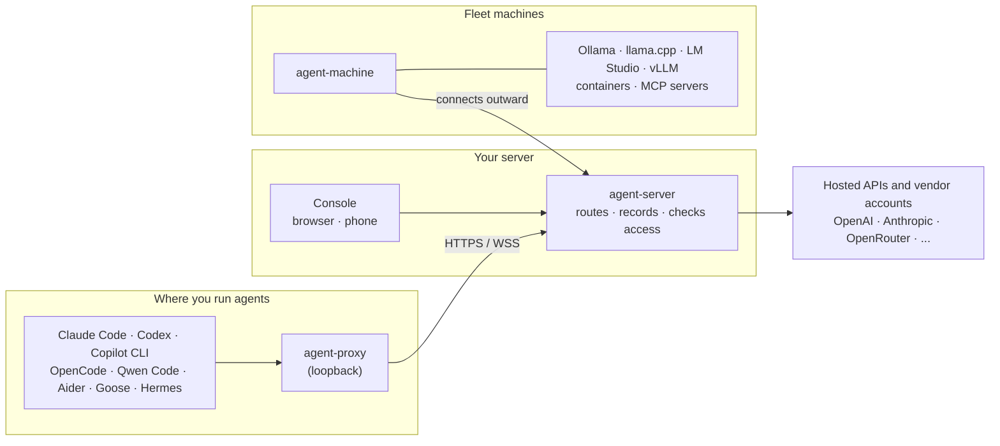
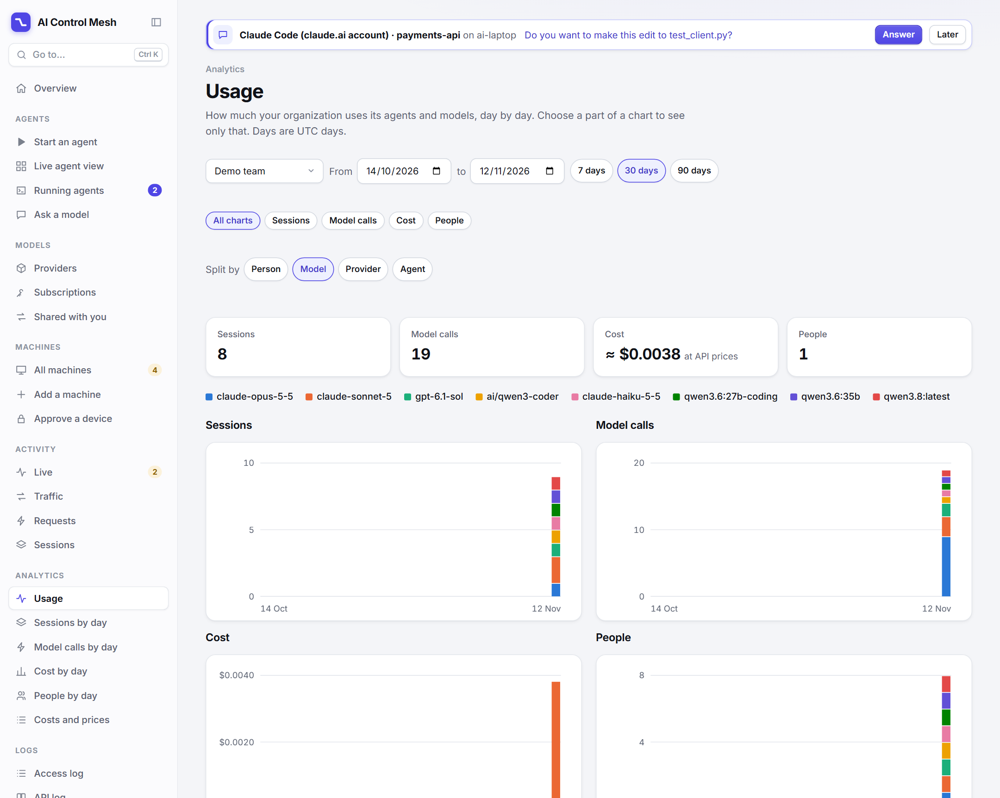

<div align="center">


# AI Control Mesh

### Your AI agents. Your infrastructure. One control plane.

Run and watch coding agents, connect your models and tools, and learn from each session.<br>
Open source, MIT licensed, and hosted on your own infrastructure.

**[Website](https://aicontrolmesh.com/) · [Quick start](#quick-start) · [AI coaching](#session-review-and-ai-coaching) · [Documentation](docs/index.md) · [Contributing](CONTRIBUTING.md)**


*The current console with synthetic demo data. Full screenshots are linked throughout the documentation.*

</div>

AI Control Mesh is a server and web console for managing terminal coding agents across your computers. Start agents on connected machines, watch their terminals, answer permission prompts from your phone, and see which models and tools they use. Review recorded sessions to improve your prompts and understand token use and estimated costs.

Use agents such as **Claude Code, Codex, Copilot CLI, OpenCode, Qwen Code, Aider, Goose and Hermes Agent**. You supply the models, hosted API keys or supported vendor accounts. Agent and provider compatibility varies; see the [compatibility guide](docs/providers.md#compatibility).

## What you can do

| Capability | What it gives you |
| --- | --- |
| **Run and control agents** | Launch agents in allowed folders on connected machines. Watch shared terminals and reply from a browser or the Android app. |
| **Choose local or hosted models** | Connect Ollama, llama.cpp, LM Studio, vLLM and other supported servers, hosted APIs, or supported agents using your existing vendor plans. |
| **Record and inspect sessions** | Track model calls, token use, caching and timings. Enable payload capture to read prompts, replies and tool calls as conversations. |
| **Review sessions with AI coaching** | Find repeated work and growing context, then ask a model for specific improvements to prompts, instructions and tool use. |
| **Understand usage and costs** | Compare usage and estimated costs by day, person, model, provider and agent. Drill down to sessions and set token limits by person and provider. |
| **Share resources with a team** | Grant access to machines and MCP tools, which let agents work with services such as GitHub and databases. Use organizations, teams, session sharing, recording policies and audit records. |

## Quick start

Pick one. All three run on your own computer, on loopback only.

| | You need | You get |
| --- | --- | --- |
| [The quickstart stack](#the-quickstart-stack) | Git, and Docker or Podman with Compose | The whole system with two fleet machines and Ollama, and a guided tour |
| [One container](#one-container) | Docker or Podman | The whole system in a single container, no checkout |
| [No containers](#no-containers) | Python 3.11 or later | The server, `agent` and `agent-machine` installed for you alone |

### The quickstart stack

```bash
git clone https://github.com/joeyenfield/ai-control-mesh.git
cd ai-control-mesh
docker compose -f deploy/compose/quickstart/compose.yaml up -d --pull always
```

For Podman, replace `docker compose` with `podman compose`. One command starts the server and console, the sign-in service, PostgreSQL, two fleet machines with coding agents installed, and Ollama, from the project's published images.

Open http://localhost:19999, sign in with **admin** / **secret**, and follow the [guided quickstart](docs/quickstart.md): add a provider, pull a model, start an agent and inspect its recorded requests. Setup time depends on image and model downloads. There's a [Kubernetes version](docs/quickstart-kubernetes.md) too.

**It's a local demo**: known credentials and ports bound to localhost. Container images are downloaded at startup; choose and download a model separately. Delete it with `docker compose -f deploy/compose/quickstart/compose.yaml down -v`. [`deploy/compose/`](deploy/compose/README.md) also has the all-in-one container as a Compose file, and two linked servers to try peering.

### One container

The whole system, with a machine and the coding agents already in it:

```bash
docker run -d --name mesh --pull=always -p 127.0.0.1:19999:19999 -p 127.0.0.1:20000:20000 \
  -v mesh-data:/data -v mesh-home:/home/agent -v mesh-workspace:/workspace \
  ghcr.io/joeyenfield/ai-control-mesh
docker logs mesh     # the console's address and the admin password
```

Then open http://localhost:19999. The three volumes keep the data, the machine's sign-ins and its projects when the container is re-created.

### No containers

One command installs the server, `agent` and `agent-machine` from the latest release and runs them on your own computer with your own folders, for you alone, with an icon in the system tray to start, stop and open it:

```bash
curl -fsSL https://github.com/joeyenfield/ai-control-mesh/releases/latest/download/install-local.sh | sh
```

```powershell
irm https://github.com/joeyenfield/ai-control-mesh/releases/latest/download/install-local.ps1 | iex
```

`uninstall-local.sh` (or `.ps1`) from the same address takes it out again. See [Run it on your own computer](docs/local.md), which covers the container, the installer and [removing it](docs/local.md#remove-it), and installing from a checkout (`./devhelpers/scripts/install-local.sh`).

## How it works



1. **Run the server** (`agent-server`): one container, a Compose stack, a Helm chart or a local install. It holds the settings, the accounts and the recordings, and serves the console.
2. **Start agents with `agent`**: `agent claude-account .` starts the agent you already use, with its traffic going through your server.
3. **Join machines with `agent-machine`**: each one shares its model servers, containers and MCP tools with the agents you allow.

Read [How it works](docs/how-it-works.md) for the longer version, and [Architecture](docs/architecture.md) for the design.

## Session review and AI coaching

Open a session’s **Review** tab to see built-in checks and the measurements behind them. The checks run without a model. Choose a review topic and an available provider and model to get AI suggestions for what to improve:

- **Prompts and workflow:** clearer task instructions, better steering, and when to plan or start a fresh session.
- **Context and project instructions:** oversized instructions, unused tools and context that keeps growing.
- **Tool use and failures:** repeated searches, large results, failed commands and slow calls.
- **Cost and caching:** opportunities to reuse cached context or use a smaller model for part of the work.
- **Lessons for the project:** suggested lines to add to your project’s instruction file.

Detailed checks need captured payloads. AI reviews send selected measurements and excerpts to the chosen model; paid providers charge for the review. Cost figures and possible savings are estimates. Review suggestions before applying them.

[Read the session review guide](docs/session-review.md) for supported reviewers, the data sent and custom review prompts.

## Models and accounts

| Option | How it works |
| --- | --- |
| **Local model servers** | Machines connect outward to your server and share their model servers with permitted agents. Manage supported providers and download models through the console. |
| **Hosted APIs** | Connect OpenAI, Anthropic, OpenRouter, LiteLLM and other supported OpenAI or Anthropic-compatible services. Server-managed API keys stay on the server. |
| **Vendor accounts** | Supported Claude Code, Codex and Copilot CLI launches use their existing vendor sign-in and plan. Traffic still reaches the vendor; the mesh records it in transit. |

Choose the route supported by your agent and provider. [Providers](docs/providers.md) explains protocol compatibility and credentials; [Subscriptions](docs/subscriptions.md) explains account assignment and usage tracking.

Use [peering](docs/peering.md) to link servers and let organizations share chosen providers, tools and machines across them.

## Inside the console

| Follow the work | Understand the usage |
| --- | --- |
|  Watch model replies and tool calls as they arrive, then inspect the recorded session. |  Compare models, providers and people, then open the sessions behind the totals. |

Screenshots use synthetic demo data. The [website](https://aicontrolmesh.com/) and [console guide](docs/console.md) show the rest of the interface.

## A real install

For a deployment beyond the local demo, follow [Getting started](docs/getting-started.md) and [Deployment](docs/deployment.md). Run the server and its sign-in service behind HTTPS, install the client on agent computers, and connect the machines that provide models and tools. OIDC sign-in is required, including on loopback.

Review [Security](docs/security.md), [Accounts and sharing](docs/accounts.md), and [Retention](docs/retention.md) before sharing a deployment. Payload capture can include project code and sensitive content.

## Documentation

Start at the [documentation's overview](docs/index.md). The pages, by section:

| Section | Pages |
| --- | --- |
| Start here | [How it works](docs/how-it-works.md) · [Run it on your own computer](docs/local.md) · [Quickstart with Docker or Podman](docs/quickstart.md) · [Quickstart on Kubernetes](docs/quickstart-kubernetes.md) · [Getting started](docs/getting-started.md) |
| Use it | [Agents](docs/running-agents.md) · [The console](docs/console.md) · [Machines](docs/machines.md) · [Providers](docs/providers.md) · [GPUs in containers](docs/gpu.md) · [MCP servers](docs/mcp.md) · [Subscriptions](docs/subscriptions.md) · [Reviewing a session](docs/session-review.md) |
| People and data | [Accounts and sharing](docs/accounts.md) · [Peering](docs/peering.md) · [Analytics and costs](docs/analytics.md) · [Usage limits](docs/usage-limits.md) · [Retention](docs/retention.md) · [The audit log](docs/audit.md) |
| Run a server | [Deployment](docs/deployment.md) · [Several server processes](docs/scaling.md) · [Configuration](docs/configuration.md) · [Security](docs/security.md) · [OIDC authentication](docs/oidc.md) · [Using API credentials](docs/api-credentials.md) |
| Technical overview | [Architecture](docs/architecture.md) · [Flows](docs/flows.md) · [Networking and protocols](docs/networking.md) · [Peering internals](docs/peering-internals.md) · [Scaling internals](docs/scaling-internals.md) · [Local instance internals](docs/local-internals.md) · [API](docs/api.md) |
| Contribute | [Development](docs/development.md) · [Local releases and snapshots](docs/releases.md) · [Marketing website](docs/website.md) |

## The parts

| Part | Folder | What it is |
| --- | --- | --- |
| Server | `server/` | `agent-server` (Python): the API, recording, routing, accounts; optionally serves the console |
| Console | `ui/` | The web console (React), bundled or [hosted separately](docs/deployment.md#separate-console-and-api-domains) |
| Public site | `site/` | The brochure website, separate from the application console |
| Client | `client/` | `agent` (Go): the launcher and each computer's `agent-proxy` |
| Machine | `machine/` | `agent-machine` (Go): keeps a computer in the server's fleet |
| Android app | `android/` | Your servers' consoles on your phone |
| Python client and machine | `python/` | `agent` and `agent-machine` for computers without a Go build |

## Contributing

See [Contributing](CONTRIBUTING.md) for changes and issue reports, [Development](docs/development.md) for builds and tests, and [`AGENTS.md`](AGENTS.md) for the code's structure and rules. The project is [MIT licensed](LICENSE).
