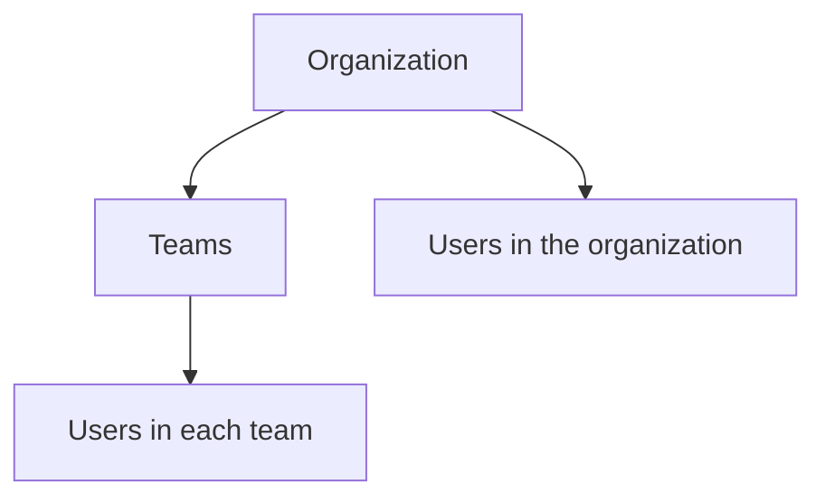

# Accounts and sharing

Everyone signs in through the separate OIDC issuer at **auth.aicontrolmesh.com**, including on loopback. People share sessions and machines through organizations and teams. See [OIDC authentication](oidc.md) for deployment, access tokens, device sign-in and automation.

This page covers accounts, who can see and control what, and using the console from a phone.

## Authentication is always required

On first start, if `users.json` does not exist and there is no environment account, the API creates `admin` with a random password, including on loopback. It prints the password and saves `first-user-password` beside `users.json`. Reset it with `agent-server user passwd admin`, then delete that file. Removing every user does not disable authentication.

## Users, roles, organizations and teams

| | What it is |
|---|---|
| **User** | Someone who signs in. Names use lowercase letters, numbers, `.`, `_` and `-`, up to 40 characters. Passwords need at least 8 characters. |
| **Role** | `admin` manages the server, organizations and users; `member` uses it. The first user is always an admin. The last admin can't be made a member or removed while others remain. |
| **Organization** | A group of users, each with its own teams. A user can be in several. |
| **Team** | A group of an organization's users, named `<org>/<team>`. Joining a team joins its organization; leaving an organization leaves its teams. |

Members see their own organizations and the people in them. Admins see and change everything.



In **Server → Organizations**, choose an organization, then open a team to manage its members. **Members** manages everyone in that organization, including people not yet in a team. Add an existing user or **Create user** directly in the organization or team. A user can belong to multiple teams and organizations; they still have one account.

Removing a team member keeps their organization membership. Removing an organization member also removes their memberships in that organization's teams. Neither deletes the account or memberships elsewhere. Membership changes apply to subsequent session and machine access checks. Deleting a team keeps its people in the organization; renaming its display name keeps its sharing key.

**User directory** manages accounts, server roles, password resets and memberships. **Your account** shows your identity and sign-in instructions. An Admin role is server-wide, not a team role. Only server admins can change organizations, teams or other users.

Manage them from the console (**Server → Organizations**), the API (`/api/orgs`, `/api/users`; see [API](api.md)), or the server's shell:

```bash
agent-server org add pockets --name "Empty Pockets"
agent-server user add joey --org pockets --team core   # the first user is an admin; it asks for a password
agent-server user add sam --team pockets/core          # joining a team joins its organization
agent-server team add pockets infra --name "Infrastructure"
agent-server user list
```

The full list of commands is on [Configuration](configuration.md#users-organizations-and-teams). They change `users.json`, which a running server picks up straight away.

**An account from the environment.** Set `AI_PROXY_USERNAME` and `AI_PROXY_PASSWORD` on the server and that account is an admin, without anything in `users.json`. Use it for servers set up by script. It can't change its password through the console.

## Signing in

| Who | How | What it carries |
|---|---|---|
| A browser | Console redirects through `GET /api/auth/login` to the issuer; authorization code + PKCE | Short-lived HttpOnly access cookie and a rotating refresh cookie |
| An agent machine | `agent login <server>`; approve the displayed device code in your browser | OAuth access token in `X-AI-Proxy-Token`, renewed automatically |
| A fleet machine | `agent-machine login <server>`; device approval | Its own access and refresh tokens, separate from `agent login` |
| Scripts and Swagger UI | A provisioned service client's access token | `Authorization: Bearer <access_token>` |
| An agent | Its loopback agent-proxy signs every upstream request | Session id selects the session; MCP also requires its launch-only capability |

The CLI never collects your password. Sign in and approve its code at the issuer. Each program stores its own rotating credentials with restricted permissions and refreshes access automatically. Logout revokes credentials.

The issuer limits failed sign-ins. Password reset and account removal invalidate issued credentials.

Passwords are hashed in `users.json`; OAuth tokens and grant state are hashed in the issuer's separate database.

**Agents keep their vendor credentials.** The proxy's alternate platform header preserves vendor `Authorization`. Open sessions still require access-token authentication and session control permission. Platform tokens are never forwarded to providers.

**Other sites can't act for you.** Unsafe methods and WebSockets require the API's origin or an explicitly allowed console origin.

## What only admins can change

Changes to the server itself are admin-only. The list is `ADMIN_ONLY` in `server/agent_server/auth.py`:

- saving the server's settings (`PUT /api/config`);
- restarting the server (`POST /api/server/restart`);
- adding, changing or deleting containers (`POST /api/containers`, `PUT`/`DELETE /api/containers/{name}`);
- adding a machine's model server as a provider (`POST /api/machines/{id}/providers/adopt`);
- changing organizations, teams and users (`/api/orgs/...`, `/api/users/...`).

Everything else is open to any signed-in user, limited by session sharing and machine grants.

## Session sharing

Whoever starts a session owns it and decides who else gets it. The sharing lives in the session's tags, which only the server writes (`server/agent_server/access.py`).

| Setting | Values |
|---|---|
| Visibility | `private`: only the owner, admins included. `team`: members of one of the owner's teams. `org`: members of one of the owner's organizations. |
| Access | `view`: others read its traffic and watch its terminal. `control`: they can also type into its terminal, end it, switch capture, and clear or delete it. |

From the launcher:

```bash
agent claude-account . --share team --team pockets/core --control
agent qwen . --model qwen3.6:35b --share org --control --let-others-type
```

`--share` is `private` (the default), `team` or `org`. `--team` names which of your teams, or with `--share org` which of your organizations; you can leave it out if you're in only one. `--let-others-type` gives them `control`. The console's **Start an agent** page and each session's page offer the same; only the owner can change who a session is shared with (`PATCH /api/sessions/{id}`).

Rules worth knowing:

- A session you can't see answers `404`, not `403`, so its id isn't confirmed.
- Changes apply straight away: the live view checks every event, and terminal viewers who lose access are disconnected.
- Sessions from before accounts have no owner. Admins see and control those.
- Clients can't set `owner`, `visibility`, `team`, `org`, `access`, `launched_by` or `mcp` tags themselves.
- **Launches on someone else's machine.** An agent the console starts on a machine runs under that machine's sign-in, so its owner owns the session. When someone else the machine lets in started it, the server tags it `launched_by` them, and they can view and control it too.
- **Shells stay private.** A terminal opened on a machine (`POST /api/machines/{id}/shell`, or `agent --shell`) is a real shell. Its session is always private with view access, and the server refuses to widen it.

## Machine access

Terminal viewers use their current sign-in and memberships. Removing a user's access,
revoking their token, signing them out or resetting their browser sign-in stops further
terminal input and output. An idle viewer is disconnected within about one second.

A machine belongs to whoever signed it in with `agent-machine login`. Its owner (or an admin) can let organizations and teams use each of its features: `view`, `launch`, `terminal`, `models`, `servers`, `update` and `mcp`. Any grant includes `view`. Admins can always `view`, manage `models` and `update` a machine; starting agents, terminals and MCP servers there needs a grant even for them. Members can grant only organizations and teams they're in.

Containers stay the owner's (and admins'). See [Machines](machines.md) for the details and the **Access** tab.

## The terminal access key and pairing

Access-key pairing has been removed. Old keys, short codes and `/pair` links no longer authenticate. Phones sign in through OIDC like other browsers; loopback has no special privilege.

## Running agents on your phone

Start an agent with `--control` and the launcher runs it in a pseudo-terminal it shares with the server, through the `agent-proxy`. The agent draws in your terminal window as usual, and the console's **Running agents** page shows the same screen and can type into it.

```bash
agent claude-account . --control
```

From your phone you can:

- see which agents are working, waiting for you or finished. An agent asking something (a permission prompt) gets a banner above every page with its question, and Running agents can turn on browser notifications for it;
- read what they printed;
- answer a prompt or send the next instruction.

To set it up on a server you reach over your network:

1. Configure HTTPS for the API, console and issuer ([OIDC](oidc.md)), and make the console reachable from your phone.
2. On your phone, open the console and sign in. Add it to the home screen to get back quickly.
3. Sign each agent machine in once with `agent login <server>`, including the server's own computer (`agent login http://127.0.0.1:9999`).

Authentication cannot be disabled by removing users.

Open a running agent to see its terminal:

- **Send** types your message, then presses Enter as a separate keystroke, so agents don't read it as a paste. Multi-line text is sent as a bracketed paste once the agent has turned that on.
- The keys underneath cover agents' menus and prompts: Esc, Enter, the arrows, Scroll ↑ and ↓, PgUp, PgDn, Tab, Shift+Tab, Ctrl+C, 1 to 3, y and n.
- Agents that run full screen (Claude Code, OpenCode, Qwen Code) keep their own history. Scroll it with the mouse wheel over the terminal, or **Scroll ↑**/**Scroll ↓** on a phone.
- **Fit width** sizes the text so the whole terminal fits the screen.
- On a computer you can click the terminal and type into it directly.

Things to know:

- **Your window stays the main one.** Its size sets the terminal's size, and closing it ends the agent.
- **History is saved.** Each terminal's output goes to `logs/sessions/<id>/terminal.log` (up to 64 MB), so finished sessions stay readable. If the launcher loses the server, it keeps trying and resends what the server missed when it reconnects; if this computer's `agent-proxy` has stopped (`agent update` stops it), the launcher starts it again.
- **It's off unless you ask.** Without `--control`, the agent runs directly and only its traffic is recorded. `AI_PROXY_CONTROL=1` makes `--control` a machine's default.
- **It needs an interactive terminal.** On Windows that's Windows Terminal, PowerShell or cmd, not Git Bash's mintty. Otherwise the launcher says why sharing is off and runs the agent directly.
- **Away from home**, use a VPN such as [Tailscale](https://tailscale.com), or HTTPS with the registered API, console and issuer hostnames ([Deployment](deployment.md)). Authentication is required in either case.

## The Android app

The app (`android/`) keeps a list of your agent-servers and opens each one's console full screen, in a WebView. All its features are the console's, so it opens on **Running agents** and works the same way.

- **Getting it.** Open `http://<your server>/android` in the phone's browser: every server hands out the app built with it, no sign-in needed. The **Downloads** page (`/get`) has it too, with its size and SHA-256.
- **Adding a server.** Type its address (a LAN address, a Tailscale name, or HTTPS). The app checks it's an agent-server (`/health`) before saving it, and shows whether each is online.
- **Signing in** uses the console's OIDC flow. The configured HTTPS issuer and API callback stay in the app; the sign-in belongs to this phone's WebView.
- **Plain HTTP** is allowed, since servers usually run on a LAN or Tailscale; the app says when a connection isn't encrypted.
- **Back** goes through the console's own history (closing its menu first), then to your servers. Links to other sites open in the browser.
- **Separate console hosting.** The server's initial redirect to an HTTPS console stays in the app, including a different console host. Later external links still open in the browser. For the Android Auto monitor, add the API host where your sign-in cookie lives, not the brochure website.
- **Updates.** When a server's version isn't the app's own, its card says **Update available**, and **Update** opens that server's Downloads page.

Building it is in `android/README.md`.

### Private Android Auto experiment

Debug APKs include **AI Control Mesh (private test)** in Android Auto development
hosts. Add servers and sign in on the phone while parked, then select a server in the
car app. It shows up to five recent visible sessions, open first, with status, model
and request counts, refreshing every 15 seconds while visible. Open means the session
has not ended, not necessarily that the agent is working. There is no terminal output,
typing, prompt approval or launching from the car.

It uses the phone's existing sign-in and the same session-sharing permissions. Renew
expired sign-ins on the phone while parked. Your phone must be able to reach the server.
Release APKs do not contain this experiment. The debug navigation category is a
development discovery workaround, not navigation functionality or Play eligibility.
Hosts can still refuse it. Android Auto's **Unknown sources** option alone does not enable
sideloaded Car App Library apps in real vehicles; Google's
[testing requirements](https://developer.android.com/training/cars/testing#test-in-real-vehicles)
require a trusted installation source for supported testing, such as Play Internal App Sharing or an Internal
Test Track. Use the Desktop Head Unit for this private experiment; see
`android/README.md` for setup, launcher troubleshooting and reported unofficial
real-car testing workarounds that have not yet been validated on this app.
