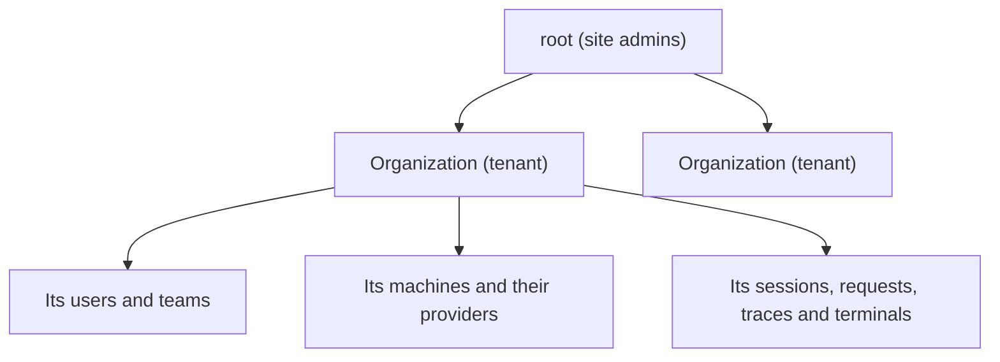

# Accounts and sharing

Everyone signs in through the separate OIDC issuer at **auth.aicontrolmesh.com**, including on loopback. Every user, machine, provider and session belongs to one organization, and nothing is shared between organizations. Inside one, people share sessions and machines with the whole organization or its teams. See [OIDC authentication](oidc.md) for deployment, access tokens, device sign-in and automation.

This page covers accounts, who can see and control what, and using the console from a phone. Your own AI plans (Claude, ChatGPT, Copilot) are something else, kept as [Subscriptions](subscriptions.md).

## Authentication is always required

On the first start against a new database, if there is no environment account, the API creates `admin`, a site admin, with a random password, including on loopback. It prints the password and saves it in the file `first-user-password` (in `certs/` normally). Reset it with `agent-server user passwd admin`, then delete that file. Removing every user does not disable authentication.

## Organizations are tenants

Each organization is a tenant: a separate part of the server that shares nothing with the others. There is one **root** organization above all the rest, which holds only the site admins. Every other organization lives under it.



- **A user belongs to one organization, for good.** They're made in it and can't join another or be moved. To give someone access to another organization, add them there as a new user.
- **A machine belongs to the organization of the user who signed it in** (`agent-machine login`), from the first time it connects. Another organization's user can't take over its id.
- **A provider belongs to its machine's organization.** A model server added as a provider, and a container a machine runs, can only be used by that organization's agents. Other organizations don't see it in their agents' backends, `/api/models` or `/api/status`, and naming it (`--backend`, `X-AI-Proxy-Backend`) answers as an unknown backend. Hosted APIs (Anthropic) are the exception: site admins add them in **Server settings** for everyone, and agents bring their own credentials to them. A model server added before machines did this belongs to the root.
- **A session belongs to its owner's organization**, and so do its request records, traces, chats, live traffic and terminal. The server sets it; clients can't. Nobody outside it sees or controls the session, except site admins.

## Users, roles and teams

| | What it is |
|---|---|
| **User** | Someone who signs in, in one organization. Names use lowercase letters, numbers, `.`, `_` and `-`, up to 40 characters, and are unique on the server. Passwords need at least 8 characters. |
| **Role** | Within the user's organization: `admin` manages it (its users, teams, and the admin side of its machines); `member` uses it. An organization's last admin can't be made a member or removed while others remain. |
| **Site admin** | An admin of the root organization. Site admins run the server (its settings, agents, model tuning, restarts) and set organizations up: they make and remove organizations and add users to any of them. They also see and control everything inside every organization, to look after the server: its sessions (private ones included: their traffic, chats and terminals), machines (every feature, as their owner could, and removing them) and providers. The machines' own switches (`agent-machine launches on`, ...) still apply. The root takes only admins. |
| **Team** | A group of an organization's users, named `<org>/<team>`. Only users of that organization can join it. |

Members see their own organization and the people in it. Its admins change them. Site admins see every organization and user.

In **Server → Organizations**, choose an organization, then open a team to manage its members. Add people to an organization by creating them there. Deleting a team keeps its people in the organization; renaming its display name keeps its sharing key. An organization can only be deleted once it has no users left, and the root can't be deleted. Membership changes apply to subsequent session and machine access checks.

Manage them from the console (**Server → Organizations**), the API (`/api/orgs`, `/api/users`; see [API](api.md)), or the server's shell:

```bash
agent-server org add pockets --name "Empty Pockets"
agent-server user add joey --org pockets --admin        # an admin of pockets; it asks for a password
agent-server user add sam --team pockets/core           # a member of pockets, in its core team
agent-server user add ops --admin                       # no --org: a site admin, in the root
agent-server team add pockets infra --name "Infrastructure"
agent-server user list
```

The full list of commands is on [Configuration](configuration.md#users-organizations-and-teams). They change the accounts in the server's database, which a running server and the issuer pick up straight away. If no site admin is left, the server says so when it starts; make one with `agent-server user add <name> --admin`.

**An account from the environment.** Set `AI_PROXY_USERNAME` and `AI_PROXY_PASSWORD` on the server and that account is a site admin, without an account in the database. Use it for servers set up by script. It can't change its password through the console.

**Upgrading from before organizations were tenants.** On the first start of this version, each user goes to their first organization (by id), keeping their role there, and leaves their teams of other organizations. An admin in no organization becomes a site admin; a member in none goes to a new organization, `main`. Sessions and machines go to their owner's organization, and those without an owner to the root. Anything a user shared with another of their old organizations is no longer shared.

## Signing in

How a computer's device sign-in works, and what keeps it safe, is on [Security](security.md).

**Several accounts in one browser.** The console can be signed in to up to five accounts at once, for example a site admin and an organization's user. Choose your name at the bottom of the menu: **Switch to** another account (no password), **Add another account** (the sign-in page again), **Sign out** of the active one or of one of the others, or **Sign out of every account**. Only one account is active at a time, and the console shows only what that account may see: switching to an account of another organization is switching organization. When you sign out of the active account, the next one becomes active. Other console tabs follow a switch. `agent login` and `agent-machine login` still hold one account per server.

| Who | How | What it carries |
|---|---|---|
| A browser | Console redirects through `GET /api/auth/login` to the issuer; authorization code + PKCE | Short-lived HttpOnly access cookie for the active account, and a rotating refresh token for each account it's signed in to |
| An agent machine | `agent login <server>`; approve the displayed device code in your browser | OAuth access token in `X-AI-Proxy-Token`, renewed automatically |
| A fleet machine | `agent-machine login <server>`; device approval | Its own access and refresh tokens, separate from `agent login` |
| Scripts and Swagger UI | A provisioned service client's access token | `Authorization: Bearer <access_token>` |
| An agent | Its loopback agent-proxy signs every upstream request | Session id selects the session; MCP also requires its launch-only capability |

The CLI never collects your password. Sign in and approve its code at the issuer. Each program stores its own rotating credentials with restricted permissions and refreshes access automatically. Logout revokes credentials.

The issuer limits failed sign-ins. Password reset and account removal invalidate issued credentials.

Passwords are hashed in the server's database; OAuth tokens and grant state are hashed in the issuer's own part of it (the schema `mesh_auth` on PostgreSQL), or its own file with SQLite.

**Agents keep their vendor credentials.** The proxy's alternate platform header preserves vendor `Authorization`. Open sessions still require access-token authentication and session control permission. Platform tokens are never forwarded to providers.

**Other sites can't act for you.** Unsafe methods and WebSockets require the API's origin or an explicitly allowed console origin.

## What only admins can change

The lists are `SITE_ADMIN_ONLY` and `ADMIN_ONLY` in `server/agent_server/auth.py`.

Only site admins:

- read and save the server's settings (`GET`/`PUT /api/config`), which include every backend;
- everything under `/api/config/...`, reading included: the stored agents, the Ollama model tuning, storage and retention, and settings export and import;
- restart the server (`POST /api/server/restart`) and read its computer's stats (`GET /api/server/stats`) and its access log (`GET /api/server/access-log`);
- make and remove organizations (`POST /api/orgs`, `DELETE /api/orgs/{org}`).

An organization's admins (and site admins, for the users and teams of any organization), within that organization only:

- rename it, and change its teams and users (`/api/orgs/{org}/...`, `/api/users/...`);
- add, change or delete containers on its machines (`POST /api/containers`, `PUT`/`DELETE /api/containers/{name}`);
- add one of its machines' model servers as a provider (`POST /api/machines/{id}/providers/adopt`).

Everything else is open to any signed-in user, limited to their organization, session sharing and machine grants. Another organization's sessions, machines, users and teams answer `404`, as if they didn't exist.

## Session sharing

Whoever starts a session owns it and decides who else gets it. The sharing lives in the session's tags, which only the server writes (`server/agent_server/access.py`).

| Setting | Values |
|---|---|
| Visibility | `private`: only the owner (and site admins); not the organization's admins. `team`: members of one of the owner's teams. `org`: everyone in the owner's organization. Never anyone in another organization. |
| Access | `view`: others read its traffic and watch its terminal. `control`: they can also type into its terminal, end it, switch capture, and clear or delete it. |

From the launcher:

```bash
agent claude-account . --share team --team pockets/core --control
agent qwen . --model qwen3.6:35b --share org --control --let-others-type
```

`--share` is `private` (the default), `team` or `org`. `--team` names which of your teams (with `--share org` it may name your organization, the only one there is); you can leave it out if you're in only one team. `--let-others-type` gives them `control`. The console's **Start an agent** page and each session's page offer the same; only the owner can change who a session is shared with (`PATCH /api/sessions/{id}`).

Rules worth knowing:

- A session you can't see answers `404`, not `403`, so its id isn't confirmed.
- Changes apply straight away: the live view checks every event, and terminal viewers who lose access are disconnected.
- Sessions from before accounts have no owner. Their organization's admins see and control those.
- Clients can't set `owner`, `visibility`, `team`, `org`, `access`, `tenant`, `launched_by` or `mcp` tags themselves.
- **Launches on someone else's machine.** An agent the console starts on a machine runs under that machine's sign-in, so its owner owns the session. When someone else the machine lets in started it, the server tags it `launched_by` them, and they can view and control it too.
- **Shells stay private.** A terminal opened on a machine (`POST /api/machines/{id}/shell`, or `agent --shell`) is a real shell. Its session is always private with view access, and the server refuses to widen it.

## Machine access

Terminal viewers use their current sign-in and memberships. Removing a user's access,
revoking their token, signing them out or resetting their browser sign-in stops further
terminal input and output. An idle viewer is disconnected within about one second.

A machine belongs to whoever signed it in with `agent-machine login`, and to their organization. Nobody outside that organization can see or use it, except site admins, who may use and remove any machine. Its owner (or an admin of its organization) can let the whole organization, or its teams, use each of its features: `view`, `launch`, `terminal`, `models`, `servers`, `update` and `mcp`. Any grant includes `view`. Grants never name another organization. The organization's admins can always `view`, manage `models` and `update` a machine; starting agents, terminals and MCP servers there needs a grant even for them. Members can grant only teams they're in.

Containers stay the owner's (and their organization's admins'). See [Machines](machines.md) for the details and the **Access** tab.

## The terminal access key and pairing

Access-key pairing has been removed. Old keys, short codes and `/pair` links no longer authenticate. Phones sign in through OIDC like other browsers; loopback has no special privilege. How each kind of device pairs now (computers, fleet machines, browsers, the Android app, scripts) and why the old way went is on [Security](security.md#pairing-how-each-device-joins).

## Running agents on your phone

Start an agent with `--control` and the launcher runs it in a pseudo-terminal it shares with the server, through the `agent-proxy`. The agent draws in your terminal window as usual, and the console's **Running agents** page shows the same screen and can type into it.

```bash
agent claude-account . --control
```

From your phone you can:

- see which agents are working, waiting for you or finished. An agent asking something (a permission prompt) gets a banner above every page with its question, and Running agents can turn on browser notifications for it;
- read what they printed;
- answer a prompt or send the next instruction.

To set it up on a server you reach over your network:

1. Configure HTTPS for the API, console and issuer ([OIDC](oidc.md)), and make the console reachable from your phone.
2. On your phone, open the console and sign in. Add it to the home screen to get back quickly.
3. Sign each agent machine in once with `agent login <server>`, including the server's own computer (`agent login http://127.0.0.1:9999`).

Authentication cannot be disabled by removing users.

Open a running agent to see its terminal:

- **Send** types your message, then presses Enter as a separate keystroke, so agents don't read it as a paste. Multi-line text is sent as a bracketed paste once the agent has turned that on.
- The keys underneath cover agents' menus and prompts: Esc, Enter, the arrows, Scroll ↑ and ↓, PgUp, PgDn, Tab, Shift+Tab, Ctrl+C, 1 to 3, y and n.
- Agents that run full screen (Claude Code, OpenCode, Qwen Code) keep their own history. Scroll it with the mouse wheel over the terminal, or **Scroll ↑**/**Scroll ↓** on a phone.
- **Fit width** sizes the text so the whole terminal fits the screen.
- On a computer you can click the terminal and type into it directly.

Things to know:

- **Your window stays the main one.** Its size sets the terminal's size, and closing it ends the agent.
- **History is saved.** Each terminal's output is saved in the server's database (up to 64 MB), so finished sessions stay readable. If the launcher loses the server, it keeps trying and resends what the server missed when it reconnects; if this computer's `agent-proxy` has stopped (`agent update` stops it), the launcher starts it again.
- **It's off unless you ask.** Without `--control`, the agent runs directly and only its traffic is recorded. `AI_PROXY_CONTROL=1` makes `--control` a machine's default.
- **It needs an interactive terminal.** On Windows that's Windows Terminal, PowerShell or cmd, not Git Bash's mintty. Otherwise the launcher says why sharing is off and runs the agent directly.
- **Away from home**, use a VPN such as [Tailscale](https://tailscale.com), or HTTPS with the registered API, console and issuer hostnames ([Deployment](deployment.md)). Authentication is required in either case.

## The Android app

The app (`android/`) keeps a list of your agent-servers and opens each one's console full screen, in a WebView. All its features are the console's, so it opens on **Running agents** and works the same way.

- **Getting it.** Open `http://<your server>/android` in the phone's browser: every server hands out the app built with it, no sign-in needed. The **Downloads** page (`/get`) has it too, with its size and SHA-256.
- **Adding a server.** Type its address (a LAN address, a Tailscale name, or HTTPS). The app checks it's an agent-server (`/health`) before saving it, and shows whether each is online.
- **Signing in** uses the console's OIDC flow. The configured HTTPS issuer and API callback stay in the app; the sign-in belongs to this phone's WebView.
- **Plain HTTP** is allowed, since servers usually run on a LAN or Tailscale; the app says when a connection isn't encrypted.
- **Back** goes through the console's own history (closing its menu first), then to your servers. Links to other sites open in the browser.
- **Separate console hosting.** The server's initial redirect to an HTTPS console stays in the app, including a different console host. Signing in stays in the app too: the issuer's pages, and the login and callback of the API the console calls (the hosts of the server's registered callbacks). Later external links still open in the browser. For the Android Auto monitor, add the API host where your sign-in cookie lives, not the brochure website.
- **Updates.** When a server's version isn't the app's own, its card says **Update available**, and **Update** opens that server's Downloads page.

Building it is in `android/README.md`.

### Private Android Auto experiment

Debug APKs include **AI Control Mesh (private test)** in Android Auto development
hosts. Add servers and sign in on the phone while parked, then select a server in the
car app. It shows up to five recent visible sessions, open first, with status, model
and request counts, refreshing every 15 seconds while visible. Open means the session
has not ended, not necessarily that the agent is working. There is no terminal output,
typing, prompt approval or launching from the car.

It uses the phone's existing sign-in and the same session-sharing permissions. Renew
expired sign-ins on the phone while parked. Your phone must be able to reach the server.
Release APKs do not contain this experiment. The debug navigation category is a
development discovery workaround, not navigation functionality or Play eligibility.
Hosts can still refuse it. Android Auto's **Unknown sources** option alone does not enable
sideloaded Car App Library apps in real vehicles; Google's
[testing requirements](https://developer.android.com/training/cars/testing#test-in-real-vehicles)
require a trusted installation source for supported testing, such as Play Internal App Sharing or an Internal
Test Track. Use the Desktop Head Unit for this private experiment; see
`android/README.md` for setup, launcher troubleshooting and reported unofficial
real-car testing workarounds that have not yet been validated on this app.
