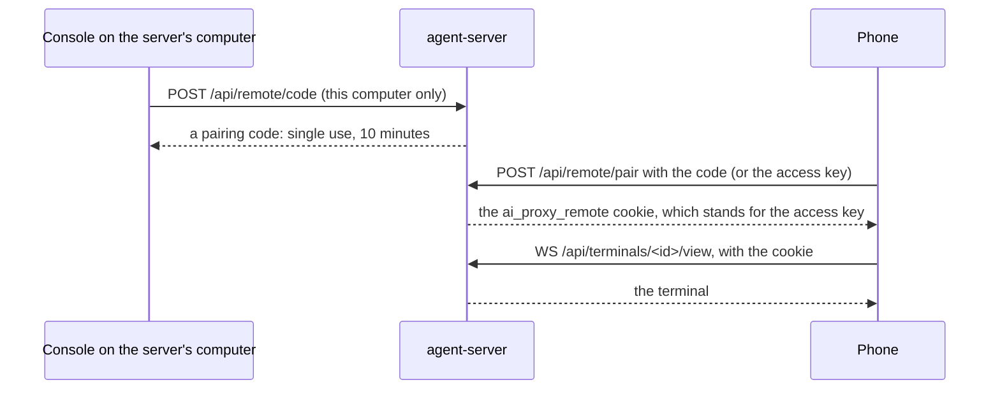

# Accounts and sharing

The server runs in one of two modes. In **local mode** it's a single-user tool on your own computer. In **server mode** it has accounts, everyone signs in, and people share sessions and machines through organizations and teams.

This page covers both, how each program signs in, who can see and control what, and using the console from a phone.

## Local mode and server mode

| | Local mode | Server mode |
|---|---|---|
| When | `users.json` has no users and `AI_PROXY_USERNAME`/`AI_PROXY_PASSWORD` aren't set | At least one user, or the environment account |
| The console and API | Open to anyone who reaches the port | Need a sign-in |
| Terminals, machines, containers | This computer, or a device paired with the access key | Need a sign-in |
| Phones | Pair with the access key or a short code | Sign in |
| Sessions | Everyone sees and controls everything | Each has an owner who decides who else gets it |

**Sign-in turns itself on when the server listens on the network.** On a start that listens beyond loopback (for example `proxy.listen_host: 0.0.0.0`), if `users.json` doesn't exist and there's no environment account, the server creates a user called `admin` with a random password. It prints the password and saves it in `first-user-password` beside `users.json` (`certs/` by default). Sign in, change the password on **Server → Organizations**, then delete that file.

It happens only while `users.json` doesn't exist. If you remove every user later, sign-in is off again and `admin` isn't created a second time. Do that only on a network you trust: in local mode, the console's pages (traffic, sessions, settings) are open to anyone who can reach the port.

## Users, roles, organizations and teams

| | What it is |
|---|---|
| **User** | Someone who signs in. Names use lowercase letters, numbers, `.`, `_` and `-`, up to 40 characters. Passwords need at least 8 characters. |
| **Role** | `admin` manages the server, organizations and users; `member` uses it. The first user is always an admin. The last admin can't be made a member or removed while others remain. |
| **Organization** | A group of users, each with its own teams. A user can be in several. |
| **Team** | A group of an organization's users, named `<org>/<team>`. Joining a team joins its organization; leaving an organization leaves its teams. |

Members see their own organizations and the people in them. Admins see and change everything.

Manage them from the console (**Server → Organizations**), the API (`/api/orgs`, `/api/users`; see [API](api.md)), or the server's shell:

```bash
agent-server org add pockets --name "Empty Pockets"
agent-server user add joey --org pockets --team core   # the first user is an admin; it asks for a password
agent-server user add sam --team pockets/core          # joining a team joins its organization
agent-server team add pockets infra --name "Infrastructure"
agent-server user list
```

The full list of commands is on [Configuration](configuration.md#users-organizations-and-teams). They change `users.json`, which a running server picks up straight away.

**An account from the environment.** Set `AI_PROXY_USERNAME` and `AI_PROXY_PASSWORD` on the server and that account is an admin, without anything in `users.json`. Use it for servers set up by script. It can't change its password through the console.

## Signing in

| Who | How | What it carries |
|---|---|---|
| A browser | The console's sign-in page (`POST /api/auth/login`) | The `ai_proxy_session` cookie: HTTP-only, `SameSite=Lax`, secure over HTTPS, for 30 days |
| An agent machine | `agent login <server>`, once | A launcher token, sent by its `agent-proxy` as `X-AI-Proxy-Token` |
| A fleet machine | `agent-machine login <server>`, once | Its own launcher token, separate from `agent login`'s |
| Scripts and Swagger UI | A token from **Server → Organizations** (`POST /api/auth/tokens`) | `X-AI-Proxy-Token` |
| An agent | Nothing: it uses an open session's id, which the launcher gives it | The session id in the URL (`/session/<id>/...`), `X-AI-Proxy-Session`, or the HTTPS proxy's user name |

`agent login` and `agent-machine login` send your user name and password once (`POST /api/auth/token`) and keep the token they get back, labelled `agent-proxy on <host>` or `agent-machine on <host>`. Your password isn't stored on the machine. The tokens show on **Server → Organizations**, where you can revoke them. `agent login` takes effect at once: the `agent-proxy` reads its credentials on every request.

Ten failed sign-ins in ten minutes from one address are refused for the rest of that time (`429`). A new password signs the user out of every browser.

Passwords and tokens are stored only as hashes (scrypt for passwords, SHA-256 for tokens), in `users.json`.

**Agents keep their own credentials.** Agent requests that name an open session pass without a sign-in, and the server never replaces the agent's own `Authorization` header: hosted pass-through needs it. Once a session has ended, its id stops working.

**Other sites can't act for you.** With accounts, a `POST`, `PUT`, `PATCH` or `DELETE` whose `Origin` is another site is refused, and so are WebSockets from other sites' pages.

## What only admins can change

Changes to the server itself are admin-only. The list is `ADMIN_ONLY` in `server/agent_server/auth.py`:

- saving the server's settings (`PUT /api/config`);
- restarting the server (`POST /api/server/restart`);
- adding, changing or deleting containers (`POST /api/containers`, `PUT`/`DELETE /api/containers/{name}`);
- adding a machine's model server as a provider (`POST /api/machines/{id}/providers/adopt`);
- replacing the terminal access key (`POST /api/remote/rotate`);
- changing organizations, teams and users (`/api/orgs/...`, `/api/users/...`).

Everything else is open to any signed-in user, limited by session sharing and machine grants.

## Session sharing

Whoever starts a session owns it and decides who else gets it. The sharing lives in the session's tags, which only the server writes (`server/agent_server/access.py`).

| Setting | Values |
|---|---|
| Visibility | `private`: only the owner, admins included. `team`: members of one of the owner's teams. `org`: members of one of the owner's organizations. |
| Access | `view`: others read its traffic and watch its terminal. `control`: they can also type into its terminal, end it, switch capture, and clear or delete it. |

From the launcher:

```bash
agent claude-account . --share team --team pockets/core --control
agent qwen . --model qwen3.6:35b --share org --control --let-others-type
```

`--share` is `private` (the default), `team` or `org`. `--team` names which of your teams, or with `--share org` which of your organizations; you can leave it out if you're in only one. `--let-others-type` gives them `control`. The console's **Start an agent** page and each session's page offer the same; only the owner can change who a session is shared with (`PATCH /api/sessions/{id}`).

Rules worth knowing:

- A session you can't see answers `404`, not `403`, so its id isn't confirmed.
- Changes apply straight away: the live view checks every event, and terminal viewers who lose access are disconnected.
- Sessions from before accounts have no owner. Admins see and control those.
- Clients can't set `owner`, `visibility`, `team`, `org`, `access`, `launched_by` or `mcp` tags themselves.
- **Launches on someone else's machine.** An agent the console starts on a machine runs under that machine's sign-in, so its owner owns the session. When someone else the machine lets in started it, the server tags it `launched_by` them, and they can view and control it too.
- **Shells stay private.** A terminal opened on a machine (`POST /api/machines/{id}/shell`, or `agent --shell`) is a real shell. Its session is always private with view access, and the server refuses to widen it.

## Machine access

A machine belongs to whoever signed it in with `agent-machine login`. Its owner (or an admin) can let organizations and teams use each of its features: `view`, `launch`, `terminal`, `models`, `servers`, `update` and `mcp`. Any grant includes `view`. Admins can always `view`, manage `models` and `update` a machine; starting agents, terminals and MCP servers there needs a grant even for them. Members can grant only organizations and teams they're in.

Containers stay the owner's (and admins'). See [Machines](machines.md) for the details and the **Access** tab.

## The terminal access key and pairing



Typing into an agent's terminal is as good as a shell on that computer. So in local mode, only trusted clients can use terminals, machines and containers:

- **This computer**: a loopback client whose `Host` header also names loopback. A web page that rebinds its own DNS name to `127.0.0.1` sends its own name in `Host`, so it isn't trusted.
- **A paired device**: one that holds the access key, in the `ai_proxy_remote` cookie (HTTP-only, `SameSite=Strict`) or the `X-AI-Proxy-Token` header.

The access key is a random value in `certs/remote-access-key` (`AI_PROXY_REMOTE_KEY_FILE` moves it; `AI_PROXY_TOKEN` replaces it). The file is created on first use, readable by its owner only where the system allows it.

**Pairing a phone.** On this computer, open **Agents → Running agents**, then **Use it from your phone**:

1. **Show the pairing code** shows a QR code with a link that carries the key. Scan it with the phone's camera.
2. Can't scan it? **Get a short code** instead (`POST /api/remote/code`), and type it into **Pair this device** on the phone.

A short code stands in for the key, so it's limited: it works once, for 10 minutes (`CODE_TTL`), and five wrong tries cancel it (`CODE_ATTEMPTS`). A new code replaces the last one. Only this computer can make codes or see the key.

**Replace access key** (`POST /api/remote/rotate`) makes a new key, which signs every paired device out. Only this computer can do it.

**Agent machines on a server without accounts** use the access key too: `agent login <server> --key <access key>`, or set `AI_PROXY_TOKEN` on that machine.

With accounts, pairing is off: phones sign in like any browser, and "this computer" gets no special trust.

## Running agents on your phone

Start an agent with `--control` and the launcher runs it in a pseudo-terminal it shares with the server, through the `agent-proxy`. The agent draws in your terminal window as usual, and the console's **Running agents** page shows the same screen and can type into it.

```bash
agent claude-account . --control
```

From your phone you can:

- see which agents are working, waiting for you or finished. An agent asking something (a permission prompt) gets a banner above every page with its question, and Running agents can turn on browser notifications for it;
- read what they printed;
- answer a prompt or send the next instruction.

To set it up on a server you reach over your network:

1. Set the listen host to `0.0.0.0` (**Server settings**, or `proxy.listen_host`) and restart the server. The first such start creates the `admin` user, as above.
2. On your phone, open the console and sign in. Add it to the home screen to get back quickly.
3. Sign each agent machine in once with `agent login <server>`, including the server's own computer (`agent login http://127.0.0.1:9999`).

Rather not sign in on your own network? Remove the users (`agent-server user remove admin`) and pair the phone instead, as above.

Open a running agent to see its terminal:

- **Send** types your message, then presses Enter as a separate keystroke, so agents don't read it as a paste. Multi-line text is sent as a bracketed paste once the agent has turned that on.
- The keys underneath cover agents' menus and prompts: Esc, Enter, the arrows, Scroll ↑ and ↓, PgUp, PgDn, Tab, Shift+Tab, Ctrl+C, 1 to 3, y and n.
- Agents that run full screen (Claude Code, OpenCode, Qwen Code) keep their own history. Scroll it with the mouse wheel over the terminal, or **Scroll ↑**/**Scroll ↓** on a phone.
- **Fit width** sizes the text so the whole terminal fits the screen.
- On a computer you can click the terminal and type into it directly.

Things to know:

- **Your window stays the main one.** Its size sets the terminal's size, and closing it ends the agent.
- **History is saved.** Each terminal's output goes to `logs/sessions/<id>/terminal.log` (up to 64 MB), so finished sessions stay readable. If the launcher loses the server, it keeps trying and resends what the server missed when it reconnects; if this computer's `agent-proxy` has stopped (`agent update` stops it), the launcher starts it again.
- **It's off unless you ask.** Without `--control`, the agent runs directly and only its traffic is recorded. `AI_PROXY_CONTROL=1` makes `--control` a machine's default.
- **It needs an interactive terminal.** On Windows that's Windows Terminal, PowerShell or cmd, not Git Bash's mintty. Otherwise the launcher says why sharing is off and runs the agent directly.
- **Away from home**, put the server and your phone on the same [Tailscale](https://tailscale.com) network (or another VPN), and pick its `100.x` address under **Use it from your phone**. If your router forwards a public name here, set it as `proxy.public_url`; pairing links then use it first. On a public address, use accounts and HTTPS ([Deployment](deployment.md)), or anyone who finds it can read your traffic.

## The Android app

The app (`android/`) keeps a list of your agent-servers and opens each one's console full screen, in a WebView. All its features are the console's, so it opens on **Running agents** and works the same way.

- **Getting it.** Open `http://<your server>/android` in the phone's browser: every server hands out the app built with it, no sign-in needed. The **Downloads** page (`/get`) has it too, with its size and SHA-256.
- **Adding a server.** Type its address (a LAN address, a Tailscale name, or HTTPS). The app checks it's an agent-server (`/health`) before saving it, and shows whether each is online.
- **Signing in** is the console's own: an account on a server with accounts, or pairing on one without. The sign-in stays in the app, on this phone only.
- **Plain HTTP** is allowed, since servers usually run on a LAN or Tailscale; the app says when a connection isn't encrypted.
- **Back** goes through the console's own history (closing its menu first), then to your servers. Links to other sites open in the browser.
- **Updates.** When a server's version isn't the app's own, its card says **Update available**, and **Update** opens that server's Downloads page.

Building it is in `android/README.md`.
