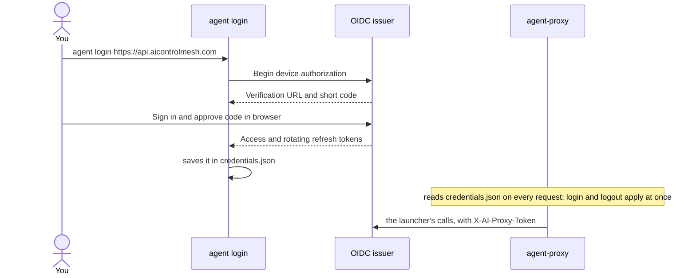

# Running coding agents

You start every coding agent with the `agent` command on the computer where you work. It asks the server for a session and runs the agent pointed at this computer's `agent-proxy`. The `agent-proxy` carries everything the agent sends to the server, which records it and passes it on.

This page covers the `agent` command, the `agent-proxy`, the agents the server knows, what their requests are, sharing an agent's terminal, and adding a new agent. To put a computer in the server's fleet (its model servers, containers, launches from the console) you use a different program, `agent-machine`: see [Machines](machines.md).

## Contents

- [The three routes](#the-three-routes)
- [The agent command](#the-agent-command)
- [Signing in: agent login and agent logout](#signing-in-agent-login-and-agent-logout)
- [The agent-proxy](#the-agent-proxy)
- [Other subcommands](#other-subcommands)
- [Environment variables](#environment-variables)
- [Supported agents](#supported-agents)
- [What the requests are](#what-the-requests-are)
- [Sharing a terminal with --control](#sharing-a-terminal-with---control)
- [Adding a new agent](#adding-a-new-agent)

## The three routes

Each agent takes one of three routes to a model. The console colours requests, sessions and agents by route.

| | Your accounts | Local models | Hosted API |
|---|---|---|---|
| **Agents** | `claude-account`, `copilot-account`, `codex-account` | `qwen`, `opencode`, `copilot`, `claude`, `codex`, `aider`, `goose` | `claude-subscription` |
| **Set in its definition by** | `intercept: true` | `backend_type: ollama` (the default) | `backend_type: anthropic` |
| **Model** | The vendor's, on your plan | Ollama, Strata or Docker Model Runner on your machines | Anthropic's, through an `anthropic` backend |
| **How the agent reaches the proxy** | `HTTPS_PROXY` pointing at the `agent-proxy` (`127.0.0.1:8183`) | Its API base URL points at the `agent-proxy` (`127.0.0.1:8184`) | `ANTHROPIC_BASE_URL` points at the `agent-proxy` |
| **What the server does** | Decrypts, records and forwards unchanged | Ollama: translates to its native API and applies the model tuning. Strata and Docker Model Runner: forwards unchanged | Forwards unchanged |
| **What you see** | Requests to public hosts: model calls plus sign-in, settings, MCP, telemetry | Model calls, with the exact payload sent to Ollama | Model calls and other Anthropic API calls Claude Code makes |
| **Credentials** | The agent's own login | None needed | The agent's own login |

### Your accounts (HTTPS capture)

Account agents keep talking to their own service with their own sign-in. Sign in once with the agent's own client (`claude`, `copilot` then `/login`, or `codex login`), then start it with `agent`:

```bash
agent claude-account .
agent copilot-account .
agent codex-account .
agent claude-account . --trace -- --model sonnet   # save bodies; pass a model to the agent
```

So that the account login is the one used, unset `ANTHROPIC_API_KEY`, `ANTHROPIC_AUTH_TOKEN`, `ANTHROPIC_BASE_URL`, `COPILOT_PROVIDER_*`, `COPILOT_OFFLINE`, `OPENAI_API_KEY` and `OPENAI_BASE_URL`, and remove any Claude `apiKeyHelper`. Your plan's usage limits still apply. `--model` is optional for these agents: pass the agent's own model option after `--` instead.

How the capture works:

- The launcher asks the server for its CA, through the `agent-proxy`, and keeps a copy in `~/.cache/agent-proxy/<fingerprint>/` (`ca.pem`, and `bundle.pem`: your system roots plus that CA). A server with a new CA gets a new folder.
- The agent starts with `HTTPS_PROXY` (and `HTTP_PROXY`, `https_proxy`, `http_proxy`) set to `http://<session id>:agent-proxy@127.0.0.1:8183`. The session id in the user name files each permitted request under the right session. `NO_PROXY` keeps `localhost`, `127.0.0.1` and `::1` direct.
- Only the launched process tree trusts the CA. It gets `NODE_EXTRA_CA_CERTS` (the CA, for Node agents), `NODE_USE_ENV_PROXY=1` (Node 24 and later only apply the proxy variables to `fetch()` with it), and `SSL_CERT_FILE`, `REQUESTS_CA_BUNDLE`, `CURL_CA_BUNDLE` and `GIT_SSL_CAINFO` pointing at the bundle. Codex gets `CODEX_CA_CERTIFICATE` set to the bundle. So the tools the agent runs (curl, git, pip, MCP servers) keep working and public-host requests are captured too. Nothing is added to the system trust store.
- The `agent-proxy` carries each connection to the server over its own WebSocket (`/api/proxy/tunnel`, on the server's own port). The server terminates TLS with a certificate from its CA, forwards the request unchanged over a normally verified TLS connection, and streams the reply back. Model calls are parsed as they stream: tokens, prompt-cache reads and writes, time to first token, reasoning, text and tool calls.
- WebSockets are relayed byte for byte and logged as a connection. Their messages are also decoded on the side: Codex sends its model turns over a WebSocket, and each `response.create` becomes its own model call record. The server drops `Sec-WebSocket-Extensions` from the upgrade so messages aren't compressed.
- Hosts listed under `intercept.passthrough` in the server's settings are tunnelled without decryption and logged as connections only (see [Configuration](configuration.md)).
- The server only connects to public IP addresses. It refuses loopback, private, link-local and reserved addresses, including when a hostname resolves to one and when the host uses `intercept.passthrough`.
- HTTPS without an open session gets `407`. If the server refuses the tunnel (the machine isn't signed in), the `agent-proxy` answers the agent with `407` too, with the reason in an `X-Agent-Proxy-Error` header.

Privacy and security:

- **Redaction.** Before anything is shown or saved, the server removes `Authorization`, cookies and any header whose name contains `auth`, `cookie`, `token`, `secret`, `api-key`, `apikey` or `session`; token-like query parameters; and token fields (`access_token`, `refresh_token`, `id_token`, `code`, `client_secret`, `password`, ...) in bodies of OAuth, token and sign-in endpoints.
- **Bodies are not redacted.** Saved and live bodies still contain your code and prompts. Bodies are saved only for sessions with capture on (`--trace`, or the switch on **Sessions**). Live text is held in memory only.
- **The CA key.** `certs/ca-key.pem` on the server is created readable only by its user. Delete `certs/` to rotate the CA.
- **No credential handling.** The proxy never reads the agents' credentials from disk or asks you to copy tokens. The agents keep managing their own sign-in and refresh.
- **VS Code extensions** (Copilot, ChatGPT/Codex) run their own processes and aren't captured. Only agents started with `agent` go through the proxy.

### Local models

Local-model agents get API base URLs on the `agent-proxy` that contain the session id. The server sends each request to the session's backend. For an Ollama backend it translates OpenAI Chat and Anthropic Messages requests to Ollama's native `/api/chat` and applies the server's Ollama model tuning. Strata and Docker Model Runner speak the agents' APIs themselves and get requests unchanged. See [Providers](providers.md).

```bash
agent qwen . --model qwen3.6:35b                          # the server's default backend for the agent
agent opencode . --model qwen3.8:latest --backend desktop
agent claude . --model qwen3.6:27b-coding -- --continue   # Claude Code, translated to Ollama
```

An agent declared for Ollama can also use a Strata or Docker Model Runner backend when that backend speaks the agent's protocol. Strata has no native Ollama API, so `aider` and `goose` can't use it. The server decides which backends an agent can use and which one a launch picks, unless you name one with `--backend`.

### Hosted API pass-through

`claude-subscription` sets only `ANTHROPIC_BASE_URL`, pointing at the proxy's Anthropic endpoint. The server forwards everything unchanged to a `type: anthropic` backend. Claude Code keeps its own login.

```bash
agent claude-subscription . --model sonnet
```

The launcher picks the `anthropic` backend by itself. The proxy sees Claude Code's API calls (`/v1/messages`, `count_tokens`, `/v1/models` and any other `/anthropic/...` path), but not its OAuth, telemetry or MCP traffic, which goes directly to Anthropic. Use `claude-account` when you want those too.

## The agent command

```text
agent <agent> [project] [options] [-- agent arguments]
agent --list
agent --shell [folder]
agent login [url]
agent logout [url]
agent proxy [--server url] [--port N] [--intercept-port N]
agent proxy stop
agent update [--force] [--server url]
agent version
```

`agent <agent> [project]` starts one agent in one session. `project` is the folder to run it in (default: the current folder); it must exist. Options can go anywhere. The first plain argument is the agent, the second the project, and further plain arguments go to the agent. Unknown options, and everything after `--`, go to the agent too.

What a launch does:

1. Starts this computer's `agent-proxy` in the background if `127.0.0.1:8184/health` doesn't answer (it runs itself as `agent proxy`). When the `agent-proxy`'s server is this computer and isn't running, it also starts `agent-server` from your `PATH`.
2. Checks this computer is signed in, if the server needs it, and gets the agent from the server (`GET /api/agents`). It stops if the agent's program isn't on your `PATH`, and prints its install command.
3. For an account agent, fetches the server's CA (see [Your accounts](#your-accounts-https-capture)).
4. Asks the server for a session (`POST /api/agents/<id>/sessions`), naming the model, backend, capture, project, sharing and MCP servers. The server picks the backend and sends back the agent's environment, command and settings files.
5. Writes those files to a new folder, `~/.cache/agent-proxy/sessions/<random>/`, and starts the backend's container first if it's one a machine runs.
6. Runs the agent and waits. When it exits, the launcher ends the session with its exit status and removes the files.

It prints the session id, agent, model, backend, the server's Live page, whether the terminal is shared, and the MCP servers the agent got.

Ctrl+C goes to the agent while the launcher waits to record its exit status. This also
applies to Python launches without terminal sharing on Linux and other POSIX systems.

### Options

| Option | What it does |
|---|---|
| `-m`, `--model NAME` | Model name, or an alias from the server's Ollama model tuning. Required for agents whose templates use `{model}`; optional for account agents. |
| `--backend NAME` | One of the server's backends. Default: the one the server picks for the agent. |
| `--trace` | Save full request and response bodies for the session. |
| `--mcp NAMES` | MCP servers that machines share, for the agent: `machine/name`, a machine for all of its servers, or `all`. Comma-separated or repeated. See [MCP servers](mcp.md). |
| `--list` | List the server's agents, whether each is installed here, and the `agent-proxy`'s server and sign-in. |
| `--control` | Share the agent's terminal with the server, to watch it and type into it from the console or a phone. `AI_PROXY_CONTROL=1` makes it the default. |
| `--switch` | If the backend is a container a machine runs, stop other containers using its GPU to start it. |
| `--share WHO` | On a server with accounts: `private` (default), `team` or `org`. Who else can see this session. |
| `--team NAME` | With `--share team`, which of your teams (`org/team`); with `--share org`, which of your organizations. Needed if you're in several. |
| `--let-others-type` | With `--control`: people the session is shared with can type into its terminal and end it, not only watch. Has no effect without `--control`. |
| `--shell` | Run your shell instead of an agent: see [agent --shell](#agent---shell). |
| `--headless` | Used by `agent-machine` for launches from the console: no local window, the terminal shared with the server. |
| `--launch-id ID` | Used by `agent-machine`: the launch record this session belongs to. |
| `-h`, `--help` | Show the usage. |

Old options: `--proxy` is refused with a pointer to `agent login`. `--no-remote` is accepted and ignored, as sharing is off unless you ask for it. `agent machine` says to use `agent-machine` instead.

`agent` with no agent prints the same list as `agent --list` and exits with status 2.

### agent --list

```bash
agent --list
```

Starts the `agent-proxy` if needed, then prints each of the server's agents with whether it's installed here, its name and its protocol (or "account, captured via HTTPS intercept"). For a missing agent it prints the install command for this environment. The last line names the server the `agent-proxy` carries traffic to and who it's signed in as.

### agent --shell

```bash
agent --shell [folder]
```

Runs your shell (`$SHELL` as a login shell, else `/bin/bash` or `/bin/sh`; on Windows `pwsh`, else `powershell`, else `%ComSpec%`) in a terminal shared with the server, in a session only you can see. Use it to reach this computer from the console or your phone. It sends no model traffic. It needs an interactive terminal. The session's client is `shell`, and the server keeps those sessions private: their sharing can't be widened. `agent-machine` uses the same thing, headless, for **Open a terminal** on a machine's page (see [Machines](machines.md)).

### Launches from the console

When someone starts an agent on a machine from the console, `agent-machine` runs `agent <id> <folder> --headless --launch-id <id>` there, with `AI_PROXY_MACHINE_ID` and `AI_PROXY_MACHINE_NAME` set. In headless mode the launcher prints `{"session_id": "..."}` as its only line of output, then runs the agent in a pseudo-terminal with no local window, shared with the server. `--headless` turns on `--control`. You don't normally run these options yourself.

## Signing in: agent login and agent logout



```bash
agent login https://api.aicontrolmesh.com # approve the device code, once per computer
agent logout                               # the server signed in to last
agent logout http://server:9999
```

`agent login [url]` signs this computer's `agent-proxy` in through OIDC device authorization. Open the printed verification URL, sign in and approve the displayed code. The CLI never collects your password. Access tokens refresh automatically; see [OIDC authentication](oidc.md).

Authentication is mandatory. The old `--user`, `--key` and password-input flow no longer grant access.

The sign-in is kept in `credentials.json`: `%APPDATA%\agent-proxy\` on Windows, `$XDG_CONFIG_HOME/agent-proxy/` (or `~/.config/agent-proxy/`) elsewhere, readable only by you. `AI_PROXY_CREDENTIALS` names another file. The last server signed in to is the default. The `agent-proxy` reads the file on every request, so signing in or out applies at once, with no restart.

`agent logout [url]` forgets a sign-in (default: the server signed in to last) and revokes its token on the server when it can reach it.

`agent-machine` has its own sign-in (`agent-machine login`), separate from this one. A computer that both runs agents and is in the fleet signs in with both.

## The agent-proxy

The `agent-proxy` is the one program agents talk to. It runs on each computer where you start agents, on loopback only:

| Port | What it serves |
|---|---|
| `127.0.0.1:8184` | The launcher's API calls, agents' model traffic (`/session/<id>/...`, `/v1/...`, `/anthropic/...`), shared MCP servers (`/session/<id>/mcp/...`), and the terminal relay for `--control`. `AI_PROXY_LOCAL_PORT` changes it. |
| `127.0.0.1:8183` | The HTTPS proxy for account agents. Each connection is carried to the server over its own WebSocket. `AI_PROXY_LOCAL_INTERCEPT_PORT` changes it. |

The launcher starts it in the background when it isn't running. You can also run it yourself:

```bash
agent proxy                          # in the foreground
agent proxy --server http://server:9999 --port 8184 --intercept-port 8183
agent proxy stop                     # stop the one running here; the next agent starts it again
```

`--server` fixes the server for this run. Without it, the server is `AI_PROXY_URL`, then the one from `agent login`, then `http://127.0.0.1:9999`. The `agent-proxy` binary (`cmd/agent-proxy`) takes the same options. Its log is `agent-proxy.log` beside `credentials.json`. If the ports are taken, it says whether by another `agent-proxy` or another program.

`GET /health` answers with its role, server, signed-in user, HTTPS proxy port, version and protocol. The launcher warns when the running `agent-proxy` or the server is another version than itself: `agent proxy stop` lets the next launch start the current one.

### What it forwards, and how it's kept safe

Any program on the computer can reach the `agent-proxy`, and what it forwards to the server is signed as you. So:

- **It binds `127.0.0.1` only**, and every route checks that the `Host` header names loopback and that any `Origin` is the same origin. A web page (another site's, or one using DNS rebinding) is refused with `403`.
- **Only the launcher's API is signed.** Calls under `/api/` are forwarded with this computer's token only if they're on its allowlist, `LauncherAPI`. Anything else gets `404`:

  | Method | Path |
  |---|---|
  | `GET` | `/api/auth/status` |
  | `GET` | `/api/config` |
  | `GET` | `/api/agents` |
  | `POST` | `/api/agents/<id>/sessions` |
  | `GET` | `/api/intercept`, `/api/intercept/ca.pem`, `/api/intercept/bundle.pem` |
  | `GET` | `/api/remote` |
  | `POST` | `/api/sessions` |
  | `PATCH` | `/api/sessions/<id>` |
  | `GET` | `/api/containers/<name>` |
  | `POST` | `/api/containers/<name>/start` |

- **Agent traffic is forwarded without the computer's token.** Model traffic under `/session/...`, `/v1/...` and `/anthropic/...` uses the open session id. MCP URLs also carry a separate per-session capability that is only delivered in the launch settings. Cookies, `Origin`, `Proxy-Authorization` and `Proxy-Connection` are never forwarded.
- **It never uses a proxy itself.** Every HTTP client and WebSocket dialer in the client ignores `HTTPS_PROXY`, which inside an account agent points back at the `agent-proxy` and would loop.
- `/api/terminals/<id>/host` relays a `--control` terminal to the server, signed as this computer. `POST /shutdown` stops it (for `agent proxy stop` and `agent update`), with the same loopback and origin checks.

## Other subcommands

| Command | What it does |
|---|---|
| `agent update [--force] [--server url]` | Replaces `agent` and `agent-proxy` with the build the server offers for this platform, checked against the server's SHA-256, then stops the running `agent-proxy` so the new one takes over: agents still running start it again within seconds, else the next agent does. It does nothing when the server's version is this one, unless you pass `--force`. `--server` names the server to update from (default: the one the `agent-proxy` uses). If the server has no build of its exact version, it takes the closest one and says so. |
| `agent version` (or `agent --version`) | Prints the version and the protocol level. |

See [Deployment](deployment.md) for how the server hands out builds.

## Environment variables

What the client reads:

| Variable | What it does |
|---|---|
| `AI_PROXY_URL` | The server the `agent-proxy` uses, over the one from `agent login`. |
| `AI_PROXY_TOKEN` | A pre-issued OAuth access token, overriding stored credentials. Obtain a replacement before it expires. |
| `AI_PROXY_CREDENTIALS` | Where `credentials.json` is. Use a Windows path when you set it from Git Bash. |
| `AI_PROXY_LOCAL_PORT` | The `agent-proxy`'s HTTP port (default 8184). |
| `AI_PROXY_LOCAL_INTERCEPT_PORT` | The `agent-proxy`'s HTTPS proxy port (default 8183). |
| `AI_PROXY_CONTROL` | `1` makes `--control` the default. |
| `AI_PROXY_MACHINE_ID`, `AI_PROXY_MACHINE_NAME` | Set by `agent-machine` for launches from the console: tag the session with its fleet machine. |

Every session is also tagged with the computer's hostname, so the server can list agents you start by hand under the fleet machine of the same owner with that hostname. The agent itself gets `AI_PROXY_SESSION`, its session id, along with the variables its definition sets.

## The Python client

`python/agent_py/client` is a drop-in for the Go client: the commands `agent` and `agent-proxy`, the same options and subcommands (`login`, `logout`, `proxy`, `proxy stop`, `update [--force]`, `version`, `--list`, `--shell`, `--headless`), the same files, ports and environment variables, and the same `agent-proxy` checks. `--control` runs the agent in a POSIX pty, or a ConPTY through pywinpty on Windows. Its `agent update` installs the server's Python wheel with pip. Install one client or the other on a computer, not both. See `python/README.md`.

## Supported agents

The server keeps every agent's definition in its database and renders it for each launch, so an agent an admin adds or changes on **Server settings** is available on every computer at once; only its program has to be installed there. The console's **Start an agent** page shows each agent's install state and install command, builds its launch command, and can open a session and print the environment to run the agent by hand in bash or PowerShell.

| Agent | Command | Route | Protocol | MCP |
|---|---|---|---|---|
| Qwen Code | `agent qwen` | Local models | OpenAI Chat | Yes |
| OpenCode | `agent opencode` | Local models | OpenAI Chat | Yes |
| GitHub Copilot CLI (Ollama, BYOK) | `agent copilot` | Local models | OpenAI Chat | Yes |
| Claude Code (Ollama) | `agent claude` | Local models | Anthropic Messages | Yes |
| Claude Code (Anthropic API pass-through) | `agent claude-subscription` | Hosted API | Anthropic Messages | Yes |
| Claude Code (claude.ai account) | `agent claude-account` | Your accounts | Anthropic Messages | Yes |
| GitHub Copilot CLI (GitHub account) | `agent copilot-account` | Your accounts | OpenAI Chat | Yes |
| OpenAI Codex CLI (ChatGPT account) | `agent codex-account` | Your accounts | OpenAI Responses | Yes |
| OpenAI Codex CLI (Ollama) | `agent codex` | Local models | OpenAI Responses | Yes |
| Aider | `agent aider` | Local models | Native Ollama | No |
| Goose | `agent goose` | Local models | Native Ollama | Yes |

"MCP" says whether the agent can take the MCP servers your machines share (`--mcp`): see [MCP servers](mcp.md).

### qwen: Qwen Code

Alibaba's terminal agent, tuned for the Qwen tool-calling format.

- **Install:** `npm install -g @qwen-code/qwen-code`
- **Sets:** `OPENAI_BASE_URL` (`{openai_url}`), `OPENAI_API_KEY=local-ollama`, `OPENAI_MODEL`, and `QWEN_CODE_SYSTEM_SETTINGS_PATH` pointing at a `qwen-settings.json` the launcher writes. Runs `qwen --auth-type openai --model <model>`.
- **Context size:** Qwen Code guesses the context size from the model's name and takes any `qwen3.x` for 1M. The settings file gives it the real one (`model.generationConfig.contextWindowSize`, from `{context_window}`).
- **MCP:** in the same settings file, under `mcpServers`, each as `{"httpUrl": "<url>"}`.

### opencode: OpenCode

Open-source terminal agent with first-class support for local providers.

- **Install:** Linux and macOS: `curl -fsSL https://opencode.ai/install | bash`. Windows: `npm install -g opencode-ai` (the script installs into WSL rather than Windows when WSL is there).
- **Sets:** `OPENCODE_CONFIG_CONTENT`, a JSON config with a provider `agent-proxy` (`@ai-sdk/openai-compatible`, base URL `{openai_url}`) and the model with tool calls on. Runs `opencode --model agent-proxy/<model>`.
- **MCP:** in the same config, under `mcp`, each as `{"type": "remote", "url": "<url>", "enabled": true}`.

### copilot: GitHub Copilot CLI (Ollama, BYOK)

GitHub's terminal agent in bring-your-own-model mode.

- **Install:** `npm install -g @github/copilot`
- **Sets:** `COPILOT_PROVIDER_TYPE=openai`, `COPILOT_PROVIDER_BASE_URL` (`{openai_url}`), `COPILOT_PROVIDER_API_KEY=local-ollama`, `COPILOT_MODEL`, `COPILOT_OFFLINE=true`.
- **Notes:** `COPILOT_OFFLINE` stops the CLI from contacting GitHub. Remove it to keep GitHub sign-in features.
- **MCP:** a `copilot-mcp.json` file (`mcpServers`, each `{"type": "http", "url": "<url>", "tools": ["*"]}`), passed with `--additional-mcp-config @<file>`.

### claude: Claude Code (Ollama)

Anthropic's agent, translated from the Messages API to Ollama by the server.

- **Install:** Linux and macOS: `curl -fsSL https://claude.ai/install.sh | bash`. Windows: `irm https://claude.ai/install.ps1 | iex`.
- **Sets:** `ANTHROPIC_BASE_URL` (`{anthropic_url}`), `ANTHROPIC_AUTH_TOKEN=local-ollama`, an empty `ANTHROPIC_API_KEY`, the model for `ANTHROPIC_MODEL`, `ANTHROPIC_DEFAULT_HAIKU_MODEL`, `ANTHROPIC_DEFAULT_SONNET_MODEL`, `ANTHROPIC_DEFAULT_OPUS_MODEL` and `CLAUDE_CODE_SUBAGENT_MODEL`, and `CLAUDE_CODE_DISABLE_NONESSENTIAL_TRAFFIC=1`. Runs `claude --model <model>`.
- **MCP:** a `claude-mcp.json` file (`mcpServers`, each `{"type": "http", "url": "<url>"}`), passed with `--mcp-config <file>`.

### claude-subscription: Claude Code (Anthropic API pass-through)

Claude Code on its saved claude.ai login, through an `anthropic` backend.

- **Install:** as for `claude`.
- **Sets:** only `ANTHROPIC_BASE_URL` (`{anthropic_url}`). Runs `claude --model <model>`. Uses a backend of type `anthropic`.
- **Notes:** sign in with `claude` first. Unset `ANTHROPIC_API_KEY` and `ANTHROPIC_AUTH_TOKEN`, and remove any `apiKeyHelper`, to keep subscription authentication.
- **MCP:** as for `claude`.

### claude-account: Claude Code (claude.ai account)

Claude Code signed in to your Claude account. All of its HTTPS traffic is recorded: messages, token counts, OAuth refresh, telemetry, MCP and web fetches.

- **Install:** as for `claude`.
- **Sets:** the HTTPS capture variables (see [Your accounts](#your-accounts-https-capture)). No model: pass one with `-- --model sonnet`.
- **Notes:** sign in with `claude` first. Unset `ANTHROPIC_API_KEY`, `ANTHROPIC_AUTH_TOKEN` and `ANTHROPIC_BASE_URL`, and remove any `apiKeyHelper`, so the account login is used.
- **MCP:** as for `claude`.

### copilot-account: GitHub Copilot CLI (GitHub account)

Copilot CLI signed in to your GitHub Copilot subscription. All of its HTTPS traffic to GitHub and Copilot is recorded.

- **Install:** `npm install -g @github/copilot`
- **Sets:** the HTTPS capture variables. Pass a model with `-- --model <name>`.
- **Notes:** sign in with `copilot` (`/login`) first. Unset `COPILOT_PROVIDER_*` and `COPILOT_OFFLINE` so the GitHub subscription is used.
- **MCP:** as for `copilot`.

### codex-account: OpenAI Codex CLI (ChatGPT account)

Codex signed in with your ChatGPT plan. All of its HTTPS and WebSocket traffic to OpenAI and ChatGPT is recorded.

- **Install:** `npm install -g @openai/codex`
- **Sets:** the HTTPS capture variables, plus `CODEX_CA_CERTIFICATE` set to the bundle (Codex replaces its trusted roots with this file, so it gets the full bundle, not only the CA). Runs `codex --no-daemon`. Pass a model with `-- -m <model>`.
- **Notes:** sign in with `codex login` (ChatGPT) first, and unset `OPENAI_API_KEY` and `OPENAI_BASE_URL` so the ChatGPT login is used.
  - `--no-daemon` matters: without it the interactive TUI hands conversations to Codex's shared background app-server daemon, which runs without the proxy settings, so only startup calls would be captured.
  - Each Codex conversation opens with a *prewarm* turn (`generate: false`), which shows up as a model call with no output.
  - Codex may print `[UNDICI-EHPA] Warning: EnvHttpProxyAgent is experimental` when it picks up the proxy settings. It's harmless.
- **MCP:** one `-c mcp_servers.<name>.url="<url>"` per server.

### codex: OpenAI Codex CLI (Ollama)

OpenAI's agent in `--oss` mode. It uses the Responses API, passed through to Ollama.

- **Install:** `npm install -g @openai/codex`
- **Sets:** `CODEX_OSS_BASE_URL` (`{openai_url}`). Runs `codex --oss -m <model>`.
- **Notes:** the Responses API is passed through to Ollama unchanged, so set `OLLAMA_CONTEXT_LENGTH` on the Ollama server for a larger context (Ollama's settings are on its machine's page, see [Machines](machines.md)).
- **MCP:** as for `codex-account`.

### aider: Aider

Pair-programming agent that talks to Ollama's native chat API.

- **Install:** `python -m pip install aider-install && aider-install`
- **Sets:** `OLLAMA_API_BASE` (`{ollama_url}`). Runs `aider --model ollama_chat/<model>`.
- **Notes:** speaks native Ollama, so it can use Ollama and Docker Model Runner backends, not Strata.
- **MCP:** none. Aider has no MCP support.

### goose: Goose

Block's extensible open-source agent.

- **Install:** `curl -fsSL https://github.com/block/goose/releases/download/stable/download_cli.sh | bash`. On Windows, run it in Git Bash (it needs bash, curl and unzip).
- **Sets:** `GOOSE_PROVIDER=ollama`, `OLLAMA_HOST` (`{ollama_url}`), `GOOSE_MODEL`. Runs `goose session`.
- **Notes:** speaks native Ollama, so it can use Ollama and Docker Model Runner backends, not Strata.
- **MCP:** one `--with-streamable-http-extension <url>` per server, after `session`.

## What the requests are

Every request is recorded with timing, sizes and status, and labelled with the service it went to and what it was for. For account agents, model calls are usually a small part of the traffic: most of it is what the agent does around them.

### Request types

The console sorts every request into one of these types (`ui/src/traffic.ts`):

| Type | What it is | Examples |
|---|---|---|
| **Model call** | A prompt sent to a model, with its streamed reply. Recorded with input and output tokens, prompt-cache reads and writes, time to first token and generation speed. | `POST api.anthropic.com/v1/messages`, `POST api.individual.githubcopilot.com/v1/messages` or `/chat/completions`, `chatgpt.com/backend-api/codex/responses`, `/v1/chat/completions` or `/api/chat` through the proxy |
| **Token count** | How many tokens a prompt would use, without running it. | `POST /v1/messages/count_tokens` |
| **Model list** | Which models the account or backend offers. | `GET api.individual.githubcopilot.com/models`, `GET chatgpt.com/backend-api/codex/models`, `/v1/models`, `/api/tags` |
| **MCP** | MCP servers and tool registries: tool lists and tool calls. Includes calls to MCP servers your machines share. | `mcp-proxy.anthropic.com`, `api.anthropic.com/mcp-registry/...` or `/v1/mcp_servers`, `api.individual.githubcopilot.com/mcp/...`, `chatgpt.com/backend-api/ps/plugins/...` |
| **Account** | Who you are, your plan and organization settings. Some are polled repeatedly. | `api.anthropic.com/api/oauth/...`, `api.github.com/copilot_internal/user`, `chatgpt.com/backend-api/wham/...` |
| **Sign-in** | Token exchange and refresh. Token values are redacted. | `api.anthropic.com/api/oauth/token`, `api.github.com/copilot_internal/v2/token`, `auth.openai.com`, `claude.ai` |
| **Settings & flags** | Feature flags, managed policy and bootstrap configuration. | `api.anthropic.com/api/claude_cli/...`, `/api/claude_code/...`, `/api/eval/...`, `statsig.anthropic.com` |
| **Telemetry** | Usage events, metrics and logs the agent reports. | `api.anthropic.com/api/event_logging/...`, Datadog, Sentry, `telemetry.individual.githubcopilot.com`, `ab.chatgpt.com` |
| **Updates** | Checks for a newer version of the agent. | `api.github.com/repos/github/copilot-cli/releases`, `registry.npmjs.org`, `downloads.claude.ai` |
| **Connection** | A WebSocket upgrade (logged as one connection, with its messages decoded separately) or a tunnel to a `passthrough` host that isn't decrypted. | `GET chatgpt.com/backend-api/codex/responses` (upgrade) |
| **Other** | Anything not matched above. | |

Back-to-back identical requests (same session, method, host and path) are folded into one row in the traffic list, except model calls.

### What each account agent sends

From real captures, grouped by purpose. Exact paths change between agent versions.

| | Claude Code | Copilot CLI | Codex CLI |
|---|---|---|---|
| **Model calls** | `api.anthropic.com/v1/messages` (SSE stream) | `api.individual.githubcopilot.com/v1/messages` or `/chat/completions` | `chatgpt.com/backend-api/codex/responses` (WebSocket; one record per turn) |
| **Before the first prompt** | OAuth validation, CLI bootstrap, policy limits, MCP server list, organization settings | Copilot user and plan, model list, MCP | Model list, account check, plugin lists |
| **Around each prompt** | Token counts, MCP tool calls | MCP | Prewarm turn (`generate: false`) |
| **In the background** | Event logging batches, metrics, Datadog logs; organization settings polled repeatedly | Telemetry batches, release check | Telemetry and analytics events, npm and GitHub release checks |

### What's recorded for each request

| Field | Meaning |
|---|---|
| Status, method, host, path | The HTTP exchange. WebSocket turns show `WS` and status 101. |
| Request and response size | Bytes sent and received. |
| Total time, first token | Wall-clock duration, and time until the first streamed token. |
| Input and output tokens | As reported by the service (or Ollama). Marked `≈` when estimated because a stream ended early. |
| Prompt cache | Cached input tokens read and written (Anthropic `cache_read_input_tokens`, OpenAI `cached_tokens`). |
| Headers | Request and response headers, credentials redacted. |
| Request, response, conversation | Full bodies and a readable conversation (system prompt, messages, reasoning, reply, tool calls), when capture is on. |
| Sent to Ollama | For local models, the exact payload after translation and model settings. |

See [Console](console.md) for the pages that show them.

## Sharing a terminal with --control

```bash
agent claude-account . --control
agent qwen . --model qwen3.6:35b --control --share team --team pockets/core --let-others-type
```

With `--control`, the launcher runs the agent in a pseudo-terminal (ConPTY on Windows, a POSIX pty elsewhere) and shares it with the server through the `agent-proxy`, a bit like a one-window tmux. The agent draws in your terminal as usual. The console's **Running agents** page shows the same screen, scrollback included, and can type into it, from a computer or a phone. The launcher prints the address of the agent's terminal in the console.

- **It's off unless you ask.** Without `--control`, the agent runs directly and only its traffic is recorded. `AI_PROXY_CONTROL=1` makes `--control` a computer's default.
- **It needs an interactive terminal.** On Windows that's Windows Terminal, PowerShell or cmd, not Git Bash's mintty. Otherwise the launcher prints why sharing is off and runs the agent directly.
- **Your window stays the main one.** Its size sets the terminal's size, and closing it ends the agent.
- **History is saved** in the server's database (up to 64 MB per terminal), so finished sessions stay readable. If the launcher loses the server, it keeps trying and resends what the server missed when it reconnects; if this computer's `agent-proxy` has stopped (`agent update` stops it), the launcher starts it again.
- **Agents on other computers** can be shared once signed in with `agent login <server>`. `AI_PROXY_TOKEN` accepts a pre-issued OAuth access token, not a legacy key.

Typing into an agent's terminal is as good as a shell on that computer. Viewers need an active OIDC sign-in and session permission. See [Console](console.md) and [Accounts](accounts.md).

### Who can see a session

Every session belongs to whoever started it and is private until they share it. The launcher's sharing flags set it when the session starts:

| `--share` | Who sees it |
|---|---|
| `private` (default) | Only you. Admins can't either. |
| `team` | The members of one of your teams. Name it with `--team org/team` if you're in several. |
| `org` | Everyone in one of your organizations. Name it with `--team org` if you're in several. |

Shared sessions are watch-only unless you add `--let-others-type`: then the people it's shared with can also type into its terminal and end it. You can change the sharing later on the session's row or its terminal page. See [Accounts](accounts.md).

## Adding a new agent

An agent is a definition stored in the server's database. The server reads the definitions on every launch and renders the one asked for, so a new or changed agent needs no code change, no restart and no client update: only its program installed where it runs.

An admin adds one in any of these ways:

- **On the console:** **Server settings** → **Agents** → **Add an agent**. Give it an id (what launchers call it: `agent my-agent`) and its definition as YAML. **Edit** changes an existing one, **Remove** takes it away.
- **With the API:** `PUT /api/config/agents/<id>` with the definition as YAML or JSON. `DELETE` removes it. See [API](api.md).
- **In a settings document:** under `agents:` in a file for `agent-server config import` (see [Configuration](configuration.md)).

The agents that ship with the server are in `server/agent_server/defaults.py`. They're added to the database on the first start and follow the server's upgrades until someone changes them; the console marks each one **Shipped**, **Shipped, changed** or **Added here**. **Reset to the shipped one** (or `POST /api/config/agents/<id>/reset`) undoes a change. A shipped agent that was removed stays removed through upgrades until it's added again or reset. To ship a new agent with the server itself, add it to `defaults.py` (see [Development](development.md)).

### The entry

On the console and with the API, the definition is the part under the id (from `name:` on). In a settings document it sits under `agents:` and its id, like this:

```yaml
agents:
  my-agent:
    name: My Agent                      # shown in the console and agent --list
    executable: my-agent                # the program, found on PATH (default: the id)
    protocol: openai-chat               # openai-chat | openai-responses | anthropic | ollama
    description: One line on what it is.
    install: npm install -g my-agent    # or one per environment, below
    homepage: https://example.com
    recommended_for: [qwen]             # model families it suits, for the console
    backend_type: ollama                # ollama (default) | anthropic
    # intercept: true                   # instead: own sign-in, captured in transit
    env:
      MY_AGENT_BASE_URL: "{openai_url}"
      MY_AGENT_MODEL: "{model}"
      MY_AGENT_CONFIG: "{files_dir}/my-agent.json"
    files:
      my-agent.json:
        contextWindow: "{context_window}"
        mcpServers: "{mcp_servers}"
    mcp:
      entry: {type: http, url: "{mcp_url}"}
    args: [--model, "{model}"]
    notes: Shown with the agent in the console.
```

| Key | What it does |
|---|---|
| `name` | The display name. Default: the id. |
| `executable` | The program the launcher runs, looked up on `PATH`. Default: the id. |
| `protocol` | The API it speaks: `openai-chat`, `openai-responses`, `anthropic` or `ollama`. Default: `openai-chat`. The server uses it to decide which backends can serve it. |
| `backend_type` | `ollama` (default) for local models: Ollama, and Strata or Docker Model Runner when they speak the protocol. `anthropic` for hosted pass-through. Ignored with `intercept`. |
| `intercept` | `true` for an agent that keeps its own login and is captured in transit. The launcher sets the HTTPS capture variables, the session's backend is `direct`, and `--model` becomes optional. |
| `env` | Environment variables, as templates. A value written as a YAML mapping or list is rendered and passed as compact JSON (OpenCode's `OPENCODE_CONFIG_CONTENT` is one). |
| `args` | Command-line arguments, as templates. Arguments you pass after `--` come after these. |
| `files` | Settings files the launcher writes for the session into `{files_dir}`, and removes when the agent exits. Name to contents: a string is written as it is, a mapping as JSON. Names are plain file names (letters, numbers, `.`, `_`, `-`, up to 64 characters). |
| `install` | The install command: one string for everywhere, or a mapping with `linux`, `macos`, `windows`, `wsl` and `default`. `wsl` falls back to `linux`; `default` (or else the Linux one) covers the rest. The console shows the one for the environment you pick, and `agent` prints the one for its own. |
| `homepage`, `description`, `notes`, `recommended_for` | Shown in the console. |
| `mcp` | How the agent takes shared MCP servers (below). Without it, it can't have any. |

The server adds `AI_PROXY_SESSION` (the session id) to every agent's environment.

### Placeholders

Strings in `env`, `args`, `files` and `mcp` are templates.

| Placeholder | Value |
|---|---|
| `{openai_url}` | `http://127.0.0.1:8184/session/<id>/v1`: OpenAI Chat and Responses |
| `{anthropic_url}` | `http://127.0.0.1:8184/session/<id>/anthropic`: Anthropic Messages |
| `{ollama_url}` | `http://127.0.0.1:8184/session/<id>`: native Ollama (`/api/...`) |
| `{model}` | The `--model` value. An agent whose `env` or `args` use it needs `--model`. |
| `{session_id}` | The session id. |
| `{proxy_url}` | The `agent-proxy`'s address, `http://127.0.0.1:8184`. |
| `{project}` | The project folder's full path (`.` when the console opens the session). |
| `{context_window}` | The model's context size on the session's backend: Ollama's `num_ctx` from the model tuning, or what Strata or Docker Model Runner reports. Unknown for account agents. |
| `{files_dir}` | The folder the launcher writes this session's files to. |
| `{intercept_url}` | Only with `intercept`: the `HTTPS_PROXY` value, with the session id in it. |
| `{ca_cert}` | Only with `intercept`: the launcher's copy of the server's CA. |
| `{ca_bundle}` | Only with `intercept`: the system roots plus the server's CA. |
| `{mcp_servers}` | Every chosen MCP server's name mapped to its `entry`. |
| `{mcp_name}`, `{mcp_url}` | In `mcp.entry` and `mcp.args_each`: one server's name and URL. |
| `{mcp_args}` | In `args`: where the MCP arguments go. |

Rules for rendering:

- A string that is exactly one placeholder keeps the value's type: `"{context_window}"` renders as a number, `"{mcp_servers}"` as a mapping.
- A template whose placeholder has no value for the session is left out: the env variable, file, mapping key or list item goes, so the agent keeps its own default. That happens for `{context_window}` when the size isn't known, for `{files_dir}` when the console rather than a launcher opens the session, and for `{mcp_servers}` when the launch has no MCP servers.
- The console's **Start an agent** page opens sessions without a launcher, so it gets no files. Templates that point at `{files_dir}` drop out.

### The mcp block

The `mcp` block says how the agent takes the MCP servers its launch chose (`--mcp`, or a picker in the console). See [MCP servers](mcp.md) for the feature itself.

| Key | What it does |
|---|---|
| `entry` | One server as the agent's config wants it, using `{mcp_name}` and `{mcp_url}`. Default: `{url: "{mcp_url}"}`. `{mcp_url}` is a Streamable HTTP URL with a per-session capability token. Treat it as a secret; the session id alone does not grant MCP access. |
| `env`, `files`, `args` | Added only when the launch has MCP servers. Use `{mcp_servers}` in them for every server's entry. |
| `args_each` | Rendered once for each server, with `{mcp_name}` and `{mcp_url}`. |

`{mcp_servers}` can also appear in the agent's own `env`, `files` or `args`: Qwen Code and OpenCode put it inside the settings they already have, so the key holding it is left out without servers.

The MCP arguments (`args` then `args_each`) go where the agent's `args` contain `"{mcp_args}"`, or else before the agent's own arguments. Goose uses `{mcp_args}` because its extensions are options of `goose session`. Before is the default because Claude Code's `--mcp-config` takes every value up to the next option.

`{mcp_name}` is the server's own name, or `<machine>-<name>` when two machines share a server of the same name in one launch.

The block may only have the keys `entry`, `env`, `files`, `args` and `args_each`; the server refuses others when the definition is saved.

### Checklist

1. Add the definition on **Server settings** → **Agents** (`executable`, `protocol`, `env` and `args` templates, `install`, `homepage`, and `backend_type` or `intercept`; an `mcp` block if the agent takes MCP servers over Streamable HTTP).
2. Run `agent --list` to check it's found.
3. Launch it once with `--trace` and read the recorded traces on **Traffic**.
4. If it ships with the server, add it to `defaults.py` and to this page's [Supported agents](#supported-agents).

The server stores a definition's contents, not its YAML text, so comments in a definition you save aren't kept. The comments on the shipped agents are in `defaults.py`.
