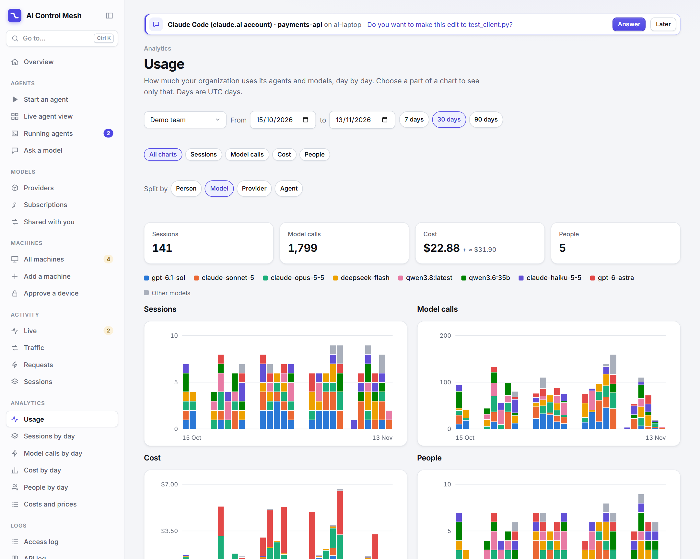
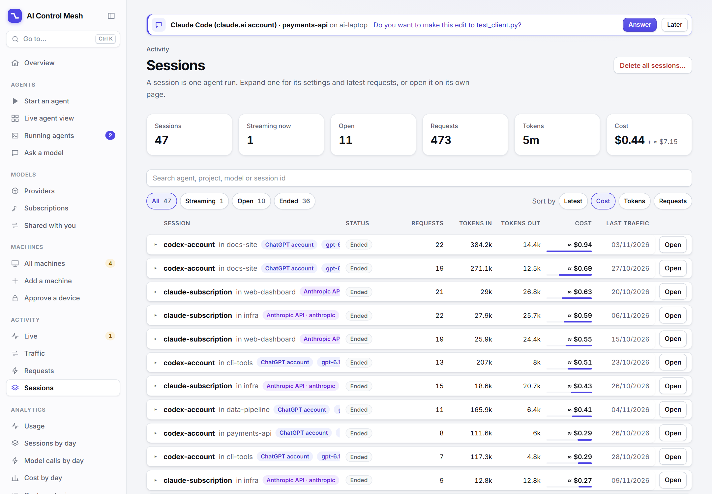
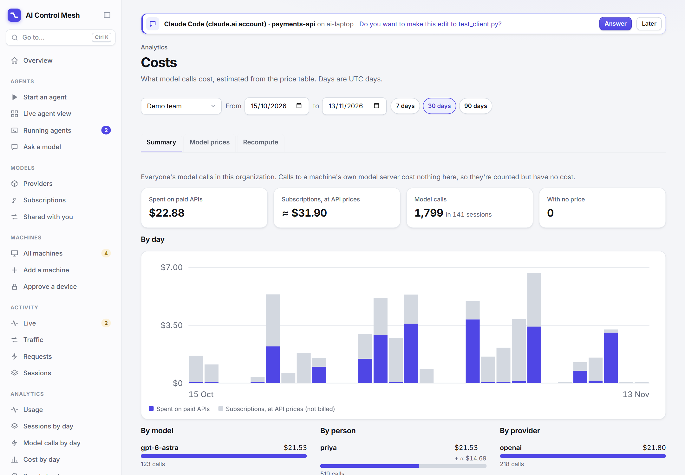

# Analytics and costs

The server records every model call an agent makes: who made it, with which agent, which model answered, through which provider, how many tokens went in and came out. **Analytics** adds those records up for an organization, day by day, so you can see how much it uses its agents and models, what that costs, and where the cost went.

This page covers the console's **Analytics** section, the token and cost columns of the **Sessions** list, how costs are estimated, and how to keep the prices right. [The console](console.md#analytics) has the page-by-page reference.

## What you can answer with it

| Question | Where |
| --- | --- |
| How much did we use this month, and is it going up? | **Usage**: four charts, one bar a day |
| Who uses the most, and what do they use? | **Usage**, split by **Person**; choose a person to see their models |
| Which model costs the most? | **Cost by day**, split by **Model** |
| What did one provider cost us? | **Costs and prices** › **Summary** › **By provider** |
| Which sessions did the money go to? | **Sessions**, sorted by **Cost**; or **Sessions that cost the most** under any chart |
| A model shows no cost. Why? | **Costs and prices** › **Model prices** lists models used with no price |
| We changed a price. How do old calls get it? | **Costs and prices** › **Recompute** |

## Who sees what

- **An organization's admins** see everyone's usage in their organization.
- **Members** see their own sessions only. They have no **Person** split and no **People** chart.
- **Site admins** choose the organization to look at.
- Another organization's figures are never shown: asking for them answers `404`.

## What is counted

- **Model calls** are requests that used tokens. A request that failed before the model answered, or a page an agent fetched, isn't one.
- **Sessions** are sessions that made at least one model call in the day.
- **People** are the people whose sessions made model calls: who started the session from the console, else its owner.
- **Tokens** are what the provider reported: input and output.
- **Cost** is an estimate from the server's price table (see [How a cost is estimated](#how-a-cost-is-estimated)).
- **Days are UTC days**, as the records' timestamps are. A range is at most 366 days.

## The Usage pages

**Usage** (`/analytics`) shows four stacked bar charts for the days you choose: **Sessions**, **Model calls**, **Cost** and **People**. **Sessions by day**, **Model calls by day**, **Cost by day** and **People by day** show one of them larger. The buttons above the charts move between them and keep what you chose.

1. **Choose the days.** Pick the first and last day, or **7 days**, **30 days** or **90 days**.
2. **Choose the split.** **Split by** sets what the colours are: **Person**, **Model**, **Provider** or **Agent**. The eight busiest get a colour each; the rest are counted together as **Other**.
3. **Read a day.** Point at a bar for that day's figures, by colour.
4. **Drill down.** Choose a name in the legend, a part of a bar or a row of the table. Everything narrows to that, and the split moves to the next thing. Choose a person, and you see that person's models. Choose a model, and you see the providers it went through. What you narrowed to is listed after **Only**: choose one to take it away, or **Clear**.

Each step is in the page's address. **Back** undoes a step, and you can send someone a link to exactly what you're looking at.

Under the charts, a table lists every value of the split with its sessions, model calls, tokens, cost and people. **Sessions that cost the most** lists up to 50 sessions that match, each a link to the session, where you can read its requests and conversation.

A session or person counts once in each model, provider or agent they used. Split by model, a session that used two models is in both colours, so a day's bar can be taller than the day's own count. Pointing at the day shows both.

## The Sessions list

**Sessions** (`/sessions`, under Activity) shows each session's requests, tokens in, tokens out and estimated cost in columns that line up down the list, so you can scan for the expensive ones. A thin bar under each cost shows how it compares with the costliest session shown.

**Sort by** **Cost**, **Tokens** or **Requests** to bring the sessions that used the most to the top, then expand one or open it to see where its tokens went. The cards at the top give the totals.

- A cost with **≈** is a subscription's calls at API prices. It isn't billed.
- A dash means none of the session's model calls has a cost yet: the model has no price, or the calls were recorded before it had one. [Recompute](#recomputing) them.

## Costs and prices

**Costs and prices** (`/costs`) has three tabs.

- **Summary**: what the organization's model calls cost in the chosen days, by day, model, person and provider, and how many calls had no price.
- **Model prices**: the server's price table. Site admins edit it here; everyone else can read it. Models that were used with no price are listed above the table, each with a button that adds its row.
- **Recompute**: prices recorded calls again at today's prices. An organization's admins do it for their organization.

### How a cost is estimated

A cost is the call's tokens times the price of its model: US dollars for a million tokens, with separate prices for input, output, and cached input read and written. A model takes the first row of the price table whose pattern matches its name. [Cost estimates](providers.md#cost-estimates) has the detail.

There are two kinds of cost, and the console keeps them apart:

| Kind | What it is | How it's shown |
| --- | --- | --- |
| **Spent on paid APIs** | Calls the server makes to a hosted API with a key, billed by the token | A plain amount: `$1.24` |
| **Subscriptions, at API prices** | Calls an agent makes on a plan (Claude, ChatGPT, Copilot). The plan doesn't bill by the token, so this is what the same tokens would cost on the API | With **≈**: `≈ $5.68` |

Calls to a model server on one of your own machines cost nothing here. They are counted, with their tokens, and have no cost.

**These are estimates.** They use list prices, and some things a single price can't say: OpenAI and Anthropic charge more for very long prompts, and DeepSeek charges double in its peak hours (the shipped table has its off-peak prices). Your provider's invoice is the record of what you paid.

### Recomputing

A call's cost is worked out once, when it's recorded, at the prices of that moment. Changing a price applies to calls from then on. To bring calls already recorded up to date:

1. Open **Costs and prices** and choose the days.
2. If models are listed with no price on **Model prices**, add their rows and **Save prices** (site admins).
3. Open **Recompute** and choose **Recompute costs…**. It says how many calls it will read, and asks first.

Calls with no price get one if there is one now. Calls priced before get today's price. Sessions, Traffic, Requests and the Analytics pages then show the new costs. It can't be undone, except by changing the prices back and recomputing.

Recompute after upgrading a server from a version that had no price for your models: the calls recorded before the upgrade have no cost until you do.

### Keeping prices right

The server ships with list prices for Claude, OpenAI and DeepSeek models. Providers change their prices and release models, so check the table now and then.

- **On your server**: site admins edit the table on **Costs and prices** › **Model prices** (also on **Server settings**). **Back to the shipped prices** drops your table. A server with no table of its own uses the shipped one, and gets newer shipped prices when it's upgraded.
- **For one provider**: an API provider can carry its own prices, which come before the server's ([API providers](providers.md#api-providers-openai-and-anthropic-compatible)). Use this for a gateway that charges differently.
- **In the project**: the shipped table is a data file, `server/agent_server/default_prices.yaml`. [Development](development.md#updating-the-shipped-prices) says how to update it.

Leave a model out rather than guess its price. Its calls are then counted as having no price, which the Summary says, instead of being costed wrongly.

## The API

Everything the pages show comes from the server's API, so you can read it from a script or a dashboard of your own. Sign in as in [Using API credentials](api-credentials.md).

| Request | What it answers |
| --- | --- |
| `GET /api/orgs/{org}/analytics?since=&until=&by=` | Usage between two UTC days, split by `user`, `model`, `provider` or `agent`, narrowed by any of `user=`, `model=`, `provider=`, `agent=` |
| `GET /api/orgs/{org}/costs?since=&until=` | Costs between two UTC days, by day, model, person and provider |
| `POST /api/orgs/{org}/costs/recompute` | Prices the organization's recorded calls in `{since, until}` again |
| `GET /api/sessions/usage` | Tokens, model calls and cost of each session you can see |
| `GET /api/sessions/{session_id}/cost` | One session's cost, by model |
| `GET /api/prices` | The price table |

[API](api.md) has each one's fields and who may call it.

## Related

- [Usage limits](usage-limits.md): limit a person's tokens on a provider. Limits count tokens, not cost.
- [Retention](retention.md): request records that retention deletes are no longer counted.
