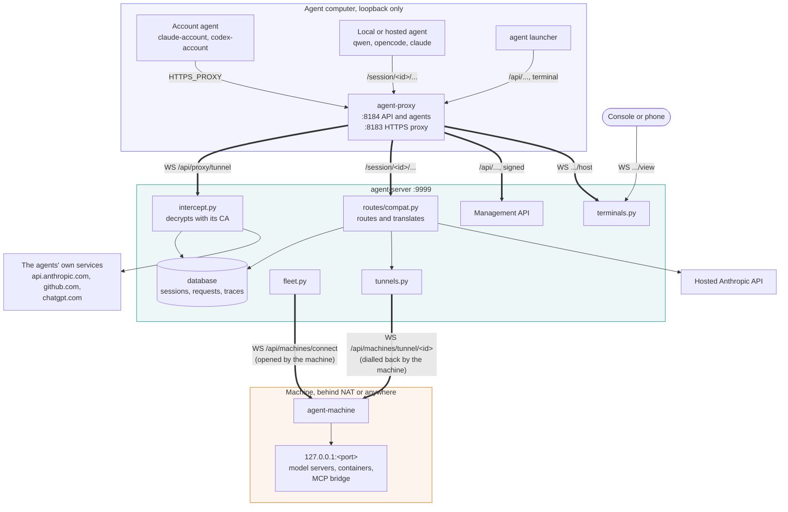
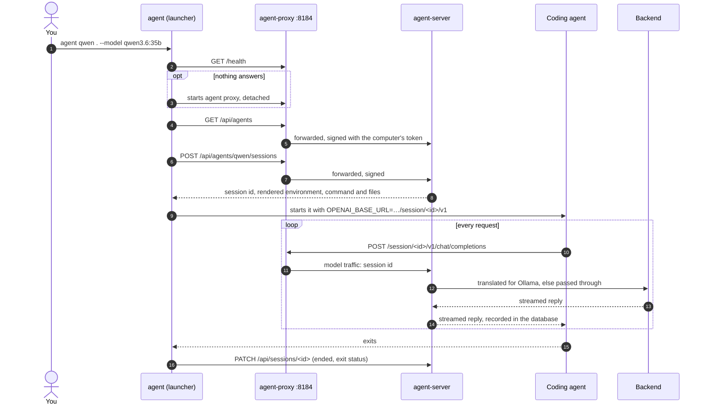
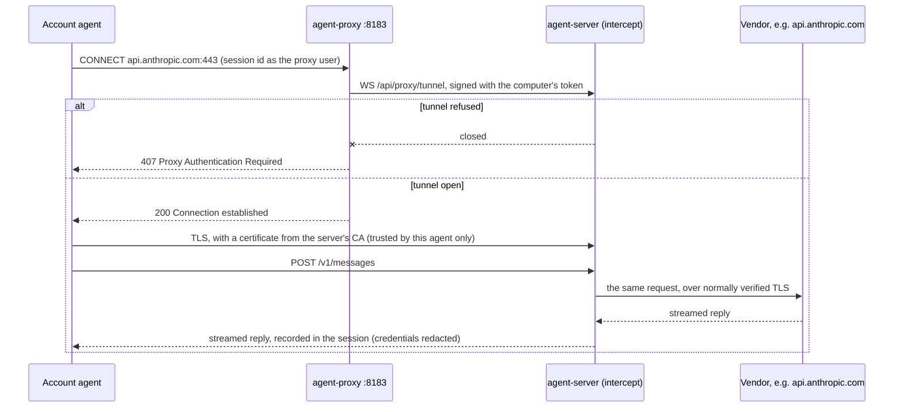
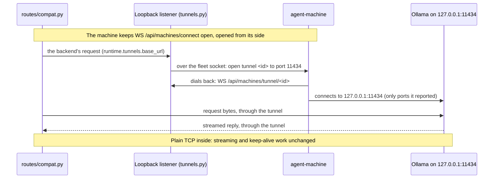
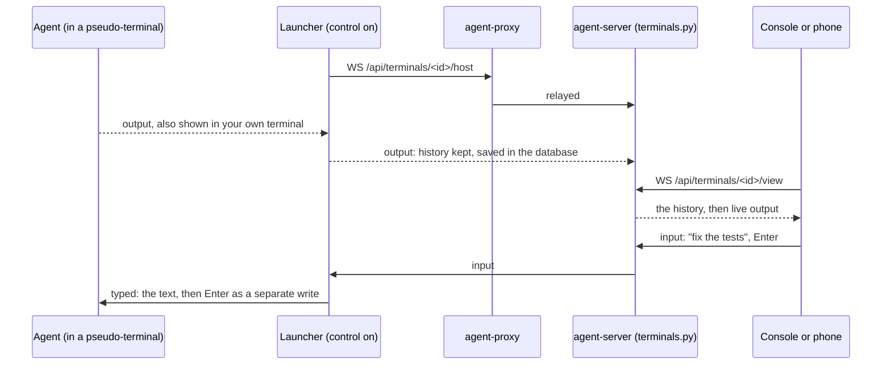

# Architecture

This page explains how the system works: its parts, how a request travels through them, what gets recorded, and how each part is kept safe. For a guided first run, see [Getting started](getting-started.md).

## The idea

Allowed agent traffic goes through one server. The server routes it and records it: tokens, timings, the full request and reply when you ask for them, and the text as it streams. Private and reserved destinations in account-agent traffic are refused. Agents don't need to change. The launcher starts them pointed at a proxy on their own computer, and that proxy carries traffic to the server.

There are three kinds of things around the server:

- **Agents** connect to it. They run on any computer with `agent` installed and signed in.
- **Machines** supply local models. A computer running `agent-machine` joins the server's **fleet**, and the model servers it runs (Ollama, Strata, Docker Model Runner, or containers it runs for the server) become providers that any agent can use.
- **Hosted APIs** (the Anthropic API) are the one kind of provider that isn't on a machine.

The server is the hub. It owns all configuration, accounts and recordings. Everything else talks to it over HTTP and WebSockets.

## Components

| Component | Folder | Language | What it does |
| --- | --- | --- | --- |
| Server, `agent-server` | `server/` | Python (FastAPI) | The API, accounts, routing to providers, recording, HTTPS interception, the fleet. Serves the console's build. |
| Console | `ui/` | React, TypeScript | The web console. It only calls the server's API. |
| Client, `agent` and `agent-proxy` | `client/` | Go | `agent` launches coding agents and signs the computer in (`agent login`). `agent-proxy` (`agent proxy`) runs on loopback and carries the agents' traffic to the server. |
| Machine, `agent-machine` | `machine/` | Go | Keeps a computer in the fleet. Reports its model servers, carries agents' traffic to them, manages them, runs containers, starts agents and terminals there. |
| Android app | `android/` | Kotlin | A list of servers, and each one's console in a WebView. Its features are the console's. |
| Python port, `agent_py` | `python/` | Python | `agent`, `agent-proxy` and `agent-machine` with the same protocol, files and ports, for computers without a Go build. Same functionality as the Go programs. |

### Why they're separate

The parts talk only over HTTP and WebSockets and never import each other's code. That keeps the boundaries honest:

- **The server owns the logic.** Agent definitions (stored in its database), backend choice and template rendering all live in Python. The client gets agents, backends and launch environments from the API. A new agent added on **Server settings** reaches every computer at once, with no client update.
- **The client knows the server only by URL.** It doesn't read the server's settings or join the fleet. It can run on a laptop that never opens a port.
- **Machines are separate from clients.** `agent-machine` has its own sign-in (`agent-machine login`, apart from `agent login`) and shares no code with `client/`. A computer that only supplies models needs nothing but `agent-machine`. When it starts an agent, it runs the `agent` program like a user would.
- **The server never manages a model server.** It only forwards agents' traffic to one. Listing models, pulling, loading, logs, the machine's load, Ollama's settings, starting and stopping: all of that is a request to the machine that runs the model server, which does it against `127.0.0.1` on its side. So the server needs no route to the model server and no knowledge of how it's installed.

## How it fits together

Agents talk only to their own computer's `agent-proxy`. Machines open connections out to the server and never need a port open. The server needs only its own port: account agents' HTTPS, terminals, the fleet and the tunnels all arrive as WebSockets on it. [Networking and protocols](networking.md) has every connection, message and routing rule in detail.

## Routes and backends

An agent takes one of three routes, set by its definition on the server:

| Route | Agents | How the agent reaches the server | What the server does |
| --- | --- | --- | --- |
| Account | `intercept: true` (`claude-account`, `copilot-account`, `codex-account`) | `HTTPS_PROXY` to `agent-proxy` on `127.0.0.1:8183`, tunnelled to `WS /api/proxy/tunnel` | Decrypts with its own CA, records, forwards unchanged to the vendor. The session's backend is `direct`. |
| Local models | `backend_type: ollama`, the default (`qwen`, `opencode`, `claude`, `copilot`, `codex`, `aider`, `goose`) | Base URLs on `agent-proxy` at `127.0.0.1:8184` | Sends the request to an `ollama`, `strata` or `docker` backend |
| Hosted | `backend_type: anthropic` (`claude-subscription`) | `ANTHROPIC_BASE_URL` on `agent-proxy` | Passes the request through to the hosted API |

Account agents keep their own login, so the vendor sees the same client it always does; the server watches in transit. Local-model and hosted agents are pointed at the server's API endpoints instead, so the server can change the request on its way.

### What happens per backend type

The backend types are in `config.BACKEND_TYPES`:

| Type | What happens to a request |
| --- | --- |
| `ollama` | Translated and tuned. OpenAI Chat and Anthropic Messages requests are rewritten to Ollama's native `/api/chat` (`translate/`), with the server's Ollama model tuning applied, and the reply is translated back, streaming included. Native `/api/*` calls pass through, for the paths agents use (`compat.NATIVE_AGENT_PATHS`: `chat`, `generate`, `embed`, `embeddings`, `tags`, `show`, `ps`, `version`). |
| `strata` | Passed through. Strata speaks OpenAI Chat, OpenAI Responses and Anthropic Messages itself. The server swaps in Strata's API key (`strata.py`). |
| `docker` | Passed through to Docker Model Runner, with its path prefixes: `/v1/messages*` goes to `/anthropic/v1/messages*`, other `/v1/*` to `/engines/v1/*`, and `/api/*` is unchanged (`model_runner.upstream_path`). |
| `anthropic` | Passed through unchanged to the hosted API. The agent's own `Authorization` is kept. |

Why translate for Ollama: its OpenAI-compatible `/v1` endpoint ignores per-request settings such as `num_ctx`, so agents' long conversations get cut to Ollama's default context without any error. Translating to the native API lets the server set the context size and sampling per model. Strata and Docker Model Runner honour the agents' APIs, so they get requests unchanged.

Which backends an agent can use is `config.serves()`. Agents with `backend_type: ollama` can also use `docker` backends, and `strata` backends unless they speak native Ollama (Strata has no native Ollama API; `config.NATIVE_PROTOCOLS` lists what each one speaks). `config.backend_for()` picks one when the launch doesn't name it: `default_backend` if it fits, else the first that does, preferring the agent's own type. The browser and the client never work this out themselves; they take it from `/api/agents`.

### Where local backends come from

A local backend (`ollama`, `strata`, `docker`) always belongs to a machine: `Backend.machine` names it. It's added in one of two ways: an admin adopts a model server the machine reported (**Add as a provider**), or the machine runs a container for the server. The server refuses new or moved local backends by URL (`Settings.update_network_config`). This keeps a single path from an agent to a model server, through the machine that runs it, and means the server learns what's there from the machine rather than by probing addresses. Backends from before this rule have no `machine`; they keep working. An admin explicitly adopts a matching provider to link the existing backend without changing its name or settings.

## A session, step by step

A session groups the traffic the server handles for one agent run, filed under its id.

1. **The proxy starts.** `agent` checks `127.0.0.1:8184/health`. If nothing answers, it starts `agent proxy` detached. If the proxy's server is on this computer and down, it starts `agent-server` from `PATH` too.
2. **The agent is looked up.** The launcher gets the agent from `GET /api/agents`. For account agents it also fetches the server's CA and bundle and caches them in `~/.cache/agent-proxy/<fingerprint>/`.
3. **The session opens.** The launcher calls `POST /api/agents/{id}/sessions` on the `agent-proxy` with the model, backend, trace setting, project, sharing, its own proxy URL and the CA paths. The `agent-proxy` forwards it signed with the computer's token. The server picks the backend, creates the session, and answers with the rendered environment and command (and the container to start first, when the backend is a container a machine runs). The console's **Start an agent** page uses the same endpoint.
4. **The agent starts** with model URLs on its own `agent-proxy` that contain the session id, rendered from the agent definition's templates. MCP URLs use a separate launch-only capability; the session id alone does not grant MCP access:

   | Placeholder | Value |
   | --- | --- |
   | `{openai_url}` | `http://127.0.0.1:8184/session/<id>/v1` |
   | `{anthropic_url}` | `http://127.0.0.1:8184/session/<id>/anthropic` |
   | `{ollama_url}` | `http://127.0.0.1:8184/session/<id>` (native `/api/...`) |

   Account agents get `HTTPS_PROXY=http://<id>:agent-proxy@127.0.0.1:8183` and the cached CA instead. Settings files an agent needs (`files` in its definition) are written to a folder of their own for the session and removed when the agent exits.
5. **Traffic flows.** The `agent-proxy` passes `/session/<id>/...` to the same path on the server. `routes/compat.py` finds the session's backend and translates or forwards model requests. MCP POST requests are recorded separately; with tracing on, full request and reply bodies are saved too.
6. **The session ends** when the agent exits. The launcher records its exit status.

Bare `/v1`, `/anthropic` and `/api` also work, with the session in the `X-AI-Proxy-Session` header, for tools that can't put it in a URL.

## HTTPS interception

Account agents talk to their vendors directly, with their own sign-in, so no base URL can point them at the server. Instead they get an HTTPS proxy and a CA to trust:

- **The CA.** On first start the server creates a certificate authority in `certs/` (`ca.pem`, `ca-key.pem`, and `bundle.pem`, the system roots plus the CA). The launcher hands it only to the agent's own process tree, through variables such as `NODE_EXTRA_CA_CERTS`, `CODEX_CA_CERTIFICATE` and `SSL_CERT_FILE`. Nothing goes into the system's trust store, so nothing else on the computer is affected.
- **The tunnel.** The agent opens a `CONNECT` per host to `agent-proxy` on `127.0.0.1:8183`. The `agent-proxy` carries each connection to the server over its own WebSocket, `WS /api/proxy/tunnel`. On the server, `InterceptProxy.serve_tunnel` hands one end of a socket pair to the same handler that a direct connection would reach, because TLS needs a real transport.
- **Decrypting and forwarding.** The server terminates TLS with a certificate from its CA, forwards each request over a normally verified TLS connection, and streams the reply back. Model calls are parsed as they stream. WebSockets are relayed byte for byte, and their messages are decoded on the side (Codex sends its model turns this way). Hosts listed under `intercept.passthrough` are tunnelled without decryption.
- **Which session.** The session id is the user name in the proxy URL, sent as `Proxy-Authorization`.
- **407.** The server answers `407 Proxy Authentication Required` unless the request names an open session the signed-in user may control. The tunnel itself needs the computer's token; when the server refuses it, the `agent-proxy` answers the agent's `CONNECT` with a `407` itself. Private and reserved destinations get `403`.

Why a tunnel over the server's own port: the agent's computer opens no ports, the server opens none beyond its own, and the intercept listener never faces the network. The server only binds a separate listener if `intercept.listen_port` is set.

## Tunnels to machines' model servers

The server often can't reach a machine's model server directly: the machine may be behind NAT, in WSL, or on another network, with only its fleet connection out to the server. So when a machine can tunnel (its hello says `"tunnel": 1`) and isn't on the server's own computer, its traffic goes through the machine:

1. `runtime.tunnels.base_url(backend)` gives the backend a loopback listener on the server, one per machine and model server, and the routes send that backend's requests there.
2. Each new connection to it asks the machine over the fleet socket to open a tunnel: `{"type": "tunnel", "tunnel": id, "port": port}`.
3. `agent-machine` dials `WS /api/machines/tunnel/<id>` back to the server, connects to `127.0.0.1:<port>` on its side, and passes raw bytes both ways (`machine/internal/presence/tunnel.go`).

It's plain TCP inside, so HTTP, streaming and keep-alive work unchanged, and the server's shared HTTP client reuses a tunnel like any connection. A machine only tunnels to ports it reported as model servers or to containers it runs for the server, never anywhere else. A machine on the server's computer, or one too old to tunnel, is reached directly at its address.

## MCP relay

A machine can share MCP servers with agents (`agent-machine mcp add`). `agent-machine` serves each of them as Streamable HTTP on a loopback bridge of its own, behind a key it makes for each run. An agent started with `--mcp` reaches one at `/session/<id>/mcp/<machine>/<name>` on its own `agent-proxy`, using a separate per-session capability delivered only in its launch settings; the server relays it through the machine's tunnel and records each call in the session. The commands, environments and URLs stay on the machine. See [MCP](mcp.md).

## Terminal sharing

With `--control`, the launcher shares the agent's terminal with the server, so you can watch and type into it from the console's **Running agents** page, from a phone too. It's off unless you ask for it (`AI_PROXY_CONTROL=1` makes it a computer's default).

- **On the agent's computer** (`client/internal/terminal`), the launcher runs the agent in a pseudo-terminal: ConPTY on Windows, a POSIX pty elsewhere. It mirrors that to your own terminal, so the agent looks and behaves as usual, and streams its output over a WebSocket to `/api/terminals/<id>/host` on the `agent-proxy`, which relays it to the server. It needs an interactive terminal; otherwise the launcher says why and runs the agent directly.
- **On the server** (`terminals.py`), `TerminalHub` keeps each terminal's history, saves it in the database in 64 KB chunks, and fans it out to viewers on `/api/terminals/<id>/view`. Each new viewer gets the history, then live output. It also notices when an agent is waiting for its user and reads the question off the screen.
- **Input** from a viewer goes back to the launcher, which types it into the agent. Text and Enter are sent as separate writes, because some agents treat them arriving together as a paste.

Agents started on a machine from the console run the same way without a local window (`agent --headless`, `terminal.RunHeadless`).

## What is recorded, and where

Everything is kept in the server's database: SQLite by default (`logs/agent-server.sqlite3`), PostgreSQL in production (`AI_PROXY_DATABASE_URL`, see [Deployment](deployment.md)). On PostgreSQL the API's tables are in the schema `mesh` and the issuer's in `mesh_auth`.

| What | Where |
| --- | --- |
| The server's settings: address, default provider, HTTPS capture, Ollama model tuning, retention | `settings` |
| Providers | `backends` |
| Agent definitions | `agents` |
| Users, organizations and teams | `users`, `orgs` |
| The fleet's machines, and removed ones | `machines`, `machines_removed` |
| The HTTPS capture's CA, containers' keys, the browser sign-in key | `secrets` |
| Each session: agent, project, model, backend, tags, sharing, status | `sessions` |
| One telemetry record per request: timing, sizes, status, tokens | `requests` |
| Full request and reply, only with tracing on | `traces` (compressed) |
| Which traced calls make up each conversation, for the Chat view | `chat_index` |
| The shared terminal's output (`--control`), up to 64 MB, and its size and exit status | `terminal_chunks`, `terminals` |
| The issuer's sign-ins, grants and signing key | `mesh_auth.records`, `mesh_auth.secrets` |

A few things stay files: the server's own log (`logs/proxy/proxy.log`, so it works when the database doesn't), the first admin's password (`certs/first-user-password`, for you to read once), and the CA's public certificate and bundle (`logs/ca/`, or `AI_PROXY_CA_DIR`) for agents that read them as files. Payloads and terminals of sessions idle longer than the retention set on **Server settings** → **Storage** are deleted every hour; request records and totals stay.

Credentials in headers, token-like query parameters and token endpoints' bodies are redacted before anything is shown or saved. Other bodies are not: traces contain code and prompts, which is why tracing is off unless you turn it on (`--trace`, or the switch on a session). Text streamed to the **Live** page is held in memory only (`AI_PROXY_LIVE=0` turns it off).

## Versions and protocol

`VERSION` at the repository root is the only version written by hand. Every component is stamped from it the same way (`server/agent_server/version.py` for the server, `tools/dist/version.go` for the Go programs): `X.Y.Z` for a build of its tag, else `X.Y.Z+<commit>`, with `.dirty` for uncommitted changes to tracked files. `AI_PROXY_VERSION` overrides it.

Compatibility isn't the version, though. It's `PROTOCOL`, an integer the server and the Go programs agree on:

- `agent` and `agent-machine` send `X-AI-Proxy-Version` and `X-AI-Proxy-Protocol` with every request.
- The server's `VersionMiddleware` accepts protocols from `MIN_PROTOCOL` to `PROTOCOL`. Outside that range it answers `426 Upgrade Required` (WebSockets close with `4426`), saying how to update. Within it, different versions just work.
- `PROTOCOL` goes up only for a change older programs can't follow. `MIN_PROTOCOL` goes up only when the server stops supporting the old one.

The server hands out its own build: the `dist/<version>/` folder of its version, only files listed in that folder's `SHA256SUMS` (`downloads.py`, public under `/downloads/`). `agent update`, `agent-machine update` and the one-line installers (`/install.sh`, `/install.ps1`) all take their binaries from there and check their SHA-256, so the programs on your computers always match the server they're signed in to.

## Restarts

`agent-server` runs under `app.Supervisor`, which can serve the app again in the same process. `POST /api/server/restart` (the console's restart button) calls `Runtime.request_restart`, which:

1. waits until no requests are in flight, for up to 30 seconds;
2. ends the long-lived connections: live streams, terminal sockets, the fleet's sockets, tunnels to machines and `agent-proxy` tunnels;
3. has the supervisor serve again with `Settings.load()`, which re-reads the stored settings, rebuilds the console if its sources changed, and binds the configured address unless `--host` or `--port` pinned it.

Running agents keep going. Their terminals and the machines reconnect by themselves. A restart reloads configuration, not Python code: code changes need `agent-server` itself restarted. With `--reload` there's no supervisor, and the button is off.

## Security model

The proxy sees every prompt and can type into agents' terminals, so each entry point is narrow.

- **`agent-proxy` is loopback only.** It binds `127.0.0.1`, checks for a loopback `Host` header and same origin on every route, and forwards the computer's token only for the launcher's API paths (`LauncherAPI`). It never forwards cookies or `Origin`. Its HTTP clients ignore proxy settings, so it can't loop through an intercepted agent's `HTTPS_PROXY`.
- **Session ids do not authenticate.** The agent-proxy signs all model/MCP traffic with an OAuth access token in the alternate platform header. The API also requires an open controllable session; MCP additionally requires its launch-only capability. Vendor Authorization stays separate and platform credentials are removed before provider forwarding.
- **Terminals are a remote shell.** Routes require an active OAuth identity, an allowed browser origin and session permission. Loopback and old access keys confer no access. Credentials are rechecked during long-lived connections; renewal requires reconnecting. See [OIDC authentication](oidc.md).
- **Sign-in is always required.** `AuthMiddleware` requires a sign-in for `/api/`, `/v1/`, `/anthropic/`, `/session/` and `/docs`, on every interface. Launchers sign with `X-AI-Proxy-Token`; browsers with a SameSite cookie, and unsafe requests from another site's `Origin` are refused. Changes to the server itself are admin-only (`auth.ADMIN_ONLY`). On the first start against a new database, it creates an `admin` with a random password.
- **Sessions are private by default.** Every endpoint that touches a session checks who may view or control it (`access.py`); a session you can't see answers 404.
- **Machines guard themselves.** Launches, terminals, containers, model-server control and remote updates are each off until the machine turns them on, and the machine checks folders and container specs again itself, whatever the server sends. See [Machines](machines.md).
- **Secrets stay out of the settings.** The CA's key and containers' keys are in the database's `secrets`, never in an export of the settings or the console. Strata keys come from the machine and are kept in memory.

See [Accounts](accounts.md) for users, organizations, teams and sharing.
