# The console

The console is the server's web app. Open the server's address in a browser (`http://<server>:9999`, or your HTTPS address). The Android app shows the same console in a WebView, so everything here works on a phone too.

The screenshots come from the demo (`python scripts/screenshots/demo.py`), which runs a server with made-up machines, agents and traffic.

- [Layout](#layout)
- [Signing in](#signing-in)
- [Overview](#overview)
- [Agents: Start an agent](#start-an-agent)
- [Agents: Running agents](#running-agents)
- [Agents: Ask a model](#ask-a-model)
- [Server: Live](#live)
- [Server: Traffic](#traffic)
- [Server: Requests](#requests)
- [Server: Sessions](#sessions)
- [Server: Server stats](#server-stats)
- [Server: Server settings](#server-settings)
- [Server: Organizations](#organizations)
- [Server: Downloads](#downloads)
- [Machines](#machines)
- [Machines: Approve a device](#approve-a-device)
- [A machine's page](#a-machines-page)
- [Pairing a phone](#pairing-a-phone)
- [Documentation](#documentation)

## Layout

The rail on the left has three parts, in the order a request flows:

| Part | Pages | What it's for |
| --- | --- | --- |
| **1 Agents** | Start an agent, Running agents, Ask a model | Start a coding agent through the server, then watch it and type into it from any device, or ask a model a question yourself. |
| **2 Server** | Live, Traffic, Requests, Sessions, Server stats, Server settings, Organizations, Downloads | The hub: allowed agent requests pass through it and are recorded. |
| **3 Machines** | All machines, Approve a device, Add a machine | Open **All machines** to search and select a computer. Individual machines aren't listed in the rail. |

- The small label above each page's title is its breadcrumb ("Machines › build-box").
- The footer of the rail links to **Downloads** and **Documentation**, and shows how many sessions are open, the server's address and its version.
- A badge on **Running agents** counts agents waiting for you. A badge on **Live** counts requests in flight. A badge next to a machine means it runs an older agent-machine than the server.
- When an agent asks a question (a permission prompt, say), a banner at the top of every page shows it. **Answer** opens its terminal; **Later** hides it until the agent asks something new.
- Below 900 px wide the rail becomes a top bar with a menu. Opening the menu adds a history entry, so Back (Android's included) closes it.
- The console follows your system's light or dark theme.

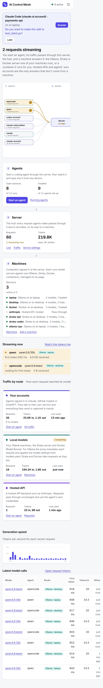

## Signing in

The console always requires sign-in. **Sign in** redirects to the separate OIDC issuer using authorization code + PKCE; passwords are entered only there. Access renews automatically through host-only HttpOnly cookies. **Downloads** and documentation remain public.

An unavailable authentication service shows an error, never an unsigned console. If a sign-in can't be completed (it took more than 10 minutes, or the sign-in service isn't answering), you come back to this page with a message saying so; press **Continue to sign in** again. See [OIDC authentication](oidc.md).

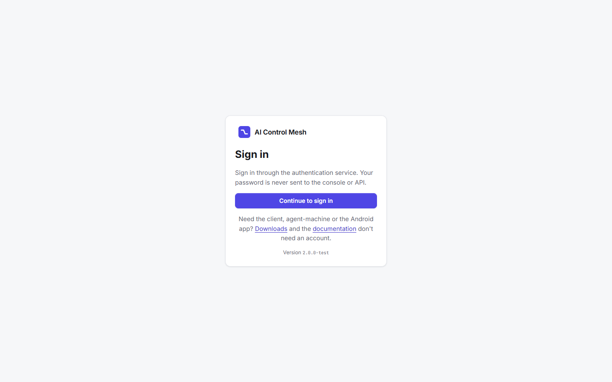

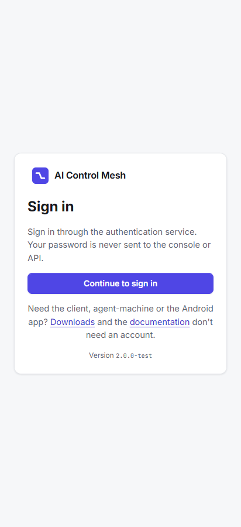

## Overview

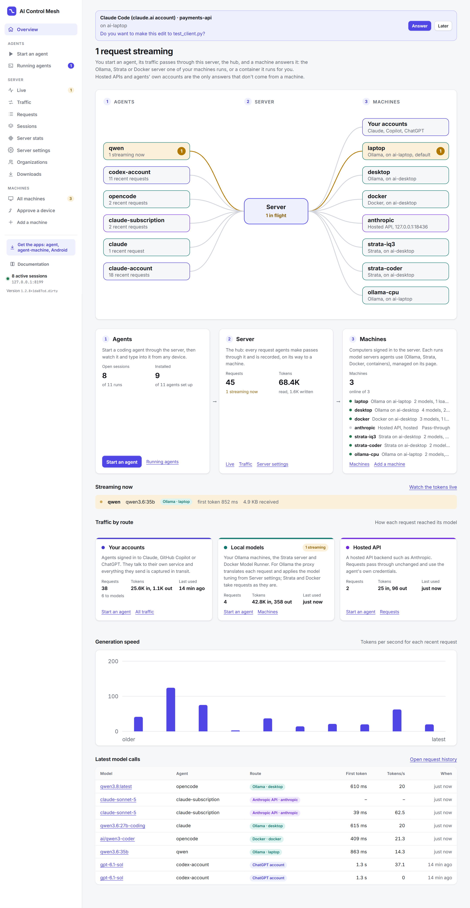

The landing page (`/`) shows the whole system at a glance:

- **The map**: agents on the left, the server in the middle, and each provider (with its machine) on the right. Lines light up while requests flow.
- **Agents, Server, Machines** cards: open sessions and installed agents; requests, tokens read and written and requests in flight; machines online. Each card links to its pages.
- **Traffic by route**: requests, tokens and last use for each of the three routes (your accounts, local models, hosted API).
- **Generation speed**: tokens per second for each recent request.
- **Streaming now** and **Latest model calls**: requests in flight and the most recent ones, each linking to its details.

If the console can't reach the server, the page says so (**Can't reach the proxy**).

## Start an agent

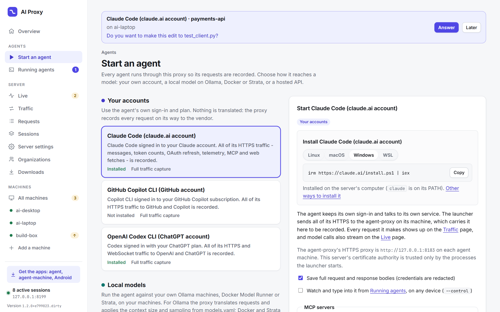

`/agents` lists every agent the server knows (its stored agent definitions, which admins change on [Server settings](#server-settings)), grouped by route: **Your accounts**, **Local models** and **Hosted API**. Each shows whether it's installed on the server's computer and which API it speaks. Pick one to see its launch panel:

- **Install**: the install command for Linux, macOS, Windows or WSL. The console remembers your choice.
- **Provider and model** (local and hosted agents): the backends this agent can use, with the one the server picks by default, and the models on that backend (aliases from the Ollama model tuning included). An offline backend says why.
- **Capture full request and response payloads**: saves every request and reply in full (`--trace`). Account agents redact credentials.
- **Watch and type into it from Running agents** (`--control`): shares the agent's terminal with the server.
- **MCP servers**: the MCP servers your machines share that you may use. Ticking one adds `--mcp` to the command. Agents that can't take MCP servers (Aider) say so. See [MCP servers](mcp.md).
- **Sharing** (with accounts): **Only me**, a team or an organization, and whether they may type into it.
- **Run it from your project folder**: the full `agent` command, ready to copy.
- **Set it up by hand instead**: opens a session now and prints the environment for the agent in PowerShell or bash, for when you can't use the launcher. Started this way, its terminal isn't shared. For MCP servers it lists the URLs to add to the agent's own settings.

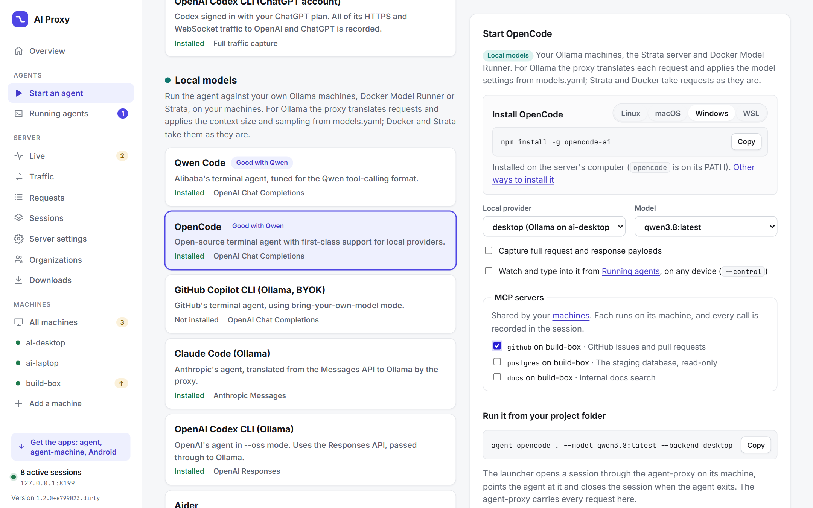

To start an agent on one of your machines from the console instead, use **Start an agent** on that machine's page (see [Agents tab](#agents)).

## Running agents

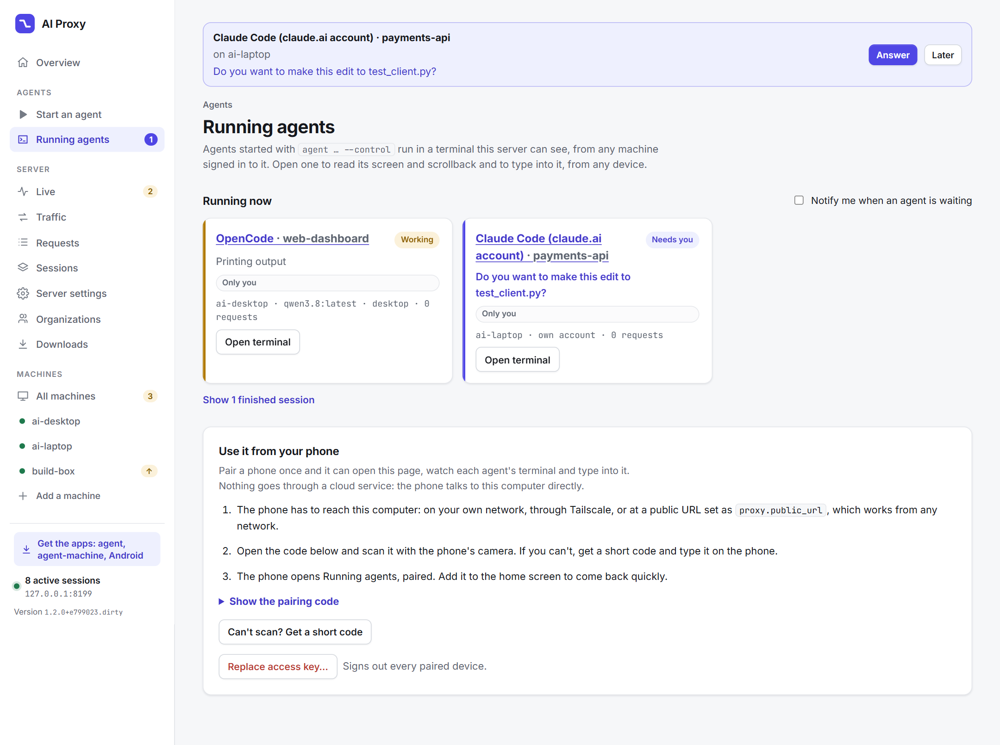

`/terminals` lists the agents whose terminals are shared with the server (started with `--control`, or from a machine's page). For each it shows the agent, project, machine, how long it's been running and its state:

| State | Meaning |
| --- | --- |
| **Working** | The agent is printing output. |
| **Waiting** | It's quiet, probably waiting for your next prompt. |
| **Needs you** | It asked a question, such as a permission prompt. The question is shown. |
| **Not connected** | The launcher's connection dropped; the terminal's history is still there. |
| **Connecting** | The viewer is joining. |

Ended terminals stay listed with their exit status until their session is deleted.

### A terminal

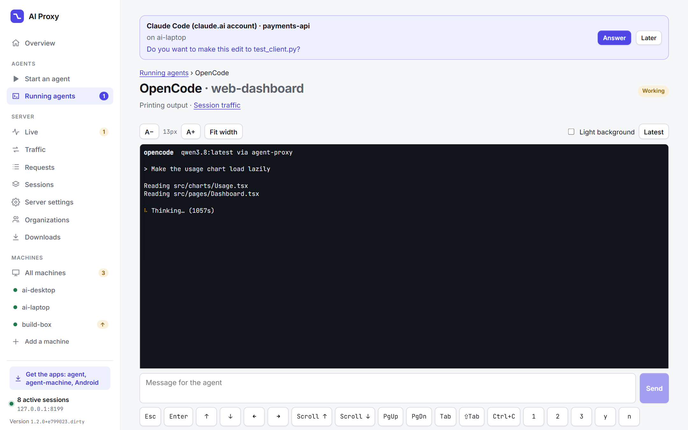

Opening one (`/terminals/<session>`) shows the agent's live terminal (xterm.js) with its history:

- **Type into it** in the message box and **Send**. Text and Enter go as separate keystrokes, and multi-line text is sent as a paste, so agents read it the way they would from a keyboard.
- **Keys** for phones: Esc, Enter, arrows, Scroll ↑/↓, PgUp/PgDn, Tab, ⇧Tab, Ctrl+C, and 1, 2, 3, y, n for answering prompts. Scroll ↑/↓ scroll the agent's own history in full-screen agents (Claude Code, OpenCode, Qwen Code) and the terminal's elsewhere.
- **A−/A+** change the font size; **Fit width** sizes it to the window; **Light background** switches the terminal's colours; **Latest** jumps to the bottom.
- **Session traffic** opens the session's requests on Traffic.
- If the session is shared with you to watch only, the input is off.

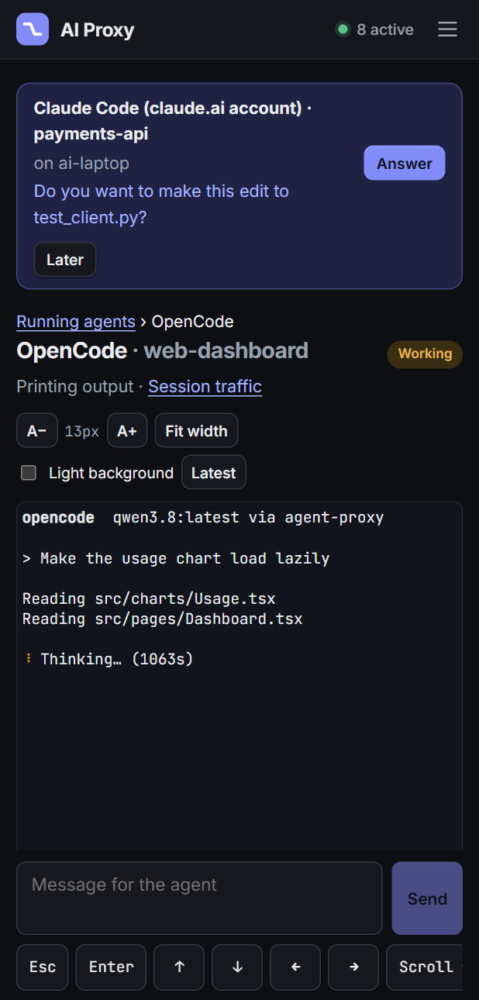

### Use it from your phone

On a phone, open the console and sign in through OIDC. Legacy pairing codes no longer grant access.

## Ask a model

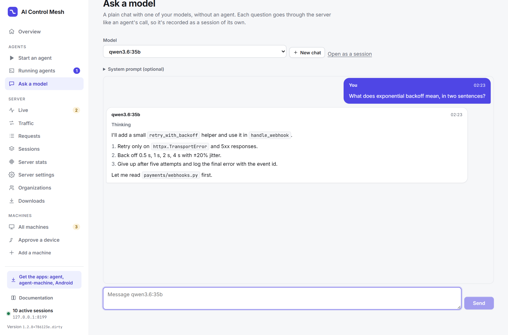

`/ask` is a plain chat with one of your models, without an agent: pick a model, type, and the answer streams in.

- **Model** lists the models of every Ollama, Strata and Docker Model Runner backend that's online, by backend. Hosted APIs aren't offered: they need an agent's own sign-in. Choosing another model starts a new chat.
- **Enter** sends; **Shift+Enter** starts a new line. **Stop** stops the answer. A model that thinks shows its thinking folded above the answer.
- **System prompt** (optional) is sent before the conversation with every question.
- Each chat is a session of its own (client `console-chat`, payloads captured), so every question goes through the server like an agent's call: on Ollama it's translated and gets the model tuning, and it's recorded on **Traffic**, **Requests** and **Sessions**. **Open as a session** shows it there, in its chat view. The session ends when you start a **New chat** or leave the page; the conversation isn't kept on the page after that, only in the session.

## Live

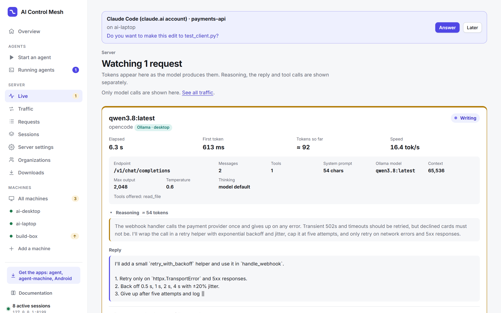

`/live` streams model calls as they happen: one card per request in flight, with the reply, reasoning and tool calls as they arrive, time to first token and speed. **Just finished** keeps the last few. Each card opens its full details (headers, the request, the payload sent to Ollama and the raw stream), and **Open in request history** goes to the saved request.

Account agents' other calls (sign-in, telemetry, MCP) aren't shown here; they're on Traffic. Set `AI_PROXY_LIVE=0` on the server to stop streaming request text (counts still stream).

## Traffic

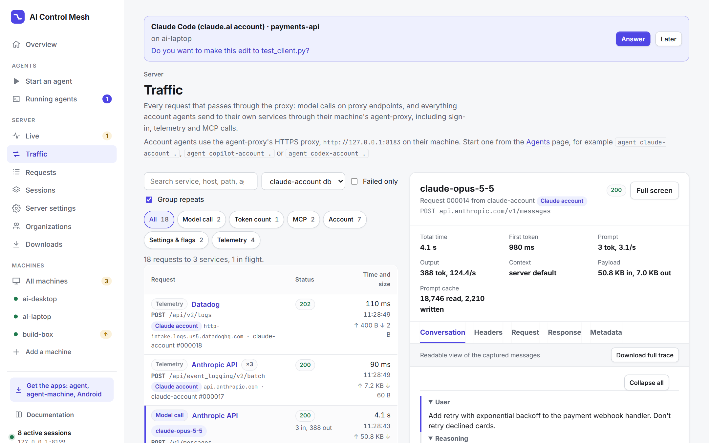

`/traffic` lists recorded requests through the server: model calls on the proxy endpoints, permitted account-agent requests to public services, and calls to shared MCP servers. The HTTPS proxy refuses private and reserved destinations.

- **Search** by service, host, path, agent or model, pick a **session**, and tick **Failed only**.
- **Request types** filter the list: Model call, Token count, Model list, MCP, Account, Sign-in, Settings & flags, Telemetry, Updates, Connection and Other, each with its count. What each type covers is in [What the requests are](agents.md#what-the-requests-are).
- **Group repeats** folds back-to-back identical requests (agents poll some endpoints) into one row.
- Each row shows the type, service, method and path, the session, its status, timing and size; requests in flight are marked **pending**.
- Selecting a row opens the inspector on the right: timings, tokens and sizes, and tabs for the **Conversation** (a readable view of the messages), the **Request**, the **Response**, what was **Sent to Ollama** (for translated calls), the request and response **Headers** (credentials redacted) for captured HTTPS, and **Metadata**. **Full screen** opens it alone; **Download full trace** saves the JSON.
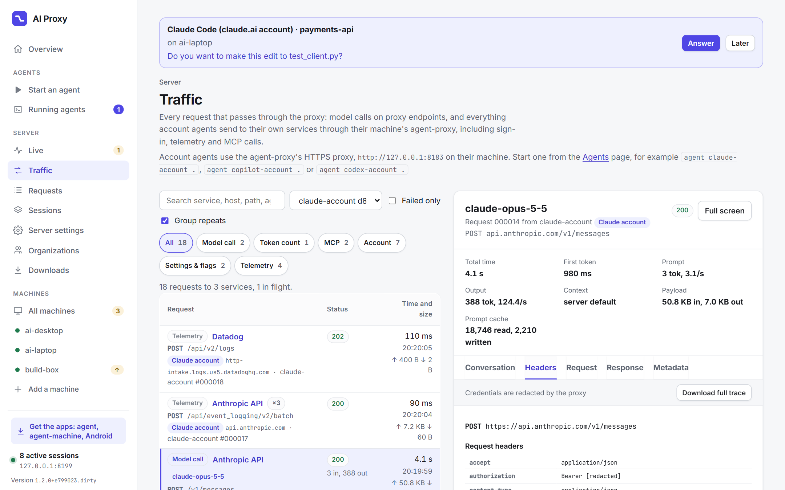

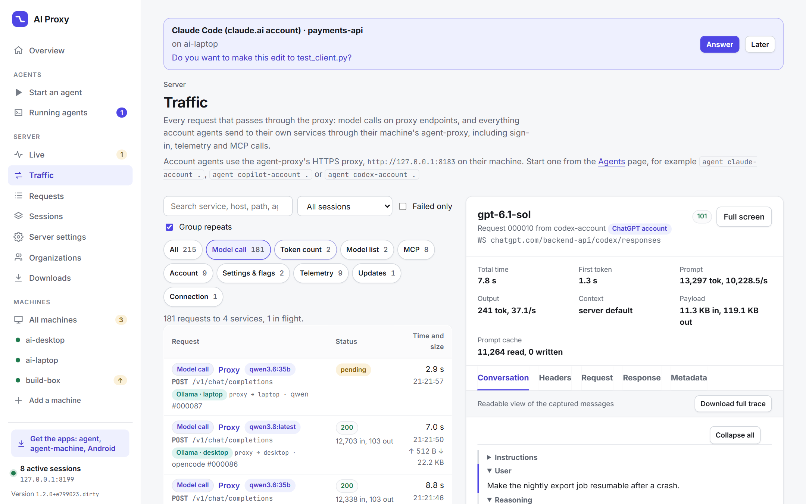

- **Still in memory** lists requests from before the page loaded that the server still holds in memory.

## Requests

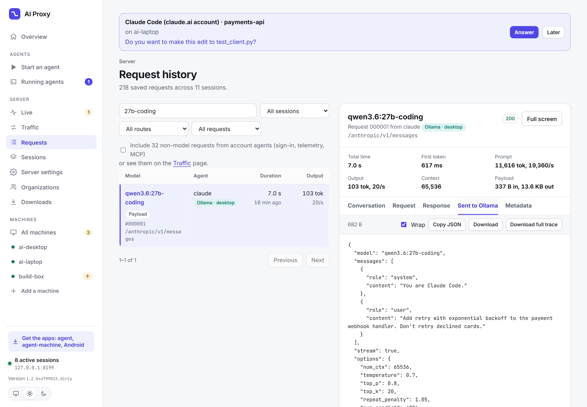

`/requests` is the model-call history across all sessions: model, agent, provider, duration, output tokens and speed.

- **Search** by model, agent, endpoint or ID; filter by **session**, **route** (accounts, local models, hosted) and **With payload**, **Without payload** or **Failed**.
- **Include non-model requests from account agents** adds their sign-in, telemetry and MCP calls, which are hidden by default (Traffic shows them too).
- It loads the newest 2,000 requests. **Load 2,000 older** fetches the next ones; search and filters cover the requests loaded so far.
- Selecting a row shows the same inspector as Traffic. Each request also has its own page (`/requests/<session>/<request>`):

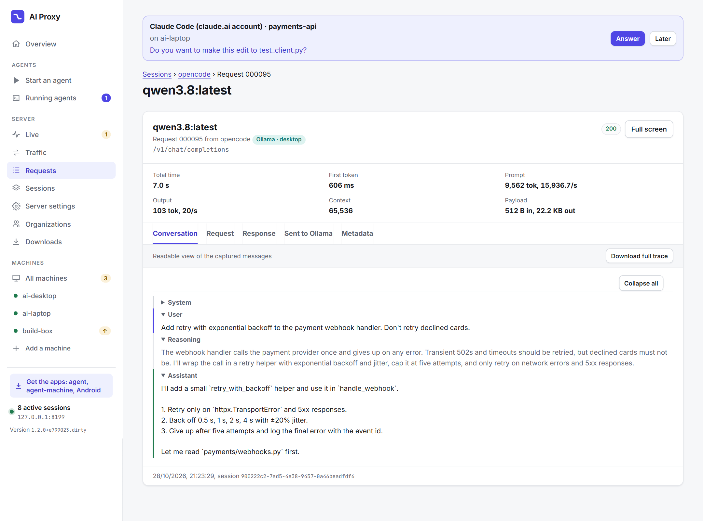

## Sessions

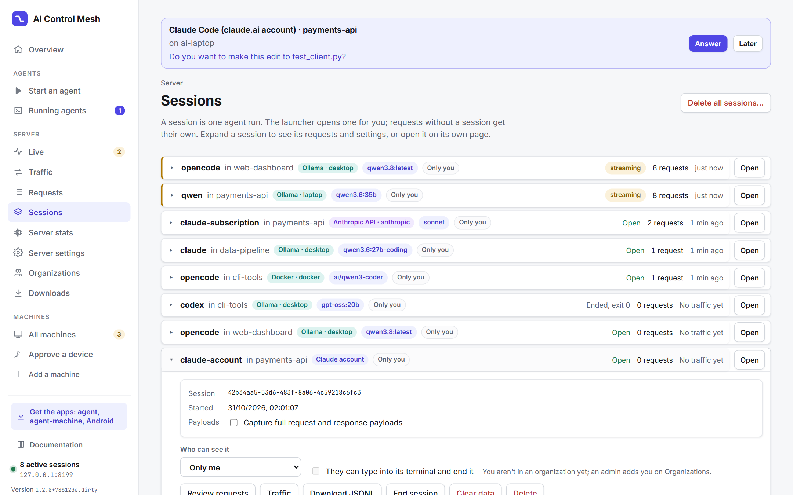

`/sessions` lists every session: agent, model, provider, when it started, requests and tokens, and whether payloads are saved. Selecting one shows its **Latest requests** and its actions:

- **Capture full request and response payloads**: turn saving payloads on or off for the rest of the session.
- **Review requests**, **Traffic**: open its requests on those pages.
- **Download JSONL**: its telemetry, one request per line.
- **End session**: closes an open session; its agent can no longer use it.
- **Clear data**: deletes its recorded requests and payloads but keeps the session.
- **Delete**: deletes the session and everything recorded for it. A session with requests in flight can't be cleared or deleted.
- **Delete all sessions** deletes ended sessions, empties open sessions idle for more than 15 minutes, and leaves recently active ones running. Only your own.
- **Open a session manually**: for other tools. Name the agent, model and backend, choose whether to capture payloads, and **Open session**; it shows the OpenAI, Anthropic and Ollama URLs to point the tool at.

### A session

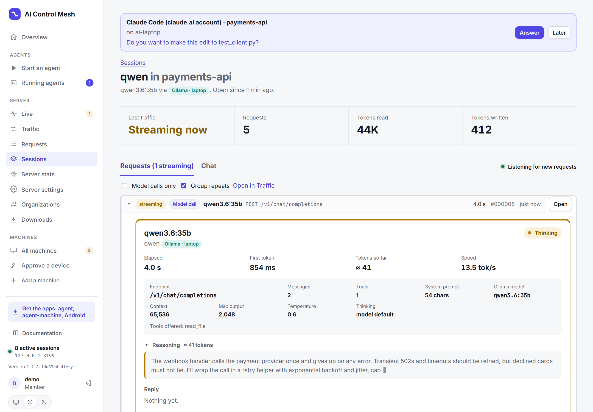

`/sessions/<id>` shows the session's details (agent, model, provider, machine, project, started, last traffic, tokens read and written, payloads, its OpenAI and Anthropic URLs), its sharing for its owner, and tabs:

- **Chat**: the session's captured model calls read back as a chat (it needs payload capture, `--trace`). See [The chat view](#the-chat-view).
- **Requests**: its requests, as on Traffic.

### The chat view

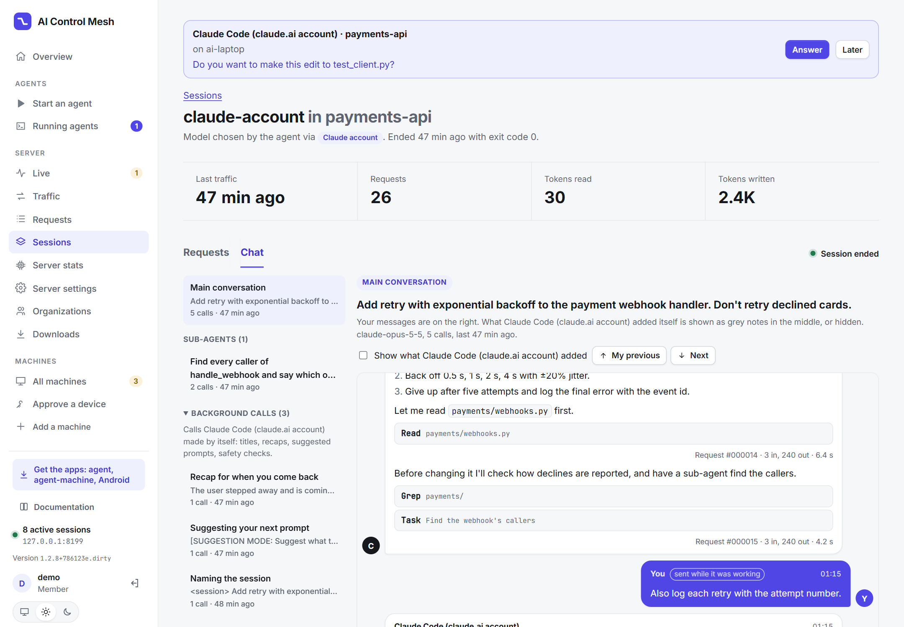

Agents send their model far more as "the user" than you type: system reminders, tool output, notes about images, and whole calls of their own. The chat view keeps what you wrote apart from all of that.

- **The list on the side** has the session's conversations. **Main conversation** is the one going on. Below it are other conversations (for example one from before `/clear`), **Sub-agents** (helpers the agent started for one task) and **Background calls**: calls the agent made by itself, such as naming the session, a recap for when you come back, suggesting your next prompt, compacting the conversation or checking that an action is safe. Each background call is named by what it was for. On a narrow screen the list is a menu above the chat.
- **Your messages are on the right**, in the accent colour, with the time you sent them. A message typed while the agent was working says so, and slash and `!` commands show as commands. Pasted text is folded. On a session someone shared with you, the owner's name replaces **You**.
- **The agent's replies are on the left**: its text, its thinking (folded), and its tool calls. More than three tool calls in a row fold into one line, such as "Used 7 tools: Bash ×5 · Read ×2". Open a tool call for its input, result and request. Under each reply are its request, tokens and time.
- **What the agent added itself** shows as small grey notes in the middle, never as a message: an interruption, a command's output, the summary a compacted conversation goes on from, and a marker where it was compacted. Reminders and other context it injects are hidden. **Show what … added** shows them.
- **In a sub-agent**, what it was asked is on the right as **Main agent**, not you. **In a background call**, the agent's instruction is on the right, marked as the agent's, with the model's **Answer** below. The conversation a sub-agent or background call was handed is hidden behind **Show the … messages it was handed** (or **sent with**).
- **My previous** and **Next** jump between your own messages. **Newest** (or **New messages**) goes back to the end. The chat opens at the newest messages, loads older ones as you scroll up, and follows new ones while you're at the bottom. Long texts load in full when you open them.

Claude Code signed in to its account sends most calls with only what's new, naming the call before. The server follows that chain, and Claude Code's request headers say which calls are the main chat, a sub-agent or a background call. For other agents the server matches each call's messages to the conversation they continue, and calls without tools that aren't the main conversation count as background calls.

**Open in Traffic** shows its requests there, and **Streaming now** shows what's in flight.

## Server stats

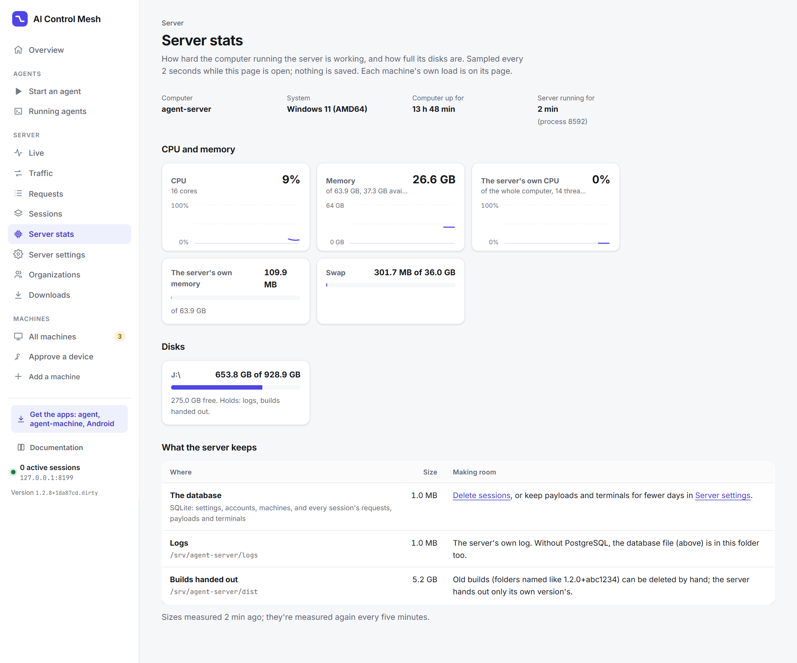

`/server-stats` (admins only) shows how hard the computer running the server is working and how full its disks are. It asks the server every 2 seconds while it's open and keeps the last five minutes on the page; nothing is saved. A machine's own load is on its [Load tab](#load).

- **The computer**: its name, system, how long it's been up and how long the server has been running.
- **CPU and memory**: charts of the computer's CPU (with the load average outside Windows) and memory, and of the server's own share of the CPU. Bars show the server's own memory and, when there is one, swap.
- **Disks**: each disk the server keeps its files on, with how much is used and free and which of its folders are there.
- **What the server keeps**: the size of its database (SQLite or PostgreSQL: settings, accounts, machines and every session's requests, payloads and terminals), its log folder (`logs/`, where the SQLite file is too) and the builds it hands out (`dist/`), measured every five minutes. Deleting sessions on the [Sessions](#sessions) page, or fewer days under **Storage** on [Server settings](#server-settings), removes recorded traffic; old builds (folders named like `1.2.0+abc1234`) can be deleted by hand, since the server only hands out its own version's.

## Server settings

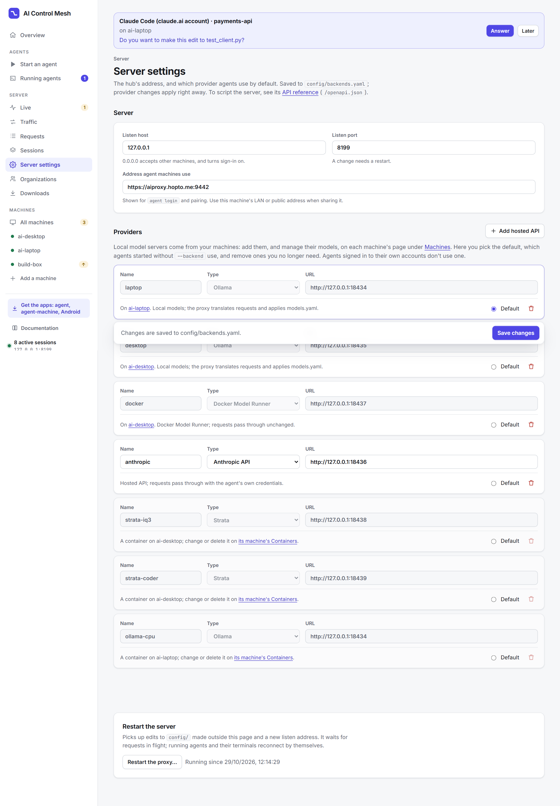

`/settings` changes the server's stored settings (admins only). They're kept in its database, and most changes apply right away:

- **Server**: **Listen host**, **Listen port**, **Address agent machines use** (shown for `agent login`) and **Public console address** (`public_url`, optional: where people open the console from anywhere, shown ahead of the addresses the server finds itself). A changed listen address needs a restart.
- **Providers**: every backend, with its type, address and machine. Choose the **Default**, or remove one. **Add hosted API** adds an Anthropic API backend (name, type, URL). Local providers can't be added here: they come from machines (see [Providers](providers.md)). **Save changes** saves this section and the one above.
- **Agents**: every agent launchers can start, each marked **Shipped**, **Shipped, changed** or **Added here**. **Edit** opens its definition as YAML; **Add an agent** takes an id and a definition; **Remove** stops launchers offering it. **Reset to the shipped one** undoes changes to an agent that ships with the server. Shipped agents follow the server's upgrades until you change them. See [Adding a new agent](agents.md#adding-a-new-agent).
- **Ollama model tuning**: the `defaults`, `profiles` and `aliases` the server applies to requests it sends to Ollama, as one YAML document. **Save tuning** applies it to new requests. See [Model tuning](providers.md#model-tuning).
- **Storage**: which database the server uses (SQLite or PostgreSQL, its address without the password, and its size), and **Keep payloads and terminals for** a number of days since a session's last request. Older sessions lose their payloads and terminal recordings; their requests and token counts stay. Empty keeps everything.
- **Restart the server** (shown when the server can restart itself, which it can't when started with `--reload`): restarts it once requests in flight finish, and says where it comes back. It picks up a new listen address, and settings changed from the command line (`agent-server config import`).

To copy the settings to another server or keep them in version control, use `agent-server config export` and `import` (see [Configuration](configuration.md)). **API reference** links to the server's OpenAPI pages (`/docs`).

## Organizations

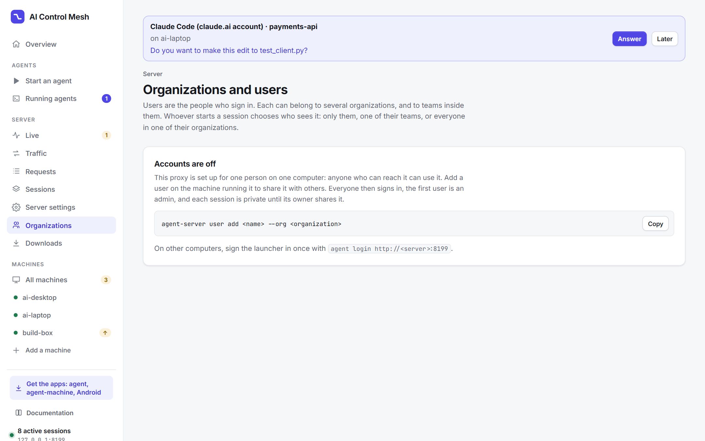

`/organization` separates the directory from your own account. Its tabs and selected organization and team stay in the URL, so you can link to them:

- **Organizations**: search and select an organization. Its **Teams** tab lists its teams; open one to add or remove members, create a user in it, or rename or delete it in **Team settings**. **Members** manages everyone in the organization, including users not assigned to a team. Add existing users before placing them in teams, or create an account directly in either view. **Settings** renames or deletes the organization.
- **User directory**: search accounts and filter by organization, including **No organization** for unassigned users. Admins can create accounts, **Edit user** to change their server role, memberships or password, and **Delete account**. Removing someone from a team or organization is separate from deleting their account.
- **Your account**: your identity and OIDC sign-in instructions. CLI sign-in uses device approval; scripts use explicitly provisioned service clients ([OIDC](oidc.md)). Admins reset account passwords in User directory or with `agent-server user passwd`.

Members see only their organizations and the people in them; all management controls require a server admin. Removing an organization membership also removes that user's team memberships there. Deleting a team or organization keeps people's accounts. Destructive changes ask for confirmation.

See [Accounts and sharing](accounts.md).

## Downloads

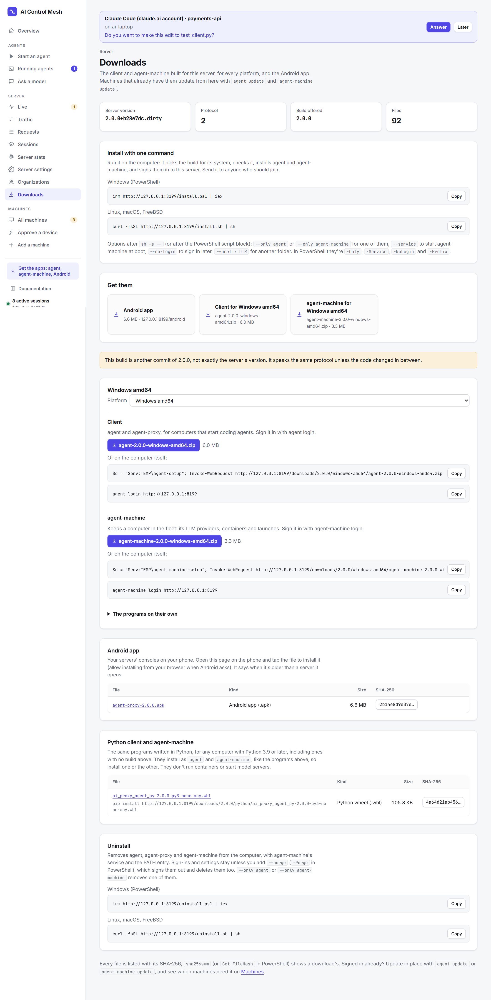

`/get` is public, so a new machine can get the programs before it signs in:

- **Install with one command**: the one-line installer for **Linux, macOS, FreeBSD** (`curl ... | sh`) and **Windows (PowerShell)** (`irm ... | iex`), for the **Client** (`agent`) or **agent-machine**. They download this server's build for the computer, check it and sign it in.
- **Get them**: every archive and package of this server's build, by platform, with sizes and SHA-256. **The programs on their own** lists the bare binaries.
- **Python client and agent-machine**: the wheel, for computers without a Go build.
- **Android app**: the APK.
- **Uninstall**: the one-line uninstallers (`/uninstall.sh`, `/uninstall.ps1`), shown even when nothing is built. They remove the programs and agent-machine's service; `--purge` (`-Purge`) also signs them out and deletes their settings.

If nothing has been built (`scripts/build-dist`), it says **Nothing built yet**. See [Deployment](deployment.md#what-the-server-hands-out).

## Machines

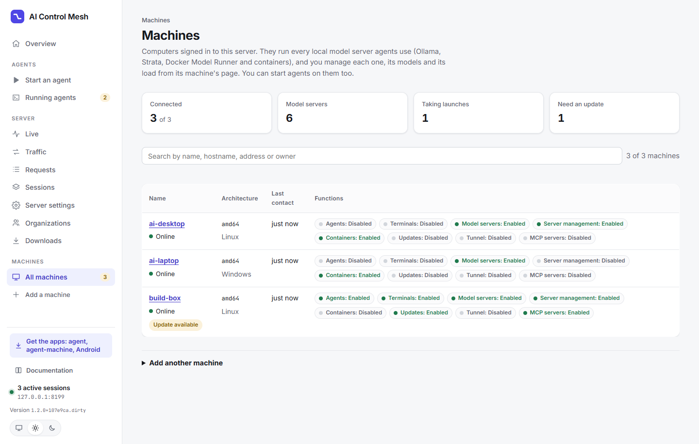

`/machines` lists the fleet in rows: **Name** (with online/offline state and owner), **Architecture** (with operating system), **Last contact** (hover for the full date and time), and **Functions**. Open a machine's name to manage it.

Each row marks **Agents**, **Terminals**, **Model servers**, **Server management**, **Containers**, **Updates**, **Tunnel** and **MCP servers** as Enabled or Disabled. These are the machine's reported settings, not your personal permissions or a promise that an offline machine is usable. Model servers and MCP servers are enabled when the machine reports servers; the other functions follow its switches. An update badge shows when a newer build is available. Narrow screens show the same fields stacked.

- **Search machines**: filter by name, machine id, hostname, address or owner. Search ignores case; clearing it shows the whole list again.
- **Add a machine**: the commands to install and sign in agent-machine on Linux or macOS and on Windows (PowerShell). **Add another machine** shows them again when the fleet isn't empty.
- **Or run a sandbox machine in a container**: the Docker or Podman command for the sandbox image, which runs agents in a container (see [Machines](machines.md#a-sandbox-machine-in-docker)).
- **Removed**: machines taken off the server, which you (their owner or an admin) can allow back.

## Approve a device

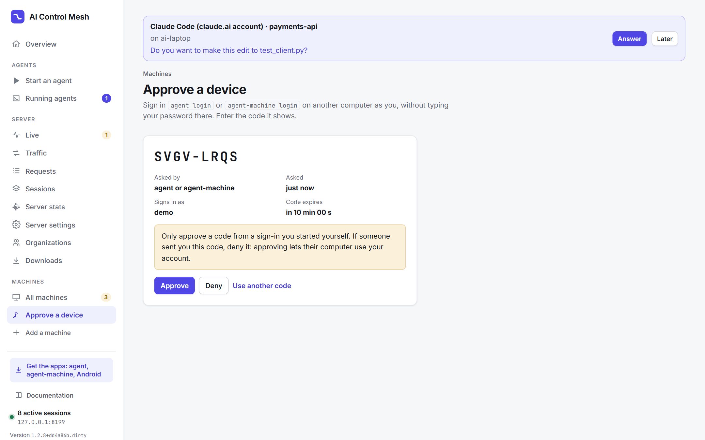

`/approve-device` signs `agent login` or `agent-machine login` on another computer in as you, from the console you're already signed in to, without typing your password there.

1. Run the login command on that computer. It prints a link and an eight-letter code.
2. Enter the code here and press **Continue**. The page shows what asked (agent or agent-machine), when, which account it signs in as, and when the code expires. Nothing is decided yet.
3. **Approve**, and the command finishes signing in by itself within a few seconds. **Deny** refuses it for good.

Only approve a code from a sign-in you started yourself: approving lets that computer use your account. The code is always typed by hand (the page never takes one from a link), and a code is decided once. The link the command prints works too: it's the sign-in service's own page, which asks for your password. See [OIDC authentication](oidc.md#cli-sign-in).

## A machine's page

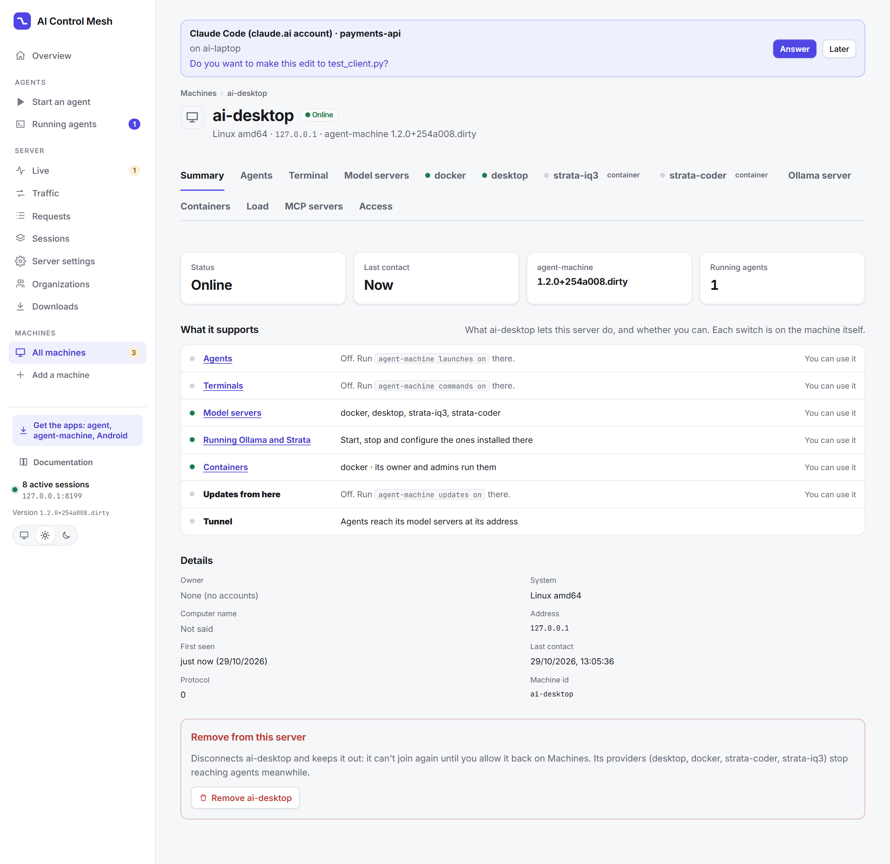

`/machines/<id>` has a header with the machine's name, state and system, **Start an agent** and **Open a terminal** (when you may use them), and, when the machine runs another build than the server, **Update now** (with **Update agent there too**) for its owner or an admin. Below it, a tab per function. **Ollama server** shows only when Ollama is installed there, **Containers** only when the machine runs containers, **MCP servers** for its owner or when it shares some, and **Access** for those who manage it.

### Summary

Cards for its state, last contact, agent-machine version and running agents. **What it supports**: each feature (agents, terminals, model servers, running Ollama and Strata, containers, updates from here, the tunnel) and whether it's on there and open to you, with the command that turns it on. **Details**: owner, system, computer name, address, first seen, last contact, protocol and machine id. **Remove from this server** (owner or admin) disconnects it and refuses it until it's allowed back.

### Agents

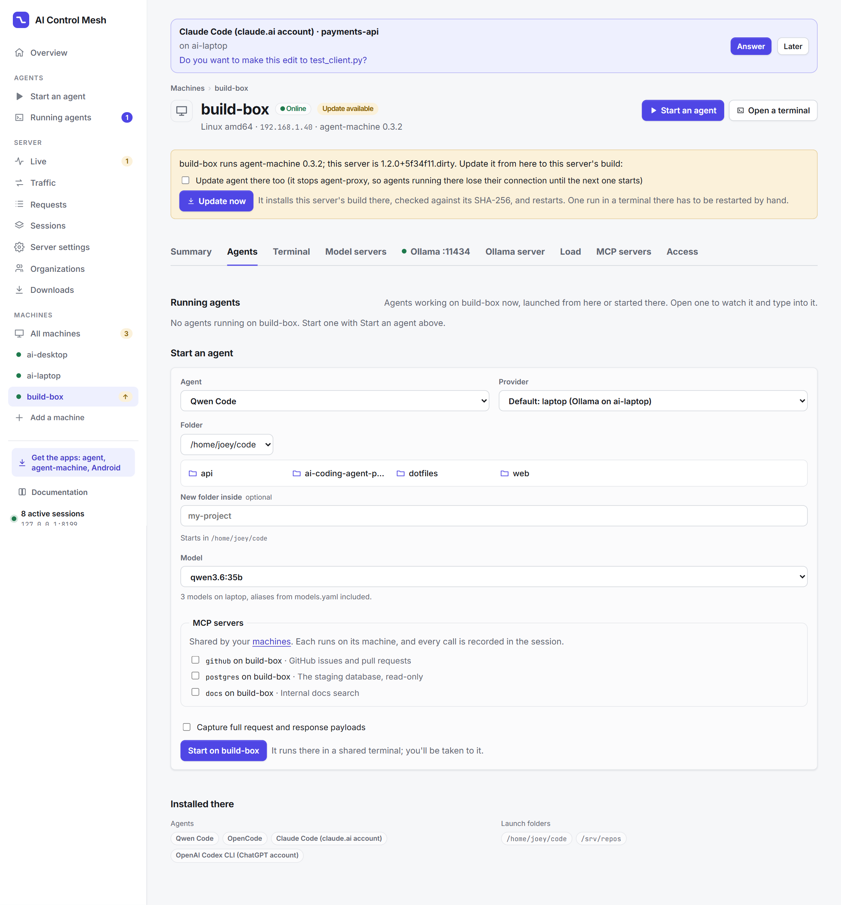

**Running agents** on the machine (launched from here or started there by hand), **Installed there** (the server's agents found on its `PATH`), **Start an agent** and **Started from here** (each launch: who, which agent, which folder, its session or why it failed).

**Start an agent** picks the agent, the provider and model, the folder (browse the folders inside its launch folders, or name a new one), MCP servers, sharing and payload capture, then starts it in a shared terminal and opens it. It needs `agent-machine launches on` and a launch folder there.

### Terminal

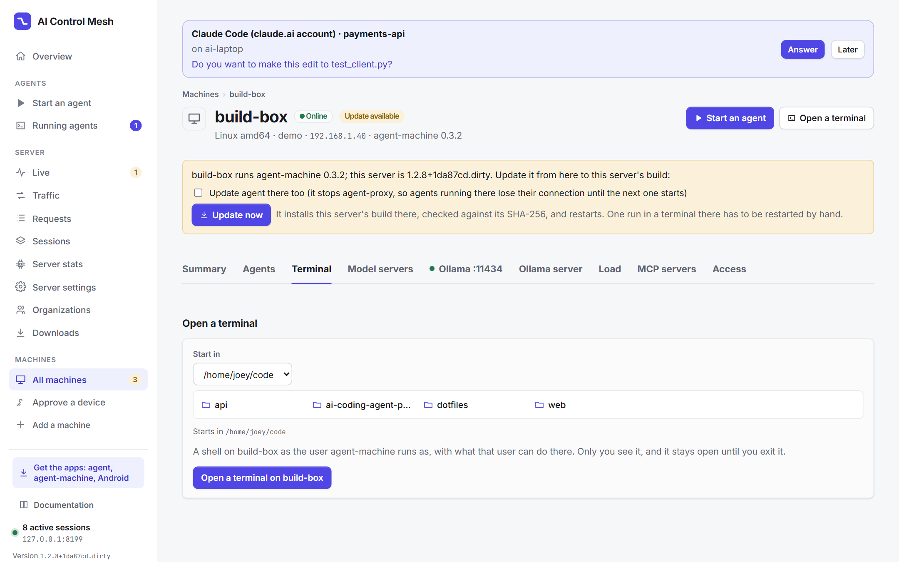

**Open a terminal** starts a shell on the machine in one of its launch folders, in a terminal only you see. It needs `agent-machine commands on` there.

### Model servers

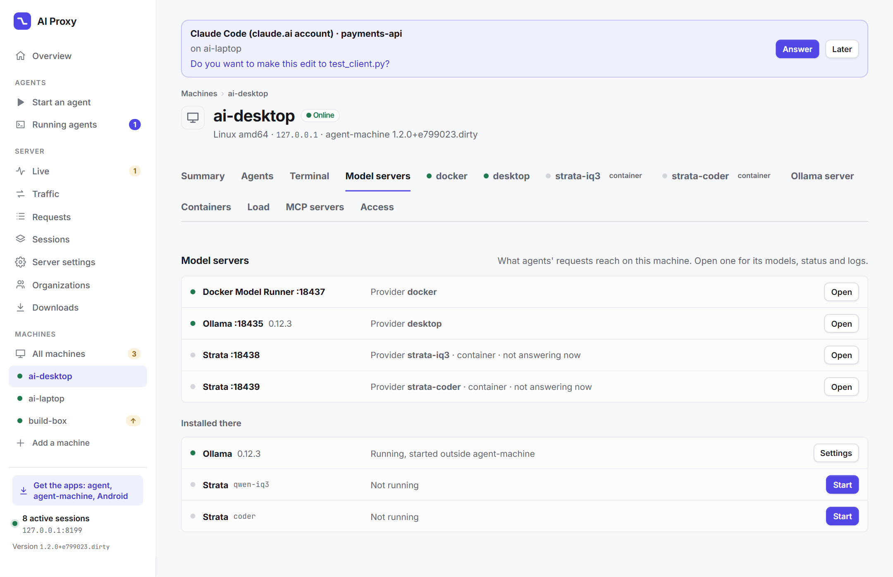

The model servers it runs (Ollama, Strata, Docker Model Runner, and the containers it runs for the server), each with its address, version and whether it's a provider yet. A model server that isn't a provider has **Add as a provider** (admins); after that, every agent that speaks its API can use it.

### One tab per model server

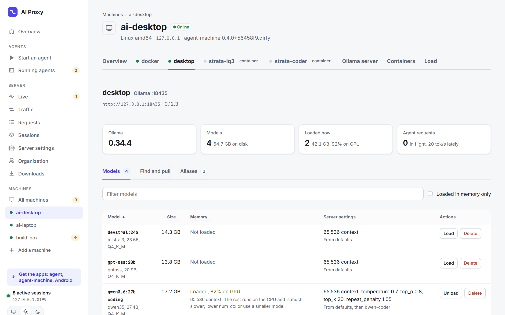

Each model server has its own tab, named after its provider (or `Ollama :11434` until it is one). Everything here is done by the machine:

- **Ollama**: **Models** (each model's size, whether it's loaded and where, the agent requests it served, and load, unload and delete), **Aliases** (the model tuning's aliases that point at it, with their settings; change them on [Server settings](#server-settings)) and **Find and pull** (search the Ollama library and Hugging Face, or pull by name, with progress).
- **Strata**: **Overview** (state, profile, engine, uptime, model, context, prompt and generation speed, speculative decoding, with **Load** and **Unload**, then its **Hardware** and **Models**), **Connect agents** (the agent commands for it) and **Log** (server and engine logs, key blanked).
- **Docker Model Runner**: **Models**, **Get models** (search Docker Hub's `ai/` models and their tags, or pull by name) and **Connect agents**.

When the machine doesn't report an Ollama or Strata running, its tab says why at the top and what to do: **Start Ollama**, or **Start** a Strata profile, when it's installed there and you may manage the machine's servers (`agent-machine servers on`); otherwise whether it isn't installed, or how to let the console start it.

Changing models needs `agent-machine servers on` there; without it the tab shows the models but doesn't change them.

### Ollama server

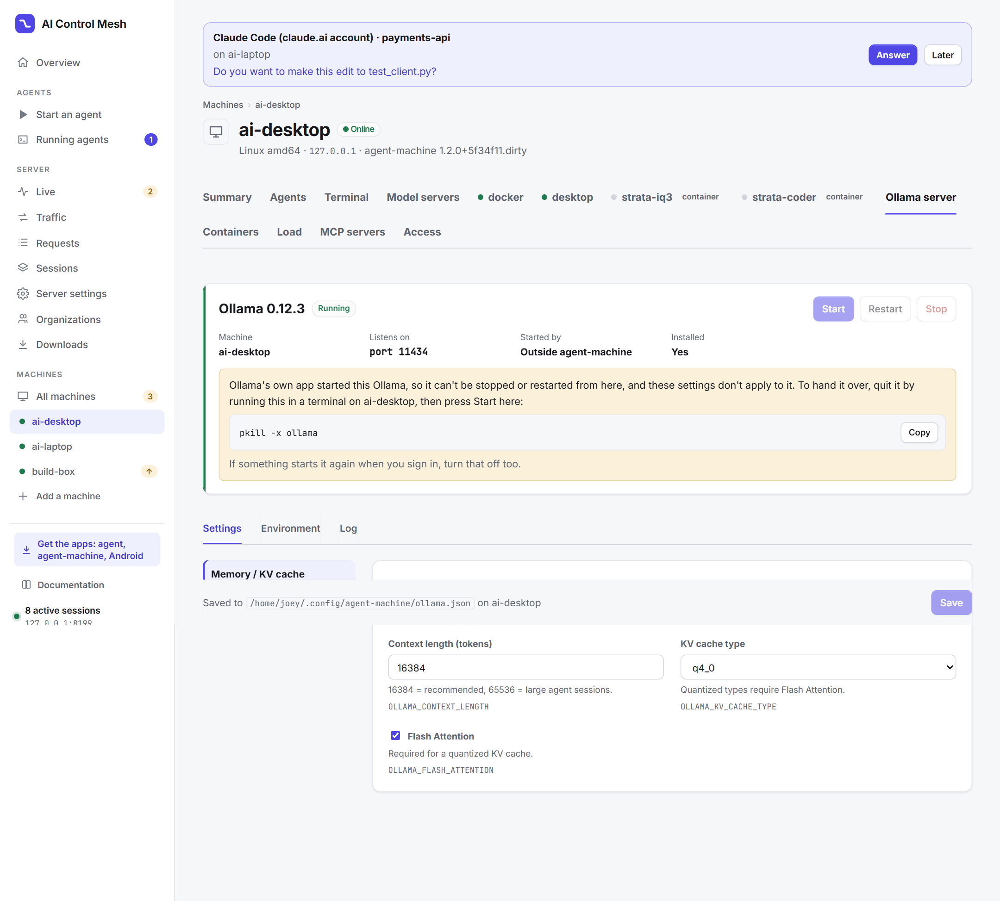

For the Ollama installed on the machine: **Start**, **Stop** or **Restart** it (with `servers on`), **Settings** (the `OLLAMA_*` settings agent-machine starts it with, such as context length, parallel requests, flash attention and KV cache type, with warnings), **Environment** (what Ollama starts with, plus **Extra variables**) and **Log**.

### Containers

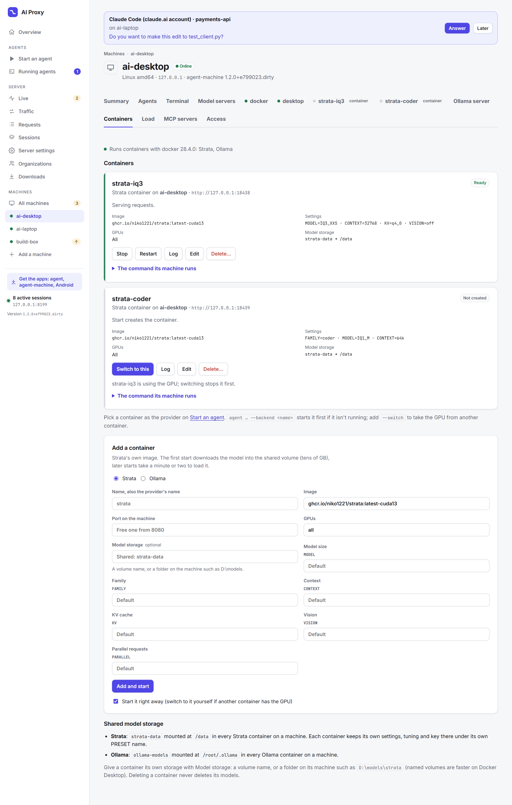

Strata and Ollama containers the machine runs for the server. Each shows its phase (Not created, Pulling image, Starting, Loading model, Ready, Unhealthy, Stopping, Stopped, Failed), settings and GPU, with start, stop, restart, switch (stop the others holding its GPU), logs, edit and delete. **Add a container** picks the engine and its settings; **Shared model storage** is the volume or folder its models live in; **The command its machine runs** shows the exact `docker run`. See [Providers](providers.md#containers-machines-run).

### Load

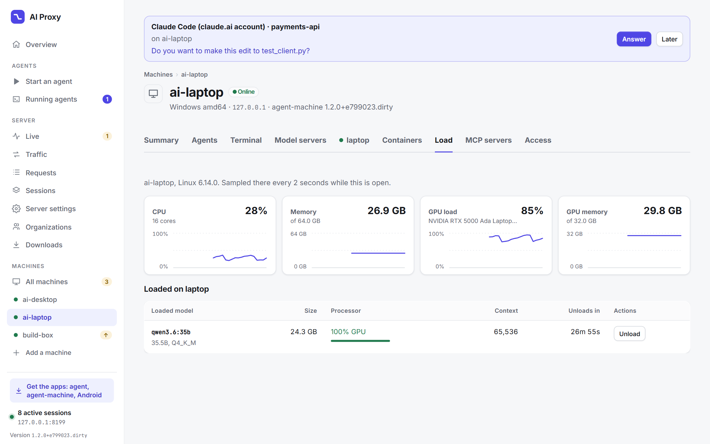

The machine's CPU, memory and GPU use over time, sampled there, and **Loaded on** each Ollama: which models are in memory.

### MCP servers

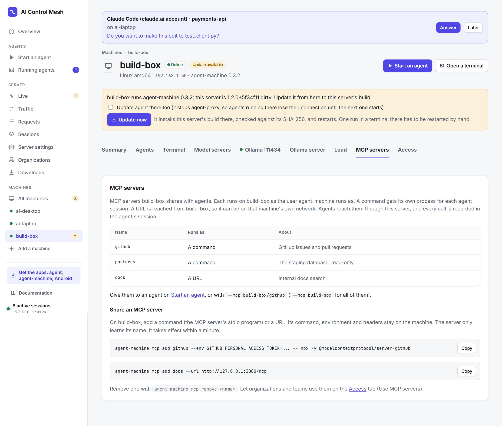

The MCP servers the machine shares, by name, with how each runs (a command or a URL) and whether it's installed there. Its owner sees the `agent-machine mcp add` commands. See [MCP servers](mcp.md).

### Access

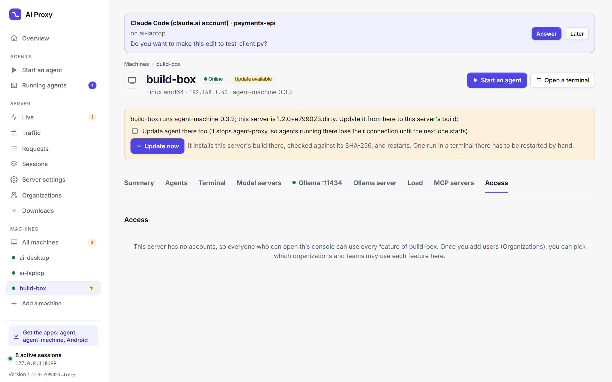

For its owner and admins: which organizations and teams may use each feature (see it, start agents, open terminals, change models, run model servers, update it, use MCP servers), and which of the machine's own switches each also needs. See [Machines](machines.md#who-may-use-a-machine).

## Pairing a phone

Pairing keys and codes no longer grant access. Open the console on the phone and sign in through OIDC. Terminal access follows session sharing. Old `/pair` links redirect to Running agents after sign-in. See [Security](security.md#pairing-how-each-device-joins) for how phones, the Android app and computers pair now.

## Documentation

`/help` shows this documentation in the console: the pages of `docs/` on the server, with their pictures, and **API reference (OpenAPI)** for the server's `/docs`. Links between pages stay in the console, and each heading has its own address (`/help/mcp#how-it-works`). Diagrams are drawn from the pages' Mermaid blocks, in the console's light or dark theme. Like Downloads it's public, so it can be read before signing in; the sign-in page links to it.

The server reads the pages from the `docs` folder of its checkout (the Docker image has them in `/app/docs`), or `AI_PROXY_DOCS_DIR`. A server installed without them says so on the page.
