# The console

The console is the server's web app: open the server's address (`http://<server>:9999`, or your HTTPS address) in a browser. The Android app shows the same console in a WebView, so everything here works on a phone.

The screenshots come from the demo (`python scripts/screenshots/demo.py`), which runs a server with made-up machines, agents and traffic.

The page follows the rail, top to bottom: [Agents](#agents), [the server's traffic and sessions](#server-traffic-and-sessions), [running the server](#server-running-it) (admin pages), then [Machines](#machines) and [a machine's page](#a-machines-page). Dip into the section for the page you're on.

## Layout

The rail on the left has three parts: the agents, the machines they and their model servers run on, and the server every request passes through.

| Part | Pages | What it's for |
| --- | --- | --- |
| **1 Agents** | Live agent view, Start an agent, Running agents, Ask a model, Providers, Subscriptions | Start a coding agent through the server, then watch it and type into it from any device, or ask a model a question yourself. |
| **2 Machines** | All machines, Approve a device, Add a machine | Open **All machines** to search and select a computer. Individual machines aren't listed in the rail. |
| **3 Server** | Live, Traffic, Requests, Sessions, Server stats, Access log, API log, Audit log, Server settings, Organizations, Downloads | The hub: allowed agent requests pass through it and are recorded. |

- The small label above each page's title is its breadcrumb ("Machines › build-box").
- The footer of the rail links to the downloads (**Get the apps**) and **Documentation**, shows how many sessions are open, the server's address and its version, and has a System/Light/Dark theme switch.
- A badge on **Running agents** counts agents waiting for you (or, when none wait, the connected terminals). A badge on **Live** counts requests in flight. A badge on **All machines** counts connected machines; a machine running an older agent-machine shows **Update available** on its row.
- When an agent asks a question (a permission prompt, say), a banner at the top of every page shows it. **Answer** opens its terminal; **Later** hides it until the agent asks something new.
- Below 900 px wide the rail becomes a top bar with a menu. Opening the menu adds a history entry, so Back (Android's included) closes it.
- The console follows your system's light or dark theme, unless the rail's theme switch forces one.

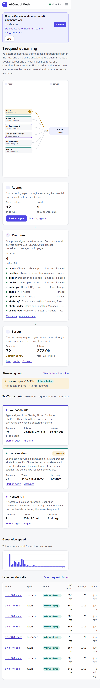

**Documentation** (`/help`) shows the server's `docs/` pages in the console, with pictures and **API reference (OpenAPI)** for `/docs`. Links stay in the console, each heading has its own address (`/help/mcp#how-it-works`), and Mermaid diagrams are drawn in the console's theme. Public, like Downloads; the sign-in page links to it. The pages come from the checkout's `docs` folder (`/app/docs` in the Docker image) or `AI_PROXY_DOCS_DIR`; a server installed without them says so.

### The overview

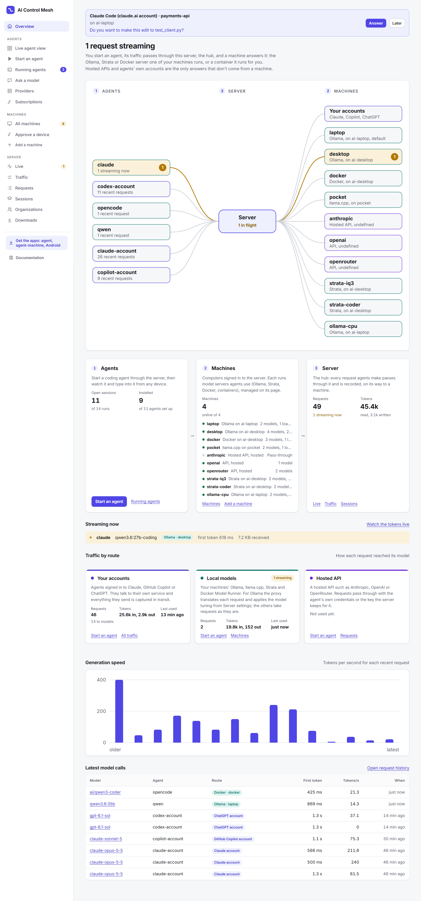

**Overview** (`/overview`, at the top of the rail) shows the whole system at a glance:

- **The map**: agents on the left, the server in the middle, and each provider (with its machine) on the right. Lines light up while requests flow.
- **Agents, Server, Machines** cards: open sessions and installed agents; requests, tokens read and written and requests in flight; machines online. Each card links to its pages.
- **Traffic by route**: requests, tokens and last use for each of the three routes (your accounts, local models, hosted API).
- **Generation speed**: tokens per second for each recent request.
- **Streaming now** and **Latest model calls**: requests in flight and the most recent ones, each linking to its details.

If the console can't reach the server, the page says so (**Can't reach the proxy**).

## Signing in

The console always requires sign-in. **Continue to sign in** redirects to the separate OIDC issuer using authorization code + PKCE; passwords are entered only there. Access renews automatically through host-only HttpOnly cookies. The page also offers **Continue as …** for accounts this browser still holds, and **Sign in to another account**. **Downloads** and documentation remain public.

An unavailable authentication service shows an error, never an unsigned console. A sign-in that can't finish (more than 10 minutes, or the service isn't answering) returns here with a message; press **Continue to sign in** again. See [OIDC authentication](oidc.md).

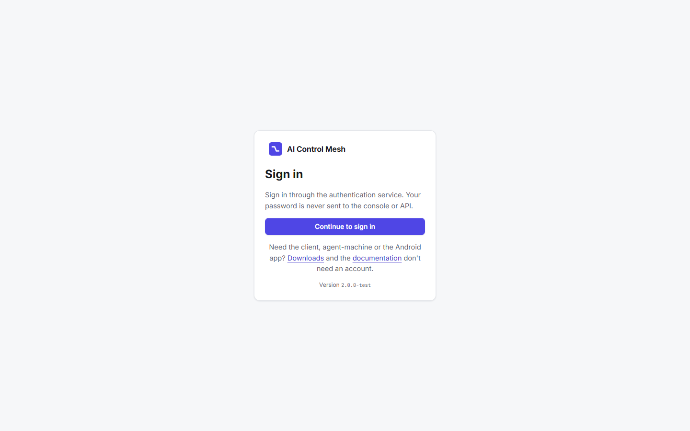

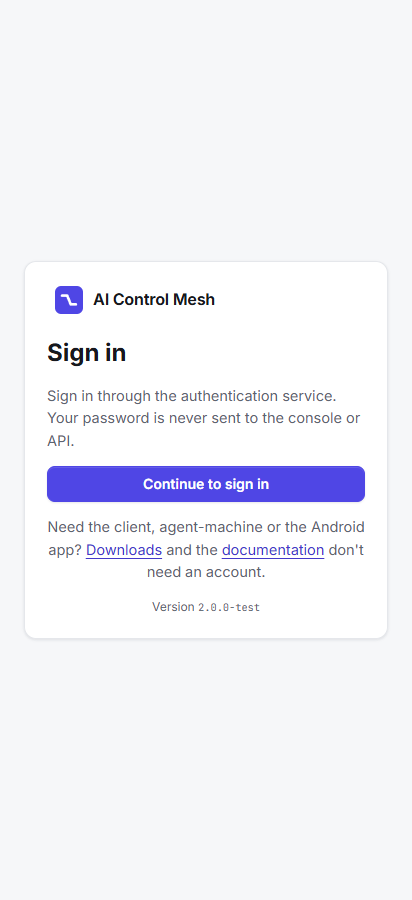

**On a phone**, open the console and sign in through OIDC, as on a computer. Pairing keys and legacy pairing codes no longer grant access; terminal access follows session sharing. Old `/pair` links redirect to Running agents after sign-in. See [Security](security.md#pairing-how-each-device-joins).

In the Android app, a server that can't be reached, or that answers with a server error (5xx), shows **Can't reach** with **Try again** and **Servers**. **Try again** reloads the page you were on. When the phone's network comes back while that panel is up, the app tries again by itself.

## Agents

### Start an agent

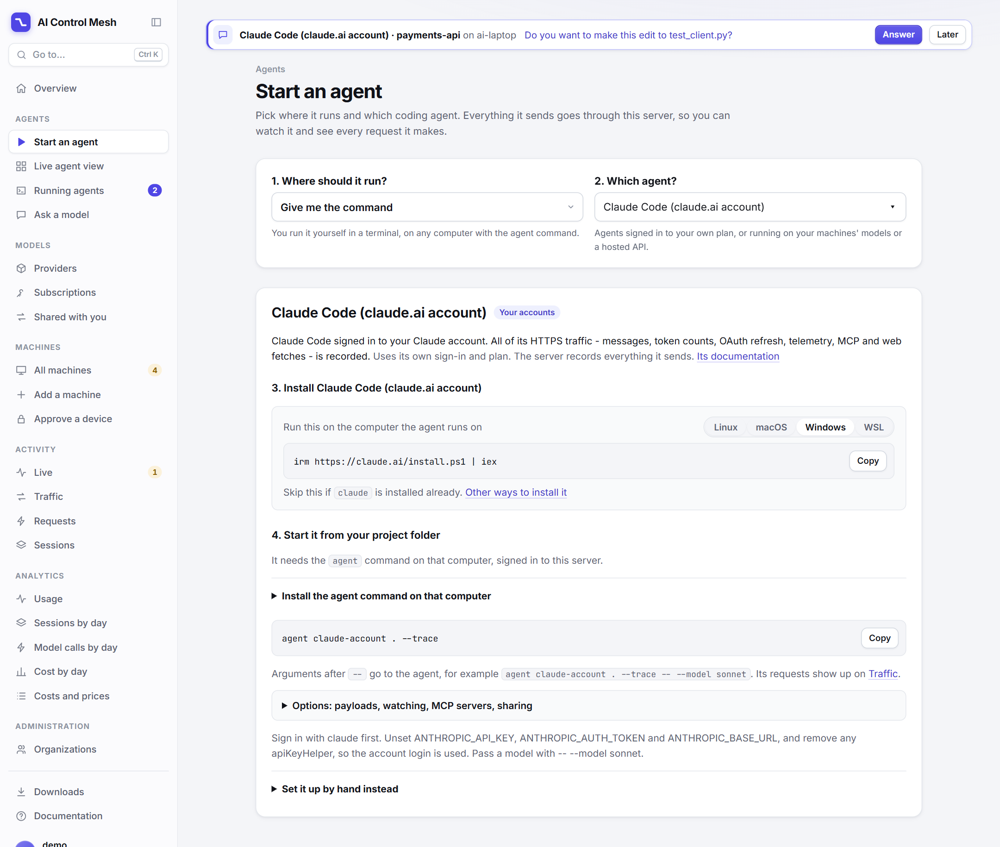

`/agents` starts a coding agent. Pick two things, and the page shows only what that choice needs:

1. **Where should it run?** **Give me the command** (the first choice), or one of the machines you may start agents on. A machine that can't start agents says why (offline, launches off, no launch folders, or no `agent` command there). The choice is remembered.
2. **Which agent?** Every agent the server knows (its stored agent definitions, which site admins change on [Server settings](#server-settings)). With **Give me the command** they're grouped by route: **Your accounts**, **Local models** and **Hosted API**. With a machine they're grouped by whether they're installed there.

The agent's card then shows its route and description, and:

- **On a machine, with the agent installed:** the launch form, with provider, folder, model, MCP servers, sharing and payload capture, then **Start on** the machine. The agent runs there in a shared terminal, which you're taken to.
- **On a machine without it:** the install command for that machine's system. The machine reports what's installed every minute, so it's startable soon after.
- **On a machine that can't start agents:** why, with a link to the machine's page.
- **Give me the command:** the install command for Linux, macOS, Windows or WSL (the console remembers your choice), then the `agent` command to run from your project folder. You need the `agent` command signed in to this server (see [Downloads](#downloads), then `agent login`). For local and hosted agents, pick the provider (the backends it can use, the server's default marked) and model (the tuning's aliases included) first; an offline backend says why. **Options** has the rest, each of which changes the command:
  - **Capture full request and response payloads** (`--trace`). Account agents redact credentials.
  - **Watch and type into it from Running agents** (`--control`): shares the agent's terminal with the server.
  - **MCP servers**: the ones your machines share that you may use (`--mcp`). Agents that can't take MCP servers (Aider) say so. See [MCP servers](mcp.md).
  - **Sharing** (with accounts): **Only me**, one of your teams or everyone in your organization, and whether they may type into it.

  **Set it up by hand instead** opens a session and prints the agent's environment for PowerShell or bash, for when you can't use the launcher (its terminal isn't shared then), with the MCP URLs to add to the agent's settings.

With no machines yet, the page says so and links to **Add a machine**. The choices are kept in the page's address (`/agents?on=<machine>&agent=<agent>`), so a link opens the same view.

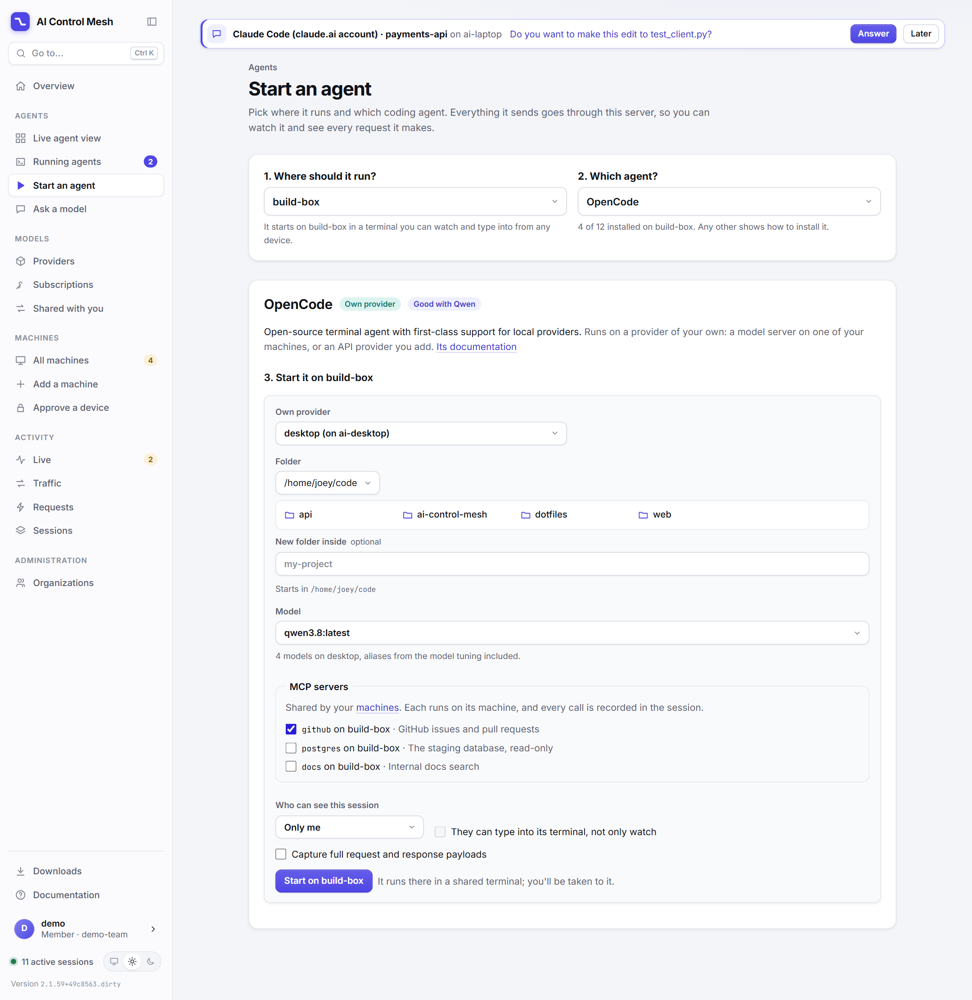

A machine's own page has the same launch form (see [its Agents tab](#summary-agents-and-terminal)).

### Running agents

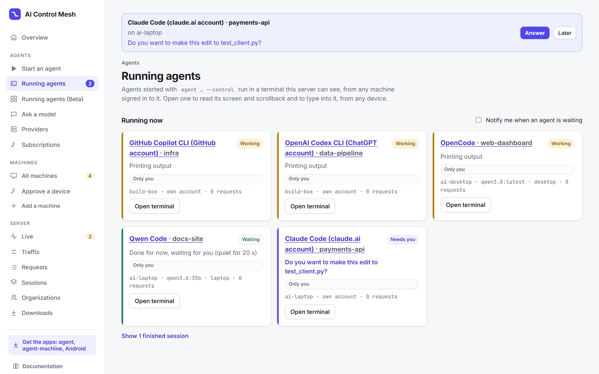

`/terminals` lists the agents whose terminals are shared with the server (`--control`, or started from a machine's page), with agent, project, machine, running time and state:

| State | Meaning |
| --- | --- |
| **Working** | The agent is printing output, or waiting on the model. |
| **Waiting** | It's quiet, probably waiting for your next prompt. |
| **Needs you** | It asked a question, such as a permission prompt. The question is shown. |
| **Not connected** | The launcher's connection dropped; the terminal's history is still there. |
| **Connecting** | The viewer is joining. |
| **Exited** | The agent ended, with its exit status when it wasn't 0. |

Finished sessions collapse behind **Show … finished sessions** and stay readable until their session is deleted. **Remove … not connected** (shown when more than one launcher dropped) clears dead rows, and **Notify me when an agent is waiting** turns on system notifications.

A terminal that isn't connected (launcher closed, or agent exited) has **Remove** for those who can control its session. It deletes the session with everything recorded for it: its terminal output, requests, traces and chats. A terminal still connected, or with a request in flight, can't be removed.

### Live agent view

**Live agent view** (`/live-agents`) is where the console opens (`/` goes there) and the first page under Agents in the rail. It shows several terminals together. Old `/terminals-beta` links open it. The title and two dropdowns share one narrow bar, so the terminals take the rest of the screen.

- **Agents** (with the number in the grid) drops down a searchable list of shared sessions, each with its state, folder and machine. Tick up to 16. It opens by itself while the grid is empty; **Done**, Esc or a click elsewhere closes it.
- The layout dropdown (**2 × 2**) sets **Rows** and **Columns** (1–4 each) and **Text size**. With more agents than fit, **Previous** and **Next** switch grid pages; only the visible page connects its terminals.
- The button at the left of the bar hides the dropdowns, leaving one line of chrome: the grid grows into the room until you show them again.

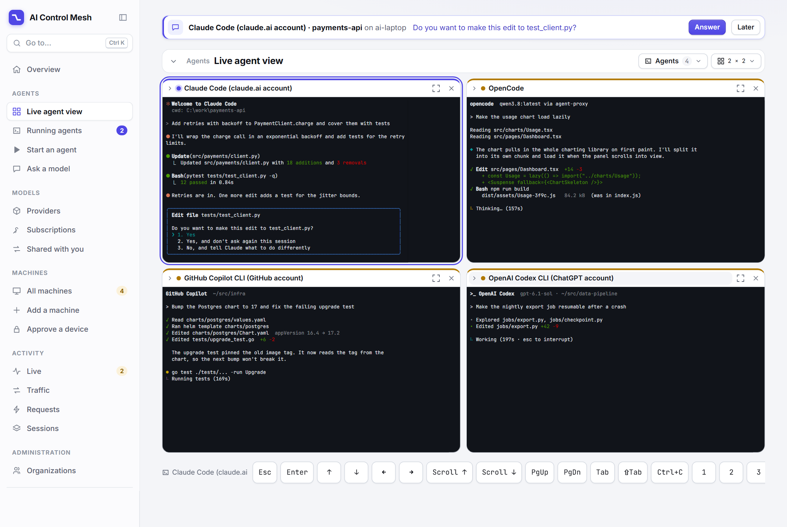

Click inside a terminal to type into that session; the focused tile has a highlighted border, and sessions shared for viewing remain watch-only.

- Each tile is headed by one short line: its state as a coloured dot and the agent's name. Press that title for the details underneath — its type, machine, folder, status, model and session id — and again to hide them; on a phone the model is left out.
- **Text size** changes the grid's text from 6px to 16px without changing the agent's terminal dimensions; scroll inside a tile to see output that doesn't fit. A tile's open details shrink only what you see: the agent's terminal keeps its own size.
- On a phone the tiles stack in one column. Tap a tile to bring up the keyboard in the message box above the quick keys; **Send** types the message into that tile's agent, with Enter.

**Quick keys** run along the bottom of the page: Esc, Enter, the arrows, Scroll ↑/↓, PgUp/PgDn, Tab, ⇧Tab, Ctrl+C, and 1, 2, 3, y, n, as on the full terminal page. They go to the selected tile, named at the start of the bar. They are off for a tile shared with you to watch only, or whose agent has ended. On a phone they stay at the bottom of the screen as you scroll, so you can answer a prompt without opening the terminal.

**Fullscreen** on each tile opens the full terminal page (message box, keys, copying and text controls); its back button returns here. The selection is remembered for your account in this browser tab; rows, columns and text size are remembered in this browser. **Remove from grid** only removes a tile, leaving the session running. A selected agent that exits stays in the grid until removed.

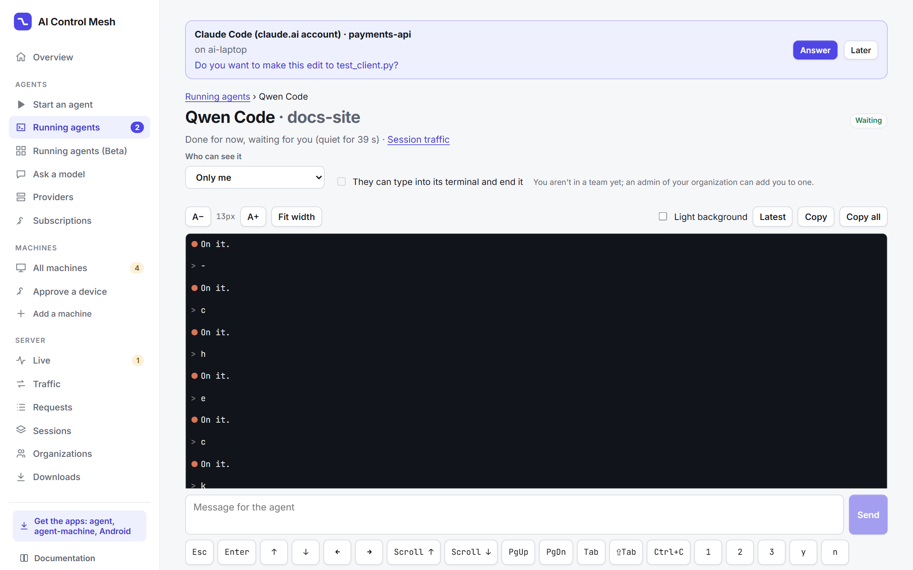

**A terminal.** Opening one (`/terminals/<session>`) shows the agent's live terminal (xterm.js) with its history. One line sits above it: a back button (to Running agents, or the Live agent view when you came from there), its state as a coloured dot, its name and folder, and the text controls. Press the name for the details underneath (the state's detail, **Session traffic**, sharing and hints), again to hide them; on narrow screens the text controls move there too.

- **Type into it** in the message box and **Send**. On a phone, tapping the terminal brings up the keyboard in the message box. Text and Enter go as separate keystrokes, and multi-line text is sent as a paste, so agents read it as if typed.
- **Keys** for phones: Esc, Enter, arrows, Scroll ↑/↓, PgUp/PgDn, Tab, ⇧Tab, Ctrl+C, and 1, 2, 3, y, n for answering prompts. Scroll ↑/↓ scroll a full-screen agent's own history (Claude Code, OpenCode, Qwen Code), else the terminal's.
- **A−/A+** change the font size; **Fit width** sizes it to the window; **Light** switches the terminal's colours; **Latest** jumps to the bottom.
- **Copying**: drag over the terminal to select text, then Ctrl+C (or Ctrl+Shift+C, or Cmd+C on a Mac) copies it; with nothing selected, Ctrl+C still goes to the agent. Full-screen agents that use the mouse (Claude Code, OpenCode, Qwen Code) take a plain drag themselves: hold Shift while dragging (Option on a Mac). **Copy** copies the selection, or else what's on the screen, and **Copy all** the whole terminal with its history (both work on phones).
- **Session traffic** opens the session's page, with its requests and chat.
- If the session is shared with you to watch only, the input is off.
- If the connection drops (a phone changing networks, the server restarting, the sign-in renewing), the page reconnects by itself and carries on from the last output it showed (an older server redraws the history). If the sign-in has run out, the page renews it once before asking you to sign in again.

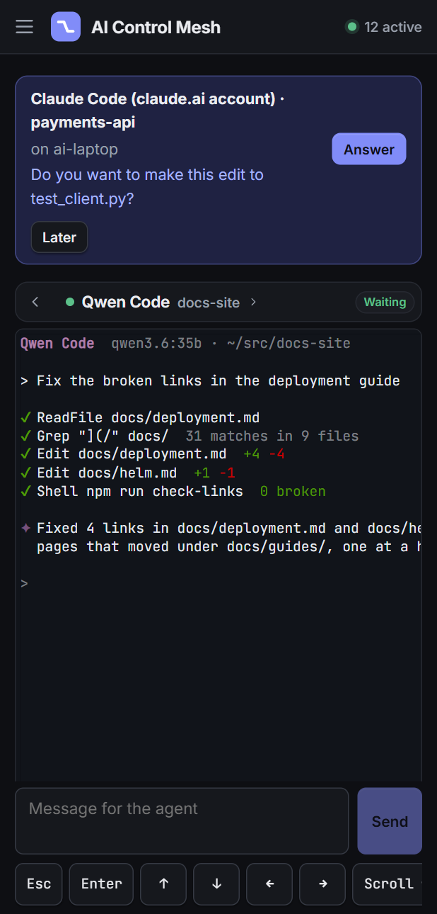

### Ask a model

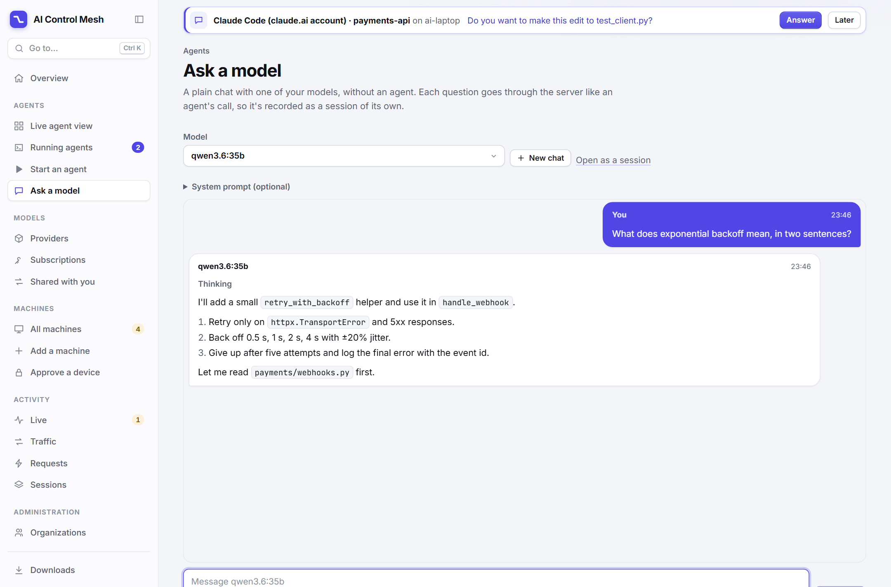

`/ask` is a plain chat with one of your models, without an agent: pick a model, type, and the answer streams in.

- **Model** lists the models of every online backend on a machine, by backend: Ollama, llama.cpp, Strata, Docker Model Runner, and OpenAI-compatible servers a machine hosts (LM Studio, vLLM). Hosted APIs and subscriptions aren't offered: they need an agent's own sign-in or key. Choosing another model starts a new chat.
- **Enter** sends; **Shift+Enter** starts a new line. **Stop** stops the answer. A model that thinks shows its thinking folded above the answer.
- If the connection drops while the answer is coming in (a phone changing networks), the server keeps reading it and records it in full, and the page picks the rest up when it's back. Only **Stop**, **New chat** or leaving the page stop it on the server.
- **System prompt** (optional) is sent before the conversation with every question.
- Each chat is a session of its own (client `console-chat`, payloads captured), so every question goes through the server like an agent's call: on Ollama it's translated and gets the model tuning, and it's recorded on **Traffic**, **Requests** and **Sessions**. **Open as a session** shows its chat view. The session ends with **New chat** or leaving the page; the conversation then lives only in the session.

### Providers and subscriptions

**Providers** (`/providers`) lists everywhere your agents' calls can go: model servers on machines (with the machine and whether it's connected), hosted APIs, and the kinds of subscription (with how many of yours the server has). See [Providers and usage limits](usage-limits.md).

- Each card shows your calls and tokens in the window you choose, every limit your organization put on you there with how much of it you've used, and **Blocked** until when, once you've reached one. A banner above them names the providers you're blocked on.
- Links beside the window go to your organization's usage and to its page; for its admins, **Hosted APIs** links to the organization's **API providers** tab, where they add them and choose the teams that may use each.

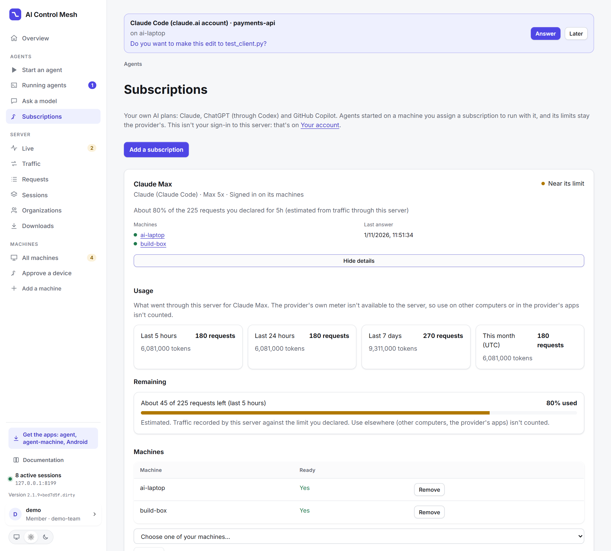

**Subscriptions** (`/subscriptions`) lists your own AI plans (Claude, ChatGPT through Codex, GitHub Copilot): each with its state, the machines it runs on and whether each is ready, and when it last answered. See [Subscriptions](subscriptions.md).

- **Add a subscription** names its provider, plan and how it signs in.
- **Usage and settings** shows what went through the server in the last 5 hours, 24 hours, 7 days and this month, the remaining balance against a limit you declare (an estimate, said as one; unknown without a limit), and limits the provider was seen enforcing.
- Below that: the machines (assign one of yours, remove, and for a token whether each gets it), the token (store, replace, revoke; never shown again), priority, who else may start agents with it, the declared limit, **Turn off**, **Remove** and its **History**.
- Admins of its organization see its metadata and can turn it off.

## Server: traffic and sessions

### Live

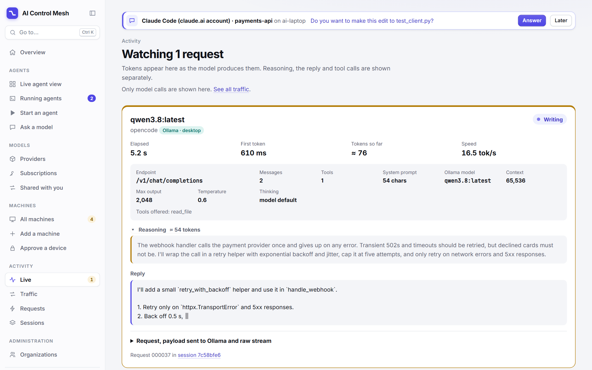

`/live` streams model calls as they happen: one card per request in flight, with the reply, reasoning and tool calls as they arrive, time to first token and speed. **Just finished** keeps the last few. Each card opens its full details (headers, the request, the payload sent to Ollama and the raw stream), and **Open in request history** goes to the saved request.

A cut-off stream reconnects by itself (at once when the browser comes back online or the page is shown, else after 1, 2, 5, 10 and then every 30 seconds, renewing the sign-in first), from what's in flight then.

Account agents' other calls (sign-in, telemetry, MCP) aren't shown here; they're on Traffic. Set `AI_PROXY_LIVE=0` on the server to stop streaming request text (counts still stream).

### Traffic

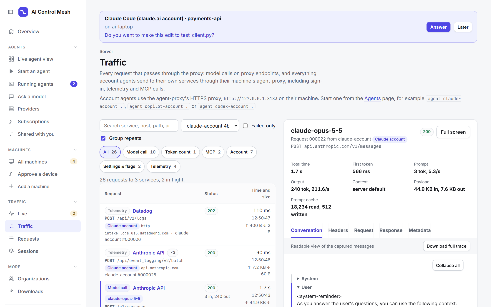

`/traffic` lists recorded requests: model calls, account agents' permitted requests to public services (private and reserved destinations are refused), and calls to shared MCP servers.

- **Search** by service, host, path, agent or model, pick a **session**, and tick **Failed only**.
- **Request types** filter the list: Model call, Token count, Model list, MCP, Account, Sign-in, Settings & flags, Telemetry, Updates, Connection and Other, each with its count. What each type covers is in [What the requests are](agents.md#what-the-requests-are).
- **Group repeats** folds back-to-back identical requests (agents poll some endpoints) into one row.
- Each row shows the type, service, method and path, the session, its status, timing and size; requests in flight are marked **pending**.
- Selecting a row opens the inspector on the right: timings, tokens and sizes, and tabs for the **Conversation** (a readable view of the messages), the **Request**, the **Response**, what was **Sent to Ollama** (for translated calls), the request and response **Headers** (credentials redacted) for captured HTTPS, and **Metadata**. **Full screen** opens it alone; **Download full trace** saves the JSON.
- **Still in memory**, in the inspector, marks a request whose session doesn't save payloads while the server still holds them live: read them now or they're gone when the request leaves memory.

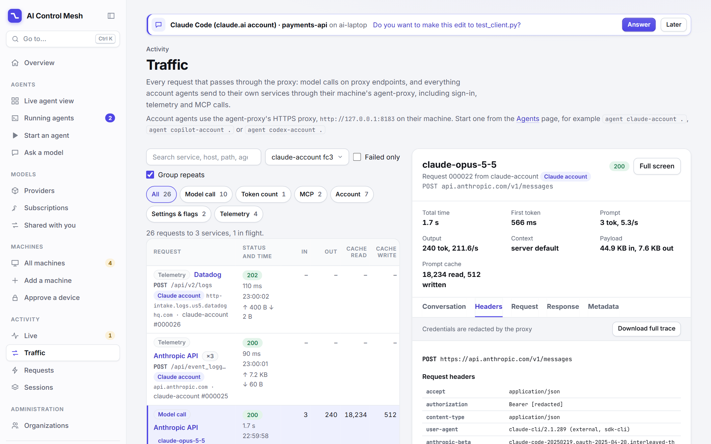

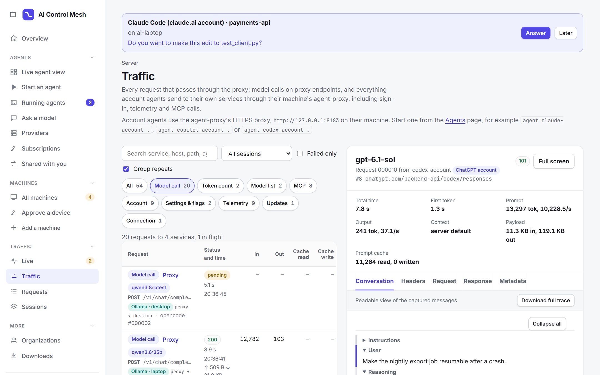

### Requests

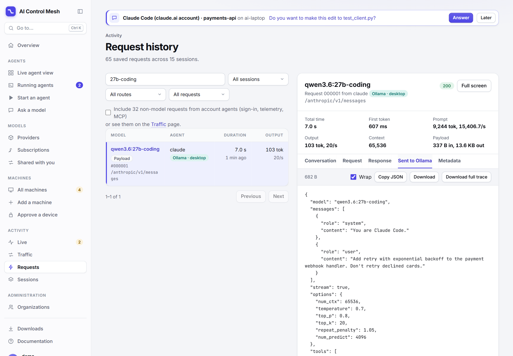

`/requests` is the model-call history across all sessions: model, agent, provider, duration, output tokens and speed.

- **Search** by model, agent, endpoint or ID; filter by **session**, **route** (accounts, local models, hosted) and **With payload**, **Without payload** or **Failed**.
- **Include non-model requests from account agents** adds their sign-in, telemetry and MCP calls (hidden by default; Traffic shows them too).
- It loads the newest 2,000 requests. **Load 2,000 older** fetches the next ones; search and filters cover the requests loaded so far.
- Selecting a row shows the same inspector as Traffic. Each request also has its own page (`/requests/<session>/<request>`):

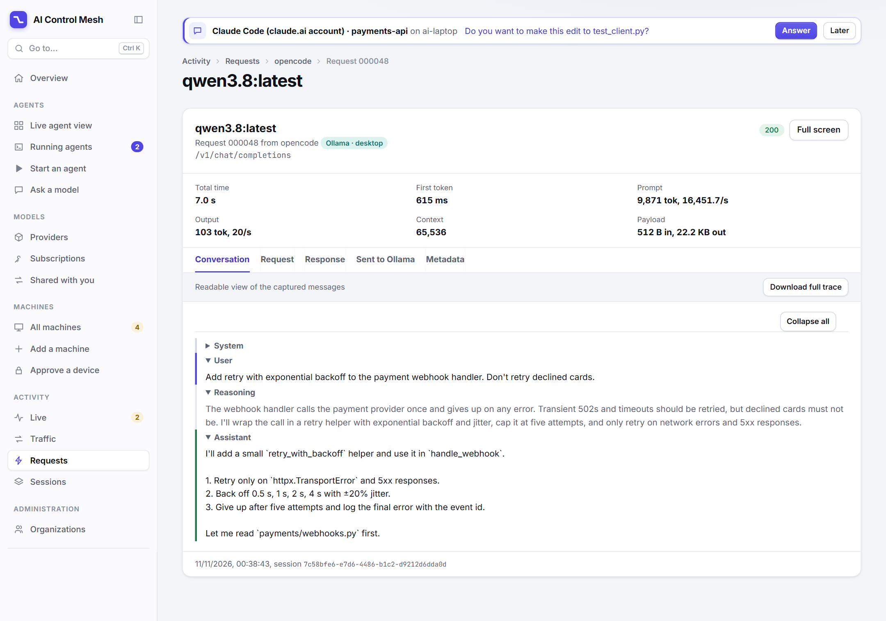

### Sessions

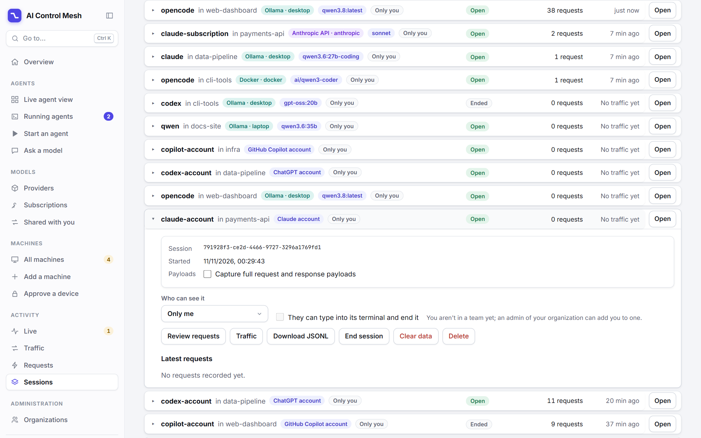

`/sessions` lists every session: agent, model, provider, when it started, requests and tokens, and whether payloads are saved. Selecting one shows its **Latest requests** and its actions:

- **Capture full request and response payloads**: turn saving payloads on or off for the rest of the session.
- **Review requests**, **Traffic**: open its requests on those pages.
- **Download JSONL**: its telemetry, one request per line.
- **End session**: closes an open session; its agent can no longer use it.
- **Clear data**: deletes its recorded requests and payloads but keeps the session.
- **Delete**: deletes the session and everything recorded for it. A session with requests in flight can't be cleared or deleted.
- **Delete all sessions** deletes ended sessions and open ones idle for more than 15 minutes (their agent most likely exited); recently active open sessions keep running but lose their saved data, and sessions with requests in flight are skipped. Only your own; admins also clear ownerless sessions in their organization.
- **Open a session manually**: for other tools. Name the agent, model and backend, choose whether to capture payloads, and **Open session**; it shows the OpenAI, Anthropic and Ollama URLs to point the tool at.

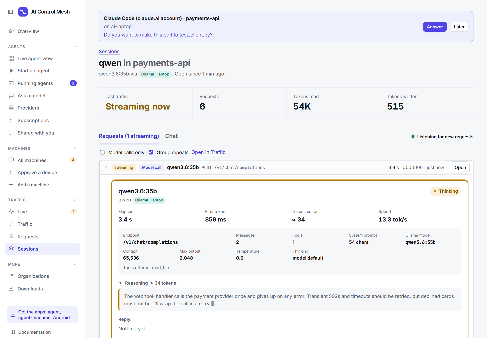

**A session's page** (`/sessions/<id>`) shows the session, when it started, its last traffic, requests, tokens read and written, a **Payloads** switch (when the organization's policy allows choosing), and its OpenAI and Anthropic URLs. Two tabs: **Requests** (the default), its requests as on Traffic, with **Model calls only**, **Group repeats** and **Open in Traffic**; and **Chat**, the session's captured model calls read back as a chat (it needs payload capture, `--trace`; see [The chat view](#the-chat-view)).

### The chat view

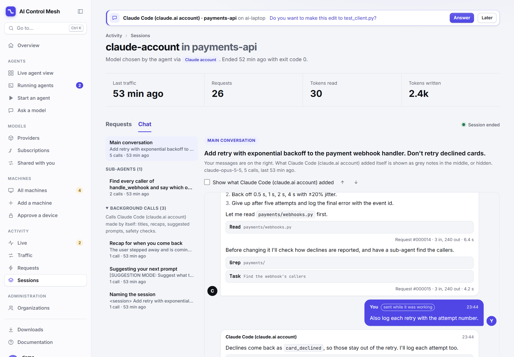

Agents send their model far more as "the user" than you type: system reminders, tool output, notes about images, and whole calls of their own. The chat view keeps what you wrote apart from all of that.

- **The list on the side** has the session's conversations. **Main conversation** is the one going on. Below it are other conversations (for example one from before `/clear`), **Sub-agents** (helpers the agent started for one task) and **Background calls**: calls the agent made by itself, such as naming the session, a recap for when you come back, suggesting your next prompt, compacting the conversation or checking an action is safe — each named by what it was for. On a narrow screen the list is a menu above the chat.
- **Your messages are on the right**, in the accent colour, with the time you sent them. A message typed while the agent was working says so, and slash and `!` commands show as commands. Pasted text is folded. On a session someone shared with you, the owner's name replaces **You**.
- **The agent's replies are on the left**: its text, its thinking (folded), and its tool calls. More than three tool calls in a row fold into one line, such as "Used 7 tools: Bash ×5 · Read ×2". Open a tool call for its input, result and request. Under each reply are its request, tokens and time.
- **What the agent added itself** shows as small grey notes in the middle, never as a message: an interruption, a command's output, the summary a compacted conversation goes on from, and a marker where it was compacted. Reminders and other context it injects are hidden. **Show what … added** shows them.
- **In a sub-agent**, what it was asked is on the right as **Main agent**, not you. **In a background call**, the agent's instruction is on the right, marked as the agent's, with the model's **Answer** below. The conversation a sub-agent or background call was handed is hidden behind **Show the … messages it was handed** (or **sent with**).
- **My previous** and **Next** jump between your own messages. **Newest** (or **New messages**) goes back to the end. The chat opens at the newest messages, loads older ones as you scroll up, and follows new ones while you're at the bottom. Long texts load in full when you open them.

Claude Code signed in to its account sends most calls with only what's new, naming the call before. The server follows that chain, and Claude Code's request headers say which calls are the main chat, a sub-agent or a background call. For other agents the server matches each call's messages to the conversation they continue, and calls without tools that aren't the main conversation count as background calls.

## Server: running it

### Server stats

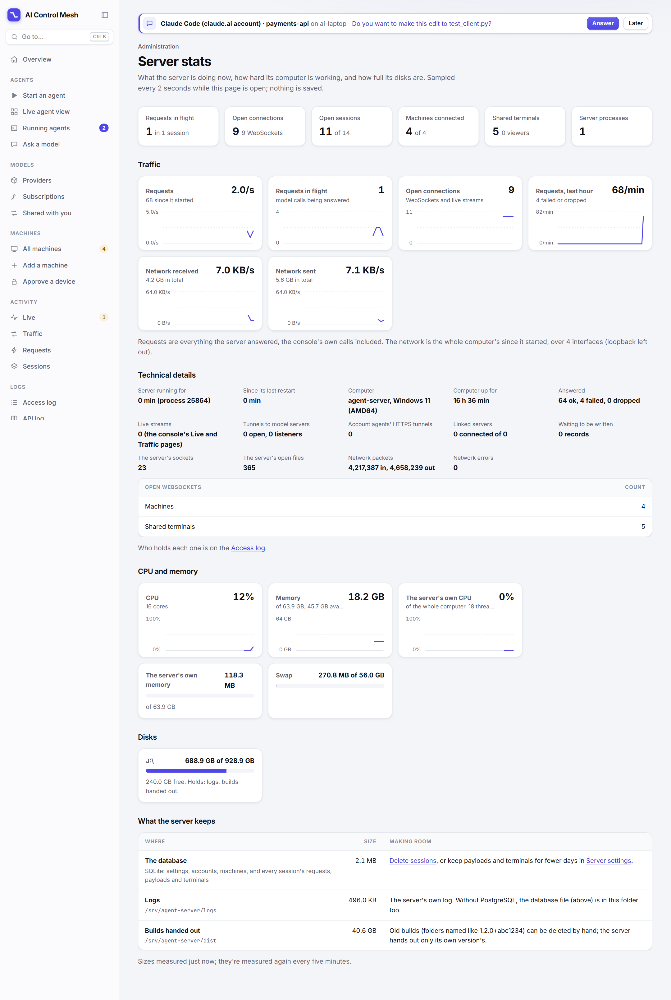

`/server-stats` (site admins only) shows how hard the server's computer is working and how full its disks are, asked every 2 seconds while open and kept for five minutes on the page only. A machine's own load is on its [Load tab](#load-mcp-servers-and-access).

- **The computer**: its name, system, how long it's been up and how long the server has been running.
- **CPU and memory**: charts of the computer's CPU (with the load average outside Windows) and memory, and of the server's own share of the CPU. Bars show the server's own memory and, when there is one, swap.
- **Disks**: each disk the server keeps its files on, with how much is used and free and which of its folders are there.
- **What the server keeps**: the size of its database (SQLite or PostgreSQL: settings, accounts, machines and every session's requests, payloads and terminals), its log folder (`logs/`, where the SQLite file is too) and the builds it hands out (`dist/`), measured every five minutes. Deleting sessions on the [Sessions](#sessions) page, or fewer days under **Storage** on [Server settings](#server-settings), removes recorded traffic; old build folders can be deleted by hand (the server hands out only its own version's).

### Access log

`/access-log` (site admins only) shows every HTTP request and WebSocket the server received and how each ended, whoever sent it (Requests shows only model calls): the console's API calls, sign-ins, downloads, agent-machine's fleet connection and tunnels, agent-proxy's tunnels, and requests refused before they reached anything (no sign-in, another site's origin, a program too old for the server).

Use it when something says it's connected and the console disagrees (a machine offline while `agent-machine status` says it runs). Start with **Machines' fleet connections** on the Overview:

- A machine that's working is **Connected**, with how long it has been.
- One the server closed shows its close code and reason under **Last ended**: 4401 not signed in, 4403 removed or refused, 4410 its sign-in needs renewing, 4426 too old for the server. A connection refused before the machine said who it is reads *Before its hello* and is listed by its sign-in and address.
- **Dropped** counts connections lost without a close, as when a phone sleeps or changes network: often many short connections in a row.
- No row at all means it isn't reaching this server: check the address it signed in to and anything in between (a proxy, Cloudflare, the phone's battery settings).

It has three tabs:

- **Overview**: totals since the server started (OK, failed, WebSockets dropped and open now, the median and 95th percentile answer time); a bar a minute for the last hour; each machine's fleet connections over the last 7 days (how many, how many failed or dropped, how long it was connected, how the last one ended and its version); what fails most (by request, with ids in paths folded together, and its answer and reason); where failures come from (by address, with the last user and program); every answer and how often; and what's saved, a bar a day.
- **Since this start**: every request, newest first, from memory. **Failed and dropped** shows only those, and **Follow** refreshes it every 3 seconds. The newest 5,000 requests are kept, and the newest 2,000 failures apart from them, so busy console traffic doesn't push a refusal out.
- **Saved history**: what's saved in the database, across restarts: every failure, every dropped WebSocket and every fleet connection, however it ended. **Fleet connections only** narrows it to those. The console's own successful calls aren't saved, which is most of the traffic.

In both lists:

- **Answer** is the HTTP status, or for a WebSocket **Open**, its close code and which side closed it, or *Refused* with the status and the server's close code. **Failed** marks answers of 400 and above, refused WebSockets and ones the server closed with an error code.
- **From** is the machine (for a fleet connection), the user it signed in as (or *not signed in*) and its address (the forwarded one, behind nginx or Cloudflare).
- Select a row for the reason (the error's message or the close reason), the address it asked for, how long it took, and the program and its version (`agent` and `agent-machine` send theirs).
- The search matches words in the path, address, user, machine, user agent, status and reason.

Saved entries are deleted after the days set under **Storage** on [Server settings](#server-settings), or after 30 days when recordings are kept forever. Query strings show their parameter names only, never their values. The log's own requests aren't listed, nor the console's `/assets/`.

### API log

`/api-log` (site admins only) lists every request the server saved, successes included: console calls, model calls, fleet connections and tunnels, sign-ins and refusals. Unlike the Access log (everything since the start, only failures saved), it keeps everything across restarts for the days you choose.

- **What's saved**: whether every request is being saved and for how many days, how many are saved and since when, and whether debug mode is on. Saving is off until you turn it on: **Start saving requests** (or **Storage** on Server settings, or `request_log` in `config import`). **Turn debug mode on** starts saving payloads too; **Change how long they're kept** opens **Storage** on [Server settings](#server-settings).
- **Requests**: newest first. Search words in the path, address, user, machine, user agent, status and reason, or pick a method, an answer (2xx, 3xx, 4xx, 5xx, failed or dropped, WebSockets) and a user. **Follow** refreshes it every 5 seconds; **Load older** pages back. Requests with a saved payload are marked **payload**.
- Select a row for when it came, its address, user, program and duration, and in debug mode its payload: the request's query, headers and body, and the response's headers and body. JSON is shown laid out.

**Debug mode** saves up to 64 KB of each request's and response's body, for fewer days than the requests themselves. Sign-in (`/api/auth/`) is never saved, credential headers (`Authorization`, cookies, API keys) are replaced, and fields named like secrets (passwords, tokens, keys) are replaced in JSON and form bodies. Anything else in a body (prompts, code, settings) is saved as it is, so turn it on while you look into a problem and off again after.

The log's own requests aren't listed, nor the console's `/assets/`. Requests that never reach the server aren't in it: the sign-in service (`agent-auth`) is a separate program, and a reverse proxy in front keeps its own log.

### Audit log

`/audit` (admins: their organization's events; site admins: everyone's; members don't see the page) is the [audit log](audit.md): who did what, to what, and whether it worked, newest first.

- Filter by type (a category like `machines` or `machines.launch`), person, outcome, organization (site admins) and a day to start from; **Load 100 older** pages back. On a phone the person is shown with each event.
- Open an event for its reason, the fields it changed, its place in its organization's chain and its whole record as JSON.
- **Download CSV** and **Download NDJSON** save the events shown by the filters (up to 5000). **Verify chain** checks every chain against the signed checkpoints and lists any problem; site admins can **Sign checkpoint now**.

### Server settings

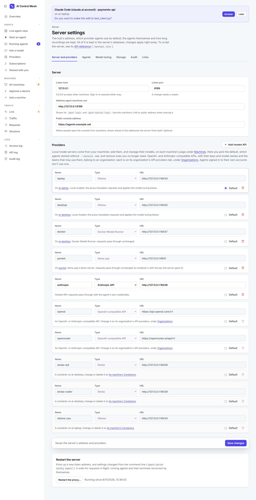

`/settings` (site admins only) changes the server's stored settings, in tabs kept in the address (`?tab=`): **Server and providers**, **Agents**, **Model tuning**, **Storage** and **Audit**. Most changes apply at once, in every server process:

- **Server**: **Listen host**, **Listen port**, **Address agent machines use** (shown for `agent login`) and **Public console address** (`public_url`, optional: where people open the console from anywhere, shown ahead of the addresses the server finds itself). A changed listen address needs a restart.
- **Providers**: every backend, with its type, address and machine. Choose the **Default**, or remove one. **Add hosted API** adds an Anthropic API backend (name, type, URL). Local providers can't be added here: they come from machines (see [Providers](providers.md)). API providers are listed here too, and can be the default, but are edited on their organization's **API providers** tab (**Organizations**). **Save changes** saves this section and the one above.
- **Agents**: every agent launchers can start, each marked **Shipped**, **Shipped, changed** or **Added here**. **Edit** opens its definition as YAML; **Add an agent** takes an id and a definition; **Remove** stops launchers offering it. **Reset to the shipped one** undoes changes to an agent that ships with the server. Shipped agents follow the server's upgrades until you change them. See [Adding a new agent](agents.md#adding-a-new-agent).
- **Ollama model tuning**: the `defaults`, `profiles` and `aliases` the server applies to requests it sends to Ollama, as one YAML document. **Save tuning** applies it to new requests. See [Model tuning](providers.md#model-tuning).
- **Storage**: which database the server uses (SQLite or PostgreSQL, its address without the password, and its size), and the server's [retention policy](retention.md):
  - which trace modes organizations may choose and the default one, and whether account agents' traffic and terminal output are recorded;
  - for each kind (traces, terminal output, request records, sessions, the audit log) how long it's kept and the least and most organizations may set — empty means forever, or no bound (on a phone each kind is a block of its own);
  - **API log**: saving every request for the [API log](#api-log) (off by default) and for how many days (7 by default), and whether debug mode saves headers and bodies too, and for how many days (1).
- **Audit**: the key checkpoints are signed with (its id, and the public key to copy), how many events exports haven't sent yet, the checkpoint interval, and the [exports](audit.md#exports): add, edit or remove one (name, kind, URL or blob folder, the environment variable holding its secret, which organizations, on or off).
- **Restart the proxy…** (shown when the server can restart itself, which it can't when started with `--reload`): restarts it once requests in flight finish, and says where it comes back. It picks up a new listen address, and settings changed from the command line (`agent-server config import`).

To copy the settings to another server or keep them in version control, use `agent-server config export` and `import` (see [Configuration](configuration.md)). **API reference** links to the server's OpenAPI pages (`/docs`).

### Organizations

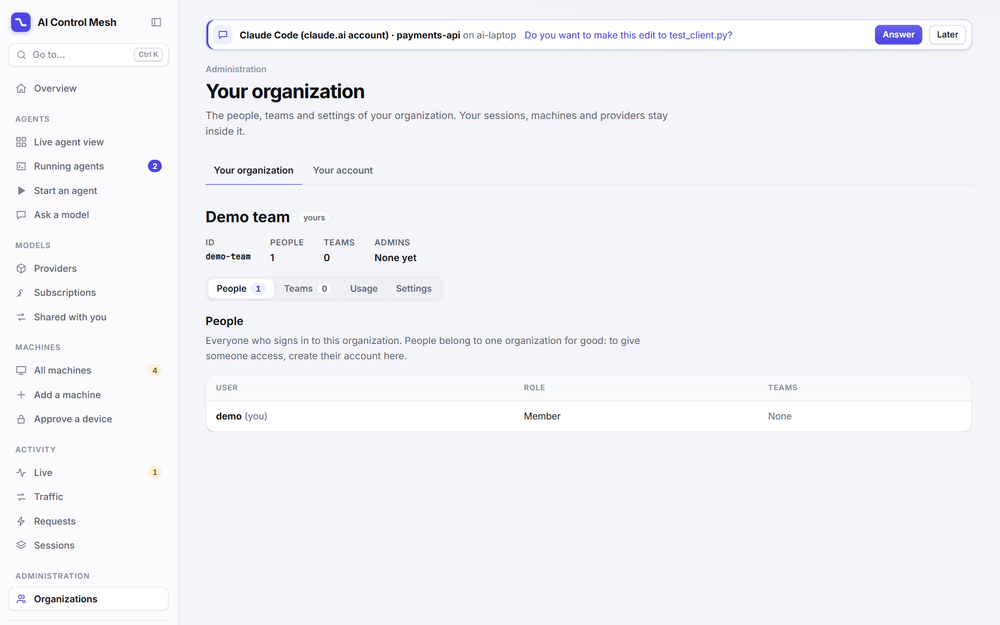

`/organization` separates the directory from your own account. Each organization is a tenant: its people, machines, providers and sessions are its own and never shared ([Accounts](accounts.md#organizations-are-tenants)). Tabs and the selected organization and team stay in the URL, for linking:

- **Your organization** (site admins: **Organizations**, every one, the root as **Site administration**; they also create organizations, and delete one once it has no users left). Its tabs:
  - **Teams** lists its teams; open one to put its people in or out of it, create a user in it, or rename or delete it.
  - **People** lists everyone in the organization and, for its admins, creates users there.
  - **API providers** (its admins, and site admins) holds the organization's [OpenAI and Anthropic-compatible providers](providers.md#api-providers-openai-and-anthropic-compatible), grouped as hosted APIs, gateways and machine-hosted ones. Each shows its address, protocols, how it authenticates, where its key comes from (stored, an environment variable, missing, or the agent's own; never the key), its models, priority, fallbacks, who may use it and its health.
    - **Add a provider** starts from a preset (OpenAI, Anthropic, OpenRouter, LiteLLM, Groq, Together, Fireworks, DeepSeek, Azure OpenAI) or a blank one. A machine-hosted one keeps its machine's address.
    - **Edit** changes every setting: the key is a write-only field (**Remove key** deletes a stored one), models are aliases mapped to the provider's ids, extra headers can't be credentials, and **Teams that may use it** limits it to some of the organization's teams (none chosen: everyone in it; its admins always may). Site admins also see **Also share with**, to share it with other organizations whole.
    - **Test connection** asks the provider for its models and offers to add the ones it lists. **Turn off** stops agents using it; **Remove** deletes it and its key.
    - Storing a key needs `AI_PROXY_VAULT_KEYS` on the server; without it, name an `AI_PROXY_API_KEY_*` variable instead.
  - **Usage** shows each person's calls and tokens on each provider in a window you choose, with their limits and who's blocked (members: only their own). Its admins set and remove limits there (**Limits**: a person or Everyone, a provider, a window, and tokens such as `1m` or `100k`; see [Usage limits](usage-limits.md#setting-limits)).
  - **Data** (its admins, and site admins) shows the [retention policy](retention.md) its sessions start under, marking what's the server's and what's its own; sets its own within the server's bounds (shown beside each), or goes back to the server's with **Use the server's**. It also lists its [legal holds](retention.md#legal-holds): place one on the whole organization, a person or a session, with a reason, or lift one.
  - **Settings** renames it.
- **People**: search the people you can see (your organization's; site admins: everyone). The root organization is the site's own: it has no Teams tab, and its People tab is **Site admins**. Admins can create accounts in their organization (site admins: in any; the root takes only site admins), **Edit user** to change their role, teams or password, and **Delete account**. People belong to one organization and can't be moved: to give someone access to another, add them there as a new user.
- **Your account**: your identity, role and organization, and OIDC sign-in instructions. To use another account, choose your name at the bottom of the menu: it switches between the accounts this browser is signed in to, adds one, or signs out of one or all ([Accounts](accounts.md#signing-in)). CLI sign-in uses device approval; scripts use explicitly provisioned service clients ([OIDC](oidc.md)). Admins reset account passwords in People or with `agent-server user passwd`.

Members see their organization and its people, read-only; its admins manage them; site admins manage organizations and server settings without seeing inside another organization. Removing someone from a team, or deleting a team, keeps the accounts. Destructive changes ask for confirmation. See [Accounts and sharing](accounts.md).

### Downloads

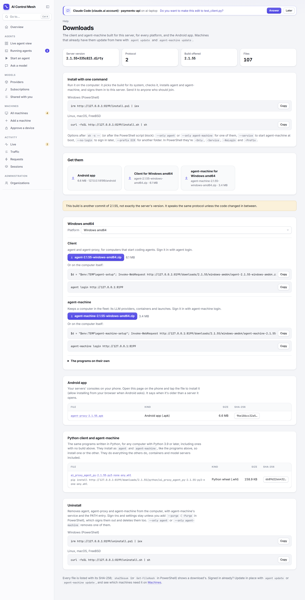

`/get` is public, so a new computer can get the programs before signing in:

- **Install with one command**: the one-line installer for **Linux, macOS, FreeBSD** (`curl ... | sh`) and **Windows (PowerShell)** (`irm ... | iex`), for the **Client** (`agent`) or **agent-machine**. They download this server's build for the computer, check it and sign it in.
- **Get them**: every archive and package of this server's build, by platform, with sizes and SHA-256. **The programs on their own** lists the bare binaries.
- **Python client and agent-machine**: the wheel, for computers without a Go build.
- **Android app**: the APK.
- **Uninstall**: the one-line uninstallers (`/uninstall.sh`, `/uninstall.ps1`), shown even when nothing is built. They remove the programs and agent-machine's service; `--purge` (`-Purge`) also signs them out and deletes their settings.

If nothing has been built (`scripts/build-dist`), it says **Nothing built yet**. See [Deployment](deployment.md#what-the-server-hands-out).

## Machines

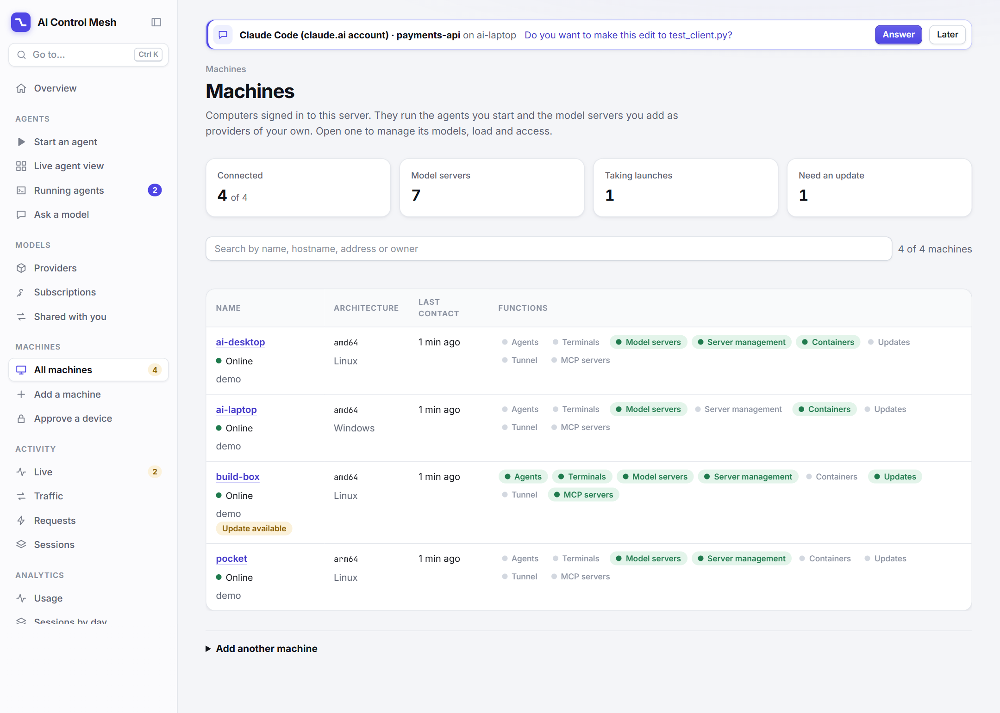

`/machines` opens with totals (Connected, Model servers, Taking launches, Need an update) and lists the fleet in rows: **Name** (with online/offline state and owner), **Architecture** (with operating system), **Last contact** (hover for the full date and time), and **Functions**. Open a machine's name to manage it.

Each row marks **Agents**, **Terminals**, **Model servers**, **Server management**, **Containers**, **Updates**, **Tunnel** and **MCP servers** as Enabled or Disabled. These are the machine's reported settings, not your permissions or a promise an offline machine is usable: model and MCP servers are enabled when it reports some, the rest follow its switches. An update badge shows when a newer build is available. Narrow screens show the same fields stacked.

- **Search machines**: filter by name, machine id, hostname, address or owner. Search ignores case.
- **Add a machine**: two choices, then one command to run there (the choices are remembered in the browser; **Add another machine** shows the page again when the fleet isn't empty).
  - **System**: Linux, macOS, FreeBSD; Windows; **Python** (the Python versions through pip, for any computer with Python 3.9 or later); or **Docker container** (a machine of its own in Docker or Podman, with the coding agents installed, which can only touch its `/workspace`). Each choice says what it is.
  - **Install**: **agent-machine** (a computer that supplies models) or **agent-machine and agent** (one you also start coding agents from). A Docker container has both, so it shows its engine and shell switches, an optional **Name** and its two steps instead. A name adds to `agent-sandbox` and names the container and both of its volumes, so `work` gives `agent-sandbox-work`, `agent-sandbox-work-home` and `agent-sandbox-work-workspace`: several sandboxes can run on one computer, each with its own sign-ins and workspace.
  - The page then shows the command, a checkbox to start agent-machine by itself (at boot, or when you sign in to Windows), and what the command does, step by step. **Let the server do more there** lists the switches for model servers, containers and launches, and **Install it by hand** points to Downloads.
  - **Remove it again** gives the matching way to take the machine off: the uninstaller for Linux, macOS and FreeBSD or Windows (`/uninstall.sh`, `/uninstall.ps1`, with `--only agent-machine` when that's all you installed), `pip uninstall` for Python, or removing the container. **Also sign out and delete its settings and sign-ins** adds signing out (which revokes its tokens) and deleting its settings, or the container's volumes. Then remove the machine from the fleet on its page.

  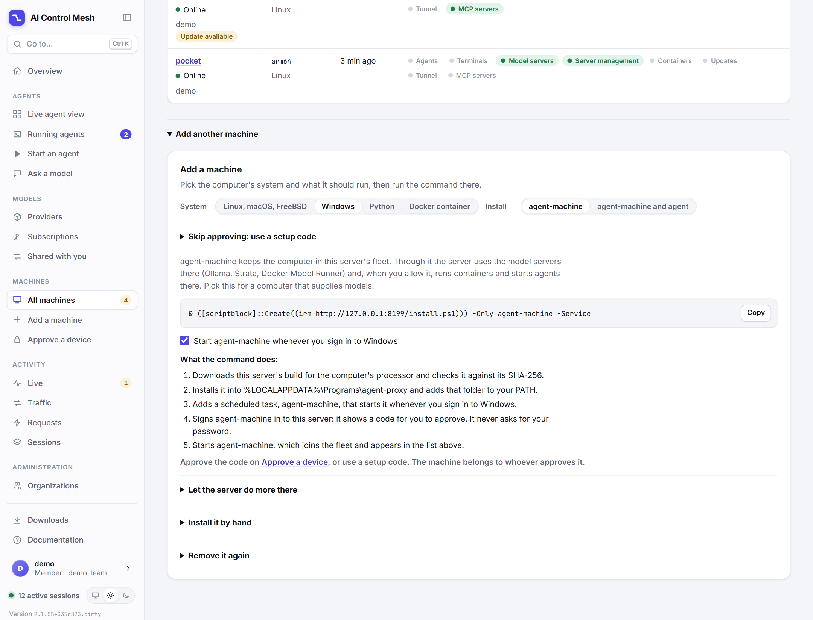
- **Skip approving: use a setup code**: makes a code (lasting 15 minutes, an hour or a day, for one or more machines) that signs a computer in as you with nothing to approve, and can turn switches on at sign-in; open codes are listed with **Revoke**. See [Machines](machines.md#signing-in-with-a-setup-code).
- **Removed**: machines taken off the server, which you (their owner or an admin of their organization) can allow back.

### Approve a device

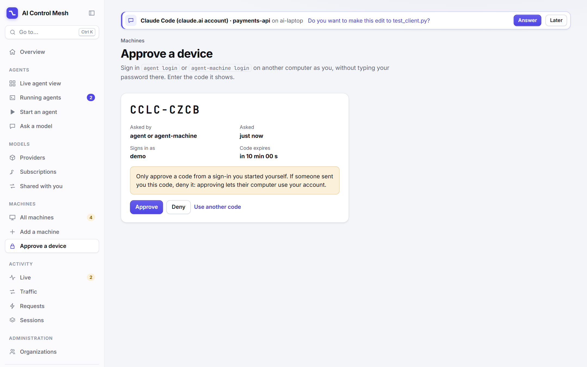

`/approve-device` signs `agent login` or `agent-machine login` on another computer in as you, from the console you're already signed in to, without typing your password there.

1. Run the login command on that computer. It prints a link and an eight-letter code.
2. Enter the code here and press **Continue**. The page shows what asked (agent or agent-machine), when, which account it signs in as, and when the code expires. Nothing is decided yet.
3. **Approve**, and the command finishes signing in by itself within a few seconds. **Deny** refuses it for good.

Approve only a code from a sign-in you started: approving lets that computer use your account. Codes are always typed by hand (never taken from a link) and decided once. The link the command prints works too: it's the sign-in service's own page, which asks for your password. See [OIDC authentication](oidc.md#cli-sign-in).

## A machine's page

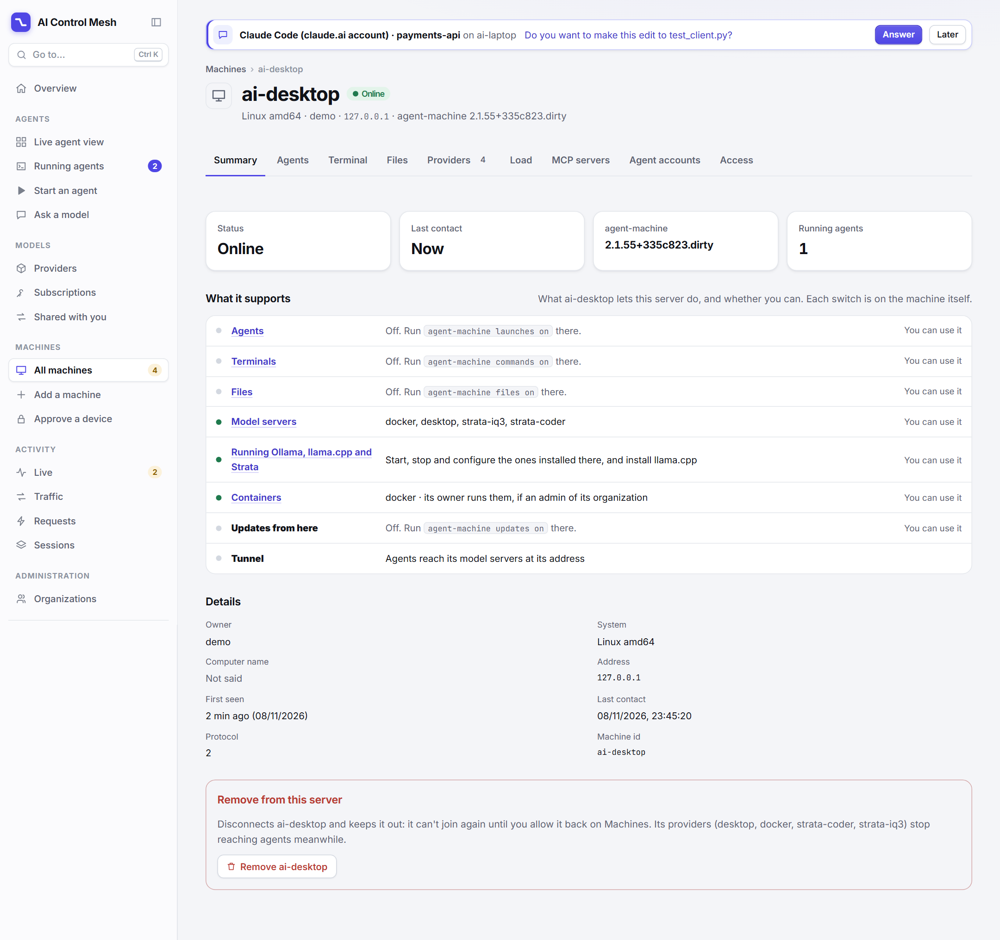

`/machines/<id>` has a header with the machine's name, state and system, **Start an agent** and **Open a terminal** (when you may use them), and, when the machine runs another build than the server, **Update now** (with **Update agent there too**) for its owner or an admin. Below it, a tab per function: **Summary**, **Agents**, **Terminal**, **Providers** (everything about its model servers and containers), **Load**, **MCP servers** (for its owner or when it shares some), **Agent accounts**, and **Access** (for those who manage it).

### Summary, agents and terminal

**Summary**: cards for its state, last contact, agent-machine version and running agents. **What it supports**: each feature (agents, terminals, files, model servers, running Ollama, llama.cpp and Strata, containers, updates from here, the tunnel) and whether it's on there and open to you, with the command that turns it on. **Details**: owner, system, computer name, address, first seen, last contact, protocol and machine id. **Remove from this server** (owner or admin) disconnects it and refuses it until it's allowed back.

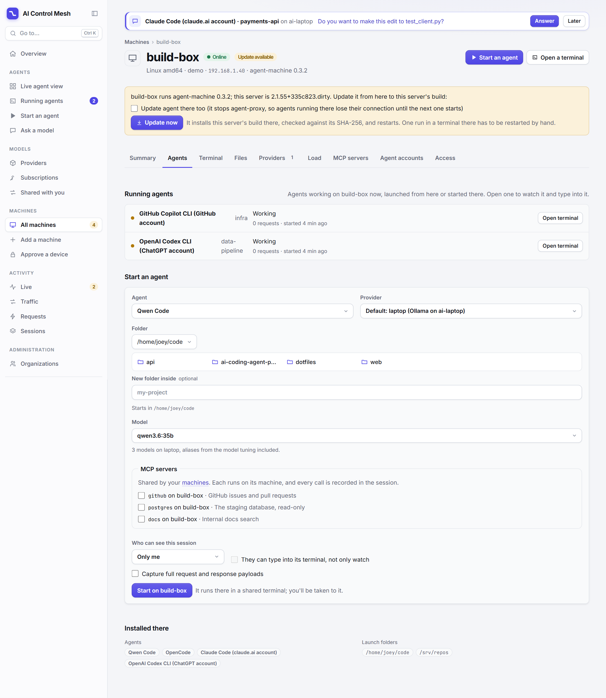

**Agents** has four parts: **Running agents** on the machine (launched from here or started there by hand), **Installed there** (the server's agents found on its `PATH`), **Start an agent**, and **Started from here** (each launch: who, which agent, which folder, its session or why it failed).

**Start an agent** picks the agent, the provider and model, the folder (browse the folders inside its launch folders, or name a new one), MCP servers, sharing and payload capture, then starts it in a shared terminal and opens it. It needs `agent-machine launches on` and a launch folder there. For an account agent, **Subscription** picks which of your [subscriptions](subscriptions.md) it runs with: the machine's own sign-in (its owner only), **Choose automatically**, or one by name.

**Agent accounts**: the provider CLIs the machine found (Claude Code, Codex, Copilot CLI), their versions and whether each is signed in, as its agent-machine reports them (never a sign-in itself), and the subscriptions you can see that run there, with their state.

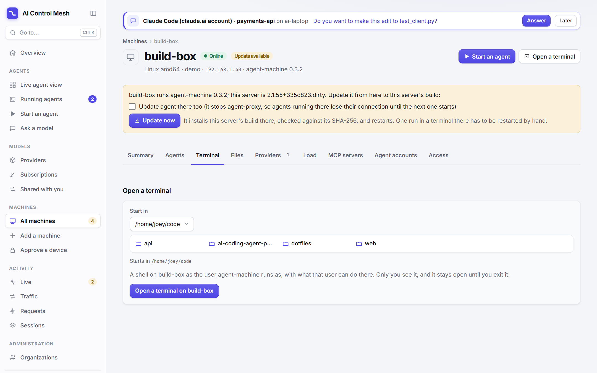

**Terminal**: **Open a terminal** starts a shell on the machine in one of its launch folders, in a terminal only you see. It needs `agent-machine commands on` there.

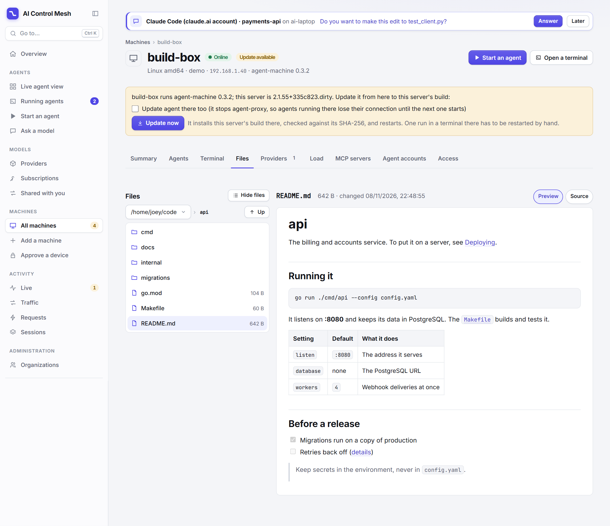

**Files**: browse the folders and files inside the machine's launch folders, and click a file to read its text, with line numbers. A Markdown file (`.md`) opens rendered, the way GitHub shows it: **Source** shows its text instead, links to other files in it open them here, raw HTML in it is shown as text, and only `https` pictures are loaded. With a file open, **Hide files** folds the list away to give the file the whole width; on a phone it folds away by itself when you open a file, and **Show files** brings it back. Hidden files (names starting with a dot, such as `.env` and `.git`) are shown too, a file shows at most its first 1 MB, and a binary file isn't shown. The open folder and file (and **Source**) are in the page's address, so a link opens the same view. It needs `agent-machine files on` there and the `files` feature ([Who may use a machine](machines.md#who-may-use-a-machine)).

### Providers

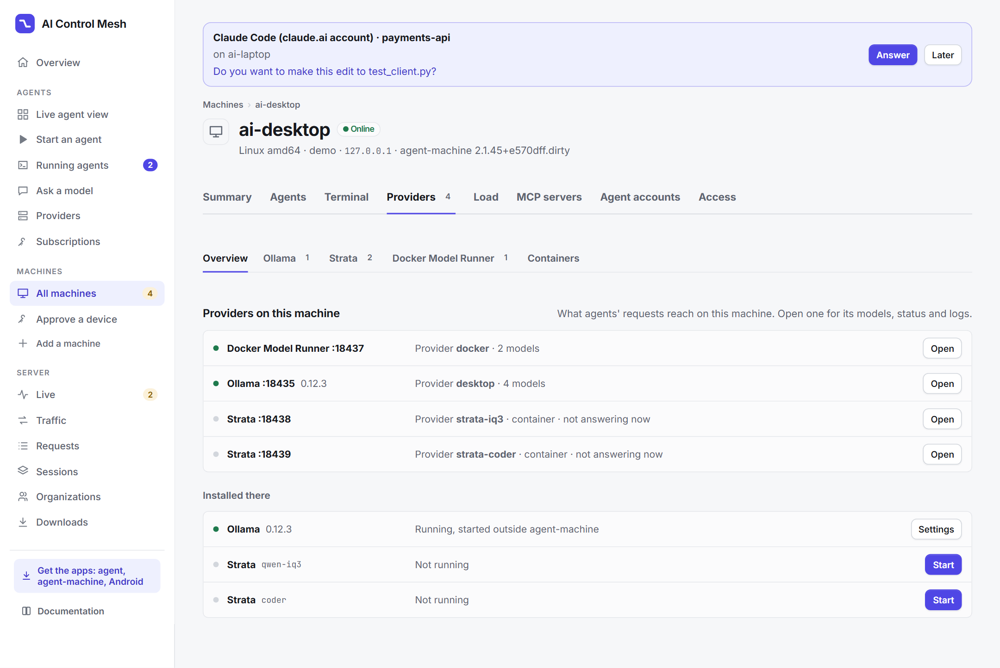

Everything about the machine's model servers is in this one tab, at `/machines/<id>/providers`. Its own tabs are:

- **Overview**: the model servers it runs (Ollama, llama.cpp, Strata, Docker Model Runner, and the containers it runs for the server), each with its address, version and whether it's a provider yet, and the Ollama, llama.cpp and Strata installed there, with **Start** and **Stop**. A model server that isn't a provider has **Add as a provider** (for the organization's admins), after which every agent of the organization that speaks its API can use it.
- **Ollama**, **llama.cpp**, **Strata** and **Docker Model Runner**: one tab for each kind the machine runs or has installed, with how many it runs. Inside it, a button for each instance, a model server or a container, named after its provider (or `Port 11434` until it is one), and for Ollama and llama.cpp the kind's server tab, **Ollama server** or **llama.cpp server**. Each has an address of its own: `/machines/<id>/providers/ollama/ollama-11434`, `/machines/<id>/providers/llamacpp/server`.
- **Containers**: the containers the machine runs, when it runs them.

Older addresses (`/machines/<id>/ollama-11434`, `/machines/<id>/ollama`, `/machines/<id>/containers`, `/machines/<id>/model-servers`) still work and open the same tab here.

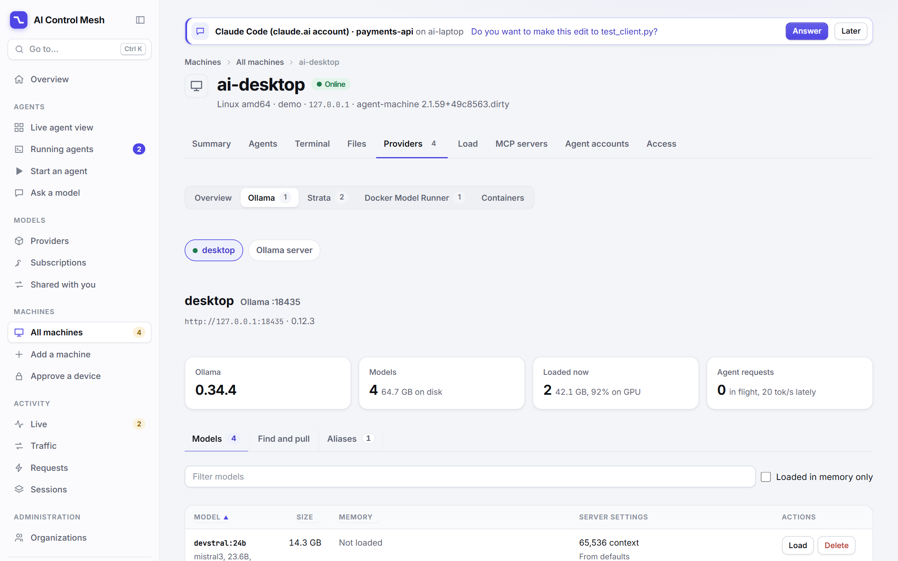

**An instance.** Everything here is done by the machine:

- **API** (LM Studio, vLLM, SGLang or another OpenAI-compatible server): the models it lists, read only. Its models are managed in that server itself. **Add as a provider** adds it with Chat Completions only; its organization's admins turn on more protocols on its **API providers** tab (Organizations).
- **Ollama**: **Models** (each model's size, whether it's loaded and where, the agent requests it served, and load, unload and delete), **Aliases** (the model tuning's aliases that point at it, with their settings; change them on [Server settings](#server-settings)) and **Find and pull** (search the Ollama library and Hugging Face, or pull by name, with progress).
- **Strata**: **Overview** (state, profile, engine, uptime, model, context, prompt and generation speed, speculative decoding, with **Load** and **Unload**, then its **Hardware** and **Models**), **Connect agents** (the agent commands for it) and **Log** (server and engine logs, key blanked).
- **llama.cpp**: **Models** (what its router can serve: each model's size, state, download progress and file, with load, unload and delete) and **Find and download** (search Hugging Face for GGUF repos and pick a quant, or name one as `user/repo:quant`, with progress; choose whether llama.cpp or the machine downloads it; **By hand** gives the `curl` commands and **Reload**).
- **Docker Model Runner**: **Models**, **Get models** (search Docker Hub's `ai/` models and their tags, or pull by name) and **Connect agents**.

A pull runs on the machine. A page that loses its connection first says so (**Lost the connection to the pull. It may still be running on the machine.**) instead of reporting success, and refreshes the model list, where the model shows up once the machine has it.

When the machine doesn't report an Ollama, llama.cpp or Strata running, its tab says why at the top and what to do: **Start Ollama**, **Start llama.cpp**, or **Start** a Strata profile, when it's installed there and you may manage the machine's servers (`agent-machine servers on`); otherwise whether it isn't installed, or how to let the console start it. Changing models needs `agent-machine servers on` there; without it the tab shows the models but doesn't change them.

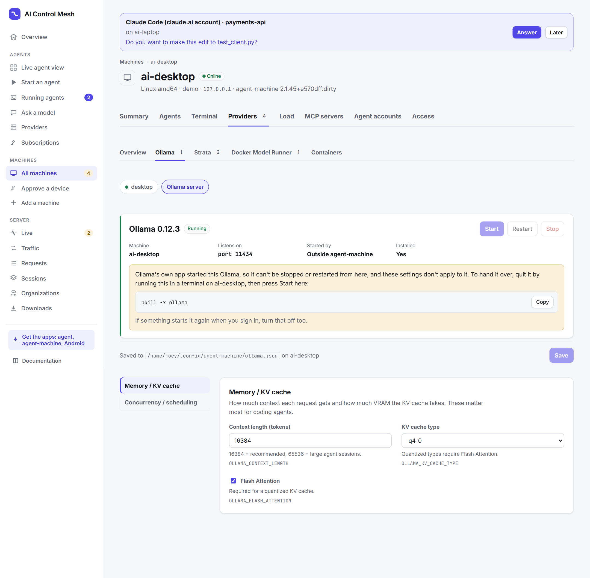

**Ollama server**, for the Ollama installed on the machine: **Start**, **Stop** or **Restart** it (with `servers on`), **Settings** (the `OLLAMA_*` settings agent-machine starts it with, such as context length, parallel requests, flash attention and KV cache type, with warnings), **Environment** (what Ollama starts with, plus **Extra variables**) and **Log**.

**llama.cpp server**, for llama.cpp on the machine (with `servers on`): its state, build and where it came from; **Install llama.cpp** (or **Update or change build**), which lists the builds that fit the machine, suggests one, and shows the install's progress; **Remove** for builds installed from here; **Start**, **Stop** and **Restart**; **Settings** (the `LLAMA_ARG_*` settings agent-machine starts it with: context, KV cache, GPU layers, devices, models loaded at once, thinking budget, download folder and more, with warnings), **Environment** (what llama-server starts with, plus **Extra variables**) and **Log**. See [llama.cpp](providers.md#llamacpp).

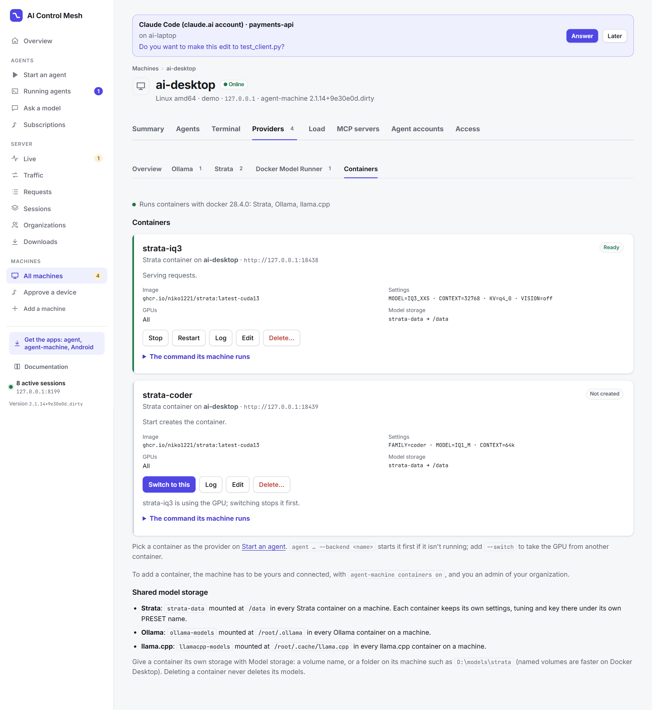

**Containers**: the Strata, Ollama and llama.cpp containers the machine runs for the server. Each shows its phase (Not created, Pulling image, Starting, Loading model, Ready, Unhealthy, Stopping, Stopped, Failed), settings and GPU, with start, stop, restart, switch (stop the others holding its GPU), logs, edit and delete. **Add a container** picks the engine and its settings; **Shared model storage** is the volume or folder its models live in; **The command its machine runs** shows the exact `docker run`. See [Providers](providers.md#containers-machines-run).

### Load, MCP servers and access

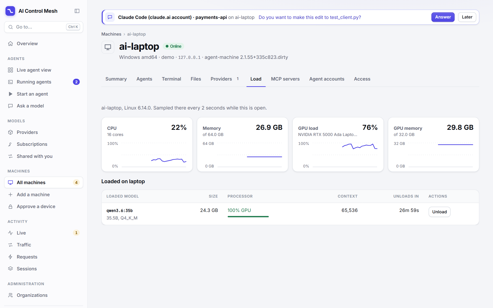

**Load**: the machine's CPU, memory and GPU use over time, sampled there, and **Loaded on** each Ollama: which models are in memory.

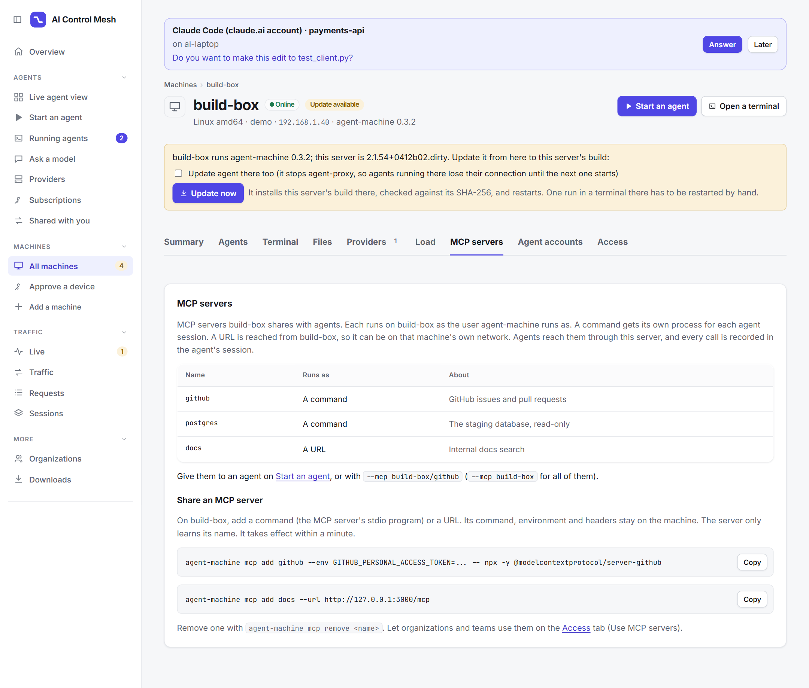

**MCP servers**: the MCP servers the machine shares, by name, with how each runs (a command or a URL) and whether it's installed there. Its owner sees the `agent-machine mcp add` commands. See [MCP servers](mcp.md).

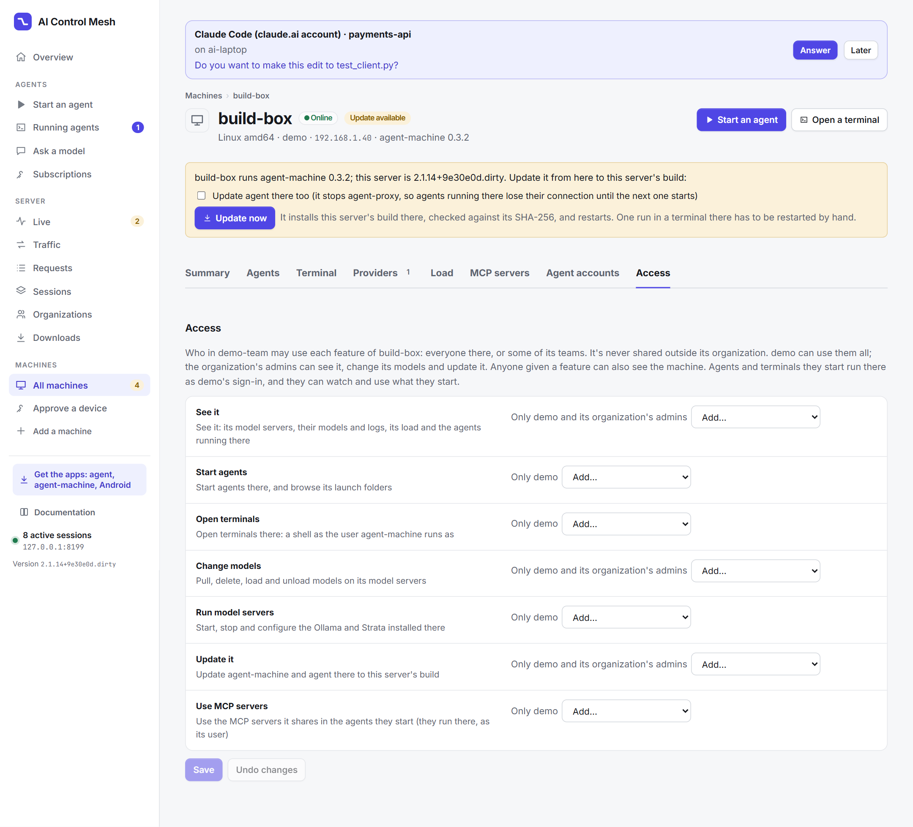

**Access**, for its owner and its organization's admins: whether the whole organization, or which of its teams, may use each feature (see it, start agents, open terminals, change models, run model servers, update it, use MCP servers), and which of the machine's own switches each also needs. See [Machines](machines.md#who-may-use-a-machine).
