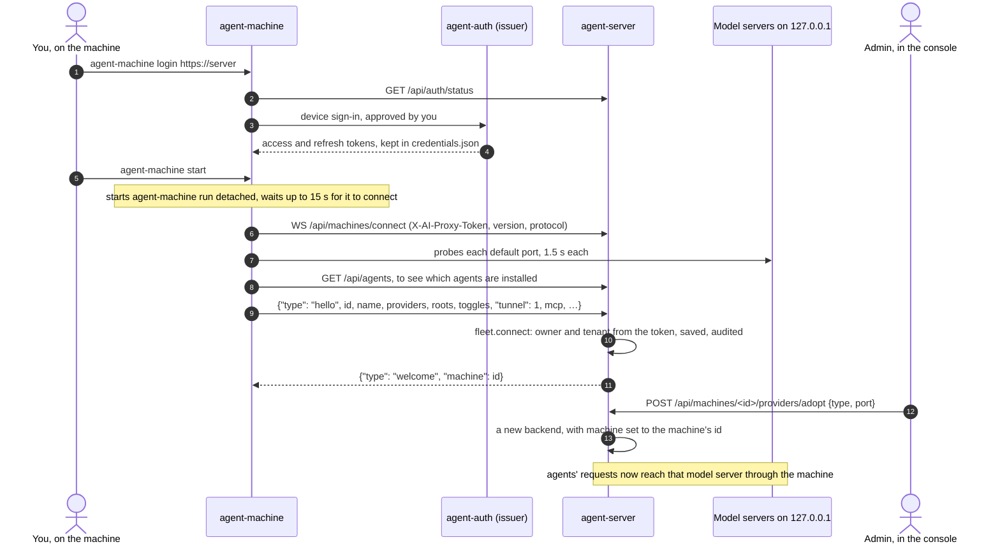
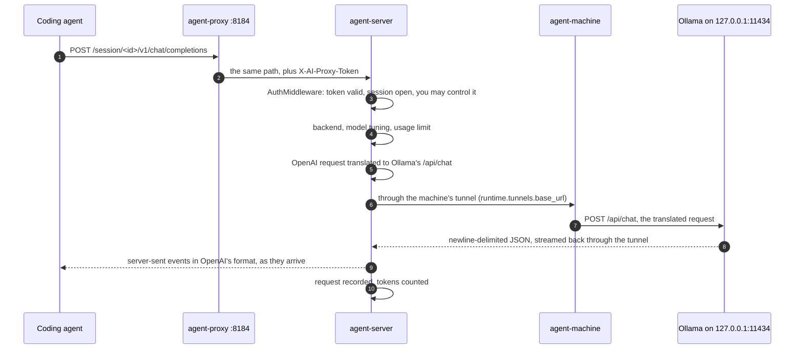
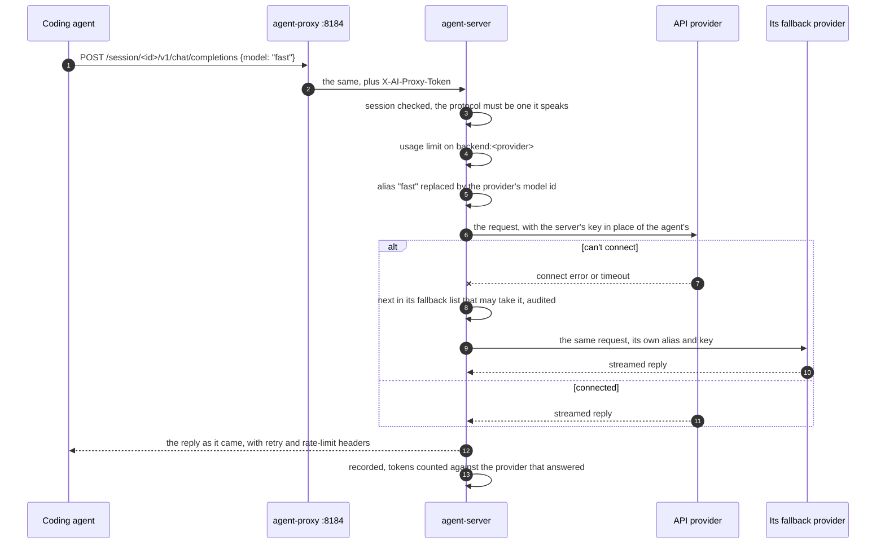
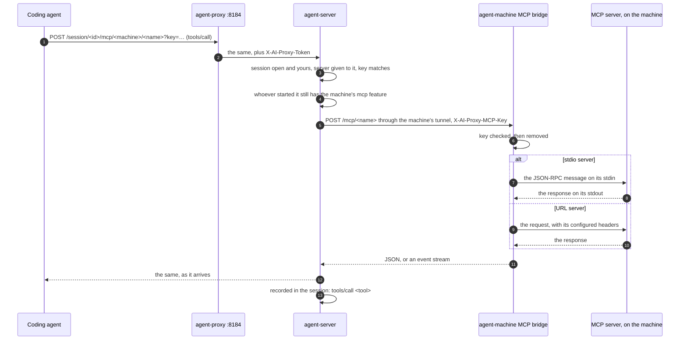
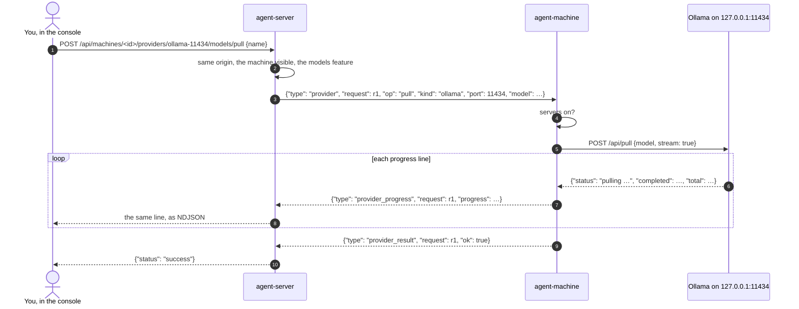
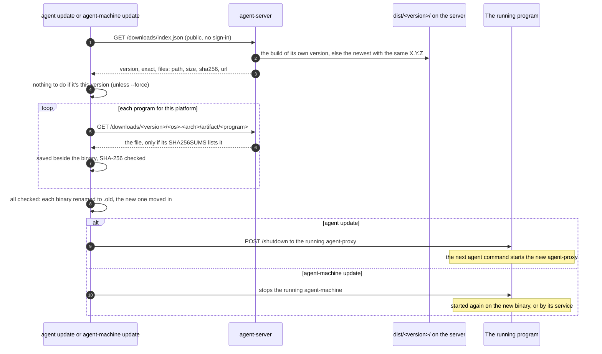

# Flows

This page is the technical view: the system's main flows end to end, message by message. For the overview in plain terms, start with [How it works](how-it-works.md).

## Every flow, and where it's drawn

| Flow | Drawn in |
| --- | --- |
| A machine joins the fleet | [below](#a-machine-joins-the-fleet) |
| A local-model request, to Ollama on a machine | [below](#a-local-model-request) |
| A request to an API provider | [below](#a-request-to-an-api-provider) |
| An MCP tool call to a server a machine shares | [below](#an-mcp-tool-call) |
| Pulling a model on a machine | [below](#pulling-a-model-on-a-machine) |
| Updating agent and agent-machine from the server | [below](#updating-agent-and-agent-machine) |
| Browser sign-in to the console | [OIDC authentication](oidc.md#browser-sign-in) |
| Device approval (`agent login`, `agent-machine login`) | [Security](security.md#device-approval) |
| `agent login` and the agent-proxy's token | [Running coding agents](running-agents.md#signing-in-agent-login-and-agent-logout) |
| A session, step by step (`agent qwen .` on your computer) | [Architecture](architecture.md#a-session-step-by-step) |
| HTTPS interception for account agents | [Architecture](architecture.md#https-interception), [Networking](networking.md#account-agents-https) |
| Tunnels to machines, and the MCP relay | [Architecture](architecture.md#tunnels-to-machines-and-the-mcp-relay) |
| Terminal sharing (`--control`) | [Architecture](architecture.md#terminal-sharing) |
| The fleet socket: hello, pings, token renewal, requests | [Networking](networking.md#the-fleet-socket) |
| How a request's upstream address is chosen | [Networking](networking.md#4-the-upstream-address) |
| Starting an agent on a machine from the console | [Machines](machines.md#launches) |
| A remote update asked for from the console | [Machines](machines.md#remote-updates) |
| Linking servers, bridges, and guests' requests, launches and MCP calls | [Peering internals](peering-internals.md) |

## A machine joins the fleet

**Signing in.** `agent-machine login` runs the OAuth device flow drawn in [Security](security.md#device-approval). It asks the server's `/api/auth/status` for the issuer and the CLI client, and saves the tokens in agent-machine's own `credentials.json`, separate from the `agent` command's. With `--code` (or `AI_PROXY_SETUP_CODE`) a setup code from the console approves it instead of you; `agent-machine start` uses such a code by itself on a container's first start. The machine's id is made once, at random, and kept in `machine.json`.

**Connecting.** `agent-machine start` runs `agent-machine run` in the background and waits until its status says it connected or failed. `run` opens `WS /api/machines/connect`, signed with its access token. A server that can't take its protocol level refuses it with HTTP 426 or close code 4426. Only after the socket is open does it build the hello: it probes the model server ports (`DetectProviders`), asks the server's `/api/agents` which executables to look for on its PATH, and adds its toggles (`launches`, `commands`, `updates`, `files`), its roots, its containers and servers state, the MCP servers it shares, and the provider CLIs it found.

**What the server checks and keeps.** `Fleet.connect` refuses an id that isn't letters, numbers and `-` (4400), a removed machine (4403), and an id that belongs to another user or tenant (4403). Otherwise the machine is the signed-in user's, in their tenant. Its address is the one the hello names, else the address the connection came from. Everything is saved in the database except Strata keys and the MCP bridge's key, which stay in memory. Backends already linked to the machine follow its address (`claim`), the connection is audited as `machines.connected`, and the server answers `welcome`. From then on the machine sends an `update` every 60 seconds, which the server takes the same way.

**Becoming a backend.** A model server the machine reports isn't used by agents until an admin of its tenant adds it as a provider (**Add as a provider**, `POST /api/machines/<id>/providers/adopt`, which is in `ADMIN_ONLY`). That saves a backend named after the machine with `machine` set to its id, so only agents of the machine's tenant can use it, and every request to it goes through `runtime.tunnels.base_url`. An OpenAI-compatible server (`api`) becomes an API provider that speaks Chat Completions only, until an admin turns on more. The server never adds a local backend by URL alone.

## A local-model request

An agent on your computer, in a session on an Ollama backend that runs on a machine:

**On your computer.** The agent's base URL is its own agent-proxy, with the session id in the path. The agent-proxy checks the request came from this computer (loopback `Host`, no other site's `Origin`), adds the computer's access token as `X-AI-Proxy-Token`, drops `Cookie`, `Origin` and the proxy headers, and streams the request to the same path on the server. The agent's own `Authorization` header is left as it is.

**At the server.** `AuthMiddleware` checks the token, then that `/session/<id>` names an open session the signed-in user may control; anything else is `404 No open session with that id`. `routes/compat.py` takes the backend from `X-AI-Proxy-Backend`, else the session's, and only from the backends the caller's tenant may use (`fleet.usable_by`). It looks up the model's tuning (`Settings.profile`): an alias may name another Ollama model, and the defaults and the first matching profile add `options` such as `num_ctx`, plus `keep_alive` and `think`. Values the agent sent itself win. Then it checks the person's usage limit on `backend:<name>`; once a limit is reached the answer is a 429 with `usage_limit` and the call never reaches the model.

**Translation.** Ollama's own `/v1` ignores per-request settings such as `num_ctx`, so the server translates Chat Completions and Anthropic Messages to native `/api/chat` and the reply back (`translate/`). A model whose tuning says `translate_openai: false` is passed to Ollama's `/v1` instead, with only the alias resolved. Native `/session/<id>/api/chat` and `/api/generate` pass through with the tuning applied. Strata, llama.cpp and Docker Model Runner take OpenAI and Anthropic requests as they are. The full table is in [Networking](networking.md#3-endpoint-and-backend-type).

**To the machine.** The upstream address is always `runtime.tunnels.base_url(backend)`. For a machine that can tunnel, is connected and isn't on the server's own computer, that's a loopback listener whose connections the machine carries to `127.0.0.1:11434` on its side. Otherwise it's the backend's address. The tunnel is drawn in [Architecture](architecture.md#tunnels-to-machines-and-the-mcp-relay).

**The reply.** Ollama streams JSON lines. The server translates each into the agent's protocol as it arrives, and after 10 seconds of silence (a long prompt still being read) it sends the protocol's own keep-alive so the agent doesn't time out. Every reply carries `X-Request-ID` and `X-Session-ID`.

**What's recorded.** When the stream ends, or fails, or the agent closes it, `Runtime.complete` records one request: model, backend, status, token counts from Ollama's statistics, time to first token and bytes. It goes into the session's `requests` in the database and to the console's live view, and the tokens are added to the person's hourly usage of `backend:<name>`, which their organization's limits count. With tracing on, the agent's request, the request sent to Ollama and the reply are saved as the request's trace.

## A request to an API provider

An agent whose session is on an `api` backend: a hosted API such as OpenAI or Groq, or a gateway, with its key on the server.

**Which protocol.** The path says what the agent speaks: `openai-chat`, `openai-responses` or `anthropic` (`api_providers.protocol_for`). A provider only takes the protocols it was set up for; anything else is a 400 that names what it speaks. Native Ollama `/api/...` is refused too.

**The key and the request.** The server replaces the agent's `Authorization`, `x-api-key` or `api-key` with its own key for the provider, in the header its `auth` mode names. The key is an environment variable the provider names (`AI_PROXY_API_KEY_*`), or one a site admin typed, kept encrypted and bound to the provider's address. With `auth: agent` the agent's own credentials go instead. The provider's extra headers are added, and the model alias is replaced by the provider's model id (`options.models`). Nothing else in the body changes. Hosted providers are reached directly through `runtime.api_clients`, which only connects to public addresses and never follows redirects; an `api` server on a machine goes through its tunnel like any model server.

**Usage limits.** Before the call, the server checks the person's limits on `backend:<provider>`: their own, or everyone's in their organization, over each window. A reached limit answers 429 with a `usage_limit` error and `retry-after`, and the refused call is recorded so people can see why. A call already running always finishes. Starting a new session on that provider is refused too.

**Fallback.** Only when the server couldn't connect to the provider (a connect error or timeout), so nothing of the request reached it, does it try the provider's `fallback` list in order. A candidate has to be an enabled API provider the session's person may use, speak the protocol, know the model (or discover models), and not be over that person's limit. The request is sent again with the candidate's own alias mapping and key. The move is recorded on the request (`fallback_from` and the routing), logged, audited as `backend.fallback`, and shown to the agent in `x-ai-proxy-backend`. Any other failure, or an empty list, is a 502.

**The reply.** It's streamed back unchanged. The provider's `retry-after`, `x-should-retry`, `request-id` and rate-limit headers are kept, so the agent's own retries work; its `x-request-id` becomes `upstream-request-id`, as `X-Request-ID` is the server's. The record counts the tokens the provider reported against the provider that answered, and the server keeps each provider's last status and time to headers as its health.

A hosted `anthropic` backend works the same way without the key, alias and fallback steps: `/anthropic/...` is passed through with the agent's own credentials.

## An MCP tool call

An agent started with `--mcp` (or with MCP servers chosen on **Start an agent**) calling a tool on an MCP server a machine shares:

**The URL.** When the session opens, the server makes a random capability for it (`mcp.issue_token`) and keeps only its SHA-256. The full URL, `…/session/<id>/mcp/<machine id>/<name>?key=<capability>`, goes only into the agent's launch settings. Knowing the session id isn't enough.

**The server's checks.** `AuthMiddleware` checks the token and that the session is open and the user may control it, as for model traffic. The MCP route then checks that the session was given this server (`tags.mcp`), that the key matches, and that whoever started the session (`launched_by`, else its owner) may still use the machine's `mcp` feature: grants can change while an agent runs. The machine must be connected, or have dropped in the last minute, and still share that server.

**At the machine.** agent-machine serves every MCP server it shares as Streamable HTTP on a loopback port of its own, behind a key it makes each time it starts and sends only in its hello. The server reaches that port through the machine's tunnel and sends the key in `X-AI-Proxy-MCP-Key`, with only the agent's `Content-Type`, `Accept`, `Mcp-Session-Id`, `Mcp-Protocol-Version` and `Last-Event-ID`; the agent's own credentials never go. The bridge refuses a wrong key with 401 and removes the header. For a stdio server, `initialize` starts its process (at most 32 at once, ended after 6 hours unused), POSTs are written to its stdin, and what it says comes back on the POST's event stream. A URL server gets the request as it is, with the headers its owner configured. The commands, environments and URLs stay on the machine.

**What's recorded.** Each POST is one request in the session, of kind `mcp`, labelled by what it does (`initialize`, `tools/list`, `tools/call search_code`), with the machine and server as its host and the reply. A JSON-RPC error marks it `mcp_error`. The session's GET stream and DELETE are passed on without being recorded. MCP calls don't count towards usage limits. See [MCP](mcp.md).

## Pulling a model on a machine

**The request.** The console names the model server as `<kind>-<port>`. The server takes it only from the console's own page (same origin), for a machine the person can see in their tenant, and only from those with the `models` feature: the owner, the tenant's admins, site admins, or the organizations and teams the owner granted it. An `api` server's models are managed in that server itself, so it has no pull.

**Over the fleet socket.** The server sends a `provider` request with a fresh request id and no timeout: a pull lasts as long as the download, so it waits for as long as the machine stays connected. If the machine dropped a moment ago, the request waits up to 10 seconds for it to come back first. In a server with several processes, the one holding the machine's socket carries it and streams the progress back.

**On the machine.** agent-machine refuses any change to a model server's models unless `agent-machine servers on`, whatever the server allowed. Then it calls Ollama's `/api/pull` on loopback, directly, with no tunnel involved, and relays each progress line as a `provider_progress` message. The final `provider_result` says whether it worked; an error line from Ollama ends it with `ok: false`.

**Back to the console.** The server answers with `application/x-ndjson`: Ollama's own progress lines, then `{"status": "success"}`, or `{"status": "error", "error": …}`. Delete, load and unload take the same path with a single answer instead of progress. llama.cpp and Docker Model Runner pulls are the same request with their own `kind`.

## Updating agent and agent-machine

What `agent update` and `agent-machine update` do. Asking a machine to run it from the console is drawn in [Machines](machines.md#remote-updates).

**Which build.** `tools/dist` writes each version's builds to `dist/<version>/` with a `SHA256SUMS` over every file. The server offers the folder of its own version, or when that wasn't built, the newest with the same X.Y.Z (`exact: false`). `/downloads/index.json` lists only the files `SHA256SUMS` names, with each one's hash and URL, and `/downloads/<version>/<path>` serves nothing else. Both are public, because a machine needs them before it can sign in.

**Checking and replacing.** The updater picks every program's file for its platform: `agent` and `agent-proxy` for `agent update`, `agent-machine` for `agent-machine update`. An update is all or nothing: a missing file stops it before anything is downloaded, and each download goes to a hidden file beside its target and must match the index's SHA-256. Only when every file checks out are they swapped in, by renaming the old binary to `.old` (Windows can rename a running program but not overwrite it). The next start removes the `.old` files.

**Restarting.** `agent update` asks the running agent-proxy to stop (`POST /shutdown`, loopback only), so the next `agent` starts the new one. `agent-machine update` stops the running agent-machine and starts it again on the new binary; one run by a service is started again by systemd or launchd, and one running in a terminal is left for you to restart. With `--with-agent`, which a remote update adds when asked, `agent-machine update` runs `agent update` from the same server first.
