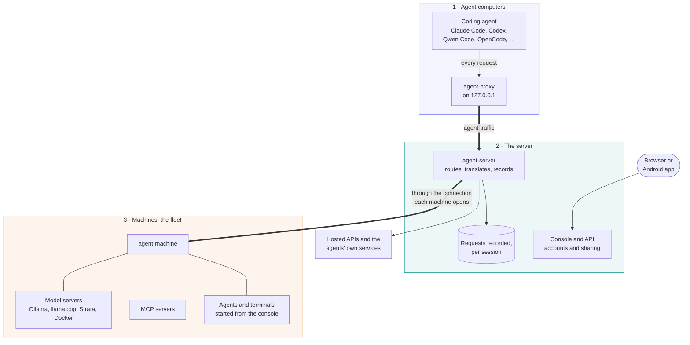

# How it works

AI Control Mesh puts one server you host between your coding agents and the models they use. Every request an agent makes goes through that server, so you can see what each agent did, choose which models it may use, and watch or answer it from a browser or a phone.

This page explains the parts and how they fit, in plain terms. The [technical overview](architecture.md) has the detail: [flows](flows.md), [protocols](networking.md) and [every endpoint](api.md).

## The three parts

- **The server** (`agent-server`) is the hub. It knows which agents exist, which models and providers they may use, and who its users are. It records what agents send, and serves the **console**, the web app you manage everything from.
- **Agent computers** are where you work. You start an agent with the `agent` command, such as `agent claude .`. The agent then talks to a small proxy on the same computer, the **agent-proxy**, which carries its traffic to the server. The agent itself needs no changes.
- **Machines** are computers that lend their resources to the server: local model servers (Ollama, llama.cpp, Strata, Docker Model Runner), MCP servers, and room to run agents the console starts. `agent-machine` keeps each one connected. A machine opens the connection itself, so it works behind a home router or in WSL with no open port.

One computer can be all three. A laptop that runs the server, has Ollama, and runs agents is a whole system on its own ([Run it on your own computer](local.md)).

## What happens when you start an agent

1. You run `agent qwen . --model qwen3.6:35b` in a project folder.
2. The `agent` command asks the server for a **session**: one run of one agent, with its model, provider, folder and owner.
3. The server decides where the agent's requests will go and tells the command how to start the agent.
4. The agent starts and sends its requests to the agent-proxy, which signs them as you and passes them to the server.
5. The server checks each request belongs to your session, sends it to the model, and records it: timing, tokens and status, and the full prompt and reply if you asked for that (`--trace`).
6. When the agent exits, the session ends. It stays on the console to look back on.

## Three ways to reach a model

| Route | When | What the server does |
| --- | --- | --- |
| **Your accounts** | Claude Code, Copilot CLI and Codex signed in to your own Claude, GitHub Copilot or ChatGPT plan | The agent keeps its own sign-in. The server records its traffic on the way to the vendor and changes nothing. |
| **Own provider** | Any supported agent against a model on your machines | The server sends the request to the machine's model server, translating it for Ollama when needed. |
| **Hosted APIs** | An agent using a provider's API, such as OpenAI, Anthropic, OpenRouter or a LiteLLM gateway | The server adds the provider's key, which never leaves the server, and passes the request on. |

[Agents](agents.md#the-three-routes) has each route in full, and [Providers](providers.md) every kind of provider.

## What gets recorded

- **Sessions**: every agent run, with who ran it, where, with which model, and how it ended.
- **Requests**: every call the agent made, with its timing, tokens and status. Model calls show live on the console as they stream.
- **Payloads**: the full prompts and replies, only when tracing is on for a session, or when the organization requires it.
- **Terminals**: an agent started with `--control`, or from the console, shares its terminal, so you can watch it and type into it from the console. Its history is kept too.

How long things are kept is up to each organization, within the server's bounds ([Retention](retention.md)). The [audit log](audit.md) records who changed what.

## Who sees what

- **Everyone signs in**, even on the server's own computer. The console, the `agent` command and each machine sign in the same way ([OIDC authentication](oidc.md)).
- **People belong to an organization.** Its sessions, machines and providers stay inside it. Teams group people within an organization.
- **Sessions are private** until their owner shares them with a team or the whole organization.
- **Machine owners choose** who may use their machine, feature by feature: start agents, open terminals, use its MCP servers ([Machines](machines.md#who-may-use-a-machine)).
- **Usage limits** cap how many tokens a person may use on a provider ([Usage limits](usage-limits.md)).

[Accounts and sharing](accounts.md) has the details.

## Agents started from the console

On a machine whose owner allows it, you can start an agent from the console instead of a terminal: pick the machine, the agent, the folder and the model. The machine starts it, and its terminal opens in the console, where you follow it and answer its prompts. This works from a phone too ([Machines](machines.md#launches)).

## Linking servers

Two servers can **link**, and an organization on each can then share chosen providers, MCP servers, agent definitions and machines with the other. Requests still go through both servers, which both record them, and keys never leave their own server ([Peering](peering.md)).

## Where to go next

- **Try it**: [on your own computer](local.md), with [Docker or Podman](quickstart.md) or on [Kubernetes](quickstart-kubernetes.md).
- **Set it up for real**: [Getting started](getting-started.md), then [Deployment](deployment.md).
- **Use it day to day**: [Agents](agents.md), [The console](console.md), [Machines](machines.md), [Providers](providers.md).
- **The technical detail**: [Architecture](architecture.md), [Flows](flows.md), [Networking and protocols](networking.md), [API](api.md).
