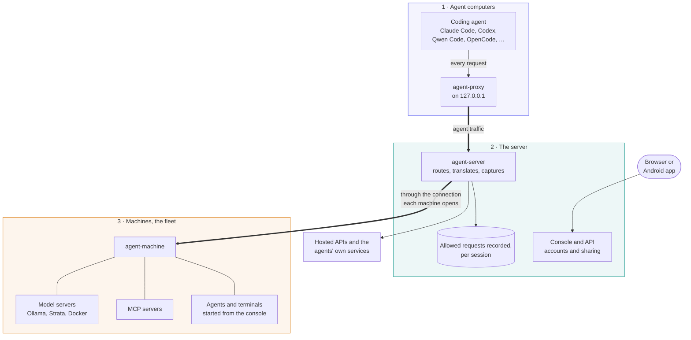

# AI Control Mesh: documentation

Run terminal coding agents (Claude Code, GitHub Copilot CLI, OpenAI Codex, Qwen Code, OpenCode, Aider, Goose) through one server and see their requests. Every model call is recorded with its prompt, reply, tokens and timing. For agents signed in to their own accounts, allowed requests to public services are recorded too: sign-in, settings, MCP, telemetry, update checks. Private and reserved IP destinations are refused. The same server gives agents your own models on your own machines, shares MCP servers between machines, and lets you watch and type into running agents from a browser or a phone.

## The system in one page

### Three parts: agents, the server, machines

- **The server** (`agent-server`) is the hub. Agent traffic goes through it, and allowed requests are recorded in a **session** per agent run, in its database. It owns all configuration, kept in the same database: the agents it knows, the providers it routes to, its users. It serves the **console**, the web app you manage everything from.
- **Agents** run on any computer with the client installed (`agent`). `agent claude .` asks the server for a session, starts the agent pointed at that computer's **agent-proxy** (a small proxy on `127.0.0.1:8184`), and the agent-proxy carries the agent's traffic to the server. The agent needs nothing but the right environment, which the server renders for it.
- **Machines** are computers in the server's **fleet**, kept there by `agent-machine`. They supply every local model: the Ollama, Strata and Docker Model Runner servers they run, and containers they run for the server. They can also share MCP servers, take agent launches from the console, open terminals, and update themselves to the server's build. A machine holds one WebSocket to the server, and the server reaches everything on it through that connection, so a machine behind NAT or in WSL needs no open port.

A computer can be all three: the server, an agent machine and a fleet machine.

### Three routes to a model

How an agent's request reaches a model depends on the agent:

| Route | For | What happens |
| --- | --- | --- |
| **Your accounts** | Claude Code, Copilot CLI and Codex signed in to your own Claude, GitHub Copilot or ChatGPT plan | Nothing is redirected. The agent's HTTPS goes through its agent-proxy to the server, which decrypts and records it with its own certificate authority (trusted only by that agent's process tree) and sends it to public destinations. Private and reserved IP addresses are refused. |
| **Local models** | Qwen Code, OpenCode, Claude Code, Copilot CLI, Codex, Aider, Goose against your own models | The agent talks to the proxy's OpenAI, Anthropic or Ollama endpoint. For Ollama, the server translates the request to Ollama's native API and applies the context size and sampling settings from the server's Ollama model tuning. Strata and Docker Model Runner take the request as it is. |
| **Hosted API** | Claude Code with your Anthropic login or key | The request is passed through to the hosted API unchanged, and recorded. |

### What a session is

A session is one run of one agent: its agent, model, provider, project folder, owner, sharing and traffic. Its id selects the session; the agent-proxy authenticates each API request with an OAuth access token. The launcher closes it when the agent exits. Each request records timing, tokens, sizes and status; `--trace` saves full payloads.

### Watching and typing from anywhere

Start an agent with `--control`, or from a machine's page in the console, and its terminal is shared with the server. **Running agents** shows it live; you can type into it, answer its permission prompts and scroll its history from a browser or the Android app. A banner tells you when an agent is waiting for you.

### One person or a team

Everyone signs in through OIDC, including on loopback. Sessions are private until shared, and machine owners grant individual features to organizations and teams.

## Guides and reference

| Page | What's in it |
| --- | --- |
| [Quickstart](quickstart.md) | The whole system on your computer with one command (server, sign-in, database, two machines, Ollama), and a step-by-step tour: sign in, add a provider, pull a model, start an agent, watch it and read back its requests. |
| [Getting started](getting-started.md) | From nothing to a first recorded agent session: install the server, sign in, install `agent`, run an agent on each route. |
| [Architecture](architecture.md) | How it works inside: components, routes, a session step by step, HTTPS capture, tunnels, terminal sharing, what's recorded, versions, restarts, security. |
| [Networking and protocols](networking.md) | Every connection and port, how a request is routed to a model, the fleet and terminal sockets message by message, headers, close codes, reverse proxies, troubleshooting. |
| [Agents](agents.md) | The `agent` command and every option, the agent-proxy, every supported agent, what the requests are, sharing terminals, adding a new agent on Server settings. |
| [MCP servers](mcp.md) | Sharing MCP servers from a machine with agents anywhere: `agent-machine mcp`, choosing them for a launch, how the bridge works, recording and access. |
| [Machines](machines.md) | The fleet and `agent-machine`: every command, its files, launches, terminals, remote updates, tunnels, access grants, services, the sandbox machine, the Python version. |
| [Providers](providers.md) | Ollama (translation, model tuning, Qwen), Strata, Docker Model Runner, containers machines run, hosted APIs, which agent can use which provider. |
| [The console](console.md) | Every page of the web console and what each control does, with screenshots. |
| [OIDC authentication](oidc.md) | Auth service deployment, browser PKCE, CLI device flow, service accounts, access tokens and migration. |
| [Security](security.md) | How each device pairs with the server, device approval step by step and what protects it, tokens and where they're kept, which connections are encrypted, where plain HTTP appears and why, and a checklist for a public server. |
| [Accounts and sharing](accounts.md) | Users, organizations and teams, session sharing, phones and the Android app. |
| [Configuration](configuration.md) | The database, the stored settings (providers, agents, model tuning, retention), `agent-server config export` and `import`, every environment variable, secrets, the `agent-server` and `agent-benchmark` commands. |
| [API](api.md) | Every HTTP endpoint and WebSocket, who may call it, and what it takes and returns. |
| [Deployment](deployment.md) | Docker, PostgreSQL and backups, HTTPS, what the server hands out, one-line installers, packages and services, versions and updates, ports. |
| [Development](development.md) | Building and testing every component, the demo and screenshots, distributions, benchmarks, checklists. |

[`AGENTS.md`](../AGENTS.md) at the repository root is the guide for changing the code.

## Every feature, and where it's documented

| Feature | Commands | Console | Docs |
| --- | --- | --- | --- |
| Run an agent through the server | `agent <agent> [project]` | Start an agent | [Agents](agents.md#the-agent-command) |
| Sign a computer in | `agent login`, `agent logout` | Organizations › Start agents from your own computer | [Agents](agents.md#signing-in-agent-login-and-agent-logout) |
| List the server's agents | `agent --list` | Start an agent | [Agents](agents.md#agent---list) |
| Capture full payloads | `--trace` | Capture full request and response payloads | [Agents](agents.md#options) |
| Record account agents' HTTPS | `agent claude-account` and the other `-account` agents | Traffic | [Agents](agents.md#your-accounts-https-capture) |
| Local models on Ollama, Strata, Docker | `--model`, `--backend` | Start an agent, a machine's model server tabs | [Providers](providers.md) |
| Tune Ollama per model | `agent-server config import` | Server settings › Ollama model tuning, a model server's Aliases tab | [Providers](providers.md#model-tuning) |
| Add or change an agent | `PUT /api/config/agents/<id>` | Server settings › Agents | [Agents](agents.md#adding-a-new-agent) |
| Hosted API pass-through | `agent claude-subscription` | Server settings › Add hosted API | [Providers](providers.md#backend-types) |
| Watch model calls live | | Live | [Console](console.md#live) |
| Account-agent traffic to public destinations | | Traffic | [Console](console.md#traffic) |
| Model-call history and payloads | | Requests | [Console](console.md#requests) |
| Sessions, chats, telemetry export | | Sessions | [Console](console.md#sessions) |
| Ask a model a question, without an agent | | Ask a model | [Console](console.md#ask-a-model) |
| Share and type into a terminal | `--control`, `--let-others-type` | Running agents | [Agents](agents.md#sharing-a-terminal-with---control) |
| Use terminals from a phone | | Running agents (sign in on the phone) | [Accounts](accounts.md#running-agents-on-your-phone) |
| Share a shell | `agent --shell [folder]` | A machine's Terminal tab | [Machines](machines.md#terminals) |
| Join a machine to the fleet | `agent-machine login`, `start`, `stop`, `run` | Machines › Add a machine | [Machines](machines.md#quick-start) |
| Add a machine's model server as a provider | | Add as a provider | [Providers](providers.md#where-providers-come-from) |
| Manage models (pull, load, delete, search) | `agent-machine servers on` | A machine's model server tabs | [Providers](providers.md#managing-models) |
| Start, stop and configure Ollama and Strata | `agent-machine servers on` | Ollama server tab, Strata tab | [Providers](providers.md#ollamas-server-settings) |
| Containers on a machine | `agent-machine containers on`, `agent --switch` | Containers tab | [Providers](providers.md#containers-machines-run) |
| Start agents on a machine from the console | `agent-machine launches on`, `roots add` | A machine's Agents tab | [Machines](machines.md#launches) |
| Share MCP servers | `agent-machine mcp add`, `agent --mcp` | MCP servers tab, Start an agent | [MCP servers](mcp.md) |
| Update machines from the server | `agent update`, `agent-machine update`, `updates on` | Update now | [Machines](machines.md#remote-updates) |
| Who may use a machine | | Access tab | [Machines](machines.md#who-may-use-a-machine) |
| Users, organizations, teams | `agent-server user\|org\|team` | Organizations | [Accounts](accounts.md) |
| Share a session | `--share`, `--team` | A session's sharing | [Accounts](accounts.md#session-sharing) |
| Server settings and restart | `agent-server config export`, `import` | Server settings | [Configuration](configuration.md) |
| The database: which one, migrations, upgrading from files | `agent-server db info`, `migrate`, `import` | Server settings › Storage | [Configuration](configuration.md#the-database) |
| How long recordings are kept | | Server settings › Storage | [Configuration](configuration.md#how-long-recordings-are-kept) |
| The server computer's CPU, memory and disks | | Server stats | [Console](console.md#server-stats) |
| Downloads and installers | `/install.sh`, `/install.ps1` | Downloads | [Deployment](deployment.md) |
| The server in Docker, HTTPS | `docker compose up -d` | | [Deployment](deployment.md#the-server-in-docker) |
| Local demo: server, two machines and Ollama | `podman compose -f quickstart/compose.yaml up -d --build` (or `docker compose`) | Sign in as admin / secret on localhost:19999 | [Quickstart](quickstart.md) |
| Benchmarks | `agent-benchmark` | | [Configuration](configuration.md#agent-benchmark) |
| The API | | Server settings › API reference (`/docs`) | [API](api.md) |

## Glossary

| Term | Meaning |
| --- | --- |
| **agent** | A terminal coding agent (Claude Code, Codex, ...), and also the launcher command `agent` that starts one. |
| **agent-proxy** | The proxy on each agent machine (`127.0.0.1:8184`, and `8183` for HTTPS capture), started by `agent`. It signs the launcher's calls with the computer's sign-in and carries agents' traffic to the server. |
| **agent-server** | The server: the hub that records and routes everything, and serves the console. |
| **agent-machine** | The program that keeps a computer in the server's fleet. |
| **backend**, **provider** | Where model requests go: an Ollama, Strata or Docker Model Runner server on a machine, a container a machine runs, or a hosted API. Listed on Server settings › Providers. |
| **session** | One run of one agent, and everything recorded for it. |
| **route** | How an agent reaches a model: your accounts, local models or hosted API. |
| **fleet** | The machines signed in to the server. |
| **tunnel** | A connection the server asks a machine to open back to it, to reach a model server or MCP bridge on that machine's loopback. |
| **bridge** | agent-machine's loopback HTTP server for the MCP servers it shares. |
| **launch** | An agent started on a machine from the console. |
| **trace** | A request's full saved payload (`--trace`). |
| **access token** | Short-lived OAuth credential required for API access; distinct from an ID token, session id or vendor API key. |
