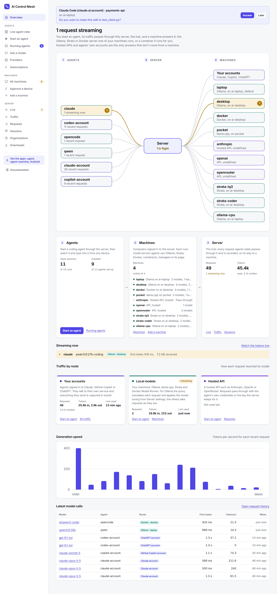

# AI Control Mesh: documentation

Run terminal coding agents — Claude Code, Codex, Copilot CLI, Qwen Code, OpenCode, Aider, Goose, Hermes Agent — through one server you host, and see everything they do. The server records every model call's tokens and timings (and, with tracing on, the full prompts and replies), routes agents to your own models or your own vendor plans, shares your machines' MCP servers, and shows you running agents' terminals, so you can watch and answer them from a browser or a phone. Agents on their own vendor accounts are recorded in transit too: sign-in, settings, MCP, telemetry and update checks, to public destinations only.

## Start here

1. **[How it works](how-it-works.md)**: the parts and how they fit, in plain terms. Five minutes.
2. **Try it**: [on your own computer](local.md) with one command, with [Docker or Podman](quickstart.md) and a guided tour, or on [Kubernetes](quickstart-kubernetes.md).
3. **Set it up for real**: [Getting started](getting-started.md), from nothing to a first recorded session.

The documentation has two halves. The **guides** (from *Start here* to *Run a server*) are for using and running it, in plain steps. The **technical overview** is for when you want to know exactly how it works: components, flows as sequence diagrams, protocols and every endpoint.

## The documentation

| Section | Pages |
| --- | --- |
| **Start here** | [Overview](index.md) (this page) · [How it works](how-it-works.md): the parts and how they fit · [Run it on your own computer](local.md): the server and sign-in on loopback with one command, no containers · [Quickstart with Docker or Podman](quickstart.md): the whole system in containers with one command, and a guided tour · [Quickstart on Kubernetes](quickstart-kubernetes.md): the Helm chart on a local cluster · [Getting started](getting-started.md): a real install, from nothing to a first recorded session |
| **Use it** | [Agents](agents.md): the `agent` command, the agent-proxy, every supported agent, terminal sharing, adding agents · [The console](console.md): every page and control · [Machines](machines.md): the fleet and `agent-machine` · [Providers](providers.md): Ollama, llama.cpp, Strata, Docker Model Runner, containers, OpenAI and Anthropic-compatible APIs (OpenAI, OpenRouter, LiteLLM, LM Studio, vLLM, ...) · [GPUs in containers](gpu.md): setting up Podman or Docker to give a model server an NVIDIA GPU · [MCP servers](mcp.md): sharing them from machines · [Subscriptions](subscriptions.md): your own Claude, ChatGPT and Copilot plans |
| **People and data** | [Accounts and sharing](accounts.md): users, organizations, teams, phones · [Peering](peering.md): linking servers, and bridges between their organizations · [Usage limits](usage-limits.md): each person's usage of each provider, and organizations' token limits · [Retention](retention.md): what's kept and for how long, legal holds · [The audit log](audit.md): who did what, verified and exported |
| **Run a server** | [Deployment](deployment.md): Docker, PostgreSQL, HTTPS, installers, packages, updates · [Several server processes](scaling.md): roles, Redis, blob storage, the Helm chart · [Configuration](configuration.md): stored settings, every environment variable, the commands · [Security](security.md): devices, tokens, encryption, a checklist for a public server · [OIDC authentication](oidc.md): the sign-in service · [Using API credentials](api-credentials.md): scripts and CI calling the API |
| **Technical overview** | [Architecture](architecture.md): components, routes, a session step by step, capture, tunnels, terminals, what's recorded · [Flows](flows.md): the main flows end to end, as sequence diagrams · [Networking and protocols](networking.md): every connection, port, message and close code · [Peering internals](peering-internals.md): signed requests, the link socket, gates and policies · [Scaling internals](scaling-internals.md): how several processes share the work, retention, token validation and the audit chain · [Local instance internals](local-internals.md): `agent-server local`, the installers and the tray · [API](api.md): every endpoint and WebSocket |
| **Contribute** | [Development](development.md): building and testing everything · [Marketing website](website.md): the public brochure. [`AGENTS.md`](../AGENTS.md) at the repository root is the guide for changing the code. |

## Find a feature

| Feature | Commands | Console | Docs |
| --- | --- | --- | --- |
| Run an agent through the server | `agent <agent> [project]` | Start an agent | [Agents](agents.md#the-agent-command) |
| Sign a computer in | `agent login`, `agent logout` | Organizations › Start agents from your own computer | [Agents](agents.md#signing-in-agent-login-and-agent-logout) |
| List the server's agents | `agent --list` | Start an agent | [Agents](agents.md#options) |
| Capture full payloads | `--trace` | Capture full request and response payloads | [Agents](agents.md#options) |
| Providers, your usage of each and the limits on you | | Providers | [Usage limits](usage-limits.md#the-providers-page) |
| Limit a person's tokens on a provider | | Organizations › Usage | [Usage limits](usage-limits.md#setting-limits) |
| Your AI subscriptions | `agent accounts list\|detect\|status\|enroll`, `--account` | Subscriptions; a machine's Agent accounts | [Subscriptions](subscriptions.md) |
| The vault for managed tokens | `agent-server vault key\|status\|rotate`, `AI_PROXY_VAULT_KEYS` | | [Subscriptions](subscriptions.md#the-vault) |
| Record account agents' HTTPS | `agent claude-account` and the other `-account` agents | Traffic | [Agents](agents.md#your-accounts-https-capture) |
| A provider of your own: Ollama, llama.cpp, Strata, Docker Model Runner, or an API | `--model`, `--backend` | Start an agent, a machine's model server tabs | [Providers](providers.md) |
| Tune Ollama per model | `agent-server config import` | Server settings › Model tuning, a model server's Aliases tab | [Providers](providers.md#model-tuning) |
| Add or change an agent | `PUT /api/config/agents/<id>` | Server settings › Agents | [Agents](agents.md#adding-a-new-agent) |
| Hosted API pass-through | `agent claude-subscription` | Server settings › Add hosted API | [Providers](providers.md#backend-types) |
| OpenAI or Anthropic-compatible APIs and gateways (OpenAI, OpenRouter, LiteLLM, ...) | `--backend <name>` | Organizations › API providers | [Providers](providers.md#api-providers-openai-and-anthropic-compatible) |
| LM Studio, vLLM or SGLang on a machine | `AI_PROXY_API_PORTS` on the machine | Add as a provider | [Providers](providers.md#openai-compatible-servers-on-a-machine) |
| Watch model calls live | | Live | [Console](console.md#live) |
| Account-agent traffic to public destinations | | Traffic | [Console](console.md#traffic) |
| Model-call history and payloads | | Requests | [Console](console.md#requests) |
| Sessions, chats, telemetry export | | Sessions | [Console](console.md#sessions) |
| Ask a model a question, without an agent | | Ask a model | [Console](console.md#ask-a-model) |
| Share and type into a terminal | `--control`, `--let-others-type` | Running agents | [Agents](agents.md#sharing-a-terminal-with---control) |
| Use terminals from a phone | | Running agents (sign in on the phone) | [Accounts](accounts.md#running-agents-on-your-phone) |
| Share a shell | `agent --shell [folder]` | A machine's Terminal tab | [Machines](machines.md#terminals) |
| Join a machine to the fleet | `agent-machine login`, `start`, `stop`, `run` | Machines › Add a machine | [Machines](machines.md#quick-start) |
| Add a machine's model server as a provider | | Add as a provider | [Providers](providers.md#where-providers-come-from) |
| Manage models (pull, load, delete, search) | `agent-machine servers on` | A machine's model server tabs | [Providers](providers.md#managing-models) |
| Start, stop and configure Ollama and Strata | `agent-machine servers on` | Providers → Ollama → Ollama server; Providers → Strata | [Providers](providers.md#ollamas-server-settings) |
| Install, start and configure llama.cpp | `agent-machine servers on` | Providers → llama.cpp → llama.cpp server | [Providers](providers.md#llamacpp) |
| Containers on a machine | `agent-machine containers on`, `agent --switch` | Providers → Containers | [Providers](providers.md#containers-machines-run) |
| Start agents on a machine from the console | `agent-machine launches on`, `roots add` | A machine's Agents tab | [Machines](machines.md#launches) |
| Share MCP servers | `agent-machine mcp add`, `agent --mcp` | MCP servers tab, Start an agent | [MCP servers](mcp.md) |
| Update machines from the server | `agent update`, `agent-machine update`, `updates on` | Update now | [Machines](machines.md#remote-updates) |
| Who may use a machine | | Access tab | [Machines](machines.md#who-may-use-a-machine) |
| Users, organizations, teams | `agent-server user\|org\|team` | Organizations | [Accounts](accounts.md) |
| Share a session | `--share`, `--team` | A session's sharing | [Accounts](accounts.md#session-sharing) |
| Server settings and restart | `agent-server config export`, `import` | Server settings | [Configuration](configuration.md) |
| The database: which one, migrations, upgrading from files | `agent-server db info`, `migrate`, `import` | Server settings › Storage | [Configuration](configuration.md#the-database) |
| How long recordings are kept, and what's captured | `AI_PROXY_RETENTION_SEED` | Server settings › Storage; Organizations › Data | [Retention](retention.md) |
| Legal holds | | Organizations › Data › Legal holds | [Retention](retention.md#legal-holds) |
| The audit log, its exports and checking it | `agent-server audit verify\|checkpoint\|key` | Audit log; Server settings › Audit | [The audit log](audit.md) |
| Several server processes, Kubernetes and the Helm chart | `AI_PROXY_ROLES`, `AI_PROXY_REDIS_URL`, `helm install` | | [Running several server processes](scaling.md) |
| Recordings in S3 (or compatible) storage | `AI_PROXY_BLOB_URL` | | [Running several server processes](scaling.md#blob-storage) |
| What the server is doing now (requests, connections, sessions, network), and its computer's CPU, memory and disks | | Server stats | [Console](console.md#server-stats) |
| Every request the server received, failed ones too, its stats and each machine's fleet connections (why a machine shows offline) | | Access log | [Console](console.md#access-log) |
| Every request saved for days, searchable, with headers and bodies in debug mode | | API log | [Console](console.md#api-log) |
| Local website, service and installer snapshots | `devhelpers/release_scripts/release.ps1` or `.sh` | | [Local releases and snapshots](releases.md) |
| Downloads and installers | `/install.sh`, `/install.ps1` | Downloads | [Deployment](deployment.md) |
| Uninstalling from a computer | `/uninstall.sh`, `/uninstall.ps1`, `install.sh --uninstall` | Downloads › Uninstall | [Deployment](deployment.md#uninstalling) |
| The server in Docker, HTTPS | `docker compose up -d` in `deploy/compose/server` | | [Deployment](deployment.md#the-server-in-docker) |
| A server on your own computer, for you alone | `install-local.sh`/`.ps1` from a release (or `devhelpers/scripts/install-local.sh` in a checkout), `agent-server local start\|stop\|status`, the `agent-tray` icon | localhost:19999 | [Run it on your own computer](local.md) |
| The whole system in one container, to try it | `docker run ... ghcr.io/joeyenfield/ai-control-mesh` | localhost:19999 | [Run it on your own computer](local.md#try-it-in-one-container) |
| Local demo: server, two machines and Ollama | `podman compose -f deploy/compose/quickstart/compose.yaml up -d` (or `docker compose`) | Sign in as admin / secret on localhost:19999 | [Quickstart with Docker or Podman](quickstart.md) |
| An NVIDIA GPU for a model server in a container | `nvidia-ctk cdi generate`, `-f compose.gpu.yaml` | | [GPUs in containers](gpu.md) |
| Two linked servers, to try peering | `podman compose -f deploy/compose/peer/compose.yaml up -d`, then `python3 deploy/compose/peer/setup.py` | localhost:29999 and 127.0.0.1:39999 | [Peering](peering.md#try-it) |
| Link this server with another | `AI_PROXY_MESH_ID`, `AI_PROXY_MESH_URL` | Server settings › Links | [Peering](peering.md#linking-two-servers) |
| Share with an organization on a linked server | | Organizations › Sharing | [Peering](peering.md#bridges) |
| What other servers share with you, and starting agents on their machines | `--backend provider:server/org/name` | Shared with you | [Peering](peering.md#using-what-crosses) |
| The Helm chart on a local cluster | `helm install mesh deploy/helm/agent-mesh -f deploy/helm/quickstart/values.yaml` | localhost:19999 through `kubectl port-forward` | [Quickstart on Kubernetes](quickstart-kubernetes.md) |
| Benchmarks | `agent-benchmark` | | [Configuration](configuration.md#agent-benchmark) |
| The API | | Server settings › API reference (`/docs`) | [API](api.md) |
| Scripts and CI calling the API | `agent-auth client add` | Organizations › API credentials | [Using API credentials](api-credentials.md) |

## Glossary

| Term | Meaning |
| --- | --- |
| **agent** | A terminal coding agent (Claude Code, Codex, ...), and also the launcher command `agent` that starts one. |
| **agent-proxy** | The proxy on each agent machine (`127.0.0.1:8184`, and `8183` for HTTPS capture), started by `agent`. It signs the launcher's calls with the computer's sign-in and carries agents' traffic to the server. |
| **agent-server** | The server: the hub that records and routes everything, and serves the console. |
| **agent-machine** | The program that keeps a computer in the server's fleet. |
| **backend**, **provider** | Where model requests go: an Ollama, llama.cpp, Strata or Docker Model Runner server on a machine, a container a machine runs, or a hosted API. Listed on Server settings › Providers. |
| **session** | One run of one agent, and everything recorded for it. |
| **route** | How an agent reaches a model: your accounts, own provider or hosted API. |
| **fleet** | The machines signed in to the server. |
| **tunnel** | A connection the server asks a machine to open back to it, to reach a model server or MCP bridge on that machine's loopback. |
| **MCP bridge** | agent-machine's loopback HTTP server for the MCP servers it shares. |
| **link** | Two servers joined by their site admins, each with the other's code ([Peering](peering.md)). Nothing crosses a link by itself. |
| **bridge** | An organization on each of two linked servers, sharing chosen providers, MCP servers, agent definitions and machines; only what both sides let through crosses. |
| **full name** | How something another server shares is named: `provider:server-b/org-b1/provider-b1`. |
| **launch** | An agent started on a machine from the console. |
| **trace** | A request's full saved payload (`--trace`). |
| **access token** | Short-lived OAuth credential required for API access; distinct from an ID token, session id or vendor API key. |
