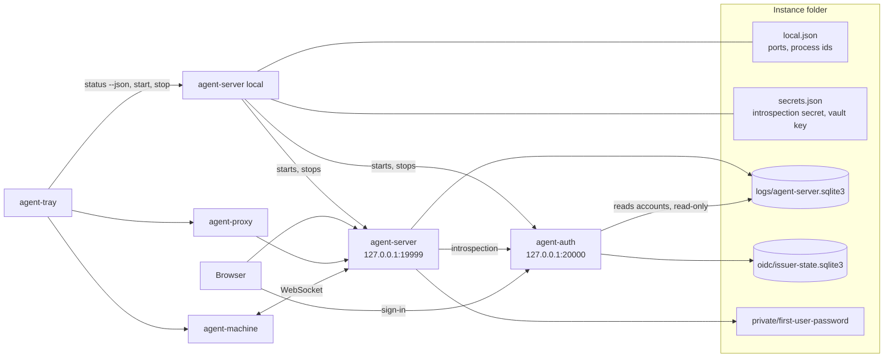
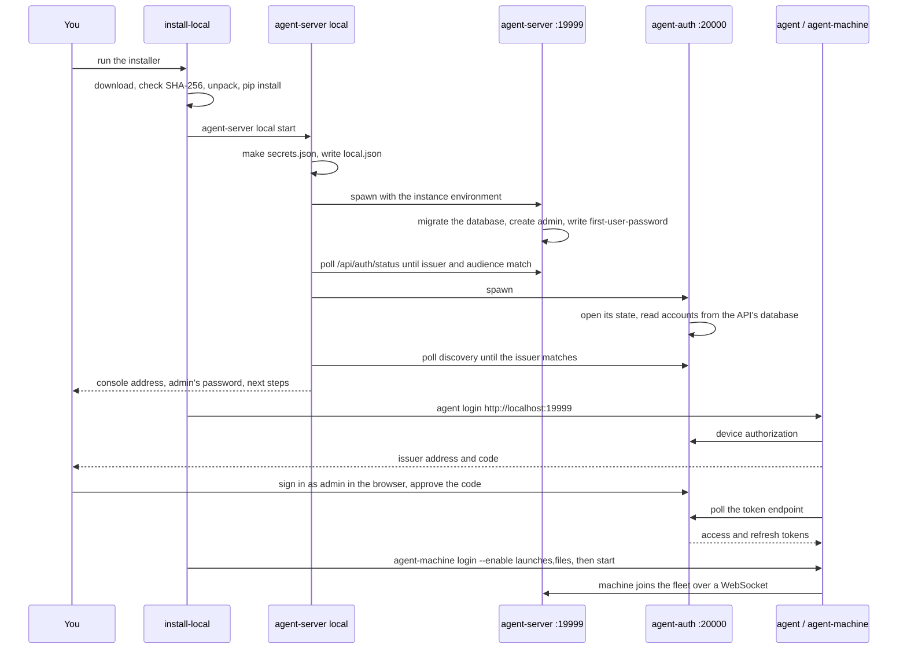

# Local instance internals

This page explains how the local instance is built: what `agent-server local` starts, how sign-in works on loopback, why it uses SQLite, and how the web installer, the tray icon and the all-in-one image fit around it. To install and use it, see [Run it on your own computer](local.md).

## What it is

A local instance is the same server that a team runs, started for one person on one computer. Nothing in it is special to the local case: the API and console (`agent-server`), the sign-in service (`agent-auth`), and the `agent` and `agent-machine` programs talk over HTTP and WebSockets exactly as in [Architecture](architecture.md#components-and-how-they-connect). Authentication stays mandatory. Being on loopback gives no extra rights.

What `agent-server local` adds is a small owner for the two server processes: it picks their folder and ports, makes their secrets, sets their environment, starts them in order, waits until they answer, and stops them again. The code is `server/agent_server/local.py`, and `agent-server local` is dispatched to it before the server's own arguments are read.

## The two processes

`agent-server local start` runs two background Python processes with the same interpreter as the command itself:

| Process | Listens on | Started as |
| --- | --- | --- |
| `agent-server` (API and console) | `127.0.0.1:19999` | `python -c "...agent_server.app.main()  # agent-server-local"` |
| `agent-auth` (OIDC issuer) | `127.0.0.1:20000` | `python -c "...agent_server.issuer.main()  # agent-server-local"` |

- **Ports.** 19999 and 20000 are the quickstart's ports, so the same addresses work in both. `--port` and `--auth-port` pick others; they must differ, can only change while the instance is stopped, and are kept in `local.json`. Because the quickstart uses the same ports, only one of the two can run at a time.
- **Loopback only.** Both bind `127.0.0.1`. The public names are `http://localhost:<port>`, used for the issuer, the audience, the callback and the cookies. `localhost` is the one name registered, which is why `127.0.0.1` in a browser doesn't sign in.
- **Order.** The API starts first, because it creates the database and the first account. Then the issuer starts, which reads accounts from that database. Each is waited for, up to 180 seconds (a server started from a checkout may rebuild the console first).
- **Readiness.** A listening port isn't enough. The API is ready when `/api/auth/status` names this instance's issuer and audience. The issuer is ready when its discovery document (`/.well-known/openid-configuration`) names itself as the issuer. If a process exits while it's waited for, or never gets ready, start stops whatever it started and points at the process's log.
- **Detached.** On Windows each child gets a new process group and no console window. Elsewhere each gets a new session. Their output goes to `logs/server.out.log` and `logs/auth.out.log`.
- **One server only.** The API takes a lock on its database. A second `agent-server` on the same SQLite file refuses to start, since one process keeps sessions, machines and terminals in memory ([Several processes](architecture.md#versions-restarts-and-several-processes)). The local instance never uses Redis or several workers.

### How it owns its processes

`local.json` records each child's process id and its start time. A process counts as "ours" only if all three of these hold:

1. a process with that id exists;
2. its start time matches the recorded one within a second, so a reused id is never taken for ours;
3. its command line carries the mark `agent-server-local`, written as a comment after the code, where the program never reads it.

`stop` stops the issuer first, then the API, the reverse of start. For each, it terminates the process and its children, waits 15 seconds, then kills what's left. It never looks a process up by name or by port, so it can't stop another program that holds the same port. `start` refuses a port that another program holds rather than taking it.

When only one of the two runs (say the issuer crashed), `start` stops the one left and starts both again in order. Nothing restarts a process that exits on its own: run `agent-server local` again, or use the tray icon.

### Its environment

The children get the shell's environment with every `AI_PROXY_*` variable removed, then the instance's own. So a shell set up for another server, or for a test, can't point the local instance elsewhere. The variables it sets:

| Variable | Value |
| --- | --- |
| `AI_PROXY_HOST`, `AI_PROXY_PORT`, `AI_PROXY_URL` | `127.0.0.1`, the port, `http://localhost:<port>` |
| `AI_PROXY_AUTH_HOST`, `AI_PROXY_AUTH_PORT` | `127.0.0.1`, the issuer's port |
| `AI_PROXY_OIDC_ISSUER` | `http://localhost:<auth port>` |
| `AI_PROXY_OIDC_AUDIENCE`, `AI_PROXY_OIDC_BROWSER_ORIGINS` | `http://localhost:<port>` |
| `AI_PROXY_OIDC_REDIRECT_URIS` | `http://localhost:<port>/api/auth/callback` |
| `AI_PROXY_OIDC_INTROSPECTION_SECRET`, `AI_PROXY_VAULT_KEYS` | from `secrets.json` |
| `AI_PROXY_LOG_DIR`, `AI_PROXY_OIDC_STATE_DIR`, `AI_PROXY_CA_DIR`, `AI_PROXY_REMOTE_KEY_FILE` | `logs`, `oidc`, `logs/ca` and `private/remote-access-key` in the folder |

The secrets reach the children only through their environment, never their command lines, where other users could read them. The variables are described in [Configuration](configuration.md).

## Files and paths

The folder is `AI_PROXY_LOCAL_HOME`, else the platform's per-user data folder. The table of folders and files is in [Where it keeps things](local.md#where-it-keeps-things). How they come about:

- **`secrets.json`** is made on the first start: a random introspection secret, shared by the API and the issuer, and a vault key for stored provider keys. It's kept, never remade: a new introspection secret would sign everyone out, and a new vault key would lose the stored keys. A missing entry is added and the others are kept.
- **`local.json`** holds the ports and the processes. Both files are written to a temporary file and renamed, so a crash never leaves half a file. They're created owner-only (mode 600 in a 700 folder; on Windows the profile's permissions apply).
- **`logs/agent-server.sqlite3`** is the API's database: its default path under `AI_PROXY_LOG_DIR`. The server migrates it on every start.
- **`oidc/issuer-state.sqlite3`** is the issuer's own state (tokens, its signing key). With SQLite the issuer opens the API's file read-only for accounts and never writes it ([OIDC](oidc.md#deployment)).
- **`private/first-user-password`** is written by the server beside its remote key file, which is why `AI_PROXY_REMOTE_KEY_FILE` points into `private/`.
- **`app/<version>/` and `venv/`** exist only after the web installer (below). From a checkout the server runs from the checkout instead.

The children's working folder is the instance folder. The server's program files are found from where its package is installed (the folder holding `VERSION` and `server/`), not from where the command was run.

## Sign-in on loopback

Sign-in is the normal OIDC setup with the issuer on loopback HTTP. The issuer accepts plain HTTP only for loopback addresses, and cookies are marked `Secure` only on HTTPS, so the same code serves both cases. The flows themselves are in [OIDC](oidc.md#browser-sign-in).

- **The first account.** On its first start the API finds no accounts in its database and creates `admin`, an admin of the root organization, with a random password. It saves that password owner-only to `private/first-user-password` and prints it. `agent-server local start` reads that file to print the password with the next steps, until the file is deleted. When the environment names a user (`AI_PROXY_USERNAME` and `AI_PROXY_PASSWORD`, as the all-in-one image can), no first account or file is made.
- **The console.** The browser goes to the API's `/api/auth/login`, is sent to the issuer on port 20000 to sign in, and comes back to the registered callback on port 19999. The tokens stay in host-only HttpOnly cookies for `localhost`.
- **`agent` and `agent-machine`.** `agent login` and `agent-machine login` use the device flow ([CLI sign-in](oidc.md#cli-sign-in)). They print the issuer's address and a code; you sign in there as `admin` and approve. They don't open a browser themselves. Each program keeps its own credentials, and the local server is just another server URL in them.

Without the web installer the last part is yours to run ([Connect your computer](local.md#connect-your-computer)).

## The database decision

The local instance uses SQLite: two embedded files, the API's and the issuer's, and no database server.

- **Why SQLite.** It's already the server's default. All data access is SQLAlchemy Core, with migrations and tests run on both SQLite and PostgreSQL, so the local instance runs the same queries as a team server. It needs nothing installed, and one person's activity fits well within what one SQLite file handles. The database runs in WAL mode.
- **Why not a NoSQL engine.** The goal was "no database server to install", and SQLite already meets it. A document store would mean rewriting the queries, transactions, account reads, migrations, audit, retention and reports, and their tests, without removing any installation step.
- **Why not PostgreSQL here.** It would be a service to install, run and upgrade on a person's computer. It stays the choice for servers several people use and for several server processes ([Scaling](scaling.md)).

Keep the folder on a local disk. A backup is the whole folder copied while the instance is stopped: both databases with their WAL files, and `secrets.json`, without which the stored provider keys can't be read. `config export` holds settings only, not accounts, recordings or secrets.

## The web installer and the release

The web installers are made locally by `devhelpers/release_scripts/release.ps1|.sh installers`, which calls `devhelpers/release_scripts/release/release.py`. Publishing is explicit and uses no Actions runner; see [Local releases and snapshots](releases.md). It reads what `tools/dist` built (`dist/<version>/` and its `SHA256SUMS`) and the console's build, and writes the release's files:

| File | What |
| --- | --- |
| `ai-control-mesh-<version>.zip` | The server bundle: `VERSION`, `BUILD`, `LICENSE`, the server's sources, `ui/dist`, `docs/` and `benchmarks/tests` |
| `agent-<version>-<os>-<arch>.*`, `agent-machine-...` | Every archive `tools/dist` built |
| `ai_proxy_agent_py-<version>-*.whl` | The Python `agent`, `agent-machine` and `agent-tray`, for any system |
| `install-local.sh`, `install-local.ps1` | The installers, filled in from the templates beside `release.py` |
| `uninstall-local.sh`, `uninstall-local.ps1` | What removes such an install: the tray's autostart, `agent` and `agent-machine` (through the server bundle's own `uninstall.sh`/`.ps1`), the `agent-server` link, `app/` and `venv/`; the data only with `--purge`. Not templates: they find the install by its folders |
| `SHA256SUMS` | Over all of the above |

The bundle has the built console but none of the UI's sources, so the server never tries to rebuild it. Its top folder is the server's root: it holds `VERSION` and `server/`, and `BUILD` gives the version where there's no git.

### How the installers trust their downloads

`release.py` writes into each installer the base URL, the version, the bundle's name and SHA-256, the wheel's name and SHA-256, and one line per archive (platform, program, SHA-256, file name). The sh installer carries only the non-Windows archives, the PowerShell one only the Windows ones. Each value is checked to contain only plain URL, version or file-name characters before it's written into a script. Each archive is checked against `tools/dist`'s `SHA256SUMS` first, and a release without the wheel or `ui/dist` is refused.

An installer downloads each file and refuses it unless its SHA-256 matches the one written into the installer. So a file in the release can't be swapped without changing the installer people download, which itself comes over HTTPS from GitHub. These checks don't cover:

- the installer script itself, which isn't signed;
- the server's Python dependencies, and pystray and Pillow for the tray, which pip fetches from PyPI.

`server/tests/test_release.py` checks the release's files, the hashes in each installer, that the filled-in sh script parses, and that unsafe URLs, versions or tampered archives are refused.

### What an install does

1. It finds Python 3.11 or later and downloads and checks the bundle.
2. It stops a running instance (`agent-server local stop`), unpacks the bundle into `app/<version>.new` and renames it to `app/<version>`.
3. It makes `venv/` if there's none with pip, and runs `pip install -e app/<version>/server` into it. The editable install makes the unpacked bundle the server's root. Older `app/` folders are then removed.
4. It links `agent-server` into the prefix (on Windows, writes `agent-server.cmd` and adds the prefix to the user's PATH) and runs `agent-server local start`. It reads the port back from `local.json`.
5. It installs `agent` and `agent-machine`: from the archive for this platform through the archive's own installer, or from the wheel into the server's `venv` with `--python` or when there's no Go build.
6. On a desktop it installs the wheel's `tray` extra into the same `venv`, links `agent-tray`, turns on its start at sign-in, and starts it detached at the end. A failure here never fails the install.
7. It signs `agent` and `agent-machine` in with the device flow, reading from the terminal (`/dev/tty` on Unix, since the script's own input is the download), and starts the machine. Without a terminal it prints the commands instead.

The options are listed in [Install from the web](local.md#install-from-the-web). The checkout installers, `devhelpers/scripts/install-local.sh` and `.ps1`, are much simpler: `pip install -e server`, the console built with npm when npm is there, `agent` and `agent-machine` built with Go when Go is there (else the Python ones), then `agent-server local start`.

## Upgrades

Running the web installer again is the upgrade. It stops the instance, replaces the program files, reinstalls the server into the same `venv`, and starts it again. The instance folder's data, secrets and ports stay. On start the server migrates its database forward, and the issuer its state.

- Nothing is backed up before the migration, and there's no way back down: an older version can't use a migrated database. Copy the folder first if you might want to go back.
- `agent` and `agent-machine` are replaced by the archive's own installer, or by pip in the `venv`. `agent` warns when its version and the server's differ.
- A tray icon that's already running keeps its old code until it's restarted: the new one started by the installer finds the lock held and leaves.

## The tray icon

`agent-tray` (`python/agent_py/tray.py`) is a separate program, the one that's Python-only. It owns nothing: it only runs the commands a person would type and shows their answers. What its menu shows is in [The tray icon](local.md#the-tray-icon).

- **Finding the programs.** It looks for `agent-server`, `agent-machine` and `agent` on PATH first, then where the installers put them (`~/.local/bin` and `/usr/local/bin`, or `%LOCALAPPDATA%\Programs\agent-proxy`), then beside its own Python. PATH comes first because the tray's own `venv` also holds the Python `agent` and `agent-machine`, which mustn't stand in for the Go ones you installed. A program that isn't found isn't shown.
- **Reading their state.** Every 5 seconds, and right after any action, it runs `agent-server local status --json`, `agent-machine status --json` and `agent proxy status --json` at the same time and reads the last JSON line of each. It never reads their files, so it works with the Go and the Python programs alike. When `agent` or `agent-machine` gives no status, the menu says it may be too old and suggests updating it.
- **The colour.** Green when the server and the machine (those installed) both run, and the machine is signed in. Amber when some of it runs. Grey when none does. `agent-proxy` doesn't count, as an agent starts it when needed.
- **Its actions.** `agent-server local start` and `stop`, `agent-machine start` and `stop`, `agent-machine <feature> on|off`, `agent proxy stop`, and `agent proxy` started detached. A failed action shows its last line of output as a notification where the desktop supports one.
- **The public address.** `status --json` asks the running API's `/api/auth/status` for `public_url` (`proxy.public_url`), which the menu offers to open when it differs from the loopback address.
- **One per user.** It holds a lock file in its config folder (`agent-tray/tray.lock`). A second one says so and exits.
- **Start at sign-in.** A value in the user's `Run` key on Windows (with `pythonw.exe`, so no window), a LaunchAgent on macOS, an XDG autostart entry elsewhere. It starts the tray, not the server: the server starts when you choose **Start the server**.

## The all-in-one image

The `ai-control-mesh` image (`devhelpers/allinone/Dockerfile`) is the local instance with a machine of its own, in one container ([Try it in one container](local.md#try-it-in-one-container)). The server is laid out in `/opt/mesh` as the release bundle is, installed editable into `/opt/mesh/venv`. The machine side repeats the sandbox image's stages: the Go `agent` and `agent-machine`, Ollama's CPU build, and the coding agents from npm. `AI_PROXY_LOCAL_HOME` is `/data/server`. Ollama's GPU libraries are left out, as they are most of its size. The build argument `OLLAMA_GPU` names the ones to keep: the `ai-control-mesh-gpu` image is the same Dockerfile built with `OLLAMA_GPU=cuda_v13`, for a container that is given an NVIDIA GPU ([GPUs in containers](gpu.md)).

Its first process, under `tini`, is `devhelpers/allinone/entrypoint.py`:

1. It installs any missing `AGENT_APT_PACKAGES` with the image's sudo. A failure is reported and skipped.
2. It calls `local.start()` with three overrides: `AI_PROXY_HOST` and `AI_PROXY_AUTH_HOST` set to `0.0.0.0`, so the host's published ports reach the two processes, and `AI_PROXY_UI_BUILD=0`. The public addresses stay `http://localhost:19999` and `:20000`, which both the host's browser and the processes inside reach. That's why the host must publish the same port numbers.
3. With `MESH_ADMIN_PASSWORD` set, it removes it from its own environment and passes it only to the two processes as `AI_PROXY_USERNAME=admin` and `AI_PROXY_PASSWORD`, so `admin` is an environment account and no first password is made. Otherwise it reads the first password from its file.
4. If `agent-machine` and `agent-proxy` have no credentials yet, it signs both in as `admin` through the issuer's device flow, approving its own codes through the issuer's form as a browser would (`sign_in` from `deploy/compose/quickstart/machine.py`, copied in). Without a password to do this it stops. If the sign-in fails (a changed password, say), it reports it and carries on, so the console stays up to fix it.
5. It names the machine `MESH_MACHINE_NAME`, else a hostname someone chose (`--hostname`), else `my-machine` (a container's own hostname is its id, which says nothing), turns launches, files, terminals and model servers on and containers off, and adds `/workspace` as a launch folder.
6. It runs `agent-machine run` in the foreground and checks every 2 seconds that it and both server processes still run. When one stops, or the container gets SIGTERM or SIGINT, it stops the others and exits.

The image's health check needs the API's `/health` and the machine connected to the fleet. `server/tests/test_allinone.py` keeps its build stages in step with the sandbox image and checks that the entrypoint signs in at the local instance's default ports.

## Limits

- **One person.** The instance is one user's, on loopback. It isn't meant to be reached from other computers, and it has no HTTPS. For a server other people use, see [Getting started](getting-started.md).
- **Capacity isn't measured.** SQLite suits one person's use, but nobody has yet measured how it copes with many agents at once, long trace retention, terminal recording, disk growth or lock contention. Treat heavy use as untested.
- **Python is required.** The web installer needs Python 3.11 or later on the computer, and on Debian and Ubuntu its `venv` module. Nothing bundles Python.
- **No supervision.** Nothing restarts a process that exits, and the server doesn't start when you sign in. The tray only shows and starts it.
- **The launcher's auto-start is separate.** When `agent` finds its loopback server down, it starts `agent-server --port <port>` from PATH itself. That is a plain server, not `agent-server local start`: it has no issuer, isn't recorded in `local.json`, and doesn't use the instance's folder or environment. Start the instance with `agent-server local` before running agents.
- **One instance per user.** There's one instance folder per user, unless `AI_PROXY_LOCAL_HOME` names another. Running the local instance and the quickstart together needs other ports for one of them.
- **No uninstaller.** Removing it means stopping it, deleting the folder and removing the links ([Where it keeps things](local.md#where-it-keeps-things)), and turning the tray's start at sign-in off first (`agent-tray --autostart off`).

## Not built yet

These were planned when the local instance was proposed, and don't exist:

- An installer with Python and the server bundled, so that no Python is needed.
- Signed installers and a signed update manifest. Today trust rests on HTTPS and the SHA-256 values in the installer.
- Server packages for macOS and Linux (`.pkg`, `.deb`, `.rpm`, desktop entries). The `tools/dist` packages hold only `agent` and `agent-machine`.
- A desktop controller that supervises the processes: restarts after a crash, waits for active sessions before a stop, keeps the instance's wanted state, and has **Start all**, **Restart**, **View logs** and **Check for updates** controls.
- Coordination between `agent`'s auto-start and `agent-server local`, so an agent starts the local instance rather than a plain server.
- A first-run flow in the console that replaces the printed first password and enrols the machine and its folders.
- Backup and restore of the instance, and an uninstaller.
- A choice between a local and a hosted instance in one installer, with both kept side by side.
