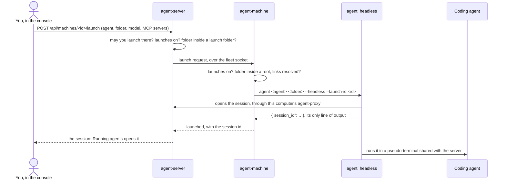
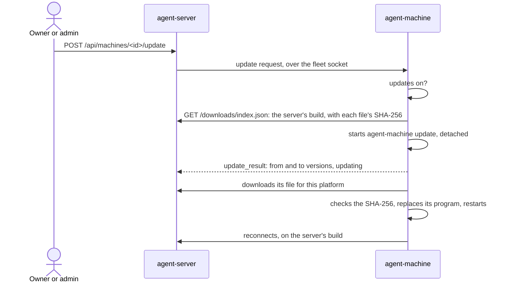

# Machines and the fleet

A **machine** is a computer that has joined the server's **fleet** with `agent-machine`. Machines do two jobs for the server:

- They supply every local LLM provider. Ollama, llama.cpp, Strata and Docker Model Runner run on machines, and so do the containers the server asks a machine to run. See [LLM providers](providers.md).
- They run things for you when you allow it: agents started from the console, terminals, [MCP servers](mcp.md) and updates.

`agent-machine` is its own program, apart from the `agent` client. It has its own sign-in and its own folder, so a machine can supply models to one server (or as one account) while its agents use another. It shares no code with `agent`. When it starts an agent, it runs `agent` as a program.

[Quick start](#quick-start) and [Commands](#commands) are all most setups need; [What a machine runs for you](#what-a-machine-runs-for-you) and [Who may use a machine](#who-may-use-a-machine) cover launches, terminals, updates and access. The rest is reference: the fleet protocol, every file on disk, running it as a service, and [the sandbox](#a-sandbox-machine-in-docker).

## Quick start

```bash
agent-machine login https://api.example.com # approve its device code
agent-machine start                      # join the fleet in the background
agent-machine                            # how the fleet sees this machine
```

The machine shows up on **Machines** in the console, with its own page. It belongs to your organization, from the first time it connects: nobody in another organization sees it or anything it runs, site admins included. Ollama, llama.cpp, Strata and Docker Model Runner running on it are found by themselves. An admin of your organization turns each one into a provider with **Add as a provider**; that provider is for your organization's agents only.

Everything that runs programs on the machine is off until you turn it on there:

```bash
agent-machine launches on          # let the server start agents here
agent-machine roots add ~/code     # where they may start (and any folder inside)
agent-machine commands on          # let you open a terminal here from the console
agent-machine files on             # let the console browse and read the files in the launch folders
agent-machine servers on           # let the server manage the model servers here
agent-machine containers on        # let the server run Strata, Ollama or llama.cpp containers here
agent-machine updates on           # let the console update agent-machine and agent here
```

Settings changes reach the server within a minute, with the machine's next update.

## Commands

| Command | What it does |
|---|---|
| `agent-machine` (or `agent-machine status`) | Shows the machine as the fleet sees it. See [Running it](#running-it). |
| `agent-machine status --json` | The same in short, as one line of JSON, without looking for model servers or containers: `id`, `name`, `version`, `server`, `signed_in`, `user`, `running`, `state`, `pid`, `features` (each toggle, on or off) and `roots`. The tray icon reads it ([Run it on your own computer](local.md#the-tray-icon)). |
| `agent-machine login [url]` | Signs the machine in using OIDC device authorization. |
| `agent-machine login [url] --code CODE [--enable LIST]` | Signs it in with a setup code from the console instead of a browser, then turns the listed toggles on. See [Signing in with a setup code](#signing-in-with-a-setup-code). |
| `agent-machine logout [url]` | Forgets a sign-in and revokes its token on the server. |
| `agent-machine start` | Joins the fleet in the background. |
| `agent-machine stop` | Stops the background run. The machine leaves the fleet. |
| `agent-machine run [--server url]` | Joins the fleet in the foreground. Ctrl+C leaves. |
| `agent-machine containers on\|off` | Lets the server run Strata, Ollama or llama.cpp here in containers. Off by default. |
| `agent-machine containers cli auto\|docker\|podman` | Picks the container CLI. `auto` uses whichever is installed and answering. |
| `agent-machine servers on\|off` | Lets the server manage the model servers here: install llama.cpp, start and stop them, their settings and their models. Off by default. |
| `sudo agent-machine servers service [off]` | Lets this user's agent-machine control Ollama's systemd service (Linux). |
| `agent-machine launches on\|off` | Lets the server start agents here. Off by default. |
| `agent-machine commands on\|off` | Lets you open a terminal here from the console, in a launch folder. Off by default. |
| `agent-machine files on\|off` | Lets the console browse and read the files in the launch folders. Off by default. See [Files](#files). |
| `agent-machine roots add <dir>` | Adds a folder agents may be started in (and any folder inside it). |
| `agent-machine roots remove <dir>` | Removes one. |
| `agent-machine mcp ...` | Lists, adds and removes the MCP servers this machine shares. See [MCP servers](mcp.md). |
| `agent-machine name <name>\|-` | Sets the name the console shows. `-` goes back to the hostname. |
| `agent-machine address <host>\|-` | Sets how the server reaches this machine's model servers. `-` clears it. |
| `agent-machine update [--force] [--server url]` | Replaces agent-machine with the build the server offers, and restarts it. |
| `agent-machine updates on\|off` | Lets the console update agent-machine and agent here to the server's build. Off by default. |
| `agent-machine version` | Prints the version and protocol level. |
| `agent-machine help` | Prints the usage. |

### Signing in

`agent-machine login` signs this machine in. The URL defaults to the server signed in to last, or `http://127.0.0.1:9999`. A URL without a scheme gets `https://`.

Open the printed OIDC verification URL in your browser, sign in and approve the displayed device code. If you're already signed in to the console, you can instead enter the code on **Machines › Approve a device**, without typing your password again ([Console](console.md#approve-a-device)). The CLI never collects your password. Access tokens refresh automatically using rotating credentials. Authentication is mandatory; old password and access-key options are removed. See [OIDC authentication](oidc.md).

The machine belongs to whoever signed it in: that user is its **owner**. A machine id already registered to another user is refused, so one user can't take over another's machine.

`agent-machine logout [url]` forgets the sign-in to that server (default: the last one) and revokes its token on the server when it can reach it. `agent-machine run` reads the credentials file each time it connects, so `login` and `logout` apply at once.

### Signing in with a setup code

Where nobody is at a browser (a container, a script, a computer you set up remotely), a setup code approves the sign-in for you. Create one in the console on **Machines**: **Add a machine**, then **Create a setup code**. A code starts with `msc_`, expires after a while and can be used a limited number of times. The machine it signs in belongs to you, as if you had approved the device code yourself. Treat it as a password: agent-machine never prints or logs it.

```bash
agent-machine login https://api.example.com --code msc_... --enable launches,commands
```

- `--code CODE` uses the setup code instead of printing a device code to approve. Without `--code`, `login` uses `AI_PROXY_MACHINE_SETUP_CODE` when it's set; otherwise it's the browser sign-in.
- `--enable LIST` turns toggles on once signed in, as `agent-machine <toggle> on` does: a comma-separated list of `launches`, `commands` (or `terminals`), `files`, `updates`, `servers` and `containers`. Without `--enable`, `login` uses `AI_PROXY_MACHINE_ENABLE`. It works with a browser sign-in too. An unknown name stops `login` (exit status 2) before it signs in.
- A code that has expired, been used up, or whose account changed is refused with "The setup code isn't valid: it may have expired or been used up. Create a new one on the console's Machines page." Nothing is saved and no toggle changes.

`agent-machine start` and `agent-machine run` sign in by themselves when `AI_PROXY_MACHINE_SETUP_CODE` is set and there's no sign-in for their server yet (`--server`, else the last one, else `http://127.0.0.1:9999`), and apply `AI_PROXY_MACHINE_ENABLE` too. That's a container's first start. Once credentials exist the code is ignored, so a restarted container doesn't spend another use. If the code is refused, they exit with the message and status 1. They remove the code from their environment either way, so agents and terminals started on the machine never see it. With `AI_PROXY_MACHINE_TOKEN` set no sign-in is needed, and the code is ignored.

### Running it

- `run` stays in the foreground and reconnects whenever the connection drops. It waits 2, 5, 10, then 30 seconds between tries, and starts over after a connection that lasted more than a minute. It renews its access token over the open connection, so the token's expiry doesn't drop it. `--server` joins another server than the signed-in one.
- `start` runs `agent-machine run` detached from the terminal, and waits up to 15 seconds for it to connect or fail. It prints the log's path.
- `stop` stops the running one and waits up to 10 seconds for it to go.

Only one agent-machine runs per folder. `run` refuses while another is running, and `start` says it's already running. It knows by the process id in `status.json` and only counts a process of its own user: if the one it ran has gone and its id now belongs to another user's process, it isn't running, and `start` starts a new one.

**The status display.** `agent-machine` with no arguments shows:

- **Machine**: its name and id.
- **Server**: its server and OIDC sign-in.
- **Fleet**: whether it's running, connected or not, and its process id. When the server runs another version, it says so and suggests `agent-machine update`.
- **Address**, when set.
- **Providers**: the model servers answering here, by type and port.
- **Containers**: off, or on with the CLI, and whether the CLI is installed and its engine answers.
- **Servers**, **Launches**, **Updates**, **Commands**: on or off, with the command to turn each on. Launches also says when the `agent` command isn't on PATH.
- **MCP**: the MCP servers it shares.
- **Folders**: the launch folders.

**On Android (Termux)**, Android stops apps' background processes when it wants the memory or battery, Termux's included, so agent-machine can go away while the phone is idle, and the machine shows offline on the console. Keep it running with:

- `termux-wake-lock` (or **Acquire wakelock** in Termux's notification) before `agent-machine start`;
- Android's battery settings for Termux set to **Unrestricted**;
- on Android 12 and later, Android's limit on background processes ("phantom process killer") turned off: in Developer options, **Disable child process restrictions**, or `adb shell settings put global settings_enable_monitor_phantom_procs false`.

If it went anyway, `agent-machine start` starts it again. The server's [Access log](console.md#access-log) shows each of the machine's connections and how it ended.

### Settings

- **`containers on`** lets the server run Strata, Ollama or llama.cpp containers here. `docker run` is root on the machine, so it's off until you turn it on, and the machine checks every request itself. `agent-machine containers cli docker` or `podman` always uses that CLI. `auto` (the default) uses Docker when it answers, else Podman. See [Containers machines run](providers.md#containers-machines-run).
- **`servers on`** lets the server start and stop the Ollama, llama.cpp and Strata profiles installed here, install llama.cpp (Termux's packages, or llama.cpp's own build from GitHub, checked by SHA-256, into agent-machine's folder), change Ollama's and llama.cpp's settings, and pull, delete, load and unload models ([llama.cpp](providers.md#llamacpp)). With it on, agent-machine also saves a Strata profile for each model installed in Strata that has none, so every one can be started from the console ([Providers](providers.md#strata)). Without it, the machine still reports its model servers, their models, logs and its load, but changes nothing.
- **`launches on`** lets the server start agents here. **`commands on`** lets you open a terminal here. **`files on`** lets the console browse and read files here. All three only work inside the folders listed with `roots add`. `roots add` makes the folder absolute and checks that it exists. With launches or files on and no roots, the status display and the command say so.
- **`name`** is the name on **Machines**. The default is the hostname.
- **`address`** is the host the server uses to reach this machine's model servers, when the address it sees isn't right (behind NAT or a reverse proxy). Without it, the server uses the address the machine connected from. When the address changes, the machine's backends move with it, on the same ports. Most machines don't need it, as agents' traffic goes through the machine itself (see [Tunnels](#tunnels)).

**Ollama's systemd service.** `sudo agent-machine servers service` is for an Ollama installed as the systemd service `ollama.service`, which Ollama's Linux installer sets up and which belongs to root. Run it once, with sudo, as the user agent-machine runs as. It:

- adds a sudoers rule (`/etc/sudoers.d/agent-machine-ollama`) that lets only that user run `systemctl start|stop|restart ollama` without a password;
- adds a drop-in (`/etc/systemd/system/ollama.service.d/agent-machine.conf`) so the service reads its environment from `/etc/agent-machine/ollama.env`, which that user may write.

The console's `OLLAMA_*` settings then apply when the service restarts. The file only sets environment variables for the ollama user's process; it can't change what runs or as whom. `sudo agent-machine servers service off` undoes it. See [Ollama](providers.md#ollama).

### Updating it

`agent-machine update` replaces this binary with the build the server offers for this platform (`<os>-<arch>`), from its downloads. It checks each file against the server's SHA-256 before it replaces anything. It does nothing when the server's version is this one, unless you pass `--force`. `--server` updates from another server than the signed-in one (by default it's the server the running agent-machine is connected to).

After updating, it puts the running agent-machine on the new binary, depending on how it was started:

| Started by | What happens |
|---|---|
| `agent-machine start` | Stopped and started again on the new binary |
| A service (systemd, launchd, rc.d) | Stopped; the service starts it again |
| `agent-machine run` in a terminal | Left running; stop it and run it again |

A binary installed by a package manager (`/usr/bin`, `Program Files`) belongs to it: update those with the package. `agent-machine updates on` lets the console do this remotely. See [Remote updates](#remote-updates).

## Files and environment variables

agent-machine keeps everything in one folder:

- `AI_PROXY_MACHINE_HOME`, when set;
- else `%APPDATA%\agent-machine` on Windows;
- else `$XDG_CONFIG_HOME/agent-machine`, or `~/.config/agent-machine`.

| File | What it holds |
|---|---|
| `credentials.json` | Each server's URL, user, access token, rotating refresh token, expiry and issuer endpoints, plus the default server. No passwords. Keep it private. |
| `machine.json` | The machine's id and settings: name, address, launches, roots, containers and the container CLI, servers, commands, updates. |
| `status.json` | How the running agent-machine is doing: process id, server, state, the server's version, and how it was started. |
| `agent-machine.log` | Its log. A run in a terminal also prints it there. |
| `ollama.json` | The `OLLAMA_*` settings it starts Ollama with, saved from the console. |
| `ollama.log` | The output of the Ollama it started. |
| `servers.json` | The Ollama and llama-server it started (process ids, where Ollama listens, the settings each started with). |
| `llamacpp.json` | The `LLAMA_ARG_*` settings it starts llama-server with, saved from the console. |
| `llamacpp.log` | The output of the llama-server it started. |
| `llamacpp/` | The llama.cpp builds installed from the console, one folder each (`<release>-<build>`): the newest and the one before it. In the data folder (below). |
| `llamacpp-install.json` | Which llama.cpp the console installed (from GitHub or Termux, which build) and where its `llama-server` is. |
| `llamacpp-install.log` | What installing llama.cpp did (Termux's `apt-get` output, and each install's result). |
| `llamacpp-models/` | The GGUF folder agent-machine's llama-server serves unless its settings name another: models agent-machine downloads itself, one subfolder each. In the data folder (below). |
| `ollama-models/` | Only with `AI_PROXY_MACHINE_DATA` set: the models of the Ollama agent-machine starts, unless its settings name another folder. In the data folder. |
| `mcp.json` | The MCP servers it shares: commands, environments, folders, URLs and headers. |

Files are written readable by this user only. The machine's id is made the first time it's needed. A `machine.json` from before agent-machine existed (in the client's `agent-proxy` folder) is carried over once, so the server still knows the machine by its id. That doesn't happen when `AI_PROXY_MACHINE_HOME` is set.

**The data folder.** The large files, llama.cpp's builds and models (gigabytes), go in the data folder: `AI_PROXY_MACHINE_DATA` when it's set, else agent-machine's folder.

- Set it where the sign-in's folder is small, or where the only writable space is `/tmp` or a scratch volume, as in a pod under OpenShift's restricted policy: `AI_PROXY_MACHINE_DATA=/tmp/agent-data`. The sign-in and settings stay in agent-machine's folder.
- With it set, an Ollama agent-machine starts keeps its models in `ollama-models` there too, unless Ollama's **Models directory** setting names a folder. Without it, Ollama keeps them where it always does (`~/.ollama/models`).
- Moving it doesn't move files already downloaded: they're downloaded again.

It reads these environment variables:

| Variable | What it does |
|---|---|
| `AI_PROXY_MACHINE_HOME` | agent-machine's folder |
| `AI_PROXY_MACHINE_TOKEN` | A pre-issued OAuth access token, over the stored sign-in (automation; obtain a replacement before it expires) |
| `AI_PROXY_MACHINE_DATA` | The data folder: llama.cpp's builds and models, and the models of an Ollama it starts (default: agent-machine's folder, and Ollama's own for Ollama's models) |
| `AI_PROXY_MACHINE_SETUP_CODE` | A setup code for `login` without `--code`, and for `start` and `run` to sign in with when there's no sign-in yet ([Signing in with a setup code](#signing-in-with-a-setup-code)) |
| `AI_PROXY_MACHINE_ENABLE` | Toggles to turn on after such a sign-in, comma-separated, for `login` without `--enable` |
| `APPDATA`, `XDG_CONFIG_HOME` | Where the folder is by default |
| `AI_PROXY_AGENT` | The `agent` program launches and terminals run, instead of `agent` from PATH |
| `AI_PROXY_LOCAL_PORT` | The port of this computer's agent-proxy (default 8184), to check which server it carries traffic to |
| `AI_PROXY_LLAMACPP_PORT` | The port of the llama-server it starts and looks for (default 9931) |
| `AI_PROXY_API_PORTS` | More loopback ports to look for OpenAI-compatible servers on, comma-separated (LM Studio's 1234, vLLM's 8000 and SGLang's 30000 are always looked at) |
| `STRATA_API_KEY` | The key for Strata here, before the one in Strata's profile |
| `STRATA_PROFILE_DIR`, `STRATA_RUNTIME_DIR` | Where Strata's profiles and runtime files are, instead of Strata's defaults (`LOCALAPPDATA` and `XDG_STATE_HOME` are used for those) |
| `SUDO_USER` | The user `sudo agent-machine servers service` sets up |
| `PATH` | Where it finds `agent`, `docker` or `podman`, `ollama`, `llama-server`, `strata` and the agents |
| `PREFIX`, `TERMUX_VERSION` | Set by Termux: llama.cpp is installed from Termux's packages there |
| `HF_TOKEN` | A Hugging Face token, for downloading models from gated repos into llama.cpp's GGUF folder |

The container CLI runs with the machine's environment, so `DOCKER_HOST` and Docker contexts work as they do in a terminal there. agent-machine never uses an `HTTPS_PROXY` from its environment. Started from inside an intercepted agent, it would otherwise loop through that agent's proxy.

Tests replace the programs it runs with JSON lists of arguments: `AI_PROXY_CONTAINER_COMMAND`, `AI_PROXY_OLLAMA_COMMAND`, `AI_PROXY_LLAMACPP_COMMAND`, `AI_PROXY_LLAMACPP_APT` (Termux's `apt-get`), `AI_PROXY_STRATA_COMMAND`, `AI_PROXY_SYSTEMCTL_COMMAND`, `AI_PROXY_SERVICE_COMMAND` and `AI_PROXY_SERVICE_ENV`. `AI_PROXY_LLAMACPP_RELEASES` points the llama.cpp installer at another releases list. `AI_PROXY_MACHINE_STARTED` is set by `agent-machine start` for the run it starts.

## The fleet connection

`agent-machine run` keeps one WebSocket open to the server, signed in as the machine's owner. It tells the server what the machine has (its agents, model servers, containers, MCP servers and switches) when it connects and every minute, and the server sends its requests back over the same connection: start an agent or a terminal, manage a model server or a container, list folders, read a file, update itself, or open a tunnel. A server that can't take the machine's protocol level refuses it, and agent-machine logs why.

The messages, their fields, how it keeps its sign-in and how it reconnects are in [Networking and protocols](networking.md#machines-the-fleet-socket-and-tunnels).

### Model server detection

agent-machine asks each default port on `127.0.0.1` whether its model server answers, with a 1.5-second timeout:

| Type | Port | Path |
|---|---|---|
| `ollama` | 11434 | `/api/version` (then `/api/tags` for the number of models) |
| `docker` (Docker Model Runner) | 12434 | `/engines/v1/models` |
| `strata` | 18500 | `/v1/models` (a 401 counts: Strata asks for a key) |
| `llamacpp` | 9931 (`AI_PROXY_LLAMACPP_PORT`) | `/models` (llama-server's router lists its models there) |
| `api` (LM Studio) | 1234 | `/v1/models`, which must answer with a model list |
| `api` (vLLM) | 8000 | `/v1/models`, the same |
| `api` (SGLang) | 30000 | `/v1/models`, the same |
| `api` (other OpenAI-compatible servers) | each port in `AI_PROXY_API_PORTS` (comma-separated) | `/v1/models`, the same |

An `api` server becomes an [API provider](providers.md#openai-compatible-servers-on-a-machine) when added. The machine only reads its model list; models are managed in that server itself.

With `servers on`, Strata profiles serving on other loopback ports are added too, from Strata's own state. For each Strata it finds, it reads the key from the profile serving on that port and sends it in the hello.

### Tunnels

Agents' requests to a machine's model servers go through the machine. The server doesn't need a route to it, so a machine behind NAT, in WSL or on another network serves models without a port forward. For each connection, the server asks the machine over the fleet connection to dial back a tunnel to the model server's loopback port. The machine only tunnels to the ports of the model servers it reported, the containers it runs for the server, and its MCP bridge, and only the machine that was asked can take its tunnel.

A machine on the server's own computer is reached directly. So is one that isn't connected, or whose agent-machine is too old to tunnel: those use the machine's address as the server saw it, or the one set with `agent-machine address`. How a tunnel is opened, retried and kept signed in is in [Networking and protocols](networking.md#tunnels).

## What a machine runs for you

### Launches



A launch starts an agent on the machine, from **Start an agent** or the machine's **Agents** tab. It runs in a shared terminal, and the console takes you to it.

The server checks that:

- the person asking may launch there (see [Who may use a machine](#who-may-use-a-machine));
- the machine is connected and has `launches on`;
- the folder is one of its roots or inside one (no `..`, for Windows and POSIX paths);
- the agent is one of the server's agents and installed on the machine, and has a model if it needs one.

The machine then checks again, whatever the server allowed. It needs `launches on`, resolves the folder (links followed, made absolute) and checks it's inside a root. A new folder named inside a root is created; only plain names are added below the part that exists.

It runs, detached and with no window:

```text
agent <agent> <folder> --headless --launch-id <id> --share private|team|org
      [--model M] [--backend B] [--trace] [--team T] [--let-others-type] [--mcp NAMES] [--account ID]
```

with `AI_PROXY_URL` set to its server, and `AI_PROXY_MACHINE_ID` and `AI_PROXY_MACHINE_NAME` to tag the session with the machine. The program is `AI_PROXY_AGENT`, or `agent` from PATH. In headless mode `agent` prints `{"session_id": ...}` as its only line of output and runs the agent in a pseudo-terminal shared with the server. agent-machine waits up to 50 seconds for that line, and the server up to 60.

The server accepts a successful launch only when the reported session belongs to the machine's owner and matches that machine, launch id and agent. An unrelated session is refused with `502`; it never grants the requester access to that session.

The agent's traffic goes through this computer's agent-proxy, signed in with `agent login`. So that has to be the same server: if the agent-proxy here is already running for another server, the launch is refused with `agent login <server>` as the fix. Install the client and sign it in to the same server to take launches.

The server records the last 30 launches per machine, with who asked, the agent, the folder and the session or the error. The machine's page shows the last 10. Machine launch history only includes sessions you may view, plus your own pending or failed launches. Sessions carry `machine`, `machine_name` and `launch` tags. Agents started by hand on the computer only carry `hostname`, and the server puts them under the same owner's machine with that hostname, so the machine's page lists both.

**The folder picker.** When you start an agent or a terminal on a machine, you pick the folder by opening the folders inside its launch folders one by one. With no path, the server lists the roots. Inside one, the machine lists the folder:

- only for those who may launch or open terminals there, and only while launches or commands are on;
- only inside the roots, checked by the server and again by the machine after resolving links;
- folder names only, never files;
- no hidden folders, and no links that lead outside the roots;
- at most 500 folders; the answer says when it's cut short;
- **Up** stops at a root.

### Terminals

With `agent-machine commands on`, **Open a terminal** on the machine's page starts a shell there. It's a real remote shell as the user agent-machine runs as.

- It needs the `terminal` feature (the owner, or organizations and teams granted it) and `commands on`.
- It starts in a launch folder (the first root by default), which must exist. The server and the machine both check it's inside a root. From there, the shell can go anywhere that user can.
- The machine runs `agent --shell <folder> --headless --launch-id <id>`.
- Its session's client is `shell`. The server keeps those sessions private and refuses to widen their sharing.

### Files

With `agent-machine files on`, the machine's **Files** tab in the console browses its launch folders and shows a file's text, with Markdown files rendered. It only reads; nothing is changed on the machine.

- It needs the `files` feature (the owner, or organizations and teams granted it) and `files on`. Launches and terminals don't turn it on.
- The server and the machine both check that the path is inside a root, and the machine checks again after following links.
- Hidden files and folders (a name starting with a dot, such as `.env` or `.git`) are listed and read like any other, so anyone who can browse the files can read secrets kept in them. Grant `files` only to who should see them.
- A listing shows folders first, then files with their size, at most 1000 entries. **Up** stops at a root.
- A file shows at most its first 1 MB. A file that isn't text (it has a NUL byte or isn't UTF-8) is reported as binary, and its bytes stay on the machine.

### Remote updates



With `agent-machine updates on`, a machine on another build than the server's has **Update now** on its page. It needs the `update` feature: the owner, admins, or a granted organization or team.

The machine runs `agent-machine update --server <server>` detached, so it can stop itself and start the new binary. Its output goes to `agent-machine.log`. With the agent box ticked, it adds `--with-agent`, which runs `agent update` from the same server first. Launches and terminals run `agent`, so it should be the server's build too. A failed `agent update` doesn't stop agent-machine's.

It only ever installs the build the server offers, checked against its SHA-256. Without `updates on`, the machine refuses.

## Who may use a machine

A machine's owner may use all its features. Others get them through grants on the machine's **Access** tab. The machine's own switches (`launches on`, `servers on`, ...) apply on top of any grant.

| Feature | What it allows | Its organization's admins without a grant |
|---|---|---|
| `view` | See it: its model servers, their models and logs, its load and the agents running there | Yes |
| `launch` | Start agents there, and browse its launch folders | No |
| `terminal` | Open terminals there: a shell as the user agent-machine runs as | No |
| `files` | Browse the files in its launch folders and read them | No |
| `models` | Pull, delete, load and unload models on its model servers | Yes |
| `servers` | Install llama.cpp; start, stop and configure the Ollama, llama.cpp and Strata installed there | No |
| `update` | Update agent-machine and agent there to this server's build | Yes |
| `mcp` | Use the MCP servers it shares in the agents they start | No |

- **Grants** go to the machine's own organization, or its teams (named `<organization>/<team>`). Never to another organization. The owner or an admin of its organization sets them (`PUT /api/machines/{id}/access`). Members can only grant teams they're in.
- **Any grant includes view.** Someone who may use one feature can see the machine.
- **Starting programs stays private.** Admins can't launch agents, open terminals or read files on someone else's machine without a grant.
- **Launched by.** Agents and terminals run under the machine's own sign-in, its owner's. When someone else starts one, the server tags the session `launched_by` them, so they can watch and use what they started. Clients can't set that tag.
- **Containers** stay with the owner, who must also be an admin of the organization to add, change or delete them (see [Containers machines run](providers.md#containers-machines-run)).

See [Accounts and sharing](accounts.md) for organizations, teams and roles.

### Removing and restoring a machine

The owner or an admin can remove a machine from its **Summary** tab (`DELETE /api/machines/{id}`), connected or not. The server closes its connection (code 4403) and refuses it when it connects again. What it ran for the server stops reaching agents.

Removed machines are listed under **Removed** on **Machines**, for their owner and their organization's admins. **Allow back** (`POST /api/machines/{id}/restore`) lets it join again. It comes back as a new machine, owned by whoever it signs in as.

## Running agent-machine as a service

The installer in every archive (`tools/dist/install/`) sets up a service with `--service` (`-Service` on Windows). The one-line installer from the server takes the same option:

```bash
curl -fsSL http://server:9999/install.sh | sh -s -- --only agent-machine --service
sudo ./install.sh --service      # from an unpacked archive
```

```powershell
& ([scriptblock]::Create((irm http://server:9999/install.ps1))) -Only agent-machine -Service
powershell -ExecutionPolicy Bypass -File install.ps1 -Service
```

The service runs as the user who ran the installer (the sudo user under sudo), because that user's `agent-machine login` and settings are the ones it uses. If an agent-machine is already running, the installer stops it so the service's own can join. Sign in with `agent-machine login` before or after; the service keeps retrying until then.

| OS | What `--service` sets up |
|---|---|
| Linux, as root | A systemd service, `/etc/systemd/system/agent-machine.service`, run as that user from boot |
| Linux, as a user | A systemd user unit, `~/.config/systemd/user/agent-machine.service`, run while you're signed in (`sudo loginctl enable-linger <you>` runs it from boot) |
| macOS | A launchd agent, `~/Library/LaunchAgents/com.ai-control-mesh.agent-machine.plist`, run when you log in |
| FreeBSD, as root | An rc.d service, `/usr/local/etc/rc.d/agent_machine` |
| Windows | A scheduled task, `agent-machine`, that runs `agent-machine start` when you sign in |

The service's `PATH` includes the install folder and the system folders, as agent-machine starts `agent`, `docker` or `podman`, `ollama`, `llama-server` and `strata` from it. `./install.sh --uninstall` (or `curl -fsSL http://server:9999/uninstall.sh | sh`) removes the programs and the service; sign-ins and settings stay unless you add `--purge`. See [Deployment](deployment.md#uninstalling).

The `agent-machine` deb, rpm and Arch packages include a systemd user unit, not enabled: turn it on after `agent-machine login` with `systemctl --user enable --now agent-machine`. See [Deployment](deployment.md) for the installers and packages.

## A sandbox machine in Docker

**agent-sandbox** (`ghcr.io/joeyenfield/agent-sandbox`, built from `sandbox/Dockerfile`) is a container that is a machine of its own. It's Ubuntu 24.04 with `agent`, `agent-proxy` and `agent-machine`, plus Claude Code, Codex, OpenCode, Qwen Code and Copilot CLI (the npm packages in the `AGENTS` build argument), and Ollama (CPU only) for the console to start.

It has the tools a person at a terminal reaches for, so the agents can use them too:

| For | Tools |
|---|---|
| Code | `git`, `git-lfs`, `gh` (GitHub CLI), `build-essential` (gcc, make), `pkg-config`, Node.js and npm, Python 3 (as `python` and `python3`) with `pip`, `venv` and `pipx`, `sqlite3` |
| Network | `ping`, `tracepath`, `traceroute`, `dig` and `nslookup`, `ip`, `ifconfig`, `netstat`, `nc`, `telnet`, `socat`, `curl`, `wget` |
| Remote | `ssh`, `scp`, `sftp`, `rsync` |
| Files | `rg`, `fd`, `tree`, `file`, `jq`, `zip`/`unzip`, `xz`, `bzip2`, `zstd`, `nano`, `vi` |
| Processes | `ps`, `htop`, `lsof`, `strace`, `pstree` |

**Adding more.** There are three ways:

- **Build time:** `--build-arg EXTRA_PACKAGES="postgresql-client nmap"` when you build the image yourself.
- **Start time:** `AGENT_APT_PACKAGES="postgresql-client nmap"` installs them when the container starts. A container keeps them until it's recreated.
- **While it runs:** the `agent` user has `sudo` without a password, so you (in a terminal from the console) or an agent can `sudo apt-get update && sudo apt-get install -y <package>`. That makes the agents root inside the container, though not outside it. Build with `--build-arg AGENT_SUDO=0` to leave `sudo` out.

On start it:

1. waits up to two minutes for the server's `/health`;
2. signs both agent-machine and agent in to the server, unless their credentials already name it. A sign-in that fails (nobody approved the code in time, a used-up setup code) is tried again after 30 seconds, then a wait that doubles up to 15 minutes, until it works; `docker logs agent-sandbox` shows each new code. It doesn't exit, so a restart policy can't make it ask for codes over and over;
3. copies SSH keys from `/ssh`, sets git's user, and clones `AGENT_REPOS`;
4. relays the model servers named by `AGENT_OLLAMA` and `AGENT_LLAMACPP` to its own loopback (see [Model servers for a sandbox](#model-servers-for-a-sandbox));
5. sets the machine's name, turns launches on and adds the workspace as a launch root (roots persist on the home volume, so a fresh volume has only the workspace), turns containers off, and turns servers on unless `AGENT_SERVERS=off`;
6. runs `agent-machine run` with rotating OAuth credentials.

Agents you start on it run inside the container, so they can't touch the computer it runs on beyond `/workspace`.

```bash
docker run -d --name agent-sandbox --hostname agent-sandbox --restart unless-stopped \
  -e AI_PROXY_SERVER=https://api.example.com \
  -v agent-sandbox-home:/home/agent -v agent-sandbox-workspace:/workspace \
  ghcr.io/joeyenfield/agent-sandbox:latest
```

`latest` is the last explicitly promoted stable build, and it's what the console's **Add a machine** (System: **Docker container**) shows. `docker pull` and a new container move a sandbox to a newer one. To pin it, use a release's tag (`2.0.1`) or a locally published snapshot tag (`snapshot-<timestamp>-g<commit>`) instead. A server that is too old for the sandbox's protocol refuses it, and the sandbox's log says so: use the tag of the server's own version then. To run changes of your own, build the image from a copy of this repository and run `agent-sandbox` instead:

```bash
docker build -f sandbox/Dockerfile -t agent-sandbox .     # from the repository root
```

Or beside the server in `deploy/compose/server/compose.yaml`, with its `sandbox` profile (from that folder):

```bash
docker compose --profile sandbox up -d
docker compose logs -f agent-sandbox
```

**More than one sandbox on a computer.** The console's **Add a machine** (System: **Docker container**) has an optional **Name** that adds to `agent-sandbox` and names the container and both of its volumes; do the same by hand.

- `work` gives `--name agent-sandbox-work --hostname agent-sandbox-work` with `agent-sandbox-work-home` and `agent-sandbox-work-workspace`, so each sandbox keeps its own sign-ins, models, llama.cpp and workspace. Names are lower-case letters, digits and dashes.
- The machine is named after the container's hostname, which is the container's id unless `--hostname` sets it, so give it the container's name (`AI_PROXY_MACHINE_NAME` still overrides it).
- `--network`, the model-server settings and the rest are the same for each; nothing else about a sandbox is shared between them.

| Setting | What it does |
|---|---|
| `AI_PROXY_SERVER` | The server to join (required) |
| `AI_PROXY_MACHINE_NAME` | The name on **Machines** (default: the container's hostname) |
| `AI_PROXY_MACHINE_SETUP_CODE` | A setup code from **Machines** › **Add a machine** › **Create a setup code**, so agent-machine signs in on first start without a browser ([Signing in with a setup code](#signing-in-with-a-setup-code)) |
| `AI_PROXY_MACHINE_ENABLE` | Toggles to turn on with that sign-in, for example `commands`. The sandbox sets launches, containers and servers itself (step 5), so this matters for `commands` and `updates`. |
| `AGENT_WORKSPACE` | Where agents may start (default `/workspace`) |
| `AGENT_DATA_DIR` | Where llama.cpp's builds and models and the Ollama models go (agent-machine's `AI_PROXY_MACHINE_DATA`), for example `/tmp/agent-data`. Default: the home volume. |
| `-v <folder>:/ssh:ro` | SSH keys for git (and optionally `config` and `known_hosts`), copied into `~/.ssh` on every start |
| `GIT_USER_NAME`, `GIT_USER_EMAIL` | Who the agents' commits are by |
| `AGENT_REPOS` | Git URLs to clone into the workspace on start, space-separated. Ones already there are left alone. |
| `AGENT_OLLAMA` | An Ollama in another container, `host[:port]` (default port 11434), relayed to the sandbox's `127.0.0.1:11434` |
| `AGENT_LLAMACPP` | A llama-server in another container, `host[:port]` (default port 8080), relayed to the sandbox's `127.0.0.1:9931` (`AI_PROXY_LLAMACPP_PORT`) |
| `AGENT_SERVERS` | `on` (the default) lets the console start, stop and configure the model servers in the sandbox (its Ollama, and llama.cpp, which it installs there) and pull models into them. `off`: the console only sees them. |
| `AGENT_APT_PACKAGES` | More apt packages to install on start, space-separated (needs the image's `sudo`; ones already installed are skipped, and a failed install doesn't stop the sandbox) |
| `TERM`, `COLORTERM` | The terminal type agents see: `xterm-256color` and `truecolor` by default, so they print in color without `-t` |
| `--build-arg AGENTS="..."` | The npm packages of the agents to install, when you build the image yourself |
| `--build-arg EXTRA_PACKAGES="..."` | More apt packages to build in |
| `--build-arg AGENT_SUDO=0` | No `sudo` for the agent user |
| `--build-arg OLLAMA_VERSION=...` | The Ollama release to copy in (from the `ollama/ollama` image), when you build the image yourself |

- **Sign-ins.** On first start, open the verification URL printed in the logs and approve each of the two device codes. With `AI_PROXY_MACHINE_SETUP_CODE` set, agent-machine's is approved by the code instead, and the code is kept out of the agents' environment. Credentials and the machine id persist in `/home/agent`; subsequent starts renew automatically and don't use the code again. Password/key environment bootstrap is removed.
- **Git over SSH.** The keys are copied rather than used in place, because a mount from Windows or macOS usually has permissions ssh refuses. Without your own `config`, a host's key is trusted the first time it's seen, so a clone doesn't stop at a question nobody can answer. Agents in the sandbox can read the key: use a deploy key or one made for the sandbox.
- **Account agents.** Their sign-ins (Claude, Copilot, ChatGPT) also live in `/home/agent`. Sign in once from the agent's terminal in the console.
- **OpenShift and OKD.** The image runs under the restricted policy, as a random user in group 0: its home and workspace are writable by group 0, and the entrypoint gives that user a name in `/etc/passwd`. If the home folder isn't writable (a read-only root file system with no volume there), it uses `/tmp/agent-home`, so sign-ins last only as long as the pod: sign in with a setup code that allows enough sign-ins, or mount a volume at `/home/agent`. Set `AGENT_DATA_DIR=/tmp/agent-data` (or a scratch volume) to keep llama.cpp and the models out of the home volume.
- **Podman** takes the same commands. It doesn't give containers the `NET_RAW` capability that Docker does, so for `ping` add `--cap-add=NET_RAW`, or `--sysctl net.ipv4.ping_group_range="0 65535"` (the image's `ping` then uses unprivileged ICMP sockets). A server on the same computer is reached at `host.docker.internal` (Docker, with `--add-host=host.docker.internal:host-gateway`) or `host.containers.internal` (Podman).

### Model servers for a sandbox

The sandbox has Ollama, and can install llama.cpp, so it can run models itself, on the CPU. To use a GPU, relay a model server container that has one.

**Run Ollama in the sandbox.** The machine's **Providers** tab lists Ollama under **Installed there**, and its **Start** starts it on the sandbox's loopback. Pull models into it from its tab; they're kept in the home volume (`/home/agent/.ollama`). Then **Add as a provider**. It's CPU only: the image leaves out Ollama's CUDA, ROCm and Vulkan libraries, which are most of its size, and a container has no GPU unless you give it one.

agent-machine only looks for model servers on its own loopback (`127.0.0.1`), and a container has a loopback of its own. So an Ollama or llama.cpp container started next to the sandbox isn't found on its own, even on the same network.

**Relay a model server container.** Run Ollama or llama.cpp's own image, and name it in `AGENT_OLLAMA` or `AGENT_LLAMACPP`. The sandbox relays it to the port agent-machine looks on, and it shows on the machine's page with **Add as a provider**. Agents' traffic reaches it through the machine's tunnel, so its port doesn't need publishing.

```bash
docker network create agent-models
docker run -d --name ollama --network agent-models -v ollama-models:/root/.ollama ollama/ollama
docker run -d --name llamacpp --network agent-models -v ./models:/models \
  ghcr.io/ggml-org/llama.cpp:server -m /models/Llama-3.2-1B-Instruct-Q4_K_M.gguf --host 0.0.0.0 --port 8080
docker run -d --name agent-sandbox --hostname agent-sandbox --network agent-models --restart unless-stopped \
  -e AI_PROXY_SERVER=https://api.example.com \
  -e AGENT_OLLAMA=ollama -e AGENT_LLAMACPP=llamacpp:8080 \
  -v agent-sandbox-home:/home/agent -v agent-sandbox-workspace:/workspace \
  ghcr.io/joeyenfield/agent-sandbox:latest
```

Pulling, deleting, loading and unloading models on the relayed Ollama work from the console, with servers on. A relayed Ollama takes port 11434, so the image's own Ollama can't start beside it. A relayed llama-server serves what its own container was started with, and the sandbox can't start, stop or configure either one: they're other containers.

**Run llama.cpp in the sandbox.** The machine's **llama.cpp** tab can install llama.cpp's own Linux build (CPU, or another variant) into the sandbox's home volume, download models from Hugging Face into its GGUF folder, and start llama-server there. It then shows as a model server like any other. Don't set `AGENT_LLAMACPP` too: both use port 9931.

Strata isn't in the image, and the sandbox can't run model server containers (containers are always off there: `docker run` would be root on the computer the sandbox runs on).

## The Python agent-machine

The Python package (`python/`, `agent_py`) installs an `agent-machine` with the same name, protocol, files and ports, for computers without a Go build. It does everything the Go one does:

- every command: `login`/`logout`, `run`/`start`/`stop`, the status display, `launches`, `roots`, `commands`, `name`, `address`, `servers` and `servers service`, `containers`, `mcp`, `update` and `updates`;
- the same hello, launches and terminals, folders, tunnels, shared MCP servers, and containers (Docker or Podman);
- starting and stopping Ollama (or its systemd `ollama.service`), llama.cpp and Strata's profiles, and installing llama.cpp;
- every model server question (Ollama, llama.cpp, Docker Model Runner and Strata, with Strata's key read from its profile), catalogue searches and the machine's load.

Ollama runs on Termux on Android too (`pkg install ollama`), and so does llama.cpp, with the phone's GPU through OpenCL.

Its `update` pip-installs the server's wheel, checked against its SHA-256; `--with-agent` runs `AI_PROXY_AGENT update` first when that names the agent command, and otherwise stops the agent-proxy, as the Python agent is the same package. A launch runs `AI_PROXY_AGENT` if it's set, otherwise the Python `agent` with the same Python. Installed with pip, `sudo agent-machine servers service` may not find the program on sudo's `secure_path`: run `sudo "$(which agent-machine)" servers service`.
