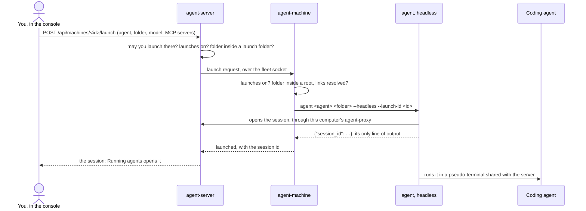
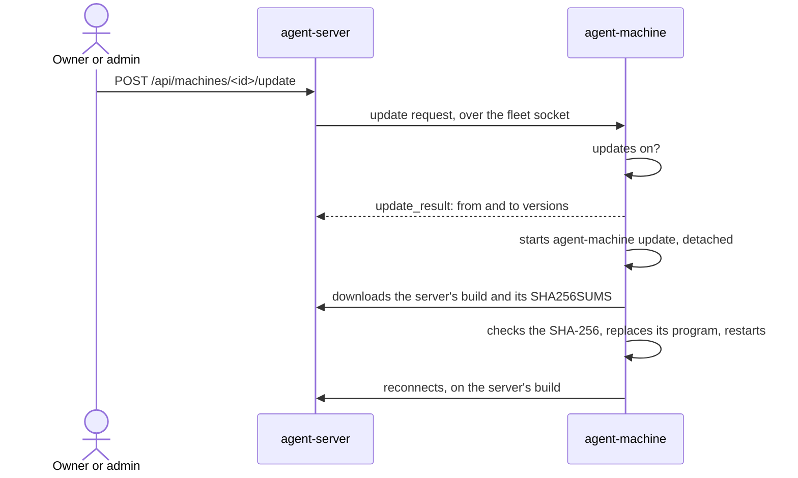

# Machines and the fleet

A **machine** is a computer that has joined the server's **fleet** with `agent-machine`. Machines do two jobs for the server:

- They supply every local LLM provider. Ollama, Strata and Docker Model Runner run on machines, and so do the containers the server asks a machine to run. See [LLM providers](providers.md).
- They run things for you when you allow it: agents started from the console, terminals, [MCP servers](mcp.md) and updates.

`agent-machine` is its own program, apart from the `agent` client. It has its own sign-in and its own folder, so a machine can supply models to one server (or as one account) while its agents use another. It shares no code with `agent`. When it starts an agent, it runs `agent` as a program.

## Quick start

```bash
agent-machine login https://api.aicontrolmesh.com # approve its device code
agent-machine start                      # join the fleet in the background
agent-machine                            # how the fleet sees this machine
```

The machine shows up on **Machines** in the console, with its own page. Ollama, Strata and Docker Model Runner running on it are found by themselves. An admin turns each one into a provider with **Add as a provider**.

Everything that runs programs on the machine is off until you turn it on there:

```bash
agent-machine launches on          # let the server start agents here
agent-machine roots add ~/code     # where they may start (and any folder inside)
agent-machine commands on          # let you open a terminal here from the console
agent-machine servers on           # let the server manage the model servers here
agent-machine containers on        # let the server run Strata or Ollama containers here
agent-machine updates on           # let the console update agent-machine and agent here
```

Settings changes reach the server within a minute, with the machine's next update.

## Commands

| Command | What it does |
|---|---|
| `agent-machine` (or `agent-machine status`) | Shows the machine as the fleet sees it. See [The status display](#the-status-display). |
| `agent-machine login [url]` | Signs the machine in using OIDC device authorization. |
| `agent-machine logout [url]` | Forgets a sign-in and revokes its token on the server. |
| `agent-machine start` | Joins the fleet in the background. |
| `agent-machine stop` | Stops the background run. The machine leaves the fleet. |
| `agent-machine run [--server url]` | Joins the fleet in the foreground. Ctrl+C leaves. |
| `agent-machine containers on\|off` | Lets the server run Strata or Ollama here in containers. Off by default. |
| `agent-machine containers cli auto\|docker\|podman` | Picks the container CLI. `auto` uses whichever is installed and answering. |
| `agent-machine servers on\|off` | Lets the server manage the model servers here: start and stop them, their settings and their models. Off by default. |
| `sudo agent-machine servers service [off]` | Lets this user's agent-machine control Ollama's systemd service (Linux). |
| `agent-machine launches on\|off` | Lets the server start agents here. Off by default. |
| `agent-machine commands on\|off` | Lets you open a terminal here from the console, in a launch folder. Off by default. |
| `agent-machine roots add <dir>` | Adds a folder agents may be started in (and any folder inside it). |
| `agent-machine roots remove <dir>` | Removes one. |
| `agent-machine mcp ...` | Lists, adds and removes the MCP servers this machine shares. See [MCP servers](mcp.md). |
| `agent-machine name <name>\|-` | Sets the name the console shows. `-` goes back to the hostname. |
| `agent-machine address <host>\|-` | Sets how the server reaches this machine's model servers. `-` clears it. |
| `agent-machine update [--force] [--server url]` | Replaces agent-machine with the build the server offers, and restarts it. |
| `agent-machine updates on\|off` | Lets the console update agent-machine and agent here to the server's build. Off by default. |
| `agent-machine version` | Prints the version and protocol level. |
| `agent-machine help` | Prints the usage. |

### login and logout

`agent-machine login` signs this machine in. The URL defaults to the server signed in to last, or `http://127.0.0.1:9999`. A URL without a scheme gets `https://`.

Open the printed OIDC verification URL in your browser, sign in and approve the displayed device code. If you're already signed in to the console, you can instead enter the code on **Machines › Approve a device**, without typing your password again ([Console](console.md#approve-a-device)). The CLI never collects your password. Access tokens refresh automatically using rotating credentials. Authentication is mandatory; old password and access-key options are removed. See [OIDC authentication](oidc.md).

The machine belongs to whoever signed it in: that user is its **owner**. A machine id already registered to another user is refused, so one user can't take over another's machine.

`agent-machine logout [url]` forgets the sign-in to that server (default: the last one) and revokes its token on the server when it can reach it.

`agent-machine run` reads the credentials file each time it connects, so `login` and `logout` apply at once.

### start, stop and run

- `run` stays in the foreground and reconnects whenever the connection drops. It waits 2, 5, 10, then 30 seconds between tries, and starts over after a connection that lasted more than a minute. `--server` joins another server than the signed-in one.
- `start` runs `agent-machine run` detached from the terminal, and waits up to 15 seconds for it to connect or fail. It prints the log's path.
- `stop` stops the running one and waits up to 10 seconds for it to go.

Only one agent-machine runs per folder. `run` refuses while another is running, and `start` says it's already running.

### containers

`agent-machine containers on` lets the server run Strata or Ollama containers here. `docker run` is root on the machine, so it's off until you turn it on, and the machine checks every request itself. `agent-machine containers cli docker` or `podman` always uses that CLI. `auto` (the default) uses Docker when it answers, else Podman. See [Containers machines run](providers.md#containers-machines-run).

### servers

`agent-machine servers on` lets the server start and stop the Ollama and the Strata profiles installed here, change Ollama's settings, and pull, delete, load and unload models. Without it, the machine still reports its model servers, their models, logs and its load, but changes nothing.

`sudo agent-machine servers service` is for an Ollama installed as the systemd service `ollama.service`, which Ollama's Linux installer sets up and which belongs to root. Run it once, with sudo, as the user agent-machine runs as. It:

- adds a sudoers rule (`/etc/sudoers.d/agent-machine-ollama`) that lets only that user run `systemctl start|stop|restart ollama` without a password;
- adds a drop-in (`/etc/systemd/system/ollama.service.d/agent-machine.conf`) so the service reads its environment from `/etc/agent-machine/ollama.env`, which that user may write.

The console's `OLLAMA_*` settings then apply when the service restarts. The file only sets environment variables for the ollama user's process; it can't change what runs or as whom. `sudo agent-machine servers service off` undoes it. See [Ollama](providers.md#ollama).

### launches, commands and roots

`launches on` lets the server start agents here. `commands on` lets you open a terminal here. Both only work inside the folders listed with `roots add`. `roots add` makes the folder absolute and checks that it exists. With launches on and no roots, the status display and the command say so.

### name and address

- `name` is the name on **Machines**. The default is the hostname.
- `address` is the host the server uses to reach this machine's model servers, when the address it sees isn't right (behind NAT or a reverse proxy). Without it, the server uses the address the machine connected from. When the address changes, the machine's backends move with it, on the same ports. Most machines don't need it, as agents' traffic goes through the machine itself (see [Tunnels](#tunnels)).

### update and updates

`agent-machine update` replaces this binary with the build the server offers for this platform (`<os>-<arch>`), from its downloads. It checks each file against the server's SHA-256 before it replaces anything. It does nothing when the server's version is this one, unless you pass `--force`. `--server` updates from another server than the signed-in one (by default it's the server the running agent-machine is connected to).

After updating, it puts the running agent-machine on the new binary, depending on how it was started:

| Started by | What happens |
|---|---|
| `agent-machine start` | Stopped and started again on the new binary |
| A service (systemd, launchd, rc.d) | Stopped; the service starts it again |
| `agent-machine run` in a terminal | Left running; stop it and run it again |

A binary installed by a package manager (`/usr/bin`, `Program Files`) belongs to it: update those with the package.

`agent-machine updates on` lets the console do this remotely. See [Remote updates](#remote-updates).

### The status display

`agent-machine` with no arguments shows:

- **Machine**: its name and id.
- **Server**: its server and OIDC sign-in.
- **Fleet**: whether it's running, connected or not, and its process id. When the server runs another version, it says so and suggests `agent-machine update`.
- **Address**, when set.
- **Providers**: the model servers answering here, by type and port.
- **Containers**: off, or on with the CLI, and whether the CLI is installed and its engine answers.
- **Servers**, **Launches**, **Updates**, **Commands**: on or off, with the command to turn each on. Launches also says when the `agent` command isn't on PATH.
- **MCP**: the MCP servers it shares.
- **Folders**: the launch folders.

## Its folder and files

agent-machine keeps everything in one folder:

- `AI_PROXY_MACHINE_HOME`, when set;
- else `%APPDATA%\agent-machine` on Windows;
- else `$XDG_CONFIG_HOME/agent-machine`, or `~/.config/agent-machine`.

| File | What it holds |
|---|---|
| `credentials.json` | Each server's URL, user, access token, rotating refresh token, expiry and issuer endpoints, plus the default server. No passwords. Keep it private. |
| `machine.json` | The machine's id and settings: name, address, launches, roots, containers and the container CLI, servers, commands, updates. |
| `status.json` | How the running agent-machine is doing: process id, server, state, the server's version, and how it was started. |
| `agent-machine.log` | Its log. A run in a terminal also prints it there. |
| `ollama.json` | The `OLLAMA_*` settings it starts Ollama with, saved from the console. |
| `ollama.log` | The output of the Ollama it started. |
| `servers.json` | The Ollama it started (process id, where it listens, the settings it started with). |
| `mcp.json` | The MCP servers it shares: commands, environments, folders, URLs and headers. |

Files are written readable by this user only. The machine's id is made the first time it's needed. A `machine.json` from before agent-machine existed (in the client's `agent-proxy` folder) is carried over once, so the server still knows the machine by its id. That doesn't happen when `AI_PROXY_MACHINE_HOME` is set.

## Environment variables

| Variable | What it does |
|---|---|
| `AI_PROXY_MACHINE_HOME` | agent-machine's folder |
| `APPDATA`, `XDG_CONFIG_HOME` | Where the folder is by default |
| `AI_PROXY_AGENT` | The `agent` program launches and terminals run, instead of `agent` from PATH |
| `AI_PROXY_LOCAL_PORT` | The port of this computer's agent-proxy (default 8184), to check which server it carries traffic to |
| `STRATA_API_KEY` | The key for Strata here, before the one in Strata's profile |
| `STRATA_PROFILE_DIR`, `STRATA_RUNTIME_DIR` | Where Strata's profiles and runtime files are, instead of Strata's defaults (`LOCALAPPDATA` and `XDG_STATE_HOME` are used for those) |
| `SUDO_USER` | The user `sudo agent-machine servers service` sets up |
| `PATH` | Where it finds `agent`, `docker` or `podman`, `ollama`, `strata` and the agents |

The container CLI runs with the machine's environment, so `DOCKER_HOST` and Docker contexts work as they do in a terminal there.

Tests replace the programs it runs with JSON lists of arguments: `AI_PROXY_CONTAINER_COMMAND`, `AI_PROXY_OLLAMA_COMMAND`, `AI_PROXY_STRATA_COMMAND`, `AI_PROXY_SYSTEMCTL_COMMAND`, `AI_PROXY_SERVICE_COMMAND` and `AI_PROXY_SERVICE_ENV`. `AI_PROXY_MACHINE_STARTED` is set by `agent-machine start` for the run it starts.

agent-machine never uses an `HTTPS_PROXY` from its environment. Started from inside an intercepted agent, it would otherwise loop through that agent's proxy.

## The fleet connection

`agent-machine run` holds one WebSocket open to `/api/machines/connect`, signed with its token. Every request carries `X-AI-Proxy-Version` and `X-AI-Proxy-Protocol`. A server that can't take this protocol level refuses it (HTTP 426, or close code 4426), and agent-machine logs why.

It sends a **hello** when it connects, and an **update** every 60 seconds, with:

- its id, name, hostname, OS and architecture, version and protocol level;
- its `address`, when set;
- which of the server's agents are installed (their executable is on PATH; it asks the server's `/api/agents` for the list);
- the model servers it found (type, port, version, number of models, and a Strata profile's key);
- whether it takes launches, its roots, and whether commands and updates are on;
- `"tunnel": 1`, as it carries agents' traffic to its model servers;
- whether the `agent` command is installed (`launcher`);
- containers: whether they're on, the CLI, whether its engine answers, and the engines it can run;
- servers: whether they're on, and the state of the Ollama and Strata installed here;
- the MCP servers it shares.

It also sends an update straight after a launch and after starting or stopping a model server. It pings every 25 seconds. The server keeps what it learns in its database, apart from Strata keys and the MCP bridge's key, which it keeps in memory only and drops when the machine disconnects.

Over the same connection the server sends requests, each answered on the machine:

| Request | What it is |
|---|---|
| `launch`, `shell` | Start an agent or a terminal. See [Launches](#launches) and [Terminals](#terminals). |
| `provider` | A model server's status, models (pull, delete, load, unload), logs, this machine's load, catalogue searches. See [LLM providers](providers.md). |
| `server` | Start, stop or restart Ollama or a Strata profile; read or save Ollama's settings. |
| `container` | Status, start, stop, restart, remove and logs of the containers it runs. |
| `folders` | The folders inside a launch folder, for the folder picker. |
| `update` | Update agent-machine (and agent) to the server's build. |
| `tunnel` | Carry one connection to one of its model servers. |

### Model server detection

agent-machine asks each default port on `127.0.0.1` whether its model server answers, with a 1.5-second timeout:

| Type | Port | Path |
|---|---|---|
| `ollama` | 11434 | `/api/version` (then `/api/tags` for the number of models) |
| `docker` (Docker Model Runner) | 12434 | `/engines/v1/models` |
| `strata` | 18500 | `/v1/models` (a 401 counts: Strata asks for a key) |

With `servers on`, Strata profiles serving on other loopback ports are added too, from Strata's own state. For each Strata it finds, it reads the key from the profile serving on that port and sends it in the hello.

## Launches



A launch starts an agent on the machine, from **Start an agent** or the machine's **Agents** tab. It runs in a shared terminal, and the console takes you to it.

The server accepts a successful launch only when the reported session belongs to the
machine's owner and matches that machine, launch id and agent. An unrelated session is
refused with `502`; it never grants the requester access to that session. Machine launch
history only includes sessions you may view, plus your own pending or failed launches.

The server checks that:

- the person asking may launch there (see [Who may use a machine](#who-may-use-a-machine));
- the machine is connected and has `launches on`;
- the folder is one of its roots or inside one (no `..`, for Windows and POSIX paths);
- the agent is one of the server's agents and installed on the machine, and has a model if it needs one.

The machine then checks again, whatever the server allowed. It needs `launches on`, resolves the folder (links followed, made absolute) and checks it's inside a root. A new folder named inside a root is created; only plain names are added below the part that exists.

It runs, detached and with no window:

```text
agent <agent> <folder> --headless --launch-id <id> --share private|team|org
      [--model M] [--backend B] [--trace] [--team T] [--let-others-type] [--mcp NAMES]
```

with `AI_PROXY_URL` set to its server, and `AI_PROXY_MACHINE_ID` and `AI_PROXY_MACHINE_NAME` to tag the session with the machine. The program is `AI_PROXY_AGENT`, or `agent` from PATH. In headless mode `agent` prints `{"session_id": ...}` as its only line of output and runs the agent in a pseudo-terminal shared with the server. agent-machine waits up to 50 seconds for that line, and the server up to 60.

The agent's traffic goes through this computer's agent-proxy, signed in with `agent login`. So that has to be the same server: if the agent-proxy here is already running for another server, the launch is refused with `agent login <server>` as the fix. Install the client and sign it in to the same server to take launches.

The server records the last 30 launches per machine, with who asked, the agent, the folder and the session or the error. The machine's page shows the last 10. Sessions carry `machine`, `machine_name` and `launch` tags. Agents started by hand on the computer only carry `hostname`, and the server puts them under the same owner's machine with that hostname, so the machine's page lists both.

## Terminals

With `agent-machine commands on`, **Open a terminal** on the machine's page starts a shell there. It's a real remote shell as the user agent-machine runs as.

- It needs the `terminal` feature (the owner, or organizations and teams granted it) and `commands on`.
- It starts in a launch folder (the first root by default), which must exist. The server and the machine both check it's inside a root. From there, the shell can go anywhere that user can.
- The machine runs `agent --shell <folder> --headless --launch-id <id>`.
- Its session's client is `shell`. The server keeps those sessions private and refuses to widen their sharing.

## The folder picker

When you start an agent or a terminal on a machine, you pick the folder by opening the folders inside its launch folders one by one. With no path, the server lists the roots. Inside one, the machine lists the folder:

- only for those who may launch or open terminals there, and only while launches or commands are on;
- only inside the roots, checked by the server and again by the machine after resolving links;
- folder names only, never files;
- no hidden folders, and no links that lead outside the roots;
- at most 500 folders; the answer says when it's cut short;
- **Up** stops at a root.

## Remote updates



With `agent-machine updates on`, a machine on another build than the server's has **Update now** on its page. It needs the `update` feature: the owner, admins, or a granted organization or team.

The machine runs `agent-machine update --server <server>` detached, so it can stop itself and start the new binary. Its output goes to `agent-machine.log`. With the agent box ticked, it adds `--with-agent`, which runs `agent update` from the same server first. Launches and terminals run `agent`, so it should be the server's build too. A failed `agent update` doesn't stop agent-machine's.

It only ever installs the build the server offers, checked against its SHA-256. Without `updates on`, the machine refuses.

## Tunnels

Agents' requests to a machine's model servers go through the machine. The server doesn't need a route to it, so a machine behind NAT, in WSL or on another network serves models without a port forward.

- For a backend on a machine that can tunnel, is connected and isn't the server's own computer, the server opens a loopback listener and sends that backend's requests there.
- Each connection to it asks the machine, over the fleet connection, to open a tunnel.
- agent-machine dials `/api/machines/tunnel/<id>` back and passes the bytes to and from `127.0.0.1:<port>`.
- Only the machine that was asked, signed in as its owner, can take its tunnel.

A machine only tunnels to the ports of the model servers it reported, the containers it runs for the server, and its MCP bridge. It refuses any other port. If the model server doesn't answer, it closes the tunnel with code 4502.

A machine on the server's own computer is reached directly. So is one that isn't connected, or whose agent-machine is too old to tunnel: those use the machine's address as the server saw it, or the one set with `agent-machine address`.

## Who may use a machine

A machine's owner may use all its features. Others get them through grants on the machine's **Access** tab. The machine's own switches (`launches on`, `servers on`, ...) apply on top of any grant.

| Feature | What it allows | Admins without a grant |
|---|---|---|
| `view` | See it: its model servers, their models and logs, its load and the agents running there | Yes |
| `launch` | Start agents there, and browse its launch folders | No |
| `terminal` | Open terminals there: a shell as the user agent-machine runs as | No |
| `models` | Pull, delete, load and unload models on its model servers | Yes |
| `servers` | Start, stop and configure the Ollama and Strata installed there | No |
| `update` | Update agent-machine and agent there to this server's build | Yes |
| `mcp` | Use the MCP servers it shares in the agents they start | No |

- **Grants** go to organizations and teams (named `<organization>/<team>`). The owner or an admin sets them (`PUT /api/machines/{id}/access`). Members can only grant organizations and teams they're in; admins can grant any.
- **Any grant includes view.** Someone who may use one feature can see the machine.
- **Starting programs stays private.** Admins can't launch agents or open terminals on someone else's machine without a grant.
- **Launched by.** Agents and terminals run under the machine's own sign-in, its owner's. When someone else starts one, the server tags the session `launched_by` them, so they can watch and use what they started. Clients can't set that tag.
- **Containers** stay with the owner, who must also be an admin to add, change or delete them (see [Containers machines run](providers.md#containers-machines-run)).

See [Accounts and sharing](accounts.md) for organizations, teams and roles.

## Removing and restoring a machine

The owner or an admin can remove a machine from its **Summary** tab (`DELETE /api/machines/{id}`), connected or not. The server closes its connection (code 4403) and refuses it when it connects again. What it ran for the server stops reaching agents.

Removed machines are listed under **Removed** on **Machines**, for their owner and for admins. **Allow back** (`POST /api/machines/{id}/restore`) lets it join again. It comes back as a new machine, owned by whoever it signs in as.

## Running agent-machine as a service

The installer in every archive (`tools/dist/install/`) sets up a service with `--service` (`-Service` on Windows). The one-line installer from the server takes the same option:

```bash
curl -fsSL http://server:9999/install.sh | sh -s -- --only agent-machine --service
sudo ./install.sh --service      # from an unpacked archive
```

```powershell
& ([scriptblock]::Create((irm http://server:9999/install.ps1))) -Only agent-machine -Service
powershell -ExecutionPolicy Bypass -File install.ps1 -Service
```

The service runs as the user who ran the installer (the sudo user under sudo), because that user's `agent-machine login` and settings are the ones it uses. If an agent-machine is already running, the installer stops it so the service's own can join. Sign in with `agent-machine login` before or after; the service keeps retrying until then.

| OS | What `--service` sets up |
|---|---|
| Linux, as root | A systemd service, `/etc/systemd/system/agent-machine.service`, run as that user from boot |
| Linux, as a user | A systemd user unit, `~/.config/systemd/user/agent-machine.service`, run while you're signed in (`sudo loginctl enable-linger <you>` runs it from boot) |
| macOS | A launchd agent, `~/Library/LaunchAgents/com.ai-coding-agent-proxy.agent-machine.plist`, run when you log in |
| FreeBSD, as root | An rc.d service, `/usr/local/etc/rc.d/agent_machine` |
| Windows | A scheduled task, `agent-machine`, that runs `agent-machine start` when you sign in |

The service's `PATH` includes the install folder and the system folders, as agent-machine starts `agent`, `docker` or `podman`, `ollama` and `strata` from it. `./install.sh --uninstall` (or `curl -fsSL http://server:9999/uninstall.sh | sh`) removes the programs and the service; sign-ins and settings stay unless you add `--purge`. See [Deployment](deployment.md#uninstalling).

The `agent-machine` deb, rpm and Arch packages include a systemd user unit, not enabled: turn it on after `agent-machine login` with `systemctl --user enable --now agent-machine`. See [Deployment](deployment.md) for the installers and packages.

## A sandbox machine in Docker

`sandbox/Dockerfile` builds **agent-sandbox**, a container that is a machine of its own. It has `agent`, `agent-proxy` and `agent-machine`, plus Claude Code, Codex, OpenCode, Qwen Code and Copilot CLI (the npm packages in the `AGENTS` build argument). On start it:

1. waits up to two minutes for the server's `/health`;
2. signs both agent-machine and agent in to the server, unless their credentials already name it;
3. copies SSH keys from `/ssh`, sets git's user, and clones `AGENT_REPOS`;
4. sets the machine's name, turns launches on with the workspace as its only root, and turns containers and servers off;
5. runs `agent-machine run` with rotating OAuth credentials.

Agents you start on it run inside the container, so they can't touch the computer it runs on beyond `/workspace`.

```bash
docker build -f sandbox/Dockerfile -t agent-sandbox .     # from the repository root
docker run -d --name agent-sandbox --restart unless-stopped \
  -e AI_PROXY_SERVER=https://api.aicontrolmesh.com \
  -v agent-sandbox-home:/home/agent -v agent-sandbox-workspace:/workspace agent-sandbox
```

Or beside the server in `compose.yaml`, with its `sandbox` profile:

```bash
docker compose --profile sandbox up -d
docker compose logs -f agent-sandbox
```

| Setting | What it does |
|---|---|
| `AI_PROXY_SERVER` | The server to join (required) |
| `AI_PROXY_MACHINE_NAME` | The name on **Machines** (default: the container's hostname) |
| `AGENT_WORKSPACE` | Where agents may start (default `/workspace`) |
| `-v <folder>:/ssh:ro` | SSH keys for git (and optionally `config` and `known_hosts`), copied into `~/.ssh` on every start |
| `GIT_USER_NAME`, `GIT_USER_EMAIL` | Who the agents' commits are by |
| `AGENT_REPOS` | Git URLs to clone into the workspace on start, space-separated. Ones already there are left alone. |
| `--build-arg AGENTS="..."` | The npm packages of the agents to install |

- **Sign-ins.** On first start, open the verification URL printed in the logs and approve each of the two device codes. Credentials and the machine id persist in `/home/agent`; subsequent starts renew automatically. Password/key environment bootstrap is removed.
- **Git over SSH.** The keys are copied rather than used in place, because a mount from Windows or macOS usually has permissions ssh refuses. Without your own `config`, a host's key is trusted the first time it's seen, so a clone doesn't stop at a question nobody can answer. Agents in the sandbox can read the key: use a deploy key or one made for the sandbox.
- **Account agents.** Their sign-ins (Claude, Copilot, ChatGPT) also live in `/home/agent`. Sign in once from the agent's terminal in the console.
- **Podman** takes the same commands. A server on the same computer is reached at `host.docker.internal` (Docker, with `--add-host=host.docker.internal:host-gateway`) or `host.containers.internal` (Podman).

## The Python agent-machine

The Python package (`python/`, `agent_py`) installs an `agent-machine` with the same name, protocol, files and ports, for computers without a Go build. It does everything the Go one does: every command (`login`/`logout`, `run`/`start`/`stop`, the status display, `launches`, `roots`, `commands`, `name`, `address`, `servers` and `servers service`, `containers`, `mcp`, `update` and `updates`), the same hello, launches and terminals, folders, tunnels, shared MCP servers, containers (Docker or Podman), starting and stopping Ollama (or its systemd `ollama.service`) and Strata's profiles, every model server question (Ollama, Docker Model Runner and Strata, with Strata's key read from its profile), catalogue searches and the machine's load. Ollama runs on Termux on Android too (`pkg install ollama`).

Its `update` pip-installs the server's wheel, checked against its SHA-256; `--with-agent` runs `AI_PROXY_AGENT update` first when that names the agent command, and otherwise stops the agent-proxy, as the Python agent is the same package. A launch runs `AI_PROXY_AGENT` if it's set, otherwise the Python `agent` with the same Python. Installed with pip, `sudo agent-machine servers service` may not find the program on sudo's `secure_path`: run `sudo "$(which agent-machine)" servers service`.
