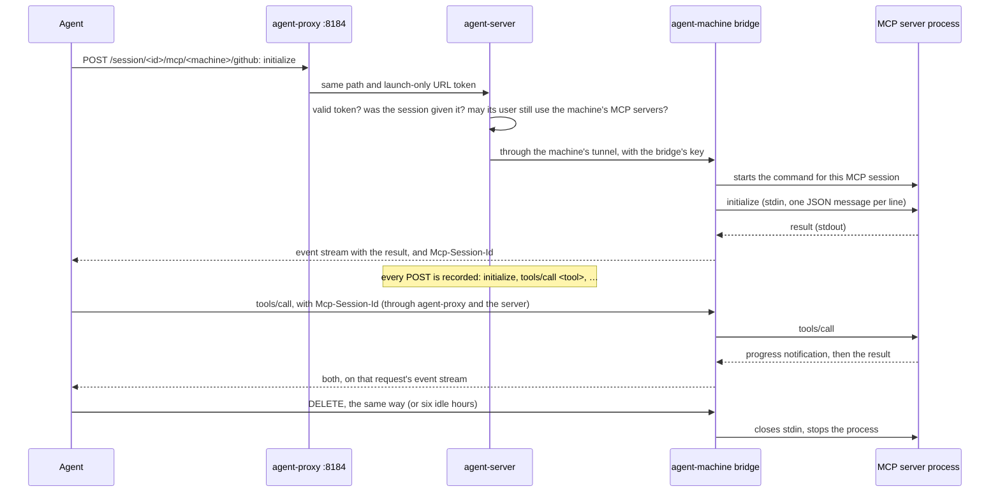

# MCP servers

A machine in the fleet can share MCP (Model Context Protocol) servers with the agents you start, on that machine or on any other. You add an MCP server once, on the machine where it should run. Then you choose it for an agent when you start the agent. The agent reaches it through the server, and every call is recorded in the agent's session.

Use it to give agents tools that live on one computer: a GitHub server with your token, a database on a machine's own network, a docs server on its loopback. The command, its environment and any tokens stay on that machine. The server only learns the names.

## Contents

- [Sharing an MCP server](#sharing-an-mcp-server)
- [Giving MCP servers to an agent](#giving-mcp-servers-to-an-agent)
- [What each agent gets](#what-each-agent-gets)
- [How it works](#how-it-works)
- [What's recorded](#whats-recorded)
- [Who may use them](#who-may-use-them)
- [API](#api)
- [Limitations](#limitations)

## Sharing an MCP server

On the machine, with `agent-machine` signed in to the server (see [Machines](machines.md)):

```bash
# A command: the MCP server's stdio program, started for each agent session.
agent-machine mcp add github --env GITHUB_PERSONAL_ACCESS_TOKEN=ghp_... -- npx -y @modelcontextprotocol/server-github
# A URL: an MCP server that speaks Streamable HTTP, reached from the machine.
agent-machine mcp add docs --url http://127.0.0.1:3000/mcp --header "Authorization: Bearer ..."
agent-machine mcp                      # what this machine shares
agent-machine mcp remove docs
```

### agent-machine mcp add

```text
agent-machine mcp add <name> [--env NAME=VALUE]... [--dir <dir>] [--description <text>] -- <command> [args...]
agent-machine mcp add <name> --url <url> [--header "Name: value"]... [--description <text>]
```

The name comes first: up to 40 lowercase letters, numbers, `-` and `_`, starting with a letter or number. Give either a command (after `--`) or `--url`, not both.

| Option | What it does |
|---|---|
| `-- <command> [args...]` | The MCP server's program and its arguments, run over stdio. Everything after `--` belongs to the command. |
| `--env NAME=VALUE` | An environment variable for the command, on top of agent-machine's own environment. Repeat it for more. |
| `--dir <dir>` | The folder the command runs in. It must exist. |
| `--url <url>` | An `http://` or `https://` URL of an MCP server that speaks Streamable HTTP. It's reached from the machine, so it can be on the machine's loopback or its own network. |
| `--header "Name: value"` | A header sent with every request to the URL, such as `Authorization`. Repeat it for more. |
| `--description <text>` | Shown beside the server in the console's pickers. |

Options take their value as `--name value` or `--name=value`. Adding a server with a name that's already there replaces it. If the command isn't on the machine's `PATH` yet, `mcp add` still saves it and says so; the console marks it "not installed there".

For example, to share a browser that agents can drive (Microsoft's [Playwright MCP server](https://github.com/microsoft/playwright-mcp), using the machine's Edge), or GitHub's server with a token kept on the machine:

```bash
agent-machine mcp add playwright --description "A browser on this machine" -- npx -y @playwright/mcp@latest --browser msedge
agent-machine mcp add github --env GITHUB_PERSONAL_ACCESS_TOKEN=ghp_... -- npx -y @modelcontextprotocol/server-github
```

A stdio server like Playwright gets a process (and here a browser) of its own for each agent session, on the machine that shares it.

### agent-machine mcp and mcp remove

`agent-machine mcp` lists what the machine shares: each name, whether it's `stdio` or `http`, and its command or URL. `agent-machine mcp remove <name>` stops sharing one. Plain `agent-machine` shows the same list in its status.

### mcp.json

The servers are kept in `mcp.json` in agent-machine's folder (`AI_PROXY_MACHINE_HOME`, or `agent-machine` in your config folder), written readable only by the user agent-machine runs as, because environments and headers often hold tokens. Entries that aren't valid are skipped when the file is read.

Changes need no restart. The machine's bridge reads `mcp.json` for every request, and the next update the machine sends the server (at most a minute later) brings the new list to the console and to launches.

On the machine's page in the console, the **MCP servers** tab lists what it shares and, for its owner, the commands to add more.

## Giving MCP servers to an agent

Choose them when you start the agent:

```bash
agent claude . --model qwen3.6:35b --mcp build-box/github
agent qwen . --model qwen3.6:35b --mcp build-box              # all of build-box's servers
agent claude-account . --mcp build-box/github,ai-desktop/docs
agent opencode . --model qwen3.8:latest --mcp all             # every one you may use
```

`--mcp` takes:

| Value | What it means |
|---|---|
| `<machine>/<name>` | One server. The machine can be named by its id or its name. |
| `<machine>` | All of that machine's servers. |
| `all` | Every server you may use, on machines that are connected now. |

Separate several with commas, or repeat `--mcp`. A server or machine that doesn't exist, or that you may not use, stops the launch with an error. So does naming one server on a machine that isn't connected. `<machine>` and `all` leave out servers on machines that aren't connected. An agent without MCP support (Aider) refuses `--mcp`.

The launcher prints the servers the agent got, on the `MCP     :` line.

In the console, **Start an agent** and starting an agent on a machine's page list the servers you may use, with a checkbox each. Offline machines' servers can't be ticked. A launch on a machine runs `agent ... --mcp` there, so the agent gets the same files as one you start by hand.

## What each agent gets

The server writes the chosen servers into the agent's own MCP settings for the session, from the agent's `mcp` block in `config/agents.yaml` (see [Adding a new agent](agents.md#the-mcp-block)). Each server's URL is on the agent's own `agent-proxy`, `http://127.0.0.1:8184/session/<id>/mcp/<machine>/<name>?key=<token>`, and speaks Streamable HTTP. The token is unique to the session and is delivered to the agent in its launch settings; the server stores only its hash. Treat the URL as a secret. A session id alone, including one visible to a session viewer, cannot call its MCP servers.

| Agent | How it gets them |
|---|---|
| `claude`, `claude-subscription`, `claude-account` | A `claude-mcp.json` with `mcpServers`, each `{"type": "http", "url": ...}`, passed with `--mcp-config` |
| `copilot`, `copilot-account` | A `copilot-mcp.json` with `mcpServers`, each `{"type": "http", "url": ..., "tools": ["*"]}`, passed with `--additional-mcp-config @<file>` |
| `codex`, `codex-account` | `-c mcp_servers.<name>.url="<url>"` for each |
| `opencode` | Under `mcp` in `OPENCODE_CONFIG_CONTENT`, each `{"type": "remote", "url": ..., "enabled": true}` |
| `qwen` | Under `mcpServers` in its session settings file, each `{"httpUrl": ...}` |
| `goose` | `--with-streamable-http-extension <url>` for each, after `session` |
| `aider` | None: Aider has no MCP support |

Each server is named by its own name in the agent's settings, or `<machine>-<name>` when two machines in one launch share a server of the same name. The files go in the session's files folder and are removed when the agent exits.

## How it works



- **They run on their machine**, as the user agent-machine runs as.
- **The bridge.** When the machine shares at least one server, agent-machine starts its bridge: an HTTP server on a random loopback port that speaks MCP's Streamable HTTP at `/mcp/<name>`. It makes a new key each time it starts. Its hello to the server names the port, the key and the servers by name (with their description, transport and whether the command is installed), never their commands, environments, folders, URLs or headers. The server keeps the key in memory only.
- **Agents reach it through the server.** The agent's `agent-proxy` forwards `/session/<id>/mcp/...` to the server without the machine's token. The URL also carries a per-session capability token, which is not included in the public session record; the server stores only its hash. The server relays each request through the machine's tunnel, like its model servers, so the machine needs no open port. It sends the bridge's key in `X-AI-Proxy-MCP-Key`, which the bridge checks and removes. A machine on the server's own computer is reached directly. The machine allows the tunnel only to its model servers, its containers and the bridge's port.
- **What's passed on.** Only `Content-Type`, `Accept`, `Mcp-Session-Id`, `Mcp-Protocol-Version` and `Last-Event-ID` go from the agent to the bridge; the agent's own credentials don't. `Mcp-Session-Id` and `Cache-Control` come back.
- **A command** gets a process of its own for each MCP session. The agent's `initialize` starts it; a request without `Mcp-Session-Id` that isn't `initialize` is refused. Messages go to the process's stdin one JSON value per line, and its stdout is read the same way; its stderr goes to agent-machine's log.
  - A POST with requests is answered on an event stream (or as JSON, if the agent doesn't accept event streams) that ends with the last response. A POST with only notifications or responses gets `202`.
  - A GET with `Accept: text/event-stream` opens the session's stream for what the MCP server says outside a request's reply. Up to 100 such messages are kept while no stream is open. A new GET replaces the old one.
  - A DELETE ends the session and its process.
  - A session unused for 6 hours is ended, as agents rarely say goodbye. A machine runs at most 32 such processes at once, over all its servers.
  - Ending a process closes its stdin first, then stops it and what it started.
- **A URL** is proxied as it is, with the server's `--header` values added.
- **The Python agent-machine** (`python/agent_py/machine`) has the same `mcp` commands, file and bridge.

## What's recorded

Every POST to a shared server is recorded in the agent's session as a request of kind `mcp`. Its host is `<machine name>/<server>` and its endpoint says what the JSON-RPC message does: `initialize`, `tools/list`, `tools/call search_code`, `resources/read <uri>`, or for a batch the first one and how many more. The reply is recorded too (up to 2 MB of it in the trace), and a JSON-RPC error in it marks the request with an error. Bodies are saved when the session saves payloads (`--trace`). On **Traffic** these show as **MCP**, with the service "MCP `<machine>/<server>`".

The GET stream and DELETE are passed on without being recorded.

## Who may use them

- **The machine's owner**, and the organizations and teams the owner grants **Use MCP servers** on the machine's **Access** tab (the fleet feature `mcp`). See [Machines](machines.md) and [Accounts](accounts.md).
- **Admins need a grant too**, as these servers often hold their owner's tokens. Unlike seeing a machine or managing its models, it isn't one of the things admins may do on any machine.
- **It's checked twice:** when the launch chooses the servers, and on every request, for whoever started the session (for a launch from the console, whoever asked for it). Taking a grant away stops agents already running.
- **A session reaches only the servers it was started with.** They're kept in the session's `mcp` tag, which clients can't set. A request for any other server gets `404`.
- Without accounts, everyone may use every machine's servers.

## API

| Endpoint | What it does |
|---|---|
| `GET /api/mcp` | The MCP servers machines share that you may give agents: `id` (`<machine id>/<name>`), `machine`, `machine_name`, `connected`, `name`, `description`, `transport` (`stdio` or `http`) and `found`. |
| `GET`, `POST`, `DELETE /session/{id}/mcp/{machine}/{name}` | An agent's Streamable HTTP to one shared server, relayed to the machine. The URL's `key` query parameter is a launch-only capability; the session id alone is insufficient. |
| `mcp` in `POST /api/agents/{id}/sessions` and in a machine launch | The servers to give the agent, as `--mcp` takes them (a list, or a comma-separated string). The answer's `mcp` lists each one's `id`, `name` and `url`. |

Errors on the relay: `404` for an ended session, a missing or invalid capability, a server the session wasn't given, or one the machine no longer shares; `403` when whoever started the session may no longer use the machine's servers; `503` when the machine isn't connected; `502` when the machine's agent-machine is too old to carry MCP traffic (run `agent-machine update` there) or the machine can't be reached. See [API](api.md).

## Limitations

- **Claude Code's `--mcp-config` takes every value up to the next option.** That's why the MCP arguments go before an agent's own. For `claude-account`, which has no arguments of its own, a prompt you pass after `--` would be read as another config file: put an option before it (`-- --model sonnet "your prompt"`).
- **Changes reach the server within a minute.** A server added or removed on a machine shows in the console and in launches after the machine's next update. The bridge itself reads `mcp.json` on every request, so a removed server stops answering at once.
- **Sessions opened from the console get no files.** **Start an agent** opens a session for running the agent by hand, and nothing writes the agent's settings files for it. It shows each server's URL instead, to add to the agent's settings yourself (Streamable HTTP). Launches with `agent`, and launches on a machine from the console, write the files.
- **Restarting agent-machine ends its stdio sessions** and makes a new bridge key. The server learns the key from the machine's next hello; agents have to initialize their MCP sessions again.
- **Aider** can't take MCP servers.
