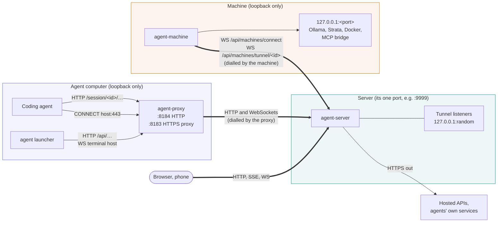
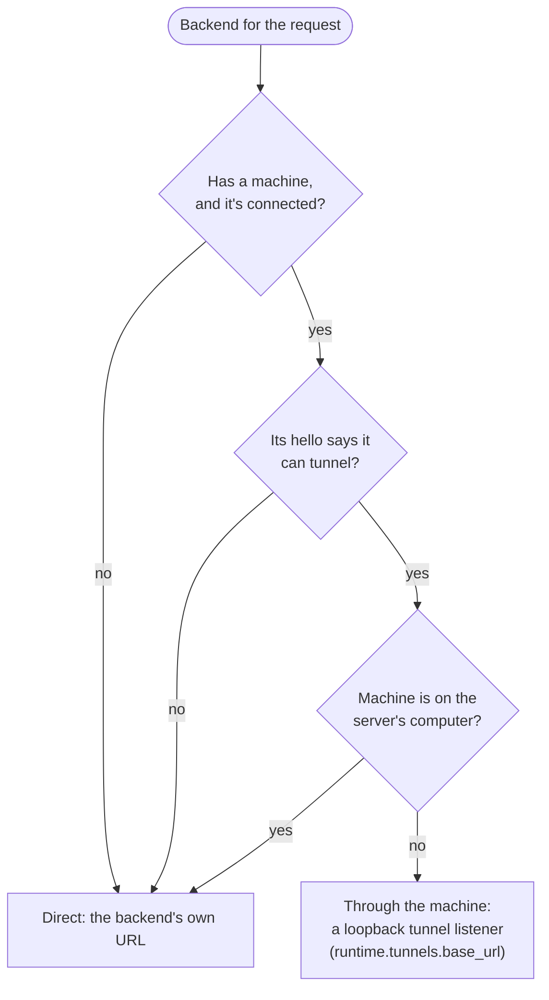
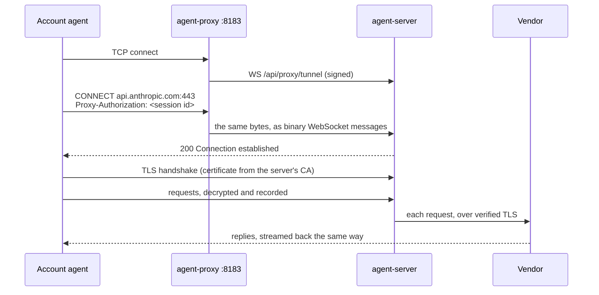
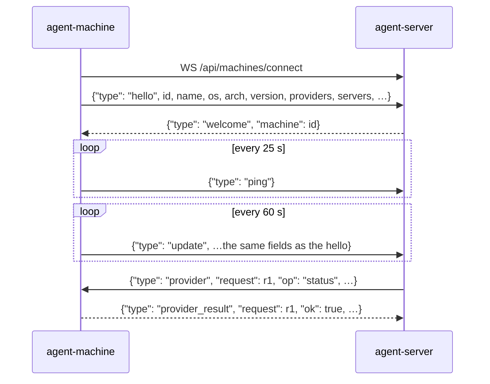

# Networking, protocols and routing

How the parts connect, what goes over each connection, and how one request from an agent finds its way to a model. [Architecture](architecture.md) has the overview; this page is the detail: every connection, port, header, message and close code, and the routing rules step by step.

## The shape of it

Only the server takes connections from the network, and only on its one port. Everything else either stays on its own computer's loopback or dials out to the server:

- **Agents** talk only to the `agent-proxy` on their own computer, on `127.0.0.1`.
- **The `agent-proxy`** dials the server: plain HTTP requests for agent traffic and the launcher, and WebSockets for terminals and account agents' HTTPS.
- **`agent-machine`** dials the server and holds one WebSocket open. When the server needs to reach something on the machine, it asks over that socket and the machine dials back.
- **The server** makes outgoing connections to hosted APIs, to the agents' own services (account agents), and to model servers it can reach directly.

So a machine behind NAT, in WSL, or on a phone needs no open port and no port forward. Only the server's port has to be reachable, from wherever agents and machines run.

## Every connection

Which of these are encrypted, and why the few plain-HTTP ones stay on one computer, is on [Security](security.md#encryption-in-transit).

| From | To | Transport | Opened by | Credential | Carries |
| --- | --- | --- | --- | --- | --- |
| Agent | `agent-proxy` `127.0.0.1:8184` | HTTP | the agent | session id for model calls; launch-only URL capability for MCP | Model calls: `/session/<id>/v1/…`, `/session/<id>/anthropic/…`, `/session/<id>/api/…`; MCP at `/session/<id>/mcp/<machine>/<name>?key=…` |
| Account agent | `agent-proxy` `127.0.0.1:8183` | HTTP `CONNECT`, then TLS inside | the agent (`HTTPS_PROXY`) | the session id as the proxy user name | HTTPS traffic to public hosts; private and reserved destinations are refused |
| Launcher (`agent`) | `agent-proxy` `127.0.0.1:8184` | HTTP | the launcher | loopback Host and same origin | The launcher's short list of server calls (`LauncherAPI`) |
| Launcher | `agent-proxy` `127.0.0.1:8184` | WebSocket `/api/terminals/<id>/host` | the launcher, with `--control` or `--headless` | loopback | The agent's terminal |
| `agent-proxy` | server | HTTP, same path | per request | session id for model traffic; MCP URL capability for MCP | Agent traffic, streamed both ways |
| `agent-proxy` | server | HTTP | per request | `X-AI-Proxy-Token` from `agent login` | The launcher's calls, signed |
| `agent-proxy` | server | WebSocket `/api/proxy/tunnel` | one per `CONNECT` | `X-AI-Proxy-Token` | One account-agent connection, as raw bytes |
| `agent-proxy` | server | WebSocket `/api/terminals/<id>/host` | one per shared terminal | `X-AI-Proxy-Token` | The launcher's terminal socket, relayed |
| `agent-machine` | server | WebSocket `/api/machines/connect` | the machine, for as long as it runs | its own token from `agent-machine login` | Its hello and updates; the server's requests and their answers |
| `agent-machine` | server | WebSocket `/api/machines/tunnel/<id>` | the machine, when the server asks | its token | One TCP connection to a model server or the MCP bridge on the machine |
| `agent-machine` | server | HTTP | now and then | its token | `/api/agents` (which agents are installed), `/downloads/…` (updates) |
| `agent-machine` | `127.0.0.1:<port>` on its computer | HTTP, TCP | the machine | none (loopback) | Probing and managing its model servers; the far end of tunnels |
| Server | a model server | HTTP | per request | Strata's key, if Strata | Agent traffic, when the backend isn't tunnelled |
| Server | hosted API, vendors | HTTPS | per request | the agent's own `Authorization` or sign-in | Hosted pass-through and account agents' traffic |
| Browser or phone | API / auth issuer | HTTPS, server-sent events, WebSocket | console, PKCE sign-in | Host-only access/refresh cookies | Issuer handles sign-in; API handles resources and terminals |

Every HTTP client and WebSocket dialer in `agent` and `agent-machine` ignores `HTTPS_PROXY` and `HTTP_PROXY` (`Proxy: nil` in Go, `trust_env=False` in Python). They often run inside an intercepted agent's environment, and would otherwise send themselves through their own proxy in a loop.

## Ports

| Port | Where | Listens on | What |
| --- | --- | --- | --- |
| 9999 | the server | all interfaces (a new server's default; **Server settings** changes it) | Everything: the API, the console, agent traffic, every WebSocket |
| 8184 | each agent computer | `127.0.0.1` only (`AI_PROXY_LOCAL_PORT`) | `agent-proxy`: agents' endpoints and the launcher's API |
| 8183 | each agent computer | `127.0.0.1` only (`AI_PROXY_LOCAL_INTERCEPT_PORT`) | `agent-proxy`'s HTTPS proxy for account agents |
| random | the server | `127.0.0.1` only | One tunnel listener per machine and model server (see [Tunnels](#tunnels)) |
| random | each machine | `127.0.0.1` only | agent-machine's MCP bridge, behind a key made for each run |
| 11434, 12434, 18500 | machines | wherever the model server listens | Ollama, Docker Model Runner, Strata: where agent-machine looks for them |
| `intercept.listen_port` | the server | only if set | A direct HTTPS proxy for agents without an `agent-proxy` (the demo uses it); off by default |

With HTTPS in front (see [Deployment](deployment.md#https)), agents, machines and browsers use the HTTPS port instead of 9999, and 9999 can stay on loopback.

## How a model request is routed

### 1. On the agent's computer

The agent sends its request to a base URL the server rendered for the session, on its own `agent-proxy`: `http://127.0.0.1:8184/session/<id>/v1` for an OpenAI-style agent, `…/session/<id>/anthropic` for an Anthropic one, `…/session/<id>` for native Ollama.

The `agent-proxy` sorts every request by its path:

| Path | What the agent-proxy does |
| --- | --- |
| `GET /health` | Answers itself: its server, user, ports, version and protocol. |
| `POST /shutdown` | Stops itself (`agent proxy stop`, `agent update`). Loopback only. |
| `/api/terminals/<id>/host` | Relays the launcher's terminal WebSocket to the server, signed. |
| `/api/…` | Forwards to the server, signed with the computer's token, only if it's on `LauncherAPI`; anything else is 404. |
| `/session/…`, `/v1/…`, `/anthropic/…` | Streams to the server with an OAuth token in `X-AI-Proxy-Token`. Vendor Authorization is preserved; caller platform headers, cookies, Origin and proxy credentials are dropped. |
| anything else | 404. |

Every route checks that the request came from this computer: a loopback Host and no other site's `Origin`. A web page in a browser on the same computer can't use the `agent-proxy` to act as you.

### 2. At the server's door

- **Protocol check.** `agent` and `agent-machine` send `X-AI-Proxy-Version` and `X-AI-Proxy-Protocol`. A protocol outside the server's `MIN_PROTOCOL`…`PROTOCOL` gets `426 Upgrade Required` (WebSockets: close `4426`), with how to update. Agents' own requests carry no such header and aren't checked.
- **Sign-in.** Everything under `/api/`, `/v1/`, `/anthropic/` and `/session/` needs an OAuth access token (the `agent-proxy` adds its machine's as `X-AI-Proxy-Token`). An agent's request also has to name an **open** session (not ended) that the signed-in user may control: in the path, or in `X-AI-Proxy-Session` on bare `/v1/` and `/anthropic/`. The agent's own `Authorization` header is passed on to the provider; platform credentials never are.

### 3. The session and its backend

`routes/compat.py` takes the session id from the path, else from `X-AI-Proxy-Session`:

- **Known session:** used as it is.
- **Unknown id:** `404 Session not found`.
- **No id at all** (a tool pointed at bare `/v1`): the server opens an implicit session for it, client `unregistered`, owned by whoever is signed in, on the default backend.

The **backend** is `X-AI-Proxy-Backend` if the request sends it, else the session's backend (picked when it was opened), else `default_backend`. Which backend a session gets at launch is `config.backend_for()`, from what the agent speaks and what each backend serves; see [Architecture](architecture.md#routes-and-backends).

### 4. Endpoint and backend type

What the server does depends on both the endpoint the agent called and the backend's type:

| Agent calls | `ollama` backend | `strata` backend | `docker` backend | `anthropic` backend |
| --- | --- | --- | --- | --- |
| `GET /v1/models` | Lists `/api/tags` as OpenAI models, plus the aliases in the model tuning | `/v1/models`, with Strata's key | `/engines/v1/models` | Not supported: hosted agents list models through `/anthropic` |
| `POST /v1/chat/completions` | **Translated** to native `/api/chat` with the model's profile applied, and the reply translated back (with `translate_openai: false`, passed to Ollama's own `/v1` with the alias resolved) | Passed through | Passed through to `/engines/v1/chat/completions` | 400: only through `/anthropic` |
| Other `/v1/…` (Responses, embeddings) | Passed through, the alias resolved to the Ollama model | Passed through | Passed through to `/engines/v1/…` | 400 |
| `POST /anthropic/v1/messages` | **Translated** to native `/api/chat` and back | Passed through to `/v1/messages` | Passed through to `/anthropic/v1/messages` | Passed through to the hosted `/v1/messages` |
| `POST /anthropic/v1/messages/count_tokens` | Estimated by the server | Passed through | Passed through | Passed through |
| Other `/anthropic/…` (account and feature calls) | 404 | 404 | 404 | Passed through |
| Native `/api/chat`, `/api/generate` | Passed through, with the model's profile applied (context size, sampling) | 400: Strata has no native Ollama API | Passed through, path unchanged | 400 |
| Native `/api/embed`, `embeddings`, `tags`, `show`, `ps`, `version` | Passed through, the alias resolved | 400 | Passed through | 400 |
| Native `/api/pull`, `delete`, `create`, `push`, … | 404: models are managed from the machine, not through agent traffic | 404 | 404 | 404 |

Why Ollama is translated: its OpenAI-compatible `/v1` ignores per-request settings such as `num_ctx`, so agents' long conversations would be cut to Ollama's default context with no error. The native API takes the context size and sampling settings from the server's Ollama model tuning. See [Providers](providers.md).

### 5. The upstream address

The request goes to the backend's address, or through its machine:

"On the server's computer" means the machine's address, as the server saw its connection or as set with `agent-machine address`, is a loopback address. Hosted backends (`anthropic`) have no machine and always go direct.

### 6. Headers and streaming

- **To the backend**, the request goes with the agent's own headers, `Authorization` included, minus `Host`, `Content-Length`, `Connection`, `Accept-Encoding`, `X-AI-Proxy-Session` and `X-AI-Proxy-Backend`. For Strata the server puts in Strata's key: a container's, `STRATA_API_KEY`, or the one its machine reported.
- **Back to the agent**, a passed-through reply keeps `retry-after`, `x-should-retry`, `request-id` and `anthropic-ratelimit-*`, so agents' own retry logic still works. Every reply adds `X-Request-ID` and `X-Session-ID`.
- **Streaming** passes through as it arrives: server-sent events and Ollama's newline-delimited JSON. After 10 seconds of silence (a big prompt still being read), the server sends a keep-alive so the agent doesn't time out: an SSE comment (`: keep-alive`) between events, or the translated protocol's own ping.
- **The shared HTTP client** keeps no cookies: it carries every user's traffic, so a cookie one agent's service set must never go out with another's request.

## Account agents' HTTPS

- The `agent-proxy` doesn't read the `CONNECT` itself. It opens one WebSocket to the server per TCP connection and copies the bytes both ways as binary messages. The server reads the `CONNECT`, the session from `Proxy-Authorization`, and does the TLS.
- **Refusals.** If the server won't take the tunnel (401 or 403, or a close `4401` or `4403`), the agent-proxy answers the agent's `CONNECT` with `407 Proxy Authentication Required`; any other failure is `502 Bad Gateway`. Both carry the reason in `X-Agent-Proxy-Error`. It reads the agent's request head first, because on Windows closing a socket with unread data resets it, and the agent would never see the answer.
- Hosts under `intercept.passthrough` are tunnelled without being decrypted. All intercepted destinations must resolve only to public IP addresses; private, loopback, link-local and reserved addresses are refused.
- WebSockets inside the TLS (Codex sends its turns this way) are relayed byte for byte, and their messages decoded on the side for the record.

More in [Architecture](architecture.md#https-interception).

## Tunnels

When a backend's traffic goes through its machine (step 5 above):

1. The server opens a listener on `127.0.0.1:<random>` for that machine and model server port, once, and sends the backend's requests there.
2. Each new TCP connection to the listener gets a fresh random tunnel id. The server sends `{"type": "tunnel", "tunnel": "<id>", "port": 11434}` over the machine's fleet socket.
3. The machine checks the port is one it reported (a model server, a container it runs, or its MCP bridge), connects to `127.0.0.1:<port>`, and dials `WS /api/machines/tunnel/<id>` back, signed with its token.
4. The server checks the id is one it's waiting for, and that the machine dialling back is the machine it asked (the same owner). Then it pipes the bytes both ways until either side closes.

If the machine doesn't dial back within 10 seconds, the connection is dropped and the agent sees a gateway error. Inside it's plain TCP, so HTTP keep-alive, chunked replies and streaming all work unchanged, and the server's HTTP client reuses an open tunnel like any other connection. The listener only takes connections from the server's own process, on loopback; nothing outside can open a tunnel.

## The fleet socket

`agent-machine run` holds `WS /api/machines/connect` open, signed with its own token. Every message is a JSON text frame with a `type`.

**From the server to the machine:**

| `type` | Asks for | Answered with |
| --- | --- | --- |
| `tunnel` | A tunnel to a loopback port (above) | the machine dialling `WS /api/machines/tunnel/<id>` |
| `provider` | Something about one of its model servers: status, models, pull, delete, load, unload, log, metrics, catalogue search | `provider_result`; a pull also sends `provider_progress` as it goes |
| `server` | Start, stop or restart its Ollama or a Strata profile; Ollama's settings | `server_result`, with the machine's `servers` state |
| `container` | Status, start, stop, restart, remove or logs of a container it runs | `container_result` |
| `launch` | Start an agent in one of its launch folders | `launched` with the session id, or `launch_failed` |
| `shell` | Open a terminal in one of its launch folders | `launched` or `launch_failed` |
| `folders` | The folders inside a launch folder | `folders_result` |
| `update` | Update itself to the server's build | `update_result` |

Each request carries a `request` id (`launch` for launches) that its answer repeats. The server waits for the answer, with a timeout that suits the operation.

**From the machine:** `hello` (once, first), `update` (every minute, and the same fields), `ping` (every 25 seconds), and the answers above.

**Reconnecting.** When the socket drops, agent-machine tries again after 2, 5, 10, then every 30 seconds, and starts over at 2 once a connection has lasted more than a minute. A server restart closes all fleet sockets; machines come back by themselves. A removed machine is closed with `4403` and refused until it's restored.

## Terminal sockets

A shared terminal has one host (the launcher) and any number of viewers (console tabs, phones).

**Host: `WS /api/terminals/<id>/host`**, through the agent-proxy:

| Direction | Frame | Meaning |
| --- | --- | --- |
| launcher → server | text `{"type": "hello", "cols", "rows", "command"}` | First message |
| server → launcher | text `{"type": "resume", "from": <byte count>}` | How much output the server already has; the launcher resends from there, so nothing is lost or doubled across a reconnect |
| launcher → server | binary | The agent's output |
| launcher → server | text `{"type": "resize", "cols", "rows"}` | The terminal changed size |
| launcher → server | text `{"type": "gap", "from": n}` | Output was dropped: the launcher keeps the last 4 MiB, and more than that came out while it was disconnected |
| launcher → server | text `{"type": "exit", "status": n}` | The agent exited |
| server → launcher | text `{"type": "input", "parts": ["text", "\r"]}` | A viewer's input, typed in as separate writes a short gap apart |

**Viewer: `WS /api/terminals/<id>/view`**:

| Direction | Frame | Meaning |
| --- | --- | --- |
| server → viewer | text `{"type": "state", "terminal": {…}}` | Size, whether the launcher is connected, whether it has exited; sent again whenever that changes |
| server → viewer | binary | The history, in 256 KiB pieces, then live output |
| server → viewer | text `{"type": "replayed"}` | The history is all sent |
| server → viewer | text `{"type": "resize", …}`, `{"type": "error", "message"}` | Size changes, refused input |
| viewer → server | text `{"type": "input", "keys": "…"}` or `{"type": "input", "text": "…", "enter": true}` | Keys, or a message and Enter; checked against the session's sharing on every message |

**Reconnecting.**

- **The launcher** tries again after 1, 2, 5, then every 10 seconds, for as long as the agent runs. It gives up only on a refusal (`4401`, `4403`, `4404`). Between tries it starts the `agent-proxy` again if it has gone away (`agent update` stops it).
- **The `agent-proxy`'s relay** passes a refusal from the server through as it is. It turns any other failure, such as a reverse proxy's `502`, `503` or `504` while the server restarts, into `1011`, which the launcher retries.
- **A viewer** reconnects after 2 seconds and replays the history. A `4404` (no terminal yet) is retried every 1.5 seconds for a minute: a launch from the console opens its page as soon as the session exists, a moment before the launcher has connected.

## Headers

| Header | Sent by | Meaning |
| --- | --- | --- |
| `X-AI-Proxy-Token` | agent-proxy (all upstream calls), agent-machine | Active OAuth access token; preserves vendor Authorization |
| `X-AI-Proxy-Version`, `X-AI-Proxy-Protocol` | `agent`, `agent-proxy`, `agent-machine` | Their build and protocol, checked by the server (426 outside its range) |
| `X-AI-Proxy-Session` | tools using bare `/v1` or `/anthropic` | The session, when it isn't in the path |
| `X-AI-Proxy-Backend` | tools | Use this backend for this request instead of the session's |
| `Proxy-Authorization` | account agents, from `HTTPS_PROXY=http://<id>:agent-proxy@127.0.0.1:8183` | The session for their HTTPS |
| `X-Request-ID`, `X-Session-ID` | the server, on replies | Which recorded request and session this was |
| `X-Agent-Proxy-Error` | `agent-proxy`, on a refused `CONNECT` | Why |
| Cookie `ai_proxy_session` | browsers | A console sign-in (SameSite=Lax) |
| Cookie `mesh_refresh` | browser, API `/api/auth` only | HttpOnly rotating refresh token; never sent to providers |

## WebSocket close codes

| Code | Where | Meaning | Who retries |
| --- | --- | --- | --- |
| `1011` | agent-proxy relay | Couldn't reach the server, or it answered with an HTTP error | the launcher |
| `1012` | terminal host | The server is restarting | the launcher |
| `4401` | every socket | Not signed in, or not allowed | nobody: sign in first |
| `4403` | fleet, relays | Refused: a removed machine, or not from this computer | nobody |
| `4404` | terminals, tunnels | No such session, terminal or tunnel | viewers, for a minute after opening |
| `4408` | terminal viewer | It fell behind the output; reconnect to catch up | the viewer |
| `4409` | terminal host | Replaced by the same launcher reconnecting | nobody (the new one carries on) |
| `4426` | every socket | Protocol out of range: update the program | nobody |

## Behind a reverse proxy

Everything arrives on one port as plain HTTP/1.1, long-lived streams and WebSockets, so a reverse proxy in front (for HTTPS) needs to:

- **Pass WebSocket upgrades**: HTTP/1.1 upstream, with `Upgrade` and `Connection` forwarded.
- **Not buffer**, in either direction. Live text, pulls, model replies and terminals stream.
- **Allow long reads and writes.** A model can be silent for a while before it answers, and terminals and the fleet socket stay open for days. An hour is enough: the server sends keep-alives in streams, machines ping every 25 seconds, and everything reconnects.
- **Allow big bodies.** Traces and agents' requests can be several megabytes; the server sets its own limits.
- **Forward the original `Host`.** The server compares `Origin` with `Host`, or with the explicit `AI_PROXY_CONSOLE_ORIGINS` allowlist for a separately hosted console. It also only treats a request as this computer's when its Host is a loopback name, so a request through the proxy must keep the public name.
- **Send `X-Forwarded-For`.** The server uses the client's address to decide whether a machine is on its own computer (tunnel or not, which address Ollama listens on). It takes `X-Forwarded-For` only from a proxy on loopback (`127.0.0.1` or `::1`). For a proxy on another host or in another container, set `FORWARDED_ALLOW_IPS` to its address where `agent-server` runs. Otherwise every machine looks like it's at the proxy's address.

`scripts/https/nginx-https.conf.template`, used by `setup-https.ps1`, does all of this; see [Deployment](deployment.md#https).

## Troubleshooting

| You see | Likely cause |
| --- | --- |
| The agent gets `502` with "agent-proxy couldn't reach the agent-server" | The server is down or its address changed: `agent --list` shows the proxy's server; `agent login <url>` points it elsewhere. |
| An account agent gets `407` | The computer isn't signed in to this server (`agent login`), or the session has ended. |
| `426`, or a socket closed with `4426` | The program is too old or too new for the server: `agent update`, `agent-machine update`. |
| A machine's model server times out for agents but the machine is connected | The machine can't reach its own model server on `127.0.0.1:<port>`, or the model server moved port. Its page in the console shows what it reports. |
| A machine is shown on the server's computer when it isn't | The server sees every connection from one address: a reverse proxy without `X-Forwarded-For`, or one on another host without `FORWARDED_ALLOW_IPS`. |
| Running agents show "The launcher isn't connected" | The launcher is retrying. If the agent's computer rebooted or the launcher was killed, the session can't come back. |
