# Peering internals

How linked servers trust each other, what travels between them and how every hop is checked: links, signed requests, the link socket, bridges and their policies, guests, launches on another server's machine, and what happens when something changes or drops. [Peering](peering.md) is the user guide: what links and bridges are, and how to set them up in the console.

The examples use **server-a** (organization `acme`, person `alice`) and **server-b** (organization `globex`, its provider `models` and its machine `gpu-box`).

## Who authenticates to whom

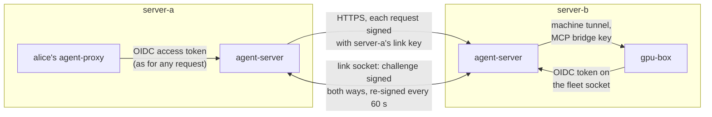

| Hop | Credential |
| --- | --- |
| A person or program to its own server | Its OIDC access token, as everywhere else ([Security](security.md)) |
| A machine to its own server | Its OIDC token on the fleet socket and tunnels ([Networking](networking.md#machines-the-fleet-socket-and-tunnels)) |
| Server to linked server | Ed25519 signatures with the sending server's **link key**: on every request, and on the link socket's handshake and renewals |

The issuer takes no part between servers. No account, service client or token is made for a peer, so a peer can never call an ordinary `/api/*` route. It reaches only the peer routes, which take nothing but link-key signatures:

| Route | What it's for |
| --- | --- |
| `GET /.well-known/mesh-link` | The server's mesh id, address, public link keys, link protocol range and fingerprint. `404` while it has no mesh id. |
| `POST /api/links/present` | The other server enters this server's link code |
| `WS /api/links/connect` | The link socket |
| `GET /api/links/relay/policies` | This side's signed link and bridge policies on the link |
| `POST /api/links/relay/changed` | "One of my policies changed": the receiver fetches them now |
| `POST /api/links/relay/keys` | A rotated link key |
| `POST /api/links/relay/bridge/inspect`, `.../bridge/present` | Checking and entering a bridge code |
| `GET /api/links/relay/catalogue/<bridge>` | What crosses to the other organization, described |
| `GET, POST /api/links/relay/provider/<org>/<name>/<path>` | A model call to a provider let out |
| `GET, POST, DELETE /api/links/relay/mcp/<org>/<machine>/<name>` | An MCP call to a machine's shared MCP server |
| `GET /api/links/relay/machine/<org>/<machine>/folders` | A machine's launch folders |
| `POST /api/links/relay/machine/<org>/<machine>/launch` | Starting an agent on a machine let out |
| `WS /api/links/relay/session/<id>/terminal` | Watching, and maybe typing into, a launch's terminal |
| `POST /api/links/relay/mirror` | Records of a launch, for its mirror session |
| `POST /api/links/relay/offboard` | Someone was removed on the other server |

These paths are public in `AuthMiddleware` on purpose (`PEER_PATHS`, `PEER_PREFIX` in `auth.py`). Each route checks the signature itself before anything else, so a person's token on them gets `401`. The site admins' own routes (`/api/links*`) are in `SITE_ADMIN_ONLY`; the organization admins' (`/api/orgs/<org>/bridges*`) check `administers` for that organization.

## Ids and names

| What | How it's made |
| --- | --- |
| **Mesh id** | A slug a site admin chooses once (`AI_PROXY_MESH_ID`, or Server settings): lower case letters, digits and `-`, up to 40. It can't change while the server has links, since other servers know it by it. |
| **Link keys** | Ed25519 key pairs, made on first use and kept in the `link-keys` secret, never in the settings. A key's id (`kid`) is the first 16 hex digits of the SHA-256 of its public key. |
| **Fingerprint** | The first 32 hex digits of the SHA-256 of the server's oldest key still held, in groups of four. It's what the two site admins read out to each other. |
| **Link id** | `lnk_` and 24 hex digits of the SHA-256 of both servers' (mesh id, oldest public key) pairs, sorted. Both sides compute the same id, so two presents at the same moment make one link. |
| **Bridge id** | `brg_` and 20 hex digits of the SHA-256 of the link id and both (mesh id, organization) pairs, sorted. The same on both sides. |
| **A person's id towards peers** | A UUID made from the user name and the account's creation time (`bridges.user_uuid`). A new account with the same name gets a new id. |

Something on a linked server is only ever named by its full name ([Peering](peering.md#full-names)):

```text
provider:server-b/globex/models
mcp:server-b/globex/gpu-box/search
agent:server-a/acme/reviewer
machine:server-b/globex/gpu-box
```

The separators are `:` and `/`, which no organization, backend, agent, machine or MCP server name may contain, so a full name never matches a short local name and is never ambiguous (`routing.py`). The API carries the parts separately as well as the text form. There are no aliases: a remote resource never appears under a short name.

## Setting up a link

Each site admin makes a one-use code, then enters the other's after checking the fingerprint the other admin read out. The steps in the console are in [Peering](peering.md#linking-two-servers).

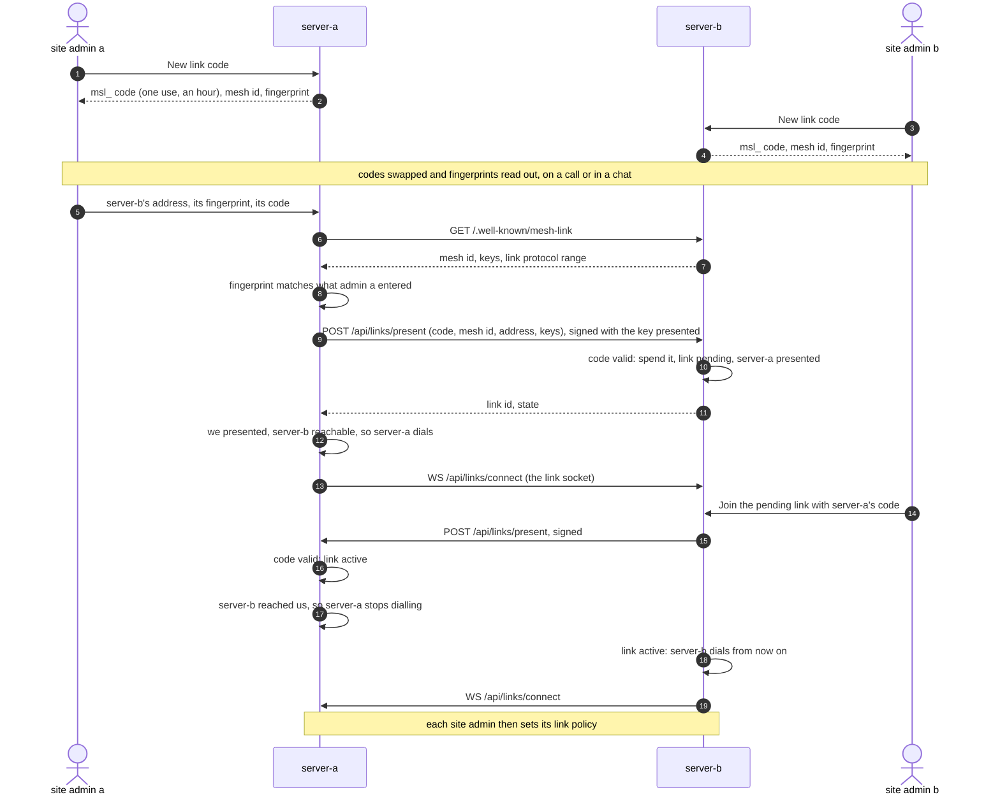

A present is signed like any other request, but with `Mesh-Link: new` and the key it presents, so the receiver can check that whoever presents holds that key. The receiver refuses it (`401`) if the date or digest is wrong, the signature isn't by a key in the present, the nonce was seen, or the server presented a different key before. A code that is wrong, spent or expired answers `403` and counts towards the limit of 20 wrong codes per address in 600 seconds (`429` after that). Codes are stored only as their SHA-256 digest, and spending one is a single locked update, so two presents of the same code can't both succeed.

The joining side compares the fingerprint the admin typed with the one it fetched (spaces and case ignored), and refuses a server whose key changed since it first presented: the link has to be removed and set up again.

**Who dials the socket.** A side whose present reached the other directly marks the link `reachable` and dials. When the other side's present then arrives directly too, the first side stops dialling: so the side that joined second, and could reach the other, holds the socket. If the second side can't reach the first (it's behind NAT), its present waits, and goes over the socket once the first side dials it. The acceptor takes a socket only from a server that has presented to it.

A link that isn't complete after 7 days is ignored when links are next loaded. A link is active only once both sides have presented; until then nothing can use it.

## Signed requests

Every request between linked servers is signed by the sender's current link key (`links.signed_headers`, `links.verify`):

| Header | Value |
| --- | --- |
| `Mesh-Link` | The link id (`new` for a present) |
| `Mesh-From` | The sender's mesh id |
| `Mesh-Date` | Unix time in seconds |
| `Mesh-Nonce` | A random value, up to 64 characters |
| `Content-Digest` | `sha-256=:<base64 of the body's SHA-256>:` |
| `Mesh-Assertion` | Who asks and for what (below), as canonical JSON in unpadded base64url. Absent on requests that aren't for anyone in particular. |
| `Mesh-Signature` | `kid=<kid>,sig=<base64 Ed25519 signature>` |

The signature covers these lines, joined by newlines: `mesh-link-v1`, the method, the path and query exactly as sent, the link id, the sender's mesh id, the date, the nonce, the content digest and the encoded assertion. Changing any of them, the body included, breaks it. Peer requests never send the client and machine `PROTOCOL` header: two servers on different releases link as long as they share a **link protocol** (`LINK_PROTOCOL`, now 1), which `/.well-known/mesh-link` and the socket handshake carry.

The receiver checks, in this order: the link is known (and, for a request carried over a link socket, is that socket's link), the link isn't paused (`403`), `Mesh-From` is the peer, the key id is one of the peer's current keys, the date is within 30 seconds of its own clock, the body matches its digest, the signature is good, and the nonce hasn't been seen in the last 90 seconds. Nonces are kept as cluster keys with that lifetime, so a replay is refused whichever process it reaches. Each of these failures answers `401`. Then each link may send 50 requests a second with bursts of 200 (`429` beyond that, counted per process).

**The assertion** names the link, the bridge, the sending and receiving mesh ids, the person (their UUID, user name, organization and teams), the sender's session, the resource (`kind`, `org`, and `machine` and `name` as needed), the function (`models`, `mcp`, `launch`, `folders`, `terminal`, `mirror`, `offboard`), the `scope`, both policy digests as the sender last saw them, `iat`, `exp` (60 seconds after `iat`) and a `jti`. The receiver refuses an assertion for another link or pair of servers, or one outside its lifetime plus the 30 seconds of skew. An assertion is checked when a request or stream starts, not again while it streams.

## The link socket

One WebSocket per link, dialled as described above (`WS /api/links/connect`). It carries the other direction's requests and keeps both sides sure the link is alive. It's authenticated by a challenge signed in both directions, never a token.

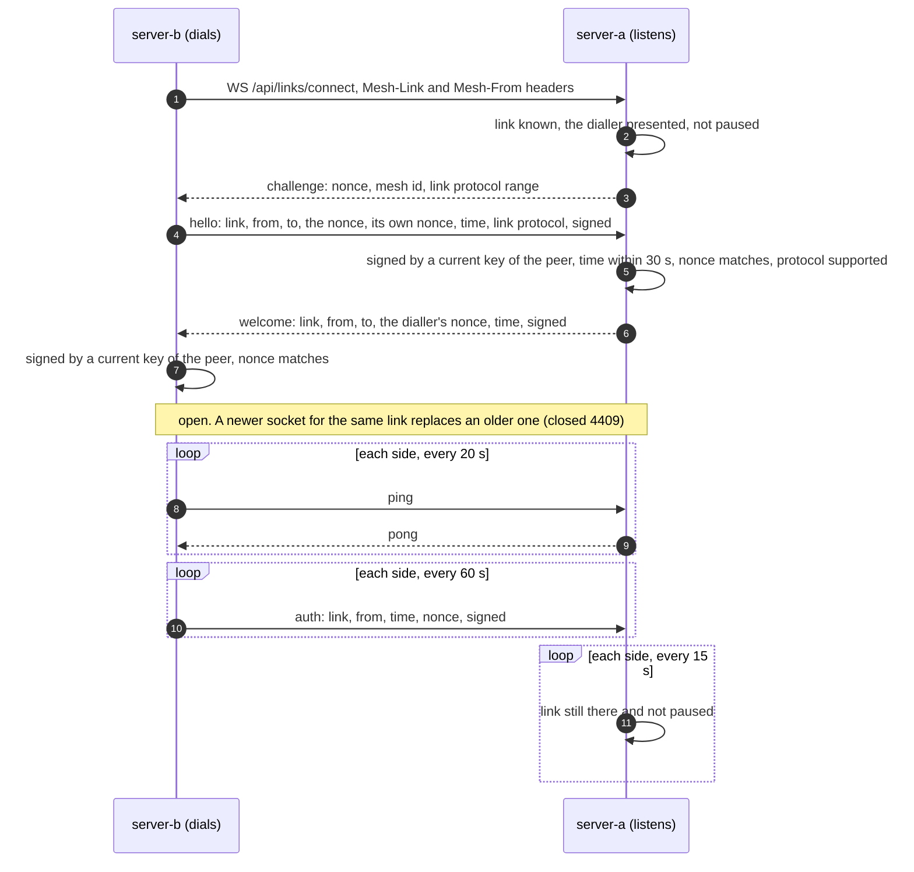

Signed socket messages are signed over `mesh-socket-v1`, a newline and the message's canonical JSON without its `kid` and `signature`. Each side closes the socket when:

| Close code | When |
| --- | --- |
| `1011` | Nothing heard from the other side for 60 seconds |
| `1012` | The server is restarting (`_restart_when_idle` and shutdown close every link socket; the dialler reconnects) |
| `4401` | Unknown link, a dialler that hasn't presented, a bad handshake signature, a bad `auth` message, or no good `auth` for 150 seconds (twice the re-sign interval, plus skew) |
| `4403` | The link is paused |
| `4409` | A newer socket for the same link replaced this one |
| `4410` | The link was removed |
| `4426` | The link protocol isn't supported |

The dialler reconnects with a backoff that starts at 1 second and doubles to 60, plus up to half again of random jitter. Each time a socket opens, both sides fetch each other's policies and catalogues again.

### Requests in the other direction

Requests travel by one of two ways (`links.route`). A side that reached the other while joining sends its requests to the other's address directly, over HTTPS. A side that can't sends them over the link socket that the other side dialled. Either way it's the same signed HTTP request, and code that sends to a peer doesn't know which way it went (`ChannelTransport`).

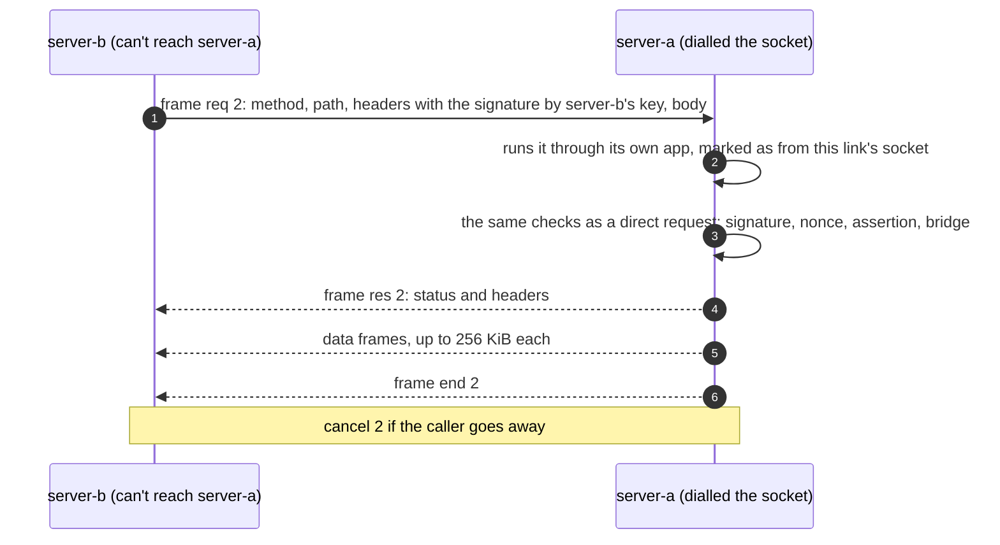

A binary frame is a 4-byte length, a JSON header (`{"t": kind, "id": stream, ...}`) and a payload. The kinds are `req`, `res`, `data`, `end`, `err` and `cancel` for HTTP, and `wso`, `wsa`, `wsm` and `wsc` for WebSockets (open, accepted, message, close), which carry a terminal viewed across. Text messages on the same socket are the control messages above. The dialling side numbers its streams odd and the other side even, so both can open streams at once, and each refuses a stream number only the other side may use. At most 64 streams run at once per link: beyond that the sender gets an error and the receiver answers `503`.

A request carried this way runs through the receiver's app with the link's id in its scope, and `verify` refuses one whose `Mesh-Link` names a different link. The scope's client address is the dialler's address as the socket saw it.

This replaced the dial-back tunnels of the first design: one socket, nothing for the unreachable side to accept, and no second authentication to get right.

## Bridges and policies

### Setting up a bridge

The same pattern one level down, between two organizations over an active link ([Peering](peering.md#bridges) has the console steps). An organization may make a bridge code only if its own server's link policy lets it bridge over that link.

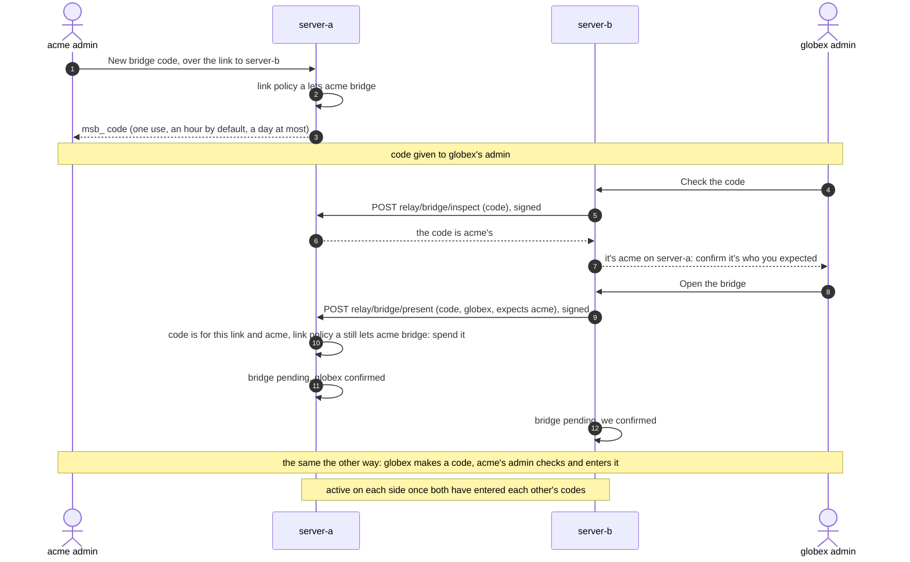

Organizations are never listed to the peer: only a code reveals one, and the admin who enters it confirms which organization it is before opening the bridge, so a leaked code can't pair the wrong organizations.

### What a policy says

Each side signs only its own policy, with its link key (`links.sign_policy`). There are two levels:

- **A link policy** (site admin): the kinds this server's organizations may let **out** and let **in**, and the organizations that may bridge (`*` for all). The kinds are `provider`, `mcp`, `agent`, `launch` and `terminal`. Until a site admin sets one, nothing is let out or in.
- **A bridge policy** (organization admin): the items it lets out, and the items it lets in, each for all its people or for teams it names. An item is a provider (`name`), an MCP server (`machine` and `name`), an agent definition (`name`, and its `digest` when let out), or a machine function (`launch` or `terminal`, with `machine`). A provider or MCP server can have `scope: home` (see [Calls back home](#calls-back-home)). At most 500 items, none twice.

Letting something out is checked when the policy is saved: a provider must be one of the organization's own (types `ollama`, `strata`, `docker`, `llamacpp` or `api`, never the `anthropic` pass-through and never a provider received over a bridge); an agent definition must be the organization's own and safe to cross (see [Agent definitions](#agent-definitions)); a machine must be the organization's, with a name usable in a full name, and its owner must have granted the bridge that feature on the machine's Access tab (`bridges: [<bridge id>]` under `launch`, `terminal` or `mcp`). Teams let in must be the organization's.

Every version is kept (`peer_policies`, one row per scope, id, side and version). A policy document carries its version, the signing server's mesh id and when it was issued; the envelope adds its SHA-256 digest, the key id, and a signature over `mesh-policy-v1`, a newline and the digest. A policy received is kept only if its signature is by one of the peer's current keys, it names the peer as its server, it is for this bridge and these two organizations, and its version is newer than the one held.

### The four gates

Something crosses only if all four allow it (`bridges.overlap`, `bridges.crossing`):

1. the giving server's link policy lets its kind out,
2. the receiving server's link policy lets its kind in,
3. the giving organization's policy lets the item out (and, for anything on a machine, the machine's owner granted the bridge),
4. the receiving organization's policy lets the same item in.

Both link policies must also list the two organizations, and the link and the bridge must be active, or nothing crosses at all. Items match on kind, machine, name and scope. For an agent definition, the version let in may be pinned: if the receiving side names a digest and the giving side's differs, it doesn't cross until the receiver takes the new one. The teams come from the receiving side's item.

What crosses is computed on each side from the two current policies, never agreed as one shared document. Adding something is a new version of your own policy, which crosses once the other side's also has it. Taking something away is a new version too, and applies at once on your side.

### Policy digests and stale requests

Every assertion carries both digests as the sender last saw them: its own policy's and the receiver's. The receiver compares them with what it holds (`bridges.checked`). If either differs, it answers `409` with both current digests (`{"digests": {"yours": ..., "ours": ...}}`), so nothing made under an older version slips through while news of a change is on its way.

A `409` is not retried. A launch on the peer, or a batch of mirror records, refetches the policies when it gets one; a model or MCP call returns it to the agent. The policies are normally fresh before that happens, because a change is announced at once.

### How policies and catalogues travel

Policies are pulled, not pushed:

1. A side that saves a policy (link or bridge) sends `POST relay/changed` to the peer.
2. The peer fetches `GET relay/policies` (this side's link policy and its policy for each bridge on the link), keeps what is newer, and fetches `GET relay/catalogue/<bridge>` for each active bridge.
3. If it took a newer policy, it sends `relay/changed` back, so the first side fetches its catalogue again. That side finds no newer policy, so the exchange ends there.

Each side also refreshes every active link every 60 seconds, and whenever a link socket opens. The **catalogue** describes what crosses out to the other organization: for providers their type, protocols, models and whether they're connected; for MCP servers their description; for agent definitions the definition itself and its digest; for machines their functions, operating system, launch folders, the agents installed there and whether they take launches. It's what the receiving side lists under **Shared with you** (`GET /api/peer/resources`), filtered again by the receiving policy's teams.

## Guests

Someone of server-a acting on server-b is a **guest** there (`bridges.Guest`): its own type, not an `auth.Identity`. Every existing permission helper (`same_tenant`, `administers`, `can_view`, `usable_by`, ...) refuses anything that isn't an `Identity`, so no ordinary route can serve a guest by accident. Guests reach server-b only through the peer routes, which make one check, `bridges.checked`: the assertion names an active bridge over this link, with this organization on the giving side and the other on the asking side; both policy digests are current; the resource asserted is the one the route serves; and the item is in what crosses out. A refusal for want of a bridge or an item is an audit event (`bridge.refused`) in the giving organization's chain.

A guest carries the person's UUID, user name (up to 40 characters), organization, teams (up to 50), server, link and bridge, as server-a states them. Server-b trusts that statement within what the bridge lets out. No rule on the giving side uses the guest's teams: teams only narrow what the receiving organization lets in, and the receiving side checks that itself (`bridges.lets_in`, where an organization admin passes any team rule).

A guest sees only the sessions it launched over the bridge it asks through (`bridges.can_view`). The tags that say who a guest is (`guest`, `guest_name`, `bridge`, `link`, `allowed_backends`, `remote_session`, `peering`, and the `mirror_*` tags) are server tags: clients can't set them (`access.PEERING_TAGS`).

## A model request across the link

alice's agent on server-a uses `provider:server-b/globex/models`.

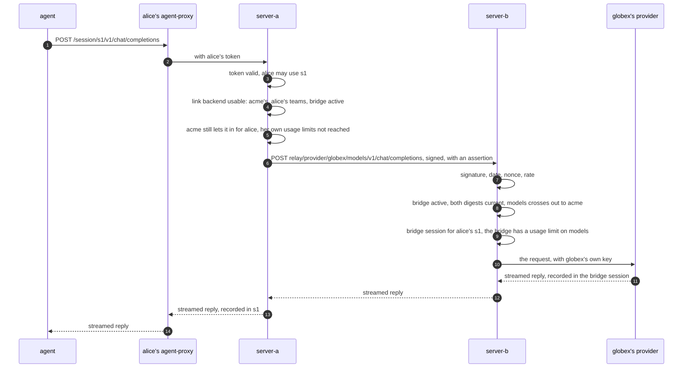

On the receiving side, each provider let in is a backend of type `link` under its full name (`Settings.remote_backends`, rebuilt from the catalogues by `bridges.rebuild`). It belongs to the receiving organization only, for the teams it was let in for, never to anyone else (`bridges.usable`). `serves()` treats it as the provider it carries to, by the type and protocols the giving server described. `backend_for` picks one only when it's named, never on its own, so nothing remote is chosen by mistake. Its upstream is `bridges.upstream`: the path as the agent sent it (without `/session/<id>`), only the headers a provider needs to read the request (`content-type`, `accept`, `anthropic-version`, `anthropic-beta`, `openai-beta`, `user-agent`, the MCP session headers and `last-event-id`), and the link's signature. Nothing that authenticates alice leaves server-a.

The giving side serves the relayed request as it serves agents' own (`compat.relay`), with the backend already chosen: the OpenAI and Anthropic endpoints, counting tokens, and Ollama's native API, translating for Ollama when its model profile asks. It drops every `Mesh-*` header before the provider and adds the provider's own key. Nothing is retried after the first byte reaches the agent.

When the link isn't active, or the request needs the link socket and it isn't connected, server-a answers `503`.

## Bridge sessions and usage limits

The giving side records each guest's calls in a **bridge session**: one per bridge, guest and remote session (`bridge-<digest>`), in the giving organization's tenant, with no owner, private, tagged with the guest, the bridge, the link and the remote session. With no owner, the giving organization's admins see it. Server-a records the same calls in alice's own session, so both servers hold full records, payloads included, each under its own retention ([Retention](retention.md)).

Its usage is the bridge's: the session's `launched_by` is `bridge:<id>`, so usage limits set for that user count everything the other organization's people use, together. A bridge has no usage until the giving organization sets it a limit on each provider (`PUT /api/orgs/<org>/bridges/<id>/limits`, stored as a limit for `bridge:<id>` on `backend:<name>`): until then, relayed model calls answer `429`, as an audit event rather than a recorded request. The receiving side's own limits on its person apply too, on the provider's full name. See [Usage limits](usage-limits.md).

## An MCP call across the link

The agent's MCP URL stays on its own agent-proxy: `/session/<id>/mcp/peer/<full name>?key=...`, with the session's own MCP capability. The session must have been given that MCP server when it started.

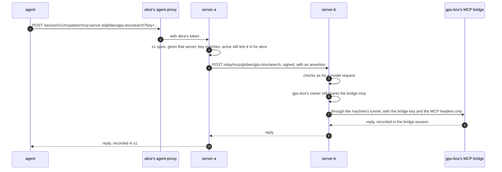

The MCP bridge's key never leaves server-b. `GET` and `DELETE` requests (the MCP session's stream and its end) are passed through; `POST`s are recorded on both sides, server-b's in the guest's bridge session.

## Agent definitions

Only an organization's own definitions cross (they live in the `agents` table with an `org`); the server's shipped ones never do. A definition is code the other side runs, so letting one out is refused if it writes files, is an account agent, or sets an environment variable that isn't an endpoint, model, key or timeout setting (`bridges.safe_definition`: names ending in `_BASE_URL`, `_MODEL`, `_API_KEY`, ..., or starting with `OPENAI_`, `ANTHROPIC_`, `OLLAMA_`, `AI_PROXY_`, ...; never `PATH`, `HOME`, `NODE_OPTIONS`, `PYTHONPATH`, `LD_*`, `DYLD_*` and the like). The policy pins it by the digest of its definition, so an edit is a new version.

The receiving side shows a definition let in under its full name only if the definition in the catalogue still has the pinned digest, still passes the same checks, and runs an executable that server already runs for its own agents (`runtime.bridged_agents`). The server that runs the session renders it, as for any agent.

## Launching on a peer's machine

alice starts an agent on `gpu-box` from server-a's console. The session lives on server-b. alice follows it in a **mirror session** on server-a.

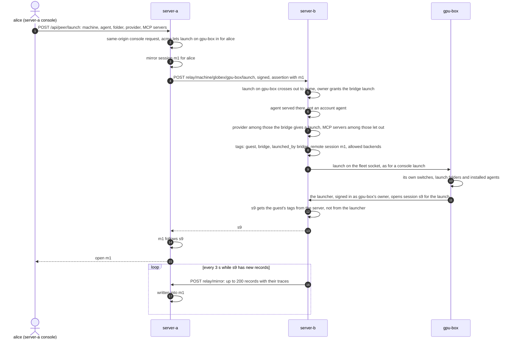

The launch runs as console launches do: by the machine owner's agent-proxy, as the owner's session in the machine's organization, so its owner and the organization's admins see it. `fleet.launch` skips the check of who may launch (the peer route already checked the bridge and the grant) but keeps every other check: the machine is connected, takes launches, the folder is inside its launch folders and the agent is installed. The machine checks again. Account agents (signed in to their own plans) can't be started for a guest, and provider accounts are never used for one.

What the session may use is set by the server, from the bridge, as its `allowed_backends` tag: the providers this side lets out to the other organization, and the other side's providers let in over the same bridge (`bridges.launch_backends`). The launcher's session gets them through `fleet.guest_launch`, found by the launch id while the launch is pending, so tags a launcher sends itself are replaced. `compat._backend` then serves the session only those backends. Its MCP servers are only those the bridge lets out, and each call checks again that the bridge still lets it out and the machine still grants it (`bridges.launch_mcp_allowed`).

The launching side names things as server-b knows them: server-b's own providers and agents by their short names, anything of server-a by its full name.

A launch's usage counts against `bridge:<id>`, like a bridge session's.

### Mirror sessions

A mirror session is alice's own, private, tagged with the link, bridge, server and machine it follows (`peering: mirror`), and, once the launch answers, `mirror_of` with the session on server-b. Server-b sends the launch's records and traces from its own records, oldest first, keeping a cursor per session in its meta table (`mirror:<session>`), so nothing is queued apart and nothing is lost while the link is down: what hasn't gone yet goes when it's back. When the launch ends, the mirror session ends too. Server-a refuses records for a mirror session that isn't on that bridge and link, or that follows another launch.

Only launches are mirrored. Model and MCP calls already pass through both servers, which each record them.

### Calls back home

A provider (or MCP server) can be let out with `scope: home`: "only for our own people's launches on your machines". alice's launch on gpu-box may then use acme's provider at home, and nobody of globex can. On server-b it appears among the launch's allowed backends but is never usable by a person there. A call to it carries the guest (alice) as the person and her mirror session as the session. Server-a accepts it only for an open mirror session on that bridge, in acme, owned by the person the assertion names; the call is recorded in that mirror session and counted against alice, under her own limits.

## Terminal relay

alice opens m1's terminal in server-a's console. Server-a pipes it to the launch's terminal on server-b.

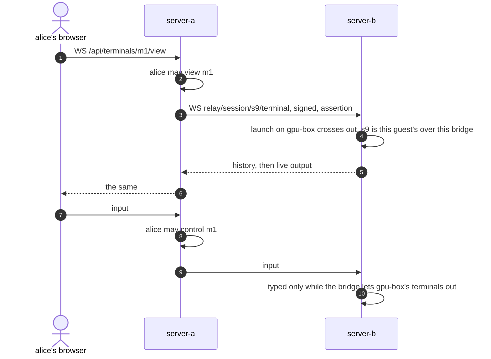

Server-a re-checks alice's sign-in and her view of m1 every 5 seconds, and forwards input only while she may control it. Server-b checks the bridge, the launch and the guest on every message and at least every second, closes with `4403` when the launch is no longer let out, and answers input with an error when typing isn't. Its refusals at the start close with `4400` plus the HTTP status's last two digits (`4401`, `4403`, `4409`, ...), and with `4404` for a session that isn't the guest's. When server-b can't be reached, server-a closes the console's socket with `4502`. The terminal's output isn't copied into the mirror session: it's watched live, from server-b's own record.

## Narrowing, pausing and ending

Narrowing is one side's own act, so it applies on that side at once:

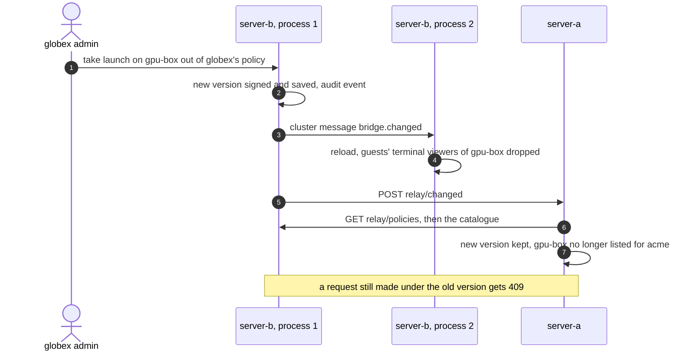

- **Taking a launch or terminal away** drops guests' viewers of those launches, and their sockets close `4403` at the next check. A launch already running keeps running until it ends or the bridge ends.
- **Pausing a bridge** stops everything over it on the side that paused: nothing crosses, and the peer is told. Launches keep running.
- **Pausing a link** closes its socket (`4403`) and refuses every request over it (`403`).
- **Ending a bridge** deletes it and its policies on the side that ends it, ends the guests' launches on that side's machines and their bridge sessions, and tells the peer. What each side recorded stays, under its own retention.
- **Removing a link** closes its socket (`4410`), deletes its policies and ends every bridge over it on the side that removes it.

The peer is told of an ended bridge or a removed link, but keeps its own record of it: from then on its requests are refused (`403` for the bridge, `401` for the link) until its own admin ends or removes it too.

## When the link drops

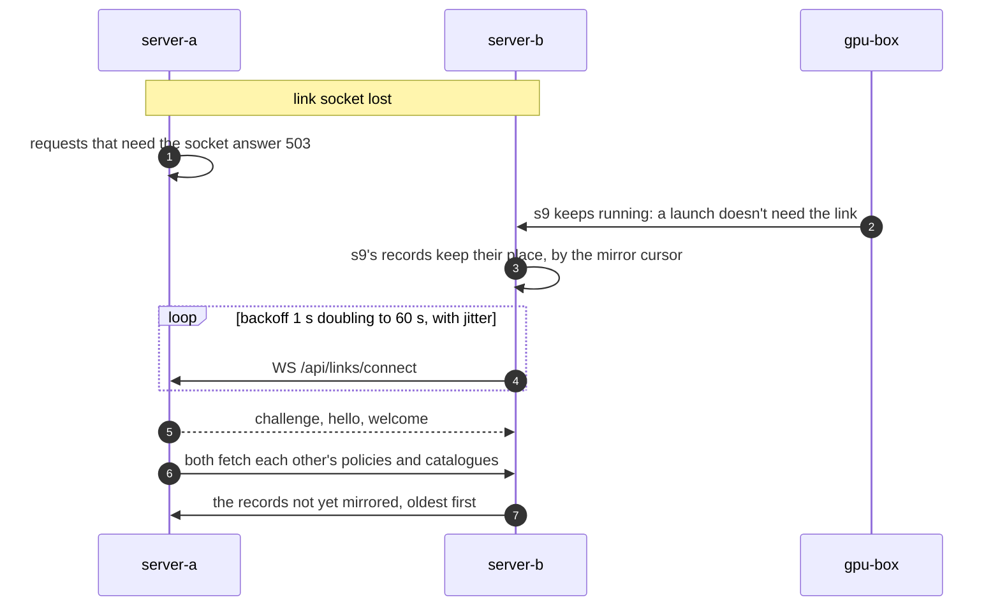

A side that reaches the other directly keeps sending its requests over HTTPS while the socket is down; only the side that relies on the socket waits. Requests and terminals already streaming over the socket when it drops are lost, as when a machine drops mid-reply. The console shows whether a link and its bridges are connected.

## Rotating and removing keys

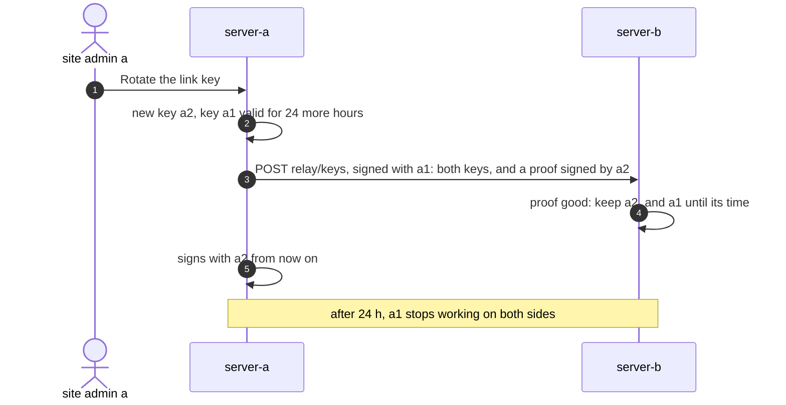

The proof is a signature by the new key over `mesh-key-v1`, the link id and the new key's id, so the peer knows whoever holds the old key also holds the new one. Rotation is announced once, to every active link; a peer that misses it refuses requests signed with the new key.

**Removing a key** (`DELETE /api/links/keys/<kid>`, refused for the only key) stops this server signing with it and publishing it at once. The peer isn't told: it accepts the key until its own copy of the key's time runs out, which for a rotated key is the end of the 24 hours. For a key that leaked, rotate, remove the old key, and remove and set up again any link you're unsure of, with new codes.

## Removing a person

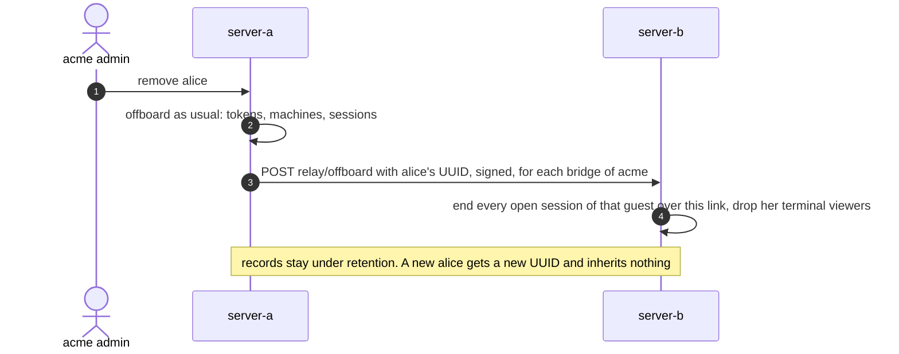

## Several processes

With several server processes ([Several processes](scaling.md)):

- One `fleet` process dials each link, under a lease (`link-dial:<link>`, 30 seconds). The process holding a socket advertises it as `link:socket:<link>`, so every process can say whether the link is connected.
- Nonces and wrong-code counts are cluster keys, so replays and guessing are refused whichever process a request reaches.
- Every change to links, bridges and policies is published as `bridge.changed`, and every process reloads.
- A guest's launch keeps its tags in a cluster key while it's pending, so the process that gets the launcher's session request finds them.
- Any process sends signed requests to a peer it reaches directly. A peer reached only over its socket is reached only from the process holding it.

## Timeouts and limits

| What | Value | In the code |
| --- | --- | --- |
| Link code (`msl_`) | One use, an hour at most (60 seconds at least) | `links.CODE_LIFETIME` |
| Bridge code (`msb_`) | One use, an hour by default, 60 seconds to a day | `bridges.BRIDGE_CODE_MAX` |
| A link not complete | Ignored after 7 days | `links.PENDING_SECONDS` |
| Wrong link codes | 20 per address per 600 seconds | `WRONG_CODES`, `WRONG_CODES_WINDOW` |
| Clock skew on dates, assertions and socket messages | 30 seconds | `links.SKEW` |
| Nonces kept | 90 seconds | `links.NONCE_TTL` |
| Assertion | 60 seconds from `iat` | `bridges.ASSERTION_LIFETIME` |
| Link socket ping | Every 20 seconds, each side | `links.PING_SECONDS` |
| Link socket silent | Closed after 60 seconds | `links.SILENT_SECONDS` |
| Link socket re-signed | Every 60 seconds; closed after 150 without | `links.RESIGN_SECONDS` |
| Link state re-checked on its socket | Every 15 seconds | `links.RECHECK_SECONDS` |
| Reconnecting the link socket | 1 second doubling to 60, plus jitter | `links.BACKOFF_MAX` |
| Opening a connection, a socket handshake message, a WebSocket over the socket | 10 seconds | `links.OPEN_TIMEOUT` |
| Requests per link | 50 a second, bursts of 200, per process | `links.RATE`, `links.BURST` |
| Requests carried over one socket at once | 64 | `links.MAX_STREAMS` |
| Frame payload | 256 KiB | `links.FRAME` |
| Waiting for a reply's headers over the socket | 600 seconds | `Channel.request` |
| A guest's launch, end to end | 120 seconds for the peer's answer; the machine has 60 to open its session | `routes/bridges.py`, `fleet.LAUNCH_TIMEOUT` |
| Policies and catalogues refreshed | Every 60 seconds, and when a socket opens | `bridges.REFRESH_SECONDS` |
| Mirror records | Every 3 seconds, 200 at a time | `bridges.MIRROR_SECONDS`, `MIRROR_BATCH` |
| Old link key after rotation | 24 hours | `links.KEY_OVERLAP` |
| Items in a bridge policy | 500 | `bridges._items` |
| A guest's terminal, re-checked | On every message and every second | `terminals.ACCESS_POLL_SECONDS` |
| The console viewer's sign-in, re-checked | Every 5 seconds | `terminals.IDENTITY_RECHECK_SECONDS` |

## How peer requests are refused

| Status | Why |
| --- | --- |
| `400` | Not a JSON object, a bad assertion, a present without a mesh id or keys |
| `401` | Unknown link, not the linked server, not a current key, date too far off, body doesn't match its digest, bad signature, nonce seen, assertion for another link or expired, no assertion |
| `403` | Link or bridge paused, no such bridge for these organizations, not let out, the assertion is for something else, a machine's owner no longer grants it, a wrong link code |
| `404` | The bridge, provider, machine or session is no longer there |
| `409` | Policy versions don't match: the body has both current digests |
| `429` | Too many requests over the link, too many wrong codes, or no usage limit set for the bridge on that provider |
| `503` | Too many requests over the socket at once; on the sending side, the peer can't be reached |

## Design decisions

- **Linking and bridging are mutual.** Each side makes a code and enters the other's; one side alone does nothing. Organizations are never listed to the peer, and the admin entering a code confirms which organization it is, so a leaked code can't pair the wrong ones.
- **Links authenticate by their own keys, not by a client on the peer's issuer.** A service client has to be a member of a real organization, so its tokens would open every ordinary `/api/*` route on the peer. Link keys open only the peer routes.
- **Each side signs only its own policy.** What crosses is the overlap of both current policies, so it still needs both sides' agreement in and out, but changes can't conflict and narrowing never waits on the other side. One shared document would race: two narrowings at once give two versions that can't be merged.
- **Four gates, two levels.** Site admins decide which kinds of thing may cross at all and which organizations may bridge; organization admins decide what exactly. Anything on a machine also needs its owner's grant. A guest's launch runs a command on a machine for someone its owner has never met, so it takes five consents: both site admins, both organization admins and the machine's owner, and the machine's own switches and folders still apply.
- **Guests are their own type.** Every existing permission check refuses them by type, and only the peer routes serve them. A guest built as an `Identity` with defaults would land in the root tenant.
- **A guest is named by a UUID, not a user name**, so a recreated account inherits nothing on the other side.
- **Full names use `:` and `/`**, not dots, because organization, agent and backend names may contain dots. There are no aliases, so a remote resource is never picked by a local name.
- **Requests are carried, keys stay home.** The giving organization keeps its provider and MCP keys, sees every call, sets limits on it and can stop it at once. That's the gain over sharing an API key.
- **Agent definitions are pinned and restricted.** Otherwise a definition would be a way to run anything on the other side's machines.
- **Launches carry the backends they may use.** They run as the machine's owner, so without this they could use any of the owner's organization's providers. A launch doesn't silently spend the other organization's budget, and `scope: home` lets a launch use its own organization's providers without opening them to the other organization's people.
- **No usage until the giving organization sets a limit**, so a forgotten bridge can't spend a budget.
- **Both servers record everything, payloads included**, under their own retention, and ending a bridge deletes neither copy. Both organizations' admins see this when they open the bridge: it's the consent for one company's prompts to sit in the other's database.
- **Only launches are mirrored.** Model and MCP calls already pass through both servers.
- **Guests' launches are seen by the giving organization's admins and the machine's owner**, not by all its members.
- **One hop.** A provider received over a bridge can't be let out again, so nothing travels from server-a through server-b to server-c.
- **The other direction rides the link socket.** One socket, nothing for a server behind NAT to accept, and requests over it meet exactly the checks of a direct request, since they run through the same app.
- **Links have their own protocol number**, so two servers on different releases can still link.

## Not built yet

- Several processes: a linked server reachable only over its socket is reached only from the process holding the socket.
- Fresh assertions on long streams: an assertion is checked when a stream opens, and the giving side re-checks the bridge while it's open instead.
- Retrying a request once after a `409`.
- MCP servers with `scope: home` for guests' launches.
- Terminal output in mirror sessions (it's watched live).
- Usage limits per guest, rather than per bridge.
- Ending a bridge or removing a link on the other side too, and expiring bridges that were never completed.
- Telling the peer when a key is removed, and announcing a rotated key again to a peer that missed it.
- Account agents on another server's machine, more than one hop, and legal holds that cover the other side's copy.
