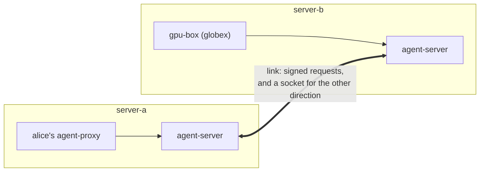

# Peering: linking servers

Two AI Control Mesh servers can **link**. Then an organization on one and an organization on the other can open a **bridge**, and each lets the other use chosen things of its own: providers, MCP servers, agent definitions, and machines to start agents on. People use what crosses as if it were their own, under its full name. Every request goes through both servers, and both record it.



Agents, agent-proxies and machines never talk to the other server: their own server carries their requests. Keys never leave their server: a provider's key, an MCP server's key and a machine's credentials stay where they are, and only requests cross.

To try it on one computer, run the [peer quickstart](#try-it).

## Links, bridges and what crosses

| Layer | Who sets it up | What it allows on its own |
| --- | --- | --- |
| **Link** (server and server) | A site admin on each server, each entering the other's code | A trusted channel, and each server's **link policy**: what kinds of thing its organizations may let out and in, and which organizations may bridge. |
| **Bridge** (organization and organization) | An admin of each organization, each entering the other's code | Each organization's **policy**: what it lets out, and what it lets in (for which of its teams). |
| **A machine's grant** | The machine's owner | Whether the bridge may use the machine at all (starting agents, terminals, MCP servers). |

Something crosses only if all four agree: the giving server's link policy lets its kind out, the receiving server's lets it in, the giving organization lets it out (and, for a machine, its owner granted the bridge), and the receiving organization lets it in. A link or bridge with only one side does nothing.

Each side signs only its own policy. Adding something to yours crosses once the other side's policy has it too; taking something away applies at once, from your side alone, and requests already on their way under the old version are refused.

The kinds are **providers**, **MCP servers**, **agent definitions**, **starting agents on a machine** and **typing into those agents' terminals**.

## Full names

Your server's own things keep their short names. Something another server shares is named by where it lives:

```text
provider:server-b/globex/gpu-box
mcp:server-b/globex/gpu-box/search
agent:server-a/acme/reviewer
machine:server-b/globex/gpu-box
```

`server-b` is that server's **mesh id**, chosen once by its site admin. A full name never matches a local name, so nothing remote is ever picked by mistake. The console, `agent --backend` and `agent --mcp` take full names, and the server resolves them.

## Linking two servers

Each server needs a **mesh id** first: **Server settings › Links**, or `AI_PROXY_MESH_ID`. It can't change once the server has links. Each server must also be reachable at its address (`AI_PROXY_MESH_URL`, else the public address) by the other while you link.

1. Both site admins open **Server settings › Links** and choose **New link code**. Each code works once, for an hour. The page shows this server's mesh id and **fingerprint**.
2. Give each other the codes, and read each other the fingerprints (on a call, in a chat).
3. On one server, **Link with another server**: enter the other's address, check that the fingerprint shown is the one its admin read out, and enter its code.
4. On the other server, the first one's present appears at the top: check its fingerprint and enter its code.
5. Open the link on each server and set its **link policy**: tick what its organizations may let out and in, and list the organizations that may bridge (`*` for all of them).

The link is active once both sides have entered codes. The server that joined second, and could reach the other, keeps a socket open to it. A server the other can't reach (behind NAT) gets the other's requests over that socket, so only one of them needs to be reachable after setup.

**Pause** stops everything over a link; **Resume** starts it again. **Remove the link** ends every bridge over it on this server. The other server is told, but keeps its side until its own site admin removes it, and its requests are refused meanwhile. **Rotate the link key** makes a new key; the old one stays valid for a day on both sides, so the other server follows without a gap. A key that leaked is removed instead, and the link is set up again with new codes: removing a key doesn't revoke it at the other server, which keeps accepting it until its copy expires (a day, for a rotated key).

## Bridges

An organization's admins open bridges on **Organizations › Sharing** (shown once a link lets the organization bridge).

1. **New bridge code**, naming the linked server. Give the code to the other organization's admin.
2. Enter theirs and choose **Check it**: it shows which organization it is. Confirm it's the one you expected, then **Open the bridge**.
3. The bridge opens once both have entered each other's codes.

Open the bridge to say what crosses:

- **Lets out**: your organization's providers, its own agent definitions, and the machines whose owners let the bridge use them. A provider (or MCP server) can be let out **only for our own people's launches there**: your people's agents started on the other organization's machines may use it, and nobody else of theirs.
- **Lets in**: what the other side lets out. Each can be for everyone in your organization or for the teams you choose.
- **Limits**: the other organization's agents can't call your providers until you set the bridge a limit on each (tokens in a window, for all their people together). An agent their people start on your machines isn't held back by a missing limit, but its usage counts against the bridge's limits you set. Your server's other limits apply too.

**Pause** and **Resume** stop and start it; **End the bridge** ends it on your side, and agents its people started on your machines stop. The other organization is told; its side stays in its list, refused, until its own admin ends it too. What each server recorded stays, under its own retention.

### Machines over a bridge

A machine is shared over a bridge in two places: its owner (or an admin) adds the bridge on the machine's **Access** tab for **Start agents**, **Open terminals** or **Use MCP servers**, and the organization lets the machine out on **Sharing**. The machine's own switches (`agent-machine launches on`, its launch folders) still apply.

An agent started there for someone of the other organization runs as your server's session, by the machine owner's sign-in, as console launches do. Your server tags it with who started it and the bridge, and it may use only what the bridge gives it: the providers you let out to that organization, and theirs let in for it. Its organization's admins and the machine's owner see it. Account agents (signed in to their own Claude, Copilot or ChatGPT plans) can't be started for the other organization.

### Agent definitions

Only an organization's own definitions cross (admins manage them with `PUT /api/orgs/<org>/agents/<id>`); the server's shipped ones never do, since each server has its own. A definition is code the other side runs, so one that crosses:

- is pinned to the version let out: an edit is a new version, which crosses once the other side takes it;
- may set only environment variables that point the agent somewhere (`*_BASE_URL`, `*_MODEL`, `OPENAI_*`, ...), never `PATH`, `NODE_OPTIONS` or the like, and writes no files;
- must run an executable the receiving server already runs for its own agents.

## Using what crosses

**Shared with you** (under **Models** in the console's rail) lists what other servers' organizations share with you, under full names.

- **A provider**: choose it as the provider in **Start an agent**, or `agent qwen . --backend provider:server-b/globex/gpu-box --model <model>`. Your server sends the agent's requests to the other server, which forwards them to its provider with its own key.
- **An MCP server**: pick it when you start an agent, or `agent ... --mcp mcp:server-b/globex/gpu-box/search`.
- **An agent definition**: it shows in **Start an agent** under its full name.
- **A machine**: **Start an agent there** runs the agent on it. You follow it in your own **mirror session**: its requests and traces come back as it runs, and its terminal opens here (typing only if typing is shared too).

Both servers record everything, payloads included: your session here, and a **bridge session** on the other server (its organization's, tagged with the bridge and who you are), under each server's retention. Both organizations' admins see this when they open the bridge; it's the consent for one company's prompts to sit in the other's database. Usage is counted on both sides: against you here, and against the bridge there.

## Who is who on the other side

To the other server you're a **guest**: it knows your user name, organization and teams as your server states them, and an id that changes if your account is recreated, so a new account of the same name inherits nothing. A guest isn't one of its users: nothing of the other server is open to you except what crosses, and every request names what it's for. Removing you from your server tells every server your organization bridges to, which ends your work there.

Your server trusts the other server's statement of its people within what you let out: a compromised server could act as any of its organization's people towards yours. Keep what you let out narrow, set limits, and pause a bridge or link at once if you're unsure.

## Try it

The peer quickstart runs two servers with a machine each:

```bash
cd deploy/compose/peer
podman compose up -d
python3 setup.py
```

`setup.py` links them and opens a bridge between `acme` (on server-a, http://localhost:29999) and `globex` (on server-b, http://127.0.0.1:39999), as the admins would. Then sign in to server-a as **alice** / **peer-demo**: **Shared with you** lists globex's `gpu-box` provider and machine. [The quickstart's README](../deploy/compose/peer/README.md) walks through it.

## What's not there yet

- Account agents (signed in to their own plans) on another server's machine.
- Passing on what you received: nothing crosses more than one link.
- A legal hold on one side doesn't hold the other side's copy.
- With several server processes, a server that can't reach the other directly reaches it only from the process holding the link socket; see [Several server processes](scaling.md).
