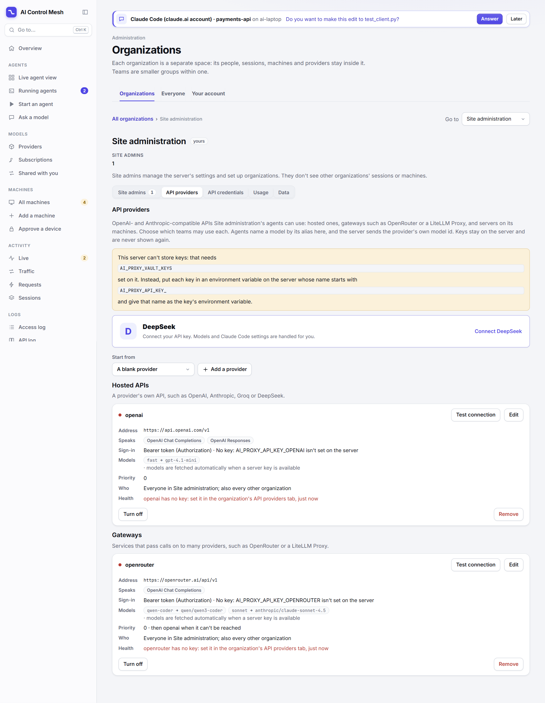
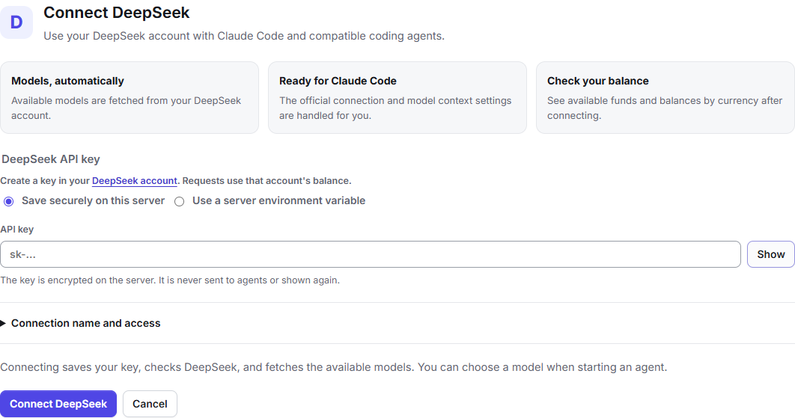
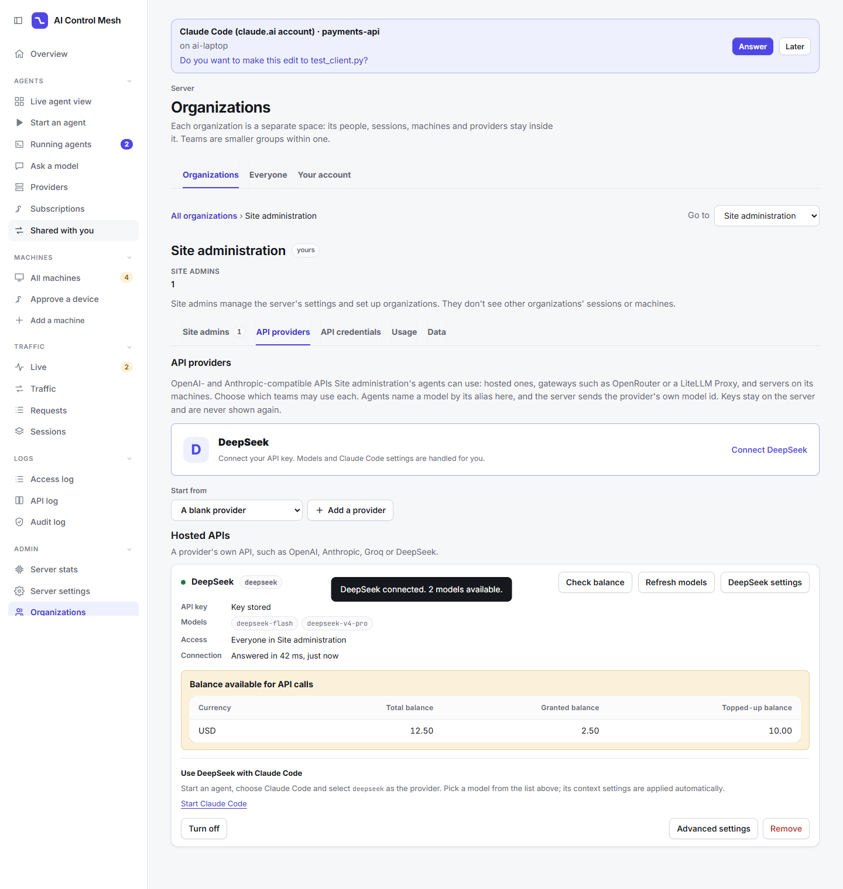

# LLM providers

A **provider** (a backend, one of the server's stored settings) is where the server sends an agent's model requests. Agents never reach a provider directly: the server records their requests and forwards them.

Start with [where providers come from](#where-providers-come-from) and [managing models](#managing-models); [API providers](#api-providers-openai-and-anthropic-compatible) covers OpenAI and Anthropic-compatible services. The sections from [Ollama](#ollama) down are the per-engine reference: read the one your models run on.

## Backend types

| Type | Provider | What the server does with agents' requests |
|---|---|---|
| `ollama` | Ollama | Translates OpenAI Chat and Anthropic Messages requests to Ollama's native `/api/chat`, with the server's Ollama model tuning. Native `/api/*` calls pass through. |
| `strata` | Strata | Passes them through, with Strata's API key put in. |
| `docker` | Docker Model Runner | Passes them through, with Model Runner's path prefixes. |
| `llamacpp` | llama.cpp (`llama-server`) | Passes them through (a container's with the key the server gave it). |
| `anthropic` | Anthropic API (hosted) | Passes them through unchanged, with the agent's own credentials. |
| `api` | Any OpenAI or Anthropic-compatible API: hosted (OpenAI, OpenRouter, LiteLLM, ...) or on a machine (LM Studio, vLLM, SGLang) | Passes them through in the protocols it speaks, with the server's key and model aliases. See [API providers](#api-providers-openai-and-anthropic-compatible). |

`ollama`, `llamacpp`, `strata` and `docker` are local model servers (`MACHINE_TYPES` in `config.py`). They always run on one of the fleet's [machines](machines.md). An `api` backend runs on a machine or is hosted elsewhere.

## Where providers come from

**Local providers only come from machines.** A machine's `agent-machine` finds the model servers running on it and reports them. On the machine's page, an admin turns one into a provider with **Add as a provider**. The new backend gets the machine's name (for Ollama) or `<machine>-<type>` (for the others), and the machine's id in its `machine` field. A machine can also run model servers in containers for the server (see [Containers machines run](#containers-machines-run)).

You can't add a local provider by URL: **Server settings** (and `PUT /api/config`) refuse a new local backend or a changed URL, and only keep or remove them. Everything but agents' traffic is done by a model server's machine, so the server must know which machine runs it.

**Hosted APIs are the exception.** Add an `anthropic` backend (`https://api.anthropic.com`) on **Server settings**, or a hosted [API provider](#api-providers-openai-and-anthropic-compatible) on an organization's **API providers** tab (**Organizations**). They need no machine.

**Older backends.** Backends set up by URL before machines keep working. An admin links one to a machine with **Add as a provider** on that machine's model server tab. A matching address and type reuse the existing backend's name and settings. Once linked, a backend follows its machine's address changes, on the same port.

## Managing models

**The server never manages a model server**; it only forwards agents' traffic. Everything else is a request, over the fleet connection, to the machine that runs it, where agent-machine does it against `127.0.0.1:<port>`:

- its status and models;
- pulling, deleting, loading and unloading models;
- its logs;
- the machine's CPU, memory and GPU load;
- Ollama's and llama.cpp's settings, installing llama.cpp, and starting and stopping Ollama, llama.cpp and Strata;
- searching ollama.com, Hugging Face and Docker Hub.

In the console, all of it is on the machine's page, a tab per model server. A model server is named `<type>-<port>`, such as `ollama-11434`. A model server that isn't a provider yet is managed the same way, with **Add as a provider** at its top for admins. Each kind's tab is described below: [Ollama](#models-on-ollama), [Strata](#strata), [llama.cpp](#models-on-llamacpp) and [Docker Model Runner](#docker-model-runner).

Reading is always allowed for those who can see the machine. Changing anything needs `agent-machine servers on` on the machine, and the right [feature](machines.md#who-may-use-a-machine) (site admins have every feature on every machine):

| Action | Feature | Owner | Admins | Others |
|---|---|---|---|---|
| See models, status, logs, load | `view` | Yes | Yes | With any grant |
| Pull, delete, load, unload models | `models` | Yes | Yes | With a grant |
| Install llama.cpp; start, stop and configure Ollama, llama.cpp and Strata | `servers` | Yes | With a grant | With a grant |

The server only forwards the native Ollama calls agents make (`chat`, `generate`, `embed`, `embeddings`, `tags`, `show`, `ps`, `version`). `/api/pull` and the like can't reach a model server through the server.

**Watching load.** A machine's **Load** tab charts its CPU, memory, GPU load and GPU memory over the last five minutes, and shows what each of its Ollama servers has loaded: size, GPU and CPU split, context length and when the model unloads. The console asks the machine every two seconds while the tab is open; the machine samples on request and stores nothing. GPU figures come from `nvidia-smi` (index, name, use, memory, temperature and power draw), so they need an NVIDIA GPU and its driver. The server never contacts a model server for this: a backend that isn't on a connected machine shows no models or load.

## Which agents can use which provider

Each agent is declared for a backend type (`backend_type`, default `ollama`) and speaks one protocol. An agent declared for Ollama is a local-model agent, and Strata, Docker Model Runner and llama.cpp serve it too when they speak its protocol (`serves()` and `NATIVE_PROTOCOLS` in `config.py`):

| Protocol | Agents | `ollama` | `strata` | `docker` | `llamacpp` | `anthropic` | `api` |
|---|---|---|---|---|---|---|---|
| `openai-chat` | Qwen Code, OpenCode, Copilot CLI (BYOK) | Yes | Yes | Yes | Yes | | If it speaks `openai-chat` |
| `anthropic` | Claude Code (Ollama) | Yes | Yes | Yes | Yes | | If it speaks `anthropic` |
| `openai-responses` | Codex (Ollama) | Yes | Yes | Yes | Yes | | If it speaks `openai-responses` |
| `ollama` (native) | Aider, Goose | Yes | No | Yes | No | | No |
| `anthropic` | Claude Code (Anthropic API pass-through) | | | | | Yes | |

Strata and llama.cpp don't speak Ollama's native `/api`, so Aider and Goose can't use them. Account agents (`intercept: true`) don't use a backend: their traffic goes to their vendor. See [Agents](agents.md).

### Sharing models with every organization

A provider belongs to one organization: a machine's model servers to the machine's organization, a hosted API to the one it was added in. A site admin can also let every organization use some models on one of the site's own providers (the root organization's). For example, an Ollama on a site machine with `qwen3:0.6b` for everyone.

- **Server settings** → **Shared models** lists the site's providers. For each one, tick the models to share, type ones that aren't listed, or choose **Every model**. **Save sharing** applies it at once. You can also use `PUT /api/config/shared-models`, or `shared_models` in `config import`.
- Everyone in every organization may then use that provider for those models. It shows in their agents' backends, in `/api/models` and on **Providers**, with only the shared models. They never see its address or the machine it runs on.
- A request, a launch or a new session that names another model there is refused with `403` before anything reaches the provider. So is a request that names no model.
- Names compare as people write them: `qwen3` and `qwen3:latest` are the same model, and so are `deepseek-chat` and Claude's `deepseek-chat[1m]`.
- Only the site's own providers can be shared this way. Another organization's machine or key is never shared with everyone. To share a whole hosted API with some organizations, use its `orgs` setting ([Who manages them](#who-manages-them-and-who-may-use-them)).
- Removing the provider removes its share. Each organization's admins can set [usage limits](usage-limits.md) on a shared provider for their people.

When a launch doesn't name a backend, the server picks one (`backend_for()`): the default backend if it serves the agent, else a backend of the agent's own type, else any other that serves it, higher `priority` first. It never picks a hosted API provider that way unless it's the default backend: name it (`--backend openai`). A named backend that can't serve the agent is refused with the reason. The console and the client take the list and the choice from `/api/agents`.

## API providers (OpenAI and Anthropic-compatible)

An `api` backend is any server that speaks one or more of these agents' APIs itself:

| Protocol | Path agents use | Agents |
|---|---|---|
| `openai-chat` | `/v1/chat/completions` (also `/v1/completions`, `/v1/embeddings`) | Qwen Code, OpenCode, Copilot CLI (BYOK) |
| `openai-responses` | `/v1/responses` | Codex |
| `anthropic` | `/v1/messages`, `/v1/messages/count_tokens` | Claude Code |

The server passes requests through as they are, streaming (SSE), tool calls, reasoning and thinking blocks included. It changes only three things:

- the provider's key goes in, in place of the agent's placeholder;
- a model alias becomes the provider's model id;
- the provider's extra headers are added.

Nothing is translated between protocols: a request in a protocol the provider wasn't set up with is refused with 400 before anything goes out. Don't assume a service speaks every protocol: many OpenAI-compatible services have Chat Completions but not Responses, and few have Anthropic Messages.

There are two kinds:

- **Machine-hosted**: an OpenAI-compatible server on a fleet machine, such as LM Studio, vLLM or SGLang. agent-machine finds it on its loopback, an admin adds it from the machine's page, and agents reach it through the machine's tunnel; it belongs to the machine's organization. See [Model servers on a machine](#openai-compatible-servers-on-a-machine).
- **Hosted APIs and gateways**: OpenAI, Anthropic, OpenRouter, LiteLLM Proxy, Groq and the like. An organization's admin adds them by URL on its **API providers** tab, and the server reaches them directly. See [Hosted APIs and gateways](#hosted-apis-and-gateways).

An `api` backend differs from the `anthropic` type: `anthropic` passes Claude Code's own credentials through (a claude.ai login or the person's key), while `api` uses one key the server holds for everyone allowed.

### Who manages them, and who may use them

Every API provider belongs to one organization. A hosted one belongs to the organization it was added in; one on a machine belongs to its machine's organization. That organization's admins add, change, test and remove it on **Organizations -> API providers** (or `/api/orgs/<org>/providers`). Site admins can do this in every organization.

- **Teams**: choose which of the organization's teams may use a provider. With none chosen, everyone in the organization may. The organization's admins may always use it, so they can test it. Other organizations never see it: to them, naming it (`--backend`, `X-AI-Proxy-Backend`) answers as an unknown backend, and its name is only "taken".
- **Sharing**: only a site admin can share a hosted provider with other organizations as a whole (`orgs`), such as a gateway the site pays for. Everyone in those organizations may then use it, with its key.
- Providers added before this belonged to the site itself (the root organization). They keep their `orgs`, so nothing changes for the organizations they were shared with.
- Deleting an organization deletes its hosted providers and their stored keys.
- Provider names are unique on the server, across organizations.

### Settings



Each provider has these settings. Only the key is secret, and it is never shown, exported or logged.

| Setting | Meaning |
|---|---|
| `url` | The OpenAI base URL: what comes before `/chat/completions`, usually ending in `/v1`. |
| `anthropic_url` | Where Anthropic Messages go (`<anthropic_url>/v1/messages`). It must be on the same scheme, host and port as `url`. Without it, the `url` without its `/v1`. |
| `protocols` | Which of `openai-chat`, `openai-responses` and `anthropic` it speaks. |
| `auth` | `bearer` (`Authorization: Bearer <key>`), `x-api-key` (Anthropic), `api-key` (Azure), `none`, or `agent` (the agent's own `Authorization` or `x-api-key` goes through and the server adds none). |
| `category` | How the console groups it: `hosted` (the default), `gateway` (LiteLLM, OpenRouter and other aggregators), or `machine` (set when a machine's server is adopted). |
| key | Typed once on the console, stored encrypted (it needs `AI_PROXY_VAULT_KEYS`, as [subscriptions](subscriptions.md) do). A stored key is bound to the provider's address: change the address and it must be typed again. |
| `key_env` | Or: the name of an environment variable on the server holding the key. It must start with `AI_PROXY_API_KEY_`, so a provider can never be pointed at the server's own secrets. A stored key wins over it. |
| `models` | Aliases agents use, mapped to the provider's model ids (`fast: gpt-4.1-mini`). An alias can be the id itself. |
| `discover` | Also list the provider's own `GET /models` (on by default). |
| `headers` | Extra headers, such as OpenRouter's `HTTP-Referer` and `X-Title`. Names that look like credentials (`authorization`, anything with `key`, `token`, `secret`, `cookie`, ...) and ones that change the request's framing are refused: use `auth` for the key. |
| `connect_timeout` | Seconds to wait for a connection (default 10). A reply may take up to 600 s. |
| `verify_tls` | Check the provider's certificate (default on). |
| `api_version` | Sent as `?api-version=` (Azure OpenAI's older API). |
| `priority` | Higher is preferred when the server picks among machine-hosted providers. |
| `fallback` | Other API providers to try when this one can't be reached. See [Fallback](#fallback). |
| `enabled` | Off: agents can't use it, and its sessions' requests are refused. |
| `teams` | The teams of its organization (`<org>/<team>`) whose people may use it. Empty: everyone in the organization. |
| `orgs` | Other organizations it's shared with whole, or `["*"]` for every one. Only site admins set it. Empty: only its own organization. |
| `org` | The organization a hosted provider belongs to (`null` for the site's own). Set by where it's added; it can't be moved. A machine-hosted one is its machine's organization's. |

**Test connection** on the console (`POST /api/orgs/{org}/providers/{name}/test`) asks the provider for its models with its key. It shows the status, the time and the listed models, which you can add to `models` (by hand when the provider has no `/models`).

Hosted providers with `discover: true` fetch their model list automatically when their provider card, the model picker or an agent's model list needs it. A launch uses the context sizes already known and doesn't wait on a provider check. The provider card shows discovered IDs alongside your aliases. Successful checks are reused for five minutes; failures are retried after 30 seconds and keep the last good list. A provider that answers without a model list is still reachable: the test says what it couldn't read, and the provider stays online. **Test connection** forces a fresh check. Changing the URL, settings or key invalidates the cached list. Automatic checks use the server's configured authentication; `auth: agent` needs aliases instead. Discovered lists are kept in each server process's memory and fetched again after a restart.

Provider listing responses include `discovered_models` (the last fetched IDs) and `balance_supported` (true for the official DeepSeek API). `/api/models` returns discovered context sizes as `context_length`, including on aliases.

### Hosted APIs and gateways

A hosted provider is reached directly from the server, so the server checks where it goes:

- The URL must be `https://`, with no credentials, query or fragment in it.
- **Only public addresses.** When it connects, the server resolves the host and refuses private, loopback, link-local and reserved addresses, and connects to the address it checked (a DNS answer can't change in between). So a provider can't be pointed at the cloud's metadata service, the server's own internal port or anything else on its network.
- **Redirects are never followed.**
- The operator can allow a private host for a gateway beside the server, such as a LiteLLM Proxy in the same cluster: list it in `AI_PROXY_API_PRIVATE_HOSTS` (hostnames, `*.suffix` patterns or CIDR networks, comma-separated). Such a host may also use `http://`. It's an environment variable, not a setting, so a console admin can't open it up.

A model server on your own network belongs on a machine instead: run agent-machine there. That keeps it to its machine's organization and grants, and needs no open port.

### OpenAI-compatible servers on a machine

agent-machine looks for OpenAI-compatible servers on its loopback: LM Studio on port 1234, vLLM on 8000 and SGLang on 30000, and any ports listed in `AI_PROXY_API_PORTS` on the machine (comma-separated). A port counts only when `GET /v1/models` answers with a model list.

- The machine's page shows each one as **API** with its kind, and **Add as a provider** adds it with Chat Completions only and no key (`auth: none`). Turn on Responses or Messages on its organization's **API providers** tab if your version of the server has them.
- Its models are managed in that server itself (LM Studio's app, vLLM's command line): the console lists them but has no pull, delete, load or unload for them.

### Fallback

When a provider can't be reached, a request can go to another one, but only when an admin listed it in the provider's `fallback` (site admins on Server settings, or the organization's own admins on its API providers page):

- Only when the connection failed, so nothing reached the provider. A request that may have reached it (a timeout waiting for the reply, an error answer, a stream that stopped part way) is never sent again: the agent gets the error.
- Only to another enabled API provider that speaks the request's protocol, knows its model (an alias, or `discover` on), may be used by the session's person, and isn't over their usage limit.
- Only for that request. The session stays on its own provider and the next request tries it first again.
- It's on the request's record (`fallback_from`, `routing`), in the response (`X-AI-Proxy-Backend`), in the server's log and in the audit log (`backend.fallback`).

Local providers have no fallback, and a local-model agent never moves to a hosted provider by itself: a launch that names no backend gets a hosted provider only when it's the default.

### What is recorded

An API provider's requests are recorded like every other:

- tokens in and out, and cached tokens (OpenAI's `cached_tokens`, Anthropic's `cache_read_input_tokens` and `cache_creation_input_tokens`, DeepSeek's `prompt_cache_hit_tokens`);
- time to first token, total time, status, and whether a stream finished;
- the protocol (`protocol`), the provider's model id when an alias was used (`upstream_model`) and a rate limit (`rate_limited`).

Tokens come from what the provider reports. When it reports none (a Chat Completions stream without `stream_options.include_usage`, say), the counts are estimates and the record says so (`tokens_estimated`). The provider's own rate-limit headers (`x-ratelimit-*`, `anthropic-ratelimit-*`, `retry-after`) are passed back to the agent, and its request id comes back as `upstream-request-id`.

Each server process keeps what it last saw of each provider (status, time, error) as its health on the console, in memory only: with several processes, each shows its own.

### Examples

These are set on an organization's **API providers** tab (or `PUT /api/orgs/<org>/providers/<name>`, as below, here for the organization `acme`). The console has presets for each.

A generic OpenAI-compatible server (on a machine, add it from the machine's page instead):

```json
PUT /api/orgs/acme/providers/inference
{"url": "https://inference.example.com/v1", "protocols": ["openai-chat"], "auth": "bearer",
 "key_env": "AI_PROXY_API_KEY_INFERENCE", "models": {"coder": "qwen3-coder-30b"}}
```

OpenAI:

```json
PUT /api/orgs/acme/providers/openai
{"url": "https://api.openai.com/v1", "protocols": ["openai-chat", "openai-responses"],
 "auth": "bearer", "key": "sk-...", "teams": ["acme/core"]}
```

Anthropic, with the server's key:

```json
PUT /api/orgs/acme/providers/claude-api
{"url": "https://api.anthropic.com/v1", "anthropic_url": "https://api.anthropic.com",
 "protocols": ["anthropic"], "auth": "x-api-key", "key_env": "AI_PROXY_API_KEY_ANTHROPIC"}
```

OpenRouter:

```json
PUT /api/orgs/acme/providers/openrouter
{"url": "https://openrouter.ai/api/v1", "protocols": ["openai-chat"], "auth": "bearer",
 "key": "sk-or-...", "headers": {"X-Title": "AI Control Mesh"},
 "models": {"sonnet": "anthropic/claude-sonnet-4.5", "qwen-coder": "qwen/qwen3-coder"}}
```

LiteLLM Proxy, in the same cluster as the server (the operator sets `AI_PROXY_API_PRIVATE_HOSTS=litellm.ai.svc.cluster.local`):

```json
PUT /api/orgs/acme/providers/litellm
{"url": "http://litellm.ai.svc.cluster.local:4000/v1", "anthropic_url": "http://litellm.ai.svc.cluster.local:4000",
 "category": "gateway", "protocols": ["openai-chat", "anthropic"], "auth": "bearer",
 "key_env": "AI_PROXY_API_KEY_LITELLM", "discover": true, "fallback": ["openrouter"]}
```

LM Studio or vLLM: start it on its machine, check `agent-machine status` lists it (`api (lmstudio) on port 1234`), then **Add as a provider** on the machine's page. Then launch an agent on it:

```bash
agent qwen . --backend laptop-api --model qwen/qwen3-coder-30b
agent codex . --backend openai --model gpt-5     # needs openai-responses
agent claude . --backend claude-api --model claude-sonnet-4-5
```

### Compatibility

**DeepSeek with Claude Code.** Choose **Connect DeepSeek** in your organization's API providers tab (or select the DeepSeek preset). Its dedicated form asks for your API key, with a link to your DeepSeek account. Choose **Save securely on this server**, or **Use a server environment variable** and name `AI_PROXY_API_KEY_DEEPSEEK` after setting it on the server. Expand **Connection name and access** to rename the connection or limit it to teams. **Connect DeepSeek** saves the connection, checks it and fetches models; a failed check is reported while keeping the saved connection available to fix.



The official addresses, authentication, Claude support and automatic model discovery come from the preset. You do not need to enter endpoints or select API protocols. **DeepSeek settings** changes the key and team access; an empty replacement field keeps the saved key. **Advanced settings** opens the full provider editor for aliases, sharing, fallback providers and other options. **Refresh models** forces a connection and model check. The preset uses `https://api.deepseek.com` for OpenAI requests and model discovery, and `https://api.deepseek.com/anthropic` for Claude's Messages requests. Available models come from DeepSeek's [model list API](https://api-docs.deepseek.com/api/list-models/), including the reported context window; they are not a hard-coded catalog.

Launch Claude with a discovered model ID, or an alias you made for it:

```bash
agent claude . --backend deepseek --model deepseek-flash
```

Following DeepSeek's [Claude Code guide](https://api-docs.deepseek.com/quick_start/agent_integrations/claude_code/), the server supplies `CLAUDE_CODE_EFFORT_LEVEL=max` and sets `CLAUDE_CODE_AUTO_COMPACT_WINDOW` to three quarters of the reported context window. Models reporting at least one million tokens get Claude's `[1m]` selector on the main model, Sonnet and Opus slots; Haiku and subagents use the selected model without that selector. Aliases still resolve to DeepSeek's model ID. If the context is unknown, no large-context or compaction size is guessed. Custom effort and compaction values in an edited agent definition take precedence. The real API key stays on the server; Claude still talks through its proxy session.

**Check balance** on the DeepSeek provider card calls the official [balance API](https://api-docs.deepseek.com/api/get-user-balance/) using that provider's server-side key. It shows whether API calls have sufficient balance and each returned currency's total, granted and topped-up amounts. Only the provider organization's administrators and site administrators can check it. Checks happen only when clicked, and balances are not saved in settings or used as usage limits. A missing key, rejected key or service failure shows an error.



What a provider supports changes with its version.

| Provider | Protocols to set |
|---|---|
| OpenAI | `openai-chat`, `openai-responses` |
| Anthropic | `anthropic` |
| Azure OpenAI | `openai-chat` (and `openai-responses` on the v1 API); `auth: api-key`; the model is the deployment name |
| OpenRouter | `openai-chat` |
| LiteLLM Proxy | `openai-chat`; `openai-responses` and `anthropic` on versions that serve them |
| Groq, Together AI, Fireworks AI | `openai-chat` |
| DeepSeek | `openai-chat`; `anthropic` with `anthropic_url` `https://api.deepseek.com/anthropic` |
| LM Studio, vLLM, SGLang (on a machine) | `openai-chat`; others on versions that serve them |
| LocalAI and other OpenAI-compatible servers | `openai-chat`; on a machine, list its port in `AI_PROXY_API_PORTS` |

Speaking a protocol isn't the same as working well with a coding agent. Agents depend on reliable tool calling, long context and, for some, reasoning: check a model with a short session (`agent ... --trace`) before relying on it.

## Ollama

Ollama's OpenAI-compatible `/v1` ignores per-request settings such as `num_ctx`, so long agent conversations get silently cut to the server's default context. To avoid that, the server translates:

- OpenAI Chat Completions (`/v1/chat/completions`) to native `/api/chat`, when the model's `translate_openai` is on (the default);
- Anthropic Messages (`/anthropic/v1/messages`) to native `/api/chat`, always;

applies the model's settings, and translates the reply back, streaming included, with tool calls and reasoning. `count_tokens` is answered with an estimate.

Native `/api/chat` and `/api/generate` get the same settings. Other paths, such as Codex's `/v1/responses`, pass through with only the model alias resolved, so the settings don't apply: set the context on the machine's Ollama instead (`OLLAMA_CONTEXT_LENGTH`, see [Ollama's server settings](#ollamas-server-settings)).

### Model tuning

The server's Ollama model tuning holds the settings for Ollama, in three layers, applied in order. Admins edit it on **Server settings** → **Model tuning**, as one YAML document; `GET` and `PUT /api/config/models` read and replace it, and it's the `models` part of a settings document for `agent-server config export` and `import` (see [Configuration](configuration.md)). New requests use a change at once.

1. `defaults`, for every model.
2. The first entry under `profiles` whose `match` (shell-style patterns) matches the Ollama model name, case-insensitively.
3. The exact alias under `aliases`, where the key is the name agents use and `ollama_model` the Ollama tag.

Each layer can set `options` (Ollama runtime options such as `num_ctx`, `temperature`, `top_p`, `top_k`), `keep_alive`, `think` (force thinking on or off for hybrid models) and `translate_openai`. Values a client sends explicitly always win. It applies only to Ollama: Strata, Docker Model Runner and llama.cpp get requests as sent.

The tuning a new server starts with is set up for Qwen:

```yaml
defaults:
  keep_alive: 30m          # keep models warm between agent turns
  translate_openai: true
  options:
    num_ctx: 65536         # coding agents send large system prompts and tool schemas

profiles:                  # first match wins, matched against the Ollama tag
  - name: qwen-coder
    match: ["qwen3*coder*", "qwen3*coding*"]
    options: {temperature: 0.7, top_p: 0.8, top_k: 20, repeat_penalty: 1.05}
  - name: qwen3
    match: ["qwen3*"]      # qwen3, qwen3.5, qwen3.6, qwen3.8 ...
    options: {temperature: 0.6, top_p: 0.95, top_k: 20, min_p: 0}

aliases:                   # aliases agents can use
  qwen-fast:
    ollama_model: qwen3.6:35b
    think: false           # skip reasoning for quick edit loops
    options: {temperature: 0.7, top_p: 0.8}
```

The coder profile uses Qwen's recommended sampling for non-thinking agentic coding; the `qwen3` profile uses its recommended thinking-mode sampling. 64K of context suits 16-24 GB GPUs; raise `num_ctx` to 131072 if you have the memory.

A model under 100% on GPU on its Ollama's page runs partly on the CPU, which slows generation a lot. Lower `num_ctx` (in `defaults` or a profile), pick a smaller tag, or start Ollama with a quantized KV cache (Flash Attention on, KV cache `q8_0` or `q4_0`) from the machine's Ollama settings.

**Which agent works best with Qwen on Ollama** (a recommendation, not a benchmark: compare on your own hardware with `agent-benchmark` and **Requests**):

1. **Qwen Code** first: the Qwen team built it around the tool-calling format the models are trained on, so tool calls parse reliably.
2. **OpenCode** is a close second: good local-provider support, and a smaller system prompt than Claude Code, which matters with 27-35B models.
3. **Copilot CLI** (BYOK) and **Claude Code** work too. Claude Code's large system prompt and tool list need a 64K+ context and are slower to process on local GPUs.

### Models on Ollama

Each Ollama's tab on its machine's page has:

- **Models**: the models it has, with the settings the server applies to each, what's loaded and how much of it is on the GPU, with **load**, **unload** and **delete**. Loading asks Ollama to generate with no prompt; unloading sends `keep_alive: 0`.
- **Find and pull**: search the Ollama library (ollama.com) or Hugging Face (GGUF repositories; pick a quantization to pull `hf.co/<user>/<repo>:<quant>`), or pull a tag by name. The machine does the search and the download. Progress streams to the console.
- **Aliases** (for a provider): the short names from the model tuning's `aliases`.

### Ollama's server settings

With `agent-machine servers on`, the machine's **Ollama server** tab starts, stops and restarts the Ollama installed there, and edits the settings it starts with. The settings are the machine's (`ollama.json` in agent-machine's folder, applied at Ollama's next start); the server has no Ollama config.

| Group | Setting | Variable | Default |
|---|---|---|---|
| Memory / KV cache | KV cache type (`f16`, `q8_0`, `q4_0`) | `OLLAMA_KV_CACHE_TYPE` | `q4_0` |
| | Flash Attention | `OLLAMA_FLASH_ATTENTION` | on |
| | Context length (1024 to 1048576) | `OLLAMA_CONTEXT_LENGTH` | 16384 |
| | GPU overhead (MB) | `OLLAMA_GPU_OVERHEAD` | 0 |
| Concurrency / scheduling | Parallel requests | `OLLAMA_NUM_PARALLEL` | 1 |
| | Max loaded models | `OLLAMA_MAX_LOADED_MODELS` | 1 |
| | Max queued requests | `OLLAMA_MAX_QUEUE` | 512 |
| | Keep alive | `OLLAMA_KEEP_ALIVE` | `-1` |
| | Load timeout | `OLLAMA_LOAD_TIMEOUT` | `10m` |
| | Spread across GPUs | `OLLAMA_SCHED_SPREAD` | off |
| | Multi-user cache | `OLLAMA_MULTIUSER_CACHE` | off |
| | Don't prune blobs | `OLLAMA_NOPRUNE` | off |
| Hardware | GPU IDs (empty for all, `-1` for CPU only) | `CUDA_VISIBLE_DEVICES`, `HIP_VISIBLE_DEVICES`, `GGML_VK_VISIBLE_DEVICES` | all |
| | LLM library | `OLLAMA_LLM_LIBRARY` | automatic |
| | Vulkan backend | `OLLAMA_VULKAN` | off |
| | New engine | `OLLAMA_NEW_ENGINE` | off |
| Server | Models directory | `OLLAMA_MODELS` | Ollama's own |
| | CORS origins | `OLLAMA_ORIGINS` | none |
| | Debug logging | `OLLAMA_DEBUG` | off |

- **Environment** takes extra variables as `KEY=VALUE` lines. Only `OLLAMA_*` variables are allowed, so the server can't change what else a program on the machine runs with. A blank value unsets one. Every setting's value is one line.
- **Warnings** show for a context below 16K (and stronger below 8K), more than one parallel request, and a quantized KV cache without Flash Attention.
- **Where it listens** isn't a setting: agent-machine sets `OLLAMA_HOST` itself. Ollama listens on `127.0.0.1` when the machine is the server's own computer or carries agents' traffic through [tunnels](machines.md#tunnels), else on `0.0.0.0` so the server can reach it.
- **Log** shows `ollama.log` in agent-machine's folder, the output of the Ollama it started.

agent-machine runs `ollama serve` (from PATH, or Ollama's usual install folder on Windows) and waits up to 30 seconds for it to answer. It stops only an Ollama it started; one started by Ollama's own app is left to that app.

**Ollama as a systemd service.** Ollama's Linux installer sets up `ollama.service`, which belongs to root. Run `sudo agent-machine servers service` on that machine once. agent-machine then starts, stops and restarts the service through `sudo -n systemctl`, and writes the settings to `/etc/agent-machine/ollama.env` before a start or restart. `sudo agent-machine servers service off` undoes it. See [Machines](machines.md#settings).

## Strata

Strata serves one local model over OpenAI Chat Completions, OpenAI Responses and Anthropic Messages, and asks for an API key on `/v1`. The server passes agents' requests through unchanged apart from the key (no translation or Ollama model tuning) and records them as usual, with Strata's own timings for the speeds.

Each Strata's tab on its machine's page shows its model, whether it's loaded, its context, uptime and where the key came from, with **Load** and **Unload** (to free the GPU between sessions). Strata can't pull or delete models from the console. Its tabs:

- **Overview**: speeds from the last request, the GPU and system memory Strata reports, and the model's names.
- **Connect agents**: the launch command for each agent that can use it.
- **Log**: Strata's server and engine logs, with the key blanked out.

### Keys

The agent sends a placeholder key. The server swaps it for Strata's own (`strata.py`), so no secret goes in the server's settings. It uses the first of:

1. the key the server generated for a Strata container it had a machine run;
2. `STRATA_API_KEY` on the server;
3. the key the machine reported for the Strata on that port.

The machine reads that last key from the Strata profile serving on the port (the run config its profile names) and sends it in its hello. The server keeps it in memory only, never in its database or the console. Without any key the agent's own headers go through, so a key set in the agent still works. On the machine, agent-machine uses `STRATA_API_KEY` there before the profile's key for its own requests.

### Profiles

agent-machine reads Strata's files:

- profiles in `%APPDATA%\Strata\profiles`, or `$XDG_CONFIG_HOME/strata/profiles` (`STRATA_PROFILE_DIR` overrides);
- running instances in `%LOCALAPPDATA%\Strata\runtime`, or `$XDG_STATE_HOME/strata/runtime` (`STRATA_RUNTIME_DIR` overrides).

Strata on its default port, 18500, is found by itself. With `agent-machine servers on`, profiles serving on other ports are found too, and the machine's page has **Start** and **Stop** for each saved profile (Strata's own `strata runtime start|stop --profile <id>`). Only the machine's own saved profiles can be named.

Nothing starts Strata again after the computer restarts. A profile that was running then is reported by Strata as **stale** (its runtime's host went away). The machine's page shows it as not running, with **Start**, and Strata recovers it when you start it.

**Profiles follow what Strata has installed.** With servers on, agent-machine asks Strata for its installed models (`strata models list --installed`) and saves a profile for each one that no profile uses yet (`strata profile create <model> --from-config <its run config>`), so every installed model can be started from the console. A model still missing files is left until it's complete. The new profile is named after the model, with `-2` and so on when a profile already has that name. Profiles are only added, never changed or removed. A Strata too old for `models list --installed` keeps working with its saved profiles.

A profile can outlive its model: removing or reinstalling the model in the Strata app deletes the run config the profile names. The machine's page then shows that profile as **Can't start**, with the reason, and Start refuses it rather than failing inside Strata (`cannot read run config`). Start the model's new profile instead, or point the old one at it with `strata profile use-config <profile> --from-config <run config>` there.

Under the list of profiles, two buttons tidy Strata up (with servers on, for whoever may manage the machine's servers):

- **Remove old profiles** deletes every profile whose model is gone (shown as **Can't start**). Each of those rows also has its own **Remove**. Strata has no command for this, so agent-machine deletes the profile's file, its history (`.history/<id>`) and run records (`.ops/<id>`). It removes only profiles whose run config is gone and that aren't serving. A profile whose model is still installed can't be removed, because agent-machine would just save it again.
- **Clean up leftovers** runs `strata runtime cleanup`, which ends servers and engines Strata started whose owner is gone, for example after a crash or a restart. Strata never touches a running instance.

## llama.cpp

[llama.cpp](https://github.com/ggml-org/llama.cpp)'s `llama-server` runs GGUF models on almost anything: NVIDIA (CUDA), AMD (ROCm, Vulkan), Intel (SYCL, OpenVINO), Apple (Metal), and phones' GPUs through OpenCL, such as the Adreno in Snapdragon phones, where Ollama only has the CPU. It speaks OpenAI Chat Completions, OpenAI Responses and Anthropic Messages, so agents' requests pass through unchanged; with no native Ollama `/api`, Aider and Goose can't use it and the Ollama model tuning doesn't apply.

agent-machine runs it in **router mode**: one `llama-server` started without a model serves every model in its cache and its GGUF folder, loads each on the first request that names it, and unloads the least recently used when more are loaded than its settings allow. Agents name a model as the router lists it, such as `unsloth/Qwen3-8B-GGUF:Q4_K_M`. A llama-server started with one model (`-m`) has no router: it lists that model, and its models can't change from here.

It listens on `127.0.0.1:9931` (llama-server's own default port) and nowhere else: agents' requests reach it through the machine's [tunnel](machines.md#tunnels), so it needs no API key. `AI_PROXY_LLAMACPP_PORT` on the machine moves it. agent-machine finds a llama-server on that port (it answers `/models`), whoever started it. Its model server is named `llamacpp-9931`.

### Installing it

With `agent-machine servers on`, the machine's **llama.cpp server** tab installs llama.cpp there. **Install llama.cpp** asks the machine which builds fit it and suggests one:

- **In Termux on Android**, Termux's own packages, through its `apt-get`: `llama-cpp` with its OpenCL backend (`llama-cpp-backend-opencl`, `ocl-icd`, `opencl-vendor-driver`, for the phone's own OpenCL driver: the fastest on Snapdragon phones), its Vulkan backend (`llama-cpp-backend-vulkan`, `vulkan-loader-android`), or the CPU only.
- **Anywhere else**, the newest build llama.cpp publishes on GitHub (`ggml-org/llama.cpp`) for the machine's system and processor, with the backend you pick: CPU, Vulkan, CUDA (NVIDIA; its runtime is downloaded too), ROCm, SYCL, OpenVINO, Metal on a Mac, or Snapdragon. agent-machine installs a download only when its SHA-256 is the one GitHub lists for it, and unpacks it into `llamacpp/<release>-<build>/` in its own folder. Nothing outside that folder changes and nothing needs root. The build before it is kept until the next install, so a running llama-server keeps its files until it restarts onto the new one.

Installing runs on the machine as a job; the tab shows its step, download progress, and the result. **Update or change build** installs the newest release again, or another backend. **Remove** deletes the builds installed from the console (Termux's packages are Termux's to remove). A llama-server already on the machine's PATH (or Homebrew's, or Termux's) is used too; the tab says it was found there and shows its version. For Termux's packages, that's the package's version, because their `--version` names no build.

### Starting it and its settings

The tab's **Start**, **Restart** and **Stop** run the installed `llama-server --host 127.0.0.1 --port 9931` in router mode. agent-machine only stops a llama-server it started itself; it stops the router's model instances with it.

The settings are the machine's: agent-machine keeps them in `llamacpp.json` in its folder and passes them as llama-server's `LLAMA_ARG_*` variables the next time it starts it.

| Group | Setting | Variable | Default |
|---|---|---|---|
| Memory / KV cache | Context length (0 for the model's own) | `LLAMA_ARG_CTX_SIZE` | 16384 |
| | KV cache type, K and V | `LLAMA_ARG_CACHE_TYPE_K`, `LLAMA_ARG_CACHE_TYPE_V` | `f16` |
| | Flash Attention (`auto`, `on`, `off`) | `LLAMA_ARG_FLASH_ATTN` | `auto` |
| | Fit to memory | `LLAMA_ARG_FIT` | on |
| | Prompt cache (MiB) | `LLAMA_ARG_CACHE_RAM` | 8192 |
| Concurrency / scheduling | Parallel requests (`-1` automatic) | `LLAMA_ARG_N_PARALLEL` | 1 |
| | Max loaded models (0 for no limit) | `LLAMA_ARG_MODELS_MAX` | 1 |
| | Load models on request | `LLAMA_ARG_MODELS_AUTOLOAD` | on |
| Hardware | GPU layers (`auto`, `all` or a number) | `LLAMA_ARG_N_GPU_LAYERS` | `auto` |
| | Devices (such as `CUDA0`; `none` for the CPU) | `LLAMA_ARG_DEVICE` | all |
| | CPU threads | `LLAMA_ARG_THREADS` | automatic |
| Reasoning | Thinking budget (`-1` no limit, `0` don't think) | `LLAMA_ARG_THINK_BUDGET` | `-1` |
| | Model's chat template | `LLAMA_ARG_JINJA` | on |
| Models | Download folder | `LLAMA_CACHE` | llama.cpp's cache |
| | GGUF folder (where agent-machine's own downloads go) | `LLAMA_ARG_MODELS_DIR` | `llamacpp-models` in agent-machine's data folder (`AI_PROXY_MACHINE_DATA`, else its own folder) |
| Server | Web UI | `LLAMA_ARG_UI` | off |
| | Metrics endpoint | `LLAMA_ARG_ENDPOINT_METRICS` | off |

- **Environment** takes extra variables as `KEY=VALUE` lines, only `LLAMA_ARG_*` and `GGML_*` ones. Where it listens, an API key, a presets file and CORS can't be set there, and neither can anything that turns on llama-server's built-in tools, MCP servers or agent mode (a name with `TOOL`, `MCP`, `AGENT`, `SSL` or `PROPS`): those would let a model run things on the machine. agent-machine drops them from its own environment too.
- **A thinking budget** makes the most difference on a slow machine: a small thinking model on a phone can think for hundreds of tokens before every answer.
- **Log** shows `llamacpp.log` in agent-machine's folder, the output of the llama-server it started.

### Models on llama.cpp

Its model server tab lists what the router can serve, loaded ones first, with each one's size, state (loaded, loading, not loaded, asleep, downloading with its progress, a download not finished) and file, and:

- **Load** and **Unload**, through the router's `/models/load` and `/models/unload`;
- **Delete**, which deletes a model from llama.cpp's cache (`DELETE /models`), or one agent-machine downloaded into its GGUF folder (it unloads it, deletes its subfolder and has the router read the folder again). Other models in a GGUF folder are removed there;
- **Find and download**: search Hugging Face for GGUF repos and pick a quant, or name one as `user/repo:quant` (`user/repo` alone takes Q4_K_M). A vision model's projector comes with it. Beside **Pull**, choose how it's downloaded:
  - **Through llama.cpp** (the default): the router downloads it into its cache itself (`POST /models`), and agent-machine relays its progress from `/models/sse`. If the router is too old to download and it's the llama-server agent-machine starts, agent-machine downloads the files itself instead.
  - **The machine downloads the files**: agent-machine downloads them from Hugging Face into the GGUF folder, as described below.
- **By hand**: name a model and **Show the files**. The tab lists its files, their sizes and SHA-256, the folder they go in, and a `curl` command for each (`curl -L -C - --create-dirs -o <folder>/<model>/<file> <url>`). Run them on the machine, or download anywhere and copy the files there, then **Reload** so the router lists it. **Have the machine download them instead** does the same as choosing the machine above.

The agents' model list shows the router's models that are ready, not ones still downloading. llama.cpp doesn't say a model's running context, so agents keep their own guess; the tab shows the context each model was trained for.

**Downloads by agent-machine.** When agent-machine downloads a model itself, it reads the repo's file list from Hugging Face and takes the quant's GGUF file (every part of a split one) and the repo's vision projector (`mmproj`, F16 first). It saves them to `<GGUF folder>/<repo>-<quant>/`, such as `llamacpp-models/Qwen3-8B-Q4_K_M/`. The router lists the model by that folder's name.

- Each file is checked against the SHA-256 Hugging Face lists for it. A file that doesn't match is deleted and the pull fails.
- Files are written as `.part` until all of them are complete, so the router never lists half a model. Pulling the same model again carries on where an interrupted download stopped.
- When the files are in, the router reads the folder again (`/models?reload=1`). A llama-server started before it served that folder is restarted, once.
- Only the llama-server agent-machine starts serves its GGUF folder. A llama.cpp container or one on another port downloads through its router only.
- A gated repo needs its licence accepted on huggingface.co, and a token in `HF_TOKEN` in agent-machine's environment.

**Old builds.** llama.cpp builds from before mid-2026 (b9590 and older) have no downloads of their own. Through llama.cpp, agent-machine downloads the files itself, as above. Asked for the router only, or for a llama-server agent-machine didn't start, the pull says the llama-server is too old. In Termux, `pkg upgrade llama-cpp` updates it. If it stays old, the phone's Termux mirror has stopped updating: pick another with `termux-change-repo`, then upgrade again.

## Docker Model Runner

[Docker Model Runner](https://docs.docker.com/ai/model-runner/) is Docker's model server. It speaks OpenAI Chat Completions, OpenAI Responses, Anthropic Messages and native Ollama, and needs no key, so every local-model agent can use it, Aider and Goose included.

The server passes requests through unchanged, apart from the path prefix (`model_runner.upstream_path()`). The Ollama model tuning doesn't apply.

| Agent path | Model Runner path |
|---|---|
| `/v1/messages*` | `/anthropic/v1/messages*` |
| other `/v1/*` | `/engines/v1/*` |
| `/api/*` | unchanged |

agent-machine finds it on port 12434. On Docker Desktop, turn that port on first:

```bash
docker desktop enable model-runner --tcp 12434
docker model configure --context-size=65536 ai/qwen3-coder   # coding agents send long prompts
```

Its tab on the machine's page shows its engines, disk use and the models loaded now, with:

- **Models**: pulled models with their size, parameters, quantization and context, with **Load** (warm a model up), **Unload** (free its memory now) and **Delete**.
- **Get models**: pull a model by name, or search Docker's curated `ai/` models on Docker Hub and pick a tag.
- **Connect agents**: the launch command for each local-model agent.

Docker Model Runner support is built from Docker's API documentation and the docker/model-runner source. It's tested against mocks (`server/tests/test_model_runner.py`, and agent-machine's Go tests) and the demo's fake server, not a real Model Runner.

## Containers machines run

A machine can run Strata, Ollama or llama.cpp in containers for the server. It starts and stops them when you ask from the console, and hands the GPU from one to another. Each container is a provider agents can use.

Running a container is as powerful as a shell on the machine (`docker run` is root there). So it's off until the machine allows it, and Docker or Podman must be installed:

```bash
agent-machine containers on
agent-machine containers cli podman   # optional: always Podman (auto: Docker if it answers, else Podman)
```

The machine then reports its engines, and its **Containers** tab offers them.

| Action | Who |
|---|---|
| Create, change or delete a container | An admin who owns the machine, or a site admin |
| Start, stop, restart, read its log | Anyone who can see the machine (the launcher starts containers for `agent --backend <container>`) |

### Engines

The engine table lives in agent-machine (`machine/internal/containers`), which sends it to the server in its hello.

| | Strata | Ollama | llama.cpp |
|---|---|---|---|
| Image | `ghcr.io/niko1221/strata:latest-cuda13` (also `cuda12`, `rocm-gfx120x`, `rocm-gfx110x`, `rocm-gfx1151`, `sycl`) | `ollama/ollama:latest` (also `:rocm`) | `ghcr.io/ggml-org/llama.cpp:server-cuda` (also `:server`, the CPU build) |
| Port in the container | 8080 | 11434 | 8080 |
| Model storage | `strata-data` volume at `/data` | `ollama-models` volume at `/root/.ollama` | `llamacpp-models` volume at `/root/.cache/llama.cpp` |
| Health check | `/health` | `/api/version` | `/health` |
| Stop timeout | 120 s (so it unloads cleanly) | 30 s | 30 s |
| Extra flags | `--ulimit memlock=-1:-1 --shm-size 2g` | none | none |
| Settings | `MODEL`, `FAMILY`, `CONTEXT`, `KV`, `VISION`, `PARALLEL` | `OLLAMA_CONTEXT_LENGTH`, `OLLAMA_KV_CACHE_TYPE`, `OLLAMA_FLASH_ATTENTION`, `OLLAMA_NUM_PARALLEL`, `OLLAMA_KEEP_ALIVE` | `LLAMA_ARG_CTX_SIZE`, `LLAMA_ARG_CACHE_TYPE_K`, `LLAMA_ARG_CACHE_TYPE_V`, `LLAMA_ARG_N_PARALLEL`, `LLAMA_ARG_MODELS_MAX`, `LLAMA_ARG_THINK_BUDGET` |

A llama.cpp container runs its router, like the one agent-machine starts: download its models on its model server tab, into the shared volume.

Every container of an engine on a machine shares its volume, so a model is downloaded once. A container can name its own volume, or an absolute folder on the machine, instead.

### The backend and its checks

A container is stored in the server's settings as a backend with `machine` and `container`. This is how it looks in a settings document (`agent-server config export`):

```yaml
backends:
  strata-iq3:
    type: strata
    url: http://192.168.1.40:8080   # the machine's address, and the container's port
    machine: 3f2a9c1e7b6d4a10       # the machine's id
    container:
      engine: strata                # or ollama, llamacpp
      image: ghcr.io/niko1221/strata:latest-cuda13
      port: 8080
      gpus: all                     # all, none, or card numbers such as 0 or 0,1
      env: {MODEL: IQ3_XXS, CONTEXT: 32k, KV: q4_0, VISION: "off"}
      # volume: D:\models\strata    # optional: its own storage
```

Without a port, the server picks the engine's default, or the next one free on that machine. The **Server settings** page keeps container blocks as they are and ignores new ones: only the containers API (the console's **Containers** tab) or `agent-server config import` changes them.

On the machine, the container is named `ai-proxy-<backend>`. It listens on `127.0.0.1` when the machine is the server's own computer, else on every address.

**Spec checks.** Both sides check every spec: the server against the engine the machine reported (`containers.validate_spec()`), and the machine again, whatever the server sends. There are no free-form `docker run` arguments. They allow only:

- the machine's engines;
- each engine's own settings, with no control characters;
- plain image names (never something the CLI would read as a flag);
- `gpus` of `all`, `none` or card numbers;
- a port from 1024 to 65535;
- a volume name or an absolute folder.

**Containers' keys.** A container's port is open to the network, so Strata and llama.cpp containers only answer with a key the server generates for each (the `secrets` table's `container-key:<name>`). The server sends it to the machine with each request about the container, and puts it in agents' requests in place of their placeholder key. Agents need none.

- Each Strata container gets `PRESET=<its name>`, so its settings, tuning and key in the shared `/data` don't clash with the others', and `API_KEY=<key>`.
- Each llama.cpp container gets `LLAMA_API_KEY=<key>`, with `LLAMA_ARG_HOST=0.0.0.0` and `LLAMA_ARG_PORT=8080` so its router listens on the published port.

### Starting, switching and phases

Containers on the same machine whose GPUs overlap can't run together. `all` overlaps with anything but `none`.

- Starting one while another holds its GPUs is refused (409), naming the containers in the way.
- **Switch to this** on the Containers tab asks the machine to stop those first (Strata gets its two minutes to unload), then start this one.
- `agent claude . --backend strata-coder --switch` does the same before launching. When a session's backend is a container, the launcher (`EnsureContainer`) starts it if it isn't serving and waits for it, up to four hours, printing each phase. Without `--switch`, it starts a stopped container but won't take the GPU from another one.

With Docker, GPUs go to `docker run --gpus`. Podman gets them as CDI devices (`--device nvidia.com/gpu=<card>` or `=all`), which needs the NVIDIA Container Toolkit's CDI set up on the machine.

Each container's card shows what it's doing: **Not created**, **Pulling image**, **Starting**, **Loading model**, **Ready**, **Unhealthy**, **Stopping**, **Stopped** or **Failed**. The first start pulls the image and, for Strata, downloads the model (tens of GB); later starts take a minute or two to load it. **Log** shows the container's log.

Changing a container's settings marks it out of date; the machine recreates it at the next start. Deleting a container removes it from the machine but keeps the shared model storage. Container jobs run on the machine, so a server restart doesn't wait for or stop them.
