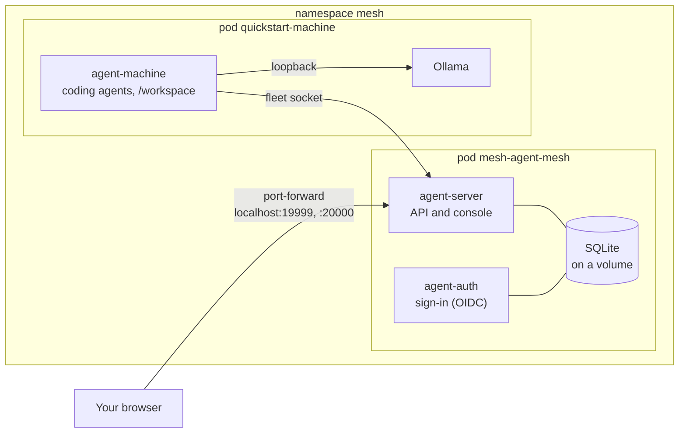

# Quickstart on Kubernetes

Try the Helm chart on a Kubernetes cluster on your own computer: the server and its sign-in service in one pod, and a fleet machine with coding agents and Ollama in another. You reach everything with `kubectl port-forward` on `localhost`, so there's no ingress, DNS or certificate to set up. It takes about twenty minutes.

It's the chart's smallest form (`mode: single`, SQLite on a volume), set up for plain HTTP on `localhost`. To try the system without Kubernetes, use the [Quickstart with Docker or Podman](quickstart.md). For production on Kubernetes (HTTPS host names, PostgreSQL, a Deployment per role), see [Running several server processes](scaling.md) and the chart's README (`deploy/helm/agent-mesh/README.md`).

## What you get



| Part | What it is |
| --- | --- |
| `mesh-agent-mesh` | The chart's one pod: agent-server (the API and the console) and agent-auth (sign-in) beside it, sharing a 5 GiB volume for the database. Services `mesh-agent-mesh` (port 19999) and `mesh-agent-mesh-auth` (port 20000). |
| `quickstart-machine` | A fleet machine from `quickstart/kubernetes/machine.yaml`: the `agent-sandbox` image (`agent`, `agent-machine`, Claude Code, Codex, OpenCode, Qwen Code, Copilot CLI) and Ollama in one pod, so agent-machine finds Ollama on its own loopback. Two small relays make `localhost:19999` and `:20000` reach the server inside the pod too. |

The values are in `quickstart/kubernetes/values.yaml`. The public address is `http://localhost:19999` both on your computer (through the port-forward) and inside the cluster, which is what lets sign-in work without host names.

## Start it

You need:

- **A local cluster** with a default StorageClass: kind, k3d, minikube, or the one in Docker Desktop, Rancher Desktop or Podman Desktop. `kubectl get storageclass` should list one marked `(default)`.
- **`kubectl` and Helm 3**, pointed at that cluster (`kubectl config current-context`).
- **A checkout of this repository**, for the chart and the quickstart's files. The images come ready-built from `ghcr.io`.
- **Room:** about 4 GB of memory for the cluster plus what your model needs, and several GB of disk.
- **Free ports** `19999` and `20000` on `localhost`.

From the repository root, install the chart and the machine:

```bash
helm install mesh deploy/helm/agent-mesh -n mesh --create-namespace -f quickstart/kubernetes/values.yaml
kubectl -n mesh apply -f quickstart/kubernetes/machine.yaml
kubectl -n mesh get pods -w        # wait until both pods are Running (the first pull takes a few minutes)
```

Keep the release name `mesh`: the machine's relays name its Services. The images are `latest`, the newest build of master, as in the Compose quickstart; `--set image.tag=<tag>` picks another (a release, `2.1.20`, or a commit, `sha-<commit>`), as `AI_PROXY_IMAGE_TAG` does there.

Then, in a terminal of its own that you leave open, forward the two ports:

```bash
kubectl -n mesh port-forward svc/mesh-agent-mesh 19999:19999 & \
kubectl -n mesh port-forward svc/mesh-agent-mesh-auth 20000:20000
```

On Windows PowerShell, run the two `port-forward` commands in two windows instead.

## Try it

1. **Sign in.** The server made an `admin` account on its first start and printed the password in its log:

   ```bash
   kubectl -n mesh logs deploy/mesh-agent-mesh -c agent-server | grep -i password
   ```

   Open **http://localhost:19999** (type `localhost` exactly), choose **Sign in** and sign in as **admin** with that password.
2. **Let the machine in.** The machine signs in the way any computer does, with two device codes (one for `agent-machine`, one for `agent`). Read them from its log:

   ```bash
   kubectl -n mesh logs deploy/quickstart-machine -c machine -f
   ```

   For each code, open **Machines › Approve a device** in the console, type the code and approve it. Within a minute **k8s-machine** shows as **Online** on **Machines**.
3. **Check the console can manage its Ollama.** `machine.yaml` sets `AGENT_SERVERS=on`, so the machine lets the console pull models. A sandbox image pulled before that setting existed ignores it: `kubectl -n mesh rollout restart deploy/quickstart-machine` pulls the newest, or turn it on there once by hand:

   ```bash
   kubectl -n mesh exec deploy/quickstart-machine -c machine -- agent-machine servers on
   ```

4. **Add its Ollama as a provider.** Open **k8s-machine**, then its **Providers** tab: it found Ollama on its own `127.0.0.1:11434`. Choose **Add as a provider**.
5. **Pull a model.** On the new provider's tab, open **Find and pull** and pull something small (a 1 to 4 billion parameter model): it runs on the cluster's CPU.
6. **Start an agent.** On the machine's **Agents** tab, choose **Start an agent**, pick **OpenCode** or **Qwen Code**, your provider and model, the folder `/workspace`, tick **Capture full request and response payloads**, and start it. Its terminal opens in the console: type a task, choose **Send**, and watch **Live**, **Requests** and **Sessions** fill in.

Most of what the [Docker or Podman quickstart](quickstart.md#try-it-step-by-step) suggests trying next works here too. The Compose-only tips (machine-2, `podman compose exec`) don't apply, and a terminal on the machine needs `kubectl -n mesh exec deploy/quickstart-machine -c machine -- agent-machine commands on` first (remote terminals are off by default).

## Stop and clean up

```bash
kubectl -n mesh scale deploy/mesh-agent-mesh deploy/quickstart-machine --replicas=0   # stop, keeping everything
kubectl -n mesh scale deploy/mesh-agent-mesh deploy/quickstart-machine --replicas=1   # start again
helm upgrade mesh deploy/helm/agent-mesh -n mesh -f quickstart/kubernetes/values.yaml # after pulling a newer checkout
kubectl delete namespace mesh                                                          # delete all of it
```

The database, the machine's sign-ins and Ollama's models are on volumes, so they survive restarts and upgrades. `helm uninstall` keeps the server's volume and its generated Secret on purpose (see the chart's README); deleting the namespace removes everything. The machine's `/workspace` is not kept: it's emptied when its pod restarts.

| What you see | What to do |
| --- | --- |
| A pod stays `Pending` | `kubectl -n mesh describe pod <name>`: usually no default StorageClass, or not enough memory for Ollama. |
| `localhost:19999` doesn't answer | The port-forward stopped (it ends when its pod restarts): run it again. |
| Sign-in fails, or says the address isn't allowed | Use `http://localhost:19999`, not `127.0.0.1`, and check both ports are forwarded. |
| No password in the server's log | It's printed only on the first start against an empty database. Delete the namespace and install again, or set an admin of your own with `auth.bootstrapAdmin.existingSecret`. |
| The machine doesn't show up | Its log (step 2) says what it's waiting for: the server's `/health`, or a device code to approve. |
| The machine's provider tab has no **Find and pull** | Run step 3, then reload the page. |

## From here to a real cluster

A real install changes the same things as any other: HTTPS host names for the API and the sign-in service (`server.host`, `auth.host`, an Ingress or Gateway API, `publicScheme: https`), PostgreSQL instead of SQLite, your own secrets, and your machines signed in from wherever they are. `deploy/helm/agent-mesh/values-single.yaml` is the small production form of what you ran here; [Running several server processes](scaling.md) covers scaled mode, and [Deployment](deployment.md) and [Security](security.md) the rest.
