# Quickstart with Docker or Podman

The quickest way to try AI Control Mesh. One command starts a complete stack in containers: the server and its console, the sign-in service, a database, two fleet machines with coding agents installed, and Ollama. In about fifteen minutes, downloads included (the tour itself takes about ten), you'll start a coding agent from the console, watch it work, type into its terminal and read back every request it made.

It runs only on your computer (every port is on `localhost`), uses a known demo password, and doesn't touch your projects, your Docker socket or your checkout's settings. To try the Helm chart instead, see [Quickstart on Kubernetes](quickstart-kubernetes.md). For a real install, follow [Getting started](getting-started.md).

This is `deploy/compose/quickstart/`, one of three in [`deploy/compose/`](../deploy/compose/README.md): `deploy/compose/allinone/` runs the whole system in one container, and `deploy/compose/peer/` two linked servers ([Peering](peering.md#try-it)).

## What you get

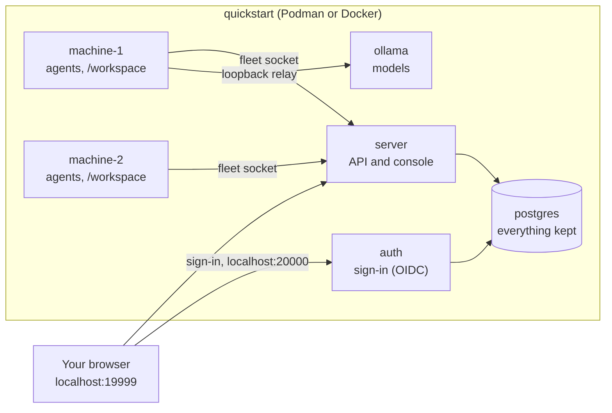

| Service | What it is |
| --- | --- |
| `server` | The agent-server: the API and the web console, on `http://localhost:19999`. |
| `auth` | The sign-in service (agent-auth), on `http://localhost:20000`. |
| `postgres` | PostgreSQL, holding the server's settings, accounts and recordings, and the sign-in service's state, each in its own schema. Not published. |
| `machine-1` | A fleet machine with `agent`, `agent-machine` and coding agents (Claude Code, Codex, OpenCode, Qwen Code, Copilot CLI) installed. It takes launches and terminals in `/workspace`, and finds Ollama, whose models the console can pull and delete (its servers switch is on). |
| `machine-2` | A second machine, the same but without Ollama, with its own workspace and sign-ins. |
| `ollama` | Ollama, reached only by machine-1. It runs on CPU unless you give it a GPU. It starts with no models. |

Both machines sign themselves in as `admin`, approving their own device codes the way you would ([Security](security.md#device-approval)), so they're in the fleet as soon as they start.

The server also creates a private vault encryption key automatically, so you can save provider API keys such as DeepSeek's in the console. It keeps the generated key at `/app/logs/private/vault-keys` in the persistent `server-logs` volume and reuses it on restart. This is separate from provider API keys and sign-in credentials. `AI_PROXY_VAULT_KEYS` in the environment or the stack's `.env` can supply your own key instead. Keep the generated file private and retain it with a database backup: existing saved API keys need the same encryption key to be read again.

## Start it

You need:

- **Podman with a Compose provider, or Docker with Compose.** On Windows and macOS, Podman runs in a VM: `podman machine init` once, then `podman machine start`. Check the Compose provider with `podman compose version`; Podman Desktop can install one (**Settings › Resources › Compose**). The commands below use `podman compose`; with Docker, type `docker compose` instead.
- **A checkout of this repository**, or just its one Compose file (below). The images come ready-built from the GitHub Container Registry (`ghcr.io/joeyenfield/agent-server` and `agent-sandbox`), for Intel and ARM computers alike.
- **Room:** several GB of disk for the images and the models you pull, and enough memory for a small model on CPU (8 GB or more is comfortable). An NVIDIA GPU is optional and makes models much faster.
- **Free ports** `19999` and `20000` on `localhost`.

From the repository root:

```bash
podman compose -f deploy/compose/quickstart/compose.yaml up -d
podman compose -f deploy/compose/quickstart/compose.yaml ps      # all six services say healthy (the machines take half a minute longer)
```

**Without a checkout.** The Compose file needs nothing beside it: its helper scripts are in the images. Download it into an empty folder and start it there:

```bash
curl -fsSLO https://raw.githubusercontent.com/joeyenfield/ai-control-mesh/master/deploy/compose/quickstart/compose.yaml
podman compose up -d
```

The commands on this page then work without their `-f deploy/compose/quickstart/compose.yaml`, from that folder. The GPU file is a second download from the same place (`compose.gpu.yaml`). This needs images newer than 2.1.57, which `latest` is.

The first start downloads about 1 GB of images, most of it the machines' coding agents, so it takes a few minutes. Later starts take seconds.

- **Another version.** The images are the newest build of master (`latest`). Set `AI_PROXY_IMAGE_TAG` to a release (`2.1.20`) or a commit of master (`sha-<commit>`), in your shell or a `.env` file beside `deploy/compose/quickstart/compose.yaml`.
- **Your own changes.** `devhelpers/basic` is the same stack built from your checkout: the server, the console, the Go programs and the coding agents. Run `podman compose up -d --build` in that folder instead (the first build takes several minutes), and stop this one first: they use the same ports. See [Developer helpers](../devhelpers/README.md).
- **A GPU.** Add `-f deploy/compose/quickstart/compose.gpu.yaml` to give Ollama your NVIDIA GPUs, every time you start the stack (with only `compose.yaml`, Ollama is recreated on CPU). Podman needs your GPU by its CDI name: check with `podman run --rm --device nvidia.com/gpu=all docker.io/library/ubuntu:24.04 nvidia-smi`, and if it doesn't print your card, run `podman machine ssh "sudo nvidia-ctk cdi generate --output=/etc/cdi/nvidia.yaml"` (again after a driver update). [The quickstart's README](../deploy/compose/quickstart/README.md#use-a-gpu) has the details.
- **Another password.** Set `QUICKSTART_ADMIN_PASSWORD` the same way before the first start.

## Try it, step by step

Every picture below is the real quickstart, started fresh with the command above on a Windows computer with Podman, on the CPU only. Nothing was set up by hand beforehand. The steps take about ten minutes, most of it the model download and the model's first answer. `node devhelpers/scripts/screenshots/quickstart-steps.mjs` takes these pictures again on a fresh quickstart.

### 1. Sign in

Open **http://localhost:19999**. Type `localhost` exactly: sign-in only accepts that address. The console asks you to sign in, and **Continue to sign in** takes you to the sign-in service on port 20000.

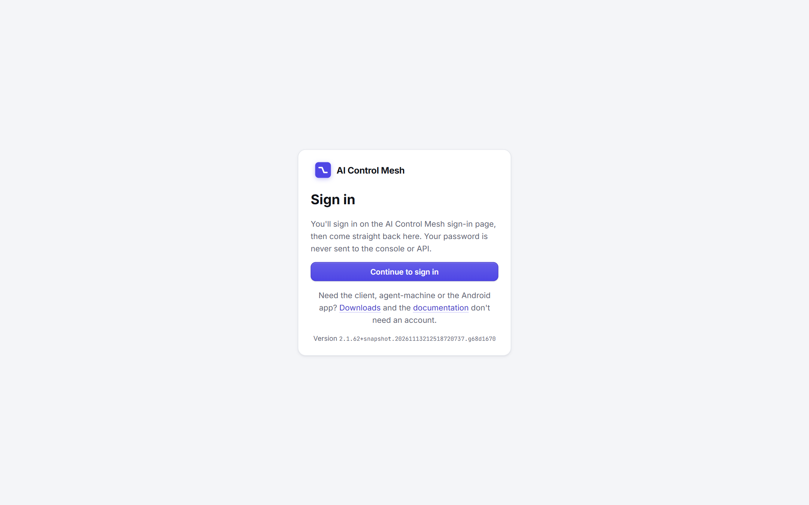

Sign in as **admin** with the password **secret** (or the one you set with `QUICKSTART_ADMIN_PASSWORD`). You come straight back to the console. The console never sees your password: only the sign-in service does.

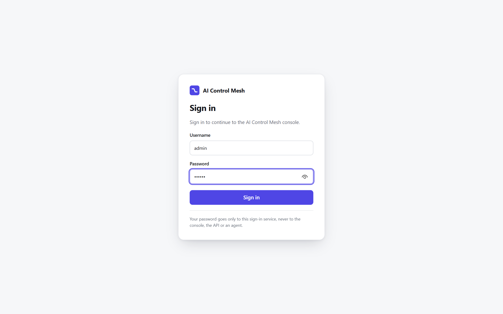

### 2. Check the machines

Open **All machines**. machine-1 and machine-2 are already there and **Online**: they signed themselves in when they started, so there's nothing to approve. Each row says what the machine allows. Both take agents (**Agents: Enabled**) and terminals. machine-1 also shares its Ollama (**Model servers: Enabled**).

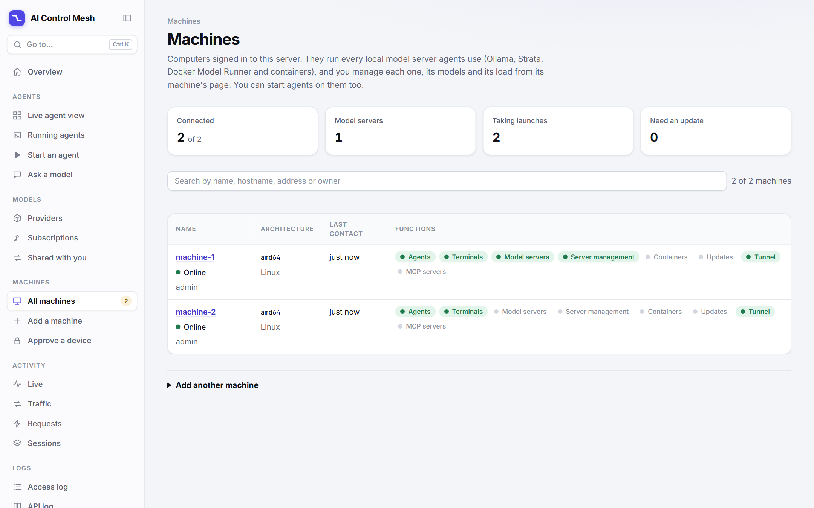

### 3. Add machine-1's model server as your own provider

Model servers belong to the machines that run them, and an admin adds each one once. This quickstart runs Ollama, but a provider is whatever you bring: llama.cpp, Strata, Docker Model Runner, LM Studio, vLLM or SGLang on a machine show up on this tab the same way, and a hosted API is added with its key on **Providers** ([Providers](providers.md)). Open **machine-1**, then its **Providers** tab. machine-1 found Ollama on its own `127.0.0.1:11434`, but it's **Not a provider yet**.

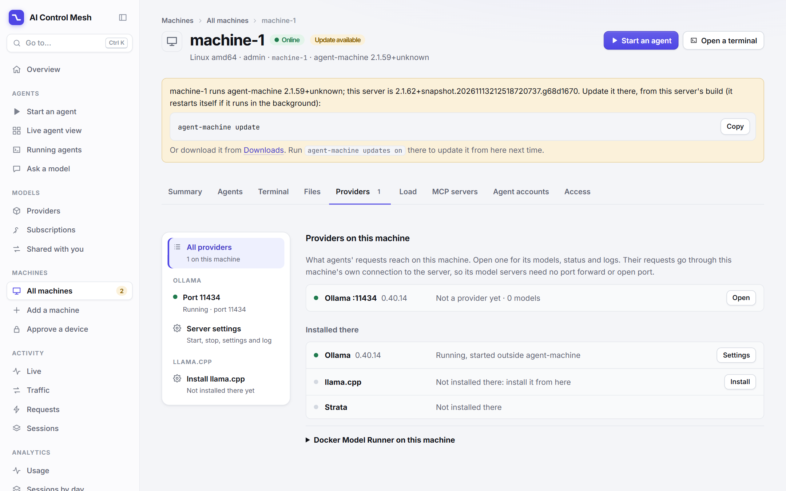

Open it and choose **Add as a provider**. The server adds a provider of your own called `machine-1`, the quickstart's default. Agents on either machine can now use it: their requests go through the server and machine-1's own connection to it, so nothing needs a published port.

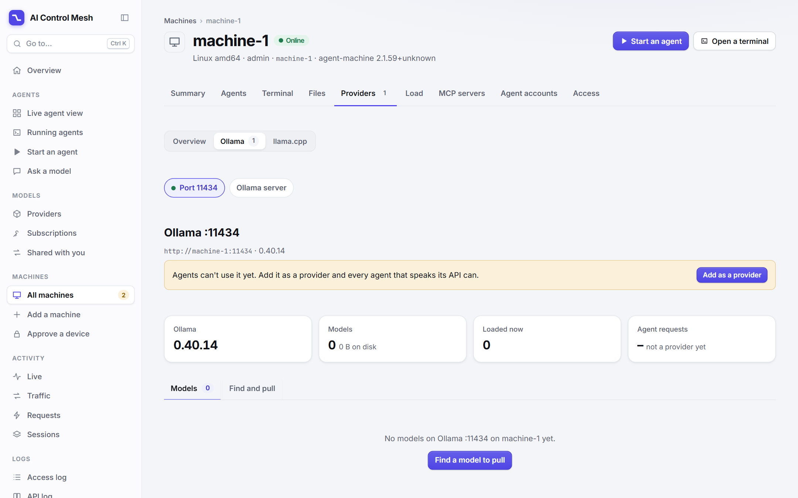

### 4. Find a model and pull it

Ollama starts with no models, and nothing is downloaded for you. On the provider's page, open **Find and pull**, keep **Ollama library**, search for `qwen3` and choose **Search**.

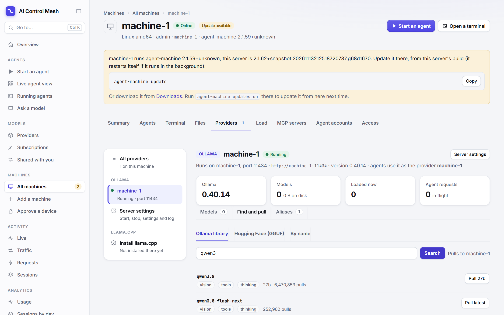

Each model family lists its sizes, with what it can do (**tools** is what coding agents need). On a CPU, pick something small: **Pull 1.7b** on `qwen3` downloads 1.3 GB and answers in seconds. Bigger models answer better but slower, and need more memory.

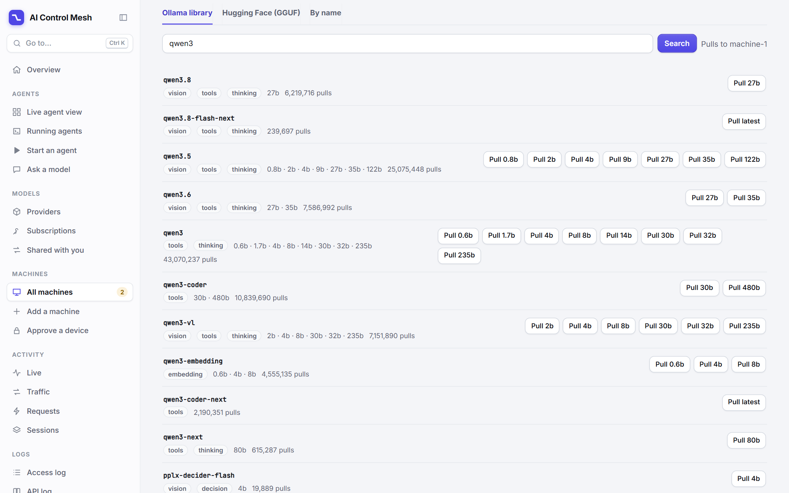

The download shows its progress at the top of the tab. When it's done, the model is on the **Models** tab, with the settings the server uses for it.

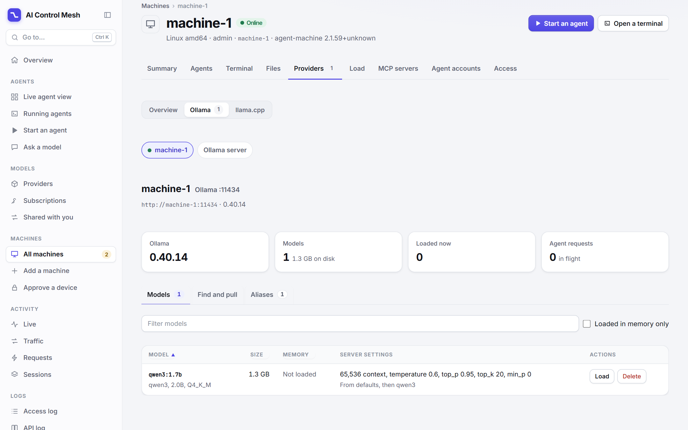

### 5. Start Qwen Code on machine-1

Choose **Start an agent** (at the top of machine-1's page, or in the menu). Pick **machine-1** under **Where should it run?** and **Qwen Code** under **Which agent?**. **Own provider** is already **machine-1**, the folder is `/workspace`, and the model is the one you pulled. Choose **Start on machine-1**. (**Capture full request and response payloads** keeps the whole conversation; tick it to read it back afterwards.)

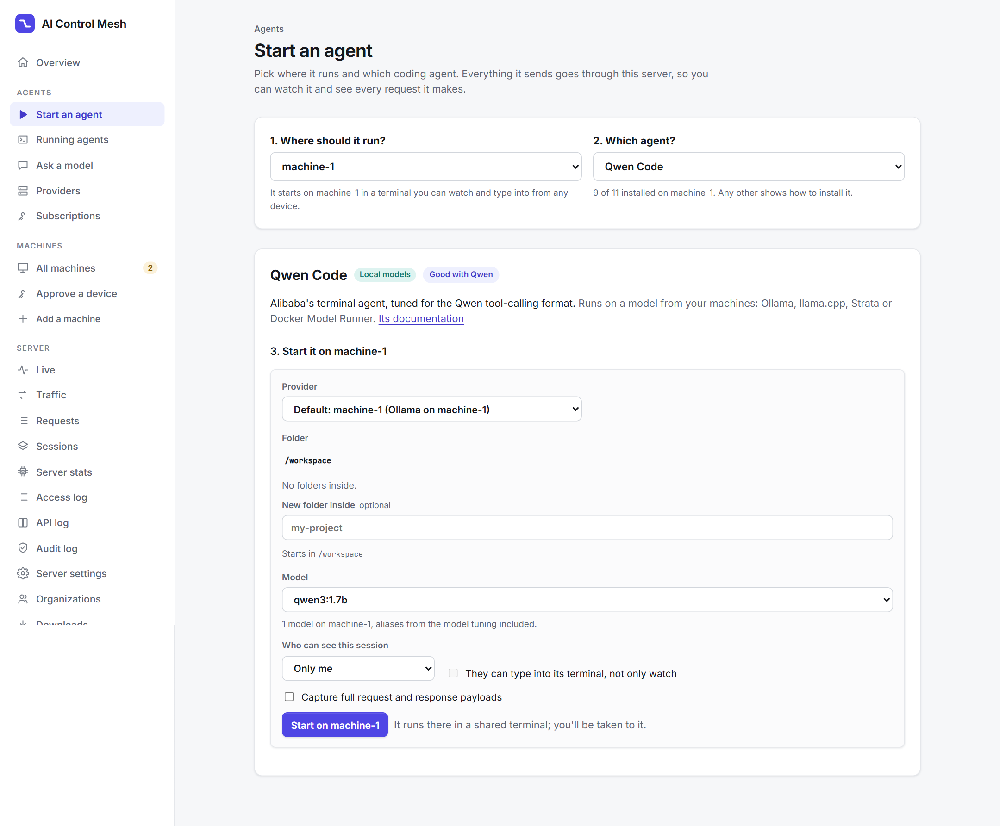

The agent starts on machine-1 in a terminal it shares with the server, and the console opens it. Qwen Code shows its banner, the model it's using, and its prompt.

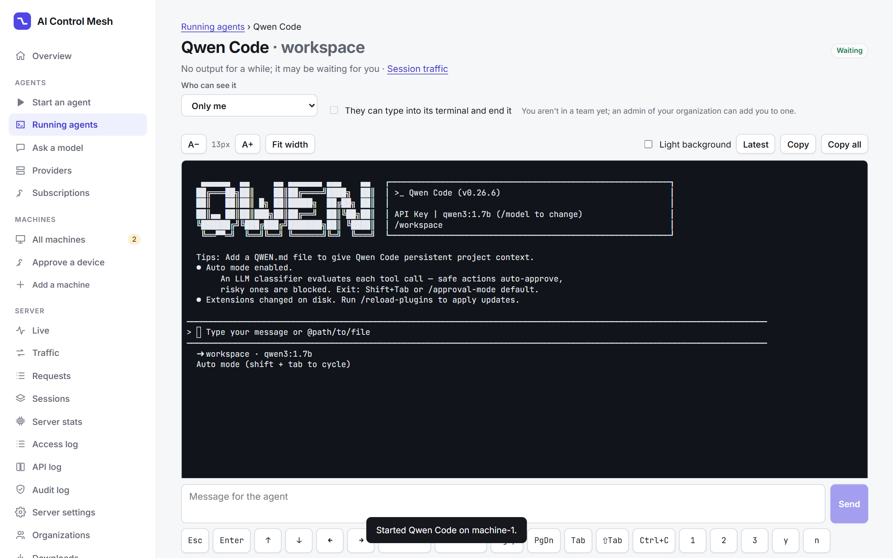

### 6. Ask it something

Type *What model are you?* in **Message for the agent** and choose **Send**. The keys underneath answer the agent's menus and prompts (Esc, Enter, the arrows, y and n), and when it asks you something, a banner shows the question on every page.

The first answer takes longest: Ollama loads the model into memory on the first request, which on a CPU can take a minute or two. Here Qwen Code thought for 44 seconds and then answered.

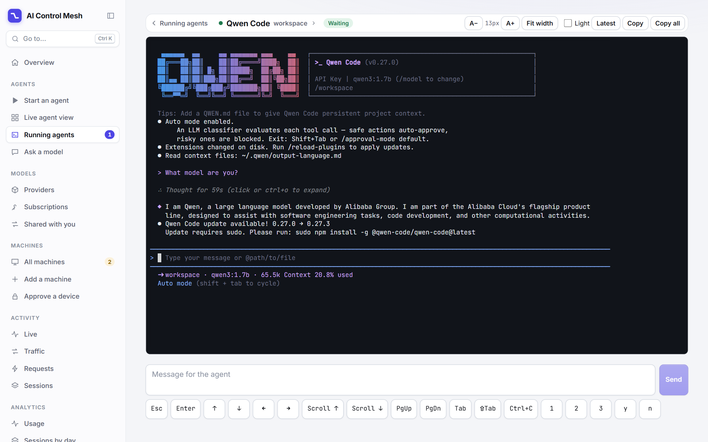

### 7. See what it sent

Open **Requests**. Every request the agent made is there, with the model, the provider, the time it took and the tokens it produced. Select one for the full request, the reply and the exact payload the server sent to Ollama. One question can take several requests: agents also ask the model for titles, summaries and the next step. The first one here says **Client hung up**: Qwen Code gave up waiting while Ollama loaded the model, and asked again.

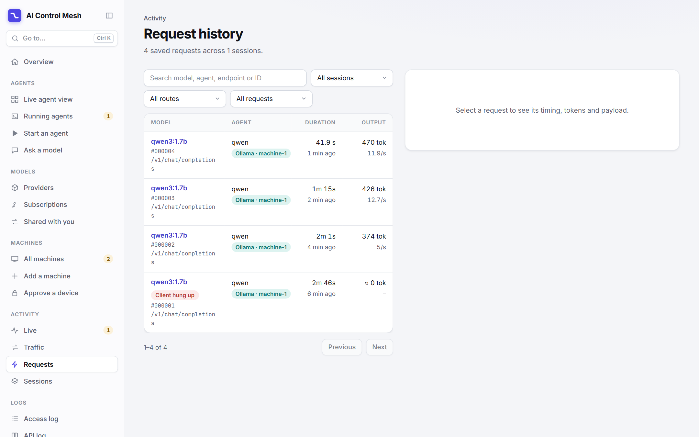

From here:

- **Give it a task.** Send *write a Python script that prints the first ten primes* and watch it work. Open **Live** in another tab to see each model request stream as it happens.
- **Running agents** lists every agent, with whether it's working, waiting for you, or finished.
- **Sessions** has one row per agent run, with a **Chat** view of the whole conversation when capture is on. **Traffic** groups requests by what they were for. Payloads are kept until you delete the session, or for the days set on **Server settings › Storage**.
- **Agents on machine-2** work the same way: start one there, and it reaches machine-1's Ollama through the server.

Then try the rest:

- **A terminal on a machine**: machine-2's **Terminal** tab, **Open a terminal**. A real shell in `/workspace` that only you can see.
- **The command line**: `podman compose -f deploy/compose/quickstart/compose.yaml exec machine-2 agent --list` lists the agents and whether each is installed; `... exec machine-2 sh` gives you a shell to run `agent opencode /workspace --model <model> --control` yourself.
- **Another person**: **Organizations** adds users, organizations and teams. Share a session with a team on its row in **Sessions**, then sign in as that user in a private window.
- **Machine access**: machine-1's **Access** tab lets an organization or team start agents, open terminals or use its models.
- **Approving a device**: **Machines › Approve a device** approves another computer's `agent login` code with your console sign-in.
- **Server settings**: the providers, the agents the server can launch (an edit applies to the next launch), Ollama's model tuning, and how long recordings are kept.
- **The stored settings and the database**: `podman compose -f deploy/compose/quickstart/compose.yaml exec server agent-server config export`, and `... exec postgres psql -U postgres mesh`.

## Stop, reset and troubleshoot

```bash
podman compose -f deploy/compose/quickstart/compose.yaml stop          # stop, keeping everything
podman compose -f deploy/compose/quickstart/compose.yaml up -d         # start again
podman compose -f deploy/compose/quickstart/compose.yaml pull          # a newer release's images; then up -d, keeping everything
podman compose -f deploy/compose/quickstart/compose.yaml logs -f server auth machine-1
podman compose -f deploy/compose/quickstart/compose.yaml down -v       # delete ALL of it, models and workspaces included
```

Everything lives in named volumes: the database (settings, accounts, recordings, sign-ins), the server's log, both machines' home folders and workspaces, and Ollama's models. They survive new images and rebuilds. Changing the admin password signs both machines out: reset with `down -v`, or sign their programs in again.

| What you see | What to do |
| --- | --- |
| `localhost:19999` doesn't answer (Podman on Windows) | Use a rootless Podman machine, Podman's default: `podman machine stop`, `podman machine set --rootful=false`, `podman machine start`, then start the stack again. |
| Sign-in fails, or says the address isn't allowed | Use `http://localhost:19999`, not `127.0.0.1` or your computer's name. |
| A machine stays `starting` | `podman compose -f deploy/compose/quickstart/compose.yaml logs machine-1`. It waits for the server and the sign-in service to be healthy first. |
| Too many sign-in attempts | The sign-in service allows 10 password attempts per address in 10 minutes: wait, or `podman compose -f deploy/compose/quickstart/compose.yaml restart auth`. |
| No model to choose when starting an agent | Add machine-1's Ollama as a provider and pull a model (steps 3 and 4). |
| The agent is very slow | It's running on CPU: pull a smaller model. |
| Building from your checkout fails with `checking context: can't stat` | Use the checkout's current `.dockerignore`, which leaves out generated folders. |
| `nftables` errors before containers start (Windows) | Update WSL (`wsl --update`) and restart it. |

`deploy/compose/quickstart/README.md` has the details behind each of these, and how the stack's local sign-in works.

## From the quickstart to a real install

The quickstart is the real server, sign-in service and machines, set up for one computer. A real install differs in four ways:

- **HTTPS**, with real host names for the API, the console and the sign-in service, instead of `localhost` ([Deployment](deployment.md#https), [OIDC](oidc.md)).
- **Private secrets**: no demo password, a strong introspection secret, and your own database passwords ([Deployment](deployment.md#postgresql)).
- **Your own machines**: `agent-machine login https://<your server>` on each computer that runs models or agents, approving its code yourself ([Machines](machines.md)).
- **Your own computers**: `agent login https://<your server>` where you run agents by hand ([Agents](agents.md)).

[Getting started](getting-started.md) walks through it, and [Security](security.md#a-checklist-for-a-public-server) has a checklist for a server others can reach.
