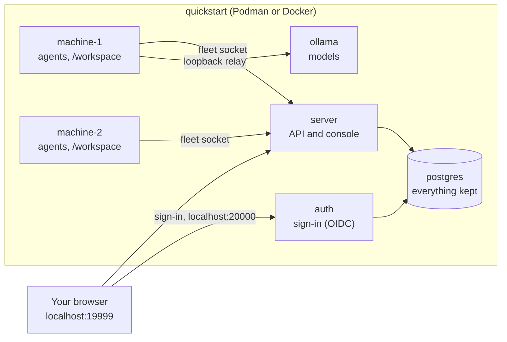

# Quickstart: the whole system on your computer

The quickest way to try AI Control Mesh. One command starts a complete, self-contained stack in containers: the server and its console, the sign-in service, a database, two fleet machines with coding agents installed, and Ollama. In about fifteen minutes you'll start a coding agent from the console, watch it work, type into its terminal and read back every request it made.

It runs only on your computer (every port is on `localhost`), uses a known demo password, and doesn't touch your projects, your Docker socket or your checkout's settings. For a real install, follow [Getting started](getting-started.md) instead.

## Contents

- [What you get](#what-you-get)
- [Before you start](#before-you-start)
- [1. Start the stack](#1-start-the-stack)
- [2. Sign in](#2-sign-in)
- [3. Add machine-1's Ollama as a provider](#3-add-machine-1s-ollama-as-a-provider)
- [4. Pull a model](#4-pull-a-model)
- [5. Start an agent](#5-start-an-agent)
- [6. Watch it, and type into it](#6-watch-it-and-type-into-it)
- [7. Read back what it did](#7-read-back-what-it-did)
- [8. Try the rest](#8-try-the-rest)
- [Stop, start again and reset](#stop-start-again-and-reset)
- [When something doesn't work](#when-something-doesnt-work)
- [From the quickstart to a real install](#from-the-quickstart-to-a-real-install)

## What you get



| Service | What it is |
| --- | --- |
| `server` | The agent-server: the API and the web console, on `http://localhost:19999`. |
| `auth` | The sign-in service (agent-auth), on `http://localhost:20000`. |
| `postgres` | PostgreSQL, holding the server's settings, accounts and recordings, and the sign-in service's state, each in its own schema. Not published. |
| `machine-1` | A fleet machine with `agent`, `agent-machine` and coding agents (Claude Code, Codex, OpenCode, Qwen Code, Copilot CLI) installed. It takes launches and terminals in `/workspace`, and finds Ollama. |
| `machine-2` | A second machine, the same but without Ollama, with its own workspace and sign-ins. |
| `ollama` | Ollama, reached only by machine-1. It runs on CPU unless you give it a GPU (see [Use a GPU](#use-a-gpu)). It starts with no models. |

Both machines sign themselves in as `admin`, approving their own device codes the way you would ([Security](security.md#device-approval)), so they're in the fleet as soon as they start.

## Before you start

- **Podman with a Compose provider, or Docker with Compose.** On Windows and macOS, Podman runs in a VM: `podman machine init` once, then `podman machine start`. Check the Compose provider with `podman compose version`; Podman Desktop can install one (**Settings › Resources › Compose**). The commands below use `podman compose`; with Docker, type `docker compose` instead.
- **A checkout of this repository**, for the Compose files and the small helper scripts they mount. The images themselves come ready-built from the GitHub Container Registry (`ghcr.io/joeyenfield/agent-server` and `agent-sandbox`), for Intel and ARM computers alike.
- **Room:** several GB of disk for the images, plus the models you pull, and enough memory for a small model on CPU (8 GB or more is comfortable). An NVIDIA GPU is optional and makes models much faster.
- **Free ports** `19999` and `20000` on `localhost`.

## 1. Start the stack

From the repository root:

```bash
podman compose -f quickstart/compose.yaml up -d
```

The first start downloads the images (about 1 GB, most of it the machines' coding agents), so it takes a few minutes. Later starts take seconds.

The images are the newest release (`latest`). For another version, set `AI_PROXY_IMAGE_TAG`, such as `AI_PROXY_IMAGE_TAG=2.0.1` (a release) or `sha-<commit>` (a commit of master), in your shell or a `.env` file beside `quickstart/compose.yaml`.

To try changes you've made to the code, build the images from your checkout instead, with `quickstart/compose.build.yaml`:

```bash
podman compose -f quickstart/compose.yaml -f quickstart/compose.build.yaml up -d --build
```

That builds the server, the console, the Go programs and the coding agents, so the first build takes several minutes. Leave the file out to go back to the published images.

Check that everything is up:

```bash
podman compose -f quickstart/compose.yaml ps
```

All six services should say `healthy` (the machines take half a minute longer than the rest).

### Use a GPU

Ollama runs on CPU unless you add `quickstart/compose.gpu.yaml`, which gives it your NVIDIA GPUs:

```bash
podman compose -f quickstart/compose.yaml -f quickstart/compose.gpu.yaml up -d
```

Use both files every time you start the stack; with only `compose.yaml`, Ollama is recreated on CPU. Podman needs to know your GPU by its CDI name. Check with `podman run --rm --device nvidia.com/gpu=all docker.io/library/ubuntu:24.04 nvidia-smi`; if it doesn't print your card, run `podman machine ssh "sudo nvidia-ctk cdi generate --output=/etc/cdi/nvidia.yaml"` (again after an NVIDIA driver update). [The quickstart's README](../quickstart/README.md#use-a-gpu) has the details.

## 2. Sign in

Open **http://localhost:19999** (type `localhost` exactly: the sign-in only accepts that address) and choose **Sign in**. The sign-in page is the separate sign-in service on port 20000. Sign in as **admin** with the password **secret**.

You land on **Overview**. Open **Machines** in the side menu: machine-1 and machine-2 are there and connected.

To use another password, set `QUICKSTART_ADMIN_PASSWORD` (in your shell or a `.env` file beside `quickstart/compose.yaml`) before the first start.

## 3. Add machine-1's Ollama as a provider

Local model servers belong to the machines that run them, and an admin adds each one as a provider once.

1. Open **Machines** and select **machine-1**.
2. Open its **Model servers** tab. It found Ollama on its own `127.0.0.1:11434`.
3. Choose **Add as a provider**. The server adds a backend called `machine-1`, which is already the quickstart's default.

Agents on either machine can now use it: their requests go to the server, and from there through machine-1's own connection to Ollama.

## 4. Pull a model

Ollama starts empty. On machine-1's **machine-1** tab (the provider you just added), open **Find and pull**, search for a model and pull it. Progress shows as it downloads.

Pick something small if Ollama runs on CPU: a model of a few GB (for example a 1 to 4 billion parameter one) answers in seconds; bigger ones work but are slow. The Ollama library page for each model lists its sizes.

## 5. Start an agent

1. On machine-1's page, open **Agents**, then **Start an agent**.
2. Choose an agent that uses local models, such as **OpenCode** or **Qwen Code**.
3. Leave the provider on **machine-1**, and choose the model you pulled.
4. For the folder, use `/workspace`, or name a new folder inside it.
5. Tick **Capture full request and response payloads**, so you can read every request later.
6. Choose **Start on machine-1**.

The agent starts on machine-1 in a terminal shared with the server, and the console opens it.

You can start agents on machine-2 the same way: its requests reach machine-1's Ollama through the server.

## 6. Watch it, and type into it

The agent's terminal is in the console, as it would be on the machine itself:

- Type a task in the box at the bottom, such as *write a Python script that prints the first ten primes*, and choose **Send**.
- Use the keys underneath for the agent's menus and prompts (Esc, Enter, the arrows, y and n). When the agent asks something, a banner shows its question on every page.
- **Running agents** lists every agent with whether it's working, waiting for you or finished.

Open **Live** in another tab while it works: each model request streams there as it happens, with its reasoning, text and tool calls.

## 7. Read back what it did

- **Requests**: every request, with its timing, tokens and status. Select one to read the full request, the reply and the exact payload the server sent to Ollama after translating it.
- **Sessions**: one row per agent run. Open the agent's session to see its requests, or switch to **Chat** to read the whole conversation as the agent saw it.
- **Traffic**: every request grouped by what it was for.

All of it is in the stack's PostgreSQL. Payloads are kept until you delete the session, or for as many days as you set on **Server settings › Storage**.

## 8. Try the rest

- **A terminal on a machine**: machine-2's **Terminal** tab, **Open a terminal**. It's a real shell in `/workspace`, which only you can see.
- **From the command line**: `podman compose -f quickstart/compose.yaml exec machine-2 agent --list` lists the agents and whether each is installed; `... exec machine-2 sh` gives you a shell there to run `agent opencode /workspace --model <model> --control` yourself.
- **Another person**: **Organizations** adds users, organizations and teams. Share a session with a team on its row in **Sessions**, then sign in as that user in a private window to see what they see.
- **Machine access**: machine-1's **Access** tab lets an organization or team start agents, open terminals or use its models.
- **Approving a device**: **Machines › Approve a device** is where you'd approve another computer's `agent login` code with your console sign-in.
- **Server settings**: the providers, the agents the server can launch (edit one, and it applies to the next launch), Ollama's model tuning, and how long recordings are kept.
- **The stored settings and the database**:

  ```bash
  podman compose -f quickstart/compose.yaml exec server agent-server config export
  podman compose -f quickstart/compose.yaml exec postgres psql -U postgres mesh
  ```

## Stop, start again and reset

```bash
podman compose -f quickstart/compose.yaml stop          # stop, keeping everything
podman compose -f quickstart/compose.yaml up -d         # start again
podman compose -f quickstart/compose.yaml pull          # get a newer release's images,
podman compose -f quickstart/compose.yaml up -d         # then start on them, keeping everything
podman compose -f quickstart/compose.yaml logs -f server auth machine-1
```

Everything lives in named volumes: the database (settings, accounts, recordings, sign-ins), the server's log, both machines' home folders and workspaces, and Ollama's models. They survive new images and rebuilds.

To delete **all of it**, models and workspaces included, and start fresh:

```bash
podman compose -f quickstart/compose.yaml down -v
podman compose -f quickstart/compose.yaml up -d
```

Changing the admin password signs both machines out: reset as above, or sign their programs in again.

## When something doesn't work

| What you see | What to do |
| --- | --- |
| `localhost:19999` doesn't answer (Podman on Windows) | Use a rootless Podman machine, Podman's default: `podman machine stop`, `podman machine set --rootful=false`, `podman machine start`, then start the stack again. |
| Sign-in fails, or says the address isn't allowed | Use `http://localhost:19999`, not `127.0.0.1` or your computer's name. |
| A machine stays `starting` | `podman compose -f quickstart/compose.yaml logs machine-1`. It waits for the server and the sign-in service to be healthy first. |
| Too many sign-in attempts | The sign-in service allows 10 password attempts per address in 10 minutes: wait, or `podman compose -f quickstart/compose.yaml restart auth`. |
| No model to choose when starting an agent | Add machine-1's Ollama as a provider (step 3) and pull a model (step 4). |
| The agent is very slow | It's running on CPU: pull a smaller model. |
| Building from your checkout (`compose.build.yaml`) fails with `checking context: can't stat` | Use the checkout's current `.dockerignore`, which leaves out generated folders. |
| `nftables` errors before containers start (Windows) | Update WSL (`wsl --update`) and restart it; see `quickstart/README.md`. |

`quickstart/README.md` has the details behind each of these, and how the stack's local sign-in works.

## From the quickstart to a real install

The quickstart is the real server, sign-in service and machines, set up for one computer. A real install differs in four ways:

- **HTTPS**, with real host names for the API, the console and the sign-in service, instead of `localhost` ([Deployment](deployment.md#https), [OIDC](oidc.md)).
- **Private secrets**: no demo password, a strong introspection secret, and your own database passwords ([Deployment](deployment.md#postgresql)).
- **Your own machines**: `agent-machine login https://<your server>` on each computer that runs models or agents, approving its code yourself ([Machines](machines.md)).
- **Your own computers**: `agent login https://<your server>` where you run agents by hand ([Agents](agents.md)).

[Getting started](getting-started.md) walks through it, and [Security](security.md#a-checklist-for-a-public-server) has a checklist for a server others can reach.
