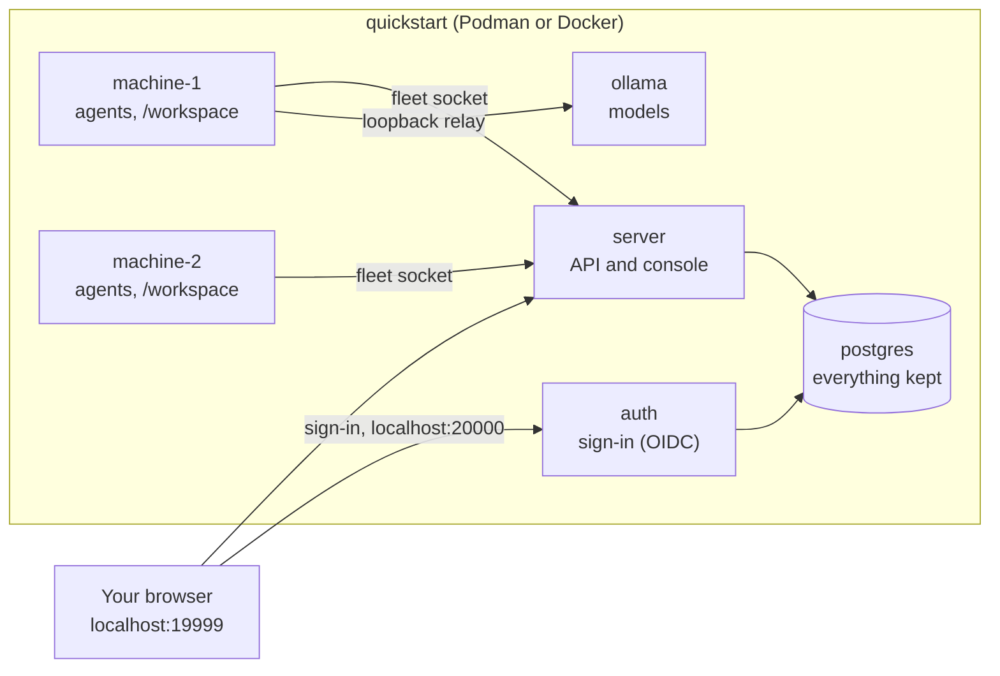

# Quickstart with Docker or Podman

The quickest way to try AI Control Mesh. One command starts a complete stack in containers: the server and its console, the sign-in service, a database, two fleet machines with coding agents installed, and Ollama. In about fifteen minutes you'll start a coding agent from the console, watch it work, type into its terminal and read back every request it made.

It runs only on your computer (every port is on `localhost`), uses a known demo password, and doesn't touch your projects, your Docker socket or your checkout's settings. To try the Helm chart instead, see [Quickstart on Kubernetes](quickstart-kubernetes.md). For a real install, follow [Getting started](getting-started.md).

## What you get



| Service | What it is |
| --- | --- |
| `server` | The agent-server: the API and the web console, on `http://localhost:19999`. |
| `auth` | The sign-in service (agent-auth), on `http://localhost:20000`. |
| `postgres` | PostgreSQL, holding the server's settings, accounts and recordings, and the sign-in service's state, each in its own schema. Not published. |
| `machine-1` | A fleet machine with `agent`, `agent-machine` and coding agents (Claude Code, Codex, OpenCode, Qwen Code, Copilot CLI) installed. It takes launches and terminals in `/workspace`, and finds Ollama. |
| `machine-2` | A second machine, the same but without Ollama, with its own workspace and sign-ins. |
| `ollama` | Ollama, reached only by machine-1. It runs on CPU unless you give it a GPU. It starts with no models. |

Both machines sign themselves in as `admin`, approving their own device codes the way you would ([Security](security.md#device-approval)), so they're in the fleet as soon as they start.

## Start it

You need:

- **Podman with a Compose provider, or Docker with Compose.** On Windows and macOS, Podman runs in a VM: `podman machine init` once, then `podman machine start`. Check the Compose provider with `podman compose version`; Podman Desktop can install one (**Settings › Resources › Compose**). The commands below use `podman compose`; with Docker, type `docker compose` instead.
- **A checkout of this repository**, for the Compose files and the small helper scripts they mount. The images come ready-built from the GitHub Container Registry (`ghcr.io/joeyenfield/agent-server` and `agent-sandbox`), for Intel and ARM computers alike.
- **Room:** several GB of disk for the images and the models you pull, and enough memory for a small model on CPU (8 GB or more is comfortable). An NVIDIA GPU is optional and makes models much faster.
- **Free ports** `19999` and `20000` on `localhost`.

From the repository root:

```bash
podman compose -f quickstart/compose.yaml up -d
podman compose -f quickstart/compose.yaml ps      # all six services say healthy (the machines take half a minute longer)
```

The first start downloads about 1 GB of images, most of it the machines' coding agents, so it takes a few minutes. Later starts take seconds.

- **Another version.** The images are the newest release (`latest`). Set `AI_PROXY_IMAGE_TAG` to a release (`2.0.1`) or a commit of master (`sha-<commit>`), in your shell or a `.env` file beside `quickstart/compose.yaml`.
- **Your own changes.** Add `-f quickstart/compose.build.yaml` and `--build` to build the server, the console, the Go programs and the coding agents from your checkout. The first build takes several minutes. Leave the file out to go back to the published images.
- **A GPU.** Add `-f quickstart/compose.gpu.yaml` to give Ollama your NVIDIA GPUs, every time you start the stack (with only `compose.yaml`, Ollama is recreated on CPU). Podman needs your GPU by its CDI name: check with `podman run --rm --device nvidia.com/gpu=all docker.io/library/ubuntu:24.04 nvidia-smi`, and if it doesn't print your card, run `podman machine ssh "sudo nvidia-ctk cdi generate --output=/etc/cdi/nvidia.yaml"` (again after a driver update). [The quickstart's README](../quickstart/README.md#use-a-gpu) has the details.
- **Another password.** Set `QUICKSTART_ADMIN_PASSWORD` the same way before the first start.

## Try it

1. **Sign in.** Open **http://localhost:19999** (type `localhost` exactly: the sign-in only accepts that address) and choose **Sign in**. The sign-in page is the separate sign-in service on port 20000. Sign in as **admin** with the password **secret**. Open **Machines**: machine-1 and machine-2 are there and connected.
2. **Add machine-1's Ollama as a provider.** Local model servers belong to the machines that run them, and an admin adds each one once. Open **machine-1**, then its **Model servers** tab: it found Ollama on its own `127.0.0.1:11434`. Choose **Add as a provider**. The server adds a backend called `machine-1`, already the quickstart's default. Agents on either machine can now use it, through the server and machine-1's own connection.
3. **Pull a model.** Ollama starts empty. On the **machine-1** provider tab, open **Find and pull**, search for a model and pull it. On CPU, pick something small (a 1 to 4 billion parameter model of a few GB answers in seconds; bigger ones are slow).
4. **Start an agent.** On machine-1's **Agents** tab, choose **Start an agent**. Pick one that uses local models, such as **OpenCode** or **Qwen Code**, leave the provider on **machine-1**, choose your model, use `/workspace` (or a new folder inside it), tick **Capture full request and response payloads**, and choose **Start on machine-1**. The agent starts in a terminal shared with the server, and the console opens it. Agents on machine-2 work the same way, reaching machine-1's Ollama through the server.
5. **Watch it and type into it.** Type a task in the box at the bottom, such as *write a Python script that prints the first ten primes*, and choose **Send**. The keys underneath answer the agent's menus and prompts (Esc, Enter, the arrows, y and n); when it asks something, a banner shows the question on every page. Open **Live** in another tab to see each model request stream as it happens. **Running agents** lists every agent with whether it's working, waiting for you or finished.
6. **Read back what it did.** **Requests** has every request with its timing, tokens and status; select one for the full request, the reply and the exact payload the server sent to Ollama after translating it. **Sessions** has one row per agent run, with a **Chat** view of the whole conversation. **Traffic** groups requests by what they were for. Payloads are kept until you delete the session, or for the days set on **Server settings › Storage**.

Then try the rest:

- **A terminal on a machine**: machine-2's **Terminal** tab, **Open a terminal**. A real shell in `/workspace` that only you can see.
- **The command line**: `podman compose -f quickstart/compose.yaml exec machine-2 agent --list` lists the agents and whether each is installed; `... exec machine-2 sh` gives you a shell to run `agent opencode /workspace --model <model> --control` yourself.
- **Another person**: **Organizations** adds users, organizations and teams. Share a session with a team on its row in **Sessions**, then sign in as that user in a private window.
- **Machine access**: machine-1's **Access** tab lets an organization or team start agents, open terminals or use its models.
- **Approving a device**: **Machines › Approve a device** approves another computer's `agent login` code with your console sign-in.
- **Server settings**: the providers, the agents the server can launch (an edit applies to the next launch), Ollama's model tuning, and how long recordings are kept.
- **The stored settings and the database**: `podman compose -f quickstart/compose.yaml exec server agent-server config export`, and `... exec postgres psql -U postgres mesh`.

## Stop, reset and troubleshoot

```bash
podman compose -f quickstart/compose.yaml stop          # stop, keeping everything
podman compose -f quickstart/compose.yaml up -d         # start again
podman compose -f quickstart/compose.yaml pull          # a newer release's images; then up -d, keeping everything
podman compose -f quickstart/compose.yaml logs -f server auth machine-1
podman compose -f quickstart/compose.yaml down -v       # delete ALL of it, models and workspaces included
```

Everything lives in named volumes: the database (settings, accounts, recordings, sign-ins), the server's log, both machines' home folders and workspaces, and Ollama's models. They survive new images and rebuilds. Changing the admin password signs both machines out: reset with `down -v`, or sign their programs in again.

| What you see | What to do |
| --- | --- |
| `localhost:19999` doesn't answer (Podman on Windows) | Use a rootless Podman machine, Podman's default: `podman machine stop`, `podman machine set --rootful=false`, `podman machine start`, then start the stack again. |
| Sign-in fails, or says the address isn't allowed | Use `http://localhost:19999`, not `127.0.0.1` or your computer's name. |
| A machine stays `starting` | `podman compose -f quickstart/compose.yaml logs machine-1`. It waits for the server and the sign-in service to be healthy first. |
| Too many sign-in attempts | The sign-in service allows 10 password attempts per address in 10 minutes: wait, or `podman compose -f quickstart/compose.yaml restart auth`. |
| No model to choose when starting an agent | Add machine-1's Ollama as a provider and pull a model (steps 2 and 3). |
| The agent is very slow | It's running on CPU: pull a smaller model. |
| Building from your checkout fails with `checking context: can't stat` | Use the checkout's current `.dockerignore`, which leaves out generated folders. |
| `nftables` errors before containers start (Windows) | Update WSL (`wsl --update`) and restart it. |

`quickstart/README.md` has the details behind each of these, and how the stack's local sign-in works.

## From the quickstart to a real install

The quickstart is the real server, sign-in service and machines, set up for one computer. A real install differs in four ways:

- **HTTPS**, with real host names for the API, the console and the sign-in service, instead of `localhost` ([Deployment](deployment.md#https), [OIDC](oidc.md)).
- **Private secrets**: no demo password, a strong introspection secret, and your own database passwords ([Deployment](deployment.md#postgresql)).
- **Your own machines**: `agent-machine login https://<your server>` on each computer that runs models or agents, approving its code yourself ([Machines](machines.md)).
- **Your own computers**: `agent login https://<your server>` where you run agents by hand ([Agents](agents.md)).

[Getting started](getting-started.md) walks through it, and [Security](security.md#a-checklist-for-a-public-server) has a checklist for a server others can reach.
