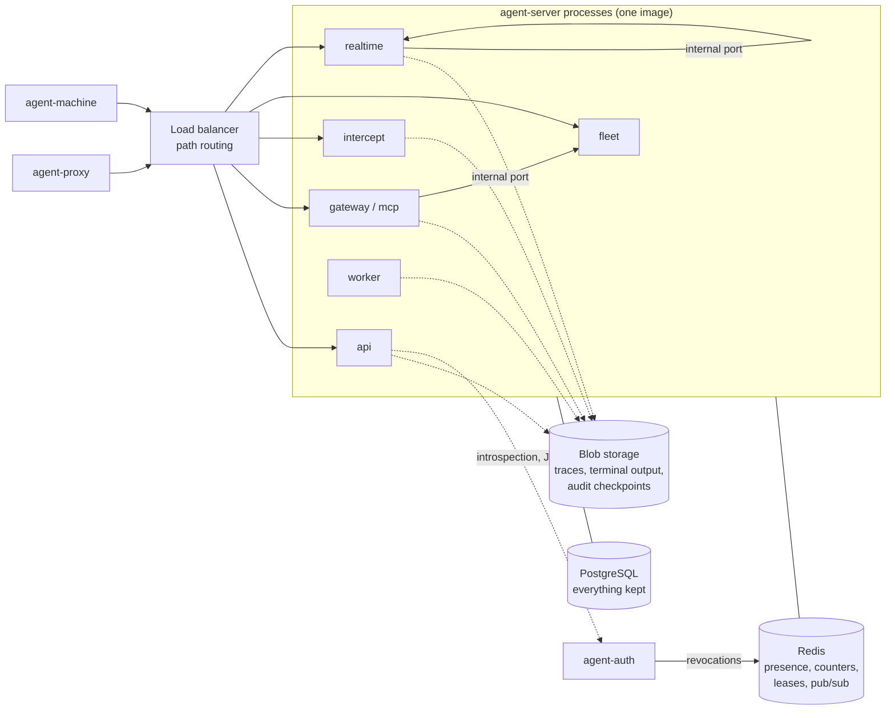
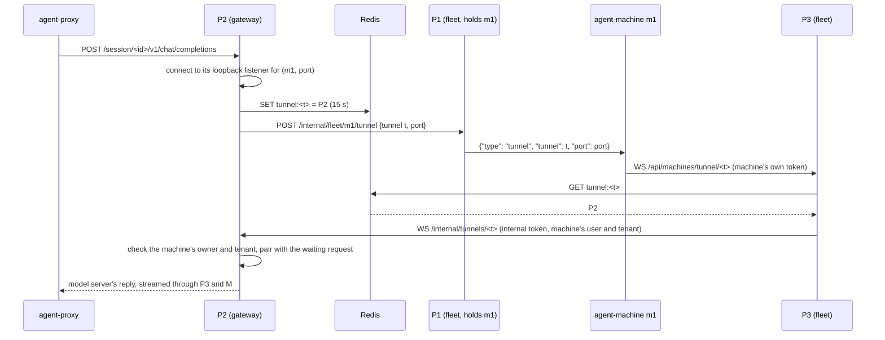
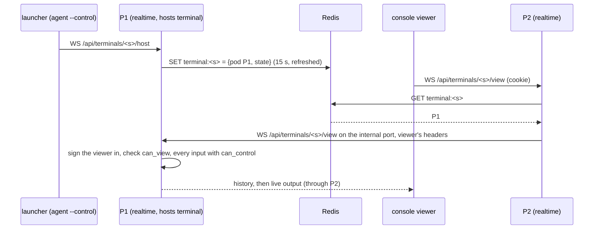

# Scaling internals

This page is the design behind running the server as several processes, as it is built: what stopped a second process from working, how each piece of state is shared or found, and the decisions behind retention, signed tokens and the audit log. To set it up and run it, see [Running several server processes](scaling.md).

## What it was designed for

The target was about 1,000 engineers (3,000 at most), with around 1,200 agents active at peak. That means a few hundred model calls a second, thousands of open streams, 100 to 500 KB per request (agents resend the whole conversation every time), one fleet connection per machine, and a few hundred terminal and console viewers. The cost is mostly long-lived connections and copying bytes, not CPU per request. So the design keeps connections where they land and moves everything else into shared stores, and gateways scale on open streams rather than CPU.

These figures were planning assumptions, not measurements. [Sizing](scaling.md#sizing) is an illustration on the same basis.

## What stopped a second process

Before this work, `agent-server` was one process, and a second one would have been wrong, not just wasteful. Each row is something that lived in one process's memory, and how it is handled now.

| Was | Problem with two processes | Now |
| --- | --- | --- |
| Sessions in memory, all loaded at start | Another process answered 404; request ids repeated; last writer won on counters | The database is authoritative; new sessions are written at once; ids come from shared counters; counters are only ever raised |
| A machine's fleet socket | Asks, launches and shells worked only on the process holding it | The holder announces the machine; others call it on its internal port |
| Tunnel dial-backs | The machine dialled back to whichever process the load balancer picked | The asking process records the tunnel in Redis; a dial-back landing elsewhere is relayed to it |
| Terminal host and viewers | They had to meet in one process | Viewers are forwarded whole to the hosting process |
| Live view | Consoles saw only their own process's requests | Events are batched to the other processes while someone watches |
| Usage limit counters | Each process counted alone, so a person could use N times their limit | Shared hourly counters |
| Launch grants and the one-time Copilot token | Lost if the agent reached another process | Shared keys; the handover is claimed once |
| Provider account cooldowns | Each process kept sending people to a throttled account | Part of the account row, announced on change |
| Settings | Changed in the answering process only | A change is announced and every process reads the stored settings again |
| Hourly retention | Every process pruned | One process at a time, under a lease |
| Console restart | In-process | A rollout; settings apply live |
| Issuer sign-in rate limits | Per issuer process | Shared counters in Redis |
| Introspecting every request | Issuer load equal to API load | With Redis, signed access tokens checked locally (see [Token validation](#token-validation-jwt)) |
| Traces and terminal output in the database | Terabytes of repeated prompt text in PostgreSQL | Blob storage, messages stored once per session |
| File logging | Not what Kubernetes collects | JSON on standard output (`AI_PROXY_LOG_STDOUT`, `AI_PROXY_LOG_FORMAT`) |

## The processes and what they share

Every process runs the same program. `AI_PROXY_ROLES` picks which routes and jobs it runs, and `AI_PROXY_REDIS_URL` makes the processes one server (`cluster.py`). State goes to one of three places:

- **PostgreSQL** keeps everything that must last: sessions, records, settings, accounts, machines, limits, policies, holds and the audit log. Each process writes through its own write queue (`db.writer`), except where another process must see the write at once (a new session, a session's document change, an admin change being audited).
- **Redis** holds what processes share while they run: who holds what, counters, leases, grants and revocations. Pub/sub carries change messages. Redis is never the only copy of anything except leases and counters for limits, and those are rebuilt from the database.
- **Blob storage** holds traces and terminal output when `AI_PROXY_BLOB_URL` is set. The database keeps only where each one is.

A connection stays with the process it reached: a machine's fleet socket, a launcher's terminal host socket, a tunnel's dial-back and an account agent's intercept tunnel. Other processes reach it through that process's **internal port** (`internal.py`), with `AI_PROXY_INTERNAL_TOKEN`.

Every process has an id (`AI_PROXY_POD_ID`, else the host name, with the process id added when one pod runs several workers). Each writes a heartbeat every 5 seconds (`HEARTBEAT`) to `pod:<id>` and on pub/sub, carrying its internal URL and a few counts (such as how many live viewers it has). A process not heard from for 20 seconds (`POD_TIMEOUT`) is gone, and so is anything it held.

`LocalCluster` is the single-node version of the same interface: keys and counters in a dictionary, leases always granted, messages going nowhere. So the code paths are the same with and without Redis.

### How a process finds what another holds

This is the rule from `.context/server.md`: any new per-process state must say how another process finds it.

| State | Where it is found | Mechanism |
| --- | --- | --- |
| Session | Database, plus each process's cache of the sessions it uses | `get` falls back to the database. Document changes are read, changed and written in one transaction (`with_for_update`), then `session.changed` makes every process re-read its copy in place, so a terminal viewer or a streaming reply sees sharing narrow at once. Request ids come from `session:<id>:seq` and `:count`, seeded from the row. Counter columns are only ever raised, so no process writes back an older value. Only sessions active in the last `AI_PROXY_SESSION_LIST_DAYS` are loaded and listed; up to 20,000 are cached, open ones kept first. |
| Machine | Every process's `Fleet.machines`; the holder in `Fleet.owners` | The holding process publishes `fleet.machine` (its stored state, whether it's connected, and its Strata and MCP keys sealed with AES-GCM under a key derived from the internal token). Others record the sender as owner. `fleet.removed` closes and refuses a removed machine everywhere. |
| Tunnel | `tunnel:<id>` → the process that asked, for the dial-back's time | See the sequence below. |
| Shared terminal | `terminal:<session>` → the hosting process and its public state, kept for 15 seconds and refreshed | `TerminalForward` proxies a viewer's WebSocket to the host's `/api/terminals/<id>/view` on its internal port, with the viewer's own headers, so the host signs them in and checks sharing as for anyone. |
| Live view | Each process's mirror of the others' requests, without payloads | `live.events`, batched every 100 ms, only while another process's heartbeat says it has viewers. A request's details are asked of the process it ran on (`/internal/live`). |
| Usage counts | `usage:<tenant>:<user>:<provider>`, one hash field per hour | Every model call adds to it (and to `provider_usage` in the database). It is seeded once from the database, taking the larger count of each hour, so nothing counts twice. Checks reuse what they read for 2 seconds. `usage.limits` reloads limits. |
| Launch grant | `grant:<launch>`, until the grant expires | Handing over the token sets `grant:<launch>:delivered` with `SET NX`, so only one process can do it. A fleet launch's id is also kept as `fleet:launch-grant:<id>` for the launch's lifetime, so the new session's usage check finds it on any process. |
| Provider accounts | Database, plus each process's copy | `provider_accounts.changed` carries the stored row (cooldowns included), never a credential. |
| Settings, container keys, API provider keys | Database | `config.changed` makes every process reload them. API providers' health and discovered models stay per process. |
| Retention policies and holds | Database | `retention.changed` reloads them. |
| Accounts | Database | `UserStore` re-reads the directory when `accounts_version` in `meta` changes, as it always did. |
| Revocations | `revoked:<kind>:<id>` and `auth.revoked` | See [Token validation](#token-validation-jwt). |
| Jobs | `lease:<name>` | `cluster.leader(name, ttl)`: `SET NX` with a TTL, renewed by the holder. |
| Links to other servers | `link:socket:<id>`, lease `link-dial:<id>`, `link:nonce:...` | One `fleet` process dials each link; nonces are shared so a replay is refused on any process. See [Peering](peering.md). |

### A request for a machine held by another process

An agent's request reaches a gateway process (P2) for a model server on machine `m1`, whose fleet connection is held by P1. The machine's dial-back lands on a third process (P3). Every upstream call still goes through `runtime.tunnels.base_url(backend)`: P2's own loopback listener for that machine and port.

P3 keeps the machine's own WebSocket, so the machine's renewed tokens are taken there. It passes on binary frames only. If P1 has just lost `m1`, P2 waits up to 10 seconds (`RECONNECT_WAIT`) for it to come back to any process before failing. Asks, launches and shells follow the first half of this path: `Fleet._where` finds the holder, `_remote` calls `/internal/fleet/<machine>/<action>`, and the holder's `FleetError` or `MachineGone` comes back as such. Pulls stream their progress lines back as NDJSON.

### A terminal viewer on another process

Forwarding happens before sign-in on P2, so P1 runs every check itself. An internal call is never a credential: launches and shells name the user, whose permissions are read fresh on the receiving process; forwarded viewers carry their own credentials.

## Roles and routes

A role is the set of routes registered by certain modules (`roles.MODULE_ROLES`), with a few paths inside modules assigned elsewhere (`roles.PATH_ROLES`). `create_app` registers every module in the usual order, then `roles.filter_routes` drops what this process doesn't serve. The route order rule (console routes before `compat`'s catch-alls) is kept, and a misrouted request gets a plain 404 rather than half working.

- `compat` is the gateway's. Its bare `/api/{path}` (agents' native Ollama calls) is also kept on the api role, because it arrives with the console's `/api/*`. The chart sends the known Ollama paths (`/api/chat`, `/api/tags` and the like) to the gateway.
- `mcp` traffic under `/session/` is the mcp role's, and the gateway serves it too unless mcp runs apart. The console's `GET /api/mcp` is the api's.
- `/api/machines/connect` and `/api/machines/tunnel/*` are fleet's; `/api/live` is realtime's; `/api/proxy/tunnel` is intercept's.
- A linked server's socket (`/api/links/connect`) is fleet's, and its relayed model and MCP calls (`/api/links/relay/provider/`, `/api/links/relay/mcp/`) are the gateway's.
- `/health`, `/ready`, `/internal/*` and `/metrics` belong to every role.

The load balancer must send each path to a process that serves it. The chart's route table (`agent-mesh.routeTable` in `deploy/helm/agent-mesh/templates/_helpers.tpl`) and `roles.py` must say the same; a new route that isn't the api's is added to both. The operator's table is [Routing](scaling.md#routing).

The internal port is a second listener in the same event loop. It serves the same app, but `InternalEntry` refuses anything without the internal token (except `/metrics`), marks the request internal and restores the original host and client address. The public port refuses `/internal/*` outright (`InternalGate`). The chart's NetworkPolicy opens the internal port only to the release's own server pods, and Prometheus.

## Deployment modes

There is one image and one command; environment variables choose the mode. See [Single-node and scaled mode](scaling.md#single-node-and-scaled-mode).

- **Single-node** (no `AI_PROXY_REDIS_URL`): memory is authoritative, as before. On PostgreSQL the process holds an advisory lock (`SINGLE_NODE_LOCK`) for its lifetime, so a second single-node process on the same database refuses to start. Roles other than `all` and `AI_PROXY_WORKERS>1` are refused without Redis (`roles.check`). The chart's `mode: single` uses the `Recreate` strategy so two never overlap.
- **Scaled** (Redis): any number of processes, each with some roles. A middle size is two Deployments, such as `api,realtime,worker` and `gateway,mcp,intercept,fleet`.
- **Several uvicorn workers in one pod** are several processes: each gets its own pod id and an internal port of its own.

Some choices make the split safe to run:

- **Migrations run once, before the pods.** The chart's pre-install and pre-upgrade Job runs `agent-server db migrate`. The pods start with `AI_PROXY_MIGRATE=0` and wait for the schema. Steps are only ever appended, so a database newer than a process is fine for it during a rollout.
- **Restarts are rollouts.** On shutdown a process stops taking work, gives open connections `AI_PROXY_GRACEFUL_SECONDS`, closes the rest with codes clients reconnect after, and `/ready` answers 503. The chart puts a `preStop` sleep in front so the load balancer stops sending first.
- **The first user** is made by a process with the `worker` role when it starts and no account exists.

## Invariants the split keeps

These come from `AGENTS.md` and `.context/`, and hold on every role and across processes:

- **Tenants first.** `same_tenant` comes before roles, sharing and grants. A call from another process carries a user, and the receiving process checks that user again; being inside the cluster grants nothing.
- **Sessions are checked per use.** Every endpoint that touches a session checks `can_view` or `can_control`; streams check per event; a sharing change reaches every process's copy at once and drops viewers who may no longer see it.
- **Usage limits are checked before any byte goes upstream**, and refusals are never counted. A check happens when a request starts, so a burst of calls already in flight can overshoot by those calls only.
- **The server never manages a model server.** The fleet role only carries requests; the machine still does the work.
- **No secret reaches Redis in the clear.** Machines' keys and MCP keys are sealed; Redis holds references, counters, presence and grants. The MCP token stays a hash. Live text crosses pub/sub while someone watches, and is never stored there.
- **Anything that runs commands is checked twice.** Launches, shells and terminals are checked by the process that took the request, again by the process holding the machine, and again by the machine. Shell sessions stay private.
- **The internal port is never exposed** outside the cluster, and never served without the token.
- **Every upstream call to a machine's model server uses `runtime.tunnels.base_url(backend)`**, on whichever process makes it.

## Decisions

| Question | Decision | Reason |
| --- | --- | --- |
| Hosting | Managed cloud and on premises, chosen by Helm values, not forks | Managed services come in `external` blocks and workload identity; on premises uses CloudNativePG, the bundled Valkey and any S3-compatible store through an endpoint. The chart never needs a cloud API. |
| Small installs | Single-node mode stays supported, with SQLite or PostgreSQL | Development, the quickstart and small teams shouldn't need Redis. Every shared thing has an in-process version behind the same interface. |
| How processes share state | Redis keys and pub/sub, plus calls to the holding process | Connections can't move, so the process holding one is asked; everything else is shared. No consistent-hash routing is needed, and no client changes or `PROTOCOL` change. |
| Session service | A store every process runs (`SessionStore` over PostgreSQL and Redis), not a separate Deployment | It sits on every model call. Its boundary is the store's interface, so it can be split out later without changing callers. |
| Recording | Each process writes records to PostgreSQL through its own queue; traces go to blob storage | This holds at the design load. An event stream (Redis Streams, Kafka) stays an option if the database becomes the limit. |
| Tunnel dial-backs | Relayed to the asking process over the internal port | Costs one hop inside the cluster and needs nothing from the machine. |
| Token format | Signed JWT access tokens (RS256, the issuer's existing key), checked locally only while revocations are current | Removes one issuer call per request without making sign-out slow. |
| Retention | A server policy, organization overrides within bounds, a capture policy and legal holds, stamped on each session | People keep the terms they started under; organizations differ. |
| Audit | Append-only, hash-chained per organization, signed checkpoints, standard exports | Aims at the logging controls SOC 2 and ISO 27001 check, without a separate audit store. |
| Audit timing | Changes are written before they're answered; refusals and looks at recordings straight after | A change someone saw succeed is always in the log; a refusal can't hold up the answer. |

## Recordings and blob storage

Agents resend the whole conversation on every call, so a long session's traces repeat the same messages again and again. In blob storage (`blobs.py`), each message of 256 bytes or more in `request.messages`, `upstream_request.messages` or `request.input` is stored once per session under the SHA-256 of its JSON (`blocks/<hash>`), and the trace keeps `{"$block": hash}` in its place (`pack_trace`, `unpack_trace`). Each process remembers which blocks it has stored for a session; another process storing the same block writes the same bytes to the same key.

Keys start with `tenant/<org>/<year>/<month>/<session>/`, the month being the session's start. So retention deletes a session's prefix (or its `traces/` and `blocks/` for traces only), and an organization's data is one prefix. Uploads run on a thread pool per process (`AI_PROXY_BLOB_THREADS`), and the trace's row in the database, with its location, is written once the upload is done. Recordings made before blob storage was on stay in the database and are still read from there. The S3 client is the server's own (Signature Version 4 over httpx), so there's nothing extra to install. Layout and settings: [Blob storage](scaling.md#blob-storage).

## Retention and capture policy

The policy has two levels: the server's, set by site admins, and each organization's, set by its admins within the server's `min` and `max` for each kind and its `allowed_traces`. The parts are in [What a policy says](retention.md#what-a-policy-says). Built-in defaults keep everything forever except the audit log (365 days, never under 90: `AUDIT_FLOOR`). The older `retention_days` setting is the server policy's traces and terminal days.

Design choices (`retention.py`):

- **The policy is stamped on the session when it starts** (its `retention` tag, a server tag clients can't set). A later change doesn't stretch or cut what people were told when they began.
- **Off means not written.** With traces `off` or `always`, the session's trace switch is fixed when it's made, and a change the policy doesn't allow is refused (`409`). `intercept_bodies` and `terminal_output` are checked before anything is written, so there's nothing to delete later.
- **Deletion looks only at what is due.** Each session's next deletion time is kept in `sessions.retention_next`. The hourly job reads only sessions whose time has come (or that have none yet and are older than the shortest retention), a batch of 2,000 at a time. A large history costs nothing until something in it expires. A policy change clears `retention_next`, so every session is looked at again.
- **Each kind goes on its own day**: traces (and chat indexes), terminal output, request records, then the session and everything it recorded. Open sessions active in the last day are skipped.
- **Implicit sessions** (made for unscoped agent writes) get 7 days for the session when their policy would keep it forever.
- **Legal holds** on an organization, a person (`launched_by`, else `owner`) or a session make the job skip the session. An organization's hold also keeps its audit events. Placing and lifting holds is audited.
- **One process deletes**: the job runs in the `worker` role under the `retention` lease.

## Token validation (JWT)

With `AI_PROXY_AUTH_JWT_ACCESS_TOKENS=1`, agent-auth issues signed access tokens (RFC 9068, `typ: at+jwt`, RS256 with its existing signing key, published at its JWKS). The server checks them itself (`Auth.verify_jwt`) instead of introspecting each one. Clients don't change: they send whatever token they were given. The checks are listed in [Signed access tokens](oidc.md#signed-access-tokens); the design behind them:

- **A valid signature is never enough.** The algorithm is fixed (RS256, never from the token), the type must be `at+jwt`, and `iss`, `aud`, `exp`, `nbf` (30 seconds of skew) and `scope` (`mesh-api`) must hold. An unknown key id fetches the JWKS again, at most once a minute.
- **Revocation is by token family.** Sign-out, a reused refresh token and removing a service client make the issuer set `revoked:<kind>:<id>` in Redis (kept a little longer than any access token: `ACCESS_TTL` plus 2 minutes) and publish `auth.revoked`. Every server process keeps the set from the messages and re-reads the keys every 5 seconds. A token issued before its family's revocation is refused.
- **Fail safe, not open.** Tokens are checked locally only while the revocation set is current: refreshed within 30 seconds. With Redis unreachable, or no Redis at all, tokens are introspected as opaque ones are. If the JWKS can't be fetched, the token is introspected too. So local checking only ever removes issuer calls; it never accepts what introspection would refuse.
- **Bound to the account.** The token carries `acct`, the account's version (a digest of its creation time and password hash). A new password or a removed account ends every token at once.
- **Permissions are read fresh.** The token says who; role, organization and teams come from the current account on every request, as with introspection. A role change needs no revocation.
- **Open connections.** WebSocket rechecks and in-place renewal (`recheck`, `renew_socket`) use the same check, and introspection answers are cached for 10 seconds for them, so long streams don't call the issuer per event.

Access tokens last 30 minutes (`ACCESS_TTL`). agent-auth still keeps every token's record, so introspection, `/userinfo` and `/revoke` work for signed tokens too. Its sign-in rate limits are shared counters in Redis when it has `AI_PROXY_REDIS_URL`, falling back to its own memory if Redis fails.

## Audit design

The audit log (`audit.py`) records actions and decisions, never what was said to a model and never a secret. What it records and how to read and export it are in [The audit log](audit.md). The design aims at the logging controls auditors look at: SOC 2 CC6 and CC7 (logical access, monitoring) and ISO 27001:2022 Annex A 8.15 (logging) and 8.16 (monitoring). It supports an organization's controls; it doesn't make anyone compliant.

- **Where events come from.** `AuditMiddleware` makes an event for every changing `/api/` request (except noisy ones such as token refreshes), every refused change and every 403, console sign-in and sign-out, and every look at another person's recordings. It keeps the names of the fields sent and only the values of `SAFE_FIELDS` (names and settings). WebSocket and non-HTTP actions (machines connecting, launches, token handovers) record their own events. Calls on the internal port aren't audited a second time.
- **Event shape.** A CloudEvents envelope (`mesh.audit.<category>.<action>`, `source` naming the process) with an OCSF-like body: tenant, actor, action, target, outcome, reason, status and the request, session and machine. SIEMs can map it without custom parsers.
- **One chain per organization.** Each event has a `seq`, the previous event's hash (`prev`) and its own `hash`, SHA-256 over `prev` and the canonical JSON of the event. Appending locks the chain's head row in `audit_chains` (`with_for_update`), so every process appends in one order without a separate audit service.
- **Append-only in the database.** Triggers refuse every update, and every delete unless the `audit_guard` row allows it, whatever role writes. Retention sets the guard only for its own delete. The guard is a row the server's database role can change, so this stops accidents and makes tampering visible through the chain; it isn't protection against someone holding the server's database credentials.
- **Signed checkpoints.** Every `checkpoint_minutes` (60 by default), the worker signs every chain's head with the server's Ed25519 audit key (in `secrets`) under the `audit-checkpoint` lease, and keeps the checkpoint in `audit_checkpoints` and, with blob storage, under `audit/checkpoints/`. With S3 Object Lock as the bucket's default they can't be changed or deleted there. `agent-server audit verify` recomputes each chain and checks it against every checkpoint and its signature. Because the key and the events share a database, the copies outside it (Object Lock checkpoints, exports) are what make the evidence independent.
- **Exports** (OTLP, syslog, webhook, blob) each keep a cursor in `meta`, so one that was down catches up. One process sends them, under the `audit-export` lease, every 10 seconds. `agent_server_audit_backlog` says how far behind the slowest is.
- **Retention.** Each organization's events older than its `days.audit` go, never under 90 days, and never while the organization is held. Pruning removes the oldest events of a chain; the remaining events still verify from the first one kept.

## Not built yet

What the original design planned that isn't built:

- An event stream for recording and audit (Redis Streams, later Kafka or NATS), and `recorder` and `audit` roles to consume it. Processes write to PostgreSQL directly.
- Building chat indexes in the background. They're still built on first view.
- Monthly partitions of `requests`, a read replica for the console's aggregations, and ClickHouse.
- A Go data plane for the byte-heavy roles (intercept TLS, tunnel relays).
- The optional `X-AI-Proxy-Machine` header for consistent-hash routing of machines' connections. Dial-backs are relayed instead.
- A separate database role for the audit log that can only insert and read.
- A storage location or encryption key per organization (data residency, crypto-shredding).
- Deleting an organization's blob prefix when the organization is removed (`blobs.tenant_prefix` exists but nothing calls it).
- Legal holds checked by manual session deletion and clearing (only scheduled retention checks them; see [Legal holds](retention.md#legal-holds)).
- Reaching a linked server that is only reachable over its link socket from any process: only the holding process can, and the others answer 503.
- Downloads from object storage or a CDN; the chart mounts `dist/` as a volume.
- Making the first user under a lease. It runs on the `worker` role's start.
