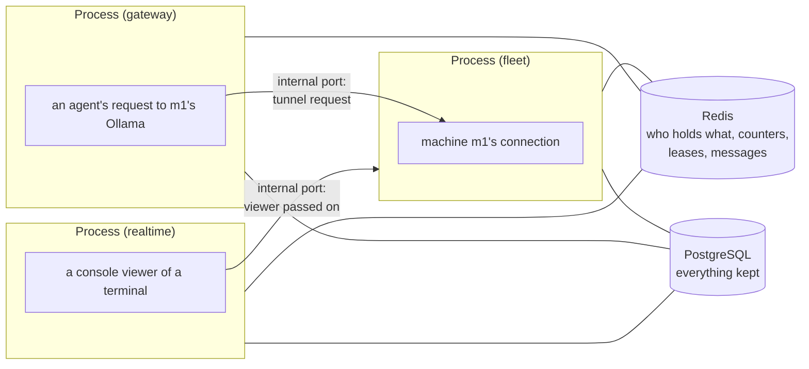

# Running several server processes (Kubernetes)

One `agent-server` process is enough for a team: it keeps its sessions, machines' connections and shared terminals in memory and runs everything. To evaluate separating workloads, run several processes behind a load balancer, each with some or all of the server's **roles**, sharing one PostgreSQL database and one Redis (or Valkey). This page covers how that works, how to set it up, and the Helm chart that does it in Kubernetes.

Nothing changes on agent computers or machines: `agent`, `agent-proxy` and `agent-machine` talk to one address as before, whichever process answers.

## Single-node and scaled mode

| | Single-node (the default) | Scaled |
| --- | --- | --- |
| Processes | One | Any number, each with some roles |
| Shared state | In the process | Redis (`AI_PROXY_REDIS_URL`) and PostgreSQL |
| Database | SQLite or PostgreSQL | PostgreSQL |
| Recordings | In the database, or blob storage | Blob storage recommended (S3 or compatible) |
| Restarts | Server settings › Restart, in the same process | A Kubernetes rollout; settings apply in every process as they change |
| For | Development, the quickstart, small teams | Separate workloads; capacity and availability need validation |

Single-node mode refuses to be run twice: without `AI_PROXY_REDIS_URL`, a server on PostgreSQL holds a database lock while it runs, and a second one exits with a message saying so. Splitting roles (`AI_PROXY_ROLES`) or running several workers (`AI_PROXY_WORKERS`) without `AI_PROXY_REDIS_URL` is refused too.

## Roles

`AI_PROXY_ROLES` says what one process serves: `all` (the default), or a comma-separated list.

| Role | Serves | Scales on |
| --- | --- | --- |
| `api` | The console's API: settings, accounts, machines' pages, sessions, requests, providers, downloads; the console itself unless it's hosted apart | CPU, latency |
| `gateway` | Agents' model calls: `/v1/*`, `/anthropic/*`, `/session/<id>/*` (and shared MCP servers unless `mcp` runs apart) | Open streams (`agent_server_open_streams`) |
| `mcp` | Agents' MCP traffic only (`/session/<id>/mcp/*`), for a Deployment of its own | Open streams |
| `intercept` | Account agents' HTTPS (`WS /api/proxy/tunnel`), decrypted and recorded | CPU |
| `fleet` | Machines' connections (`WS /api/machines/connect`) and the tunnels they dial back (`WS /api/machines/tunnel/*`) | Connections (`agent_server_fleet_sockets`) |
| `realtime` | Shared terminals (`/api/terminals/*`) and the live view (`/api/live`) | Viewers |
| `worker` | Jobs one process runs at a time: retention (which also prunes old usage counts), the audit log's checkpoints and exports; making the first user | (two, for failover) |

Every role answers `/health`, `/ready` and its internal port. A route a process doesn't serve answers 404, so the load balancer must send each path to a process that serves it (see [Routing](#routing)).

A middle size is two Deployments, such as `api,realtime,worker` and `gateway,intercept,fleet`.

## What the processes share



- **Sessions** are written to the database when they start, so a request reaching any process finds its session. Each process keeps the sessions it uses in memory and is told when another one changes one (its sharing, say), and updates its copy at once: a terminal viewer or a streaming reply on another process sees sharing narrow straight away. Request ids come from a shared counter, so they never repeat.
- **Machines**: a machine's connection is held by the process it reached. That process tells the others the machine's state whenever it changes; its Strata and MCP keys travel sealed with `AI_PROXY_INTERNAL_TOKEN`, so Redis only ever sees ciphertext. A request to the machine from another process (its models, a launch, a terminal, a tunnel) is made by the holding process, through its **internal port**.
- **Tunnels**: a machine dials back to whichever process the load balancer picks. If that isn't the one that asked, it passes the tunnel on to that process over the internal port. The machine's own WebSocket, with its renewed tokens, stays with the process it reached.
- **Shared terminals**: a terminal lives with the process its launcher reached. A console viewer reaching another process is passed on to it whole, with the viewer's own credentials, so every check runs there as usual.
- **The live view**: each process sends its requests' live text to the others, but only while some console is watching (each process's heartbeat says how many are), batched every 100 ms. With nobody watching, a token costs nothing extra.
- **Usage limits** count in shared hourly counters, so a limit holds however many processes a person's agents reach.
- **Launch grants** for subscriptions are shared keys, and handing a Copilot token over is claimed once, whichever process is asked.
- **Settings**: a change on one process is announced; every process reads the stored settings again. The listen address still needs a restart (a rollout).
- **Jobs** (retention, audit checkpoints and exports) take a lease in Redis first, so one process runs each at a time.
- **Links to other servers** ([Peering](peering.md)): one `fleet` process dials each link's socket, under a lease; any process sends signed requests to a linked server it can reach directly, and nonces are shared keys, so a replay is refused whichever process it reaches. Policy changes are announced to every process. A linked server that can't be reached directly is reached only from the process holding its socket: requests from other processes to it answer `503` for now.

With several processes, the console lists sessions active in the last 30 days (`AI_PROXY_SESSION_LIST_DAYS`); older ones are still found by id. The status page's in-flight requests are the answering process's; the live view shows every process's.

## Settings for several processes

| Variable | Meaning |
| --- | --- |
| `AI_PROXY_ROLES` | `all`, or some of `api`, `gateway`, `mcp`, `intercept`, `fleet`, `realtime`, `worker`. |
| `AI_PROXY_REDIS_URL` | `redis://` or `rediss://` (Redis 6 or later, or Valkey). Required for anything but one process. |
| `AI_PROXY_INTERNAL_TOKEN` | A secret of 16 or more characters, the same in every process of the server (agent-auth doesn't need it). Internal calls carry it, and machines' keys are sealed with it. |
| `AI_PROXY_INTERNAL_PORT` | The port other processes reach this one on (the Helm chart uses 9100). It also serves `/metrics` for Prometheus, without the token; every other internal path needs it. Never expose it outside the cluster. |
| `AI_PROXY_INTERNAL_HOST` | What the internal port binds to (default `0.0.0.0`). |
| `AI_PROXY_POD_ID` | This process's name in the cluster (default: the host's name). |
| `AI_PROXY_POD_IP` | The address other processes reach it on (default `127.0.0.1`). |
| `AI_PROXY_WORKERS` | uvicorn worker processes in one pod (default 1). More than one needs Redis; each worker takes an internal port of its own and says which, so `/metrics` isn't on a fixed port then. Prefer more pods. |
| `AI_PROXY_MIGRATE=0` | Don't migrate the database on start; wait (up to 10 minutes) for `agent-server db migrate` to have done it. Kubernetes runs that as a Job before the server's pods start. |
| `AI_PROXY_GRACEFUL_SECONDS` | How long open connections get to finish on shutdown (default 5). Set it a little under the pod's termination grace period. |
| `AI_PROXY_SESSION_LIST_DAYS` | With several processes, how many days back the session lists go (default 30). |
| `AI_PROXY_DB_POOL_SIZE`, `AI_PROXY_DB_MAX_OVERFLOW` | Database connections each process keeps (default 5 and 10). Put PgBouncer (transaction pooling) in front when there are many processes. |
| `AI_PROXY_BLOB_URL` | Where traces and terminal output go: `database` (default), `file:///<folder>`, or `s3://<bucket>/<prefix>`. See [Blob storage](#blob-storage). |
| `AI_PROXY_LOG_STDOUT=1`, `AI_PROXY_LOG_FORMAT=json` | The server's log on standard output, one JSON object a line, for log collectors. |
| `AI_PROXY_RETENTION_SEED` | A retention policy (JSON) `agent-server db migrate` stores on a new install. See [Retention](retention.md). |

On agent-auth, set `AI_PROXY_REDIS_URL` too (its sign-in rate limits are then shared, and it publishes revocations), and `AI_PROXY_AUTH_JWT_ACCESS_TOKENS=1` to issue signed access tokens the server checks itself, instead of asking agent-auth about every request. See [OIDC](oidc.md#signed-access-tokens).

## Health, readiness and metrics

- `GET /health` says the process runs.
- `GET /ready` says whether to send it traffic: its database, Redis and blob storage answer, and it isn't shutting down. `503` otherwise, with each check's detail.
- `GET /metrics` on the internal port: Prometheus metrics per process (`pod` label). A server without an internal port serves the same text at `GET /api/server/metrics` on its public port, to a site admin: give Prometheus a site admin's [API credential](api-credentials.md) (OAuth client credentials) to scrape it.
- `GET /api/machines/{id}/metrics?format=prometheus`: one machine's load, asked from its agent-machine when scraped, as `agent_machine_*` metrics labelled `machine` and `machine_name`: CPU, load average, memory, swap, uptime, GPUs, network bytes, packets and errors, disks, agent-machine's own memory, and its connection, requests and tunnels. Machines only dial out, so the server is where they're scraped; the credential needs to see the machine. A machine that isn't connected answers `409`.

| Metric | What |
| --- | --- |
| `agent_server_open_streams` | Agents' requests in flight here (what gateways scale on) |
| `agent_server_requests_in_flight` | Every request in flight here, tunnels included |
| `agent_server_fleet_sockets`, `agent_server_fleet_machines` | Machines' connections held here, machines known |
| `agent_server_tunnels_open` | Tunnels to machines' model servers open here |
| `agent_server_terminals_hosted`, `agent_server_terminal_viewers` | Shared terminals hosted here, and their viewers |
| `agent_server_live_subscribers` | Live views watching here |
| `agent_server_sessions_cached`, `agent_server_db_write_queue` | Sessions in memory, writes waiting for the database |
| `agent_server_cluster_processes` | Processes of this server alive |
| `agent_server_audit_backlog` | Audit events not yet sent to every export |
| `agent_server_requests_total` | Requests and WebSockets answered here, by `outcome` (`ok`, `failed`, `dropped`) |
| `agent_server_websockets_open` | WebSockets open here, by `kind` (`machines`, `model_tunnels`, `agent_tunnels`, `links`, `terminal_hosts`, `terminal_viewers`, `other`) |
| `agent_server_sessions_open`, `agent_server_sessions_streaming` | Sessions that haven't ended, and those with a request in flight here |
| `agent_server_fleet_connected`, `agent_server_links_connected`, `agent_server_intercept_tunnels` | Machines connected, linked servers connected, account agents' HTTPS tunnels open here |
| `agent_server_process_resident_memory_bytes` | The server process's memory |
| `agent_server_host_memory_used_bytes`, `agent_server_host_memory_total_bytes` | Memory on the server's computer |
| `agent_server_host_network_receive_bytes_total`, `agent_server_host_network_transmit_bytes_total` | Bytes through the computer's network interfaces, loopback left out |
| `agent_server_info` | `version` and `roles` labels |

## Routing

Send each path to a process with its role. The Helm chart writes this table into its routes.

| Path | Role |
| --- | --- |
| `/v1/*`, `/anthropic/*`, `/session/*`, agents' bare Ollama calls (`/api/chat`, `/api/generate`, `/api/embed`, `/api/embeddings`, `/api/tags`, `/api/show`, `/api/ps`, `/api/version`), and a linked server's relayed calls (`/api/links/relay/provider/*`, `/api/links/relay/mcp/*`) | gateway (`/session/*/mcp/*` to mcp, when it runs apart) |
| `/api/proxy/tunnel` | intercept |
| `/api/machines/connect`, `/api/machines/tunnel/*`, `/api/links/connect` (a linked server's socket) | fleet |
| `/api/terminals/*`, `/api/live`, `/api/live/*`, `/api/remote*` | realtime |
| Everything else (`/api/*`, `/health`, `/ready`, `/docs`, `/openapi.json`, `/downloads/*`, `/install.*`, `/help-files/*`, the console) | api |

WebSockets and streamed replies need long timeouts on every hop: agents' replies can run for minutes, and machines' and terminals' connections for days. Turn response buffering off for the gateway's paths.

## Blob storage

Traces and terminal output are most of what the server stores: agents resend the whole conversation with every call. With `AI_PROXY_BLOB_URL` they go to blob storage instead of the database, which keeps only where each one is.

- `s3://<bucket>/<prefix>`: AWS S3 or anything that speaks its API (Ceph RGW, SeaweedFS, MinIO, ...). For a store that isn't AWS, set `AI_PROXY_BLOB_ENDPOINT` (such as `https://s3.internal:9000`); addresses are then path-style. `AI_PROXY_BLOB_REGION` (default `us-east-1`). Credentials: `AWS_ACCESS_KEY_ID` and `AWS_SECRET_ACCESS_KEY` (and `AWS_SESSION_TOKEN`), or a web identity, `AWS_ROLE_ARN` with `AWS_WEB_IDENTITY_TOKEN_FILE` (IRSA in EKS, workload identity elsewhere; `AWS_STS_ENDPOINT` to use another STS).
- `file:///<folder>`: a folder, on one computer or a volume every process mounts.
- `AI_PROXY_BLOB_THREADS`: uploads at once per process (default 8).

Keys are laid out as `tenant/<organization>/<year>/<month>/<session>/`: `traces/<request>.json.gz`, `blocks/<sha256>` and `terminal/<offset>-<length>`. Each message of a conversation is stored once per session, under its hash, and each trace keeps a reference to it, so a long session's traces take a fraction of the space. Retention deletes a session's prefix. Bucket lifecycle rules do not consult application legal holds; coordinate them with holds, backups and exports before enabling automatic expiry. Audit checkpoints go to `audit/checkpoints/`; with S3 Object Lock as the bucket's default, they can't be changed or deleted.

Recordings made before blob storage was turned on stay in the database and are read from there.

## The Helm chart

`deploy/helm/agent-mesh/` installs the server, agent-auth and optionally the console, PostgreSQL (CloudNativePG), PgBouncer and Valkey. Its [README](../deploy/helm/agent-mesh/README.md) has every value. To try the chart on a local cluster first, follow [Quickstart on Kubernetes](quickstart-kubernetes.md); this page is the reference for production. In short:

```bash
# One pod, every role (SQLite on a volume, or an external PostgreSQL)
helm install mesh deploy/helm/agent-mesh -f deploy/helm/agent-mesh/values-single.yaml

# A Deployment per role on PostgreSQL and Redis you already run
helm install mesh deploy/helm/agent-mesh -n mesh --create-namespace -f deploy/helm/agent-mesh/values-scaled.yaml

# The same on managed services: RDS (behind RDS Proxy), ElastiCache and S3 through IRSA
helm install mesh deploy/helm/agent-mesh -n mesh --create-namespace -f deploy/helm/agent-mesh/values-cloud.yaml

# The same on premises: CloudNativePG with a PgBouncer pooler, the bundled Valkey and an S3-compatible store
helm install mesh deploy/helm/agent-mesh -n mesh --create-namespace -f deploy/helm/agent-mesh/values-onprem.yaml
```

- `mode: single` is one replica (`Recreate`, so two never overlap) running every role; `mode: scaled` is a Deployment per role (or per group of roles) with autoscaling, disruption budgets and zone spreading.
- Migrations run as a Job (`agent-server db migrate`) before an install or upgrade; the server's pods start with `AI_PROXY_MIGRATE=0` and wait for it.
- Gateway API routes (or an Ingress) carry the routing table above.
- A NetworkPolicy opens the internal port only to the release's own server pods (and Prometheus, for `/metrics`).
- Secrets (database URLs, `AI_PROXY_VAULT_KEYS`, the introspection secret, the internal token) come from Kubernetes Secrets, or External Secrets.
- In scaled mode the worker makes the first user and prints its password in its log once (or set `AI_PROXY_USERNAME`/`AI_PROXY_PASSWORD` from a Secret).

**Upgrades and shutdowns.** The following describes intended reconnect and drain behavior, not measured failover or zero downtime. Test outages and long-lived streams in your deployment. A rolling upgrade replaces pods one by one. A pod that stops closes its machines' connections and terminals with codes they reconnect after; machines reconnect to another pod within seconds, and requests waiting for them wait (up to 10 s) rather than fail. Streamed replies on a stopping pod get `AI_PROXY_GRACEFUL_SECONDS` to finish. During the rollout, old and new processes run together: the database is migrated first, and a database newer than a process is fine for it.

## Sizing

The following is an illustrative configuration, not a measured capacity result or support target. Validate stream counts, resource use and recovery under representative workloads before adopting these values:

| Role | Replicas | Each |
| --- | --- | --- |
| gateway | 3 to 20 | ~500 open streams |
| intercept | 3 to 30 | 2 CPUs |
| fleet | 3 to 8 | ~1,000 machines' connections |
| realtime | 2 to 6 | |
| api | 2 to 6 | |
| worker | 2 | one runs each job at a time |
| agent-auth | 2 to 4 | |
| PostgreSQL | a primary and one or two replicas, PgBouncer in front | |
| Redis or Valkey | 3 with Sentinel, or a managed service | |
