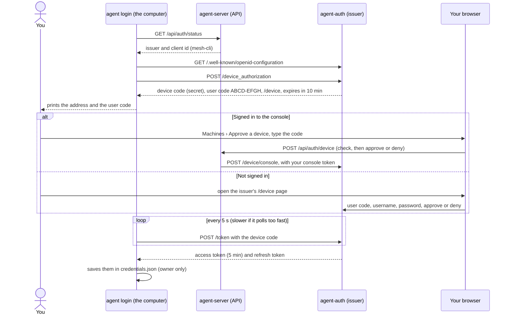
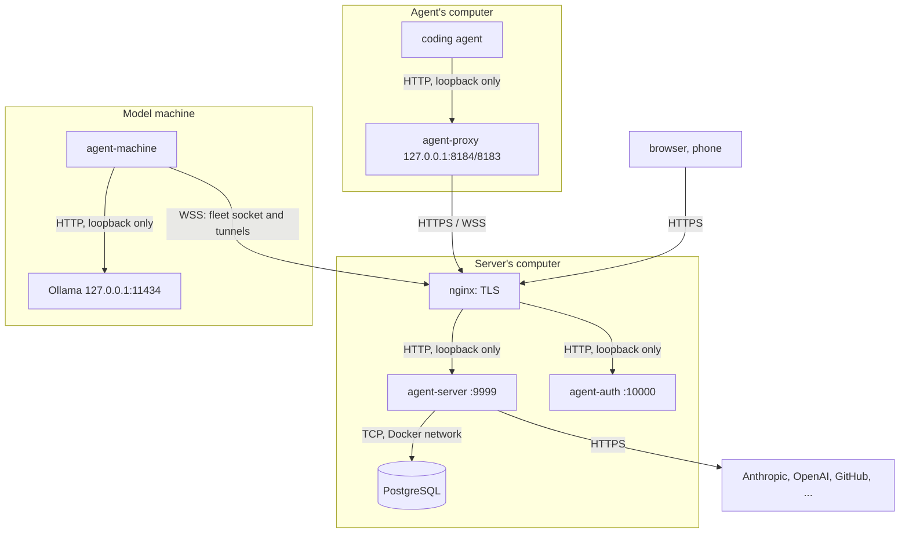

# Security: device approval, tokens and transport

How each device pairs with the server, how computers sign in without passwords, what keeps a device code from being misused, where tokens are kept, and which connections are encrypted. For the issuer's endpoints and settings see [OIDC authentication](oidc.md); for accounts, roles and sharing see [Accounts](accounts.md).

## Contents

- [Pairing: how each device joins](#pairing-how-each-device-joins)
- [Device approval](#device-approval)
- [What protects a device code](#what-protects-a-device-code)
- [Approving safely](#approving-safely)
- [Tokens after approval](#tokens-after-approval)
- [Encryption in transit](#encryption-in-transit)
- [Where plain HTTP is used, and why](#where-plain-http-is-used-and-why)
- [What to watch for](#what-to-watch-for)
- [A checklist for a public server](#a-checklist-for-a-public-server)

## Pairing: how each device joins

There is no separate pairing step any more. Every device pairs with the server by signing in through the issuer (agent-auth), as a person, and the server then decides what that person may do. What differs is how each kind of device signs in:

| Device | How it pairs | What it gets | What it's tied to |
|---|---|---|---|
| A computer that runs agents | `agent login https://<server>`: the [device approval](#device-approval) below | Access and refresh tokens in `agent`'s `credentials.json` | You. Its sessions are yours. |
| A fleet machine | `agent-machine login https://<server>`: the same device approval, with its own tokens | Tokens in agent-machine's own `credentials.json`, and a machine id | You: the machine is yours, as [below](#a-machine-becomes-yours) |
| A browser or a phone's browser | Open the console and sign in on the issuer's page (authorization code with PKCE) | `HttpOnly` cookies on the API's own host | You, in that browser |
| The Android app | Add the server's address, then sign in as in a browser | The same cookies, in the app's own WebView | You, on that phone |
| A script or service | An admin provisions a service client (`agent-auth client add <id> --user <name>`) | A client id and secret for the client-credentials grant | A member account, never an admin |

A computer that runs agents *and* is in the fleet pairs twice, once for each program, and you approve two codes. They're kept apart on purpose: logging `agent` out doesn't take the machine out of the fleet, and the other way round.

### A machine becomes yours

- On its first run, agent-machine makes a random machine id (8 random bytes, as hex, in `machine.json` in its folder) and sends it with every connection, signed with its token.
- The first account to connect with that id owns the machine. If another account later connects with the same id, the server refuses it (close code 4403) rather than hand the machine over, so knowing (or copying) a machine's id doesn't let anyone else take it.
- The owner, or an admin, can remove a machine (**Remove** on its page). It's disconnected at once and refused when it tries again, until the owner or an admin allows it back.
- What others may do on it (start agents, open terminals, use its models or MCP servers) is up to its owner: see [Machine access](accounts.md#machine-access).

### Browsers and phones

- The console sends you to the issuer to sign in (`GET /api/auth/login`). It uses the authorization-code flow with PKCE (S256), a random `state` and `nonce`, and a signed state cookie that lasts ten minutes. Only the exact callback addresses the issuer has registered are accepted.
- Back from the issuer, the API keeps your access token and refresh token in `HttpOnly`, host-only cookies (`SameSite=Lax`, and `Secure` with HTTPS). Scripts in the page can't read them, and no other site's page can use them: unsafe requests and every WebSocket must come from the console's own origin (or one listed in `AI_PROXY_CONSOLE_ORIGINS`).
- Signed in to the console already? Approve another computer's code there (**Machines › Approve a device**) instead of typing your password on the issuer's page.

### The Android app

- You add a server by its address. The app checks it's an agent-server (`/health`) before saving it.
- It learns the issuer only from that server, without following redirects, and allows only that HTTPS issuer and the server's sign-in paths inside its WebView. Anything else opens in your browser, so a link can't steer the sign-in page elsewhere.
- The sign-in belongs to that phone's WebView; signing out there, or changing your password, ends it.
- The app allows plain HTTP for servers on a LAN or Tailscale, and says when a connection isn't encrypted. Use HTTPS for anything reachable from the internet.

### What pairing used to be, and why it went

Versions before protocol 2 paired phones and launchers with a server-wide **access key**: a short pairing code or a `/pair?key=...` link, and launcher tokens (`aip_...`). The key belonged to no one, so anyone holding it had the same access, and it couldn't be revoked for one device without changing it for all. The server's own computer was also trusted without a sign-in.

All of that is gone. Old keys, codes, `/pair` links and `aip_` tokens grant nothing, loopback is trusted no more than anywhere else, and the old routes answer `403` or `410` so old consoles and scripts say why ([API](api.md#terminals-and-pairing)). Old `/pair` links in the console just take you to **Running agents** after you sign in. Every device now has its own sign-in, tied to a person, which you can revoke on its own.

## Device approval

`agent login`, `agent-machine login` and the one-line installers sign a computer in with the OAuth device grant (RFC 8628). The computer never sees your password: you approve it from a browser where you're already signed in, or sign in there.

Step by step:

1. **The computer finds the issuer.** It asks the server's `/api/auth/status` for the issuer's address and client id, then reads the issuer's discovery document. The issuer it gets back must be the same one, and every endpoint in it must be on the issuer's own origin. Both must be HTTPS (plain HTTP is accepted only on loopback, for development).
2. **It asks for a code.** The issuer makes two codes: a long random **device code**, which only the computer knows and uses to collect its tokens, and a short **user code** for you, eight letters from 20 consonants (`ABCD-EFGH`). Both expire after 10 minutes. The issuer stores only their SHA-256 hashes.
3. **You approve or deny it.** Either way works, and both record the same decision:
   - **From the console** (**Machines › Approve a device**): type the code. The console first shows what's asking (the CLI client) and when it asked, then you approve or deny. No password: the API passes your console access token to the issuer, which accepts only a console sign-in's token for this, never a CLI or service token.
   - **On the issuer's `/device` page**: type the code, your username and password, and choose approve or deny. The form is bound to a one-time transaction cookie and checks its `Origin`.
4. **The computer collects its tokens.** It polls the token endpoint every 5 seconds. Polling faster adds 5 seconds to its interval (`slow_down`). Once you've approved, it receives an access token and a refresh token; once you've denied, it gets `access_denied`, and that code can never be approved.

`agent-machine login` is the same flow with its own client and its own credentials file, so a computer that runs agents and is in the fleet signs in twice and you approve two codes.

## What protects a device code

| Protection | What it stops |
|---|---|
| Codes are typed, never links | The issuer offers no `verification_uri_complete`, and the console's approval page never takes a code from its address. Someone can't send you a link that approves their computer in one click. |
| The console shows what's asking before you decide | An approval you didn't start stands out: if you didn't just run a login command, deny it. |
| Ten minutes, then gone | A code is good for 10 minutes and for one decision. An approved or denied code can't be decided again. |
| Hashes at rest | The issuer keeps only hashes of device codes, user codes and tokens, so a copy of its database doesn't hold usable ones. |
| Rate limits | Typing codes on `/device`: 10 tries per address per 10 minutes, and 10 password checks. Console approvals: 20 per person per 10 minutes. New codes: 10 per address per 10 minutes. 20⁸ (about 2.6 × 10¹⁰) user codes make guessing a live one hopeless at that rate. |
| Bound to the account | An approval records the account and its version (its password hash and when it was made). Changing the password, deleting the account or making a new one with the same name voids it, and every token it led to. |
| No password on the computer | The CLI never asks for one, and the API never sees one. Only the issuer checks passwords. |
| One issuer, checked | The computer refuses an issuer that isn't the one the server named, endpoints outside its origin, plain-HTTP issuers (except loopback) and redirects. |

## Approving safely

- **Approve only a code you just started yourself**, on a computer you're at or control. The classic attack on device sign-in is someone starting a login on their own computer and asking you to "enter this code". Approving it signs their computer in as you.
- **Check the code matches** what your terminal printed, letter for letter.
- **Deny anything you don't recognise.** Denial is final, and the other computer gets nothing.
- **Approve from the console when you can.** It shows what's asking before anything is decided, and you don't type your password into a page you reached from a link.
- **Sign out computers you no longer use**: `agent logout` and `agent-machine logout` revoke their tokens. Changing your password signs every computer and browser out.

## Tokens after approval

| Credential | Lifetime | Where it's kept |
|---|---|---|
| Access token | 5 minutes | `agent`: `credentials.json` (`%APPDATA%\agent-proxy\` on Windows, `~/.config/agent-proxy/` elsewhere). `agent-machine`: `credentials.json` in its own folder. Both are written readable by their owner only. The browser keeps the console's in an `HttpOnly` cookie. |
| Refresh token | Rotates on each use; its family ends after 30 days | Beside the access token. Using an old refresh token again revokes the whole family, so a stolen one stops working as soon as either copy is used. |
| On the issuer | | Only hashes, in its own schema (`mesh_auth`), which the server's database role can't read ([Deployment](deployment.md#postgresql)). |

Tokens are opaque: the API asks the issuer about each one (introspection), so a revoked token, a deleted account or a changed role takes effect on the next request. WebSockets check again every 15 seconds. Programs send the access token as `X-AI-Proxy-Token`, and the browser as a cookie that's `Secure` when the issuer is HTTPS. The token never goes to model servers, MCP servers or vendors: the server strips it from everything it forwards.

`AI_PROXY_TOKEN` and `AI_PROXY_MACHINE_TOKEN` take a token you made another way (a service client, see [OIDC](oidc.md#automation)). Treat them like passwords.

## Encryption in transit

Every connection that leaves a computer is meant to be HTTPS (or WSS) end to end:

What enforces it:

- **The programs won't send a token over plain HTTP.** `agent`, `agent-proxy` and `agent-machine` (Go and Python) refuse to sign in to, or send a token to, a server or issuer whose address is `http://` unless it's loopback. `agent login api.example.com` without a scheme means `https://`.
- **The issuer must be HTTPS.** The server and agent-auth refuse to start with a plain-HTTP issuer, browser return origin or sign-in callback outside loopback.
- **Cookies are `Secure`** when the issuer is HTTPS, so a browser never sends them over plain HTTP.
- **Account agents' HTTPS stays HTTPS.** Their TLS goes to the server through the `agent-proxy`'s WebSocket (inside the WSS connection), and the server opens a new, normally verified TLS connection to the vendor.
- **Model traffic to machines rides the fleet socket.** When a machine can tunnel (any current `agent-machine`) and isn't the server's own computer, the server reaches its model servers through the machine's own WSS connection, and the machine connects to them on its loopback.
- **nginx from `setup-https.ps1`** redirects HTTP to HTTPS and sends `Strict-Transport-Security`, so browsers use HTTPS from then on.

## Where plain HTTP is used, and why

You'll see `http://` in a few places. Each of these stays on one computer (or inside Docker's network on one host), so nothing crosses a network in the clear:

| Where | Address | Why it's plain HTTP |
|---|---|---|
| Agents to their `agent-proxy` | `http://127.0.0.1:8184/session/...` | Loopback. Agents have no way to authenticate to a proxy, so the `agent-proxy` binds `127.0.0.1` only and checks every request's `Host` and `Origin`, which shuts out web pages and DNS rebinding. |
| Account agents' `HTTPS_PROXY` | `http://<session>:agent-proxy@127.0.0.1:8183` | `http` is the proxy protocol, not the traffic: the agent sends `CONNECT` and does TLS inside it, end to end with the server. |
| nginx to agent-server, agent-auth, the console, the site | `127.0.0.1:9999`, `:10000`, `:8081`, `:8080` | The hop after TLS ends, on the same computer. `compose.yaml` publishes these on loopback (set `AI_PROXY_PUBLISH_HOST=127.0.0.1` for `9999`, see below). |
| agent-machine to its model servers | `http://127.0.0.1:11434` and so on | Loopback, on the machine. |
| The server to its tunnel listeners | `http://127.0.0.1:<port>` | Loopback on the server; the bytes then go to the machine over its WSS socket. |
| agent-server and agent-auth to PostgreSQL in Compose | `postgres:5432` | Docker's private network on the same host, never published. |
| Development, the quickstart and tests | `http://localhost:19999`, `:20000`, `:5173` | Loopback only, with demo passwords. Not for real use. |

## What to watch for

These can send something in the clear if you set things up that way. Each has a fix:

| Risk | When it happens | What to do |
|---|---|---|
| **agent-server's own port reachable from the network** | `compose.yaml` publishes `9999` on every interface unless you set `AI_PROXY_PUBLISH_HOST`. The programs won't send tokens to it over HTTP, and browsers won't send `Secure` cookies, so sign-in fails there. But it still answers, and serves the public pages. | Behind nginx, set `AI_PROXY_PUBLISH_HOST=127.0.0.1` (and `AI_PROXY_FORWARDED_ALLOW_IPS=*`), so only nginx reaches it. Firewall the port otherwise. |
| **Downloads over plain HTTP** | `curl http://<server>/install.sh \| sh`, or `agent update --server http://...` / `agent-machine update --server http://...`, to a server that isn't loopback. The SHA-256 checks come from the same server, so someone on the path could change both the program and its checksum. | Always install and update from the server's `https://` address. |
| **Model traffic straight to a model server** | Backends from before machines (no `machine`), a machine whose `agent-machine` is too old to tunnel (the console says so), or a backend pointed at another computer's address. The server then sends prompts and replies to `http://<that computer>:11434` across the network, and Ollama itself has no sign-in. | Run a current `agent-machine` beside each model server and add it from its machine's page (**Add as a provider**), so traffic rides the machine's WSS socket. Keep Ollama on `127.0.0.1`. |
| **A database across a network** | `AI_PROXY_DATABASE_URL` pointing at a PostgreSQL on another computer. Without TLS, the database password and everything stored (recordings, secrets) cross the network in the clear. | Add `?sslmode=verify-full` (with the server's CA via `sslrootcert=`), or keep the database on the same host or a private network. |
| **Serving HTTPS yourself without a proxy** | `AI_PROXY_TLS_CERT`/`KEY` on the server itself. | Fine, but you also have to look after renewal and HSTS that nginx would add. |

Plain HTTP between computers isn't blocked outright everywhere: a LAN-only install without certificates still works for browsing the public pages and downloads. It's never used for anything signed in.

## A checklist for a public server

1. Put nginx (or another reverse proxy) with a real certificate in front of agent-server and agent-auth: `scripts/https/setup-https.ps1` on Windows, or see [Deployment](deployment.md#https).
2. Publish agent-server's port on loopback only: `AI_PROXY_PUBLISH_HOST=127.0.0.1`, `AI_PROXY_FORWARDED_ALLOW_IPS=*`.
3. Use `https://` addresses everywhere you type one: `agent login`, `agent-machine login`, the one-line installers, `--server`, `AI_PROXY_URL`, `AI_PROXY_OIDC_ISSUER`.
4. Set strong, different passwords for PostgreSQL's three roles and for `AI_PROXY_OIDC_INTROSPECTION_SECRET`, in `.env` or a secret manager, never in a file you commit.
5. Keep model servers on loopback and add them from their machines, so their traffic goes through the fleet's tunnels.
6. Change the first admin's password, then delete `certs/first-user-password`.
7. Back up the database privately: it holds the capture CA's key, the issuer's signing key and every recording ([Backups](deployment.md#backups)).
