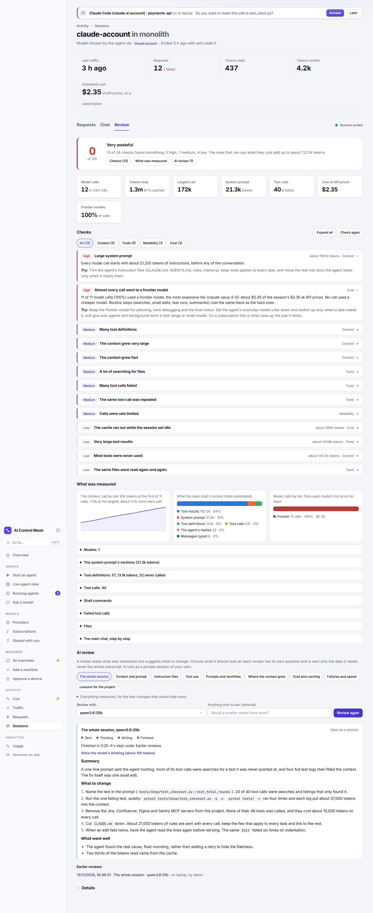

# Reviewing a session

A session's **Review** tab looks at what one agent session spent its tokens, time and money on, and says what to change next time. It has three parts:

- **Checks**: a fixed list of checks the server runs on the session, with a score. No model is involved, so they are instant, free and the same every time.
- **What was measured**: the numbers behind the checks, to read for yourself.
- **AI review**: one request to a model you pick, which reads part of what was measured and writes suggestions in plain words. There is a set of prompts to choose from, and a site admin can change it.



Open a session from **Sessions** and choose **Review**. The checks run when the tab opens; **Check again** runs them once more on a session that is still going.

The top of the tab says it in short: the score, how many of the checks found something at each level, and about how many tokens the findings add up to. The buttons under it jump to **Checks**, **What was measured** and **AI review**.

## What the checks need

The checks on a session's numbers (tokens, failures, caching, timings) always run: the server records those for every request. The checks on the system prompt, the conversation and the tools read the session's payloads, so they need payload capture: start the agent with `--trace`, or turn on **Capture full request and response payloads** on the session. A session without payloads says so in a note, and is checked on its numbers only.

Token counts of payloads (the system prompt, tool definitions, tool results) are estimates, at four characters a token. Token counts of calls are what the provider reported.

## The checks

Each finding has a level (**High**, **Medium**, **Low**, or a **Note**), what was seen, and what to try. Where the server can work it out, a finding also says about how many tokens it cost over the session: a system prompt's tokens beyond 8,000 on every call, unused tool definitions on every call, the size of the large results, the tokens written to the cache again after idle gaps.

Findings are listed worst first, and within a level the one that cost most first. High findings start open; choose any other to open it, or **Expand all**. With findings in more than one area, the buttons above the list show one area at a time: **Context**, **Tools**, **How it went**, **Reliability** or **Cost**.

**The score** starts at 100 and loses 18 for each high finding, 9 for each medium and 3 for each low: **Efficient** from 85, **Some waste** from 65, **Wasteful** from 40, **Very wasteful** below. It compares sessions roughly; the findings say what to do.

| Check | It says something when | What to try |
| --- | --- | --- |
| **Large system prompt** | The instructions sent with every call are about 8,000 tokens or more (high from 20,000) | Trim the agent's instruction files to what applies to every task; move the rest into docs it reads when needed |
| **Many tool definitions** | The tools described to the model take about 10,000 tokens or more (high from 25,000) | Switch off MCP servers and tools this work doesn't use |
| **Most tools were never used** | 30 or more tools were defined and fewer than a quarter were called; MCP servers with no call are named | Give the agent only the tools the task needs |
| **The context grew very large** | The largest call read 70% of the model's context (high from 90%), or 100,000 tokens where the context size isn't known (high from 180,000) | A new session for each task; clear or compact between tasks; sub-agents for large side jobs |
| **The context grew fast** | Over 8 or more calls of the main chat, the context gained 5,000 tokens a call or more on the way to its largest (high from 12,000) | Keep the largest results out: read ranges, quieter commands, a sub-agent that reports a summary |
| **Many images in the conversation** | 5 or more images (medium from 20) | Paste text, not screenshots of text; start again after a round of visual checks |
| **The conversation was compacted** | The agent replaced the conversation with a summary (high from 3 times) | Smaller sessions; have the agent keep its plan and progress in a file |
| **A very long session** | 150 or more model calls (high from 400) | One task a session |
| **A lot of searching for files** | 20 or more searches and listings, and they are over 35% of all tool calls (high from 60) | Name the files in the prompt; keep a short map of the project in its instruction file |
| **The same files were read again and again** | A file was read 3 times or more (medium from 6) | Ask for the change in one go; split very large files |
| **Very large tool results** | A tool result of about 10,000 tokens or more (medium from 5 of them) | Read ranges of a file; filter command output; keep logs short |
| **Many tool calls failed** | 5 or more failed and they are over 15% of tool calls (high from 30%) | See what failed: a wrong path or command, a missing tool, edits that don't apply |
| **The same tool call was repeated** | The same call with the same input 3 times or more (medium from 6) | Stop a looping agent and say what it's missing |
| **Many sub-agents** | 6 or more sub-agents (medium from 15) | Keep sub-agents for wide, independent searches |
| **A short first prompt for a long task** | The first message was under 80 characters and the session ran 30 model calls or more | Say what done looks like, which files matter and how to check the result |
| **A lot of steering** | 20 or more messages were typed | Ask for a plan first; put repeated corrections in the instruction file |
| **Model calls failed** | 3 or more failed and they are over 5% of model calls | Open the failed requests on the **Requests** tab |
| **Calls were rate limited** | Any model call was refused with `429` | Fewer agents at once, a smaller model, or another provider |
| **Replies were cut off** | 2 or more replies stopped before the model finished | A plan agreed first saves interrupted calls |
| **Most calls went to a frontier model** | Over 10 or more model calls, 60% or more went to frontier models (high from 90%: **Almost every call went to a frontier model**) | Keep the frontier model for planning and hard problems; a tier down for everyday work, sub-agents and background calls |
| **Little of the prompt came from the cache** | Under half the tokens read were cached, over 10 calls and 200,000 tokens, on a provider that reports caching | Don't switch models or tool sets mid-session; finish a task in one sitting |
| **The cache ran out while the session sat idle** | Twice or more a call came over 5 minutes after the one before and wrote most of its prompt to the cache again (medium from 6) | Come back to a waiting agent within minutes, or start a new session later |
| **Slow to start answering** | Half the calls waited over 15 seconds for the first token | On a local model: fewer tools, a shorter prompt, shorter sessions |
| **Payloads weren't captured** | Some or all model calls have no payloads (a note) | Turn on payload capture |

**Model tiers.** Each model call is put in a tier by its model's list price for a million input tokens in the server's price table (**Server settings** › **Model prices**): **frontier** from $4, **small** under $1.50, **mid-range** between. With the shipped prices, Claude Fable, Mythos and Opus and GPT-5.5 are frontier; Claude Sonnet and GPT-5.4 are mid-range; Claude Haiku and the mini and nano models are small. A machine's own model is **local**, and a paid model the table has no price for is **no price**; neither counts as frontier. An account agent's calls are sorted the same way: on a subscription a frontier model uses up the plan's limits rather than money.

Searches and reads made through a shell count as what they do: `rg`, `grep`, `find` and `ls` are searches, `cat`, `head` and `tail` are reads. A sub-agent's copy of its parent's conversation is counted once, in the parent.

## What was measured

Under the checks are the numbers they were made from. Three pictures: **the context, call by call** (the main chat's calls, so sub-agents don't blur it), **what the main chat's context holds**, split into the system prompt, tool definitions, tool results, tool calls, the agent's replies, its thinking, the messages typed and the notes the agent adds, and **model calls by tier**. Then tables that open:

- **Models**: each model the session called, its tier, its calls, the tokens it read and wrote, and its estimated cost.

- **The system prompt's sections**: each Markdown heading or XML-style tag starts a section; the largest twelve, with their sizes. This is where to look before trimming an instruction file.
- **Tool definitions**: the largest ones, how many were never called, and each MCP server's tools and calls.
- **Tool calls**: by tool, with its kind, failures and the size of what came back.
- **Shell commands**: grouped by what they run (their first two words), with how often, failures and result sizes.
- **Failed tool calls**: grouped by tool and error, with how the error starts.
- **Files**: the ones changed, and the ones read three times or more.
- **The main chat, step by step**: each message typed, then the tool calls the agent made before the next one and the tokens their results added (the first 20 steps).
- **Sub-agents and side conversations**: what each was asked, its model, and its model and tool calls.

## The AI review

Under **AI review**, choose what the model should look at, pick a provider and model in **Review with**, optionally type something of your own to ask, and choose **Review this session**. The answer streams in: a summary, numbered suggestions with the most valuable first, and what went well. **Stop** ends it early.

While a review runs, its box shows where it stands and how long it has taken:

- **Sent**: the model has the data and is reading it. Nothing has come back yet.
- **Thinking**: a thinking model reasons before it answers, often for a minute or more. Its thinking shows as it arrives, with about how many tokens it has used, so a quiet minute isn't mistaken for a review that hung. **Hide the model's thinking** folds it away.
- **Writing**: the answer is arriving. The thinking folds away.
- **Finished**: the review is kept, and listed under **Earlier reviews**.

A review keeps running if you leave the tab: choose **Open as a session** to watch it in the chat view, or go anywhere else in the console, and come back to find it where it has got to. Closing or reloading the console stops it, because the page is what reads the reply. A review that was stopped before the model began its answer has no saved answer, and says so.

Each prompt asks its own question, is sent only the parts of the session it lists, and gets the findings of the checks in its area. The line under the buttons opens to show the data sent, the checks and the whole prompt.

| Review | It asks |
| --- | --- |
| **The whole session** | Which few changes would save the most, across everything (up to six) |
| **Context and prompt** | What could be removed, shortened or loaded only when needed, largest part first, and what each would save a call |
| **Instruction files** | An editor's audit of the system prompt by section: what belongs in every call, what should move out, and an outline for a shorter version |
| **Tool use** | What to tell the agent or set up in the project so it needs fewer and smaller calls, quoting the command or search and its replacement |
| **Prompts and workflow** | Whether the task was stated well, how much steering it took, where a plan or a new session would have helped, and a better version of a weak prompt |
| **Where the context grew** | The moments the context jumped, what caused each and what it cost afterwards, and where to clear, compact or delegate |
| **Cost and caching** | Which habits or settings would lower the cost and by how much, and whether a smaller model would have done for part of it |
| **Failures and speed** | Failed tool calls grouped by cause, what most likely caused each failure or wait, and what to check |
| **Lessons for the project** | The lines to add to the project's instruction file, written out, from what the agent had to find out for itself |

Every prompt tells the model the same rules: work only from the data, say when it can't tell, don't repeat numbers back, be specific, and don't invent facts about the project.

- **Which providers.** Any provider you can use that takes OpenAI Chat with the server's own sign-in: the model servers on your machines, and hosted APIs and gateways with a key stored on the server. A provider that needs the agent's own credentials (the Anthropic pass-through, an API provider with sign-in **agent**) isn't offered. A larger model gives better advice: small local ones tend to repeat the numbers back.
- **What the model gets.** Only what the chosen prompt lists, at most 16,000 characters: measurements and findings, the first 1,200 characters of the system prompt and its section titles, the names of tools, MCP servers and files, command lines and search patterns (160 characters each), the first 240 characters of each kind of tool error, and messages typed (the first six, 300 characters each; 200 in the step-by-step list). It never gets the transcript, file contents or whole tool results. Pick a provider you would send that to.
- **It is a session of its own.** The review goes through the server like any agent's call: a session of client `console-review`, private to you, with its payloads captured. It counts toward your usage limits, has a cost on a paid provider, and shows on **Sessions**, **Traffic** and **Requests**. **Open as a session** opens it.
- **Earlier reviews** lists the reviews you can see of this session; choose one to read it again. A review is kept as long as its own session is: deleting that session, or [retention](retention.md), removes it. Someone else's review of a session you share shows only if they share the review's session.

Anyone who can see a session can review it. The checks are the server's: the model's suggestions are advice, so check them against what you know about the project.

## Your own prompts

Site admins change the set on **Server settings** › **Review prompts**, as one YAML document; **Use the shipped prompts** goes back to the ones above. The whole set is replaced, so keep the shipped prompts you want and add yours. It is the `review_prompts` setting, so `agent-server config export` and `import` carry it.

```yaml
prompts:
  - id: risky-commands
    title: Risky commands
    about: What the agent ran that deserves a second look.
    focus: >-
      Look at the shell commands the agent ran. Say which could have changed something
      outside the project folder, and what rule in the instruction file would prevent each.
    data: [session, commands, errors, edits]
    metrics: [tool-errors, repeated-calls]
    suggestions: 3
```

- `id` (lowercase letters, numbers, dashes), `title` (the button), `about` (the line under the buttons) and `focus` (what the model is asked, up to 4,000 characters) are required. `summary` says how the answer's summary should read, and `suggestions` (1 to 10, default 4) how many to ask for.
- `data` lists what the model is sent, in that order, and `metrics` the checks whose findings go with it. Either can be `all`, or left out for all. The page lists every name under the editor.
- The rules above and the form of the answer are added around `focus` by the server. The first prompt is the one chosen when the tab opens.

| `data` name | What it sends |
| --- | --- |
| `session` | The agent, model, length, requests and the score |
| `tokens` | Tokens read and written, the cached share, the largest call, idle cache rewrites |
| `cost` | Estimated cost, and calls, tokens and cost by model and by model tier |
| `reliability` | Failed, rate-limited and cut-off calls, the wait for the first token |
| `timeline` | The context's size call by call, and its growth a call |
| `context` | What the main chat's context holds, by kind |
| `prompt` | The system prompt's size and start, tools defined, MCP servers |
| `system-outline` | The system prompt's sections by size |
| `tool-definitions` | The largest tool definitions, and the tools never called |
| `conversation` | Conversations, sub-agents, background calls, compactions, images |
| `threads` | Each sub-agent and side conversation: its task, model and calls |
| `typed` | The first messages typed |
| `steps` | The main chat step by step |
| `tools` | Tool calls by kind and by tool, with errors and result sizes |
| `files` | Files read again, identical calls repeated, the largest results |
| `commands` | Shell commands by what they run |
| `searches` | What the agent searched for |
| `edits` | The files it changed |
| `errors` | Failed tool calls with how each error starts |

The `metrics` names are the checks: `system-prompt`, `tool-definitions`, `unused-tools`, `peak-context`, `context-growth`, `images`, `compactions`, `long-session`, `searching`, `rereads`, `large-results`, `tool-errors`, `repeated-calls`, `subagents`, `short-prompt`, `steering`, `failed-calls`, `rate-limited`, `incomplete`, `model-tiers`, `caching`, `idle-cache`, `slow`, `untraced`.

## From the API

`GET /api/sessions/<id>/review` returns the measurements, findings, score and prompts as JSON, for a script that checks sessions after a run. `POST /api/sessions/<id>/reviews` opens a review's session for one prompt and returns the messages to send to it. `GET` and `PUT /api/config/review-prompts` read and replace the prompts. See [the API](api.md).
