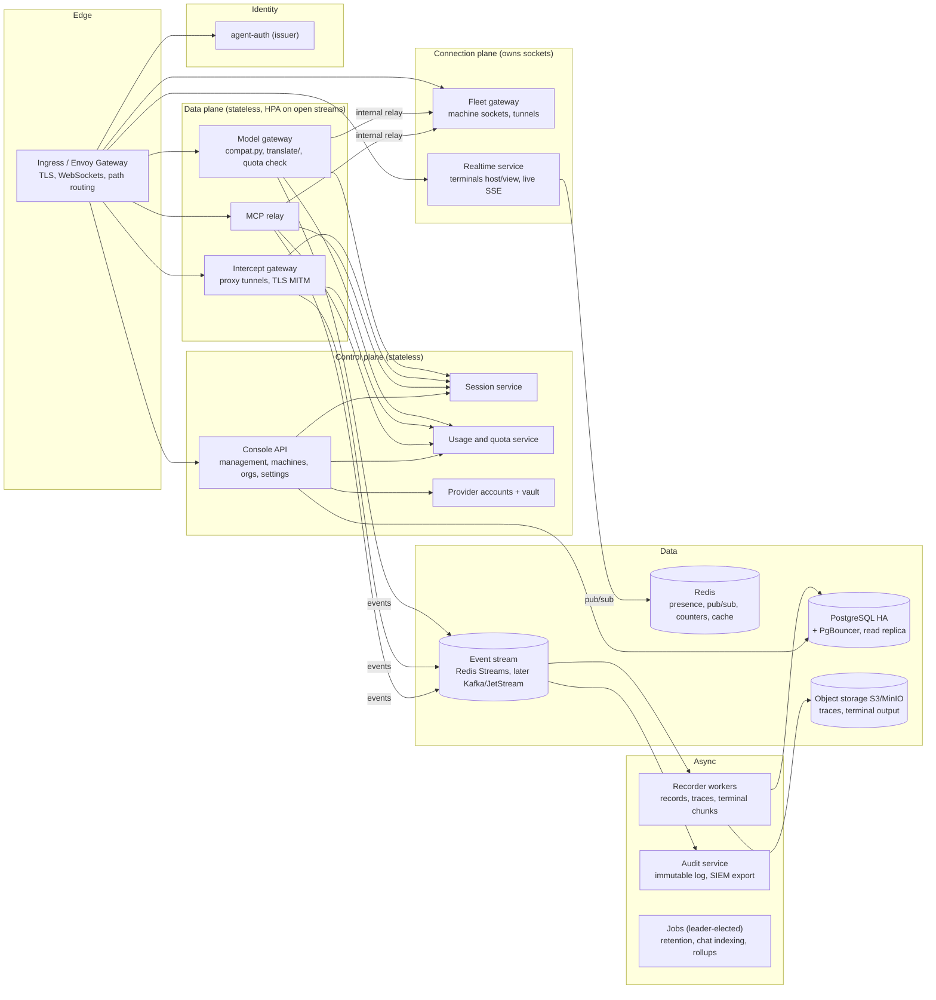
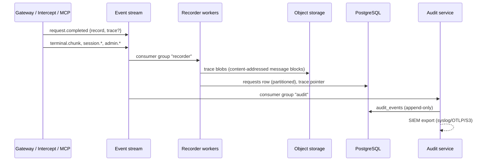

# Proposal: a horizontally scalable server for 1000+ engineers

Status: **implemented** (2026-11-01), apart from what's listed under "Not implemented" below. The decisions on the open questions are recorded in §9; §10–§14 detail them. The user documentation is `docs/scaling.md`, `docs/retention.md` and `docs/audit.md`; the design is in `.context/server.md` ("Several processes") and `.context/auth.md` ("Signed access tokens").

**Implemented as described:** step 1 (the server runs as several processes: sessions, machines, tunnels, terminals, live view, usage limits, grants, settings and jobs shared through Redis and the internal port); step 2 (`AI_PROXY_ROLES`, one image, the route table); blob storage with messages stored once per session; retention policies, capture modes and legal holds; the audit log with hash chains, signed checkpoints, `agent-server audit verify` and exports (OTLP, syslog, webhook, files); JWT access tokens checked locally with published revocations; `/ready`, `/metrics` and JSON logs; the Helm chart (`deploy/helm/agent-mesh/`).

**Changed from the proposal:**
- Recording isn't moved to an event stream. Each process writes its records to PostgreSQL through its own write queue, and traces go to blob storage. This holds at the proposal's load; a stream (Redis Streams, Kafka) stays an option if the database becomes the limit.
- The Session service is a store every process runs (`SessionStore` over PostgreSQL and Redis), not a separate Deployment. Its boundary is the store's interface, so it can be split out later without changing callers.
- Admin changes are audited before they're answered; refusals and looks at recordings are written straight after (not before).
- Signed tokens use the issuer's existing RSA key (RS256), not ES256.

**Not implemented:** chat indexing as a background consumer (it's still built on first view); monthly partitions of `requests`; ClickHouse; a Go data plane; the optional `X-AI-Proxy-Machine` consistent-hash header (tunnel dial-backs to another process are relayed instead).

This proposal splits `agent-server` into services that can each run as several replicas in Kubernetes, and says what has to change first so that more than one replica is even correct. It is based on a review of `server/agent_server/` at 2.1.19 and of `.context/server.md`, `.context/overview.md` and `.context/auth.md`.

## 1. Summary

Today `agent-server` is one process. It works as a well-built monolith, but **a second replica would be incorrect, not just inefficient**. Several things exist in only one process's memory: open sessions, machine sockets, tunnels, terminal hosts, live streams, launch grants and usage-limit counters. If a request lands on a different replica, it gets a 404, a missing tunnel, a terminal viewer with no output, or a usage limit that doesn't hold.

The proposal has three steps, and each one can ship on its own:

1. **Make the monolith replica-safe.** Use the same image and the same code, behind interfaces that have an in-process implementation (for SQLite, dev and the quickstart) and a Redis/PostgreSQL implementation (for Kubernetes).
2. **Split by role.** One image, with the roles chosen by an environment variable (`AI_PROXY_ROLES=all` by default, or `gateway`, `intercept`, `fleet`, `realtime`, `api`, `worker`). A small install runs every role in one pod; a large one runs a Deployment per role, and the ingress routes paths to them so each scales on its own metric (§10).
3. **Extract the services that need their own storage and lifecycle.** These are the **Session service**, the **Recording and audit pipeline** (with object storage), the **Usage and quota service** and the **Config/control plane**.

No change to `agent`, `agent-proxy` or `agent-machine` is required, and `PROTOCOL` doesn't move. One small additive header is suggested later, as an optimisation.

## 2. Load model (assumptions to check)

| Figure | Assumption | Value |
| --- | --- | --- |
| Engineers | given | 1,000 (design for 3,000) |
| Concurrent at peak | 60% working, 2 agents each | ~1,200 active sessions |
| Model calls | one per 5–10 s per active agent | 120–250 req/s; plan for 750 req/s |
| Concurrent streams | 10–60 s each | 2,000–6,000 open upstream streams |
| Account (intercepted) agents | likely the majority in an enterprise (Claude/Copilot subscriptions) | TLS termination and re-origination for most traffic |
| Request size | coding agents resend the whole conversation on every call | 100–500 KB JSON per call |
| Traces, if 30% of calls are traced | 250 req/s × 30% × ~80 KB gzipped | ~0.5 TB/day; PostgreSQL can't hold this |
| Request records | ~5 M/day | ~150 M rows/month |
| Machines | 1 per engineer, plus GPU boxes | 1,000–1,500 fleet WebSockets, plus tunnels |
| Terminals and console | phone and console viewers | a few hundred WebSockets and SSE streams |

The dominant cost is **concurrent long-lived connections and byte pumping** (streams, tunnels, TLS interception), not CPU per request. Autoscaling must use connection counts, not CPU alone.

## 3. What blocks scaling today

These come from the code, and are ordered by severity.

### Correctness blockers: wrong with 2+ replicas

| # | Where | Problem |
| --- | --- | --- |
| B1 | `sessions.py` `SessionStore` | Memory is authoritative for sessions. All sessions are loaded at start (`_load_existing`), and new ones exist only in the creating process. Another replica answers 404 (`resolve_session`). The per-session `asyncio.Lock` in `next_request_id` gives duplicate request ids across replicas, and `_write_session` lets the last writer win on `request_count` and `last_activity_at`. |
| B2 | `fleet.py` `Fleet.sockets`, `_pending`, `_via` | A machine's socket lives in one process. `Fleet.ask`, `launch`, `shell`, `folders` and `update` only work on the replica holding it. `Fleet.machines` (the hello's state, plus `keys` and `mcp_key`, which are memory-only by design) is also per-process. |
| B3 | `tunnels.py` `TunnelHub` | The loopback listener is per process, and `_pending` futures wait for the machine to dial `WS /api/machines/tunnel/<id>` back. Behind a load balancer, the dial-back lands on a random replica, so local-model traffic breaks. |
| B4 | `terminals.py` `TerminalHub` | The launcher's `/host` socket and the console's `/view` sockets must meet in one process. Input and output fan-out are in memory. |
| B5 | `live.py` `LiveHub` | SSE subscribers only see requests running on their own replica. |
| B6 | `usage_limits.py` `UsageLimits` | Buckets are loaded once per (tenant, user, provider), then only incremented locally. With N replicas a person can use up to N× their limit. This is an enforcement gap, so it is a compliance problem. |
| B7 | `provider_accounts.py` `grants`, cooldowns | Launch grants are memory-only. `deliver` (the one-time Copilot token) and `for_session` fail if they reach a different replica than the launch. 429 cooldowns aren't shared, so the scheduler keeps sending people to an exhausted account. |
| B8 | `runtime.py` `prune_daily`, `app.ensure_first_user` | Every replica prunes every hour. That is idempotent but wasteful, and `prune` scans the in-memory session list. `ensure_first_user` can race on first start. |
| B9 | `config.py` `Settings` | `update_network_config`, `update_models` and `set_retention` change the in-memory `Settings` of the replica that served the request. The others stay stale until restart. Agents are re-read per call, which is fine. |
| B10 | `app.Supervisor`, `Runtime.request_restart` | "Restart" is in-process. In Kubernetes that must become a rollout. |
| B11 | `access_log.py`, `Runtime.active`/`recent`/`tokens` | Stats, recent activity and "requests in flight" are per replica. The console would show one replica's view. |
| B12 | `issuer.py` `Issuer.attempts` | Sign-in rate limits are per issuer replica, so N replicas allow N× the attempts. |

### Capacity problems: wrong even on one node at this scale

| # | Where | Problem |
| --- | --- | --- |
| C1 | `SessionStore` | Sessions are never deleted; retention deletes only traces, chat indexes and terminal output. Every session ever is held in memory and loaded at each start: about 10k/day, or about 3.6M/year. Memory and start time grow without bound. `list()` sorts all of them for every console page. |
| C2 | `auth.Auth.identify` | Each new request makes one synchronous introspection HTTP call to the issuer, run through `asyncio.to_thread`. Issuer load equals API load, and the default thread pool (min(32, cores+4)) is shared with every other `to_thread` DB read. This is likely the first bottleneck under load. |
| C3 | `db/__init__.py` | `pool_size=5` per process. There is one `Writer` thread per process doing gzip and inserts under the GIL. |
| C4 | `traces`, `terminal_chunks` | Gzipped blobs are stored in PostgreSQL. At the volumes in §2, this makes PostgreSQL the storage system for terabytes of mostly repeated prompt text, and it also bloats backups, replication and vacuum. |
| C5 | `requests` | One unpartitioned table of ~150M rows/month. The console's Traffic, Requests and Providers aggregations get slower over time. |
| C6 | `intercept.py` | TLS MITM in Python asyncio for most traffic. It is CPU-bound per byte. It works if scaled out, but it is the most CPU-hungry part and must scale apart from the rest. |
| C7 | `logs/proxy/proxy.log` | File logging. Kubernetes wants stdout and structured JSON. |
| C8 | `chat.py` | Chat indexes are built on first view, on a request thread, from all traces. This is heavy CPU on the API path. |

## 4. Target architecture



Every box is a role of one image to begin with (§6, step 2). A box becomes its own codebase only when it needs its own storage or language (§6, step 3).

### 4.1 Session service (new)

This service owns the session lifecycle. It replaces `SessionStore` as the authority. It sits on the hot path, so it is designed so that a model call costs at most one Redis round trip, not one service hop.

- **Owns:** the `sessions` table; create, end, tags, sharing (`access.client_tags`/`sharing_tags`), `launched_by`, the MCP token hash, `request_sequence`, totals, and session retention (including deleting old sessions, which is missing today: C1).
- **Hot read path:** a session document in Redis (`session:<id>`, with a `version`), written through by the service. Gateways resolve sessions from Redis with a small per-pod LRU (≈1–2 s), invalidated by a `session.changed` pub/sub message. When a session's sharing narrows, the message is also what drops terminal viewers on every replica (today `TerminalHub.drop_viewers` is local).
- **Request ids:** `INCR session:<id>:seq` replaces the in-memory lock, so ids are unique across replicas. Counters (`request_count`, tokens, `last_activity_at`) are Redis hashes, flushed to PostgreSQL by the service every few seconds and on `end`. There is no more last-writer-wins on the whole document.
- **API (internal):** `POST /sessions` (from the console API and the launcher route), `GET /sessions/{id}`, `PATCH .../sharing`, `POST .../end`, `GET /sessions?owner=&tenant=&before=` (paged in SQL, not sorted in memory). Authorization stays in `access.py`, which becomes a shared library both sides import.
- **Memory:** only open sessions are hot. Ended ones are read from PostgreSQL on demand, which fixes C1.
- **Invariants kept:** clients can't set `SERVER_TAGS`, shell sessions are forced private, a session you can't see is a 404, and tenant before sharing.

### 4.2 Model gateway: the data plane

This is `routes/compat.py`, `translate/`, `strata.py` and `model_runner.py`, unchanged in behaviour.

- **Stateless.** For each request it: resolves the session (4.1), checks the quota (4.4), opens the upstream, streams, and emits a `request.completed` event (4.6) instead of calling `db.writer` directly.
- **Upstream to machines:** it doesn't open loopback tunnel listeners itself. It sends to the Fleet gateway's internal endpoint for that machine (4.3).
- **Live text:** it publishes deltas to `live:<tenant>:<session>` only while someone is subscribed (Redis keeps an interest count), so token deltas cost nothing when nobody is watching.
- **Scaling:** HPA on open upstream streams per pod (exported as a Prometheus gauge, through a custom-metrics adapter). Target about 500 streams per pod and run several uvicorn workers per pod (`--workers`), since nothing here is in process memory any more.

### 4.3 Fleet gateway: machine sockets and tunnels

This is the one genuinely stateful role. Each machine's socket lives in exactly one pod, so the problem is routing to that pod.

- **Owner registry:** when a pod accepts `WS /api/machines/connect`, it writes `machine:<id>:owner = <pod-id>` (with a TTL, renewed by pings) and keeps the hello state in `machine:<id>:state`. `Fleet.machines` becomes a read of that. `keys` and `mcp_key` stay in the owning pod's memory only, which keeps today's guarantee that they are never stored.
- **Asks:** `Fleet.ask/launch/shell/folders/update` from any pod become an internal RPC to the owner pod, `POST http://<pod-ip>:9100/internal/machines/<id>/ask`. This uses mTLS or a shared internal token, is reachable only inside the namespace (NetworkPolicy), and returns the same 409/502/504 semantics. Results arrive on the socket at the owner pod, which answers the RPC.
- **Tunnels without a client change:** the server chooses the tunnel id, so it is minted as `<pod-ordinal>.<random>`. When the machine dials back `WS /api/machines/tunnel/<id>`:
  - if the dial lands on the owner pod, it is paired locally, as today;
  - if not, the receiving pod pipes the WebSocket to the owner pod over the internal network. This costs one extra in-cluster hop and needs no protocol change.

  The owner pod exposes `http://<pod>:9100/m/<machine>/<port>/...` to gateways in place of today's loopback listener, so `tunnels.base_url(backend)` returns that.
- **Optional later optimisation (additive, no `PROTOCOL` bump):** `agent-machine` sends `X-AI-Proxy-Machine: <id>` on connect and on tunnel dials, and the ingress consistent-hashes on it. Dial-backs then almost always land on the owner, which removes the extra hop. Older machines still work through the relay. If adopted, this change goes into Go and `python/` together, with `test_client.py`.
- **Reconnects:** Kubernetes rolling updates drop sockets. The existing `RECONNECT_WINDOW`/`wait_socket` logic already covers a machine coming back; the registry makes "coming back to a different pod" just work.
- **Scaling:** HPA on sockets per pod, about 1,000 fleet sockets per pod, plus tunnels. Use `terminationGracePeriodSeconds` of about 120 s, and have pods drain by closing sockets with a retryable code so machines reconnect elsewhere.

### 4.4 Usage and quota service

This is `usage_limits.py`, plus the quota half of `provider_accounts.py`.

- **Enforcement counters in Redis:** keys are `usage:<tenant>:<user>:<provider>:<hour>`, updated with `INCRBY`. Windows are a sum of hour keys, cached per pod for a second or two. This fixes B6. The documented rule that usage is checked before any byte goes upstream stays the same. The check happens at request start, so a burst of in-flight calls can overshoot by those calls only. That is the same as today, and it should be documented.
- **Durable totals:** a worker folds Redis hours into `provider_usage` in PostgreSQL. Reports read PostgreSQL.
- **Provider account cooldowns and exhaustion** move to Redis (`acct:<id>:cooldown_until`), so every gateway and the scheduler (`plan`) see a 429 at once.
- **Launch grants:** `grant:<launch-id>` in Redis with a TTL, set to `GETDEL` on `deliver`, which keeps the one-time semantics across replicas (B7).
- **Refusals** are still never counted as usage or passed to `provider_accounts.observe`.

### 4.5 Realtime service: terminals and live streams

- **Terminals:** the launcher's `/host` socket is owned by one pod, registered as `terminal:<id>:owner`. Output goes to a Redis Stream `term:<id>`, capped at about 4 MiB (today's in-memory tail). Viewers on any pod read the stream from their `?from=` offset, which keeps `TerminalHub.subscribe(..., since)` resume semantics. Durable chunks still go to storage through the recorder (4.6).
- **Input:** a viewer's input goes to the owner pod with `PUBLISH term:<id>:input`. Every message is still checked with `can_control` on the viewer's pod.
- **Live SSE (`/api/live`):** subscribes to the tenant's channels and still filters each event with `can_view`. Narrowed sharing applies at once, through the `session.changed` message.
- **Restart:** `_restart_when_idle`'s list of long-lived connections becomes each role's shutdown hook (SIGTERM → stop accepting → close with retryable codes → exit).

### 4.6 Recording pipeline and audit service

This takes recording off the request path and out of PostgreSQL's blob storage.



- **Events, not direct writes:** `Runtime.complete` publishes `request.completed`, and `db.Writer` remains only in single-node mode. A Redis Stream with consumer groups is enough at the volumes in §2. It sits behind an `EventBus` interface, so it can move to Kafka or NATS JetStream when volume or retention needs it.
- **Traces in object storage:** S3, or MinIO on-prem. Coding agents resend the whole conversation on every call, so traces are stored as **content-addressed message blocks** (the hash of each message, stored once per session) plus a small manifest per call. That should cut stored bytes by an order of magnitude, and `chat.py` already reasons in message prefixes. Terminal chunks go to object storage too. Retention becomes an object lifecycle rule plus a row delete.
- **`requests` partitioned by month.** This is a PostgreSQL-only migration step in `db/migrate.py`; SQLite keeps the plain table. Console aggregations go to a read replica. If Traffic and Providers analytics outgrow PostgreSQL, add ClickHouse fed from the same stream. That is optional, and only once measured.
- **Audit service (new):** detailed in §14. In short, an append-only `audit_events` table with a separate role that can only INSERT and SELECT, plus export to the enterprise SIEM. It records admin and security events: sign-ins, role and org changes, settings and agent edits, machine grants, launches and shells, container changes, provider-account grants and token deliveries, usage-limit changes, sharing changes, and refusals (403, 407, 429). Today these are spread over `provider_account_events`, `access_log` and the log file. The access log's failures and fleet connections feed it too. Records reference secrets but never contain them; the existing redaction (`redact_headers`, `redact_fields`) runs before publishing.
- **Chat indexing** (`chat.py`) moves to a worker that consumes `request.completed`, so `/api/sessions/{id}/chat` reads a ready index instead of building one on a request thread (C8).

### 4.7 Console API and control plane

These are `routes/management.py`, `routes/machines.py`, `routes/containers.py`, `routes/auth.py` (orgs and users), `routes/providers.py`, `routes/provider_accounts.py`, `config.py` and `config_io.py`.

- **Stateless.** Reads go to the read replica where staleness is acceptable (traffic, requests, stats). Machine operations go to the Fleet gateway (4.3) and sessions to the Session service (4.1).
- **Config changes publish `config.changed {version}`.** Every pod reloads `Settings` from the database. "Restart the server" becomes: settings that need a restart (the listen address, TLS) are a Helm/rollout concern, and everything else applies live. B9 and B10 go away. `config_lock` becomes a PostgreSQL advisory lock.
- **UserStore** keeps its whole-directory cache, but checks `accounts_version` on `accounts.changed` pub/sub instead of reading meta on each call.

### 4.8 Identity (`agent-auth`)

`agent-auth` is already separate. It needs these changes:

- **Several replicas:** the rate counters (`Issuer.attempts`) move to Redis (B12). The state is already in `mesh_auth`.
- **API-side validation (C2):** decided: signed JWT access tokens, validated locally. §13 has the checks. This is a security change and needs its own review against `.context/auth.md` when implemented.

### 4.9 Jobs (leader-elected)

Retention (`Runtime.prune`), usage rollups, provider-account pruning, access-log pruning, chat re-indexing on an `INDEX_VERSION` bump, and `ensure_first_user` run in a `worker` role under a Kubernetes Lease, or a PostgreSQL advisory lock, which already exists for migrations. Migrations run as a pre-upgrade Helm Job, not on every pod start (B8).

### 4.10 Things that stay as they are

- Static console: `ui/Dockerfile` with nginx, or a CDN. This already exists (`AI_PROXY_SERVE_UI=0`).
- Downloads and installers: `dist/` in object storage or a CDN, with `downloads.py` redirecting to signed URLs, keeping the SHA256SUMS check.
- **Single-node mode:** `agent-server` with SQLite and no Redis stays supported for dev, the quickstart and small installs (§10). Every new dependency is behind an interface with an in-process implementation. Tests keep running on both, as they do today for SQLite and PostgreSQL.

## 5. Ingress routing

| Path | Role | Notes |
| --- | --- | --- |
| `/session/*/v1/*`, `/session/*/anthropic/*`, `/session/*/api/*`, `/v1/*`, `/anthropic/*` | gateway | Long streams: read timeout ≥ 10 min, buffering off |
| `/session/*/mcp/*` | gateway (MCP relay) | Its GET streams have no read timeout |
| `/api/proxy/tunnel` | intercept | WebSocket; the most CPU-heavy role |
| `/api/machines/connect`, `/api/machines/tunnel/*` | fleet | WebSocket; optional hash on `X-AI-Proxy-Machine` |
| `/api/terminals/*`, `/api/live` | realtime | WebSocket and SSE |
| `/api/*` (everything else), `/openapi.json`, `/docs`, `/downloads/*`, `/install.*` | api | |
| `auth.<domain>` | agent-auth | |
| `/` | console (nginx) | |

The `/api/{path}` catch-all in compat (agents' bare native Ollama calls) stays in the gateway. The ingress lists the console routes explicitly, so the router-order rule is still enforced in one place.

## 6. Delivery plan

### Step 0: measure first (1–2 weeks)

- Add a `/metrics` endpoint (Prometheus) with: open streams, introspection latency, the thread pool queue, Writer queue depth, fleet sockets, tunnels, SSE subscribers, and DB pool waits. Add OpenTelemetry traces across gateway → fleet → machine, and JSON logs to stdout (C7).
- Build a load harness from the existing fakes (`fake_ollama.py`, `fake_strata.py`, `scripts/screenshots/demo.py`'s `FakeLauncher`/`FakeProviders`) plus simulated agent-proxies and machines, to find today's ceiling on one node and confirm the §2 assumptions.

### Step 1: replica-safe monolith (the largest step)

- Add the interfaces with local and Redis implementations: `Presence` (machine, terminal and tunnel owners), `Bus` (pub/sub and streams), `Counters`, `Locks`.
- Make sessions Redis/PostgreSQL-backed, with request ids from `INCR` and session deletion in retention (B1, C1).
- Add the fleet owner registry, the internal ask RPC and tunnel dial-back relay (B2, B3); terminals and live over pub/sub and streams (B4, B5); usage counters, grants and cooldowns in Redis (B6, B7).
- Add the `config.changed` reload, the `worker` role with leader election, migrations as a Job (B8, B9); graceful SIGTERM in place of Supervisor restarts in Kubernetes (B10); cluster-wide stats (B11); issuer rate limits in Redis (B12).
- Add an introspection cache or JWT validation (C2), and raise the DB pool with PgBouncer in front (C3).
- Ship the Helm chart (§11), first with `mode: single`, then `mode: scaled`.

**Exit criteria:** 3 replicas behind a plain round-robin load balancer pass the server, `test_client.py` and `python/tests` suites with requests deliberately spread across replicas. A pod killed mid-stream fails only its own streams, and its machines and terminals reconnect.

### Step 2: split by role

- Add `AI_PROXY_ROLES` (§10): each role registers only its routers and starts only its stores. Use one image, several Deployments and the routing table in §5.
- Each role scales on its own: the gateway and intercept on open streams, fleet on sockets, realtime on viewers, api on CPU and latency.

### Step 3: extract services with their own storage

- Move the recording pipeline to object storage, with content-addressed traces and monthly partitions (C4, C5); chat indexing as a consumer (C8); the audit service and SIEM export.
- Move the Session service, then Usage/quota, to their own Deployments with internal APIs, once their interfaces from step 1 have settled.

### Step 4: only if measurements demand it

- Rewrite the byte-pumping roles (intercept TLS, the tunnel relay) in Go, which already has the WebSocket and TLS code in `client/` and `machine/`. Python keeps all the logic, as `.context/overview.md` requires: the Go part would be a dumb pipe that asks the Python services for decisions.
- Add ClickHouse for analytics, and multi-region (an issuer per region, sessions pinned to a home region).

## 7. Kubernetes sizing sketch (to validate in step 0)

| Role | Replicas (min–max) | Scale on | Notes |
| --- | --- | --- | --- |
| gateway | 3–20 | open streams (~500 per pod) | 2–4 uvicorn workers per pod |
| intercept | 3–30 | CPU and open tunnels | the biggest CPU user |
| fleet | 3–8 | sockets (~1,000 per pod) | spread across zones; long grace period |
| realtime | 2–6 | open viewers and SSE | |
| api | 2–6 | CPU and p95 latency | |
| worker | 2 (1 active) | Lease | recorder consumers scale separately, on consumer lag |
| agent-auth | 2–4 | CPU | |
| PostgreSQL | primary + 1–2 replicas | | CloudNativePG or managed; PgBouncer in transaction mode |
| Redis | 3 (Sentinel) or managed | | Persistence off except for streams (AOF), sized for ~4 MiB × open terminals |
| Object storage | managed S3 or MinIO | | lifecycle rules = retention |

## 8. Invariants that must survive the split

From `AGENTS.md` and `.context/`. Each needs a test in the replica-spread suite.

- Tenants first: `same_tenant` before roles, sharing and grants, on every role. An internal RPC carries the caller's `Identity`, and the receiver checks again; being inside the cluster never grants anything.
- Every endpoint that touches a session checks `can_view`/`can_control`, and streams check per event.
- Usage limits are checked before any byte goes upstream, and refusals are never counted.
- The server never manages a model server: the fleet gateway relays only, and the machine still does the work.
- `Machine.keys`, `mcp_key`, vault keys and Copilot tokens never reach Redis, the event stream or object storage. Redis holds only references, counters and session documents without secrets. The MCP token hash stays a hash.
- Terminals and launches stay double-gated (server and machine), and shell sessions stay private.
- The internal port (9100) is never exposed through the ingress; NetworkPolicy enforces this.

## 9. Decisions

| Question | Decision | Detail |
| --- | --- | --- |
| Hosting target | Both managed cloud and on-prem, chosen by Helm values | §11 |
| Trace retention and residency | Configurable: a server default, organization overrides within limits the site admin sets, a capture policy, a storage location per organization, and legal holds | §12 |
| Token format | Signed JWT access tokens, accepted locally once the signature is valid **and** the standard claim, revocation and account-version checks pass | §13 |
| Single-node mode | Supported for small installs: one pod running every role, chosen by environment variables, with the same image | §10 |
| Audit | Designed for SOC 2 and ISO 27001 logging controls: an append-only, tamper-evident log, exported through standard formats | §14 |

## 10. Deployment modes and roles

One image and one `agent-server` command. What a process does is chosen by environment variables, so the same build serves a laptop, one pod, or a fleet of Deployments.

| Variable | Values | Default | Meaning |
| --- | --- | --- | --- |
| `AI_PROXY_ROLES` | `all`, or a comma list of `api`, `gateway`, `intercept`, `mcp`, `fleet`, `realtime`, `worker`, `recorder`, `audit` | `all` | Which routers and background tasks this process runs. `all` is today's server. |
| `AI_PROXY_REDIS_URL` | `redis://…`, `rediss://…` (Redis or Valkey), unset | unset | Unset means in-process presence, pub/sub, counters and locks: single-node only. |
| `AI_PROXY_EVENT_BUS` | `memory`, `redis`, later `kafka://…` or `nats://…` | `memory`, or `redis` when a Redis URL is set | Where recording and audit events go. `memory` writes through `db.Writer`, as today. |
| `AI_PROXY_BLOB_URL` | `database`, `file:///path`, `s3://bucket/prefix` (any S3-compatible endpoint, with `AI_PROXY_BLOB_ENDPOINT`) | `database` | Where traces and terminal output live. |
| `AI_PROXY_POD_ID` | a string (Helm sets it from the pod name) | hostname | Names this process in the owner registry and tunnel ids. |
| `AI_PROXY_INTERNAL_PORT` / `AI_PROXY_INTERNAL_TOKEN` | port / secret | 9100 / unset | The pod-to-pod port for fleet asks, tunnel relays and terminal input. It is off in single-node mode. |
| `AI_PROXY_WORKERS` | integer | 1 | uvicorn workers. More than 1 requires a Redis URL, since workers are separate processes. |

**Single-node mode** (no Redis URL) is today's server with every role in one process. It is supported for small teams, dev and the quickstart. It works on SQLite or PostgreSQL. To keep it from being run wrongly:

- On PostgreSQL, a process without Redis takes a lease (an advisory lock held for its lifetime). A second one refuses to start and says that scaling out needs `AI_PROXY_REDIS_URL`. On SQLite the file is local anyway.
- `AI_PROXY_WORKERS>1` and any `AI_PROXY_ROLES` other than `all` are refused without Redis.
- In Helm, `mode: single` deploys one replica with the `Recreate` strategy, so two never overlap during an upgrade.

**A middle size** is one pod per role group, for example `api,realtime,worker` and `gateway,intercept,mcp,fleet`, with Redis. It needs no more than two Deployments, for teams that need high availability but not per-role scaling.

**Scaled mode** is a Deployment per role (§7).

Inside the code, each role is a `register(app, runtime)` set plus a list of background tasks. `create_app` reads `AI_PROXY_ROLES` and registers only those, keeping today's router order. A route a role doesn't serve isn't registered, so a mis-routed request gets a plain 404 rather than half-working.

## 11. Helm chart

The chart lives at `deploy/helm/agent-mesh/`. It belongs in `.context/build-and-deploy.md` and `docs/` when built. Compose (`compose.yaml`, `quickstart/`) stays for non-Kubernetes installs.

```yaml
mode: single            # single | scaled
image: {repository: ghcr.io/<owner>/agent-server, tag: ""}   # tag defaults to the chart's appVersion

roles:                  # used when mode: scaled
  gateway:   {replicas: 3, autoscaling: {max: 20, metric: open_streams, target: 500}}
  intercept: {replicas: 3, autoscaling: {max: 30, metric: cpu, target: 70}}
  fleet:     {replicas: 3, autoscaling: {max: 8, metric: fleet_sockets, target: 1000}, terminationGracePeriodSeconds: 120}
  realtime:  {replicas: 2}
  api:       {replicas: 2}
  worker:    {replicas: 2}      # one active, by Lease
  recorder:  {replicas: 2, autoscaling: {metric: stream_lag}}
  audit:     {replicas: 2}

postgresql:
  external: {existingSecret: "", urlKey: url}     # managed (RDS, Cloud SQL, Azure Flexible Server)
  cloudnativepg: {enabled: false, instances: 3}   # on-prem: the CloudNativePG operator's Cluster
  pgbouncer: {enabled: true}
redis:
  external: {existingSecret: ""}                  # ElastiCache, Memorystore, Azure Cache
  bundled: {enabled: false}                       # on-prem: Valkey with Sentinel (BSD-licensed, Redis-compatible)
objectStorage:
  url: ""                                         # s3://bucket/prefix
  endpoint: ""                                    # set for on-prem S3-compatible stores
  existingSecret: ""                              # or IRSA / Workload Identity annotations below
  serviceAccountAnnotations: {}

auth: {issuer: {enabled: true, replicas: 2}, host: auth.example.com}
console: {enabled: true}                          # the standalone console image (ui/Dockerfile)
routing:
  gatewayAPI: {enabled: true, gatewayRef: {}}     # HTTPRoutes (preferred)
  ingress: {enabled: false, className: ""}        # Ingress fallback
secrets:
  externalSecrets: {enabled: false, store: ""}    # vault keys, DB and Redis passwords, internal token
monitoring: {serviceMonitor: true, prometheusRule: true}
networkPolicy: {enabled: true}
retention: {}                                     # seeds §12's server defaults on first install only
```

- **Both hosting targets come from values, not forks.** Managed cloud means `external` blocks plus workload-identity annotations. On-prem means the operator blocks (CloudNativePG, Valkey) and any S3-compatible store (Ceph RGW, SeaweedFS, MinIO and the like) through `endpoint`. The chart never requires a cloud API.
- **Routing:** Gateway API `HTTPRoute`s by default, with Ingress as a fallback. Both carry §5's path table and WebSocket/streaming timeouts. In `mode: single` every path goes to the one Service.
- **Migrations:** a `pre-install`/`pre-upgrade` hook Job runs `agent-server db migrate`. Pods no longer migrate at start in scaled mode; they wait for `schema_version` to match.
- **Every role gets:**
  - probes: `/health` for liveness, and a new `/ready` that checks the database, Redis and, for fleet, that the internal port is up;
  - a `PodDisruptionBudget`, `topologySpreadConstraints` across zones, and `preStop` drains with retryable close codes;
  - a NetworkPolicy that only same-release pods may reach on the internal port.
- **Secrets:** `AI_PROXY_VAULT_KEYS`, the issuer's introspection and signing material, the internal token and database passwords come from Kubernetes Secrets, or External Secrets when enabled. None are in values.
- **Tests:** `helm lint` and `helm template` for both modes, run with `kubeconform` in CI. A `kind` job installs `mode: single` and `mode: scaled` (with bundled Valkey and CloudNativePG) and runs the replica-spread suite from step 1.

## 12. Retention and capture policy

This replaces the single `retention_days` setting with a policy at two levels. Org admins can tighten or loosen within limits the site admin sets.

| Setting | Server default (site admins) | Organization override (org admins) |
| --- | --- | --- |
| `capture.traces` | `opt_in` (today: `--trace` per session) | `off`, `opt_in`, `always`, within the server's allowed set |
| `capture.intercept_bodies` | `on` | `off`, `on` |
| `capture.terminal_output` | `on` | `off`, `on` |
| `retention.traces_days` | 30 | 1 to `max.traces_days` |
| `retention.terminal_days` | 30 | 1 to `max.terminal_days` |
| `retention.chat_index_days` | follows traces | follows traces |
| `retention.request_records_days` | none (kept, as today) | at least `min.request_records_days` |
| `retention.sessions_days` | 400 | at least the longest data retention |
| `retention.audit_days` | 365 | at least `min.audit_days` (default 90), never shorter than the server floor |
| `storage.location` | the default bucket and prefix | another configured bucket, region or encryption key: data residency |
| `max.*` / `min.*` | the limits on overrides | — |

- **Where it lives:** `settings["retention"]` holds the server policy, replacing `retention_days`; a migration carries the old value into `traces_days`, `terminal_days` and `chat_index_days`. A new `retention_policies` table holds organization overrides. Both go into `config_io` so `config export|import` carry them. The console's Server settings → Storage gets the server policy, and the Organization page gets a Data tab. New API routes go in `docs/api.md`, are `SITE_ADMIN_ONLY` for the server policy and `ADMIN_ONLY` plus `administers` for an organization's.
- **The effective policy is stamped on the session at creation** (`tags["retention"]`, a server tag), so a later change doesn't silently extend or shorten what people were told when they started. The worker computes the effective policy per session when deciding.
- **Capture off means not written:** gateways check the capture policy before publishing bodies, so nothing is stored to delete later.
- **Legal hold:** site admins (and org admins for their organization) can put a hold on an organization, a person or a session. Held data is skipped by every prune and recorded in the audit log.
- **Deletion:** the leader-elected worker deletes by policy. Object keys are `tenant/<org>/<yyyy>/<mm>/<session>/…`, so a bucket lifecycle rule at the server's `max` acts as a backstop if the worker falls behind. Removing an organization deletes its prefix. With a per-organization KMS key (`storage.location`), destroying the key renders anything missed unreadable (crypto-shredding).
- **Single-node mode** applies the same policy with `AI_PROXY_BLOB_URL=database` or `file://`.

## 13. Token validation (JWT)

The issuer issues signed access tokens in the RFC 9068 profile (`typ: at+jwt`), using the signing key it already has (ES256, published at its JWKS). The API accepts a token without calling the issuer **only when every one of these local checks passes**. A valid signature alone isn't enough: a valid signature on an expired, revoked or wrong-audience token must still be refused.

1. **Signature**, against the JWKS. The `kid` must be known; an unknown `kid` refreshes the JWKS once (rate-limited), then refuses. Only ES256 is allowed: never `none` or HS*, and the algorithm is never taken from the token.
2. **Claims:** `iss` equals `oidc_issuer`; `aud` contains `oidc_audience`; `exp` and `nbf` hold within 30 s of skew; `typ` is `at+jwt`. Access tokens live 5 minutes; refresh tokens stay opaque, rotating and issuer-only.
3. **Revocation:** sign-out, revocation, account disable and role change publish `auth.revoked` with either a `jti` or `{user, not_before}`. Every pod keeps this set (Redis, mirrored in memory, pruned after 5 minutes when the tokens it names expire). This is what keeps sign-out instant.
4. **Account binding:** the token carries `acct_ver` (today's `UserStore.account_version`, the digest of `created_at` and the password hash). It must match the account's current one, so a password change ends every token at once.
5. **Permissions read fresh** from `UserStore` on every request, as today (`identity_for`). The token says who, never what they may do.

Then:

- **Service clients and the transition:** the issuer can still issue opaque tokens to clients that ask for them, and the API introspects those, using a shared Redis cache of a few seconds. Clients of `PROTOCOL` 2 send whatever they were given, so `agent` and `agent-machine` need no change.
- **WebSocket rechecks** (`recheck`, `renew_socket`) become local checks. The 4410 and renew-in-place behaviour is unchanged.
- **Failure modes:** if the JWKS can't be fetched, a cached JWKS is used for its lifetime, then requests are refused (503), as today when the issuer is down. Revocation-set staleness is bounded: if Redis is unreachable for more than 30 s, the gateway refuses new sessions and requests (fail closed) rather than accept possibly revoked tokens.
- **Tests:** a forged signature, a wrong algorithm, a wrong `aud`/`iss`, an expired token, an unknown `kid`, a revoked `jti`, a user-wide revocation, a password change and a role change. Each runs against the real issuer in `test_oidc_api.py` and across replicas in the step-1 suite.

## 14. Audit (designed for SOC 2 and ISO 27001)

The design targets the logging controls auditors check: SOC 2 CC6/CC7 (logical access, monitoring) and ISO 27001:2022 Annex A 8.15 (logging) and 8.16 (monitoring). These are the defaults; each choice can be revisited if a specific auditor asks for more.

**What is recorded** (actions and decisions only, never prompt or response content and never secrets):

| Category | Events |
| --- | --- |
| Authentication | sign-in success and failure, device approval, token refresh refused, sign-out, revocation, rate-limit blocks |
| Accounts | user, organization and team create/change/delete, role changes, password changes (that it happened, never the value) |
| Configuration | settings, agents, model tuning, backends, retention policy and legal holds; each with a before/after diff of non-secret fields |
| Machines | connect and disconnect, removal and restore, access grants, toggles reported (launches, commands, servers, updates), remote updates |
| Execution | launches, shells, terminal control taken by a viewer, container create/edit/delete/start/stop |
| Subscriptions | provider-account create/assign/revoke, launch grants, token deliveries |
| Usage | limit changes, `usage_limit` refusals |
| Sharing | session sharing changes |
| Security refusals | 401/403 on admin routes, 407/403 on interception, tenant-crossing attempts answered 404 |
| Data | trace and terminal views by someone other than the owner, exports, prunes and their counts |

**Event shape:** a CloudEvents envelope with an OCSF-aligned body, so SIEMs map it without custom parsers:

```json
{"specversion": "1.0", "id": "<uuid>", "source": "agent-server/<pod>", "type": "mesh.audit.config.changed",
 "time": "2026-11-01T12:00:00.000Z",
 "data": {"tenant": "pockets", "actor": {"user": "joey", "via": "cookie", "ip": "…", "user_agent": "…"},
          "action": "update", "target": {"kind": "agent", "id": "claude"}, "outcome": "success",
          "reason": null, "request_id": "…", "session_id": null, "machine_id": null,
          "changes": {"args": ["…", "…"]}},
 "chain": {"seq": 1042, "prev": "<sha256>", "hash": "<sha256>"}}
```

**Integrity:**

- `audit_events` is written only by the audit role. Its database role has INSERT and SELECT only; a separate retention role may delete only rows past the policy and outside legal holds. The API role can't touch it.
- Each tenant's events form a hash chain (`seq`, `prev`, `hash`). Every hour the worker signs a checkpoint (the chain heads) with a dedicated audit key and writes it to object storage. With S3 Object Lock (compliance mode) where available, the checkpoints are WORM. A verification command (`agent-server audit verify [--org]`) recomputes the chains against the checkpoints.
- Delivery is at-least-once from the event stream, deduplicated by `id`. Producers fail open for user traffic (an audit outage doesn't stop agents), but the backlog is alerted on (`PrometheusRule`), and refusals and admin changes are written before they answer, so those are never lost.

**Export and access:**

- Exports: OTLP logs (so an OpenTelemetry Collector forwards to Splunk, Elastic, Sentinel, Datadog and the like), syslog RFC 5424 over TLS, signed webhooks, and NDJSON to object storage. Each is configured by site admins and can be filtered by organization.
- A console **Audit log** page: site admins see everything, org admins their own organization. It offers filters, CSV and NDJSON export, and the chain's verification state.
- Retention follows §12's `audit_days`, with a floor that organizations can't go below.
- The existing `provider_account_events` and the saved part of `access_log` become producers of this stream; their tables remain for their current views until the audit page replaces them.
